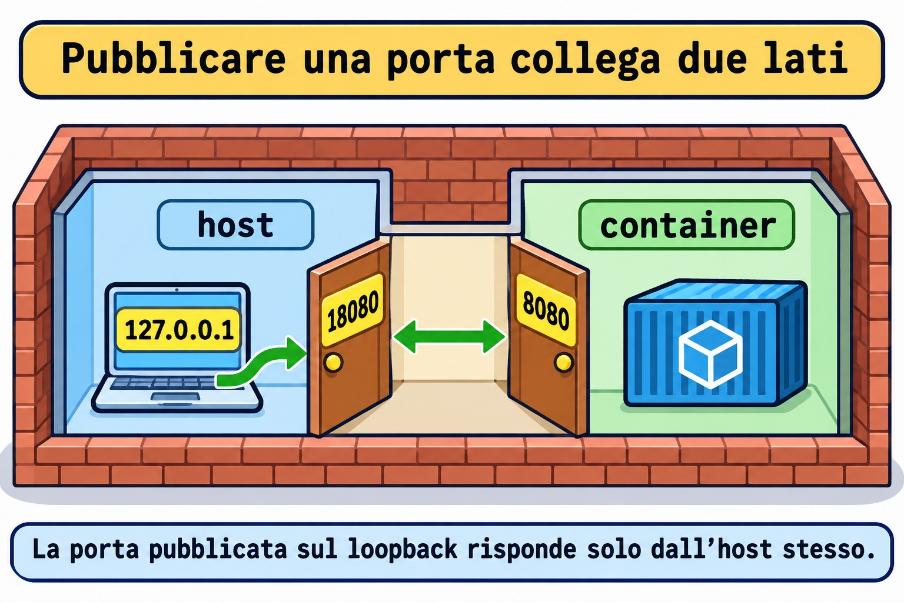
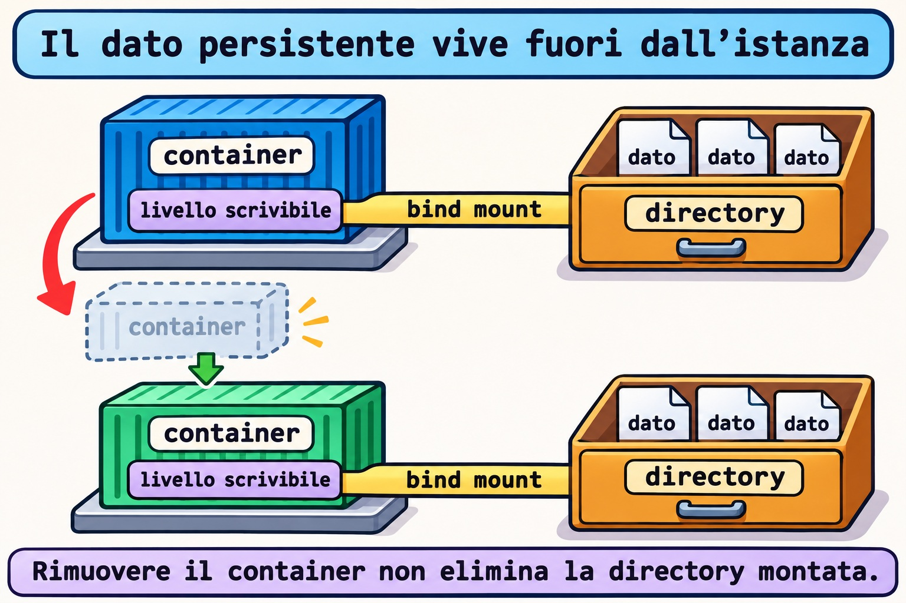
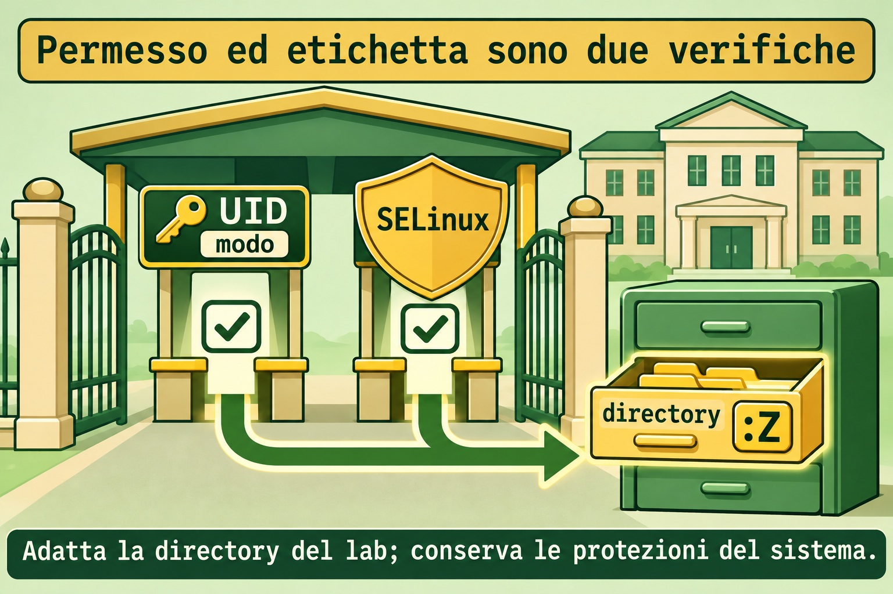

# Lezione 18.2 · Eseguire e conservare i dati

> **Il cuore di questa lezione:** segui processo, porta e dato come tre verifiche diverse.

| Scheda | Piano di lavoro |
| --- | --- |
| Modulo | M18 · Podman, lezione 2 di 5 |
| Quando | Settimana 24 |
| Alla fine | Eseguire nginx rootless e dimostrare la persistenza fuori dall’istanza |
| Prerequisiti | 18.1 completata con lo stesso utente; curl e console della VM |
| Durata | 80–100 minuti |
| Snapshot | m18a2-inicio e m18a2-fim nelle VM usate |

Usa la VM 201 come banco principale e ripeti il confronto sulla 202. Il nome del container è locale a ogni utente in ogni VM.

Tutto ciò che usa Podman viene eseguito come `student` dentro la VM. L’applicazione resta accessibile soltanto dal loopback di quella VM, senza pubblicazione sulla LAN.

## 1 · Riscaldamento

1. Il pull della lezione precedente ha creato un processo nginx?

2. Quale riferimento locale permette di ripetere l’esecuzione senza dipendere dal tag attuale?

3. Perché usare un altro utente può mostrare un elenco diverso di container?

Prima del lab prevedi dove finirà un file creato dentro il container dopo la rimozione dell’istanza.

## 2 · Perché conta

Il sito funziona e l’amministratore aggiorna l’immagine ricreando il container. La pagina personalizzata scompare perché si trovava nel livello scrivibile dell’istanza rimossa.

In un’altra segnalazione il processo è attivo, ma il test esterno non raggiunge una porta pubblicata soltanto sul loopback. L’errore è nell’aspettativa sulla raggiungibilità.

Verificherai il contenuto via HTTP, distinguerai riavviare da ricreare e manterrai le protezioni del sistema mentre diagnostichi l’accesso ai file.

### Ponte Windows

Separare disco dati e macchina eliminabile aiuta a ragionare sulla persistenza. Tuttavia un bind mount non è automaticamente una copia di sicurezza.

## 3 · Modello mentale



*La porta pubblicata sul loopback risponde solo dall’host stesso.*

| Livello | Verifica utile | Limite della conclusione |
| --- | --- | --- |
| Processo | Stato del container | Non dimostra la risposta HTTP |
| Porta | Pubblicazione e indirizzo di ascolto | Non dimostra il contenuto corretto |
| File | Percorso e hash del dato | Non dimostra l’accesso dal processo |
| Applicazione | Risposta HTTP attesa | Non dimostra l’avvio al boot |

La porta a sinistra appartiene all’host della VM; quella a destra appartiene al processo nel container. La mappatura non cambia la configurazione di ascolto di nginx.

## 4 · L'essenziale

### Riavviare conserva l’istanza; ricreare cambia l’oggetto

Fermare e avviare lo stesso container conserva il suo livello scrivibile. Rimuovere l’istanza elimina quel livello; lo stesso nome non ripristina lo stato precedente.

Un bind mount punta a un percorso dell’host. Il file del sito resterà in `~/m18-lab/site`, separato dal livello scrivibile.



*Rimuovere il container non elimina la directory montata.*

Il mount sarà di sola lettura dentro il container. Modificherai la copia sull’host con il proprietario corretto, senza concedere scrittura al processo web.

### Permessi e SELinux

Modo, identità mappata ed etichetta di sicurezza sono condizioni diverse. Correggerne soltanto una può lasciare l’accesso bloccato.

Il suffisso `:Z` richiede una nuova etichettatura privata per il container. L’opzione condivisa `:z` risponde a un altro contratto; non scambiarle senza valutare chi usa il percorso.

Applica la nuova etichettatura soltanto alla directory dedicata dell’esercizio. Non montare e non rietichettare l’intera home o una directory di sistema.

### Rocky × Debian

| Condizione | Rocky 201 | Debian 202 |
| --- | --- | --- |
| Proprietario | student, rootless | student, rootless |
| Pubblicazione | Soltanto loopback | Soltanto loopback |
| SELinux | Controllare modalità ed etichette reali | Non presumere SELinux attivo |
| Accesso ai file | Modo, mappa ed etichetta | Modo, mappa e politiche locali |

## 5 · Lab guidato

Prima di entrare nelle VM controlla ID e nome su Proxmox e crea gli snapshot soltanto sulle VM che userai.

```bash
qm config 201
qm config 202
qm snapshot 201 m18a2-inicio
qm snapshot 202 m18a2-inicio
```

Da questo punto usa la shell di studio dentro la VM. Non eseguire mai Podman su Proxmox per sostituire il banco.

### Passo 1 · Verificare proprietario, immagine e nomi liberi

**Ipotesi:** un riferimento registrato da un altro utente è adatto a questa sessione?

```bash
test "$(id -un)" = student || exit 1
test "$(id -u)" -ne 0 || exit 1
hostnamectl hostname
source "$HOME/m18-lab/image.env" || exit 1
: "${M18_IMAGE:?}"
[[ "$M18_IMAGE" =~ ^docker\.io/nginxinc/nginx-unprivileged@sha256:[[:xdigit:]]{64}$ ]] || exit 1
podman image inspect "$M18_IMAGE" >/dev/null || exit 1
test -z "${CONTAINER_HOST-}${CONTAINER_CONNECTION-}" || exit 1
test "$(podman info --format '{{.Host.Security.Rootless}}')" = true || exit 1
podman ps -a --format '{{.Names}}'
ss -ltn 'sport = :18080'
```

**Output atteso:** immagine locale con il proprietario corretto, nome dell’esercizio assente e porta non ancora usata. Se esiste un utilizzatore di `18080`, fermati.

Il nome riservato è `m18-web-manual`. Non usare la sostituzione automatica di un oggetto esistente.

**Verifica:** annota macchina, utente, digest e assenza di conflitti. Un elenco fallito non è un elenco vuoto.

### Passo 2 · Creare il dato sull’host della VM

**Ipotesi:** quale percorso continuerà a esistere dopo la rimozione dell’istanza?

```bash
test ! -e "$HOME/m18-lab/site" || exit 1
mkdir -m 0755 "$HOME/m18-lab/site" || exit 1
printf '<h1>M18 persistente</h1>\n' > "$HOME/m18-lab/site/index.html"
chmod 0644 "$HOME/m18-lab/site/index.html"
stat -c '%a %U:%G %n' "$HOME/m18-lab/site" "$HOME/m18-lab/site/index.html"
sha256sum "$HOME/m18-lab/site/index.html"
command -v getenforce >/dev/null && getenforce
ls -Zd "$HOME/m18-lab/site"
```

**Output atteso:** directory dedicata leggibile e file leggibile, appartenenti all’utente di studio. L’etichetta dipende dal sistema reale.

Il contenuto è pubblico e didattico. I modi scelti permettono la lettura dal processo mappato; non applicare questi modi a dati riservati.

**Verifica:** conserva l’hash nel diario. Confronterai i byte del file e della risposta HTTP, senza copiare un risultato di esempio.

### Passo 3 · Eseguire un’istanza identificata

**Ipotesi:** pubblicare sul loopback permette l’accesso da un altro computer della LAN?

```bash
podman run -d --name m18-web-manual --label io.course.module=M18 \
  --pull=never --publish 127.0.0.1:18080:8080 \
  --volume "$HOME/m18-lab/site:/usr/share/nginx/html:ro,Z" \
  "$M18_IMAGE" || exit 1
podman ps --filter name=m18-web-manual
podman port m18-web-manual
podman inspect --format '{{json .Mounts}}' m18-web-manual
podman logs --tail 20 m18-web-manual
```

**Output atteso:** container attivo, pubblicazione sul loopback e mount della directory dedicata in sola lettura.

L’immagine è già locale; il comando non esegue un aggiornamento implicito. Un errore di nome occupato deve interrompere la creazione, senza rimuovere l’oggetto trovato.

**Verifica:** il mount punta esattamente alla tua directory e la porta interna è `8080`. Non provare l’indirizzo di Proxmox.

### Passo 4 · Verificare risposta e ambito di scrittura

**Ipotesi:** un processo attivo basta per garantire la pagina corretta?

```bash
curl --retry 10 --retry-delay 1 --retry-all-errors --max-time 5 --fail --silent --show-error http://127.0.0.1:18080/ --output "$HOME/m18-lab/resposta.html" || exit 1
cmp "$HOME/m18-lab/site/index.html" "$HOME/m18-lab/resposta.html" || exit 1
podman exec m18-web-manual id
podman exec m18-web-manual sh -c 'printf "estado da instancia\n" > /tmp/m18-volatil.txt' || exit 1
podman exec m18-web-manual cat /tmp/m18-volatil.txt || exit 1
podman exec m18-web-manual sh -c 'test ! -w /usr/share/nginx/html/index.html' || exit 1
```

**Output atteso:** risposta identica al file, dato temporaneo creato nell’istanza e contenuto web senza scrittura dal processo.

La consultazione interna usa l’utente predefinito dell’immagine. Non aggiungere root o la modalità privilegiata per trasformare la lettura in successo.

**Verifica:** spiega i due posti in cui ora esistono dati: directory montata e livello scrivibile del container.

### Passo 5 · Confrontare riavvio e ricreazione

**Ipotesi:** il file temporaneo sopravvive all’arresto e all’avvio dello stesso oggetto? E alla rimozione?

Definisci una protezione per tutte le modifiche distruttive di questo esercizio. Un errore d’ispezione deve impedire la modifica.

```bash
m18_manual_guard() {
  test "$(id -un)" = student || return 1
  local label
  label=$(podman inspect --type container --format '{{index .Config.Labels "io.course.module"}}' m18-web-manual) || return 1
  test "$label" = M18
}
m18_manual_guard || exit 1
podman stop m18-web-manual || exit 1
podman start m18-web-manual || exit 1
podman exec m18-web-manual cat /tmp/m18-volatil.txt || exit 1
m18_manual_guard || exit 1
podman stop m18-web-manual || exit 1
podman rm m18-web-manual || exit 1
```

Ricrea usando esattamente il comando di esecuzione del Passo 3, con lo stesso riferimento e la stessa directory. Non usare un comando che ometta il mount.

```bash
podman exec m18-web-manual test ! -e /tmp/m18-volatil.txt || exit 1
curl --retry 10 --retry-delay 1 --retry-all-errors --max-time 5 --fail --silent --show-error http://127.0.0.1:18080/ --output "$HOME/m18-lab/resposta.html" || exit 1
cmp "$HOME/m18-lab/site/index.html" "$HOME/m18-lab/resposta.html" || exit 1
sha256sum "$HOME/m18-lab/site/index.html"
```

**Output atteso:** il file temporaneo persiste nel semplice riavvio e scompare nella nuova istanza; la pagina montata resta uguale.

**Verifica:** registra le due operazioni con risultati distinti. Persistenza del dato non significa esistenza di un backup.

### Passo 6 · Riavviare la VM e separare continuità e automazione

**Ipotesi:** un container creato manualmente deve avviarsi da solo al boot senza configurazione di servizio?

Dopo aver conservato il diario e riparato i guasti seguenti, riavvia soltanto la VM di studio. Non riavviare Proxmox.

```bash
sudo reboot
```

Riconnettiti direttamente come lo stesso utente e consulta lo stato prima di avviare qualsiasi cosa.

```bash
source "$HOME/m18-lab/image.env" || exit 1
podman ps -a --filter name=m18-web-manual
sha256sum "$HOME/m18-lab/site/index.html"
```

**Output atteso:** dato dell’host conservato; l’istanza manuale non ha una garanzia di avvio automatico in questa procedura. Registra lo stato reale, non uno stato desiderato.

La prossima lezione implementerà un servizio dichiarativo. Qui, se devi continuare la diagnosi, ridefinisci la protezione del Passo 5 e avvia soltanto il container identificato.

**Verifica:** il riscontro distingue file persistente, istanza esistente e servizio configurato per il boot.

## 6 · Rompi e ripara

Introduci un guasto alla volta nel banco. Conserva contenuto e configurazione appena verificati.

### Guasto 1 · Il processo è fermo

**Sintomo:** la pagina non risponde, anche se esistono vecchi log di accessi riusciti. Ferma soltanto l’istanza identificata.

```bash
m18_manual_guard || exit 1
podman stop m18-web-manual
podman ps -a --filter name=m18-web-manual
curl --max-time 5 --fail http://127.0.0.1:18080/
```

**Indagine:** confronta l’ora dei log con lo stato attuale e il test HTTP.

**Causa:** la registrazione di un accesso precedente è stata interpretata come disponibilità attuale.

**Riparazione:** avvia soltanto l’oggetto la cui protezione è stata verificata.

```bash
m18_manual_guard || exit 1
podman start m18-web-manual
curl --retry 10 --retry-delay 1 --retry-all-errors --max-time 5 --fail http://127.0.0.1:18080/
```

**Verifica:** HTTP torna con la pagina attesa, non soltanto con una nuova riga di log.

**Prevenzione:** segui processo, porta e applicazione con consultazioni separate.

### Guasto 2 · Il file ha perso la lettura

**Sintomo:** nginx è attivo, ma non restituisce il contenuto atteso. Modifica soltanto il file pubblico dedicato.

```bash
test -f "$HOME/m18-lab/site/index.html" || exit 1
test "$(stat -c %U "$HOME/m18-lab/site/index.html")" = student || exit 1
chmod 000 "$HOME/m18-lab/site/index.html"
curl --max-time 5 --fail http://127.0.0.1:18080/
podman logs --tail 20 m18-web-manual
stat -c '%a %U:%G %n' "$HOME/m18-lab/site/index.html"
```

**Indagine:** confronta modo attuale, utente interno ed errore d’accesso; non concludere che ogni rifiuto provenga da SELinux.

**Causa:** il processo non ha più il permesso di lettura a causa del modo del file.

**Riparazione:** ripristina il modo del file pubblico, senza ampliare la scrittura.

```bash
chmod 0644 "$HOME/m18-lab/site/index.html"
curl --retry 10 --retry-delay 1 --retry-all-errors --max-time 5 --fail http://127.0.0.1:18080/
```

**Verifica:** la risposta torna e l’hash del file resta uguale.

**Prevenzione:** registra il modo della directory e del file prima di modificare le etichette.

### Guasto 3 · L’etichetta è stata confusa con il modo

**Sintomo:** un caso di laboratorio mostra modi corretti e un rifiuto SELinux. Questa diagnosi usa letture; non modificare etichette globali per creare il caso.

**Indagine:** su Rocky controlla modo, contesto ed eventi recenti. Se SELinux non è attivo, indica questo ramo come non applicabile.

```bash
command -v getenforce >/dev/null && getenforce
ls -Zd "$HOME/m18-lab/site" "$HOME/m18-lab/site/index.html"
podman inspect --format '{{json .Mounts}}' m18-web-manual
sudo journalctl -k --since '-10 min' --no-pager | grep -i avc
```

**Causa:** può mancare l’etichetta privata adatta al processo; il rifiuto reale deve confermare l’ipotesi. L’assenza di eventi in questa finestra non conferma la causa.

**Riparazione:** se il caso reale indica una nuova etichettatura assente, rimuovi soltanto l’istanza protetta e ricreala con il Passo 3, la directory dedicata e `:Z`. Non eliminare il dato.

**Verifica:** confronta nuovo contesto, HTTP e assenza di un nuovo rifiuto pertinente. Se l’errore persiste, indaga prima di modificare un altro livello.

**Prevenzione:** non disattivare SELinux, non concedere permessi totali e non rietichettare tutta la home come correzione generica.



*Adatta la directory del lab; conserva le protezioni del sistema.*

## 7 · Trappole

### Decidi 1

Il container è stato rimosso e la directory montata è ancora sull’host. Devi:

A. Concludere che il dato è perso perché il nome è scomparso.

B. Ricreare secondo il contratto e confrontare il contenuto persistente.

C. Eliminare la cartella per allinearla all’elenco vuoto.

### Decidi 2

L’accesso fallisce e modi ed etichette differiscono dalla registrazione. La prima azione è:

A. Eseguire tutto come root per nascondere l’errore.

B. Disattivare ogni protezione dei file.

C. Controllare ogni condizione e applicare la correzione minima alla directory dedicata.

## 8 · Quiz

1. Quali sono i due lati della pubblicazione della porta di questo lab?

2. Perché una porta dichiarata dall’immagine non pubblica l’host?

3. Quale dato sopravvive a stop/start e quale alla rimozione?

4. Che cosa fa il suffisso privato di SELinux e dove va applicato?

5. Un bind mount è già un backup?

6. Perché la porta deve restare libera alla fine di questa lezione?

## 9 · Promemoria

**Flashcard:** confronta immagine, livello scrivibile, bind mount, modo, etichetta e pubblicazione. Ripassa a D+1, D+3, D+7 e D+21.

```bash
podman ps -a
podman port m18-web-manual
podman logs --tail 20 m18-web-manual
podman exec m18-web-manual id
```

`!explica 18.2 porta publicada, camada gravável, bind mount e SELinux`

`!feynman 18.2 vou explicar por que recriar o contêiner não apaga o site montado`

`!quiz 18.2`

## 10 · Checklist e chiusura

Dopo aver riparato i tre guasti e conservato il diario, rimuovi soltanto l’istanza manuale. La prossima lezione creerà il servizio sulla stessa porta.

Se hai aperto un’altra sessione, ridefinisci la funzione del Passo 5 prima di questo blocco. Non sostituire la protezione con una rimozione forzata.

```bash
m18_manual_guard || exit 1
podman stop m18-web-manual || exit 1
podman rm m18-web-manual || exit 1
podman ps -a --filter label=io.course.module=M18
ss -ltn 'sport = :18080'
sha256sum "$HOME/m18-lab/site/index.html"
```

Conserva la directory del sito, l’immagine e `image.env`. Non eseguire un prune globale e non rimuovere dati per svuotare un elenco.

- [ ] Ho eseguito rootless con il riferimento fissato.

- [ ] Ho confrontato la risposta HTTP con il file reale.

- [ ] Ho separato riavvio, ricreazione e persistenza.

- [ ] Ho riparato il modo senza disattivare le protezioni.

- [ ] Ho liberato la porta e conservato i dati per la 18.3.

**Ultimo esercizio:** produci tre riscontri brevi: dove vive il dato, quale processo lo legge e quale test dimostra il contenuto corretto.

**Reboot di verifica:** registra soltanto il reboot della VM eseguito nel Passo 6. L’avvio automatico senza login non è ancora stato implementato.

Su Proxmox, dopo aver controllato ID e nome, registra il punto finale delle VM usate.

```bash
qm snapshot 201 m18a2-fim
qm snapshot 202 m18a2-fim
```

## 11 · Nella vita reale

Chiedi l’autorizzazione per consultare la definizione di mount e pubblicazioni di un servizio noto. Riduci l’output prima di condividerlo; l’ispezione può contenere variabili sensibili.

Indica quali dati si trovano fuori dall’istanza e qual è il piano reale di backup. Non ricreare un container di produzione per verificare la tua ipotesi.

## 12 · Approfondire quando vuoi

- [Podman run: pubblicazione, volumi e nuova etichettatura](https://docs.podman.io/en/latest/markdown/podman-run.1.html).

- [Podman exec](https://docs.podman.io/en/latest/markdown/podman-exec.1.html).

- [Immagine NGINX Unprivileged](https://github.com/nginx/docker-nginx-unprivileged).

La guida locale stabilisce i campi d’ispezione e le opzioni disponibili nella versione installata. Non modificare la politica globale per imitare una schermata.

### Soluzioni commentate

**Riscaldamento:** il pull non ha avviato nginx; il riferimento con digest è nel file locale; un altro utente consulta un altro archivio e ambiente.

**Decidi 1: B.** La directory montata è indipendente dal livello scrivibile rimosso.

**Decidi 2: C.** Identità, modo e politica di sicurezza devono essere controllati separatamente.

1. Loopback della VM sulla porta pubblicata e processo nginx sulla porta interna; non c’è pubblicazione sulla LAN.

2. Il metadato descrive un’intenzione; la pubblicazione richiede un’opzione esplicita dell’esecuzione.

3. Il livello scrivibile resta nello stesso oggetto; la directory dell’host resta dopo la sua rimozione.

4. Richiede un’etichetta privata per quell’uso e deve essere limitato alla directory dedicata.

5. No. Separa il ciclo di vita del dato; richiede ancora copia, conservazione e prova di recupero.

6. Il servizio dichiarativo della prossima lezione userà la stessa pubblicazione, senza conflitti con l’istanza manuale.

[← Lezione 18.1 · Un container non è una VM](18.1-conteiner-nao-e-vm.md) · [Indice delle lezioni](../01-aulas.md) · [Lezione 18.3 · Container come servizio →](18.3-conteiner-como-servico.md)
