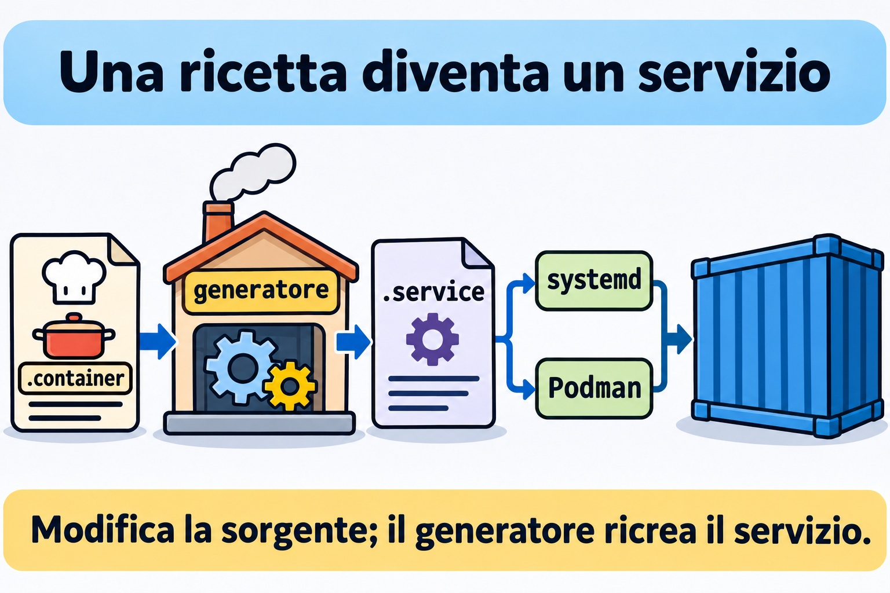
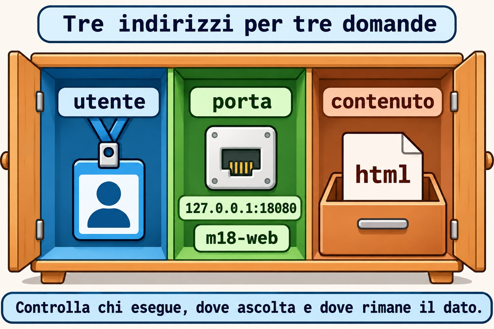
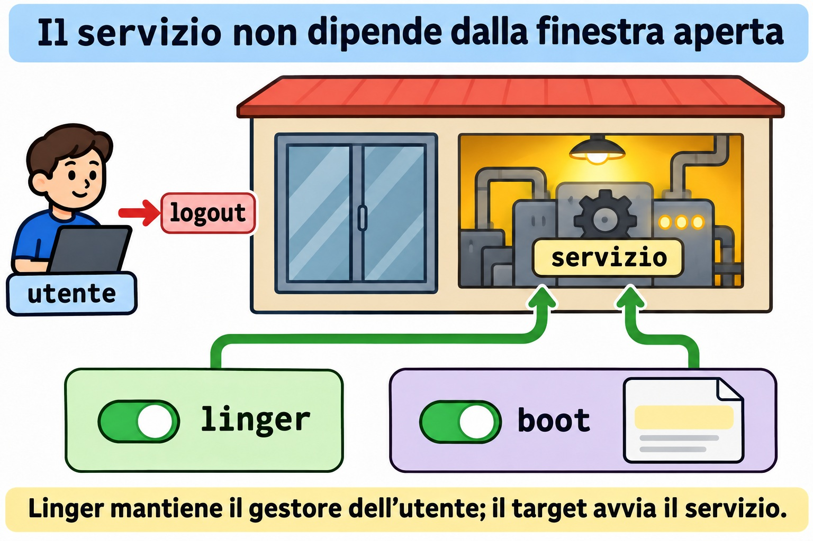

# Lezione 18.3 · Container come servizio

> **Il cuore di questa lezione:** il gestore dell’utente avvia il servizio dal Quadlet; la sessione aperta non deve essere la sua dipendenza.

| Scheda | Piano di lavoro |
| --- | --- |
| Modulo | M18 · Podman, lezione 3 di 5 |
| Quando | Settimana 25 |
| Alla fine | Creare e verificare un servizio rootless persistente dopo il boot senza login del proprietario |
| Prerequisiti | 18.1 e 18.2; immagine tramite digest, contenuto persistente e porta libera |
| Durata | 80–100 minuti |
| Snapshot | `m18a3-inicio` e `m18a3-fim` soltanto nelle VM di laboratorio |

Lavora come `student` nella VM 201, `rocky-lab`, e ripeti nella VM 202, `debian-lab`. Non eseguire Podman sull’host Proxmox.

Conserva la directory del contenuto e il file dell’immagine delle lezioni precedenti. Il container manuale è già stato rimosso alla chiusura della 18.2.

Il servizio di questa lezione rimane per diagnosi, costruzione dell’immagine e reverse proxy nei moduli successivi. La pulizia qui annulla soltanto i guasti introdotti.

Prima del laboratorio crea lo snapshot della VM con la procedura già nota e verifica che la console della VM resti disponibile. Non creare uno snapshot dell’host per proteggere una modifica nel guest.

## 1 · Riscaldamento

Rispondi senza consultare i comandi. Torna alle risposte dopo il reboot di verifica.

1. Quale parte del sito sopravvive quando il container viene rimosso?

2. Pubblicare una porta soltanto sul loopback permette l’accesso diretto da un altro computer?

3. Un processo avviato dal terminale possiede automaticamente una politica di boot?

## 2 · Perché conta

Il sito funziona quando sei collegato. Dopo una manutenzione nessuno entra come proprietario e il servizio non compare. L’immagine non è cambiata; mancava la definizione di chi deve avviare il lavoro e quando.

Un secondo errore consiste nell’inserire un utente in un’unità di sistema e chiamarla rootless. La posizione dell’unità, il gestore che la legge e l’identità del processo devono corrispondere.

In questa lezione produci una sorgente leggibile, un servizio generato, dati fuori dal container e un riscontro dell’avvio senza login. Questi quattro oggetti rispondono a domande diverse.

### Ponte Windows

Confronta il gestore dei servizi con una finestra di terminale. Chiudere la finestra non deve determinare il ciclo di vita di un servizio. Qui il gestore appartiene a un utente, con il proprio contesto.

## 3 · Modello mentale



*Modifica la sorgente; il generatore ricrea il servizio.*

Il file Quadlet è la ricetta. Il generatore trasforma la ricetta in un’unità compresa da systemd. Mantieni la sorgente; non correggere il file generato come se fosse l’origine.

| Oggetto | Domanda |
| --- | --- |
| `.container` | Che cosa deve essere eseguito? |
| `.service` | Che cosa ha ricevuto il gestore? |
| Gestore dell’utente | Chi segue il servizio? |
| Contenuto persistente | Dove rimane il dato? |

Linger permette al gestore dell’utente di essere avviato al boot e continuare dopo il logout. Non scrive il Quadlet e non sceglie da solo quale servizio deve avviarsi.

## 4 · L'essenziale

Quadlet richiede cgroup v2 e una versione installata che offra il generatore e le opzioni usate. Controlla il manuale locale; se non esiste, risolvi il prerequisito tramite il repository ufficiale della distribuzione.

Non installare un pacchetto casuale e non sostituire il servizio con un vecchio comando di generazione per far sembrare conclusa la lezione. Registra versione e lacuna.

La sorgente rootless si trova in `~/.config/containers/systemd/`. Il nome di questo laboratorio è `m18-web.container`; il servizio sarà `m18-web.service` e il container sarà `m18-web`.

L’immagine è già stata ottenuta tramite digest. Il file di ambiente conserva quel riferimento, ma il campo dell’immagine del Quadlet deve ricevere il valore letterale renderizzato; non espande automaticamente una variabile di shell.

Non usare una sezione di servizio con un altro utente per simulare un’unità rootless. Usa il gestore del proprietario.

### Rocky × Debian

| Questione | Rocky | Debian |
| --- | --- | --- |
| Pacchetti | Repository ufficiale della famiglia RPM | Repository ufficiale della famiglia DEB |
| Contenuto montato | Permessi ed etichetta SELinux | Permessi e controlli attivi del sistema |
| Servizio rootless | Gestore di student | Gestore di student |

L’opzione `:Z` rietichetta soltanto la directory esclusiva dell’esercizio quando SELinux è attivo. Non applicarla all’intera home né a una cartella condivisa da altri servizi.

### Decidi 1

Il servizio generato non può essere abilitato come una normale unità installata. Che cosa fai?

A. Modifichi il file generato e insisti con l’abilitazione.
B. Mantieni la politica di installazione nella sorgente Quadlet e ricarichi il gestore.
C. Esegui Podman come root per aggirare l’utente.

## 5 · Lab guidato

Entra direttamente tramite SSH come proprietario. Un cambio utente incompleto può lasciare il terminale senza il bus e la directory di esecuzione corretti.

Le guardie accettano soltanto Podman locale rootless e cgroup v2. Un percorso XDG personalizzato richiede un piano esplicito: qui viene usato il percorso standard della home.

### Passo 1 · Controllare proprietario, versione e contesto

**Ipotesi:** l’inventario dell’utente attuale coincide con quello dell’amministratore?

```bash
test "$(id -un)" = student || exit 1
test "$(id -u)" -ne 0 || exit 1
test -z "${CONTAINER_HOST-}${CONTAINER_CONNECTION-}" || exit 1
test "$(podman info --format '{{.Host.Security.Rootless}}')" = true || exit 1
case "$(hostname -s)" in rocky-lab|debian-lab) ;; *) exit 1 ;; esac
id
printf '%s\n' "$XDG_RUNTIME_DIR"
podman version
podman info --format '{{.Host.CgroupsVersion}} {{.Host.Security.Rootless}}'
test "$(podman info --format '{{.Host.CgroupsVersion}}')" = v2 || exit 1
systemctl --user show-environment || exit 1
man podman-systemd.unit
podman ps -a --filter label=io.course.module=M18
```

**Output atteso:** proprietario corretto, contesto rootless e cgroup v2. Il gestore dell’utente risponde. Se manca il manuale o un’opzione, interrompi la creazione.

**Verifica:** la sessione appartiene alla VM giusta e all’identità giusta. L’host Proxmox resta fuori dalla procedura.

### Passo 2 · Controllare contenuto, immagine e porta

**Ipotesi:** un container manuale dimenticato può impedire l’avvio del servizio senza modificare l’immagine?

```bash
test -z "${XDG_CONFIG_HOME-}" || test "$XDG_CONFIG_HOME" = "$HOME/.config" || exit 1
test -f "$HOME/m18-lab/image.env" && test -O "$HOME/m18-lab/image.env" || exit 1
. "$HOME/m18-lab/image.env" || exit 1
[[ "$M18_IMAGE" =~ ^docker\.io/nginxinc/nginx-unprivileged@sha256:[[:xdigit:]]{64}$ ]] || exit 1
podman image exists "$M18_IMAGE" || exit 1
test -r "$HOME/m18-lab/site/index.html" || exit 1
stat -c '%a %U:%G %n' "$HOME/m18-lab/site" "$HOME/m18-lab/site/index.html"
sha256sum "$HOME/m18-lab/site/index.html"
M18_LISTEN=$(ss -H -ltn 'sport = :18080') || exit 1
test -z "$M18_LISTEN" || { printf '%s\n' 'STOP: porta ocupada'; exit 1; }
if podman container exists m18-web; then
  printf '%s\n' 'STOP: nome ocupado' >&2; exit 1
else
  M18_RC=$?; test "$M18_RC" -eq 1 || exit 1
fi
if podman container exists m18-web-manual; then
  printf '%s\n' 'STOP: nome ocupado' >&2; exit 1
else
  M18_RC=$?; test "$M18_RC" -eq 1 || exit 1
fi
```

**Output atteso:** contenuto conservato, immagine disponibile e nessun listener sulla porta. Un nome occupato chiude la fase, non autorizza la rimozione senza verificarne l’origine.

**Verifica:** la directory ha modalità 755 e il documento 644, entrambi appartenenti al proprietario previsto. Controlla la riserva della porta nel diario; fermati se un processo la usa già.

### Passo 3 · Scrivere la sorgente con valore letterale

**Ipotesi:** ricaricare il gestore crea la sorgente o legge una sorgente che hai già scritto?

```bash
systemctl --user daemon-reload || exit 1
M18_UNITS=$(systemctl --user list-unit-files --all --no-legend) || exit 1
if printf '%s\n' "$M18_UNITS" | awk '$1 == "m18-web.service" {found=1} END {exit !found}'; then
  printf '%s\n' 'STOP: m18-web.service already exists' >&2
  exit 1
fi
install -d -m 0700 "$HOME/.config/containers/systemd" || exit 1
UNIT="$HOME/.config/containers/systemd/m18-web.container"
test ! -e "$UNIT" || exit 1
umask 077
cat > "$UNIT" <<EOF || exit 1
[Unit]
Description=M18 rootless web

[Container]
Image=$M18_IMAGE
Pull=never
ContainerName=m18-web
Label=io.course.module=M18
PublishPort=127.0.0.1:18080:8080
Volume=%h/m18-lab/site:/usr/share/nginx/html:ro,Z
LogDriver=journald
NoNewPrivileges=true

[Service]
Restart=on-failure
TimeoutStartSec=900

[Install]
WantedBy=default.target
EOF
cat "$UNIT"
systemctl --user daemon-reload
systemctl --user cat m18-web.service
```

**Output atteso:** la sorgente contiene il digest reale, senza variabile irrisolta; l’unità generata punta all’immagine e alla directory previste.

**Verifica:** la sorgente termina con la sezione di installazione e il target dell’utente. Non eseguire l’abilitazione sull’unità generata e non copiarne l’output per sostituire il Quadlet.

### Passo 4 · Avviare e collegare i tre riscontri

**Ipotesi:** un’unità attiva dimostra che il contenuto HTTP è il file montato?



*Controlla chi esegue, dove ascolta e dove rimane il dato.*

```bash
systemctl --user start m18-web.service || exit 1
systemctl --user status m18-web.service --no-pager
podman inspect m18-web --format '{{index .Config.Labels "io.course.module"}}'
podman port m18-web
curl --retry 10 --retry-delay 1 --retry-all-errors --max-time 5 --fail --silent --show-error http://127.0.0.1:18080/
sudo journalctl _UID="$(id -u student)" _SYSTEMD_USER_UNIT=m18-web.service -b --no-pager -n 30
podman logs --tail 20 m18-web
```

**Output atteso:** servizio attivo, etichetta del laboratorio, pubblicazione sul loopback e contenuto noto. I log registrano gli eventi reali; non ci sono righe di successo inventate da confrontare.

**Verifica:** confronta risposta, documento persistente e mount. Se il servizio parte con un altro contenuto, indaga il percorso prima di modificare i permessi.

### Passo 5 · Registrare e abilitare linger

**Ipotesi:** linger da solo sceglie il container che deve avviarsi?



*Linger mantiene il gestore dell’utente; il target avvia il servizio.*

```bash
test ! -e "$HOME/m18-lab/linger-before.txt" || exit 1
M18_LINGER=$(loginctl show-user student -p Linger --value) || exit 1
case "$M18_LINGER" in yes|no) ;; *) exit 1 ;; esac
printf '%s\n' "$M18_LINGER" > "$HOME/m18-lab/linger-before.txt" || exit 1
cat "$HOME/m18-lab/linger-before.txt"
sudo loginctl enable-linger student || exit 1
test "$(loginctl show-user student -p Linger --value)" = yes || exit 1
loginctl show-user student -p Linger -p State
systemctl --user is-active m18-web.service
```

**Output atteso:** stato precedente conservato e linger abilitato per il proprietario. Il servizio mantiene la stessa identità e la stessa directory del contenuto.

**Verifica:** annota l’UID del proprietario e l’ora. La politica di boot dipende anche dal target nella sorgente. Chiudere una sola finestra non dimostra l’assenza di tutte le sessioni del proprietario.

### Passo 6 · Dimostrare il boot prima del login del proprietario

**Ipotesi:** entrare tramite SSH come proprietario prima della consultazione compromette quale parte del riscontro?

**Reboot di verifica:** chiudi i lavori nella VM, controlla la console e riavvia soltanto la VM di studio. Dopo il boot non entrare ancora come proprietario.

```bash
case "$(hostname -s)" in rocky-lab|debian-lab) ;; *) exit 1 ;; esac
sudo reboot
```

Su Debian 13, linger può creare una sessione di classe `manager`: è il gestore dell’utente, non un login interattivo. Il controllo seguente considera soltanto la classe `user`, interrogando ogni sessione di student con `show-session`, disponibile anche su Rocky 9.

Nella console della VM usa l’account amministrativo di emergenza già preparato nel corso, senza avviare una sessione di student. Se non disponi di questo accesso, preparalo prima del reboot; non presentare una sessione del proprietario come prova di avvio senza login.

```bash
M18_UID=$(id -u student)
loginctl list-sessions
loginctl show-user student --all -p Linger -p Sessions
M18_SESSIONS=$(loginctl show-user student --all -p Sessions --value) || exit 1
M18_USER_SESSIONS=
for M18_SESSION in $M18_SESSIONS; do
  M18_CLASS=$(loginctl show-session "$M18_SESSION" -p Class --value) || exit 1
  if test "$M18_CLASS" = user; then M18_USER_SESSIONS="$M18_USER_SESSIONS $M18_SESSION"; fi
done
test -z "$M18_USER_SESSIONS" || { printf '%s\n' 'STOP: student logged in' >&2; exit 1; }
systemctl status "user@$M18_UID.service" --no-pager
ss -ltnp 'sport = :18080'
curl --retry 10 --retry-delay 1 --retry-all-errors --max-time 5 --fail --silent --show-error http://127.0.0.1:18080/
journalctl -b _UID="$M18_UID" _SYSTEMD_USER_UNIT=m18-web.service --no-pager
```

**Output atteso:** gestore del proprietario e risposta HTTP prima di qualsiasi login del proprietario. L’elenco delle sessioni e l’orario fanno parte del riscontro.

**Verifica:** conserva la sequenza temporale nel diario esterno. Soltanto dopo entra normalmente come student e ricontrolla servizio, immagine e documento.

Su Rocky, il journal persistente può non avere un journal separato per utente. Per questo le letture del servizio usano sudo e filtrano contemporaneamente UID di student e unità utente; Podman e `systemctl --user` continuano a essere eseguiti dal proprietario senza sudo.

## 6 · Rompi e ripara

Introduci un guasto alla volta, come proprietario, soltanto nella sorgente del laboratorio. Prima conserva una copia privata; se esiste già, esaminala invece di sovrascriverla.

```bash
UNIT="$HOME/.config/containers/systemd/m18-web.container"
test ! -e "$HOME/m18-lab/m18-web.container.good" || exit 1
test -f "$UNIT" && test -O "$UNIT" || exit 1
grep -qxF 'ContainerName=m18-web' "$UNIT" || exit 1
grep -qxF 'Label=io.course.module=M18' "$UNIT" || exit 1
cp -- "$UNIT" "$HOME/m18-lab/m18-web.container.good" || exit 1
```

### Guasto 1 · Sorgente non valida

**Sintomo:** il gestore non genera l’unità prevista dopo una modifica nella sezione del container.

```bash
systemctl --user stop m18-web.service
sed -i 's/^Image=/ImageErrada=/' "$UNIT"
systemctl --user daemon-reload
systemctl --user status m18-web.service --no-pager
```

**Indagine:** leggi la sorgente, la guida locale di Quadlet e i messaggi del gestore. L’unità precedente caricata può confondere; non concludere soltanto dalla presenza di un nome nell’elenco.

**Causa:** una chiave obbligatoria è stata sostituita da un nome che non descrive l’immagine.

**Riparazione:** ripristina soltanto la sorgente nota e ricarica il gestore.

```bash
cp -- "$HOME/m18-lab/m18-web.container.good" "$UNIT" || exit 1
systemctl --user daemon-reload
systemctl --user start m18-web.service
```

**Verifica:** l’unità punta al digest corretto e il documento torna a rispondere.

**Prevenzione:** controlla la sorgente e l’unità generata prima di attribuire il guasto all’applicazione.

### Guasto 2 · Porta pubblicata nel posto sbagliato

**Sintomo:** il servizio è attivo, ma la porta prevista non risponde.

Conferma che la porta alternativa sia libera prima di introdurre la modifica; non usare la porta di un altro servizio.

```bash
M18_LISTEN=$(ss -H -ltn 'sport = :18081') || exit 1
test -z "$M18_LISTEN" || exit 1
systemctl --user stop m18-web.service
sed -i 's/127.0.0.1:18080:8080/127.0.0.1:18081:8080/' "$UNIT"
systemctl --user daemon-reload
systemctl --user start m18-web.service
podman port m18-web
```

**Indagine:** confronta pubblicazione reale, sorgente e indirizzo del client.

**Causa:** il client e la pubblicazione usano porte diverse.

**Riparazione:** ripristina la sorgente nota e riavvia soltanto il servizio del laboratorio.

```bash
systemctl --user stop m18-web.service
cp -- "$HOME/m18-lab/m18-web.container.good" "$UNIT" || exit 1
systemctl --user daemon-reload
systemctl --user start m18-web.service
curl --retry 10 --retry-delay 1 --retry-all-errors --max-time 5 --fail http://127.0.0.1:18080/
```

**Verifica:** la porta alternativa non è rimasta come dipendenza nascosta.

**Prevenzione:** registra separatamente indirizzo di ascolto, porta pubblicata e porta interna.

### Guasto 3 · Confondere sorgente e unità generata

**Sintomo:** un’annotazione consiglia di modificare il file generato per rendere persistente la riparazione.

**Indagine:** individua l’origine e confronta l’unità mostrata dal gestore. Questo guasto è documentale; non modificare il file generato.

```bash
systemctl --user cat m18-web.service
cat "$UNIT"
```

**Causa:** il risultato della generazione è stato trattato come sorgente di configurazione.

**Riparazione:** riscrivi l’annotazione indicando la modifica della sorgente e la ricarica del gestore.

**Verifica:** un’altra persona riesce a ripetere la modifica senza dipendere da un file transitorio.

**Prevenzione:** mantieni la sorgente versionabile e lo stato osservato come riscontro separato.

## 7 · Trappole

La consultazione del servizio di sistema e quella del servizio utente appartengono a gestori diversi. Una risposta vuota di uno non descrive tutti i container della macchina.

Non mescolare il vecchio container manuale con il container gestito. Nome e porta appartengono ora al servizio; creare un altro processo con le stesse risorse introduce concorrenza.

### Decidi 2

Dopo il reboot sei entrato come proprietario prima del test. Quale conclusione è corretta?

A. Il test va ripetuto senza login del proprietario prima dell’osservazione.
B. Il contenuto persistente è stato cancellato.
C. Il servizio si è certamente avviato senza login.

## 8 · Quiz

1. Perché la sorgente deve contenere il digest letterale invece di una variabile di shell non espansa?

2. Qual è la funzione di linger e quale quella del target di installazione?

3. Perché l’unità generata non va modificata come sorgente?

4. Che cosa dimostra la risposta HTTP oltre allo stato attivo del servizio?

5. Perché l’osservatore del reboot non deve entrare prima come student?

6. Che cosa rimane per la lezione successiva?

## 9 · Promemoria

| Domanda | Consultazione |
| --- | --- |
| Sorgente | `cat ~/.config/containers/systemd/m18-web.container` |
| Unità | `systemctl --user cat m18-web.service` |
| Stato | `systemctl --user status m18-web.service` |
| Eventi | `sudo journalctl _UID="$(id -u student)" _SYSTEMD_USER_UNIT=m18-web.service -b` |
| Pubblicazione | `podman port m18-web` |

**Flashcard:** crea schede su sorgente, generatore, servizio, proprietario, linger e riscontro del boot. Ripassa a D+1, D+3, D+7 e D+21.

```text
!explica 18.3 Quadlet, gerenciador do usuario e linger
!feynman 18.3 vou explicar por que editar a fonte e provar boot sem login
!quiz 18.3
```

## 10 · Checklist e chiusura

Ripristina la sorgente nota, ricarica e conferma la porta originale. Conserva servizio, directory del sito, riferimento dell’immagine e riscontro dello stato precedente di linger.

Non disabilitare linger alla chiusura: il laboratorio successivo dipende dal servizio. Quando il corso autorizzerà la rimozione definitiva, esamina gli altri servizi del proprietario prima di ripristinare lo stato precedente.

Se linger era già abilitato prima del modulo, la pulizia non deve disabilitarlo. Il file dello stato precedente evita che una configurazione preesistente venga trattata come residuo dell’esercizio.

- [ ] Ho identificato VM e proprietario.
- [ ] Ho controllato cgroup v2 e il generatore installato.
- [ ] Ho mantenuto il digest letterale e il contenuto persistente.
- [ ] Ho controllato servizio e risposta HTTP.
- [ ] Ho dimostrato l’avvio prima del login del proprietario.
- [ ] Ho annullato i guasti senza modificare servizi estranei.

**Ultimo esercizio:** spiega perché file esistente, servizio attivo e servizio avviato senza login sono tre riscontri distinti. Cita il dato raccolto per ciascuno.

Crea lo snapshot finale soltanto dopo aver ripristinato il laboratorio e registrato il riscontro. Uno snapshot della VM non sostituisce la copia del contenuto che sai ripristinare.

## 11 · Nella vita reale

In un ambiente autorizzato esegui soltanto letture: identifica il proprietario di un servizio rootless, individua la sorgente e descrivi il percorso del dato. Non riavviare e non abilitare linger su un account reale per completare l’osservazione.

Se la sorgente o il riscontro del boot non è disponibile, registra la lacuna. Non trasformare una supposizione di disponibilità in una garanzia di continuità.

## 12 · Approfondire quando vuoi

- [Quadlet e unità dell’utente](https://docs.podman.io/en/latest/markdown/podman-systemd.unit.5.html).
- [Opzioni dell’unità container](https://docs.podman.io/en/latest/markdown/podman-container.unit.5.html).
- [Gestione delle sessioni e linger](https://www.freedesktop.org/software/systemd/man/latest/loginctl.html).

Confronta il manuale della versione installata prima di adottare un’opzione nuova. Questa lezione non afferma che qualsiasi versione precedente accetti tutte le chiavi documentate nella versione più recente.

### Soluzioni commentate

**Riscaldamento:** il contenuto montato rimane fuori dal container; il loopback non espone direttamente ad altri host; un processo manuale non definisce una politica di boot.

**Decidi 1: B.** La sorgente conserva la politica di installazione applicata dal generatore.

**Decidi 2: A.** Il login può aver avviato il gestore, quindi la sequenza temporale va ripetuta.

**Quiz 1:** L’espansione appartiene alla scrittura della sorgente; Quadlet deve ricevere un riferimento valido all’immagine.

**Quiz 2:** Linger mantiene il gestore; il target di installazione collega l’unità all’avvio desiderato.

**Quiz 3:** Il generatore può ricrearla, scartando una modifica fatta sul risultato.

**Quiz 4:** Dimostra il percorso HTTP e permette di confrontare il documento effettivamente servito.

**Quiz 5:** Perché quel login può attivare il gestore e impedire di attribuire l’avvio al boot.

**Quiz 6:** Sorgente, servizio, immagine tramite digest, sito e registrazione dello stato precedente di linger.

[← Lezione18.2 · Eseguire e conservare i dati](18.2-rodar-e-persistir.md) · [Indice delle lezioni](../01-aulas.md) · [Lezione18.4 · Diagnosticare un container rootless →](18.4-diagnosticar-conteiner-rootless.md)
