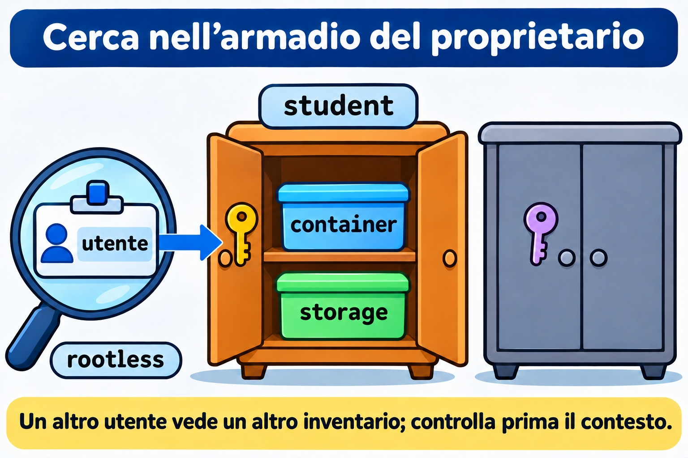

# Lezione 18.4 · Diagnosticare un container rootless

> **Il cuore di questa lezione:** controlla il proprietario e collega configurazione, processo, file ed evento prima di correggere il container.

| Scheda | Piano di lavoro |
| --- | --- |
| Modulo | M18 · Podman, lezione 4 di 5 |
| Quando | Settimana 25 |
| Alla fine | Individuare il livello di tre guasti senza ampliare i privilegi |
| Prerequisiti | Servizio e contenuto conservati dalla 18.3; accesso come proprietario |
| Durata | 80–100 minuti |
| Snapshot | `m18a4-inicio` e `m18a4-fim` soltanto nelle VM di studio |

Il laboratorio continua con l’utente `student`, prima su `rocky-lab` e poi su `debian-lab`. I comandi di Podman appartengono sempre al proprietario, senza elevazione.

La porta rimane sul loopback e il contenuto resta fuori dal container. Non collegare il servizio alla rete esterna per facilitare la diagnosi.

Crea lo snapshot della VM prima dei guasti e controlla la console. I difetti sono limitati al laboratorio; non verrà modificata alcuna mappatura globale degli utenti.

## 1 · Riscaldamento

Rispondi prima di consultare l’unità o l’inventario.

1. Perché un elenco vuoto di container non dimostra che la macchina non ne abbia?

2. Qual è la differenza tra servizio attivo e risposta HTTP valida?

3. Il numero dell’utente dentro il container deve coincidere con quello sull’host?

## 2 · Perché conta

Un servizio rootless non compare nel terminale dell’amministratore. Il tentativo di ricrearlo su un altro account produce un’altra copia, un altro storage e un altro conflitto di porta, senza spiegare il primo guasto.

Un’altra segnalazione sembra un guasto di rete: l’unità è attiva, il processo esiste, ma la richiesta scade. Un processo congelato non è un processo inesistente.

Manterrai osservabili queste distinzioni. La riparazione deve essere più piccola del problema e permettere di ripetere il riscontro iniziale.

### Ponte Windows

Uno strumento aperto con un’altra identità può mostrare un altro profilo e un altro insieme di risorse. Controlla l’identità effettiva prima di interpretare un’assenza come perdita di dati.

## 3 · Modello mentale



*Un altro utente vede un altro inventario; controlla prima il contesto.*

Ogni proprietario ha il proprio armadio di immagini, container e dati interni di Podman. Usare il nome corretto nell’armadio sbagliato rimane una domanda rivolta al posto sbagliato.

| Riscontro | Domanda |
| --- | --- |
| Identità e ambiente | Chi sta consultando? |
| Scheda del container | Che cosa è stato configurato? |
| Processi | Che cosa esiste ora? |
| Eventi | Che cosa è successo e quando? |
| File montato | Quale dato è stato consegnato al processo? |

La configurazione del servizio appartiene al gestore; lo stato del container all’esecuzione; il contenuto al percorso montato. Confronta tutti e tre.

## 4 · L'essenziale

La directory di esecuzione dell’utente e il bus della sua sessione non vanno inventati per far funzionare un comando. Entra direttamente come proprietario tramite un login completo.

Non usare l’elevazione per consultare Podman come se mostrasse automaticamente i container dell’utente. Può cambiare l’inventario e produrre un’altra diagnosi.

I file `/etc/subuid` e `/etc/subgid` descrivono intervalli subordinati. Leggere la mappatura è diverso dal riassegnare gli intervalli di un account in uso.

Una modifica globale di questi intervalli può rendere incoerente lo storage esistente. Questa lezione non effettua tale modifica e non usa una pulizia globale dello storage come riparazione.

Il comando `podman unshare` apre una vista nel namespace del proprietario. Non fornisce root globale della VM. Usalo qui soltanto per leggere la mappatura e confrontare un file noto.

### Rocky × Debian

| Lettura | Rocky | Debian |
| --- | --- | --- |
| Accesso al file | Modalità, proprietario e SELinux attivo | Modalità, proprietario e controlli attivi |
| Journal dell’utente | Contesto del proprietario | Contesto del proprietario |
| Intervalli subordinati | Leggere, non riassegnare alla cieca | Leggere, non riassegnare alla cieca |

### Decidi 1

L’inventario è vuoto in un terminale che non appartiene al proprietario. Il primo passo è:

A. Ricreare il servizio con privilegi globali.
B. Cancellare le directory di storage che sembrano vecchie.
C. Controllare identità, contesto e VM, poi consultare come proprietario.

## 5 · Lab guidato

### Passo 1 · Fissare il contesto e il limite della modifica

**Ipotesi:** quale informazione deve precedere il nome del container in un’indagine rootless?

```bash
test "$(id -un)" = student || exit 1
test "$(id -u)" -ne 0 || exit 1
test -z "${CONTAINER_HOST-}${CONTAINER_CONNECTION-}" || exit 1
test "$(podman info --format '{{.Host.Security.Rootless}}')" = true || exit 1
case "$(hostname -s)" in rocky-lab|debian-lab) ;; *) exit 1 ;; esac
id
printf 'HOME=%s\nXDG_RUNTIME_DIR=%s\n' "$HOME" "$XDG_RUNTIME_DIR"
podman info --format '{{.Host.Security.Rootless}} {{.Store.GraphRoot}}'
systemctl --user status m18-web.service --no-pager
loginctl show-user student --all -p Linger -p Sessions
```

**Output atteso:** proprietario corretto, inventario rootless e servizio noto. Un errore di connessione al gestore è un riscontro di contesto, non un motivo per creare un altro servizio.

**Verifica:** scrivi nome della VM, utente, orario e risorsa. Se uno è incerto, fermati prima dei guasti.

### Passo 2 · Leggere la configurazione reale

**Ipotesi:** un nome noto garantisce immagine, etichetta e mount corretti?

```bash
podman inspect m18-web --format '{{index .Config.Labels "io.course.module"}}'
podman inspect m18-web --format '{{.ImageName}}'
podman inspect m18-web --format '{{json .State}}'
podman inspect m18-web --format '{{json .Mounts}}'
podman port m18-web
systemctl --user cat m18-web.service
```

**Output atteso:** etichetta M18, immagine con riferimento noto, stato reale, mount del sito e porta sul loopback. Non pubblicare una scheda completa se contiene un ambiente con segreti.

**Verifica:** la sorgente del volume è la directory persistente prevista, non una cartella simile né il contenuto interno dell’immagine. Confrontala con la sorgente Quadlet.

### Passo 3 · Collegare processi ed eventi

**Ipotesi:** l’utente mostrato nel processo interno deve avere lo stesso numero nella vista della VM?


*Collega configurazione, processo ed evento prima di correggere.*

```bash
podman top m18-web user huser pid hpid args
podman logs --timestamps --tail 30 m18-web
sudo journalctl _UID="$(id -u student)" _SYSTEMD_USER_UNIT=m18-web.service -b --no-pager -n 40
systemctl --user show m18-web.service -p ActiveState -p SubState -p Result -p NRestarts
curl --max-time 3 --fail --silent --show-error http://127.0.0.1:18080/
```

**Output atteso:** processi reali e registrazioni dell’intervallo attuale. I campi dell’utente dell’host e del container possono differire per la mappatura.

**Verifica:** collega il momento della richiesta agli eventi. L’assenza di una riga applicativa non dimostra che non ci sia mai stato un guasto; controlla intervallo, origine del log e conservazione.

### Passo 4 · Leggere la mappatura senza cambiare identità

**Ipotesi:** la stessa proprietà numerica di un file può apparire con un altro numero in un altro namespace?


*Leggi la mappatura prima di cambiare il proprietario del file.*

```bash
awk -F: '$1=="student" {print}' /etc/subuid /etc/subgid
command -v newuidmap newgidmap
podman unshare cat /proc/self/uid_map /proc/self/gid_map
stat -c '%u:%g %a %n' "$HOME/m18-lab/site/index.html"
podman unshare stat -c '%u:%g %a %n' "$HOME/m18-lab/site/index.html"
```

**Output atteso:** intervalli reali del proprietario e una traduzione osservabile nella mappatura. Non copiare numeri da un’altra macchina per cercare di uguagliare l’output.

**Verifica:** spiega inizio, intervallo e quantità usando la mappatura letta. Se manca un intervallo o un helper, conserva lo storage e tratta la correzione come modifica amministrativa pianificata.

### Passo 5 · Separare permesso, etichetta e mount

**Ipotesi:** negare la lettura tramite modalità Unix equivale a una negazione di SELinux?

```bash
namei -l "$HOME/m18-lab/site/index.html"
ls -ldZ "$HOME/m18-lab/site"
ls -lZ "$HOME/m18-lab/site/index.html"
podman exec m18-web id
podman exec m18-web sh -c 'test -r /usr/share/nginx/html/index.html'
printf 'rc=%s\n' "$?"
```

**Output atteso:** il documento è leggibile dall’identità effettiva dell’applicazione. Un campo di contesto vuoto o indisponibile richiede di interpretare i controlli attivi della distribuzione, non di disabilitarli.

Su Rocky con SELinux attivo cerca una negazione nell’intervallo del sintomo con la procedura di audit già studiata, se presente. Non inventare una negazione quando la causa è nella modalità del file.

**Verifica:** il mount rimane in sola lettura nel container. Renderlo scrivibile non è una riparazione per un’applicazione che deve soltanto leggere il sito.

### Passo 6 · Scrivere una conclusione riproducibile

**Ipotesi:** quanti output senza contesto equivalgono a una conclusione dimostrata?

Completa la tabella con il tuo caso reale. Registra soltanto il necessario e conserva l’orario.

| Campo | Il tuo riscontro |
| --- | --- |
| Contesto | VM, proprietario e gestore |
| Configurazione | Immagine, porta e mount |
| Esecuzione | Stato e processi |
| Evento | Istante e messaggio pertinente |
| Dato | Percorso e lettura dal processo |
| Limite | Che cosa non è ancora stato dimostrato |

**Output atteso:** un’altra persona comprende l’ipotesi e riesce a ripetere una breve consultazione che la mette alla prova.

**Verifica:** la conclusione non dipende da un segreto, una schermata vecchia o un numero UID presunto. Usa questa tabella prima di ogni riparazione seguente.

## 6 · Rompi e ripara

Introduci un guasto alla volta e ripristina prima del successivo. I controlli rifiutano un nome senza l’etichetta del laboratorio. Se un controllo fallisce, fermati; non rimuovere risorse per farlo passare.

```bash
assert_m18() {
  test "$(id -un)" = student || return 1
  test -z "${CONTAINER_HOST-}${CONTAINER_CONNECTION-}" || return 1
  test "$(podman info --format '{{.Host.Security.Rootless}}')" = true || return 1
  test "$(podman inspect m18-web --format '{{index .Config.Labels "io.course.module"}}')" = M18 || return 1
}
assert_m18 || exit 1
UNIT="$HOME/.config/containers/systemd/m18-web.container"
test -f "$UNIT" && test -O "$UNIT" || exit 1
test -f "$HOME/m18-lab/site/index.html" && test -O "$HOME/m18-lab/site/index.html" || exit 1
test ! -e "$HOME/m18-lab/m18a4.container.good" || exit 1
cp -- "$UNIT" "$HOME/m18-lab/m18a4.container.good" || exit 1
```

### Guasto 1 · Documento non leggibile dall’applicazione

**Sintomo:** il sito smette di servire il documento, anche se il servizio rimane attivo.

```bash
assert_m18 || exit 1
chmod 0600 "$HOME/m18-lab/site/index.html"
curl --max-time 3 --fail http://127.0.0.1:18080/
podman logs --tail 20 m18-web
podman exec m18-web id
```

**Indagine:** confronta proprietario e modalità del documento con l’utente dell’applicazione. La risposta può indicare accesso negato; registra il messaggio reale e non attribuirlo automaticamente al firewall.

**Causa:** il file è diventato leggibile soltanto dal proprietario esterno, mentre l’applicazione non usa quell’identità nel namespace.

**Riparazione:** ripristina la modalità di lettura prevista, senza concedere scrittura e senza cambiare globalmente il proprietario.

```bash
chmod 0644 "$HOME/m18-lab/site/index.html"
podman exec m18-web sh -c 'test -r /usr/share/nginx/html/index.html'
curl --retry 10 --retry-delay 1 --retry-all-errors --max-time 5 --fail http://127.0.0.1:18080/
```

**Verifica:** lo stesso documento torna a rispondere, con il volume ancora in sola lettura.

**Prevenzione:** confronta l’identità del processo prima di ampliare modalità o cambiare etichette.

### Guasto 2 · Processo congelato

**Sintomo:** esistono processo e servizio attivo, ma il client non ottiene risposta entro il termine.

```bash
assert_m18 || exit 1
podman pause m18-web || exit 1
podman inspect m18-web --format '{{.State.Status}} {{.State.Paused}}'
systemctl --user is-active m18-web.service
curl --max-time 3 --fail http://127.0.0.1:18080/
```

Se la versione o l’ambiente rifiuta la pausa rootless, registra l’impedimento e non applicare modifiche globali per forzare la simulazione. Il laboratorio Quadlet richiede cgroup v2, ma le capacità locali vanno comunque controllate.

**Indagine:** confronta stato del container, stato del gestore e termine del client.

**Causa:** l’esecuzione è stata sospesa; l’esistenza del processo non dimostra avanzamento.

**Riparazione:** riprendi soltanto il container etichettato dell’esercizio.

```bash
assert_m18 || exit 1
podman unpause m18-web || exit 1
podman inspect m18-web --format '{{.State.Paused}}'
curl --max-time 3 --fail http://127.0.0.1:18080/
```

**Verifica:** la pausa è stata rimossa e la richiesta torna a concludersi.

**Prevenzione:** mantieni un riscontro della risposta applicativa oltre all’esistenza di PID e unità.

### Guasto 3 · Comando applicativo sostituito

**Sintomo:** il servizio tenta di riavviarsi, ma il processo principale termina invece di servire HTTP.

```bash
assert_m18 || exit 1
systemctl --user stop m18-web.service
sed -i '/^LogDriver=/a Exec=/bin/sh -c "exit 23"' "$UNIT"
systemctl --user daemon-reload
systemctl --user start m18-web.service
sudo journalctl _UID="$(id -u student)" _SYSTEMD_USER_UNIT=m18-web.service -b --no-pager -n 35
systemctl --user show m18-web.service -p Result -p NRestarts
systemctl --user stop m18-web.service
```

**Indagine:** confronta il comando nella sorgente e nell’unità generata con la causa di uscita registrata. Il numero dei riavvii dipende dal momento osservato; non c’è un conteggio fisso da copiare.

**Causa:** un comando sostitutivo termina deliberatamente il processo; la politica di restart non corregge un comando errato.

**Riparazione:** ripristina la sorgente nota, ricarica e pulisci soltanto lo stato di errore di questa unità.

```bash
cp -- "$HOME/m18-lab/m18a4.container.good" "$UNIT" || exit 1
systemctl --user daemon-reload
systemctl --user reset-failed m18-web.service
systemctl --user start m18-web.service || exit 1
curl --retry 10 --retry-delay 1 --retry-all-errors --max-time 5 --fail http://127.0.0.1:18080/
```

**Verifica:** il comando originale è tornato e il sito serve il contenuto persistente.

**Prevenzione:** leggi la prima causa pertinente dell’uscita, non soltanto l’ultimo tentativo di riavvio.

## 7 · Trappole

Non modificare gli intervalli subordinati di un account per far assomigliare un output numerico al materiale. La traduzione reale è l’oggetto dello studio.

Non usare pulizia globale, rimozione di tutti i container o cambio di utente come prima riparazione. Perderesti il contesto che devi spiegare.

Evita di consultare soltanto l’ultimo container creato. Una selezione esplicita per nome, identità ed etichetta riduce il rischio di indagare un’altra risorsa.

### Decidi 2

L’applicazione non legge il documento, ma l’amministratore riesce a leggerlo nel terminale. Quale riscontro manca?

A. Lettura tramite identità e mount effettivi dell’applicazione.
B. Disattivazione dei controlli di sicurezza.
C. Permesso di scrittura totale per tutti.

## 8 · Quiz

1. Perché consultare con un altro utente può mostrare un altro inventario?

2. Che cosa aiutano a distinguere i campi dell’utente dell’host e del container?

3. Qual è la differenza tra file illeggibile per modalità e negazione di un controllo aggiuntivo?

4. Perché un servizio attivo non garantisce avanzamento dell’applicazione?

5. Perché modificare gli intervalli subordinati di un account esistente richiede un piano?

6. Quale riscontro permette di ripetere la diagnosi dopo il reboot?

## 9 · Promemoria

| Livello | Consultazione breve |
| --- | --- |
| Proprietario | `id` |
| Scheda | `podman inspect m18-web` |
| Processi | `podman top m18-web user huser pid hpid args` |
| Evento | `sudo journalctl _UID="$(id -u student)" _SYSTEMD_USER_UNIT=m18-web.service -b` |
| Mappatura | `podman unshare cat /proc/self/uid_map` |

**Flashcard:** prepara schede su contesto, intervallo subordinato, proprietario effettivo, pausa e causa di uscita. Ripassa a D+1, D+3, D+7 e D+21.

```text
!explica 18.4 contexto do dono, logs, inspect, top e unshare
!feynman 18.4 vou explicar por que processo existente pode nao responder
!quiz 18.4
```

## 10 · Checklist e chiusura

Ripristina il documento nella modalità di lettura prevista, rimuovi la pausa e conferma la sorgente originale. Conserva sito, servizio e linger per la continuità del modulo.

Non rimuovere l’inventario delle immagini né i backup privati delle sorgenti come effetto automatico di questa pulizia. Registra quali copie sono state create per non confonderle con configurazione attiva.

**Reboot di verifica:** dopo aver corretto i tre guasti ripeti il saggio della 18.3: soltanto la VM, osservazione amministrativa prima del login del proprietario e risposta sul loopback.

```bash
case "$(hostname -s)" in rocky-lab|debian-lab) ;; *) exit 1 ;; esac
sudo reboot
```

Dopo il riscontro senza login entra nuovamente come proprietario e confronta configurazione e contenuto con la registrazione iniziale. Non usare una consultazione di un altro boot come se fosse attuale.

```bash
systemctl --user is-active m18-web.service
podman inspect m18-web --format '{{.State.Paused}} {{.State.Status}}'
podman port m18-web
curl --retry 10 --retry-delay 1 --retry-all-errors --max-time 5 --fail http://127.0.0.1:18080/
sha256sum "$HOME/m18-lab/site/index.html"
```

- [ ] Ho controllato VM, proprietario e contesto.
- [ ] Ho collegato stato, processo ed evento.
- [ ] Ho letto la mappatura senza modificare intervalli globali.
- [ ] Ho separato modalità del file e controlli aggiuntivi.
- [ ] Ho corretto i tre difetti e verificato dopo il reboot.
- [ ] Ho conservato il servizio per la prossima lezione.

**Ultimo esercizio:** consegna un resoconto di sei righe con contesto, ipotesi, consultazione, osservazione, riparazione e limite della conclusione. Ogni riga deve poggiare su un riscontro reale.

Crea lo snapshot finale soltanto con il laboratorio sano e il diario aggiornato. Lo snapshot da solo non dimostra che la causa sia stata compresa.

## 11 · Nella vita reale

Con autorizzazione leggi la documentazione operativa di un servizio rootless. Identifica proprietario, origine dell’immagine, percorso del dato e fonte dei log. Non introdurre alcun difetto fuori dal laboratorio.

Proponi una consultazione breve per ogni lacuna trovata. Se l’informazione contiene un segreto, chiedi una versione ridotta invece di copiare l’intero ambiente nel resoconto.

## 12 · Approfondire quando vuoi

- [Lettura di processi e identità](https://docs.podman.io/en/latest/markdown/podman-top.1.html).
- [Namespace dell’utente e unshare](https://docs.podman.io/en/latest/markdown/podman-unshare.1.html).
- [Ispezione dei container](https://docs.podman.io/en/latest/markdown/podman-inspect.1.html).
- [Quadlet e gestore dell’utente](https://docs.podman.io/en/latest/markdown/podman-systemd.unit.5.html).

Usa la documentazione della versione installata per interpretare i campi disponibili. Un campo assente richiede di adattare la lettura, non di inventare un output di riferimento.

### Soluzioni commentate

**Riscaldamento:** ogni proprietario può possedere un altro inventario; servizio attivo non implica risposta valida; i namespace traducono i numeri d’identità.

**Decidi 1: C.** L’assenza è interpretabile soltanto dopo aver stabilito chi ha consultato e dove.

**Decidi 2: A.** La lettura dell’amministratore non rappresenta automaticamente quella dell’applicazione.

**Quiz 1:** Perché storage e risorse rootless appartengono al contesto di ogni proprietario.

**Quiz 2:** L’identità effettiva del processo nelle due viste e la traduzione da spiegare tramite la mappatura.

**Quiz 3:** Modalità, proprietario e controlli aggiuntivi sono verifiche indipendenti; un’ipotesi non sostituisce il riscontro dell’altra.

**Quiz 4:** Il processo può essere in pausa o non avanzare, anche se il gestore continua a considerare attiva l’unità.

**Quiz 5:** Perché i dati esistenti possono dipendere dalla mappatura precedente; la modifica deve considerare migrazione e recupero.

**Quiz 6:** VM, proprietario, boot, orario, configurazione, dato e risultato osservabile permettono di ripetere l’ipotesi.

[← Lezione18.3 · Container come servizio](18.3-conteiner-como-servico.md) · [Indice delle lezioni](../01-aulas.md) · [Lezione18.5 · Costruire immagini →](18.5-construir-imagens.md)
