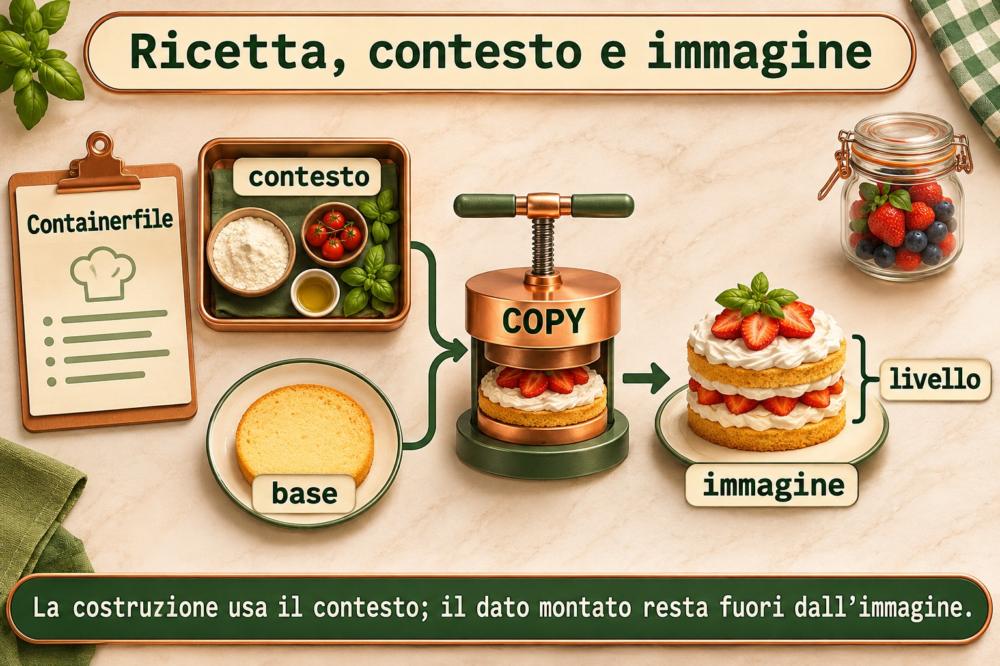
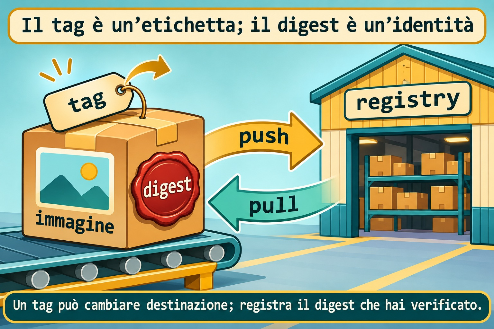
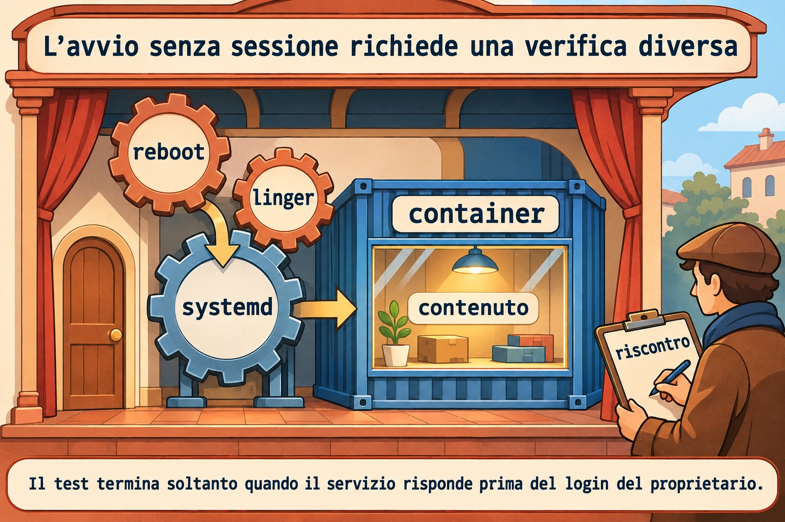

# Lezione 18.5 · Costruire immagini

> **Il cuore di questa lezione:** una ricetta crea un’immagine; un tag la indica; il dato persistente mantiene un contratto distinto.

| Scheda | Piano di lavoro |
| --- | --- |
| Modulo | M18 · Podman, lezione 5 di 5 |
| Quando | Settimana 25 |
| Alla fine | Costruire, provare, pubblicare localmente e verificare il servizio dopo il riavvio senza sessione del proprietario |
| Prerequisiti | 18.1–18.4; VM 201, utente `student`, servizio `m18-web` funzionante |
| Durata | 100–140 minuti, oltre ai trasferimenti |
| Snapshot | `m18a5-inicio` e `m18a5-fim`, soltanto VM 201; nella ripetizione Debian, VM 202 |

Esegui come proprietario del laboratorio in una sessione reale della VM, mai sull’host Proxmox. I comandi amministrativi sono separati. Il confronto Debian usa la propria VM 202 e i propri oggetti.

Prima del laboratorio chiudi le modifiche in corso e crea lo snapshot `m18a5-inicio` della VM201; nella ripetizione Debian usa soltanto la VM202. Usa la procedura di snapshot già studiata in Proxmox, controlla ID e nome del guest e torna alla sessione di student nella VM prima dei comandi seguenti.

## 1 · Riscaldamento

1. Se un’immagine contiene una pagina, quale pagina appare quando una directory esterna copre lo stesso percorso?

2. Un secondo tag copia tutti i byte di un’immagine?

3. Un servizio funzionante dopo il tuo login dimostra che si è avviato prima del login?

## 2 · Perché conta

Ricevi un’immagine funzionante, ma nessuno sa spiegarne l’origine. Un file di ricetta e un contesto piccolo rendono la costruzione ispezionabile. Da soli non garantiscono sicurezza né riproduzione byte per byte.

Il laboratorio pubblica soltanto in un registry locale senza autenticazione, collegato al loopback della VM. Serve a imparare trasporto e identità; non è un registry per la rete aziendale.

Il servizio persistente delle lezioni precedenti resta riservato al proxy del M19. Il test dell’immagine usa un’altra porta e non monta la directory del servizio.

## 3 · Modello mentale



*La costruzione usa il contesto; il dato montato resta fuori dall’immagine.*

| Oggetto | Che cosa descrive |
| --- | --- |
| `Containerfile` | Istruzioni e base della costruzione |
| Contesto | File che la costruzione può leggere |
| Immagine | Risultato con configurazione e livelli |
| Tag | Riferimento che può essere spostato |
| Digest | Identità del manifest verificato |
| Bind mount | Dato esterno visibile in quel percorso |

### Ponte Windows

Pensa alla differenza tra una ricetta di distribuzione, il suo pacchetto e una directory di dati montata dopo. Cambiare il pacchetto non elimina né sostituisce automaticamente quella directory.

## 4 · L'essenziale

La base proviene dal digest reale salvato nella 18.1. La costruzione non scarica un’altra base tramite un tag modificabile. Il file di ambiente appartiene all’utente del laboratorio; leggine il contenuto prima di caricarlo.

La ricetta usa soltanto la copia di un file locale. Non installa pacchetti e non scarica nulla durante la costruzione. Aggiungere queste operazioni richiederebbe controllare separatamente repository, versioni e segreti.

Un segreto passato come argomento di costruzione può apparire nei metadati o nei log. In questa lezione il contesto non contiene credenziali, chiavi private o token.

Usa nomi completi di registry. Le eccezioni alla verifica TLS sono limitate alle chiamate destinate esclusivamente all’endpoint locale definito qui; non modificare la configurazione globale dei registry.

### Rocky × Debian

Su Rocky mantieni SELinux in modalità enforcing e applica l’etichetta privata soltanto alla directory dedicata del registry. Su Debian controlla le politiche di sicurezza disponibili; l’assenza di SELinux non elimina permessi Unix né namespace.

## 5 · Lab guidato

Riserva le porte di loopback dei test prima di creare qualsiasi oggetto. Non cambiare la porta del servizio precedente per liberare una porta di questo esercizio.

### Passo 1 · Fissare proprietario, base e area di lavoro

**Ipotesi:** un riferimento tramite digest basta a dimostrare che l’utente attuale possiede l’immagine locale?

```bash
test "$(id -un)" = student || exit 1
case "$(hostname -s)" in rocky-lab|debian-lab) ;; *) exit 1 ;; esac
test "$(podman info --format '{{.Host.Security.Rootless}}')" = true || exit 1
cat "$HOME/m18-lab/image.env"
. "$HOME/m18-lab/image.env"
case "$M18_IMAGE" in docker.io/nginxinc/nginx-unprivileged@sha256:*) ;; *) exit 1 ;; esac
podman image inspect "$M18_IMAGE" > /dev/null || exit 1
systemctl --user is-active m18-web.service || exit 1
test "$(podman inspect m18-web --format '{{index .Config.Labels "io.course.module"}}')" = M18 || exit 1
PORTS=$(ss -H -ltn '( sport = :18081 or sport = :15000 )') || exit 1
test -z "$PORTS" || exit 1
for NAME in m18-build-test m18-registry; do
  if podman container exists "$NAME"; then exit 1
  else RC=$?; test "$RC" -eq 1 || exit 1; fi
done
for REF in localhost/m18-web:v1 localhost:15000/m18-web:v1; do
  if podman image exists "$REF"; then exit 1
  else RC=$?; test "$RC" -eq 1 || exit 1; fi
done
test ! -e "$HOME/m18-lab/build" || exit 1
mkdir -m 0750 "$HOME/m18-lab/build" || exit 1
EVID=$(mktemp -d "$HOME/m18-lab/evidence-18-5.XXXXXX") || exit 1
```

**Output atteso:** proprietario corretto, modalità rootless vera, base disponibile e due porte libere. Se il nome host è cambiato in un esercizio precedente, risolvi l’identità del laboratorio prima di adattare il controllo.

**Verifica:** controlla anche l’assenza dei nomi di test e dei nuovi tag nell’elenco completo. Se esistono già, conservali e indaga; non usare la sostituzione automatica.

```bash
podman ps --all
podman images
systemctl --user cat m18-web.service > "$EVID/service-before.txt"
```

### Passo 2 · Scrivere la ricetta e limitare il contesto

**Ipotesi:** copiare un file nell’immagine richiede di montare la directory persistente del servizio durante la costruzione?

```bash
cd "$HOME/m18-lab/build" || exit 1
printf '%s\n' '<h1>M18 build v1</h1>' > index.html
chmod 0644 index.html
cat > Containerfile <<'EOF'
ARG M18_BASE
FROM ${M18_BASE}
LABEL io.course.module="M18"
COPY index.html /usr/share/nginx/html/index.html
EOF
cat > .containerignore <<'EOF'
*
!Containerfile
!index.html
!.containerignore
EOF
cat Containerfile
cat .containerignore
sha256sum Containerfile index.html .containerignore | tee "$EVID/context.sha256"
```

**Output atteso:** una ricetta breve e un contesto senza chiavi o credenziali. Utente, porta e comando di esecuzione restano ereditati dalla base.

**Verifica:** il file copiato appartiene al contesto di costruzione. Non è il contenuto persistente che il servizio attuale monta dopo.

### Passo 3 · Costruire e provare senza il volume del servizio

**Ipotesi:** un’attività di costruzione riuscita dimostra che la pagina HTTP contiene i byte attesi?

```bash
podman build --pull=never --network=none   --build-arg "M18_BASE=$M18_IMAGE"   --tag localhost/m18-web:v1 "$HOME/m18-lab/build" || exit 1
podman image inspect localhost/m18-web:v1 > "$EVID/built-image.json"
podman history --no-trunc localhost/m18-web:v1
podman run -d --name m18-build-test --label io.course.module=M18   --pull=never -p 127.0.0.1:18081:8080 localhost/m18-web:v1 || exit 1
podman logs m18-build-test
curl --retry 10 --retry-delay 1 --retry-all-errors --max-time 5 --fail --silent --show-error http://127.0.0.1:18081/ --output "$EVID/build-response.html" || exit 1
```

**Output atteso:** dopo che il server è pronto, la risposta coincide con il file incorporato. Se la prima richiesta precede la disponibilità, leggi i log e ripeti soltanto la richiesta.

```bash
cmp "$HOME/m18-lab/build/index.html" "$EVID/build-response.html" || exit 1
podman inspect m18-build-test --format '{{json .Mounts}}'
podman inspect m18-build-test --format '{{json .HostConfig.PortBindings}}'
```

**Verifica:** il test non ha un bind mount del sito precedente. Usare la stessa directory con etichetta privata in due container può cambiarne la categoria SELinux e interrompere il servizio che già la usava.

### Passo 4 · Avviare un registry esclusivamente locale

**Ipotesi:** ascoltare soltanto sul loopback permette di ricevere immagini da qualsiasi altra VM?

Controlla nel progetto Distribution l’immagine di registry utilizzata. Il tag serve alla selezione iniziale; leggi il RepoDigest reale e fissalo prima di creare il container.

```bash
podman pull docker.io/library/registry:3 || exit 1
podman image inspect docker.io/library/registry:3 --format '{{json .RepoDigests}}'
read -r -p 'RepoDigest real docker.io/library/registry@sha256:...: ' M18_REG_IMAGE
case "$M18_REG_IMAGE" in docker.io/library/registry@sha256:*) ;; *) exit 1 ;; esac
podman image inspect "$M18_REG_IMAGE" > /dev/null || exit 1
test ! -e "$HOME/m18-lab/registry-data" || exit 1
mkdir -m 0700 "$HOME/m18-lab/registry-data" || exit 1
podman run -d --name m18-registry --label io.course.module=M18   --pull=never -p 127.0.0.1:15000:5000   -e OTEL_TRACES_EXPORTER=none   -v "$HOME/m18-lab/registry-data:/var/lib/registry:Z"   "$M18_REG_IMAGE" || exit 1
podman logs m18-registry
podman port m18-registry
curl --retry 10 --retry-delay 1 --retry-all-errors --max-time 5 --fail --silent --show-error http://127.0.0.1:15000/v2/ || exit 1
```

**Output atteso:** l’API locale risponde e la pubblicazione è limitata all’indirizzo di loopback. Nessuna porta del firewall della VM viene aperta.

**Verifica:** il volume privato del registry è un’altra directory. Non indirizzarlo all’intera home, al sito o a dati esistenti.

### Passo 5 · Pubblicare e leggere tramite il digest di destinazione

**Ipotesi:** il digest del manifest pubblicato deve essere indovinato dall’ID locale dell’immagine?



*Un tag può cambiare destinazione; registra il digest che hai verificato.*

```bash
REG_REF=localhost:15000/m18-web
podman tag localhost/m18-web:v1 "$REG_REF:v1" || exit 1
podman push --tls-verify=false --digestfile "$EVID/pushed.digest"   "$REG_REF:v1" "docker://$REG_REF:v1" || exit 1
REG_DIGEST=$(cat "$EVID/pushed.digest") || exit 1
case "$REG_DIGEST" in sha256:*) ;; *) exit 1 ;; esac
podman pull --tls-verify=false "$REG_REF@$REG_DIGEST" || exit 1
podman image inspect "$REG_REF@$REG_DIGEST" > "$EVID/pulled-image.json"
printf '%s\n' "$REG_REF@$REG_DIGEST" > "$EVID/service-image.txt"
```

**Output atteso:** trasporto completato, digest reale salvato e riferimento di destinazione disponibile nello storage dello stesso utente. Cambiamenti di formato o compressione possono modificare il manifest; usa il digest restituito dal push.

**Verifica:** le eccezioni TLS riguardano esclusivamente l’endpoint locale. Un registry esterno richiede TLS e autenticazione appropriati; non esportare questa eccezione come configurazione generale.

### Passo 6 · Ripetere il test con il riferimento pubblicato

**Ipotesi:** pubblicare e scaricare un’immagine dimostra che il contenuto HTTP resta corretto?

```bash
test "$(podman inspect m18-build-test --format '{{index .Config.Labels "io.course.module"}}')" = M18 || exit 1
podman stop m18-build-test || exit 1
podman rm m18-build-test || exit 1
podman run -d --name m18-build-test --label io.course.module=M18   --pull=never -p 127.0.0.1:18081:8080 "$REG_REF@$REG_DIGEST" || exit 1
podman logs m18-build-test
curl --retry 10 --retry-delay 1 --retry-all-errors --max-time 5 --fail --silent --show-error http://127.0.0.1:18081/ --output "$EVID/pull-response.html" || exit 1
cmp "$HOME/m18-lab/build/index.html" "$EVID/pull-response.html" || exit 1
systemctl --user is-active m18-web.service
```

**Output atteso:** l’immagine pubblicata serve gli stessi byte e il servizio precedente resta funzionante. Attendi la disponibilità prima del confronto; una risposta assente non è un file approvato.

**Verifica:** conserva ricetta, checksum, riferimento pubblicato e risultato HTTP. La sfida userà quel riferimento già scaricato, con una politica che non scarica mai all’avvio.

## 6 · Rompi e ripara

Esegui ogni guasto sul test dell’immagine o su una copia della ricetta. Non modificare la politica globale TLS, il contenuto del sito o il servizio persistente per creare un errore.

### Guasto 1 · Il file non è nel contesto

**Sintomo:** la costruzione segnala di non trovare il file da copiare.

```bash
cd "$HOME/m18-lab/build" || exit 1
cp Containerfile Containerfile.broken
sed -i 's/COPY index.html/COPY missing.html/' Containerfile.broken
podman build --pull=never --network=none   --build-arg "M18_BASE=$M18_IMAGE" -f Containerfile.broken .
```

**Indagine:** leggi l’istruzione fallita e confronta i suoi percorsi con la radice del contesto e il file di esclusioni.

**Causa:** la ricetta richiede un file inesistente nel contesto consentito. Non è un guasto del nginx in esecuzione.

**Riparazione:** torna al file originale e ripeti la costruzione soltanto con un nuovo tag di test autorizzato, senza sostituire il tag approvato.

**Verifica:** il file richiesto esiste e non è stato escluso dal contesto.

**Prevenzione:** mantieni un contesto piccolo e spiega ogni file incluso.

### Guasto 2 · Il riferimento non esiste nel registry

**Sintomo:** il registry risponde, ma non trova il tag richiesto.

```bash
podman pull --tls-verify=false localhost:15000/m18-web:tag-ausente
```

**Indagine:** confronta nome del repository, tag, destinazione del push e digest registrato. La risposta dell’API non dimostra che qualsiasi tag esista.

**Causa:** il nome richiesto non è stato pubblicato in quel registry. Non disabilitare altri controlli per cercare un tag inesistente.

**Riparazione:** usa il riferimento tramite digest effettivamente salvato nel diario.

**Verifica:** l’ispezione trova il riferimento corretto e il test HTTP resta approvato.

**Prevenzione:** pubblica e registra destinazione, tag e digest come tre campi distinti.

### Guasto 3 · Il volume nasconde la pagina dell’immagine

**Sintomo:** dopo aver cambiato l’immagine del servizio nella sfida, appare la pagina persistente precedente.

**Indagine:** confronta i mount del servizio con quelli del test senza bind mount.

```bash
podman inspect m18-web --format '{{json .Mounts}}'
podman inspect m18-build-test --format '{{json .Mounts}}'
cat "$HOME/m18-lab/site/index.html"
cat "$HOME/m18-lab/build/index.html"
```

**Causa:** il dato esterno copre il percorso che contiene la pagina incorporata. È il contratto di persistenza, non una costruzione ignorata.

**Riparazione:** mantieni il volume; confronta il servizio con il sito persistente e il test con la pagina incorporata. Non eliminare il dato per forzare l’aspetto atteso.

**Verifica:** i due risultati corrispondono alle rispettive fonti differenti.

**Prevenzione:** registra quali percorsi provengono dall’immagine e quali sono coperti dai mount.

## 7 · Trappole

### Decidi 1

Vuoi includere una chiave privata nella costruzione per scaricare un file. Quale decisione conserva l’ambito della lezione?

A. Fermarsi e pianificare un meccanismo appropriato per il segreto fuori da questo esercizio.
B. Copiare la chiave nel contesto ed eliminarla in un livello successivo.
C. Passare la chiave come normale argomento di costruzione.

### Decidi 2

HTTP risponde dopo che sei entrato come proprietario. Vuoi affermare che il servizio si avvia senza login. Che cosa manca?

A. Un altro tag che indica gli stessi byte.
B. Una schermata dell’immagine locale.
C. Riavvio controllato e osservazione esterna precedente a qualsiasi sessione del proprietario.

## 8 · Quiz

1. Qual è la differenza tra ricetta e contesto?

2. Perché salvare il digest restituito dal push?

3. Il test dell’immagine deve montare lo stesso sito privato del servizio?

4. Che cosa autorizza l’eccezione TLS di questa lezione?

5. Perché il servizio può mostrare un’altra pagina dopo aver cambiato l’immagine?

6. Quale osservazione distingue l’avvio autonomo dall’avvio causato dal login?

## 9 · Promemoria

| Domanda | Riscontro |
| --- | --- |
| Come è stata costruita? | Ricetta, base fissa e contesto |
| Che cosa è stato pubblicato? | Destinazione e digest del manifest |
| Quale pagina è stata servita? | Risposta confrontata con la propria fonte |
| Quando si è avviato il servizio? | Avvio e riscontro prima del login |

**Flashcard:** crea schede su contesto, tag, digest, bind mount e osservatore esterno. Ripassa senza aprire il terminale.

```text
!explica 18.5 receita, contexto, tag e digest
!feynman 18.5 vou explicar por que o mount esconde a página incorporada
!quiz 18.5
```

## 10 · Checklist e chiusura

### Sfida · Servizio senza login del proprietario



*Il test termina soltanto quando il servizio risponde prima del login del proprietario.*

Prima conferma che il servizio precedente sia funzionante, il sito conservato e l’immagine pubblicata disponibile localmente. Salva una copia della definizione prima di cambiare soltanto il riferimento dell’immagine e la politica di pull.

```bash
UNIT="$HOME/.config/containers/systemd/m18-web.container"
test -f "$UNIT" && test -O "$UNIT" && test ! -L "$UNIT" || exit 1
test ! -e "$EVID/m18-web.before.container" || exit 1
cp -p "$UNIT" "$EVID/m18-web.before.container" || exit 1
podman image inspect "$REG_REF@$REG_DIGEST" > /dev/null || exit 1
python3 - "$UNIT" "$REG_REF@$REG_DIGEST" <<'PY'
import pathlib, sys
p = pathlib.Path(sys.argv[1]); lines = p.read_text().splitlines()
assert sum(x.startswith('Image=') for x in lines) == 1
assert 'ContainerName=m18-web' in lines
assert any('io.course.module=M18' in x for x in lines)
out = [x for x in lines if not x.startswith('Pull=')]
i = next(i for i,x in enumerate(out) if x.startswith('Image='))
out[i:i+1] = ['Image=' + sys.argv[2], 'Pull=never']
p.write_text('\n'.join(out) + '\n')
PY
test "$?" -eq 0 || exit 1
systemctl --user daemon-reload
systemctl --user restart m18-web.service || exit 1
systemctl --user status m18-web.service --no-pager
curl --retry 10 --retry-delay 1 --retry-all-errors --max-time 5 --fail --silent --show-error http://127.0.0.1:18080/ --output "$EVID/service-response.html" || exit 1
cmp "$HOME/m18-lab/site/index.html" "$EVID/service-response.html" || exit 1
loginctl show-user student -p Linger
```

Controlla la chiave di politica nella guida Quadlet installata prima della modifica. Se la tua versione non supporta quel file, conserva la definizione e risolvi il prerequisito della 18.3. Non usare un’immagine che dipende dal download all’avvio per dimostrare un servizio offline.

Il servizio deve continuare a mostrare il sito esterno, perché il volume lo copre. Il cambiamento dell’immagine non autorizza a modificare il dato persistente.

Se la nuova definizione fallisce, conserva i log e torna alla copia precedente in questo stesso shell, prima di tentare il riavvio. Il blocco seguente è soltanto il percorso di recupero: non eseguirlo quando il test è riuscito.

```bash
test -s "$EVID/m18-web.before.container" || exit 1
cp -p "$EVID/m18-web.before.container" "$UNIT" || exit 1
systemctl --user daemon-reload
systemctl --user restart m18-web.service || exit 1
curl --retry 10 --retry-delay 1 --retry-all-errors --max-time 5 --fail --silent --show-error http://127.0.0.1:18080/ || exit 1
```

Nel percorso approvato registra fuori dalla VM la directory dei riscontri, l’hash del sito e il riferimento dell’immagine. Potrai così trovare la prova dopo che la sessione e le sue variabili saranno scomparse.

```bash
printf '%s\n' "$EVID"
sha256sum "$HOME/m18-lab/site/index.html"
cat "$EVID/service-image.txt"
```

**Reboot di verifica:** mantieni disponibile una console amministrativa indipendente. Riavvia soltanto la VM di laboratorio e non entrare come proprietario dopo l’avvio.

```bash
sudo reboot
```

Nella console amministrativa della stessa VM entra come amministratore autorizzato. Prima di qualsiasi sessione del proprietario esegui soltanto queste letture; questo amministratore non esegue Podman al posto del proprietario.

```bash
date -Is
uptime -s
loginctl show-user student --all -p Linger -p Sessions
systemctl status "user@$(id -u student).service" --no-pager
curl --retry 10 --retry-delay 1 --retry-all-errors --max-time 5 --fail --silent --show-error http://127.0.0.1:18080/ || exit 1
journalctl -b _UID="$(id -u student)" _SYSTEMD_USER_UNIT=m18-web.service --no-pager
```

Il criterio richiede linger attivo, nessuna sessione interattiva di classe user del proprietario e risposta corretta prima del login. Conserva orario e contenuto fuori dalla VM. Se il proprietario è già entrato, quel tentativo non dimostra la condizione: ripeti il riavvio controllato.

Dopo l’osservazione entra come proprietario, controlla servizio e log. Il registry di test non deve essere attivo: l’immagine è stata scaricata prima e la politica del servizio vieta il pull.

**Ultimo esercizio:** consegna ricetta, riferimento pubblicato, checksum del sito e resoconto dell’osservatore. Distingui il test dell’immagine incorporata dal test del dato persistente.

### Pulizia e continuità

Rimuovi soltanto i due container temporanei, dopo averne controllato nomi ed etichette. Se hai aperto un’altra sessione, identifica di nuovo il proprietario e conserva le variabili del diario; non indovinarne i valori.

```bash
for NAME in m18-build-test m18-registry; do
  test "$(podman inspect "$NAME" --format '{{index .Config.Labels "io.course.module"}}')" = M18 || exit 1
  podman stop "$NAME" || exit 1
  podman rm "$NAME" || exit 1
done
systemctl --user is-active m18-web.service
curl --retry 10 --retry-delay 1 --retry-all-errors --max-time 5 --fail --silent --show-error http://127.0.0.1:18080/ || exit 1
```

Conserva sito, definizione Quadlet, immagine del servizio e linger per il M19. Conserva anche riscontri, ricetta e dati del registry fino alla revisione della consegna. Non eseguire pulizie globali di immagini o volumi.

Dopo la pulizia controllata e il riscontro del boot crea lo snapshot `m18a5-fim` soltanto nella VM di studio corrispondente. Registra il punto di ritorno; non sostituisce backup e recupero del sito persistente.

- [ ] Ho costruito con base fissa e contesto delimitato.
- [ ] Ho confrontato le risposte HTTP con le fonti corrette.
- [ ] Ho pubblicato soltanto nel registry di loopback e registrato il digest.
- [ ] Ho dimostrato l’avvio prima di qualsiasi sessione del proprietario.
- [ ] Ho conservato servizio e contenuto per il modulo seguente.

## 11 · Nella vita reale

Scegli un’immagine già autorizzata e leggi ricetta, origine della base e processo di pubblicazione. Produci soltanto un parere: quali dati restano nell’immagine, quali nei volumi e dove si registra l’identità pubblicata?

Non costruire né pubblicare un’immagine per conto dell’organizzazione per colmare una lacuna del rapporto. Un’informazione assente deve restare indicata come assente.

## 12 · Approfondire quando vuoi

- [Podman: costruire immagini](https://docs.podman.io/en/latest/markdown/podman-build.1.html).

- [Podman: pubblicare immagini e registrare il digest](https://docs.podman.io/en/latest/markdown/podman-push.1.html).

- [Distribution: registry di laboratorio e produzione](https://distribution.github.io/distribution/about/deploying/).

- [Quadlet e unità utente](https://docs.podman.io/en/latest/markdown/podman-systemd.unit.5.html).

### Soluzioni commentate

**Riscaldamento 1:** appare il dato montato sul percorso; copre il file dell’immagine.

**Riscaldamento 2:** no; il tag aggiunge un riferimento locale.

**Riscaldamento 3:** no; il login stesso può avviare il gestore dell’utente.

**Decidi 1: A.** Eliminare un segreto dopo non lo rimuove necessariamente dai livelli precedenti o dai log.

**Decidi 2: C.** Devi osservare l’effetto senza provocare la condizione che vuoi escludere.

**Quiz 1:** la ricetta contiene istruzioni; il contesto delimita i file disponibili per esse.

**Quiz 2:** identifica il manifest effettivamente memorizzato nella destinazione; non se ne indovina il valore dall’ID locale.

**Quiz 3:** no; oltre a nascondere la pagina incorporata, un’altra etichetta privata può influire sul servizio esistente.

**Quiz 4:** soltanto il trasporto verso il registry di loopback indicato; non autentica un registry esterno e non cambia la politica generale.

**Quiz 5:** il bind mount copre il percorso della pagina dell’immagine e offre il dato persistente.

**Quiz 6:** un osservatore autorizzato controlla il servizio dopo il riavvio e prima di qualsiasi sessione del proprietario, registrando orario e risposta.

[← Lezione 18.4 · Diagnosticare un container rootless](18.4-diagnosticar-conteiner-rootless.md) · [Indice delle lezioni](../01-aulas.md) · [Piano del corso: dal M19 in poi →](../00-plano-do-curso.md)
