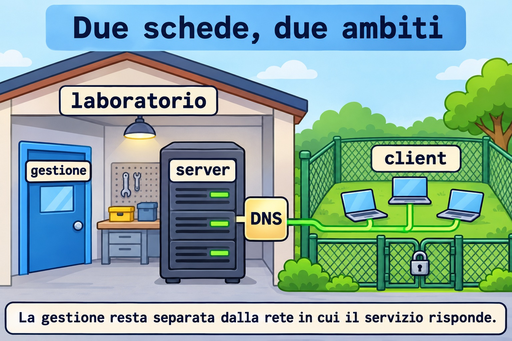

# Lezione 19.1 · DNS autoritativo

> **Il cuore di questa lezione:** crea la VM 204 e verifica risposte A, MX e PTR nella rete isolata.

| Scheda | Piano di lavoro |
| --- | --- |
| Modulo | M19 · Servizi di rete, lezione 1 di 9 |
| Quando | Settimana 25 |
| Alla fine | crea la VM 204 e verifica risposte A, MX e PTR nella rete isolata. |
| Prerequisiti | M17, M18; VM 201 e 202; utente student; rete isolata vmbr17 |
| Durata | 150–180 minuti |
| Snapshot | m19a1-inicio e m19a1-fim; solo VM indicate |

Il nodo Proxmox riceve solo i comandi indicati come host.

Gli altri appartengono alla VM specificata, con Bash e utente `student`.

Non eseguire i blocchi successivi se una verifica fallisce.

Conserva l’output reale nel diario; questa lezione non presenta un’esecuzione già effettuata.

Prima delle query dai client, completa la [guida del banco M19](../GUIA_BANCADA_M19_IT.md) per le schede isolate delle VM 201 e 202; la creazione della VM 204 resta in questa lezione.

Nomi canonici del modulo: il nome della VM in Proxmox e l’hostname del sistema operativo devono corrispondere al ruolo, prima di eseguire le guardie. Un nome DNS di servizio non cambia l’hostname. Se l’inventario differisce, riconcilialo dalla console prima di proseguire; non ignorare le guardie.

| VM | Hostname breve | Indirizzo isolato |
| --- | --- | --- |
| 201 | `rocky-lab` | `192.0.2.201` |
| 202 | `debian-lab` | `192.0.2.202` |
| 204 | `srv-deb` | `192.0.2.204` |
| 212 | `m19-client` | DHCP; solo sfida 19.9 |

## 1 · Riscaldamento

1. Qual è la differenza fra l’indirizzo usato per amministrare una VM e quello su cui un servizio risponde al lab?

2. Interrogare un nome dimostra automaticamente che la ricerca inversa funziona?

3. Come dimostreresti che la VM 204 è libera nell’intero cluster?

Disegna la VM 204 con due schede.

Segna l’unico segmento su cui il DNS deve ascoltare e lascia fuori la gestione.

## 2 · Perché conta

Un servizio di posta deve trovare la destinazione MX e verificare i nomi associati agli indirizzi.

Un solo record A non risponde a queste domande.

La VM 204 sosterrà i prossimi servizi.

Crearla verificando identità, disco e rete evita di trascinare un errore di base per tutto il modulo.

### Ponte Windows

Una zona DNS resta un insieme di record autoritativi.

Il client può interrogare direttamente questo server senza renderlo il resolver predefinito dell’intera macchina.

## 3 · Modello mentale



*La gestione resta separata dalla rete in cui il servizio risponde.*

La gestione usa la rete reale esistente.

La scheda isolata usa `192.0.2.204/24`, senza gateway; `vmbr17` non ha porta fisica, IP sull’host, router o NAT.

Il prefisso `192.0.2.0/24` è didattico e resta rigorosamente segregato.

Prima di assegnarlo, verifica sovrapposizioni con rotte, gestione e VPN su tutte le macchine coinvolte.


*La zona diretta risponde al nome; quella inversa risponde all’indirizzo.*

Il server è autorità per `lab.test` e per l’inversa `2.0.192.in-addr.arpa`.

Un PTR non nasce automaticamente da un A.

### Rocky × Debian

Il server della lezione è Debian 13; Rocky 201 resta un client del segmento isolato.

I nomi dei servizi e i percorsi BIND possono cambiare fra distribuzioni: non copiare quelli del server Debian sul client Rocky.

## 4 · L'essenziale

| Oggetto | Contratto |
| --- | --- |
| 204 srv-deb | Debian 13; 2 vCPU; 2 GiB; disco 20 GiB su vm-hdd |
| Firmware | q35; OVMF; x86-64-v2-AES; QGA |
| net0 | vmbr0; gestione reale riservata fuori dal pool DHCP reale |
| net1 | vmbr17; 192.0.2.204/24; senza gateway |
| Client | 201 = 192.0.2.201; 202 = 192.0.2.202 |
| Servizio | TCP e UDP 53; solo loopback e scheda isolata |

L’host deve avere `vm-hdd` già verificato nel M17 e uno storage di file che accetti ISO.

Non inventare uno storage locale e non creare la VM su un ID occupato.

### Decidi 1

La VM 204 compare come CT su un altro nodo.

Che cosa fai?

A. Creare 204 sul nodo attuale perché il tipo è diverso.

B. Eliminare il CT per liberare il numero.

C. Fermarti e riconciliare l’inventario prima di creare.

## 5 · Lab guidato

### Passo 1 · Creare la base da un’origine verificabile

**Ipotesi:** Una ISO che si avvia dimostra già l’autenticità dell’origine?

Nella VM 202, usa la pagina ufficiale Debian delle immagini DVD amd64 per scegliere la versione 13 disponibile.

Copia URL versionato e nome reale del DVD-1; non usare un nome o hash illustrativo.

```bash
sudo apt update && sudo apt install curl gpgv debian-keyring
mkdir -p ~/m19-iso && cd ~/m19-iso
read -r -p "URL versionada iso-dvd: " ISO_BASE
read -r -p "Nome Debian 13 amd64 DVD-1: " ISO_FILE
[[ "$ISO_BASE" == https://cdimage.debian.org/debian-cd/*/amd64/iso-dvd ]] || exit 1
[[ "$ISO_FILE" =~ ^debian-13[.][0-9]+[.][0-9]+-amd64-DVD-1[.]iso$ ]] || exit 1
for f in "$ISO_FILE" SHA512SUMS SHA512SUMS.sign; do
  curl -fLO "$ISO_BASE/$f" || exit 1
done
gpgv --keyring /usr/share/keyrings/debian-role-keys.pgp SHA512SUMS.sign SHA512SUMS || exit 1
awk -v f="$ISO_FILE" '$2==f || $2=="*"f {print}' SHA512SUMS > chosen.sha512
test "$(wc -l < chosen.sha512)" -eq 1 || exit 1
sha512sum -c chosen.sha512 || exit 1
```

Se la chiave di firma vigente manca nel keyring aggiornato, fermati e segui la pagina Debian di verifica per autenticare la chiave.

Non ignorare mai una firma errata e non importare una chiave casuale per proseguire.

Trasferisci il DVD verificato allo storage ISO del nodo tramite il flusso autorizzato.

Sull’host, trova il volume con `pvesm list`, copia l’identificatore completo e confronta il suo SHA512 con quello verificato nella VM 202.

```bash
pvesm status
read -r -p "Storage ISO existente: " ISO_STORAGE
pvesm list "$ISO_STORAGE" --content iso
read -r -p "Volume completo do DVD verificado: " ISO_VOLUME
ISO_PATH=$(pvesm path "$ISO_VOLUME") || exit 1
test -f "$ISO_PATH" || exit 1
sha512sum "$ISO_PATH"
pvesh get /cluster/resources --type vm --output-format json > /tmp/m19-resources.json
python3 -c 'import json; assert not any(x["vmid"]==204 for x in json.load(open("/tmp/m19-resources.json")))' || exit 1
ip -4 route show table all
ip -d link show vmbr17
ip -br address show dev vmbr17
pvesm status --storage vm-hdd
```

Conferma bridge senza uplink e senza indirizzo sull’host, rotte senza conflitti e hash identico.

Registra nodo, storage, nome completo, hash e `ISO_VOLUME` nel diario `~/m19-operador.env`; non caricarlo come codice.

Conserva il DVD per la sfida 19.9.

```bash
qm create 204 --name srv-deb --machine q35 --bios ovmf --cpu x86-64-v2-AES --cores 2 --memory 2048 --agent enabled=1 --scsihw virtio-scsi-single --scsi0 vm-hdd:20 --efidisk0 vm-hdd:1,efitype=4m,pre-enrolled-keys=1 --net0 virtio,bridge=vmbr0 --net1 virtio,bridge=vmbr17 --ide2 "$ISO_VOLUME",media=cdrom --boot order=ide2 || exit 1
qm config 204
```

Solo dopo una creazione senza errori, apri la console 204 e avvia l’installazione manuale dal DVD.

Scegli solo il disco vuoto da 20 GiB della nuova VM.

Se disco o identità differiscono, fermati.

Configura solo la scheda corrispondente alla MAC di net0 nella gestione: indirizzo reale riservato, maschera, gateway e DNS autorizzati.

Imposta hostname `srv-deb`, utente `student` e password root di emergenza custodita fuori dal materiale.

Seleziona server SSH e utilità standard, senza ambiente grafico.

Lascia net1 non configurata nell’installer.

Completa sul disco della VM ed entra nella console come root.

```bash
apt update && apt install sudo qemu-guest-agent ifupdown openssh-server || exit 1
usermod -aG sudo student
systemctl enable --now qemu-guest-agent
sshd -T | grep -E '^(permitrootlogin|passwordauthentication) '
```

Richiedi accesso SSH con chiave di `student`, verificato in una seconda sessione, e root con password solo dalla console; applica la procedura SSH del M15 se necessario.

Non chiudere la sessione di emergenza prima della verifica.

Torna al terminale root del nodo Proxmox prima del blocco seguente.

```bash
qm set 204 --agent enabled=1 --boot order=scsi0
qm agent 204 ping
qm snapshot 204 m19a1-inicio
```

**Output atteso:** Una VM nuova installata e amministrabile; nessun DNS o DHCP avviato. QGA risponde solo dopo l’installazione dell’agente e l’attivazione del canale.

**Verifica:** Confronta MAC, gestione riservata, avvio dal disco e spazio libero. Non usare NetworkManager sulla VM 204.

### Passo 2 · Collegare solo la scheda isolata

**Ipotesi:** Il secondo nome mostrato da `ip link` è necessariamente net1?

Sull’host leggi la MAC di net1 con `qm config 204`.

Nella VM 204 confrontala con `ip -br link`, esamina rotte e configurazione ifupdown esistente.

Fermati se il prefisso isolato confligge con rotte di gestione o VPN.

```bash
ip -br link
ip -4 route show table all
cat /etc/network/interfaces
sudo grep -R -n . /etc/network/interfaces.d/
read -r -p "Interface da MAC de net1: " LAB_IF
[[ "$LAB_IF" =~ ^[a-zA-Z][a-zA-Z0-9_-]{0,14}$ ]] || exit 1
ip link show dev "$LAB_IF" || exit 1
grep -Eq '^[[:space:]]*source(-directory)?[[:space:]]+/etc/network/interfaces.d/' /etc/network/interfaces || exit 1
sudo test ! -e /etc/network/interfaces.d/m19-lab || exit 1
sudo test ! -L /etc/network/interfaces.d/m19-lab || exit 1
sudo test ! -e /etc/m19-lab.env || exit 1
```

Prima di scrivere, conferma che nessuna definizione esistente amministri questa interfaccia.

Se esiste, riconcilia la configurazione; non sovrascrivere il file.

Net0 resta intatta.

```bash
printf 'auto %s
iface %s inet static
    address 192.0.2.204/24
    pre-up /usr/sbin/sysctl -w net.ipv6.conf.%s.disable_ipv6=1
' "$LAB_IF" "$LAB_IF" "$LAB_IF" | sudo tee /etc/network/interfaces.d/m19-lab
printf 'LAB_IF=%q
LAB_IP=%q
LAB_NET=%q
LAB_DOMAIN=%q
' "$LAB_IF" 192.0.2.204 192.0.2.0/24 lab.test | sudo tee /etc/m19-lab.env
sudo chown root:root /etc/m19-lab.env /etc/network/interfaces.d/m19-lab
sudo chmod 0644 /etc/m19-lab.env /etc/network/interfaces.d/m19-lab
sudo ifup "$LAB_IF"
ip -4 address show dev "$LAB_IF"
ip -4 route
```

**Output atteso:** L’interfaccia isolata ha `.204/24`; solo la gestione ha una rotta predefinita. IPv6 è disattivato solo su questa interfaccia.

**Verifica:** Dalla scheda isolata della VM 202 già configurata con la guida di laboratorio M19, verifica la raggiungibilità di `.204`. Se necessario, ripristina `.202/24` nel suo profilo isolato con la procedura dei profili del M11, mai su net0.

### Passo 3 · Installare senza esporre il servizio sulla gestione

**Ipotesi:** Il pacchetto può avviare il demone prima che tu imposti le interfacce?

Nella VM 204 appena creata, conferma che BIND non sia già installato.

La maschera prima dell’installazione impedisce l’avvio con la configurazione predefinita.

```bash
if dpkg-query -W -f='${Status}' bind9 2>/dev/null | grep -q "install ok installed"; then exit 1; fi
sudo systemctl mask named.service
sudo apt update && sudo apt install bind9 bind9-utils dnsutils
sudo cp -a /etc/bind/named.conf.options /etc/bind/named.conf.options.m19-original
sudo cp -a /etc/bind/named.conf.local /etc/bind/named.conf.local.m19-original
sudo tee /etc/bind/named.conf.options >/dev/null <<'EOF'
acl m19_trusted { 127.0.0.1; 192.0.2.0/24; };
options {
    directory "/var/cache/bind";
    listen-on { 127.0.0.1; 192.0.2.204; };
    listen-on-v6 { none; };
    allow-query { m19_trusted; };
    allow-transfer { none; };
    recursion no;
    dnssec-validation auto;
};
EOF
sudo install -d -o root -g bind -m 0750 /etc/bind/m19
sudo tee /etc/bind/named.conf.local >/dev/null <<'EOF'
zone "lab.test" { type primary; file "/etc/bind/m19/db.lab.test"; };
zone "2.0.192.in-addr.arpa" { type primary; file "/etc/bind/m19/db.192.0.2"; };
EOF
```

**Output atteso:** Servizio ancora mascherato; le opzioni limitano socket e query, senza ricorsione.

**Verifica:** Se host o VM hanno un firewall attivo, segui M16 per consentire TCP/UDP 53 solo dalla rete isolata; conserva politica e gestione. Non disattivare il firewall come diagnosi.

Mascherare una unità prima di installare il pacchetto può mostrare un avviso che la unità non esiste ancora: è previsto se la maschera viene creata correttamente. Controlla comunque il risultato e l’assenza di listener; vale anche per Kea, Postfix, Dovecot e Squid.

### Passo 4 · Scrivere due zone indipendenti

**Ipotesi:** Senza punto finale, `mail.lab.test` resta un nome assoluto dentro la zona?

```bash
sudo tee /etc/bind/m19/db.lab.test >/dev/null <<'EOF'
$TTL 300
@ IN SOA ns.lab.test. hostmaster.lab.test. (
  2026111701 3600 900 604800 300 )
@ IN NS ns.lab.test.
@ IN MX 10 mail.lab.test.
ns IN A 192.0.2.204
srv-deb IN A 192.0.2.204
mail IN A 192.0.2.204
web IN A 192.0.2.204
www IN A 192.0.2.204
proxy IN A 192.0.2.204
smb IN A 192.0.2.204
app IN A 192.0.2.201
rocky IN A 192.0.2.201
debian IN A 192.0.2.202
EOF
sudo tee /etc/bind/m19/db.192.0.2 >/dev/null <<'EOF'
$TTL 300
@ IN SOA ns.lab.test. hostmaster.lab.test. (
  2026111701 3600 900 604800 300 )
@ IN NS ns.lab.test.
204 IN PTR srv-deb.lab.test.
201 IN PTR rocky.lab.test.
202 IN PTR debian.lab.test.
EOF
sudo chown root:bind /etc/bind/m19/db.lab.test /etc/bind/m19/db.192.0.2
sudo chmod 0640 /etc/bind/m19/db.lab.test /etc/bind/m19/db.192.0.2
sudo named-checkconf && sudo named-checkzone lab.test /etc/bind/m19/db.lab.test && sudo named-checkzone 2.0.192.in-addr.arpa /etc/bind/m19/db.192.0.2
```

**Output atteso:** I validatori terminano con successo; il seriale è un valore scelto per il file, non un output osservato.

**Verifica:** Controlla ogni A, la destinazione MX e i tre PTR. La prossima modifica a una zona richiede un seriale maggiore in quella zona.

### Passo 5 · Caricare e interrogare il server giusto

**Ipotesi:** L’opzione che sceglie il server in `dig` modifica il DNS globale del client?


*Un file valido deve ancora essere caricato e rispondere correttamente.*

```bash
sudo systemctl unmask named.service
sudo systemctl enable --now named.service
sudo systemctl --no-pager --full status named
sudo ss -lntup | grep ":53"
sudo journalctl -u named -b --no-pager -n 30
dig @192.0.2.204 app.lab.test A +norecurse
dig @192.0.2.204 lab.test MX +norecurse
dig @192.0.2.204 -x 192.0.2.204 +norecurse
dig @192.0.2.204 lab.test AXFR
```

**Output atteso:** Le query dalla VM 202 ricevono A `.201`, MX `10 mail.lab.test.` e PTR `srv-deb.lab.test.` con flag AA; AXFR non è autorizzato. Se la VM 202 non ha ancora `dig`, installa prima il client: `sudo apt install dnsutils` (sulla 201: `sudo dnf install bind-utils`).

**Verifica:** Una riga nel journal non basta: verifica socket solo sugli indirizzi consentiti e ripeti A via TCP con `dig @192.0.2.204 app.lab.test A +tcp`.

### Decidi 2

A funziona; PTR restituisce NXDOMAIN.

Quale ipotesi spiega meglio?

A. La zona inversa o il PTR non è stato caricato correttamente.

B. MX crea l’inversa solo dopo un reboot.

C. Il client deve eliminare tutti i profili di rete.

### Passo 6 · Verificare la persistenza e conservare la base

**Ipotesi:** Una risposta prima del reboot garantisce che net1 e BIND torneranno?

**Reboot di verifica:** Riavvia solo la VM 204, con console disponibile. Non riavviare il nodo. Riapri SSH di gestione e ripeti le query dalla VM 202.

```bash
sudo systemctl reboot
```

Dopo la riconnessione alla VM 204:

```bash
ip -4 address
ip -4 route
sudo systemctl is-active named
sudo ss -lntup | grep ":53"
dig @192.0.2.204 lab.test MX +norecurse
```

**Output atteso:** Gestione conservata, `.204/24` persistente e risposte autoritative dopo l’avvio.

**Verifica:** Sull’host, crea `qm snapshot 204 m19a1-fim` solo dopo tutte le verifiche. Conserva ISO, diario e zone per le prossime lezioni.

## 6 · Rompi e ripara

### Guasto 1 · Nome relativo duplicato

**Sintomo:** MX punta a un nome che termina due volte con `lab.test`.

**Indagine:** Leggi la destinazione completa con `dig @192.0.2.204 lab.test MX`.

**Causa:** Manca il punto finale di un nome assoluto nel file.

**Riparazione:** In una copia di esercizio confronta i due formati; correggi l’originale, incrementa il seriale, valida e ricarica con `sudo rndc reload`.

**Verifica:** La destinazione MX ora è esattamente `mail.lab.test.`.

**Prevenzione:** Controlla i nomi assoluti prima di caricare.

### Guasto 2 · Zona valida, risposta precedente

**Sintomo:** Il file cambia, la risposta autoritativa no.

**Indagine:** Confronta seriale nel file e `dig @192.0.2.204 lab.test SOA +norecurse`.

**Causa:** Manca la ricarica oppure la nuova zona è stata rifiutata.

**Riparazione:** Valida entrambe le zone, ricarica e leggi il journal.

**Verifica:** SOA e query al record mostrano la versione prevista.

**Prevenzione:** Usa validare, caricare e interrogare come tre verifiche distinte.

### Guasto 3 · Domanda al server sbagliato

**Sintomo:** Il sistema non risolve `app.lab.test`, ma la query esplicita funziona.

**Indagine:** Confronta `getent hosts app.lab.test` con `dig @192.0.2.204 app.lab.test A`.

**Causa:** Il resolver predefinito della gestione non conosce la zona del lab.

**Riparazione:** Mantieni la query esplicita in questa lezione; non riconfigurare la gestione per nascondere la differenza.

**Verifica:** Annota quale server ha risposto in ciascuno strumento.

**Prevenzione:** Registra sempre il percorso della domanda.

Con `recursion no`, alcuni ambienti possono registrare messaggi di priming come FORMERR o non-improving referral. Non usarli da soli per diagnosticare un errore della zona locale: confronta configurazione, stato e risposte A/MX/PTR con AA. Timeout, errori di caricamento della zona o risposte locali errate richiedono indagine.

## 7 · Trappole

Prima di accusare il servizio, verifica VM, interfaccia e rete.

Una risposta corretta di un altro server resta la verifica sbagliata.

Un file accettato dal validatore non dimostra che il processo lo abbia caricato.

Controlla anche stato, socket e risposta del client.

Gli indirizzi di documentazione usati qui appartengono solo al segmento segregato.

Se si sovrappongono a gestione, VPN o rotte esistenti, fermati.

## 8 · Quiz

1. Perché A non dimostra PTR?

2. Che cosa dimostra AA?

3. Perché verificare TCP oltre a UDP 53?

4. Quale verifica collega il DVD all’origine?

Rispondi prima di aprire le soluzioni.

Per ogni risposta, indica un’osservazione capace di smentirla.

## 9 · Promemoria

```bash
sudo named-checkconf
sudo named-checkzone lab.test /etc/bind/m19/db.lab.test
dig @192.0.2.204 lab.test MX +norecurse
dig @192.0.2.204 -x 192.0.2.204 +norecurse
```

**Flashcard:** Qual è l’oggetto? Chi risponde? Quale osservazione distingue configurazione e risultato?

`!explica`

`!feynman`

`!quiz`

## 10 · Checklist e chiusura

- [ ] 204 creata solo con ID libero e DVD autenticato.

- [ ] Net0 conservata; net1 segregata e persistente.

- [ ] A, MX, PTR, AA e TCP verificati dalla VM 202.

- [ ] Ricorsione disattivata; socket fuori dalla gestione.

- [ ] Diario ISO disponibile per 19.9.

**Ultimo esercizio:** Rifai il disegno iniziale usando solo riscontri registrati nel lab. Segna ciò che non hai ancora dimostrato.

Lo snapshot finale registra una fase coerente; non sostituisce il backup indipendente.

Non eliminare la VM 204 né la rete isolata: servono alle prossime lezioni.

## 11 · Nella vita reale

Missione di sola lettura: in un ambiente autorizzato, identifica server interrogato, interfaccia usata e responsabile della configurazione.

Non modificare profili, porte, lease o zone.

Consegna tre riscontri con ora e contesto, un’ipotesi e un limite.

Rimuovi i dati privati prima di condividere il rapporto.

## 12 · Approfondire quando vuoi

[Debian: verificare immagini e firme](https://www.debian.org/CD/verify)

[BIND: configurazione e controlli di accesso](https://bind9.readthedocs.io/en/stable/reference.html)

[Debian 13: file del pacchetto BIND](https://packages.debian.org/trixie/amd64/bind9/filelist)

Usa la documentazione della versione installata.

Controlla il manuale locale prima di adattare un’opzione di un’altra versione.

## Soluzioni commentate

Riscaldamento: gestione e servizio hanno ambiti diversi; A e PTR appartengono a zone indipendenti; l’inventario deve includere VM e CT del cluster.

Decidi 1: C.

Un ID occupato non può essere riutilizzato senza riconciliare l’inventario.

Decidi 2: A.

A non crea né convalida l’inversa.

Quiz 1: sono record e zone distinti; interrogali entrambi.

Quiz 2: AA indica una risposta autoritativa per la domanda.

Quiz 3: DNS usa anche TCP; un blocco può comparire solo su quel trasporto.

Quiz 4: firma autenticata del manifesto più SHA512 della ISO corrispondente.

[← Lezione 18.5 · Costruire immagini](18.5-construir-imagens.md) · [Indice delle lezioni](../01-aulas.md) · [Piano del corso](../00-plano-do-curso.md)
