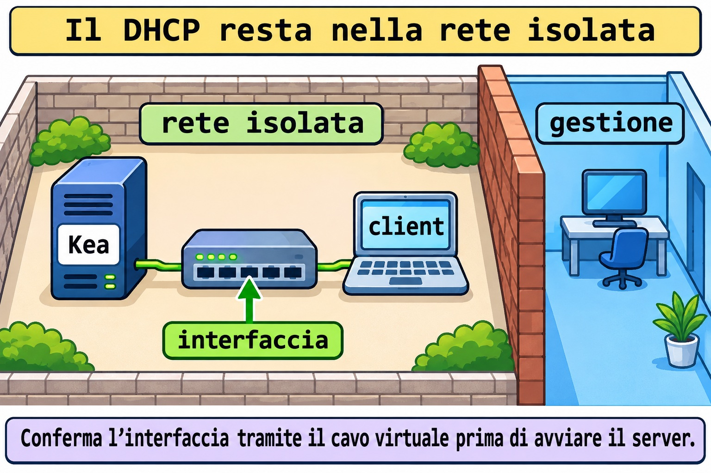
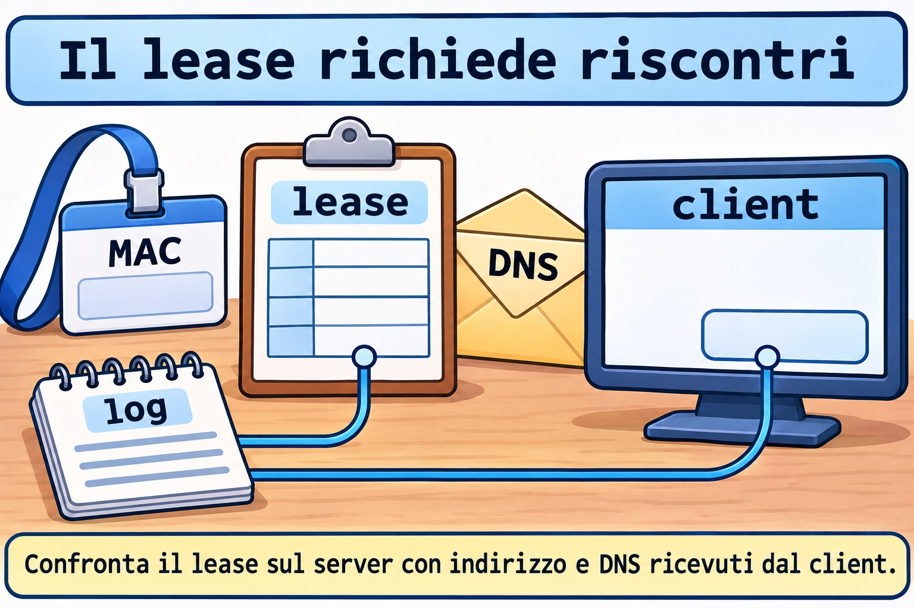

# Lezione 19.3 · DHCP

> **Il cuore di questa lezione:** assegna lease Kea solo nella rete isolata e verifica indirizzo, DNS e ripristino del client.

| Scheda | Piano di lavoro |
| --- | --- |
| Modulo | M19 · Servizi di rete, lezione 3 di 9 |
| Quando | Settimana 25 |
| Alla fine | assegna lease Kea solo nella rete isolata e verifica indirizzo, DNS e ripristino del client. |
| Prerequisiti | M17, M18; VM 201 e 202; utente student; rete isolata vmbr17 |
| Durata | 80–110 minuti |
| Snapshot | m19a3-inicio e m19a3-fim; solo VM indicate |

Il nodo Proxmox riceve solo i comandi indicati come host.

Gli altri appartengono alla VM specificata, con Bash e utente `student`.

Non eseguire i blocchi successivi se una verifica fallisce.

Conserva l’output reale nel diario; questa lezione non presenta un’esecuzione già effettuata.

Completa la [guida del banco M19](../GUIA_BANCADA_M19_IT.md) e conserva il DNS della 19.2.

La VM 202 usa il profilo isolato `m19-isolada`, statico `.202/24`, separato dalla gestione.

Nomi canonici del modulo: il nome della VM in Proxmox e l’hostname del sistema operativo devono corrispondere al ruolo, prima di eseguire le guardie. Un nome DNS di servizio non cambia l’hostname. Se l’inventario differisce, riconcilialo dalla console prima di proseguire; non ignorare le guardie.

| VM | Hostname breve | Indirizzo isolato |
| --- | --- | --- |
| 201 | `rocky-lab` | `192.0.2.201` |
| 202 | `debian-lab` | `192.0.2.202` |
| 204 | `srv-deb` | `192.0.2.204` |
| 212 | `m19-client` | DHCP; solo sfida 19.9 |

## 1 · Riscaldamento

1. Perché un server DHCP sulla bridge di gestione può influire su macchine che non amministri?

2. Un lease include obbligatoriamente un gateway?

3. Chi deve verificare l’identità dell’interfaccia prima di avviare Kea?

Disegna DORA con le direzioni dei quattro messaggi.

Segna indirizzo offerto, server scelto e conferma finale.

## 2 · Perché conta

Un indirizzo manuale funzionante può nascondere l’assenza di DHCP.

Un lease registrato sul server può nascondere un client che applica opzioni diverse.

Il lab richiede verifiche da entrambi i lati e ripristino del client alla base statica.

I prossimi servizi non devono dipendere da un indirizzo temporaneo ottenuto per caso.

### Ponte Windows

Ambito, lease e prenotazione descrivono oggetti diversi.

Una prenotazione identifica un client; non gli impedisce di configurare manualmente un altro indirizzo fuori dal tuo controllo.

## 3 · Modello mentale


*Il lease conferma una conversazione; l’indirizzo da solo non racconta tutta la storia.*

Discover parte dal client; Offer arriva dal server; Request sceglie l’offerta; Ack conferma il lease.

NAK e rinnovo sono parti aggiuntive del protocollo.

Il broadcast raggiunge il segmento locale.

In questo lab non esistono relay o router fra client e server.



*Conferma l’interfaccia tramite il cavo virtuale prima di avviare il server.*

Kea ascolta solo sull’interfaccia reale corrispondente alla MAC di net1 della VM 204.

Non usare mai `*`, il nome della bridge dell’host o l’interfaccia di gestione.

## 4 · L'essenziale

| Oggetto | Contratto |
| --- | --- |
| Server | 204 srv-deb; 192.0.2.204/24 |
| Rete | vmbr17 isolata; senza porta fisica o IP sull’host |
| Pool | 192.0.2.100–192.0.2.149 |
| DNS | 192.0.2.204 |
| Dominio | lab.test |
| Gateway | Nessuno; opzione routers assente |
| Client | 202 net1; verifica temporanea; ritorno a .202 |

Kea separa server, backend dei lease e opzioni.

Useremo DHCPv4 e backend memfile persistente; non servono database esterni né pannelli.

### Rocky × Debian

Il servizio principale gira su Debian 13 nella VM 204.

La VM 201 potrà servire come secondo client; nomi dei pacchetti e politica firewall vanno verificati per distribuzione.

dnsmasq combina funzioni leggere di DHCP e DNS; Kea è un server DHCP specializzato.

Il confronto è concettuale: non installare un secondo DHCP attivo su questa rete.

### Decidi 1

Non hai ancora associato la MAC di net1 al nome Linux.

Quale azione è corretta?

A. Usare tutte le interfacce per cinque minuti.

B. Tenere Kea mascherato e completare l’identificazione.

C. Ascoltare su vmbr0 per trovare il client.

## 5 · Lab guidato

### Passo 1 · Verificare il cavo virtuale e conservare lo stato

**Ipotesi:** Il nome registrato in un file basta a dimostrare che il cavo virtuale non sia cambiato?

Sull’host confronta `qm config 204` e `qm config 202` con la guida del banco.

Conferma net1 solo su vmbr17, senza uplink e senza altro DHCP attivo.

Non modificare le NIC in questa lezione.

```bash
qm snapshot 204 m19a3-inicio
qm snapshot 202 m19a3-inicio
```

Nella VM 204 verifica che il file non sia simbolico, proprietario e permessi prima di caricare le variabili locali create nella 19.1.

Non caricare file scaricati come configurazione della shell.

```bash
test ! -L /etc/m19-lab.env || exit 1
test "$(stat -c %u:%g:%a /etc/m19-lab.env)" = 0:0:644 || exit 1
cat /etc/m19-lab.env
. /etc/m19-lab.env
[[ "$LAB_IF" =~ ^[a-zA-Z][a-zA-Z0-9_-]{0,14}$ ]] || exit 1
test "$LAB_IP" = 192.0.2.204 || exit 1
test "$LAB_NET" = 192.0.2.0/24 || exit 1
ip -br link
ip -4 address show dev "$LAB_IF"
ip -4 route
sudo ss -lunp | grep -E ":67[[:space:]]" || true
```

L’assenza di socket UDP 67 nella VM 204 non dimostra l’assenza di altri DHCP nel segmento.

Conferma l’inventario dei servizi del lab e cattura un Discover se hai dubbi.

Fermati se compare un’offerta di origine sconosciuta.

**Output atteso:** LAB_IF corrisponde alla MAC reale di net1 e ha `.204/24`; nessun lease è stato avviato.

**Verifica:** Se trovi una divergenza, correggi documentazione e interfaccia tramite la guida prima di continuare. Non adattare Kea alla gestione come scorciatoia.

### Passo 2 · Installare mascherato e preparare l’ambito

**Ipotesi:** Validare JSON garantisce anche che il socket si aprirà sull’interfaccia corretta?

```bash
if dpkg-query -W -f='${Status}' kea-dhcp4-server 2>/dev/null | grep -q "install ok installed"; then exit 1; fi
sudo systemctl mask kea-dhcp4-server.service
sudo apt update && sudo apt install kea-dhcp4-server tcpdump
sudo cp -a /etc/kea/kea-dhcp4.conf /etc/kea/kea-dhcp4.conf.m19-original
sudo tee /etc/kea/kea-dhcp4.conf >/dev/null <<EOF
{
  "Dhcp4": {
    "interfaces-config": { "interfaces": [ "$LAB_IF" ] },
    "lease-database": {
      "type": "memfile",
      "persist": true,
      "name": "/var/lib/kea/kea-leases4.csv"
    },
    "valid-lifetime": 600,
    "renew-timer": 300,
    "rebind-timer": 450,
    "subnet4": [ {
      "id": 19,
      "subnet": "192.0.2.0/24",
      "pools": [ { "pool": "192.0.2.100 - 192.0.2.149" } ],
      "option-data": [
        { "name": "domain-name-servers", "data": "192.0.2.204" },
        { "name": "domain-name", "data": "lab.test" }
      ]
    } ],
    "loggers": [ {
      "name": "kea-dhcp4",
      "output-options": [ { "output": "stdout" } ],
      "severity": "INFO"
    } ]
  }
}
EOF
sudo chown root:_kea /etc/kea/kea-dhcp4.conf && sudo chmod 0640 /etc/kea/kea-dhcp4.conf || exit 1
sudo -u _kea kea-dhcp4 -t /etc/kea/kea-dhcp4.conf || exit 1
```

I tempi sopra sono parametri scelti per osservare il rinnovo nel lab, non durate misurate.

Non c’è un’opzione router: il segmento deve raggiungere solo servizi locali.

Il validatore di Kea 2.6 controlla la configurazione, ma non sostituisce avvio, socket, log e un lease reale.

Non modificare manualmente il CSV dei lease.

**Output atteso:** Configurazione accettata dal validatore e demone ancora mascherato. L’unica interfaccia elencata è quella identificata dalla MAC isolata.

**Verifica:** Leggi l’intero file: il pool non include server statici, dominio corretto, DNS `.204` e nessuna opzione routers.

Il file scritto dal heredoc deve essere root:_kea 0640. La directory /etc/kea può appartenere a _kea:_kea con modo 0750; il profilo AppArmor può negare dac_override anche a root. Per questo validiamo come _kea, verificando l’accesso previsto senza disattivare AppArmor. Dopo modifiche e ripristini conserva proprietario, gruppo e modo.

### Passo 3 · Avviare solo dopo la verifica dell’interfaccia

**Ipotesi:** Un firewall permissivo compensa l’ascolto sull’interfaccia sbagliata?

Se esiste un firewall attivo, applica la procedura M16 per DHCPv4 solo su questa interfaccia: client UDP 68 verso server UDP 67, incluso broadcast locale.

Conserva gestione e politica esistente.

```bash
sudo -u _kea kea-dhcp4 -t /etc/kea/kea-dhcp4.conf && sudo systemctl unmask kea-dhcp4-server.service && sudo systemctl enable --now kea-dhcp4-server.service
sudo systemctl --no-pager --full status kea-dhcp4-server
sudo journalctl -u kea-dhcp4-server -b --no-pager -n 50
sudo ss -lunp | grep -E ":67[[:space:]]"
sudo timeout 25 tcpdump -ni "$LAB_IF" -e -vv "udp port 67 or udp port 68"
```

Kea può usare socket raw; per questo una sola riga di `ss` non identifica tutto il percorso.

Confronta configurazione, log di apertura dell’interfaccia e cattura sul dispositivo reale.

**Output atteso:** Il demone si avvia senza errori e indica solo l’interfaccia isolata. Senza un nuovo client potrebbe non esserci DORA durante la cattura.

**Verifica:** Se il demone apre l’interfaccia sbagliata, fermalo immediatamente, tienilo mascherato e correggi l’origine. Non provare mai un’offerta sulla gestione.

### Passo 4 · Richiedere un lease in un profilo temporaneo

**Ipotesi:** Cambiare il metodo IPv4 del profilo di gestione equivale a cambiare il profilo isolato?

Nella VM 202, mantieni disponibili una sessione SSH tramite gestione e la console.

Associa net1 alla MAC, trova l’UUID di `m19-isolada` e registra la configurazione prima del cambio.

```bash
ip -br link
nmcli -f NAME,UUID,TYPE,DEVICE connection show
read -r -p "Interface da MAC de net1 da VM 202: " CLIENT_IF
read -r -p "UUID do perfil m19-isolada: " BASE_UUID
[[ "$CLIENT_IF" =~ ^[a-zA-Z][a-zA-Z0-9_-]{0,14}$ ]] || exit 1
[[ "$BASE_UUID" =~ ^[0-9a-fA-F-]{36}$ ]] || exit 1
test "$(nmcli -g connection.id connection show "$BASE_UUID")" = m19-isolada || exit 1
nmcli connection show "$BASE_UUID" > ~/m19a3-base-profile.txt
nmcli -f GENERAL,IP4 device show "$CLIENT_IF"
ip -4 route
```

Conferma profilo statico `.202/24`, interfaccia esatta e rotta predefinita solo tramite gestione.

Se non corrispondono, torna alla guida.

Verifica che non esista un vecchio profilo chiamato `m19-dhcp-test`.

Prima di attivare il profilo, apri una seconda sessione sulla VM 204 e ripeti la cattura tcpdump sulla LAB_IF isolata. Avvia la cattura subito prima di nmcli up nella VM 202, così la finestra include DORA.

```bash
if nmcli -t -f NAME connection show | grep -Fxq m19-dhcp-test; then exit 1; fi
sudo nmcli connection add type ethernet ifname "$CLIENT_IF" con-name m19-dhcp-test connection.autoconnect no ipv4.method auto ipv4.never-default yes ipv4.dns-priority 200 ipv6.method disabled
TEST_UUID=$(nmcli -g connection.uuid connection show m19-dhcp-test)
[[ "$TEST_UUID" =~ ^[0-9a-fA-F-]{36}$ ]] || exit 1
printf '%s
%s
%s
' "$CLIENT_IF" "$BASE_UUID" "$TEST_UUID" > ~/m19a3-client-state.txt
sudo nmcli connection up uuid "$TEST_UUID" ifname "$CLIENT_IF"
nmcli -f GENERAL,IP4,DHCP4 device show "$CLIENT_IF"
ip -4 route
```

La priorità DNS 200 mantiene preferito il DNS di gestione se la sua priorità è inferiore, come nella guida.

Se la politica reale differisce, fermati e registra prima di attivare; non provocare un cambio globale di DNS come effetto collaterale.

**Output atteso:** Solo net1 riceve un indirizzo del pool; DHCP4 mostra DNS `.204` e dominio. La rotta predefinita di gestione resta uguale.

**Verifica:** Confronta MAC del client, indirizzo ricevuto, server DHCP e opzioni. La sezione DHCP4 contiene valori reali: non copiare un lease illustrativo nel diario.

### Passo 5 · Confrontare client, server e prenotazione

**Ipotesi:** Vedere un indirizzo sul client dimostra che provenga da questo Kea?



*Confronta il lease sul server con indirizzo e DNS ricevuti dal client.*

Nella VM 204 leggi journal e lease senza modificare il CSV.

Confronta indirizzo e identità con i dati reali della VM 202.

```bash
sudo journalctl -u kea-dhcp4-server -b --no-pager -n 80
sudo head -n 1 /var/lib/kea/kea-leases4.csv
sudo tail -n 15 /var/lib/kea/kea-leases4.csv
```

Il CSV memfile può contenere più righe storiche dello stesso indirizzo fino alla pulizia periodica.

Non contare le righe come client attivi; interpreta intestazione, identità e validità del lease.

Nella VM 202 esegui query esplicite al DNS ricevuto, conservando il resolver di gestione.

```bash
dig @192.0.2.204 app.lab.test A
dig @192.0.2.204 lab.test MX
ip -4 address show dev "$CLIENT_IF"
```

Ora applica una prenotazione controllata per il client 202: `.150` resta fuori dal pool dinamico. Verifica nell’inventario che sia libero prima di assegnarlo.

Nella VM 202 leggi la MAC reale di net1 con `cat /sys/class/net/"$CLIENT_IF"/address`; confrontala con net1 del nodo. Copia solo quel valore nella richiesta seguente sulla VM 204.

```bash
read -r -p "MAC real de net1 da VM 202: " CLIENT_MAC
[[ "$CLIENT_MAC" =~ ^([0-9a-fA-F]{2}:){5}[0-9a-fA-F]{2}$ ]] || exit 1
sudo test ! -e /etc/kea/kea-dhcp4.conf.before-reservation || exit 1
sudo cp -a /etc/kea/kea-dhcp4.conf /etc/kea/kea-dhcp4.conf.before-reservation
sudo python3 - "$CLIENT_MAC" <<'PY'
import json,sys
p="/etc/kea/kea-dhcp4.conf"
with open(p) as f: c=json.load(f)
s=c["Dhcp4"]["subnet4"][0]
assert s["subnet"] == "192.0.2.0/24"
assert "reservations" not in s
s["reservations"]=[{"hw-address":sys.argv[1].lower(),"ip-address":"192.0.2.150"}]
with open(p,"w") as f: json.dump(c,f,indent=2); f.write("\n")
PY
sudo -u _kea kea-dhcp4 -t /etc/kea/kea-dhcp4.conf && sudo systemctl restart kea-dhcp4-server
sudo journalctl -u kea-dhcp4-server -b --no-pager -n 25
```

Se la validazione fallisce, non riavviare: ripristina la copia precedente e valida di nuovo. Controlla che il file conservi l’unica interfaccia isolata e che il pool non sia cambiato.

Nella VM 202 riattiva soltanto il profilo temporaneo; il profilo di gestione resta attivo. Una nuova acquisizione deve ora ricevere `.150`, identificata dalla MAC reale.

```bash
sudo nmcli connection down uuid "$TEST_UUID"
sudo nmcli connection up uuid "$TEST_UUID" ifname "$CLIENT_IF"
nmcli -f GENERAL,IP4,DHCP4 device show "$CLIENT_IF"
```

Confronta il nuovo lease nei log Kea e sul client. Conserva la prenotazione per questa MAC; gli altri client continuano a usare il pool e al Passo 6 il client 202 torna statico `.202`.

**Output atteso:** Il lease reale corrisponde fra client e server. Distingui pool dinamico, prenotazione e indirizzo statico.

**Verifica:** DNS ricevuto e risposta corretta sono verifiche distinte. Un server DHCP può fornire un’opzione sintatticamente valida e semanticamente errata.

### Decidi 2

L’indirizzo è nel pool, ma DNS punta a un altro server.

Che cosa fai?

A. Confrontare opzioni del lease, origine dell’offerta e configurazione applicata.

B. Assegnare un gateway qualsiasi al client.

C. Accettare perché ottenere un indirizzo dimostra tutto.

### Passo 6 · Ripristinare il client e verificare l’avvio

**Ipotesi:** Eliminare il profilo temporaneo garantisce che quello statico sia tornato attivo?

Nella stessa sessione Bash della VM 202 usa solo gli UUID registrati.

Se ti sei riconnesso, leggi il diario e controlla ogni valore con `nmcli` prima di definirlo; non eseguire il diario come script.

```bash
test "$(nmcli -g connection.id connection show "$BASE_UUID")" = m19-isolada || exit 1
test "$(nmcli -g connection.id connection show "$TEST_UUID")" = m19-dhcp-test || exit 1
sudo nmcli connection up uuid "$BASE_UUID" ifname "$CLIENT_IF"
nmcli -f GENERAL,IP4 device show "$CLIENT_IF"
ip -4 route
```

Solo dopo aver verificato `.202/24` e gestione conservata, rimuovi il profilo temporaneo tramite l’UUID esatto.

Non usare mai una rimozione con un criterio ampio.

```bash
sudo nmcli connection delete uuid "$TEST_UUID"
dig @192.0.2.204 app.lab.test A
nmcli -f NAME,UUID,DEVICE connection show --active
```

**Reboot di verifica:** Riavvia 202 dalla console e verifica gestione, profilo statico isolato e DNS esplicito. Riavvia 204 separatamente e verifica BIND e Kea sull’interfaccia corretta.

Nella VM 204, dopo il reboot:

```bash
sudo systemctl is-active named kea-dhcp4-server
sudo -u _kea kea-dhcp4 -t /etc/kea/kea-dhcp4.conf
sudo journalctl -u kea-dhcp4-server -b --no-pager -n 35
ip -4 address
ip -4 route
```

**Output atteso:** Kea resta disponibile solo nell’isolamento. Il client 202 termina statico `.202`, pronto per le prossime lezioni.

**Verifica:** Sull’host esegui gli snapshot finali di 204 e 202. Conserva Kea per la sfida 19.9; non creare la VM 212 adesso.

```bash
qm snapshot 204 m19a3-fim
qm snapshot 202 m19a3-fim
```

## 6 · Rompi e ripara

### Guasto 1 · JSON rifiutato prima dell’avvio

**Sintomo:** La copia di esercizio non supera il validatore.

**Indagine:** Copia il file in `/tmp/m19-kea-broken.json`, rimuovi una virgola solo in questa copia ed esegui `sudo kea-dhcp4 -t /tmp/m19-kea-broken.json`.

**Causa:** La struttura JSON non rappresenta la configurazione prevista.

**Riparazione:** Ripristina la virgola nella copia e valida di nuovo; non caricare il file guasto nel servizio.

**Verifica:** La configurazione attiva continua a rispondere e la copia corretta supera il controllo.

**Prevenzione:** Valida prima di avviare o riavviare.

### Guasto 2 · Client senza offerta

**Sintomo:** Il profilo DHCP attende e non riceve un indirizzo.

**Indagine:** Cattura sull’interfaccia isolata; confronta Discover, journal Kea, MAC e bridge delle due VM.

**Causa:** Può esserci un cavo virtuale errato, interfaccia sbagliata, demone fermo o filtraggio.

**Riparazione:** Correggi solo la causa osservata. Se l’interfaccia è incerta, ferma Kea; non aprire mai tutte le interfacce.

**Verifica:** Un’offerta del server previsto è seguita da Request e Ack.

**Prevenzione:** Associa MAC e dispositivo prima della prima offerta.

### Guasto 3 · Indirizzo corretto, DNS errato

**Sintomo:** Il client ha un indirizzo del pool, ma i nomi del lab falliscono.

**Indagine:** Confronta opzioni DHCP4 e query esplicita all’indirizzo DNS ricevuto.

**Causa:** L’opzione DNS può essere sbagliata oppure il servizio DNS irraggiungibile.

**Riparazione:** Correggi l’opzione nel file noto, valida e riavvia Kea solo dopo aver verificato l’interfaccia; rinnova il profilo di prova controllato.

**Verifica:** Il nuovo lease mostra `.204` e la query esplicita risponde.

**Prevenzione:** Controlla la semantica delle opzioni oltre all’indirizzo del pool.

## 7 · Trappole

Prima di accusare il servizio, verifica VM, interfaccia e rete.

Una risposta corretta di un altro server resta la verifica sbagliata.

Un file accettato dal validatore non dimostra che il processo lo abbia caricato.

Controlla anche stato, socket e risposta del client.

Gli indirizzi di documentazione usati qui appartengono solo al segmento segregato.

Se si sovrappongono a gestione, VPN o rotte esistenti, fermati.

## 8 · Quiz

1. Perché non esiste l’opzione routers in questa configurazione?

2. Che cosa distingue Offer da Ack?

3. Il validatore dimostra l’apertura del socket?

4. Una prenotazione appartiene obbligatoriamente al pool dinamico?

5. Come deve terminare la lezione il client?

Rispondi prima di aprire le soluzioni.

Per ogni risposta, indica un’osservazione capace di smentirla.

## 9 · Promemoria

```bash
sudo -u _kea kea-dhcp4 -t /etc/kea/kea-dhcp4.conf
sudo journalctl -u kea-dhcp4-server -b --no-pager -n 40
ip -4 address
nmcli -f GENERAL,IP4,DHCP4 device show
```

**Flashcard:** Qual è l’oggetto? Chi risponde? Quale osservazione distingue configurazione e risultato?

`!explica`

`!feynman`

`!quiz`

## 10 · Checklist e chiusura

- [ ] MAC e interfaccia reale di net1 verificate prima dell’avvio.

- [ ] Solo Kea nell’isolamento; nessun DHCP sulla gestione.

- [ ] Lease e DNS confrontati da entrambi i lati.

- [ ] Client 202 ripristinato al profilo statico.

- [ ] Kea persistente e VM 212 non ancora creata.

**Ultimo esercizio:** Rifai il disegno iniziale usando solo riscontri registrati nel lab. Segna ciò che non hai ancora dimostrato.

Lo snapshot finale registra una fase coerente; non sostituisce il backup indipendente.

Non eliminare la VM 204 né la rete isolata: servono alle prossime lezioni.

## 11 · Nella vita reale

Missione di sola lettura: in un ambiente autorizzato, identifica server interrogato, interfaccia usata e responsabile della configurazione.

Non modificare profili, porte, lease o zone.

Consegna tre riscontri con ora e contesto, un’ipotesi e un limite.

Rimuovi i dati privati prima di condividere il rapporto.

## 12 · Approfondire quando vuoi

[Kea 2.6: configurazione DHCPv4, lease e prenotazioni](https://kea.readthedocs.io/en/kea-2.6.5/arm/dhcp4-srv.html)

[Debian 13: pacchetto kea-dhcp4-server](https://packages.debian.org/trixie/kea-dhcp4-server)

[NetworkManager: proprietà IPv4](https://networkmanager.dev/docs/api/latest/settings-ipv4.html)

Usa la documentazione della versione installata.

Controlla il manuale locale prima di adattare un’opzione di un’altra versione.

## Soluzioni commentate

Riscaldamento: il broadcast può raggiungere terzi nella stessa rete; il gateway è un’opzione, non un obbligo; l’operatore deve verificare MAC e cavo virtuale.

Decidi 1: B.

Senza verifica dell’interfaccia il server resta mascherato.

Decidi 2: A.

L’indirizzo ricevuto non dimostra opzioni corrette né origine del lease.

Quiz 1: il segmento non ha router e non richiede una rotta predefinita.

Quiz 2: Offer propone; Ack conferma il lease richiesto.

Quiz 3: no; servono avvio, log dell’interfaccia e conversazione reale.

Quiz 4: no; `.150` è stato pianificato fuori dal pool e deve essere libero.

Quiz 5: profilo `m19-isolada` statico `.202/24`, gestione conservata e profilo temporaneo rimosso tramite UUID esatto.

[← Lezione 19.2](19.2-dns-recursivo-e-diagnostico.md) · [Indice delle lezioni](../01-aulas.md) · [Piano del corso](../00-plano-do-curso.md)
