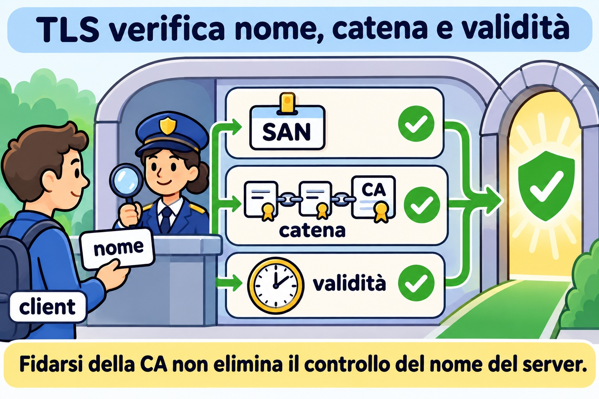
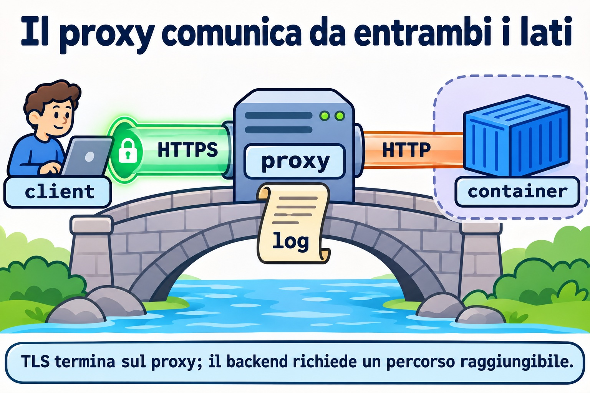

# Lezione 19.5 · TLS e reverse proxy: identità prima del lucchetto

> **Il cuore di questa lezione:** verificare nome, catena e validità, conservando la chiave privata e la separazione tra proxy e backend.

| Scheda | Piano di lavoro |
| --- | --- |
| Modulo | M19 · Servizi di rete, lezione 5 di 9 |
| Quando | Settimana 26 |
| Alla fine | verificare nome, catena e validità, conservando la chiave privata e la separazione tra proxy e backend. |
| Prerequisiti | 19.4; servizio rootless persistente di M18 nella VM 201 |
| Durata | 100–120 minuti |
| Snapshot | Soltanto VM del corso: `m19a5-inicio` e `m19a5-fim` |

La VM principale è `204`, `srv-deb`, Debian 13. L’interfaccia isolata ha `192.0.2.204/24` su `vmbr17`; l’interfaccia di gestione conserva il proprio indirizzo reale.

La rete `192.0.2.0/24` è stata riservata al lab dopo aver escluso sovrapposizioni con gestione e VPN. Non instradarla verso Internet.

I blocchi indicano su quale macchina e con quale identità lavorare. Crea lo snapshot prima della modifica e tieni disponibile la console; non eseguire queste operazioni sull’host Proxmox.

Se trovi una configurazione o un servizio precedente fuori dal percorso, fermati e riconcilia l’inventario. I controlli evitano di sostituire un servizio sconosciuto con una configurazione didattica.

La rete isolata della VM `201` deve essere pronta secondo la [Guida del banco](../GUIA_BANCADA_M19_IT.md). Usa `192.0.2.201`; la gestione rimane intatta.

Nomi canonici del modulo: il nome della VM in Proxmox e l’hostname del sistema operativo devono corrispondere al ruolo, prima di eseguire le guardie. Un nome DNS di servizio non cambia l’hostname. Se l’inventario differisce, riconcilialo dalla console prima di proseguire; non ignorare le guardie.

| VM | Hostname breve | Indirizzo isolato |
| --- | --- | --- |
| 201 | `rocky-lab` | `192.0.2.201` |
| 202 | `debian-lab` | `192.0.2.202` |
| 204 | `srv-deb` | `192.0.2.204` |
| 212 | `m19-client` | DHCP; solo sfida 19.9 |

## 1 · Riscaldamento

1. Fidarti della CA rende valido qualsiasi nome presentato dal server?

2. Il loopback della VM `201` è raggiungibile usando il loopback della VM `204`?

3. Al client serve la chiave privata della CA per verificare un certificato?

## 2 · Perché conta

Una connessione cifrata con la macchina sbagliata consegna comunque informazioni alla macchina sbagliata. TLS deve collegare la richiesta a un nome autorizzato e a una catena fidata dal client.

Il proxy presenta l’identità esterna e apre un’altra connessione al servizio. Il secondo tratto deve esistere e avere accesso limitato; il certificato del primo tratto non lo crea.

### Ponte Windows

Un certificato pubblico può essere copiato come un documento di identità verificabile. La chiave privata è il mezzo per dimostrarne il possesso; distribuirla insieme elimina la separazione che volevi costruire.

## 3 · Modello mentale



*Fidarsi della CA non elimina il controllo del nome del server.*

Il client richiede un nome. Il certificato server presenta nomi in `subjectAltName`; la CA firma quel certificato. L’orologio partecipa alla verifica della validità.

In questo banco la CA è privata del corso, senza fiducia pubblica. Fornirai esplicitamente il suo certificato al client; non abituerai il browser a ignorare gli errori.

Il certificato verrà riutilizzato dalla posta nella 19.8. Includi fin da ora il nome della posta nel SAN; copiare un certificato privo di quel nome non corregge l’identità.

## 4 · L'essenziale

| Oggetto | Posizione | Distribuzione |
| --- | --- | --- |
| CA privata | `/root/m19-ca/ca.key` | Non lascia mai la VM emittente |
| CA pubblica | `/etc/ssl/m19/ca.crt` | Client autorizzati |
| Certificato server | `/etc/ssl/m19/server.crt` | Servizio che presenta l’identità |
| Chiave server | `/etc/ssl/private/m19-server.key` | Root, modo `600` |

### Rocky × Debian

Il proxy principale rimane su Debian `204`. Nella VM Rocky `201`, il servizio rootless continua ad appartenere a `student`, con SELinux conservato e contenuto montato soltanto nell’albero di M18.

Spostare un proxy su Rocky aggiungerebbe l’indagine della politica di connessione del processo web. Non attivare preventivamente un permesso ampio; questo lab non richiede tale modifica nella VM `201`.

### Decidi 1

Il certificato è firmato dalla CA corretta, ma il nome richiesto manca nel SAN. Che cosa risolve?

A. Disattivare la verifica nel client.
B. Emettere nuovamente con il nome corretto e verificare il certificato presentato.
C. Copiare la chiave privata della CA sul client.

## 5 · Lab guidato

### Passo 1 · Controllare le due estremità

**Ipotesi:** Una pubblicazione locale di M18 può diventare upstream remoto senza modifiche?

Nella VM `204`, come root, controlla il servizio della lezione precedente e l’orologio. Nella VM `201`, entra direttamente come `student` per i comandi dell’utente.

```bash
test ! -L /etc/m19-lab.env || exit 1
test "$(stat -c '%U:%G:%a' /etc/m19-lab.env)" = root:root:644 || exit 1
cat /etc/m19-lab.env
. /etc/m19-lab.env
test "$LAB_IP" = 192.0.2.204
ip -4 -o address show dev "$LAB_IF" | grep -F '192.0.2.204/24'
timedatectl status
nginx -t
curl --fail -H 'Host: www.lab.test' http://192.0.2.204/
```

Ora nella VM `201`, come `student`:

```bash
test "$(id -un)" = student
ip -br -4 address
systemctl --user is-active m18-web.service
grep -F 'PublishPort=' ~/.config/containers/systemd/m18-web.container
curl --fail http://127.0.0.1:18080/
```

**Output atteso:** M18 risponde sul loopback della `201`, mentre nginx risponde sulla rete isolata della `204`.

**Verifica:** Se il Quadlet non contiene il servizio previsto o M18 non risponde, risolvi la continuità prima di creare il proxy.

### Passo 2 · Autorizzare soltanto il proxy sul backend

**Ipotesi:** Quale macchina deve potersi collegare alla porta pubblicata della VM `201`?

Sempre nella VM `201`, come `student`, identifica l’interfaccia dall’indirizzo già configurato. Installa prima le regole limitate; modifica il bind del Quadlet soltanto dopo.

```bash
set -eu
LAB_IF=$(ip -4 -o address show | awk '$4 == "192.0.2.201/24" {print $2}')
test -n "$LAB_IF"
test "$(printf '%s\n' "$LAB_IF" | wc -l)" -eq 1
sudo firewall-cmd --state
ZONE=$(sudo firewall-cmd --get-zone-of-interface "$LAB_IF" || true)
if test -z "$ZONE" || test "$ZONE" = 'no zone'; then
  ZONE=$(sudo firewall-cmd --get-default-zone)
fi
ALLOW='rule priority="-20" family="ipv4" source address="192.0.2.204/32" destination address="192.0.2.201/32" port port="18080" protocol="tcp" accept'
DENY='rule priority="-10" family="ipv4" destination address="192.0.2.201/32" port port="18080" protocol="tcp" drop'
sudo firewall-cmd --zone="$ZONE" --add-rich-rule="$ALLOW"
sudo firewall-cmd --zone="$ZONE" --add-rich-rule="$DENY"
sudo firewall-cmd --permanent --zone="$ZONE" --add-rich-rule="$ALLOW"
sudo firewall-cmd --permanent --zone="$ZONE" --add-rich-rule="$DENY"
sudo firewall-cmd --zone="$ZONE" --list-rich-rules
install -d -m 700 ~/m19-lab
test ! -e ~/m19-lab/m18-web.before.container
cp -a ~/.config/containers/systemd/m18-web.container ~/m19-lab/m18-web.before.container
python3 - <<'PY'
from pathlib import Path
p = Path.home()/'.config/containers/systemd/m18-web.container'
s = p.read_text()
assert 'ContainerName=m18-web' in s
assert 'Label=io.course.module=M18' in s
old = 'PublishPort=127.0.0.1:18080:8080'
assert s.count(old) == 1
p.write_text(s.replace(old, 'PublishPort=192.0.2.201:18080:8080'))
PY
systemctl --user daemon-reload
systemctl --user restart m18-web.service
podman port m18-web
```

**Output atteso:** La pubblicazione diventa `192.0.2.201:18080`, con accettazione dell’origine `192.0.2.204` prima dello scarto delle altre origini.

**Verifica:** Nella VM `204`, `curl --fail http://192.0.2.201:18080/` deve funzionare. Nella VM `202`, usa un limite di tempo e conferma il rifiuto. Non concludere soltanto dall’elenco delle regole.

Nella VM `202`, la richiesta `curl --connect-timeout 3 --max-time 5 http://192.0.2.201:18080/` non deve ottenere la pagina. Se la ottiene, fermati e indaga regole precedenti con priorità maggiore.

### Passo 3 · Creare una CA di laboratorio

**Ipotesi:** Quale oggetto può arrivare ai client senza consentire l’emissione di certificati?


*Distribuisci il certificato pubblico; conserva la chiave privata.*

Torna alla VM `204`, come root. La password della chiave CA verrà richiesta nel terminale; non inserirla in argomenti, cronologia o file della lezione.

```bash
set -eu
umask 077
test ! -e /root/m19-ca
test ! -e /etc/ssl/m19
test ! -e /etc/ssl/private/m19-server.key
install -d -m 700 /root/m19-ca
install -d -m 755 /etc/ssl/m19
openssl genpkey -algorithm RSA -aes-256-cbc   -pkeyopt rsa_keygen_bits:3072 -out /root/m19-ca/ca.key
openssl req -new -x509 -sha256 -days 3650   -key /root/m19-ca/ca.key -out /etc/ssl/m19/ca.crt   -subj '/CN=M19 Lab CA'   -addext 'basicConstraints=critical,CA:TRUE'   -addext 'keyUsage=critical,keyCertSign,cRLSign'
chmod 600 /root/m19-ca/ca.key
chmod 644 /etc/ssl/m19/ca.crt
openssl x509 -in /etc/ssl/m19/ca.crt -noout -subject -fingerprint -sha256
```

**Output atteso:** La chiave CA rimane cifrata e limitata a root; il certificato pubblico può essere controllato senza la password della CA.

**Verifica:** Registra l’impronta del certificato pubblico tramite un canale fidato. La CA dell’esercizio non sostituisce una politica reale di emissione, revoca e custodia.

### Passo 4 · Emettere l’identità con SAN

**Ipotesi:** Il nome nella richiesta deve corrispondere a quale estensione del certificato?

```bash
openssl genpkey -algorithm RSA -pkeyopt rsa_keygen_bits:3072   -out /etc/ssl/private/m19-server.key
chmod 600 /etc/ssl/private/m19-server.key
openssl req -new -key /etc/ssl/private/m19-server.key   -out /root/m19-ca/server.csr -subj '/CN=mail.lab.test'
cat > /root/m19-ca/server.ext <<'EOF'
basicConstraints=critical,CA:FALSE
keyUsage=critical,digitalSignature,keyEncipherment
extendedKeyUsage=serverAuth
subjectAltName=DNS:web.lab.test,DNS:www.lab.test,DNS:mail.lab.test,DNS:proxy.lab.test,DNS:srv-deb.lab.test
EOF
openssl x509 -req -sha256 -days 90   -in /root/m19-ca/server.csr -CA /etc/ssl/m19/ca.crt   -CAkey /root/m19-ca/ca.key -CAcreateserial   -extfile /root/m19-ca/server.ext -out /etc/ssl/m19/server.crt
chmod 644 /etc/ssl/m19/server.crt
openssl x509 -in /etc/ssl/m19/server.crt -noout -dates -ext subjectAltName
openssl verify -CAfile /etc/ssl/m19/ca.crt   -verify_hostname web.lab.test /etc/ssl/m19/server.crt
openssl verify -CAfile /etc/ssl/m19/ca.crt   -verify_hostname mail.lab.test /etc/ssl/m19/server.crt
```

**Output atteso:** Il certificato contiene i cinque nomi SAN e serve i nomi web e posta. La validità del certificato finale è inferiore a quella della CA.

**Verifica:** Controlla i nomi emessi, non soltanto la richiesta CSR. Un’estensione assente dall’emissione non viene aggiunta da nginx.

### Passo 5 · Terminare TLS e raggiungere il backend

**Ipotesi:** L’indirizzo dell’upstream appartiene al proxy o alla macchina che esegue il container?



*TLS termina sul proxy; il backend richiede un percorso raggiungibile.*

```bash
test ! -e /etc/nginx/conf.d/m19-tls.conf
cat > /etc/nginx/conf.d/m19-tls.conf <<'EOF'
server {
    listen 192.0.2.204:443 ssl;
    server_name web.lab.test www.lab.test proxy.lab.test;
    ssl_certificate /etc/ssl/m19/server.crt;
    ssl_certificate_key /etc/ssl/private/m19-server.key;
    ssl_protocols TLSv1.2 TLSv1.3;
    allow 192.0.2.0/24;
    deny all;
    access_log /var/log/nginx/m19-tls-access.log;
    error_log /var/log/nginx/m19-tls-error.log;
    location / {
        proxy_pass http://192.0.2.201:18080;
        proxy_set_header Host $host;
        proxy_set_header X-Forwarded-Proto $scheme;
        proxy_set_header X-Forwarded-For $remote_addr;
    }
}
EOF
nginx -t
systemctl reload nginx
ss -ltnp '( sport = :443 )'
curl --fail --cacert /etc/ssl/m19/ca.crt   --resolve web.lab.test:443:192.0.2.204 https://web.lab.test/
```

**Output atteso:** La richiesta HTTPS verificata riceve il contenuto di M18. Il secondo tratto usa HTTP soltanto sulla rete isolata e accetta l’origine del proxy.

**Verifica:** Se esiste un firewall Debian precedente, consenti soltanto TCP 443 dalla rete isolata all’indirizzo isolato secondo il piano della 19.1. Non sostituire l’insieme delle regole.

### Passo 6 · Verificare da un client indipendente

**Ipotesi:** Una verifica effettuata sul server dimostra la fiducia di un altro client?

Copia soltanto `ca.crt` nella VM `202`, tramite trasferimento autenticato e con impronta verificata. Crea lì `/etc/ssl/m19/ca.crt` come root, modo `644`; non copiare mai la chiave privata.

Nella VM `204`, prepara una copia pubblica per l’account di trasferimento già autorizzato. Il file temporaneo seguente contiene soltanto il certificato pubblico.

```bash
install -o student -g student -m 644 /etc/ssl/m19/ca.crt /home/student/m19-ca-public.crt
openssl x509 -in /home/student/m19-ca-public.crt -noout -fingerprint -sha256
```

Nella VM `202`, come `student`, usa la destinazione di gestione reale della VM `204`, secondo l’inventario. Verifica la chiave SSH nota prima del trasferimento.

```bash
read -r -p 'SSH target of VM 204: ' SRV_SSH
scp "student@$SRV_SSH:m19-ca-public.crt" ./m19-ca-public.crt
openssl x509 -in ./m19-ca-public.crt -noout -fingerprint -sha256
sudo install -d -m 755 /etc/ssl/m19
sudo install -m 644 ./m19-ca-public.crt /etc/ssl/m19/ca.crt
curl --fail --cacert /etc/ssl/m19/ca.crt   --resolve web.lab.test:443:192.0.2.204 https://web.lab.test/
openssl s_client -connect 192.0.2.204:443 -servername web.lab.test   -CAfile /etc/ssl/m19/ca.crt -verify_hostname web.lab.test   -verify_return_error </dev/null
```

**Output atteso:** Il client verifica catena e nome senza disattivare il controllo; la pagina proviene dal servizio rootless.

**Verifica:** Ripeti dopo il reboot della `201` e della `204`. Conferma il blocco diretto dalla `202` alla porta `18080` e l’accesso consentito all’HTTPS del proxy.

## 6 · Rompi e ripara

Le prove di nome e fiducia non richiedono di corrompere i file del server. Eseguile sul client con gli stessi certificati e confronta gli errori.

### Guasto 1 · Nome fuori dal SAN

**Sintomo:** Richiedi `https://wrong.lab.test/` con risoluzione esplicita verso `192.0.2.204` e la stessa CA.

**Indagine:** Confronta il nome della richiesta con `openssl x509 -ext subjectAltName`.

**Causa:** Fidarsi dell’emittente non autorizza un nome assente dal SAN.

**Riparazione:** Torna al nome `web.lab.test`; una nuova identità richiederebbe un’emissione revisionata.

**Verifica:** Il nome autorizzato passa e quello errato continua a fallire.

**Prevenzione:** Includi una prova negativa del nome nella consegna TLS.

### Guasto 2 · Client senza CA

**Sintomo:** Ripeti la richiesta senza `--cacert`, su un client che non ha ricevuto questa CA nell’archivio globale.

**Indagine:** Confronta l’errore di fiducia con la verifica esplicita della CA pubblica.

**Causa:** La CA privata del lab non è automaticamente fidata su un altro sistema.

**Riparazione:** Fornisci al client la CA pubblica verificata; non usare un’opzione per ignorare la validazione.

**Verifica:** Ripeti con nome e CA corretti e controlla l’impronta.

**Prevenzione:** Distribuisci la fiducia con una procedura esplicita e un ambito noto.

### Guasto 3 · Upstream non disponibile

**Sintomo:** Nella VM `201`, come `student`, ferma `m18-web.service`; HTTPS supera la verifica ma restituisce 502.

**Indagine:** Nella VM `204`, leggi l’errore del proxy e verifica il backend con un limite di tempo.

**Causa:** Il problema è successivo alla terminazione TLS; il certificato non avvia il servizio.

**Riparazione:** Nella VM `201`, come `student`, avvia `m18-web.service`.

**Verifica:** HTTPS torna a consegnare il contenuto e la `202` resta senza accesso diretto al backend.

**Prevenzione:** Monitora separatamente validità TLS e risposta applicativa.

## 7 · Trappole

Un certificato valido per DNS non autorizza automaticamente una richiesta all’IP. Il lab usa nomi SAN e non emette SAN di indirizzo IP.

La chiave server rimane senza password per avviare il servizio senza intervento, protetta da root e modo `600`. La chiave CA rimane cifrata e non viene caricata da nginx.

Il file della CA pubblica non va confuso con la chiave privata perché il client usa lo stesso nome di directory. Controlla tipo, impronta e destinazione prima del trasferimento.

### Decidi 2

TLS viene verificato, ma la risposta è 502. Quale verifica distingue l’ipotesi principale?

A. Aprire la porta backend a tutta la gestione.
B. Emettere subito un’altra CA.
C. Verificare il backend dal proxy e leggere l’errore dell’upstream.

## 8 · Quiz

1. Quali tre verifiche di identità e fiducia hai separato?

2. Perché la chiave privata della CA non raggiunge il client?

3. Quale modifica ha reso il servizio di M18 raggiungibile dal proxy?

4. Quale client deve fallire nell’accesso diretto al backend?

5. Che cosa dimostra una verifica TLS seguita da 502?

## 9 · Promemoria

**Flashcard:** rispondi ad alta voce senza cercare la riga di comando. Una buona risposta nomina il riscontro che può contraddire la tua ipotesi.

- Nome SAN, catena di fiducia e validità temporale sono verifiche indipendenti.

- La CA pubblica verifica la firma; la chiave privata permetterebbe di emettere identità.

- Il bind è passato all’indirizzo isolato della VM 201, con firewall che accetta soltanto la VM 204.

Usa DeepTutor per giustificare l’ordine delle verifiche con i risultati che hai misurato. Non inviare password, chiavi private o dati di altri utenti.

```text
!explica Separe nome SAN, cadeia de confianca e validade temporal.
!feynman Explique as duas conexoes do proxy sem confundir seus enderecos.
!quiz Crie tres falhas de TLS ou backend e peca a prova que as separa.
```

## 10 · Checklist e chiusura

- [ ] So indicare macchina, interfaccia, identità e file responsabile della modifica.

- [ ] Ho registrato ipotesi, risultato osservato e una verifica indipendente.

- [ ] Ho annullato tutti i guasti introdotti e ripetuto l’accesso dal client autorizzato.

- [ ] Ho conservato l’interfaccia di gestione e le protezioni di accesso del sistema.

**Reboot di verifica:** dopo aver corretto i guasti, riavvia soltanto la VM del corso coinvolta. Dalla console controlla l’interfaccia isolata e ripeti la richiesta reale da un’altra VM.

Uno stato attivo dopo il reboot è soltanto una delle prove. La risposta deve arrivare dall’indirizzo corretto, con il nome corretto e l’identità prevista.

**Ultimo esercizio:** chiudi il terminale usato per configurare. In una nuova sessione ricostruisci il percorso della richiesta usando gli appunti, senza dipendere dalle variabili della sessione precedente.

La pulizia di questa lezione elimina i file temporanei di prova e ripristina i guasti. Conserva servizi, dati e configurazione dedicati a M19 per la sfida integrata della 19.9.

Crea `m19a5-fim` soltanto dopo la verifica esterna. Annota il punto di ripristino precedente e non ripristinare una VM senza valutare i servizi già usati dalle altre lezioni.

## 11 · Nella vita reale

Missione di osservazione: scegli un servizio già autorizzato e segui una singola richiesta nei registri disponibili, senza modificare configurazione, permessi, utenti o firewall.

Consegna un disegno con client, nome, indirizzo, processo e file. Segna ciò che hai misurato e ciò che resta un’ipotesi; non trasformare l’assenza di riscontri in un’autorizzazione a modificare.

## 12 · Approfondire quando vuoi

[OpenSSL · emissione e ispezione dei certificati](https://docs.openssl.org/3.5/man1/openssl-x509/)

[nginx · modulo proxy HTTP](https://nginx.org/en/docs/http/ngx_http_proxy_module.html)

[curl · verifica dei certificati](https://curl.se/docs/sslcerts.html)

Consulta anche il manuale installato nella VM: la sintassi della versione presente ha priorità sugli esempi di un’altra distribuzione o edizione.

## Soluzioni commentate

1. Nome SAN, catena di fiducia e validità temporale sono verifiche indipendenti.

2. La CA pubblica verifica la firma; la chiave privata permetterebbe di emettere identità.

3. Il bind è passato all’indirizzo isolato della VM 201, con firewall che accetta soltanto la VM 204.

4. Decidi 1: B. L’identità emessa deve contenere il nome; ignorare l’errore non lo corregge.

5. Decidi 2: C. TLS può essere corretto mentre la connessione al backend fallisce.

6. La VM 202 accede a HTTPS sul proxy, ma non accede direttamente alla porta 18080 del backend.

### Quiz · Risposte per domanda

1. Nome SAN, catena di fiducia e validità temporale.

2. La chiave CA permette di emettere certificati; la verifica richiede soltanto il certificato pubblico fidato.

3. Il Quadlet è passato dal loopback all’indirizzo isolato della VM 201, dopo aver limitato l’origine nel firewall.

4. La VM 202 deve fallire sulla porta 18080; soltanto la VM 204 viene accettata.

5. L’identità TLS è stata verificata, ma il percorso dal proxy al backend è fallito.

La risposta è completa soltanto quando spiega perché l’alternativa scartata non risolve la causa osservata. Se restano possibili due cause, aggiungi una verifica che le distingua.

[← Indice delle lezioni](../01-aulas.md) · [Piano del corso →](../00-plano-do-curso.md)
