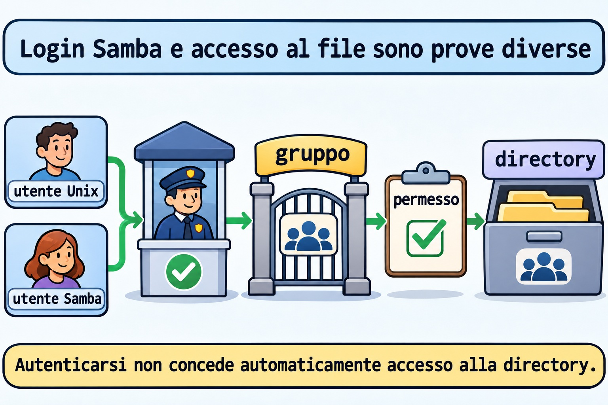

# Lezione 19.6 · Samba: il ponte con il client Windows

> **Il cuore di questa lezione:** separare autenticazione Samba, autorizzazione della share e permessi Unix nella verifica di un file condiviso.

| Scheda | Piano di lavoro |
| --- | --- |
| Modulo | M19 · Servizi di rete, lezione 6 di 9 |
| Quando | Settimana 26 |
| Alla fine | separare autenticazione Samba, autorizzazione della share e permessi Unix nella verifica di un file condiviso. |
| Prerequisiti | 19.1–19.5; DNS isolato e client autorizzato sulla stessa rete |
| Durata | 100–120 minuti |
| Snapshot | Soltanto VM del corso: `m19a6-inicio` e `m19a6-fim` |

La VM principale è `204`, `srv-deb`, Debian 13. L’interfaccia isolata ha `192.0.2.204/24` su `vmbr17`; l’interfaccia di gestione conserva il proprio indirizzo reale.

La rete `192.0.2.0/24` è stata riservata al lab dopo aver escluso sovrapposizioni con gestione e VPN. Non instradarla verso Internet.

I blocchi indicano su quale macchina e con quale identità lavorare. Crea lo snapshot prima della modifica e tieni disponibile la console; non eseguire queste operazioni sull’host Proxmox.

Se trovi una configurazione o un servizio precedente fuori dal percorso, fermati e riconcilia l’inventario. I controlli evitano di sostituire un servizio sconosciuto con una configurazione didattica.

La VM `204` ospita il server principale. Usa la VM `202` come client Linux. Il client Windows 11 deve essere una macchina già autorizzata e collegata alla rete isolata; questa lezione non crea un’altra VM.

Senza quel client Windows completa e registra la verifica Linux; segna la verifica Windows come in sospeso. Non modificare macchine fuori dall’inventario del corso per colmare la lacuna.

Nomi canonici del modulo: il nome della VM in Proxmox e l’hostname del sistema operativo devono corrispondere al ruolo, prima di eseguire le guardie. Un nome DNS di servizio non cambia l’hostname. Se l’inventario differisce, riconcilialo dalla console prima di proseguire; non ignorare le guardie.

| VM | Hostname breve | Indirizzo isolato |
| --- | --- | --- |
| 201 | `rocky-lab` | `192.0.2.201` |
| 202 | `debian-lab` | `192.0.2.202` |
| 204 | `srv-deb` | `192.0.2.204` |
| 212 | `m19-client` | DHCP; solo sfida 19.9 |

## 1 · Riscaldamento

1. Una password Samba accettata dimostra il permesso di scrittura sulla directory Unix?

2. Il nome mostrato nel percorso UNC deve coincidere con il percorso sul disco?

3. Quando due programmi usano lo stesso file, le regole di accesso smettono di valere?

## 2 · Perché conta

Il client richiede una cartella tramite il nome della condivisione. Il server autentica un’identità e tenta di accedere a un percorso locale. Ogni fase può rifiutare una richiesta per una ragione diversa.

Quando la password funziona ma la scrittura fallisce, concedere accesso anonimo sostituisce il problema con un’esposizione. Devi scoprire quale identità abbia raggiunto il file e quale regola l’abbia limitata.

### Ponte Windows

L’unità di rete è una presentazione del client. La share è una definizione del server; il percorso reale e i suoi permessi continuano a esistere su Linux, anche quando Windows mostra una lettera di unità.

## 3 · Modello mentale



*Autenticarsi non concede automaticamente accesso alla directory.*

L’account Unix identifica il proprietario o membro del gruppo locale. Il registro Samba fornisce la credenziale usata nell’autenticazione SMB. L’account di questa lezione non richiede password Unix né login interattivo.

La share consente soltanto il gruppo dedicato. Dopo questa autorizzazione il file system applica ancora proprietario, gruppo e modo; anche una politica attiva può limitare l’operazione.

Il bit setgid sulla directory fa ereditare il suo gruppo ai nuovi oggetti. Da solo non concede lettura o scrittura; gli altri bit e la configurazione della share devono essere coerenti.

## 4 · L'essenziale

| Livello | Oggetto del lab |
| --- | --- |
| Identità Unix | `aluno19` |
| Gruppo autorizzato | `m19share` |
| Nome SMB | `[curso]` |
| Percorso reale | `/srv/samba/m19-curso` |
| Ingresso di rete | `192.0.2.204:445` |

### Rocky × Debian

Su Debian l’unità è `smbd`; su Rocky è `smb`. La configurazione si trova in `/etc/samba/smb.conf` in entrambe le famiglie, ma la politica SELinux richiede attenzione aggiuntiva su Rocky.

L’installazione principale configura ascolto diretto TCP 445, nomi tramite il DNS del lab e nessuna condivisione anonima. Non abilitare SMB1 né scoperta NetBIOS per risolvere un errore di nome.

### Decidi 1

Il login viene accettato e creare un file restituisce accesso negato. Quale indagine aiuta per prima?

A. Concedere accesso totale a tutti.
B. Cambiare il nome della VM ed eliminare la password.
C. Controllare identità, share e permessi del percorso reale.

## 5 · Lab guidato

### Passo 1 · Installare con i servizi bloccati

**Ipotesi:** Il pacchetto può aprire l’ascolto prima della configurazione limitata?

Nella VM `204`, come root, controlla l’interfaccia e un’installazione nuova. Se uno dei pacchetti o file appartiene già a un altro uso, fermati e revisiona l’inventario.

```bash
set -eu
test ! -L /etc/m19-lab.env
test "$(stat -c '%U:%G:%a' /etc/m19-lab.env)" = root:root:644
cat /etc/m19-lab.env
. /etc/m19-lab.env
test "$LAB_IP" = 192.0.2.204
ip -4 -o address show dev "$LAB_IF" | grep -F '192.0.2.204/24'
if dpkg-query -W -f='${Status}' samba 2>/dev/null | grep -q 'install ok installed'; then
  printf '%s\n' 'STOP: Samba already installed' >&2; exit 1
fi
test ! -e /etc/samba/smb.conf
test ! -e /root/m19a6
for unit in smbd nmbd samba-ad-dc; do
  test "$(systemctl is-enabled "$unit" 2>/dev/null || true)" != masked
done
install -d -m 700 /root/m19a6
systemctl mask smbd.service nmbd.service samba-ad-dc.service
apt-get update
apt-get install -y samba smbclient
cp -a /etc/samba/smb.conf /root/m19a6/smb.conf.package
```

**Output atteso:** I servizi di condivisione restano mascherati mentre prepari account, percorso e limitazione dell’ascolto.

**Verifica:** Non confondere il client `smbclient` con il server. Uno strumento installato non dimostra che una porta debba già essere aperta.

### Passo 2 · Costruire gruppo e percorso

**Ipotesi:** Il gruppo dei nuovi file deriva soltanto dal nome digitato nel client?

```bash
if getent passwd aluno19 >/dev/null; then
  printf '%s\n' 'STOP: aluno19 exists' >&2; exit 1
fi
if getent group m19share >/dev/null; then
  printf '%s\n' 'STOP: m19share exists' >&2; exit 1
fi
test ! -e /srv/samba/m19-curso
groupadd m19share
useradd --no-create-home --shell /usr/sbin/nologin --gid m19share aluno19
install -d -o root -g m19share -m 2770 /srv/samba/m19-curso
printf '%s\n' 'M19 Samba: OK' > /srv/samba/m19-curso/leia.txt
chown root:m19share /srv/samba/m19-curso/leia.txt
chmod 660 /srv/samba/m19-curso/leia.txt
id aluno19
namei -l /srv/samba/m19-curso/leia.txt
runuser -u aluno19 -- cat /srv/samba/m19-curso/leia.txt
```

**Output atteso:** L’account Unix appartiene al gruppo dedicato e riesce a leggere il file. La directory ha gruppo `m19share` e modo `2770`.

**Verifica:** Controlla l’attraversamento delle directory antenate. Non modificare un intero albero precedente per adattarlo a una singola condivisione.

### Passo 3 · Registrare la credenziale Samba

**Ipotesi:** Creare l’account Unix ha registrato automaticamente una password SMB?

```bash
smbpasswd -a aluno19
smbpasswd -e aluno19
pdbedit -L -u aluno19
getent passwd aluno19
```

**Output atteso:** La password viene richiesta in modo interattivo e il registro Samba mostra soltanto l’account previsto. La shell Unix continua a impedire il login interattivo.

**Verifica:** Non scrivere la password negli argomenti del comando, in schermate o nel materiale condiviso. La stessa persona può avere credenziali diverse nei due contesti.

### Passo 4 · Definire la share e limitare l’ascolto

**Ipotesi:** Il nome della share rivela necessariamente il percorso sul disco?


*Controlla la definizione della share e i permessi del percorso reale.*

```bash
cat > /etc/samba/smb.conf <<EOF
[global]
    workgroup = WORKGROUP
    server role = standalone server
    security = user
    map to guest = Never
    interfaces = 127.0.0.1 $LAB_IP/24
    bind interfaces only = yes
    smb ports = 445
    server min protocol = SMB2_02
    hosts allow = 127.0.0.1 192.0.2.0/24
    hosts deny = ALL
    log file = /var/log/samba/log.%m
    max log size = 1000

[curso]
    path = /srv/samba/m19-curso
    browseable = yes
    read only = no
    guest ok = no
    valid users = @m19share
    create mask = 0660
    directory mask = 2770
    force directory mode = 2000
EOF
testparm -s /etc/samba/smb.conf
systemctl unmask smbd.service
systemctl enable --now smbd.service
ss -ltnp '( sport = :445 or sport = :139 )'
```

**Output atteso:** L’ascolto include loopback e indirizzo isolato sulla 445. Non c’è ascolto sulla 139 né bind sull’indirizzo di gestione.

**Verifica:** Con un firewall precedente autorizza TCP 445 soltanto dalla rete isolata all’indirizzo isolato, secondo il piano della 19.1. Mantieni `nmbd` e `samba-ad-dc` mascherati su questo server standalone.

I pacchetti hanno introdotto unità non usate da questo disegno. Registra queste maschere deliberate; non eliminarle nella pulizia finché il lab standalone rimane installato.

### Passo 5 · Dimostrare lettura e scrittura dal client

**Ipotesi:** Elencare le share dimostra che un file può essere scritto?

Nella VM `202`, come `student`, interroga esplicitamente il DNS del lab. La risoluzione di gestione è stata conservata; l’opzione `-I` fissa la destinazione SMB senza cambiare il DNS globale. La password verrà richiesta a ogni chiamata.

```bash
sudo apt-get install -y smbclient
dig @192.0.2.204 smb.lab.test A +short
install -d -m 700 ~/m19-smb-client
cd ~/m19-smb-client
printf '%s\n' 'M19 client: OK' > prova.txt
smbclient -I 192.0.2.204 -L //smb.lab.test -U aluno19
smbclient -I 192.0.2.204 //smb.lab.test/curso -U aluno19   -c 'ls; get leia.txt; put prova.txt; get prova.txt retorno.txt'
cmp prova.txt retorno.txt
```

**Output atteso:** Il marcatore viene letto, il client scrive il proprio file e la copia restituita è identica. Il solo elenco non sostituisce queste operazioni.

**Verifica:** Nella VM `204`, controlla `stat -c '%U:%G %a %n' /srv/samba/m19-curso/prova.txt`. Il gruppo deve restare dedicato, senza scrittura per qualsiasi utente.

### Passo 6 · Controllare il ponte Windows e la politica

**Ipotesi:** Un client con una sessione precedente può riutilizzare un’identità inattesa?

Sul Windows 11 già autorizzato interroga esplicitamente il DNS del lab e controlla la rotta isolata. Il mapping tramite IP seguente evita di cambiare il DNS globale; la consultazione precedente continua a verificare il record del nome.

```powershell
Resolve-DnsName smb.lab.test -Server 192.0.2.204
Test-NetConnection 192.0.2.204 -Port 445
net use
net use Z: \\192.0.2.204\curso /user:aluno19 *
Get-SmbConnection | Select-Object ServerName,ShareName,UserName,Dialect
Get-Content Z:\leia.txt
Set-Content -Path Z:\windows19.txt -Value 'M19 Windows: OK'
Get-Content Z:\windows19.txt
```

**Output atteso:** L’account autenticato legge e scrive nella share. Se `Z:` è già in uso, scegli una lettera libera e adatta soltanto i comandi della tua sessione di lab.

**Verifica:** Registra il dialetto negoziato e l’identità. Non concludere che sia stato usato un account soltanto perché il nome è apparso nella richiesta di password.

Nel confronto Rocky, soltanto se prepari un server dedicato equivalente, installa `samba`, `samba-client` e `policycoreutils-python-utils`, maschera `smb` prima dell’installazione e configura indirizzo e regola limitati prima di avviarlo.

```bash
getenforce
ls -Zd /srv/samba/m19-curso
semanage fcontext -l | grep -F '/srv/samba/m19-curso' || true
semanage fcontext -a -t samba_share_t '/srv/samba/m19-curso(/.*)?'
restorecon -Rv /srv/samba/m19-curso
ausearch -m AVC -ts recent
```

Esegui il blocco dell’etichetta soltanto sull’albero dedicato creato per il confronto e senza una regola locale precedente. Se la regola esiste, controllala. Non usare uno sblocco globale di tutti i file per Samba.

## 6 · Rompi e ripara

Annulla il guasto precedente prima di introdurre il successivo. Le prime due prove usano la VM `204` come root e il client Linux già autenticato.

### Guasto 1 · Directory senza attraversamento per il gruppo

**Sintomo:** Applica `chmod 2700 /srv/samba/m19-curso`; il login resta possibile, ma l’operazione sulla share fallisce.

**Indagine:** Controlla `id aluno19`, il percorso con `namei` e il registro del tentativo.

**Causa:** L’account è stato autenticato, ma il gruppo non attraversa la directory.

**Riparazione:** Ripristina `chmod 2770 /srv/samba/m19-curso`.

**Verifica:** Ripeti lettura e scrittura; controlla gruppo e modo del nuovo file.

**Prevenzione:** Verifica l’accesso con l’identità del servizio, non soltanto come root.

### Guasto 2 · Share diretta a un percorso inesistente

**Sintomo:** Crea una copia di `smb.conf` e sostituisci soltanto il percorso della share con `/srv/samba/m19-ausente`, che non deve esistere.

**Indagine:** Esegui `testparm`, ricarica e confronta il nome della share con il percorso reale.

**Causa:** Una sintassi valida non dimostra esistenza né permessi della directory configurata.

**Riparazione:** Ripristina la copia della configurazione di questa lezione, valida e ricarica `smbd`.

**Verifica:** Una nuova connessione del client torna a raggiungere il marcatore.

**Prevenzione:** Controlla la destinazione dopo qualsiasi modifica di percorso o punto di mount.

```bash
test ! -e /srv/samba/m19-ausente
cp -a /etc/samba/smb.conf /root/m19a6/smb.conf.before-fault
sed -i 's|path = /srv/samba/m19-curso|path = /srv/samba/m19-ausente|' /etc/samba/smb.conf
testparm -s /etc/samba/smb.conf
systemctl reload smbd
# After observing the failed NEW client connection:
cp -a /root/m19a6/smb.conf.before-fault /etc/samba/smb.conf
testparm -s /etc/samba/smb.conf
systemctl reload smbd
```

### Guasto 3 · Sessione Windows con un’altra identità

**Sintomo:** Se il client ha già una sessione con un altro utente, il nuovo mapping può rifiutare un’identità diversa. Non creare un altro account per fabbricare questo caso.

**Indagine:** Leggi `net use` e `Get-SmbConnection` sul client autorizzato.

**Causa:** La sessione esistente appartiene al contesto del client; cambiare la password server non ripulisce quel contesto.

**Riparazione:** Chiudi i file della tua share, controlla `net use Z:` ed elimina soltanto il mapping del lab con `net use Z: /delete`, se punta davvero a questa share.

**Verifica:** Ricrea la connessione interattiva e controlla l’identità negoziata. Se persiste un’altra sessione in uso, coordinane la chiusura senza eliminarla forzatamente.

**Prevenzione:** Registra i mapping per contesto e non disconnettere mai tutte le condivisioni dell’utente.

## 7 · Trappole


*Amplia soltanto l’accesso necessario nella directory dedicata del lab.*

La share può essere scrivibile mentre la directory resta senza scrittura; può accadere anche il contrario. L’autorizzazione effettiva deve superare tutti i livelli coinvolti nell’operazione.

La maschera di creazione limita i modi richiesti; non recupera un accesso negato dalla directory né sostituisce la decisione della share. Controlla il risultato reale con un nuovo file.

L’indirizzo di gestione non deve rispondere a SMB. Conferma questo rifiuto da un client autorizzato a osservare la gestione, senza eseguire scansioni di altre macchine.

### Decidi 2

Una directory su Rocky ha modo e gruppo corretti, ma il registro mostra un diniego SELinux sul percorso dedicato. Quale opzione corrisponde al lab?

A. Permettere a Samba di esportare qualsiasi file del sistema.
B. Controllare la regola specifica `samba_share_t` e riapplicare il contesto persistente.
C. Disattivare SELinux in modo permanente.

## 8 · Quiz

1. Che cosa aggiunge il registro Samba all’account Unix?

2. Quale oggetto collega il nome curso alla directory locale?

3. Perché una verifica effettuata come root non dimostra l’accesso dell’allievo?

4. Quale effetto produce setgid sui nuovi oggetti?

5. Quali due verifiche effettui dopo aver corretto la scrittura?

Dopo le verifiche elimina soltanto `prova.txt` e `windows19.txt` che hai creato nella share. Conserva marcatore e configurazione per la 19.9; controlla i nomi prima di qualsiasi eliminazione.

## 9 · Promemoria

**Flashcard:** rispondi ad alta voce senza cercare la riga di comando. Una buona risposta nomina il riscontro che può contraddire la tua ipotesi.

- Il registro Samba offre la credenziale SMB; l’utente Unix resta necessario per l’accesso locale.

- La share associa un nome pubblico al percorso, ma non modifica da sola i permessi Unix.

- Setgid conserva il gruppo dei nuovi oggetti; il modo finale deve ancora essere verificato.

Usa DeepTutor per giustificare l’ordine delle verifiche con i risultati che hai misurato. Non inviare password, chiavi private o dati di altri utenti.

```text
!explica Separe conta Unix, credencial Samba, share e permissao do caminho.
!feynman Explique por que login aceito nao garante gravacao no share.
!quiz Proponha tres recusas SMB e peca a identidade e a regra aplicadas.
```

## 10 · Checklist e chiusura

- [ ] So indicare macchina, interfaccia, identità e file responsabile della modifica.

- [ ] Ho registrato ipotesi, risultato osservato e una verifica indipendente.

- [ ] Ho annullato tutti i guasti introdotti e ripetuto l’accesso dal client autorizzato.

- [ ] Ho conservato l’interfaccia di gestione e le protezioni di accesso del sistema.

**Reboot di verifica:** dopo aver corretto i guasti, riavvia soltanto la VM del corso coinvolta. Dalla console controlla l’interfaccia isolata e ripeti la richiesta reale da un’altra VM.

Uno stato attivo dopo il reboot è soltanto una delle prove. La risposta deve arrivare dall’indirizzo corretto, con il nome corretto e l’identità prevista.

**Ultimo esercizio:** chiudi il terminale usato per configurare. In una nuova sessione ricostruisci il percorso della richiesta usando gli appunti, senza dipendere dalle variabili della sessione precedente.

La pulizia di questa lezione elimina i file temporanei di prova e ripristina i guasti. Conserva servizi, dati e configurazione dedicati a M19 per la sfida integrata della 19.9.

Crea `m19a6-fim` soltanto dopo la verifica esterna. Annota il punto di ripristino precedente e non ripristinare una VM senza valutare i servizi già usati dalle altre lezioni.

## 11 · Nella vita reale

Missione di osservazione: scegli un servizio già autorizzato e segui una singola richiesta nei registri disponibili, senza modificare configurazione, permessi, utenti o firewall.

Consegna un disegno con client, nome, indirizzo, processo e file. Segna ciò che hai misurato e ciò che resta un’ipotesi; non trasformare l’assenza di riscontri in un’autorizzazione a modificare.

## 12 · Approfondire quando vuoi

[Samba · documentazione ufficiale](https://www.samba.org/samba/docs/)

[Samba · configurazione del server](https://www.samba.org/samba/docs/current/man-html/smb.conf.5.html)

[Microsoft · Get-SmbConnection](https://learn.microsoft.com/en-us/powershell/module/smbshare/get-smbconnection)

Consulta anche il manuale installato nella VM: la sintassi della versione presente ha priorità sugli esempi di un’altra distribuzione o edizione.

## Soluzioni commentate

1. Il registro Samba offre la credenziale SMB; l’utente Unix resta necessario per l’accesso locale.

2. La share associa un nome pubblico al percorso, ma non modifica da sola i permessi Unix.

3. Setgid conserva il gruppo dei nuovi oggetti; il modo finale deve ancora essere verificato.

4. Decidi 1: C. Identità, definizione della share e percorso distinguono i livelli del diniego.

5. Decidi 2: B. Il contesto persistente nella directory dedicata conserva l’ambito della protezione.

6. Verifica un’operazione consentita e un’altra che deve restare negata; root non rappresenta l’accesso dell’allievo.

### Quiz · Risposte per domanda

1. La credenziale SMB viene registrata separatamente; l’account Unix fornisce l’identità locale.

2. La definizione `[curso]` associa il nome della share al suo parametro di percorso.

3. Root ha privilegi diversi; la richiesta Samba usa l’identità Unix autenticata e le politiche applicabili.

4. I nuovi oggetti ereditano il gruppo della directory; il modo rimane un’altra verifica.

5. Conferma lettura e scrittura autorizzate e controlla che l’accesso anonimo o fuori ambito resti negato.

La risposta è completa soltanto quando spiega perché l’alternativa scartata non risolve la causa osservata. Se restano possibili due cause, aggiungi una verifica che le distingua.

[← Indice delle lezioni](../01-aulas.md) · [Piano del corso →](../00-plano-do-curso.md)
