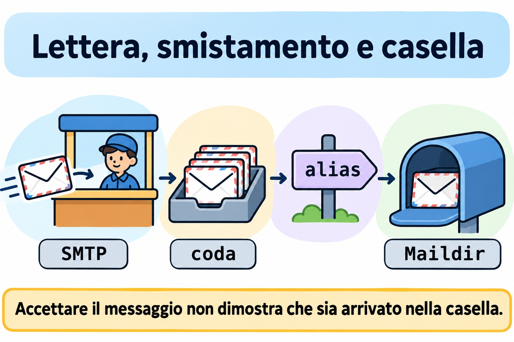
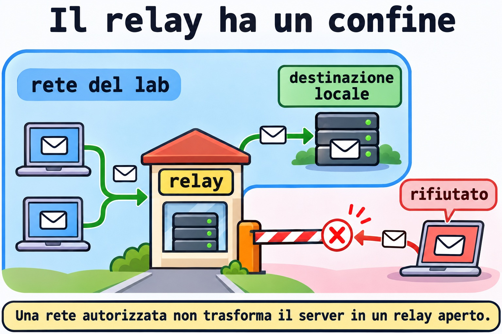

# Lezione 19.7 · Postfix e posta locale

> **Il cuore di questa lezione:** accettare una lettera, scegliere il destinatario e consegnarla nella casella sono tre verifiche diverse.

| Scheda | Piano di lavoro |
| --- | --- |
| Modulo | M19 · Servizi di rete, lezione 7 di 9 |
| Quando | Settimana 27 |
| Alla fine | Consegnare posta locale e verificare il rifiuto del relay non autorizzato |
| Prerequisiti | 19.1–19.6; VM 204 `srv-deb`; DNS `lab.test` funzionante |
| Durata | 100–140 minuti, oltre alle installazioni |
| Snapshot | `m19a7-inicio` e `m19a7-fim`, VM 204 |

Esegui nel guest indicato, come `student` con `sudo`. L’host Proxmox compare soltanto nella sfida esplicitamente indicata. Non adattare gli esempi a un server di produzione.

Verifica la [guida comune del laboratorio](../GUIA_BANCADA_M19_IT.md) prima di modificare i servizi; definisce rete, firewall e materiale di fiducia.

Nomi canonici del modulo: il nome della VM in Proxmox e l’hostname del sistema operativo devono corrispondere al ruolo, prima di eseguire le guardie. Un nome DNS di servizio non cambia l’hostname. Se l’inventario differisce, riconcilialo dalla console prima di proseguire; non ignorare le guardie.

| VM | Hostname breve | Indirizzo isolato |
| --- | --- | --- |
| 201 | `rocky-lab` | `192.0.2.201` |
| 202 | `debian-lab` | `192.0.2.202` |
| 204 | `srv-deb` | `192.0.2.204` |
| 212 | `m19-client` | DHCP; solo sfida 19.9 |

## 1 · Riscaldamento

1. Una risposta SMTP positiva dimostra la lettura da parte dell’utente?

2. Il record MX indica direttamente un indirizzo IP?

3. Consentire destinatari locali equivale a consentire il relay verso qualsiasi dominio?

## 2 · Perché conta

Un servizio deve inviare un avviso e trovi soltanto una coda in crescita. Separare accettazione, accodamento e consegna evita di attribuire la colpa al client sbagliato.

Il laboratorio usa soltanto posta locale. Non pubblica MX su Internet e non configura consegna esterna, antispam, reputazione, SPF, DKIM o DMARC. Questi contratti richiedono un altro progetto.

Lo stesso indirizzo può passare attraverso un alias prima di raggiungere un account Unix. L’alias cambia la destinazione locale; non crea una password né una casella indipendente.

## 3 · Modello mentale



*Accettare il messaggio non dimostra che sia arrivato nella casella.*

| Elemento | Che cosa dimostra |
| --- | --- |
| SMTP | Trasporto e risposta di accettazione |
| MX | Nome del server di posta del dominio |
| queue ID | Identità locale nella coda di Postfix |
| Message-ID | Intestazione per correlare il contenuto |
| alias | Mappatura del destinatario locale |
| Maildir | Messaggi in file individuali |

### Ponte Windows

Un client di posta distingue il server di invio dal server di lettura. In questa lezione prepari soltanto la consegna SMTP; la lettura tramite IMAPS arriva nella prossima.

## 4 · L'essenziale

Il dominio è `lab.test`. Il record MX indica `mail.lab.test`, il cui record A risolve in `192.0.2.204`. Il destinatario della prova sarà `suporte@lab.test`.

Il nuovo utente è `aluno-mail`, con casella in `~/Maildir/`. Non riutilizzare l’account `student`, non copiarne la password e non abilitare l’accesso remoto per l’account di posta.

La fiducia per il relay comprende soltanto `127.0.0.1/32` e `192.0.2.0/24`. Il resto del loopback non è attendibile in questa configurazione: permette una prova negativa locale e controllata.

SMTP ascolta soltanto sul loopback e sull’indirizzo isolato. Senza autenticazione su questa porta, invia soltanto contenuto fittizio del laboratorio; la password dell’utente non partecipa alla prova SMTP.

Accettare il relay dalla LAN non richiede connettività esterna. Una protezione aggiuntiva impedisce il trasporto SMTP in uscita; si esercita soltanto la consegna locale.

### Rocky × Debian

Il server di questa lezione è Debian 13. Postfix usa parametri simili nelle due famiglie, ma pacchetti, unità, politiche firewall e log vanno verificati sul sistema reale.

Su Rocky SELinux resta enforcing e il servizio non riceve permessi estesi per compensare un percorso errato. Questa lezione non installa un secondo MTA sulle VM 201 o 202.

## 5 · Lab guidato

La rete del laboratorio è `192.0.2.0/24`, isolata in `vmbr17`, senza gateway, NAT o porta fisica. La VM 204 usa `192.0.2.204` su questa rete. L’interfaccia di gestione conserva il proprio indirizzo reale e la propria rotta.

### Passo 1 · Verificare rete, DNS e assenza di altri MTA

**Ipotesi:** Un nome risolto dimostra che la porta di posta esiste già?

Leggi il file di ambiente prima di caricarlo. Se trovi altro oltre alle quattro assegnazioni documentate, fermati. Mantieni la politica firewall già verificata nella 19.1.

```bash
test "$(hostname -s)" = srv-deb || exit 1
cat /etc/os-release
test ! -L /etc/m19-lab.env || exit 1
test "$(stat -c %u:%g:%a /etc/m19-lab.env)" = 0:0:644 || exit 1
cat /etc/m19-lab.env
. /etc/m19-lab.env
test "$LAB_IP" = 192.0.2.204 || exit 1
test "$LAB_NET" = 192.0.2.0/24 || exit 1
ip -4 address show dev "$LAB_IF"
ip -4 route
dig @192.0.2.204 lab.test MX +noall +answer
dig @192.0.2.204 mail.lab.test A +short
dpkg-query -W postfix exim4-daemon-light exim4-daemon-heavy sendmail-bin 2>/dev/null
sudo ss -ltnp '( sport = :25 )'
if getent passwd aluno-mail > /dev/null; then exit 1; fi
sudo nft list ruleset
```

**Output atteso:** MX verso il nome corretto, A verso l’indirizzo isolato, porta libera e utente assente. L’elenco dei pacchetti può restituire un codice diverso da zero per pacchetti assenti.

**Verifica:** Se esiste già un altro MTA o l’account, fermati e indaga. Non riutilizzarne la configurazione e non rimuovere un altro servizio per liberare la porta.

```bash
mkdir -p "$HOME/m19-lab"
EVID=$(mktemp -d "$HOME/m19-lab/evidence-19-7.XXXXXX") || exit 1
ip -4 address > "$EVID/address-before.txt"
ip -4 route > "$EVID/routes-before.txt"
sudo nft list ruleset > "$EVID/firewall-before.txt"
```

Durante l’installazione scegli **Local only**, con mailname `mail.lab.test`; non scegliere **No configuration**, che può lasciare assenti i file richiesti. Il blocco preimposta questi valori e controlla i file prima del backup.

### Passo 2 · Installare senza pubblicare la configurazione predefinita

**Ipotesi:** Installare un pacchetto garantisce che ascolti soltanto sulla rete corretta?

La VM 204 è stata preparata senza MTA precedente. La maschera temporanea impedisce l’avvio automatico durante l’installazione. Nel dialogo del pacchetto scegli la configurazione locale; quella finale arriva al passo successivo.

```bash
sudo systemctl mask postfix.service postfix@.service
sudo apt update
printf '%s\n' 'postfix postfix/main_mailer_type select Local only' 'postfix postfix/mailname string mail.lab.test' | sudo debconf-set-selections || exit 1
sudo apt install postfix swaks
systemctl is-enabled postfix.service
sudo ss -ltnp '( sport = :25 )'
sudo test ! -e /root/m19-backup-19-7 || exit 1
sudo install -d -m 0700 /root/m19-backup-19-7
sudo test -f /etc/postfix/main.cf && sudo test -f /etc/aliases || exit 1
sudo cp -a /etc/postfix/main.cf /root/m19-backup-19-7/main.cf
sudo cp -a /etc/aliases /root/m19-backup-19-7/aliases
sudo useradd --create-home --shell /usr/sbin/nologin aluno-mail
sudo install -d -o aluno-mail -g aluno-mail -m 0700   /home/aluno-mail/Maildir /home/aluno-mail/Maildir/cur   /home/aluno-mail/Maildir/new /home/aluno-mail/Maildir/tmp
getent passwd aluno-mail
sudo stat -c '%U %G %a %n' /home/aluno-mail/Maildir
```

**Output atteso:** Pacchetto installato, unità mascherata, nessun listener SMTP e directory appartenenti al nuovo account.

**Verifica:** Non procedere con installazione interrotta o listener inatteso. Conserva il backup fuori dal materiale pubblicato: può contenere parametri privati dell’ambiente.

### Passo 3 · Limitare identità, ascolto e relay

**Ipotesi:** Una regola di relay deve autorizzare tutti i client che raggiungono la porta?

```bash
sudo postconf -e 'myhostname = mail.lab.test'
sudo postconf -e 'mydomain = lab.test'
sudo postconf -e 'myorigin = $mydomain'
sudo postconf -e 'mydestination = $myhostname, localhost.$mydomain, localhost, $mydomain'
sudo postconf -e 'inet_interfaces = 127.0.0.1, 192.0.2.204'
sudo postconf -e 'inet_protocols = ipv4'
sudo postconf -e 'mynetworks = 127.0.0.1/32, 192.0.2.0/24'
sudo postconf -e 'smtpd_relay_restrictions = permit_mynetworks, reject_unauth_destination'
sudo postconf -e 'relay_domains ='
sudo postconf -e 'relayhost ='
sudo postconf -e 'home_mailbox = Maildir/'
sudo postconf -e 'default_transport = error:external delivery disabled in M19'
sudo postconf -e 'relay_transport = error:external relay disabled in M19'
sudo postconf -e 'smtpd_sasl_auth_enable = no'
sudo postconf -n
sudo postfix check
```

**Output atteso:** Identità locale, ascolto limitato e politica esplicita di relay. La validazione deve terminare senza errori prima dell’avvio.

**Verifica:** Il dominio locale resta consegnabile tramite il trasporto locale. I trasporti in uscita bloccati evitano che un messaggio di prova tenti di uscire dall’interfaccia di gestione.

La prova non implementa submission autenticata né relay verso Internet. Non trasformare l’esempio in un server esterno limitandoti a rimuovere le due protezioni di trasporto.



*Una rete autorizzata non trasforma il server in un relay aperto.*

### Passo 4 · Mappare l’alias e avviare il servizio

**Ipotesi:** Modificare il file degli alias aggiorna immediatamente la mappa consultata?

```bash
if sudo grep -qE '^suporte[[:space:]]*:' /etc/aliases; then exit 1; fi
printf '%s
' 'suporte: aluno-mail' | sudo tee -a /etc/aliases
sudo newaliases
sudo postalias -q suporte hash:/etc/aliases
sudo postfix check || exit 1
sudo systemctl unmask postfix.service postfix@.service
sudo systemctl enable --now postfix.service
sudo postfix status
systemctl cat postfix.service
sudo ss -ltnp '( sport = :25 )'
sudo postconf mydestination mynetworks inet_interfaces
sudo journalctl --since '-5 min' --no-pager | grep -F postfix
```

**Output atteso:** L’alias restituisce il nuovo account. Il processo master ascolta soltanto su `127.0.0.1` e `192.0.2.204`, porta 25.

**Verifica:** Leggi l’unità della versione installata; l’organizzazione delle istanze è cambiata tra versioni Debian. Usa anche lo stato di Postfix e il listener reale, non soltanto la riga di systemd.

Se la verifica fallisce, mantieni il servizio mascherato, ripristina i due file dal backup e rigenera la mappa. Non tentare avvii ripetuti per nascondere il problema.

### Passo 5 · Inviare e seguire lo stesso messaggio

**Ipotesi:** L’identificatore di coda e l’intestazione della lettera sono lo stesso oggetto?

Sulla VM 202 usa la rete isolata verificata e invia soltanto testo fittizio. Il marcatore è tuo, non un numero di log inventato; conserva il valore per la prossima lezione.

```bash
test "$(hostname -s)" = debian-lab || exit 1
sudo apt install swaks
dig @192.0.2.204 lab.test MX +short
MID="m19-$(date +%s)-$(cat /proc/sys/kernel/random/uuid)@lab.test"
printf '%s
' "$MID"
swaks --server 192.0.2.204 --port 25   --from student@lab.test --to suporte@lab.test   --header "Message-ID: <$MID>" --header 'Subject: M19 prova local'   --body 'Mensagem ficticia para leitura na aula 19.8.'
printf '%s
' "$MID" > "$HOME/m19-message-id.txt"
```

**Output atteso:** Accettazione del messaggio e identificatore reale di coda nella risposta. Copia l’identificatore osservato, senza sostituirlo con un valore di esempio.

**Verifica:** Tornato sulla VM 204, cerca la stessa intestazione, segui la consegna locale e controlla il file del messaggio. Una coda vuota da sola potrebbe anche significare scarto o rifiuto.

```bash
test "$(hostname -s)" = srv-deb || exit 1
read -r -p 'Message-ID observado: ' MID
sudo journalctl --since '-15 min' --no-pager | grep -F "$MID"
sudo postqueue -p
sudo find /home/aluno-mail/Maildir/new -maxdepth 1 -type f -printf '%f
'
sudo grep -rlF -- "$MID" /home/aluno-mail/Maildir/new/
# Leia apenas o arquivo encontrado; nao publique seu conteudo real.
```

### Passo 6 · Verificare il rifiuto senza inviare posta esterna

**Ipotesi:** Un tentativo dalla stessa LAN dimostra il rifiuto di un’origine non attendibile?

Questa prova si svolge sulla VM 204. L’origine di loopback scelta non è in `mynetworks`; il comando termina al destinatario, prima del corpo. Il dominio riservato evita contatti con un dominio reale.

```bash
swaks --local-interface 127.0.0.2 --server 127.0.0.1 --port 25   --from origem@lab.test --to destinatario@outside.invalid   --quit-after RCPT
sudo journalctl --since '-5 min' --no-pager | grep -E 'postfix|Relay access denied'
sudo postqueue -p
sudo postconf -n > "$EVID/postconf-final.txt"
sudo ss -ltnp > "$EVID/listeners-final.txt"
ip -4 route > "$EVID/routes-after.txt"
diff -u "$EVID/routes-before.txt" "$EVID/routes-after.txt"
```

**Output atteso:** Rifiuto del relay al comando del destinatario, senza accettazione del corpo né creazione di un messaggio esterno in coda.

**Verifica:** Se l’origine locale non può essere usata, registra la prova come in sospeso e indaga la piattaforma. Non ampliare la rete attendibile per far superare la prova.

### Decidi 1 · La coda è vuota

A. Concludere che l’utente ha letto. B. Correlare risposta, log e file. C. Riavviare il client finché compare qualcosa.

### Decidi 2 · Il relay è stato rifiutato

A. Verificare origine e destinazione prima di cambiare la politica. B. Disattivare la restrizione. C. Aggiungere tutte le reti private.

## 6 · Rompi e ripara

Introduci un guasto alla volta e ripristina prima del successivo. Mantieni aperta la sessione di gestione. I difetti seguenti non richiedono di eliminare messaggi, utenti o file di altri servizi.

### Guasto 1 · Alias senza mappa aggiornata

**Sintomo:** Il file mostra l’alias, ma la consultazione della mappa non riflette la modifica.

**Indagine:** Confronta il file sorgente con la consultazione della mappa; non inviare decine di lettere per provare.

**Causa:** La mappa compilata non è stata rigenerata dopo la modifica.

**Riparazione:** Rigenera e consulta nuovamente prima di ripetere un unico invio.

**Prevenzione:** Includi la consultazione della mappa nella modifica documentata.

**Verifica:** La consultazione della mappa restituisce l’account locale previsto.

```bash
sudo postalias -q suporte hash:/etc/aliases
sudo newaliases
sudo postalias -q suporte hash:/etc/aliases
```

### Guasto 2 · Dominio fuori dalla consegna locale

**Sintomo:** Una lettera del dominio del laboratorio non arriva alla casella e risulta destinazione esterna bloccata.

**Indagine:** Leggi le destinazioni locali effettive e il log del messaggio.

**Causa:** Una modifica dell’esercizio ha rimosso il dominio dalle destinazioni locali.

**Riparazione:** Ripristina la riga verificata del passo 3, controlla e ricarica; invia una nuova lettera con un altro marcatore.

**Prevenzione:** Non compensare rimuovendo la protezione dei trasporti esterni.

**Verifica:** La nuova lettera registra una consegna locale e compare nella casella.

```bash
sudo postconf mydestination default_transport relay_transport
sudo postfix check && sudo postfix reload
```

### Guasto 3 · Casella con proprietario errato

**Sintomo:** L’accettazione SMTP avviene, ma la consegna locale registra un permesso negato.

**Indagine:** Controlla soltanto le directory dell’account di laboratorio e il log della consegna.

**Causa:** Una directory specifica di Maildir appartiene a un altro account.

**Riparazione:** Ripristina proprietario e modalità soltanto della directory identificata; non usare permessi universali né modifiche ricorsive su tutte le home.

**Prevenzione:** Crea le tre sottodirectory con il proprietario corretto fin dall’inizio.

**Verifica:** La nuova consegna termina senza errori e la directory mantiene proprietario e modalità limitati.

```bash
sudo namei -l /home/aluno-mail/Maildir/new
sudo stat -c '%U %G %a %n' /home/aluno-mail/Maildir/{cur,new,tmp}
```

## 7 · Trappole


*Correla lo stesso messaggio dall’invio alla consegna.*

1. Il record MX indica un nome, non un testo contenente un IP.

2. La fiducia di rete non è autenticazione del mittente.

3. Una coda vuota non dimostra da sola lettura né successo.

4. Un alias non crea un secondo utente Unix.

5. Non cancellare l’intera coda per ripulire un unico errore di prova.

6. Anche un comando amministrativo di consultazione richiede il contesto corretto.

## 8 · Quiz

1. Quale oggetto permette di correlare il contenuto tra invio e file?

2. Perché la prova negativa usa un’origine fuori dalla rete attendibile?

3. Che cosa cambia dopo aver modificato l’alias e prima di rigenerare la mappa?

4. Quale evidenza distingue accettazione SMTP e consegna locale?

5. Perché la protezione del trasporto esterno resta necessaria anche nel laboratorio?

## 9 · Promemoria

```bash
sudo postconf -n
sudo postfix check
sudo postfix status
sudo postqueue -p
sudo postalias -q suporte hash:/etc/aliases
sudo journalctl --since '-15 min' --no-pager | grep -F postfix
sudo ss -ltnp '( sport = :25 )'
```

**Flashcard:** Accettazione → responsabilità assunta per l’elaborazione, non lettura.

**Flashcard:** Alias → mappatura di nome, senza password propria.

**Flashcard:** Relay → inoltro verso un altro dominio sotto una politica esplicita.

## 10 · Checklist e chiusura

- [ ] DNS MX e A verificati sulla rete isolata.

- [ ] Gestione e rotte mantenute.

- [ ] Ascolto limitato e trasporti esterni bloccati.

- [ ] Alias consultato nella mappa effettiva.

- [ ] Un messaggio correlato fino a Maildir.

- [ ] Relay non autorizzato rifiutato prima del corpo.

- [ ] Account di posta ed evidenze conservati per la 19.8.

**Reboot di verifica:** pianifica soltanto la VM 204 quando il laboratorio lo consente. Dopo il riavvio verifica indirizzo isolato, listener, politica e prova funzionale completa; un servizio attivo da solo non conclude la verifica.

Nella finestra concordata riavvia dal guest; poi riconnettiti tramite la gestione ed esegui le verifiche seguenti.

```bash
sudo systemctl reboot
```

```bash
sudo postfix status
sudo postconf inet_interfaces mynetworks
sudo ss -ltnp '( sport = :25 )'
sudo postqueue -p
```

**Ultimo esercizio:** Spiega a una persona dove si trova il messaggio in ogni fase e mostra tre evidenze della stessa lettera.

## 11 · Nella vita reale

In un ambiente reale esegui prima un inventario in sola lettura: domini, destinazioni locali, reti attendibili, autenticazione, trasporto, conservazione e monitoraggio.

Un problema di reputazione esterna non si risolve ampliando il relay. Un problema di archiviazione non si risolve cancellando un’intera coda senza identificarne i proprietari.

## 12 · Approfondire quando vuoi

[Postfix · configurazione di base](https://www.postfix.org/BASIC_CONFIGURATION_README.html) spiega identità, destinazioni e interfacce.

[Postfix · esempi di configurazione](https://www.postfix.org/STANDARD_CONFIGURATION_README.html) documenta i limiti del relay.

[Postfix · parametri](https://www.postfix.org/postconf.5.html) è il riferimento per consultare i parametri usati.

I riferimenti sostengono la verifica documentale. I comandi e i risultati della lezione devono essere eseguiti nel tuo laboratorio; questa consegna non registra prove su VM.

!explica Por que aceitar SMTP, entregar Maildir e ler IMAP sao tres provas diferentes?

!feynman Explique um alias sem confundi-lo com uma conta de usuario.

!quiz Crie tres casos de relay e peca origem, destino e regra aplicada.

### Soluzioni commentate

Riscaldamento: no; il record MX indica un nome; consegna locale e relay sono decisioni distinte.

Decidi 1: B. Risposta, log e file formano una catena; nessuno da solo dimostra la lettura.

Decidi 2: A. Il rifiuto può essere proprio la protezione desiderata.

Quiz 1: l’intestazione del messaggio permette di correlare il contenuto; l’identificatore di coda serve all’elaborazione locale.

Quiz 2: un’origine attendibile non esercita il rifiuto del relay a terzi.

Quiz 3: cambia il file sorgente, ma la mappa consultata può ancora contenere il valore precedente.

Quiz 4: log della consegna locale e file nella casella, correlati al messaggio accettato.

Quiz 5: l’interfaccia di gestione può avere connettività; il laboratorio non autorizza posta esterna attraverso di essa.

Conserva le evidenze fuori dalla VM prima di terminare. Mantieni i servizi del M19 per le lezioni successive e non ripristinare lo snapshot sopra lavoro successivo.

[← Lezione 19.6 · Samba](19.6-samba-a-ponte-windows.md) · [Indice delle lezioni](../01-aulas.md) · [Lezione 19.8 · Dovecot →](19.8-dovecot-e-imaps.md)
