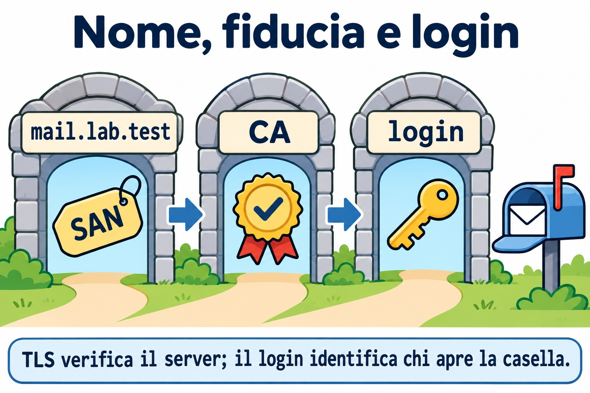
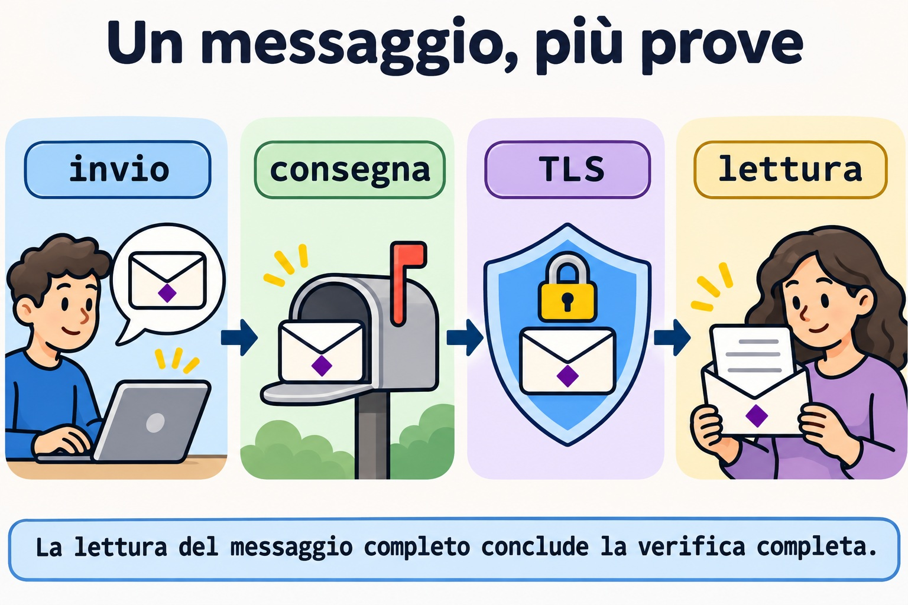

# Lezione 19.8 · Dovecot e lettura tramite IMAPS

> **Il cuore di questa lezione:** lo stesso messaggio conclude la catena soltanto dopo aver verificato nome, fiducia TLS, login e contenuto.

| Scheda | Piano di lavoro |
| --- | --- |
| Modulo | M19 · Servizi di rete, lezione 8 di 9 |
| Quando | Settimana 27 |
| Alla fine | Leggere tramite IMAPS il messaggio consegnato da Postfix |
| Prerequisiti | 19.5 e 19.7; CA del laboratorio e account `aluno-mail` |
| Durata | 100–140 minuti, oltre alle installazioni |
| Snapshot | `m19a8-inicio` e `m19a8-fim`, VM 204 |

Esegui nel guest indicato, come `student` con `sudo`. L’host Proxmox compare soltanto nella sfida esplicitamente indicata. Non adattare gli esempi a un server di produzione.

Verifica la [guida comune del laboratorio](../GUIA_BANCADA_M19_IT.md) prima di modificare i servizi; definisce rete, firewall e materiale di fiducia.

Nomi canonici del modulo: il nome della VM in Proxmox e l’hostname del sistema operativo devono corrispondere al ruolo, prima di eseguire le guardie. Un nome DNS di servizio non cambia l’hostname. Se l’inventario differisce, riconcilialo dalla console prima di proseguire; non ignorare le guardie.

| VM | Hostname breve | Indirizzo isolato |
| --- | --- | --- |
| 201 | `rocky-lab` | `192.0.2.201` |
| 202 | `debian-lab` | `192.0.2.202` |
| 204 | `srv-deb` | `192.0.2.204` |
| 212 | `m19-client` | DHCP; solo sfida 19.9 |

## 1 · Riscaldamento

1. Chi deposita il messaggio nella casella: Postfix o Dovecot?

2. Una connessione TLS valida dimostra che la password è corretta?

3. Perché il nome usato dal client deve comparire nel SAN?

## 2 · Perché conta

Trovi un messaggio sul disco, ma il client mostra una casella vuota. Il messaggio può trovarsi in un’altra home, in un altro formato o sotto un’identità diversa.

Dovecot fornisce accesso alla casella; non sostituisce la decisione di consegna già presa da Postfix. La verifica attraversa entrambi senza confonderne le responsabilità.

Il client deve fidarsi della CA privata del laboratorio e verificare il nome. Disabilitare la verifica TLS trasforma un sintomo di configurazione in perdita d’identità.

## 3 · Modello mentale


*Postfix consegna; Dovecot permette di leggere la casella.*

| Elemento | Che cosa dimostra |
| --- | --- |
| Postfix | Consegna la lettera nella casella locale |
| Maildir | Conserva ogni messaggio in un file |
| Dovecot | Apre la casella secondo l’identità |
| IMAPS | IMAP dentro TLS fin dalla connessione |
| SAN | Autorizza il nome presentato dal client |
| CA | Stabilisce la catena di fiducia |

### Ponte Windows

In un client grafico server di lettura, porta, sicurezza e utente sono campi distinti. Usa il nome del certificato, IMAPS e l’account locale; l’indirizzo di posta dell’alias non diventa automaticamente il nome di accesso.

## 4 · L'essenziale

Questa lezione richiede Dovecot 2.4 su Debian 13. La configurazione 2.3 usa nomi diversi; non incollare esempi vecchi di un’altra distribuzione senza verificare versione e sintassi.

Il certificato proviene dalla 19.5: `mail.lab.test` nel SAN, CA in `/etc/ssl/m19/ca.crt`, certificato in `/etc/ssl/m19/server.crt` e chiave in `/etc/ssl/private/m19-server.key`. La chiave privata non va mai al client.

L’unica porta di lettura pubblicata è la 993 sull’indirizzo isolato. La porta 143 resta disattivata. L’esempio non abilita POP3, submission né autenticazione SMTP.

Il meccanismo di autenticazione può chiamarsi PLAIN ed essere comunque protetto da TLS. Il laboratorio vieta di trasmettere la password fuori dal tunnel verificato.

La password viene digitata in un prompt interattivo. Non inserirla in URL, variabili di ambiente, argomenti di comando, schermate o file di evidenza.

### Rocky × Debian

Su Debian 13 verifica esplicitamente la serie 2.4. Usa `mail_driver`, `mail_path`, `ssl_server_cert_file`, `ssl_server_key_file` e `auth_allow_cleartext`.

Una Rocky con Dovecot 2.3 richiede una configurazione propria di quella serie. La lezione non modifica la VM 201 e non tenta di rendere la stessa configurazione compatibile con entrambe le versioni.

## 5 · Lab guidato

La rete del laboratorio è `192.0.2.0/24`, isolata in `vmbr17`, senza gateway, NAT o porta fisica. La VM 204 usa `192.0.2.204` su questa rete. L’interfaccia di gestione conserva il proprio indirizzo reale e la propria rotta.

### Passo 1 · Verificare casella, certificato e versione prevista

**Ipotesi:** Un file di certificato esistente dimostra nome e validità?

```bash
test "$(hostname -s)" = srv-deb || exit 1
test ! -L /etc/m19-lab.env || exit 1
test "$(stat -c %u:%g:%a /etc/m19-lab.env)" = 0:0:644 || exit 1
cat /etc/m19-lab.env
. /etc/m19-lab.env
test "$LAB_IP" = 192.0.2.204 || exit 1
ip -4 address show dev "$LAB_IF"
getent passwd aluno-mail
sudo find /home/aluno-mail/Maildir -maxdepth 2 -type f -printf '%P
'
sudo postconf home_mailbox
openssl x509 -in /etc/ssl/m19/server.crt -noout -dates -ext subjectAltName
openssl verify -CAfile /etc/ssl/m19/ca.crt   -verify_hostname mail.lab.test /etc/ssl/m19/server.crt
sudo stat -c '%U %G %a %n' /etc/ssl/private/m19-server.key
sudo ss -ltnp '( sport = :143 or sport = :993 )'
apt-cache policy dovecot-core dovecot-imapd
systemctl list-unit-files 'dovecot*'
```

**Output atteso:** Un messaggio della prova precedente, chiave limitata a root, nome accettato e porte ancora libere. La versione candidata appartiene alla serie richiesta.

**Verifica:** Se la casella non esiste, torna alla consegna locale. Se il nome non corrisponde, correggi il certificato nella 19.5; non omettere la verifica del nome.

```bash
mkdir -p "$HOME/m19-lab"
EVID=$(mktemp -d "$HOME/m19-lab/evidence-19-8.XXXXXX") || exit 1
ip -4 route > "$EVID/routes-before.txt"
openssl x509 -in /etc/ssl/m19/server.crt -noout -fingerprint -sha256   > "$EVID/server-fingerprint.txt"
```

### Passo 2 · Preparare account e pacchetto senza ascolto automatico

**Ipotesi:** La password dell’alias deve essere creata separatamente?

L’account è stato creato nella 19.7. Definisci ora una password esclusiva, digitata due volte nel prompt. Non modificare l’account di gestione. Se Dovecot è già configurato, fermati prima dell’installazione.

```bash
sudo passwd aluno-mail
sudo systemctl mask dovecot.service
sudo apt install dovecot-imapd
dovecot --version
case "$(dovecot --version)" in 2.4.*) ;; *) exit 1 ;; esac
systemctl is-enabled dovecot.service
sudo ss -ltnp '( sport = :143 or sport = :993 )'
sudo test ! -e /root/m19-backup-19-8 || exit 1
sudo install -d -m 0700 /root/m19-backup-19-8
sudo cp -a /etc/dovecot /root/m19-backup-19-8/dovecot
sudo cat /etc/pam.d/dovecot
sudo passwd -S aluno-mail
getent passwd aluno-mail
```

**Output atteso:** Password definita senza comparire sullo schermo, unità mascherata e versione 2.4 confermata. L’account mantiene la home della consegna locale.

**Verifica:** Il file PAM del pacchetto deve esistere e usare l’autenticazione locale prevista. Non creare una politica PAM permissiva per risolvere un accesso che non è ancora stato provato.

### Passo 3 · Scrivere una configurazione minima della serie 2.4

**Ipotesi:** Copiare i nomi dei parametri della serie 2.3 viene accettato silenziosamente?

Questo server non possiede ancora una configurazione Dovecot operativa. Conserva la directory originale e sostituisci soltanto il file principale con un esempio minimo completo; non include i vecchi frammenti del pacchetto.

```bash
cat > "$EVID/dovecot.conf" <<'EOF'
dovecot_config_version = 2.4.0
dovecot_storage_version = 2.4.0
protocols {
  imap = yes
}
listen = 127.0.0.1, 192.0.2.204
mail_driver = maildir
mail_path = ~/Maildir
first_valid_uid = 1000
auth_mechanisms = plain login
auth_allow_cleartext = no
ssl = required
ssl_min_protocol = TLSv1.2
ssl_server_cert_file = /etc/ssl/m19/server.crt
ssl_server_key_file = /etc/ssl/private/m19-server.key
passdb pam {
}
userdb passwd {
}
namespace inbox {
  inbox = yes
}
service imap-login {
  inet_listener imap {
    port = 0
  }
  inet_listener imaps {
    listen = 192.0.2.204
    port = 993
    ssl = yes
  }
}
EOF
sudo doveconf -c "$EVID/dovecot.conf" -n > /dev/null || exit 1
sudo install -o root -g root -m 0644 "$EVID/dovecot.conf" /etc/dovecot/dovecot.conf
sudo doveconf -n
```

**Output atteso:** Il parser accetta la sintassi e mostra Maildir, TLS obbligatorio, provider locali e listener IMAPS isolato.

**Verifica:** Se una validazione fallisce, non rimuovere la maschera del servizio. Ripristina il file principale dal backup e indaga la versione; non cambiare i nomi dei parametri per tentativi.

L’account locale fornisce UID, GID e home. L’esempio non usa un unico utente virtuale né definisce un proprietario globale per tutte le caselle.



*TLS verifica il server; il login identifica chi apre la casella.*

### Passo 4 · Avviare e verificare il tunnel prima dell’accesso

**Ipotesi:** Una porta aperta dimostra l’identità del server?

```bash
sudo doveconf -n > "$EVID/doveconf-final.txt" || exit 1
sudo systemctl unmask dovecot.service
sudo systemctl enable --now dovecot.service
sudo systemctl status dovecot.service --no-pager
sudo ss -ltnp '( sport = :143 or sport = :993 )'
sudo journalctl -u dovecot.service --since '-5 min' --no-pager
openssl s_client -connect 192.0.2.204:993 -servername mail.lab.test   -verify_hostname mail.lab.test -verify_return_error   -CAfile /etc/ssl/m19/ca.crt < /dev/null
```

**Output atteso:** Soltanto la 993 sull’indirizzo isolato, catena attendibile e nome corretto. La chiusura senza accesso basta per questa verifica TLS.

**Verifica:** Un banner IMAP non sostituisce il risultato della verifica. Non digitare comandi di accesso in una sessione TLS che ha presentato un errore.

Se il servizio non si avvia, ripristina la maschera prima del ripristino. Leggi l’errore del parser e il registro; la chiave deve restare limitata, senza permessi universali.

### Passo 5 · Leggere il messaggio senza esporre la password

**Ipotesi:** L’utente di accesso è l’alias del destinatario?

Sulla VM 202 la CA pubblica è stata trasferita e verificata nella 19.5 in `/etc/ssl/m19/ca.crt`. Non trasferire la chiave del server. Verifica il supporto IMAPS del client prima di autenticarti.

```bash
test "$(hostname -s)" = debian-lab || exit 1
dig @192.0.2.204 mail.lab.test A +short
curl --version
openssl s_client -connect mail.lab.test:993 -servername mail.lab.test   -verify_hostname mail.lab.test -verify_return_error   -CAfile /etc/ssl/m19/ca.crt < /dev/null
MID=$(cat "$HOME/m19-message-id.txt") || exit 1
printf '%s
' "$MID"
curl --cacert /etc/ssl/m19/ca.crt --user aluno-mail   --url 'imaps://mail.lab.test/INBOX'   --request "UID SEARCH HEADER Message-ID <$MID>"
```

**Output atteso:** Il client chiede la password in modo interattivo e restituisce l’UID reale del messaggio cercato. L’accesso usa `aluno-mail`, non l’alias.

**Verifica:** Scegli l’UID restituito dalla ricerca, senza presumere che sia 1. Una casella può contenere messaggi precedenti e numeri non consecutivi.

```bash
read -r -p 'UID observado: ' MAIL_UID
case "$MAIL_UID" in ''|*[!0-9]*) exit 1 ;; esac
curl --cacert /etc/ssl/m19/ca.crt --user aluno-mail   --url "imaps://mail.lab.test/INBOX/;UID=$MAIL_UID"
# A senha e digitada no prompt, nunca acrescentada ao nome do usuario.
```

### Passo 6 · Concludere la correlazione completa

**Ipotesi:** Un accesso riuscito dimostra che il messaggio desiderato è stato letto?

Torna sulla VM 204, nella sessione originale che mantiene la cartella delle evidenze. Confronta intestazione e corpo letti con la lettera inviata. Maildir può spostare un messaggio da nuovo a già visto durante la lettura.

```bash
test "$(hostname -s)" = srv-deb || exit 1
read -r -p 'Message-ID observado: ' MID
sudo journalctl --since '-30 min' --no-pager | grep -F "$MID"
sudo journalctl -u dovecot.service --since '-15 min' --no-pager
sudo grep -rlF -- "$MID"   /home/aluno-mail/Maildir/new/ /home/aluno-mail/Maildir/cur/
sudo doveadm user aluno-mail
sudo postqueue -p
sudo ss -ltnp > "$EVID/listeners-final.txt"
ip -4 route > "$EVID/routes-after.txt"
diff -u "$EVID/routes-before.txt" "$EVID/routes-after.txt"
```

**Output atteso:** La lettera accettata e consegnata corrisponde al contenuto recuperato dal client, con sessione IMAPS registrata e rotte di gestione mantenute.

**Verifica:** Il registro può non riportare l’intestazione nell’evento di lettura. Usa UID e contenuto sul client per questa fase e il marcatore in Postfix per la consegna; non inventare un unico log che contenga tutto.

### Decidi 1 · Il certificato non è attendibile

A. Ignorare TLS per provare la password. B. Cambiare subito la password. C. Verificare CA, nome e validità prima di autenticarsi.

### Decidi 2 · L’accesso funziona e la casella è vuota

A. Verificare utente, home, formato e consegna. B. Reinstallare entrambi i servizi. C. Eliminare gli indici di tutte le caselle.

## 6 · Rompi e ripara

Introduci un guasto alla volta e ripristina prima del successivo. Mantieni aperta la sessione di gestione. I difetti seguenti non richiedono di eliminare messaggi, utenti o file di altri servizi.

### Guasto 1 · Nome errato sul client

**Sintomo:** La connessione tramite IP fallisce la verifica del nome.

**Indagine:** Confronta il nome richiesto con il SAN; non inviare password su quella connessione.

**Causa:** Il certificato autorizza il nome DNS, non qualsiasi nome o IP della macchina.

**Riparazione:** Torna al nome del SAN e verificane la risoluzione sulla rete isolata.

**Prevenzione:** Registra nome e porta insieme alla catena di fiducia del client.

**Verifica:** La verifica del nome termina con successo prima di qualsiasi accesso.

```bash
openssl x509 -in /etc/ssl/m19/server.crt -noout -ext subjectAltName
dig @192.0.2.204 mail.lab.test A +short
```

### Guasto 2 · Alias usato come accesso

**Sintomo:** La lettera arriva all’alias, ma l’accesso con quel nome non autentica.

**Indagine:** Confronta la mappa degli alias, l’account Unix e l’utente indicato dal client.

**Causa:** L’alias di Postfix non crea un account autenticabile in Dovecot.

**Riparazione:** Usa l’account locale creato, con la sua password esclusiva. Non creare account duplicati per nascondere l’errore.

**Prevenzione:** Documenta indirizzo di posta e nome di accesso in campi diversi.

**Verifica:** L’accesso dell’account locale apre la casella che riceve l’alias.

```bash
sudo postalias -q suporte hash:/etc/aliases
getent passwd aluno-mail
sudo doveadm user aluno-mail
```

### Guasto 3 · Formato della casella divergente

**Sintomo:** Il file esiste nella home, ma la casella aperta non corrisponde ad esso.

**Indagine:** Verifica percorso effettivo, home e formato dei due servizi.

**Causa:** Una modifica dell’esercizio ha fatto cercare al lettore un altro formato o percorso.

**Riparazione:** Ripristina i due parametri Maildir del passo 3, verifica e ricarica. Non convertire né eliminare messaggi.

**Prevenzione:** Mantieni un contratto unico tra consegna e lettura.

**Verifica:** Il contenuto del messaggio originale può essere recuperato nuovamente dal client.

```bash
sudo postconf home_mailbox
sudo doveconf -n mail_driver mail_path
sudo doveadm user aluno-mail
sudo doveconf -n && sudo systemctl reload dovecot.service
```

## 7 · Trappole



*La lettura del messaggio completo conclude la verifica completa.*

1. Un certificato valido senza nome corrispondente resta un errore d’identità.

2. La password del client non deve comparire nella cronologia della shell.

3. Non confondere UID IMAP, UID Unix e identificatore di coda.

4. La casella può spostare messaggi tra nuovi e già visti.

5. Dovecot 2.4 non accetta automaticamente una configurazione 2.3.

6. La chiave del server rimane sul server; soltanto la CA pubblica va al client.

## 8 · Quiz

1. Quali due verifiche TLS si eseguono prima dell’autenticazione?

2. Perché l’alias non diventa automaticamente un utente IMAP?

3. Quale formato devono condividere i due servizi in questa lezione?

4. Perché cercare l’intestazione prima di scegliere l’UID?

5. Che cosa non dimostra ancora un accesso riuscito?

## 9 · Promemoria

```bash
dovecot --version
sudo doveconf -n
sudo doveadm user aluno-mail
sudo ss -ltnp '( sport = :143 or sport = :993 )'
sudo journalctl -u dovecot.service --since '-15 min' --no-pager
openssl verify -CAfile /etc/ssl/m19/ca.crt   -verify_hostname mail.lab.test /etc/ssl/m19/server.crt
```

**Flashcard:** TLS → identità del server e protezione del trasporto.

**Flashcard:** Accesso → identità che riceve accesso alla casella.

**Flashcard:** Lettura → contenuto recuperato, correlato all’invio.

## 10 · Checklist e chiusura

- [ ] Serie 2.4 e parser verificati.

- [ ] Porta 143 chiusa e 993 soltanto sulla rete isolata.

- [ ] CA, SAN e validità verificati prima della password.

- [ ] Account locale e Maildir corrispondono alla consegna.

- [ ] Password digitata senza argomento né URL.

- [ ] Messaggio originale recuperato tramite UID osservato.

- [ ] Evidenze senza segreti e servizi mantenuti.

**Reboot di verifica:** pianifica soltanto la VM 204 quando il laboratorio lo consente. Dopo il riavvio verifica indirizzo isolato, listener, politica e prova funzionale completa; un servizio attivo da solo non conclude la verifica.

Nella finestra concordata riavvia dal guest; poi riconnettiti tramite la gestione ed esegui le verifiche seguenti.

```bash
sudo systemctl reboot
```

```bash
sudo systemctl is-active dovecot.service
sudo ss -ltnp '( sport = :143 or sport = :993 )'
sudo doveadm user aluno-mail
sudo postfix status
```

**Ultimo esercizio:** Invia una seconda lettera con un nuovo marcatore e ripeti la lettura tramite ricerca, senza presumere un UID fisso.

## 11 · Nella vita reale

Prima di modificare un server esistente, inventaria autenticazione, home, quote, conservazione, copie e client. Una migrazione di formato o autenticazione richiede un piano proprio e un ripristino provato.

L’utente segnala una casella vuota; l’indagine parte dal contratto effettivo e dalla correlazione, senza eliminare indici né concedere lettura globale delle home.

## 12 · Approfondire quando vuoi

[Dovecot 2.4 · configurazione iniziale](https://doc.dovecot.org/2.4.2/core/config/quick.html) documenta la sintassi e i provider locali usati.

[Dovecot 2.4 · TLS](https://doc.dovecot.org/2.4.0/core/config/ssl.html) distingue certificato, chiave e requisito del trasporto sicuro.

[curl · URL IMAP](https://curl.se/docs/url-syntax.html) spiega ricerca e selezione dell’UID.

I riferimenti sostengono la verifica documentale. I comandi e i risultati della lezione devono essere eseguiti nel tuo laboratorio; questa consegna non registra prove su VM.

!explica Diferencie entrega SMTP, autenticacao IMAP e leitura do conteudo.

!feynman Explique por que confiar na CA nao dispensa conferir o nome.

!quiz Proponha tres falhas de IMAPS e peca a primeira evidencia de cada uma.

### Soluzioni commentate

Riscaldamento: Postfix consegna; TLS non dimostra la password; il SAN collega il nome all’identità del server.

Decidi 1: C. Autenticarti soltanto dopo aver verificato l’identità evita di consegnare la password a una destinazione non verificata.

Decidi 2: A. Accesso e posizione della casella sono contratti distinti.

Quiz 1: catena fino a una CA attendibile e corrispondenza del nome al SAN, oltre alla validità temporale.

Quiz 2: gli alias appartengono all’instradamento locale di Postfix; PAM autentica account locali.

Quiz 3: Maildir nella home dello stesso account.

Quiz 4: l’UID viene assegnato al messaggio nella casella e deve essere osservato.

Quiz 5: non dimostra presenza né lettura del messaggio desiderato; occorre ancora recuperarne il contenuto.

Conserva le evidenze fuori dalla VM prima di terminare. Mantieni i servizi del M19 per le lezioni successive e non ripristinare lo snapshot sopra lavoro successivo.

[← Lezione 19.7 · Postfix](19.7-postfix-e-correio-local.md) · [Indice delle lezioni](../01-aulas.md) · [Lezione 19.9 · Squid →](19.9-squid-e-desafio-integrado.md)
