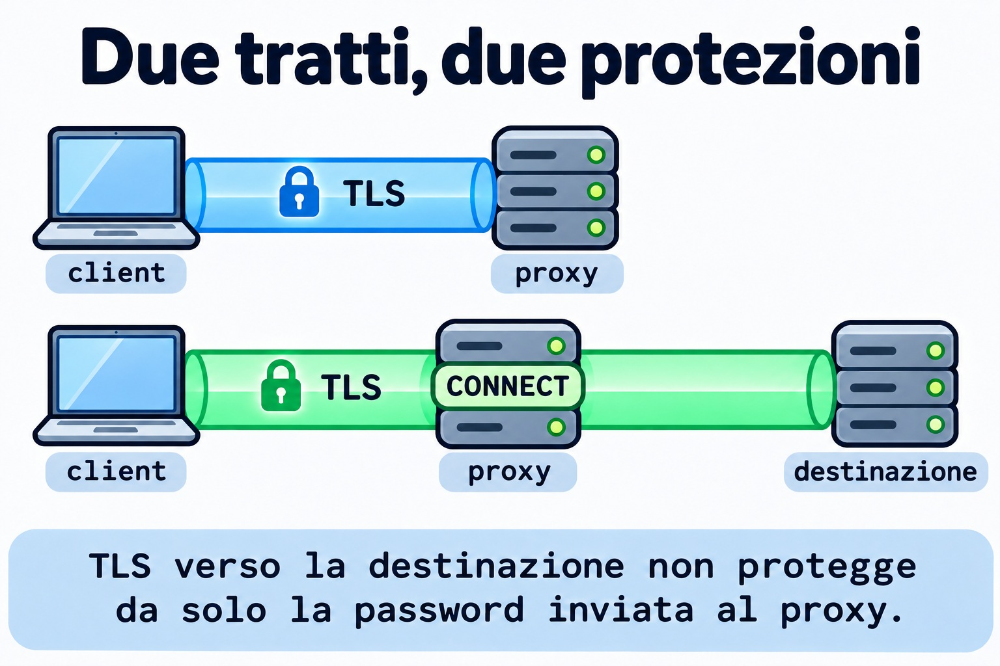
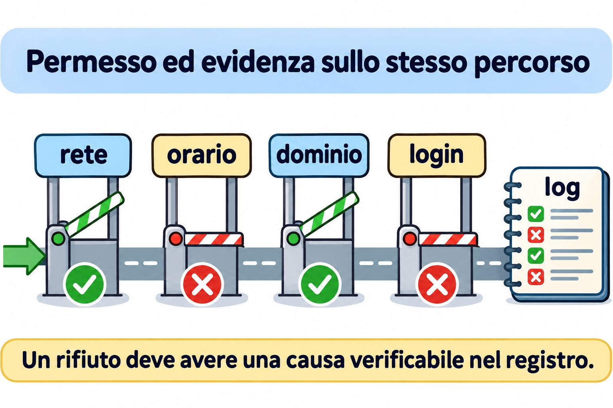

# Lezione 19.9 · Squid e sfida integrata

> **Il cuore di questa lezione:** un proxy decide secondo una politica e ne registra l’esito; la password del proxy richiede protezione nel tratto fino a esso.

| Scheda | Piano di lavoro |
| --- | --- |
| Modulo | M19 · Servizi di rete, lezione 9 di 9 |
| Quando | Settimana 27 |
| Alla fine | Controllare un proxy esplicito e collegare DHCP, DNS, HTTPS e IMAPS su un nuovo client |
| Prerequisiti | 19.1–19.8; VM 204; DNS, CA, web e posta funzionanti |
| Durata | 100–140 minuti, oltre alle installazioni |
| Snapshot | `m19a9-inicio` e `m19a9-fim`, VM 204 |

Esegui nel guest indicato, come `student` con `sudo`. L’host Proxmox compare soltanto nella sfida esplicitamente indicata. Non adattare gli esempi a un server di produzione.

Verifica la [guida comune del laboratorio](../GUIA_BANCADA_M19_IT.md) prima di modificare i servizi; definisce rete, firewall e materiale di fiducia.

Nomi canonici del modulo: il nome della VM in Proxmox e l’hostname del sistema operativo devono corrispondere al ruolo, prima di eseguire le guardie. Un nome DNS di servizio non cambia l’hostname. Se l’inventario differisce, riconcilialo dalla console prima di proseguire; non ignorare le guardie.

| VM | Hostname breve | Indirizzo isolato |
| --- | --- | --- |
| 201 | `rocky-lab` | `192.0.2.201` |
| 202 | `debian-lab` | `192.0.2.202` |
| 204 | `srv-deb` | `192.0.2.204` |
| 212 | `m19-client` | DHCP; solo sfida 19.9 |

## 1 · Riscaldamento

1. Il proxy esplicito riceve traffico senza essere configurato dal client?

2. HTTPS verso la destinazione protegge la password inviata prima al proxy HTTP?

3. Una regola di dominio sostituisce una regola di rete?

## 2 · Perché conta

Una persona segnala che il browser apre un sito, ma l’accesso risulta negato sul proxy. Occorre prima dimostrare che quel tentativo sia davvero passato attraverso di esso.

Un proxy esplicito non è una barriera completa in uscita: il client può tentare una rotta diretta quando esiste. In questo laboratorio la rete isolata non ha uscita esterna.

La prima fase usa HTTP senza credenziali soltanto per studiare le ACL. La seconda chiude quella porta e richiede autenticazione dentro TLS fino al proxy.

## 3 · Modello mentale


*Il client sceglie il proxy; l’ACL decide se il viaggio continua.*

| Elemento | Che cosa dimostra |
| --- | --- |
| ACL | Condizione che può corrispondere al tentativo |
| http_access | Decisione tramite la prima regola corrispondente |
| CONNECT | Tunnel fino alla destinazione consentita |
| https_port | TLS tra client e proxy |
| proxy_auth | Identità richiesta dalla politica |
| access.log | Risultato reale del tentativo osservato |

### Ponte Windows

Su un Windows 11 già esistente e autorizzato usa il proxy manuale soltanto nella fase senza autenticazione e soltanto se quella macchina partecipa già alla LAN isolata. Conserva la configurazione precedente e ripristinala alla fine.

Non creare una VM Windows e non modificare una scheda di una VM fuori inventario. Il campo proxy HTTP del browser non garantisce il supporto al proxy HTTPS; la fase autenticata usa il client da terminale verificato sotto.

## 4 · L'essenziale

Il server usa il pacchetto `squid-openssl` di Debian 13, con supporto a `https_port`. Verifica versione e opzioni reali: una compilazione senza TLS non può completare la seconda fase.

Le porte sono `192.0.2.204:3128` nella fase senza password e `192.0.2.204:3129` nella fase autenticata. Non ci sono listener sulla gestione, intercettazione trasparente o ispezione del TLS della destinazione.

Il certificato della 19.5 comprende `proxy.lab.test`. La chiave riceve una copia limitata al gruppo del processo Squid, senza aprire il file privato condiviso dagli altri servizi.

L’autenticazione usa un account esclusivo `proxy-aluno` in un file di hash dedicato. Non è l’account di posta né quello di gestione. La password viene digitata nel prompt.

L’ACL dell’orario usa l’ora locale del server. La finestra iniziale copre l’intera giornata per consentire il laboratorio; l’esercizio di guasto sceglie poi una finestra che esclude l’ora osservata, senza cambiare l’orologio.

### Rocky × Debian

Non trattare il nome del pacchetto come prova della compilazione. Leggi la versione, cerca il supporto OpenSSL e usa il parser prima di pubblicare qualsiasi listener.

Su Rocky possono cambiare percorso dell’helper, utente del servizio e politiche di sicurezza. Questa lezione mantiene la VM 204 come unico proxy e non disattiva controlli per riutilizzare un percorso Debian.

## 5 · Lab guidato

La rete del laboratorio è `192.0.2.0/24`, isolata in `vmbr17`, senza gateway, NAT o porta fisica. La VM 204 usa `192.0.2.204` su questa rete. L’interfaccia di gestione conserva il proprio indirizzo reale e la propria rotta.

### Passo 1 · Verificare destinazioni e installare senza pubblicare

**Ipotesi:** La prova del sito deve passare attraverso il proxy per verificare l’ACL?

```bash
test "$(hostname -s)" = srv-deb || exit 1
test ! -L /etc/m19-lab.env || exit 1
test "$(stat -c %u:%g:%a /etc/m19-lab.env)" = 0:0:644 || exit 1
cat /etc/m19-lab.env
. /etc/m19-lab.env
test "$LAB_IP" = 192.0.2.204 || exit 1
ip -4 address show dev "$LAB_IF"
dig @192.0.2.204 proxy.lab.test A +short
dig @192.0.2.204 web.lab.test A +short
curl --cacert /etc/ssl/m19/ca.crt https://web.lab.test/
sudo ss -ltnp '( sport = :3128 or sport = :3129 )'
dpkg-query -W squid squid-openssl 2>/dev/null
# Pare se um proxy anterior ou configuracao propria ja existir.
sudo systemctl mask squid.service
sudo apt install squid-openssl apache2-utils
squid -v
test -x /usr/lib/squid/basic_ncsa_auth || exit 1
getent passwd proxy
getent group proxy
sudo test ! -e /root/m19-backup-19-9 || exit 1
sudo install -d -m 0700 /root/m19-backup-19-9
sudo cp -a /etc/squid/squid.conf /root/m19-backup-19-9/squid.conf
mkdir -p "$HOME/m19-lab"
EVID=$(mktemp -d "$HOME/m19-lab/evidence-19-9.XXXXXX") || exit 1
ip -4 route > "$EVID/routes-before.txt"
```

**Output atteso:** Web e DNS funzionano direttamente; pacchetto con TLS e helper disponibili; unità mascherata e porte libere.

**Verifica:** Se l’installazione propone di sostituire un altro servizio operativo, fermati. La preparazione riguarda un nuovo proxy, non una migrazione improvvisata.

### Passo 2 · Pubblicare la fase ACL senza credenziali

**Ipotesi:** Una condizione definita senza regola di accesso modifica la decisione?

```bash
cat > "$EVID/squid-acl.conf" <<'EOF'
http_port 192.0.2.204:3128
visible_hostname proxy.lab.test
dns_nameservers 192.0.2.204
acl lab src 192.0.2.0/24
acl destinos dstdomain web.lab.test www.lab.test
acl horario time SMTWHFA 00:00-23:59
acl Safe_ports port 80 443
acl SSL_ports port 443
acl CONNECT method CONNECT
http_access deny !Safe_ports
http_access deny CONNECT !SSL_ports
http_access allow lab horario destinos
http_access deny all
cache deny all
access_log stdio:/var/log/squid/access.log squid
EOF
sudo squid -f "$EVID/squid-acl.conf" -k parse || exit 1
sudo install -o root -g root -m 0644 "$EVID/squid-acl.conf" /etc/squid/squid.conf
sudo squid -k parse || exit 1
sudo systemctl unmask squid.service
sudo systemctl enable --now squid.service
sudo ss -ltnp '( sport = :3128 or sport = :3129 )'
sudo journalctl -u squid.service --since '-5 min' --no-pager
```

**Output atteso:** Soltanto la porta 3128 sull’indirizzo isolato. La regola di autorizzazione richiede contemporaneamente rete, orario e dominio.

**Verifica:** I rifiuti delle porte precedono l’autorizzazione e l’ultima regola rifiuta il resto. Non aggiungere un’autorizzazione generale prima di esse.

### Passo 3 · Verificare accesso, rifiuto e CONNECT

**Ipotesi:** Un certificato corretto della destinazione dimostra che la password del proxy sarebbe protetta?

Sulla VM 202 forza l’uso del proxy e rimuovi soltanto per questo comando l’effetto delle esclusioni del proxy. La fase attuale non chiede né riceve password.

```bash
test "$(hostname -s)" = debian-lab || exit 1
curl --noproxy '' --proxy http://proxy.lab.test:3128   --fail-with-body http://web.lab.test/
curl --noproxy '' --proxy http://proxy.lab.test:3128   --fail-with-body http://mail.lab.test/
curl --noproxy '' --proxy http://proxy.lab.test:3128   --cacert /etc/ssl/m19/ca.crt --fail-with-body https://web.lab.test/
curl --noproxy '' --proxy http://proxy.lab.test:3128   --fail-with-body https://web.lab.test:22/
```

**Output atteso:** Web autorizzato funziona; dominio fuori elenco viene rifiutato; CONNECT verso 443 funziona; CONNECT verso una porta non consentita viene rifiutato. I rifiuti restituiscono un codice diverso da zero al client.

**Verifica:** Sulla VM 204 correla ora, origine, destinazione e decisione nel registro. Non copiare tempi o dimensioni da un output di esempio.

```bash
test "$(hostname -s)" = srv-deb || exit 1
sudo tail -n 30 /var/log/squid/access.log
date --iso-8601=seconds
sudo squid -k parse
```



*TLS verso la destinazione non protegge da solo la password inviata al proxy.*

Il lab conserva due copie della stessa chiave server: l’originale root-only e la copia leggibile dal gruppo proxy. Compromettere il processo proxy amplia quindi l’esposizione della stessa identità usata dagli altri servizi. Per un servizio reale emetti una chiave e un certificato dedicati al proxy, con SAN proxy.lab.test; gestisci rinnovo, backup e rimozione di entrambe le copie. Nessuna chiave va ai client.

### Passo 4 · Preparare TLS e password esclusiva

**Ipotesi:** HTTPS verso la destinazione protegge il primo tratto fino a un proxy HTTP?

La risposta è no. Prima di attivare l’autenticazione prepara TLS tra client e proxy. Verifica la corrispondenza di certificato e chiave e mantieni la copia privata limitata al processo necessario.

```bash
openssl verify -CAfile /etc/ssl/m19/ca.crt   -verify_hostname proxy.lab.test /etc/ssl/m19/server.crt
sudo install -d -o root -g proxy -m 0750 /etc/squid/m19-tls
sudo install -o root -g proxy -m 0644 /etc/ssl/m19/server.crt /etc/squid/m19-tls/server.crt
sudo install -o root -g proxy -m 0640 /etc/ssl/private/m19-server.key /etc/squid/m19-tls/server.key
sudo -u proxy test -r /etc/squid/m19-tls/server.key || exit 1
sudo stat -c '%U %G %a %n' /etc/squid/m19-tls/server.key
sudo stat -c '%U %G %a %n' /etc/ssl/private/m19-server.key
sudo test ! -e /etc/squid/m19.passwd || exit 1
sudo htpasswd -c /etc/squid/m19.passwd proxy-aluno
sudo chown root:proxy /etc/squid/m19.passwd
sudo chmod 0640 /etc/squid/m19.passwd
sudo stat -c '%U %G %a %n' /etc/squid/m19.passwd
```

**Output atteso:** Copia privata leggibile dal gruppo di Squid, chiave originale ancora limitata a root e password creata in modo interattivo in un file dedicato.

**Verifica:** L’opzione di creazione del file delle password viene usata soltanto perché la prova precedente ne ha confermato l’assenza. Per cambiare la password in seguito non usare l’opzione che ricrea il file.

### Passo 5 · Richiedere accesso sul proxy HTTPS e chiudere HTTP

**Ipotesi:** Mantenere una porta senza autenticazione permetterebbe di aggirare il requisito dell’altra?

```bash
cat > "$EVID/squid-auth.conf" <<'EOF'
https_port 192.0.2.204:3129 tls-cert=/etc/squid/m19-tls/server.crt tls-key=/etc/squid/m19-tls/server.key
visible_hostname proxy.lab.test
dns_nameservers 192.0.2.204
auth_param basic program /usr/lib/squid/basic_ncsa_auth /etc/squid/m19.passwd
auth_param basic realm M19
acl autenticado proxy_auth REQUIRED
acl lab src 192.0.2.0/24
acl destinos dstdomain web.lab.test www.lab.test
acl horario time SMTWHFA 00:00-23:59
acl Safe_ports port 80 443
acl SSL_ports port 443
acl CONNECT method CONNECT
http_access deny !Safe_ports
http_access deny CONNECT !SSL_ports
http_access allow lab horario destinos autenticado
http_access deny all
cache deny all
access_log stdio:/var/log/squid/access.log squid
EOF
sudo squid -f "$EVID/squid-auth.conf" -k parse || exit 1
sudo install -o root -g root -m 0644 "$EVID/squid-auth.conf" /etc/squid/squid.conf
sudo squid -k parse || exit 1
sudo systemctl restart squid.service
sudo systemctl is-active squid.service
sudo ss -ltnp '( sport = :3128 or sport = :3129 )'
```

**Output atteso:** 3128 chiusa; soltanto 3129 sull’indirizzo isolato. Senza credenziale un tentativo autorizzabile riceve una richiesta di autenticazione.

**Verifica:** Se il parser non riconosce TLS, fermati e verifica il pacchetto. Non ripiegare sulla password in un proxy HTTP e non disattivare la verifica del certificato per terminare la lezione.

Un errore dopo aver installato la configurazione candidata richiede di ripristinare il file verificato e controllarlo di nuovo prima di riavviare. Il recupero della fase senza password non autorizza a inviarvi credenziali.

### Passo 6 · Verificare le due catene e il registro

**Ipotesi:** Il certificato del proxy sostituisce quello della destinazione?

Sulla VM 202 verifica il supporto del client al proxy HTTPS. Il primo file CA verifica il proxy; il secondo verifica il sito dentro il tunnel. Qui entrambi usano la stessa CA privata, ma sono verifiche diverse.

```bash
curl --version
curl --noproxy '' --proxy https://proxy.lab.test:3129   --proxy-cacert /etc/ssl/m19/ca.crt   --cacert /etc/ssl/m19/ca.crt --fail-with-body https://web.lab.test/
curl --noproxy '' --proxy https://proxy.lab.test:3129   --proxy-cacert /etc/ssl/m19/ca.crt --proxy-user proxy-aluno   --cacert /etc/ssl/m19/ca.crt --fail-with-body https://web.lab.test/
curl --noproxy '' --proxy http://proxy.lab.test:3128   --connect-timeout 5 http://web.lab.test/
```

**Output atteso:** Senza password c’è una richiesta di autenticazione; con password digitata nel terminale l’accesso funziona; la vecchia porta rifiuta la connessione. Nessuna password compare negli argomenti.

**Verifica:** Sulla VM 204 il registro deve mostrare origine, destinazione, decisione e utente del tentativo accettato. Il proxy non sostituisce né ispeziona il certificato della destinazione.

```bash
sudo tail -n 40 /var/log/squid/access.log
sudo journalctl -u squid.service --since '-15 min' --no-pager
sudo squid -k parse
ip -4 route > "$EVID/routes-after.txt"
diff -u "$EVID/routes-before.txt" "$EVID/routes-after.txt"
```

### Decidi 1 · Una pagina si è aperta

A. Verificare proxy forzato e registro del tentativo. B. Dichiarare approvato il proxy. C. Disabilitare le ACL per confermare.

### Decidi 2 · Il client non supporta il proxy HTTPS

A. Ignorare il certificato. B. Inviare la password tramite HTTP. C. Usare un client compatibile o registrare il requisito in sospeso.

## 6 · Rompi e ripara

Introduci un guasto alla volta e ripristina prima del successivo. Mantieni aperta la sessione di gestione. I difetti seguenti non richiedono di eliminare messaggi, utenti o file di altri servizi.

### Guasto 1 · L’orario esclude il tentativo

**Sintomo:** Lo stesso dominio autorizzato non si apre più durante una finestra di prova limitata.

**Indagine:** Verifica ora locale e finestra dell’ACL; mantieni uguali utente e destinazione.

**Causa:** La finestra scelta esclude l’ora reale del server.

**Riparazione:** Ripristina la finestra originale della configurazione verificata, esegui il parser e ricarica.

**Prevenzione:** Registra fuso e finestra; non modificare l’orologio per aggirare la politica.

**Verifica:** Lo stesso tentativo torna a essere accettato nella finestra ripristinata.

```bash
date --iso-8601=seconds
sudo grep -n '^acl horario ' /etc/squid/squid.conf
sudo squid -k parse && sudo systemctl reload squid.service
```

### Guasto 2 · Dominio fuori elenco

**Sintomo:** La destinazione web funziona e un altro nome della stessa VM viene rifiutato.

**Indagine:** Confronta nome richiesto e ACL di dominio; osserva il registro.

**Causa:** La politica decide sulla destinazione richiesta, non consentendo tutti i servizi di quell’IP.

**Riparazione:** Torna al dominio autorizzato. Amplia l’elenco soltanto quando il contratto del servizio lo richiede.

**Prevenzione:** Prova un rifiuto noto dopo ogni nuova autorizzazione.

**Verifica:** Il dominio consentito funziona e il nome rifiutato resta rifiutato.

### Guasto 3 · Password rifiutata

**Sintomo:** Il tunnel TLS è valido, ma il proxy continua a chiedere autenticazione.

**Indagine:** Verifica utente, helper, proprietario e modalità del file; non pubblicarne il contenuto.

**Causa:** Password digitata male, account assente o helper senza accesso al file sono ipotesi distinte.

**Riparazione:** Correggi la causa osservata. Per ridefinire la password usa il file esistente, senza ricrearlo.

**Prevenzione:** Mantieni una credenziale esclusiva e non attivare la registrazione delle intestazioni di autenticazione.

**Verifica:** L’accesso autenticato funziona con password interattiva e compare con l’utente nel registro.

```bash
sudo stat -c '%U %G %a %n' /etc/squid/m19.passwd
sudo -u proxy test -r /etc/squid/m19.passwd
sudo htpasswd /etc/squid/m19.passwd proxy-aluno
```

## 7 · Trappole



*Un rifiuto deve avere una causa verificabile nel registro.*

1. CONNECT consentito non significa ispezione o decifratura della destinazione.

2. Una porta HTTP senza autenticazione aperta in parallelo permette di aggirare la seconda fase.

3. Definire un’ACL senza usarla non applica una politica.

4. Un’esclusione del proxy sul client può invalidare la prova.

5. Il contenuto HTTPS resta cifrato fino alla destinazione, senza TLS bump.

6. Anche il file degli hash richiede accesso limitato e copia protetta.

## 8 · Quiz

1. Quale tratto resta non protetto autenticandoti su un proxy HTTP?

2. Perché il rifiuto delle porte deve precedere l’autorizzazione?

3. Che cosa dimostra il passaggio reale attraverso il proxy?

4. Qual è la differenza tra il certificato del proxy e quello della destinazione?

5. Una nuova VM che ottiene un indirizzo dimostra che DNS e posta funzionano?

## 9 · Promemoria

```bash
sudo squid -k parse
sudo ss -ltnp '( sport = :3128 or sport = :3129 )'
sudo tail -n 20 /var/log/squid/access.log
sudo journalctl -u squid.service --since '-15 min' --no-pager
date --iso-8601=seconds
```

**Flashcard:** Proxy esplicito → scelta del client e politica del server.

**Flashcard:** TLS del proxy → protegge anche l’autenticazione su quel tratto.

**Flashcard:** CONNECT → tunnel consentito, senza aprire il contenuto TLS.

## 10 · Checklist e chiusura

- [ ] 3128 chiusa dopo la fase autenticata.

- [ ] 3129 isolata e certificato verificato tramite il nome.

- [ ] Porte, dominio, rete e orario esercitati.

- [ ] Password interattiva esclusiva e file limitato.

- [ ] Registro di successo e rifiuto correlato.

- [ ] Nessuna intercettazione TLS configurata.

**Reboot di verifica:** pianifica soltanto la VM 204 quando il laboratorio lo consente. Dopo il riavvio verifica indirizzo isolato, listener, politica e prova funzionale completa; un servizio attivo da solo non conclude la verifica.

Nella finestra concordata riavvia dal guest; poi riconnettiti tramite la gestione ed esegui le verifiche seguenti.

```bash
sudo systemctl reboot
```

```bash
sudo systemctl is-active squid.service
sudo squid -k parse
sudo ss -ltnp '( sport = :3128 or sport = :3129 )'
sudo tail -n 10 /var/log/squid/access.log
```

**Ultimo esercizio:** Ripeti accesso autenticato, un dominio rifiutato e vecchia porta chiusa. Poi esegui la sfida integrata sotto.

### Sfida del modulo · Nuovo client

Riserva la VM temporanea 212, nome `m19-client`, soltanto se l’ID è libero nel cluster. Occupa temporaneamente un ID futuro del M24. Se esiste già una VM o un CT con questo ID, fermati; non scegliere un altro ID e non riutilizzarne i dati.

Sull’host Proxmox usa lo stesso volume ISO DVD Debian 13 verificato nella 19.1 e annotato nel diario esterno `~/m19-operador.env` come `ISO_VOLUME`. Leggi e verifica di nuovo il registro; non caricare il file automaticamente. Verifica il volume nell’inventario reale, senza indovinare il nome del file.

L’installazione è nuova, eseguita dalla console con identità proprie. Non clonare la VM 202. L’unica scheda è VirtIO in `vmbr17`, senza accesso alla gestione e senza NAT.

```bash
# SOMENTE no host Proxmox, apos conferir o inventario.
pvesh get /cluster/resources --type vm
test "$(pvesh get /cluster/nextid --vmid 212)" = 212 || exit 1
read -r -p 'DVD_ISO_VOLUME do diario 19.1: ' DVD_ISO_VOLUME
DVD_PATH=$(pvesm path "$DVD_ISO_VOLUME") || exit 1
test -f "$DVD_PATH" || exit 1
read -r -p 'SHA512 autenticado do diario 19.1: ' DVD_SHA512
[[ "$DVD_SHA512" =~ ^[0-9a-fA-F]{128}$ ]] || exit 1
printf '%s  %s
' "$DVD_SHA512" "$DVD_PATH" | sha512sum -c - || exit 1
CLIENT_RECORD=$(mktemp "$HOME/m19-212-created.XXXXXX.conf") || exit 1
qm create 212 --name m19-client --memory 2048 --cores 2   --cpu x86-64-v2-AES --machine q35 --bios ovmf --ostype l26   --scsihw virtio-scsi-single --scsi0 vm-hdd:20   --efidisk0 vm-hdd:1,efitype=4m,pre-enrolled-keys=1   --net0 virtio,bridge=vmbr17   --ide2 "$DVD_ISO_VOLUME,media=cdrom" --boot 'order=ide2;scsi0' || exit 1
qm config 212 | tee "$CLIENT_RECORD"
test -s "$CLIENT_RECORD" || exit 1
printf 'Creation record: %s\n' "$CLIENT_RECORD"
qm start 212 || exit 1
```

Nella console installa Debian 13 soltanto dal DVD, con utente `student`, nome `m19-client`, password root di emergenza custodita fuori dal materiale e senza mirror di rete. Non abilitare SSH di root. L’interfaccia riceve DHCP da Kea; non indicare gateway e non aggiungere una seconda scheda.

Dopo aver installato il sistema, sull’host imposta l’ordine di avvio con disco prima del DVD tramite `qm set 212 --boot 'order=scsi0;ide2'`. Mantieni il supporto collegato per i pacchetti offline. I comandi seguenti si eseguono nel nuovo guest. Mantieni il DVD collegato e usalo come sorgente locale per le utilità. Se un pacchetto non è nel DVD scelto, registra la dipendenza e prepara un supporto offline verificato; non collegare la VM alla gestione per scaricare.

```bash
# Console root SOMENTE no cliente novo.
test "$(hostname -s)" = m19-client || exit 1
test "$(id -u)" -eq 0 || exit 1
apt-cdrom add || exit 1
grep -E '^[[:space:]]*deb[[:space:]]+cdrom:' /etc/apt/sources.list > /root/m19-dvd.list
test -s /root/m19-dvd.list || exit 1
apt -o Dir::Etc::sourcelist=/root/m19-dvd.list -o Dir::Etc::sourceparts=- install sudo curl openssl || exit 1
usermod -aG sudo student
exit
```

Accedi di nuovo come student per ricevere il nuovo gruppo sudo. I comandi seguenti tornano all’utente normale sul client 212.

```bash
test "$(id -un)" = student || exit 1
sudo -v
ip -4 address
ip -4 route
cat /etc/resolv.conf
getent ahostsv4 web.lab.test
getent ahostsv4 mail.lab.test
cat /etc/machine-id
```

L’indirizzo deve essere nel pool `192.0.2.100–192.0.2.149`, il DNS deve essere `192.0.2.204` e non deve esistere una rotta predefinita. Correla MAC e concessione in Kea sulla VM 204. Confronta il machine-id con le VM esistenti: una nuova installazione non riutilizza l’identità originale.

Trasferisci solo il PEM pubblico della CA tramite console. Confronta l’impronta con quella della 19.5 ottenuta da un canale fidato; non copiare chiavi private. Esegui prima il blocco seguente, incolla soltanto il PEM completo e termina con Ctrl+D.

```bash
CA_IN=$(mktemp "$HOME/m19-ca-public.XXXXXX.crt") || exit 1
cat > "$CA_IN"
```

Dopo aver terminato l’input del PEM, esegui il prossimo blocco. La verifica dell’impronta deve riuscire prima di installare il certificato.

```bash
openssl x509 -in "$CA_IN" -noout -fingerprint -sha256 || exit 1
read -r -p 'SHA256 esperado da CA (somente hex, com ou sem dois-pontos): ' CA_EXPECTED
CA_EXPECTED=$(printf '%s' "$CA_EXPECTED" | tr -d ':')
[[ "$CA_EXPECTED" =~ ^[0-9a-fA-F]{64}$ ]] || exit 1
CA_ACTUAL=$(openssl x509 -in "$CA_IN" -noout -fingerprint -sha256 | cut -d= -f2 | tr -d ':') || exit 1
test "$(printf '%s' "$CA_ACTUAL" | tr 'A-F' 'a-f')" = "$(printf '%s' "$CA_EXPECTED" | tr 'A-F' 'a-f')" || exit 1
sudo install -d -m 0755 /etc/ssl/m19
sudo install -o root -g root -m 0644 "$CA_IN" /etc/ssl/m19/ca.crt
curl --cacert /etc/ssl/m19/ca.crt --fail-with-body https://web.lab.test/
curl --cacert /etc/ssl/m19/ca.crt --user aluno-mail \
  --url 'imaps://mail.lab.test/INBOX' --request 'UID SEARCH ALL'
read -r -p 'UID da mensagem observado: ' MAIL_UID
case "$MAIL_UID" in ''|*[!0-9]*) exit 1 ;; esac
curl --cacert /etc/ssl/m19/ca.crt --user aluno-mail \
  --url "imaps://mail.lab.test/INBOX/;UID=$MAIL_UID"
```

La sfida termina soltanto con quattro evidenze: concessione DHCP, risoluzione DNS, contenuto web con TLS valido e contenuto del messaggio letto tramite IMAPS. Aggiungi il proxy HTTPS autenticato come verifica aggiuntiva, usando il comando del passo 6 e password interattiva.

Copia tramite console gli output non segreti nel diario esterno dell’operatore, annotando MAC, indirizzo, impronta e risultati; verifica che siano leggibili fuori dalla VM. Non creare una seconda scheda per esportarli. Poi arresta dal guest e rimuovi soltanto il client temporaneo, se nome, ID e dischi corrispondono ancora al registro di creazione. L’eliminazione rimuove i dati di quella VM; i servizi 204 e 201 restano.

```bash
# No host, somente depois de exportar as evidencias e desligar o convidado.
read -r -p 'Caminho do Creation record impresso na criacao: ' CLIENT_RECORD
test -f "$CLIENT_RECORD" && test ! -L "$CLIENT_RECORD" || exit 1
test "$(stat -c %u "$CLIENT_RECORD")" = "$(id -u)" || exit 1
test "$(qm config 212 | sed -n 's/^name: //p')" = m19-client || exit 1
test "$(qm status 212)" = 'status: stopped' || exit 1
CURRENT_RECORD=$(mktemp "$HOME/m19-212-current.XXXXXX.conf") || exit 1
qm config 212 > "$CURRENT_RECORD" || exit 1
diff -u <(grep -E '^(name|scsi[0-9]+|efidisk0|net[0-9]+|smbios1|vmgenid):' "$CLIENT_RECORD") <(grep -E '^(name|scsi[0-9]+|efidisk0|net[0-9]+|smbios1|vmgenid):' "$CURRENT_RECORD") || exit 1
# Somente depois da exportacao e das guardas acima:
qm destroy 212 || exit 1
test "$(pvesh get /cluster/nextid --vmid 212)" = 212 || exit 1
```

Dopo la rimozione, conserva le configurazioni 201/204 e il client 202 statico `.202`; ripeti una query DNS e il test HTTPS dal client esistente. Il lease della 212 può restare fino alla scadenza: non modificare il CSV Kea per cancellarlo.

L’agente guest può essere installato successivamente tramite supporto offline e abilitato su entrambi i lati, ma non è un requisito per verificare questi quattro servizi. La rimozione del client libera l’ID per il M24.

## 11 · Nella vita reale

Una politica aziendale deve definire autenticazione, riservatezza dei registri, conservazione, eccezioni, disponibilità e chi può modificare le regole. Il laboratorio non autorizza a intercettare il traffico delle persone.

Raccogli evidenze minime e senza segreti. Un URL completo può contenere dati sensibili; conservazione e accesso al registro fanno parte del servizio.

## 12 · Approfondire quando vuoi

[Squid · ACL](https://www.squid-cache.org/Doc/config/acl/) e [regole di accesso](https://wiki.squid-cache.org/SquidFaq/SquidAcl) descrivono condizioni e ordine di valutazione.

[Squid · porta HTTPS](https://www.squid-cache.org/Doc/config/https_port/) richiede una compilazione con TLS; [autenticazione](https://www.squid-cache.org/Doc/config/auth_param/) richiede una regola che usi l’identità.

[curl · opzioni del proxy](https://curl.se/docs/manpage.html) documenta la CA del proxy e il prompt della password.

[Proxmox · creazione VM](https://pve.proxmox.com/pve-docs/qm.1.html) documenta i parametri del client temporaneo.

I riferimenti sostengono la verifica documentale. I comandi e i risultati della lezione devono essere eseguiti nel tuo laboratorio; questa consegna non registra prove su VM.

!explica Por que HTTPS no destino nao protege sozinho a senha do proxy HTTP?

!feynman Explique CONNECT sem dizer que o proxy le o conteudo cifrado.

!quiz Crie quatro recusas de proxy e peca a evidencia que separa cada causa.

### Soluzioni commentate

Riscaldamento: no; no; dominio e rete sono condizioni diverse che possono essere richieste insieme.

Decidi 1: A. Occorre forzare il passaggio e trovare l’evento corrispondente nel registro.

Decidi 2: C. La compatibilità è un requisito, non un motivo per inviare la password senza protezione.

Quiz 1: client fino al proxy, prima del tunnel TLS con la destinazione.

Quiz 2: la prima regola corrispondente conclude la decisione; un’autorizzazione ampia precedente può aggirare il rifiuto successivo.

Quiz 3: comando con proxy forzato e registro correlato per ora, origine e destinazione.

Quiz 4: ogni certificato identifica un’estremità distinta; entrambi richiedono nome e catena validi.

Quiz 5: no. La concessione è soltanto la prima verifica; nome, contenuto web e messaggio vanno provati separatamente.

Conserva le evidenze fuori dalla VM prima di terminare. Mantieni i servizi del M19 per le lezioni successive e non ripristinare lo snapshot sopra lavoro successivo.

[← Lezione 19.8 · Dovecot](19.8-dovecot-e-imaps.md) · [Indice delle lezioni](../01-aulas.md) · [Piano del corso: M20 →](../00-plano-do-curso.md)
