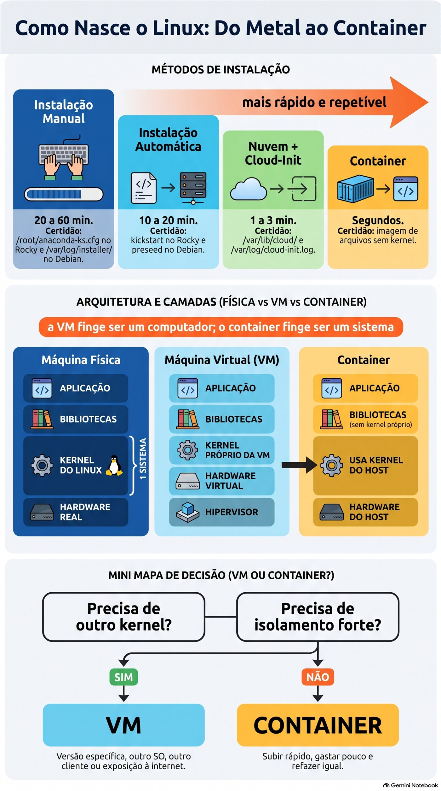
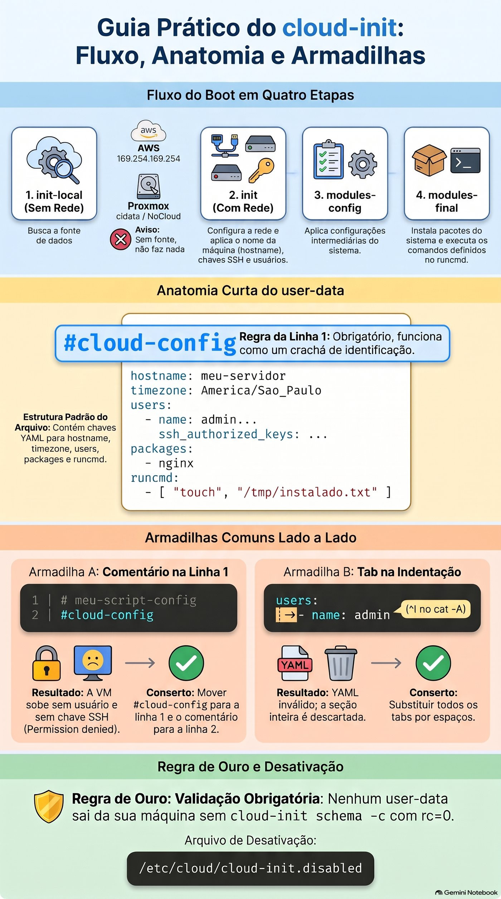

# Lezione 2.1 · Installazione e provisioning

Prima lezione del Modulo 2. Nella lezione 0.1 hai installato Rocky e Debian manualmente, schermata per schermata. Ha funzionato e ci è voluta un'ora. Ora immaginate la richiesta vera e propria: "Ho bisogno di sei server web uguali entro domani e altri sei tra tre mesi". Nessuno lo fa per l'installatore. Oggi imparerai i quattro modi in cui nasce Linux (installazione manuale, installazione automatica, immagine cloud con cloud-init e container), scopri come ognuno lascia una traccia nel sistema e, soprattutto, impari a scegliere. Alla fine, guardi qualsiasi server e dici da dove proviene.

| File | lezione 2.1 |
| --- | --- |
| Modulo | M2 · Sistema, utenti e permessi, lezione 1 di 8 |
| Quando | Settimana 4 |
| Alla fine puoi | Indica se Linux viene eseguito su una macchina fisica, VM o contenitore e come è stato installato; leggere la traccia del programma di installazione in Rocky e Debian; spiegare perché il nome host, l'ID macchina e le chiavi SSH dell'host devono essere univoci; scegliere tra installazione manuale, automatica, immagine cloud e contenitore per un ordine reale; scrivere e convalidare i dati utente cloud-init senza eseguirli; mostrare, con un comando, che un contenitore utilizza il kernel host |
| Articoli di prova | LE 014.1 (scegliere un sistema, ciclo di vita delle distribuzioni) · LE 011.4 (cloud e virtualizzazione) · LPIC-1 102.6 (Linux come guest di virtualizzazione: VM, contenitore, cloud-init, machine-id, chiavi SSH host) · LPIC-1 102.1 (vista iniziale del layout del disco) |
| Prerequisiti | lezioni 0.1 e 0.2 (VM e accesso SSH); lezione 1.10 (`systemd-detect-virt`) |
| Tempo | Intorno alle 2:30 |
| Istantanee | m2a1-start e m2a1-end in entrambe le VM |

## 1 · Riscaldamento

Tre domande, appena mi vengono in mente. Scrivi le risposte; la chiave di risposta viene visualizzata alla fine.

1. Nella lezione 1.10, cosa mostrava `systemd-detect-virt` sulle sue VM e cosa mostrerebbe su un server fisico?
2. Nella lezione 0.1, hai scelto il disco, la rete, la zona e gli utenti nel programma di installazione di Rocky. Indovina: il programma di installazione ha salvato queste risposte da qualche parte al termine?
3. Indovina: un contenitore Debian in esecuzione all'interno di Rocky-Lab. Il `uname -r` al suo interno mostra il kernel Debian o Rocky?

## 2 · Perché è importante

In un client con 40 server, un giorno qualcuno chiede: "come è stato installato questo server? Se muore, possiamo ricostruirlo lo stesso?". Se la risposta è "qualcuno l'ha installato a mano nel 2019 e ci ha armeggiato", nessuno sa come rifarlo. Se "nasce da un'immagine con questo file cloud-init, che è in Git", rifarlo richiede dieci minuti.

Lo stesso vale per l'errore più comune commesso da chi inizia a utilizzare la virtualizzazione: installare una VM fantasiosa e clonarla dieci volte. Tutti e dieci nascono con lo stesso ID macchina, le stesse chiavi SSH host e lo stesso nome. Il monitoraggio confonde le macchine, l'SSH del vostro notebook grida `REMOTE HOST IDENTIFICATION HAS CHANGED` ad ogni server e, a seconda del client DHCP, due di essi si contendono lo stesso IP. Tutto questo ha un nome, una causa e una soluzione e inizia in questa lezione.

E c'è la domanda per ogni nuovo progetto: "diventerà una VM o un contenitore?". Il DeepTutor che utilizzerai nel corso viene eseguito in un Proxmox CT, un contenitore. Le VM del tuo laboratorio sono VM. Oggi capisci perché tutti sono dove sono.

## 3 · Modello mentale

> Ogni Linux nasce in uno di questi quattro modi, e ogni modo lascia un certificato di nascita sul disco. Più sei a destra, più è veloce e ripetibile e meno dovrai parlare con l'installatore.

| Modo | Come nasce | Quanto tempo ci vuole | Ripetibile? | Certificato che rimane |
| --- | --- | --- | --- | --- |
| Installazione manuale | ISO, programma di installazione, rispondi alle schermate | da 20 a 60 minuti | No: ognuno esce un po' diverso | `/root/anaconda-ks.cfg` su Rocky, `/var/log/installer/` su Debian |
| Installazione automatica | ISO + file di risposte (kickstart su Rocky, preconfigurato su Debian) | Da 10 a 20 minuti, senza nessuno che guarda | Sì | Lo stesso con le risposte del file |
| Immagine cloud + cloud-init | Un disco già pronto e generico; al primo avvio, cloud-init legge un file e personalizza | da 1 a 3 minuti | Sì, ed è lo standard cloud | `/var/lib/cloud/`, `/var/log/cloud-init.log` |
| Contenitore | Un'immagine di file, senza kernel, che viene eseguita sul kernel host | Secondi | Sì | `/run/.containerenv` (Podman) o `/.dockerenv` (Docker); `systemd-detect-virt` dice `podman`, `docker` o `lxc` |

E dove ognuno di essi viene eseguito:

```text
  máquina física                VM (KVM no Proxmox)              container
 ┌──────────────────┐        ┌─────────────────────────┐      ┌──────────────────────────┐
 │ aplicação        │        │ aplicação               │      │ aplicação  │ aplicação   │
 │ bibliotecas      │        │ bibliotecas             │      │ bibliotecas│ bibliotecas │
 │ KERNEL do Linux  │        │ KERNEL próprio da VM    │      │ (sem kernel próprio)     │
 │                  │        │ hardware virtual (virtio)│      ├──────────────────────────┤
 │                  │        ├─────────────────────────┤      │ KERNEL do host, um só    │
 │ hardware real    │        │ hipervisor + hardware   │      │ hardware (real ou VM)    │
 └──────────────────┘        └─────────────────────────┘      └──────────────────────────┘
  1 sistema                    vários kernels, isolados         um kernel, vários "mundos"
```

La frase da asporto: **la VM finge di essere un computer; il contenitore finge di essere un sistema**. La VM ha il proprio kernel e può eseguire Windows insieme a Linux. Il contenitore divide il kernel dell'host e può eseguire Linux solo sopra Linux, ma si avvia in pochi secondi e non utilizza quasi nulla.


*Più sei a destra, più è veloce e ripetibile e meno parli con l'installatore.*

## 4 · Concetto a strati

### Essenziale

**Scegli un sistema.** Prima dell'installazione, qualcuno ha deciso *quale* sistema. Per i server, la domanda non è "qual è il miglior Linux", ma piuttosto "per quanto tempo questa versione riceve le correzioni di sicurezza e chi mi aiuterà in caso di problemi":

| Sistema | Ciclo di vita | Quando ha senso |
| --- | --- | --- |
| Rocky Linux 9 | Correzioni fino a maggio 2032, circa dieci anni per versione principale | Server che devono rimanere gli stessi per anni; programmi certificati per RHEL |
| Debian13 | Circa tre anni di sostegno normale e altri due di LTS, fino al 2030 | Server snelli, base Proxmox, che preferisce la community |
| Ubuntu LTS | Cinque anni gratis, altri con abbonamento | Cloud pubblico, dove l'immagine più comune è |
| Fedora, Arco | Rilascio ogni sei mesi o continuo (*a rotazione*) | Desktop e test, raramente server |
| Windows Server, macOS | Cicli del produttore, licenza a pagamento | Active Directory e applicazioni Windows; macOS quasi solo su desktop |

**LTS** significa *Supporto a lungo termine*: una versione che riceve correzioni per molti anni, senza passare a una versione principale. **Rolling** significa che non esiste una "versione": il sistema viene continuamente aggiornato. Su un server client, desideri LTS.

**I quattro modi di installazione**, nell'ordine in cui li troverai:

1. **Manuale.** Avvia l'ISO e ottieni il programma di installazione: Anaconda su Rocky, `debian-installer` su Debian. Buono per la prima volta, per un singolo server fisico e per l'apprendimento. È brutto farlo di nuovo.
2. **Automatico.** Stesso programma di installazione, ma le risposte provengono da un file. In Rocky, è il **calcio di partenza**; in Debian, **presettato**. Anaconda ti regala addirittura il primo: dopo ogni installazione, registra le tue risposte in `/root/anaconda-ks.cfg`, pronto per ripetere l'installazione.
3. **Immagine cloud con cloud-init.** Qualcuno ha già installato il sistema, ripulito tutto ciò che è univoco (nome, chiavi, ID macchina) e salvato il disco come immagine generica: `Rocky-9-GenericCloud.qcow2`, `debian-13-genericcloud-amd64.qcow2`. Crei la VM da quel disco. Al primo avvio, **cloud-init** cerca le istruzioni (nome, utente, chiave SSH, pacchetti, rete) e personalizza la macchina. È così in AWS, Azure, Google Cloud, OpenStack e anche in Proxmox, con l'unità cloud-init che utilizzerai nel Modulo 17.
4. **Contenitore.** Il sistema non è installato. Si scarica un'immagine di file (`debian:trixie`, `rockylinux:9`) ed si esegue un processo isolato sul kernel già esistente. Con Podman o Docker, è un contenitore **applicazione**: un processo principale, una funzione. Con LXC, come i Proxmox CT, è un contenitore **di sistema**: ha `systemd`, diversi servizi e sembra una VM, ma il kernel rimane quello dell'host.

**VM o contenitore?** Due domande risolvono quasi sempre il problema:

- **Hai bisogno di un altro kernel?** Windows, un kernel di una versione specifica, i tuoi moduli, un firewall con le tue regole del kernel: VM.
- **Hai bisogno di un forte isolamento, perché proviene da un altro client o è esposto a Internet?** In caso di dubbio, VM. Un errore grave nel kernel colpisce tutti i contenitori su quell'host; in una VM, influisce solo sulla VM.

Se entrambe le risposte sono "no", e vuoi salire velocemente, spendi poco e rifai sempre lo stesso, contenitore.

### Intermedio

**Il certificato di nascita.** Ogni modo di installazione lascia indizi. Li cercherai in laboratorio:

| Traccia | Dove | Che cosa significa |
| --- | --- | --- |
| `/root/anaconda-ks.cfg` | Roccioso | Le risposte del programma di installazione, in formato kickstart: lingua, tastiera, disco, rete, zona, pacchetti |
| `/var/log/anaconda/` | Roccioso | I registri di installazione, se qualcosa è andato storto |
| `/var/log/installer/` | Debian | `debian-installer` registri, riepilogo hardware e risposte |
| `/var/lib/cloud/instance/` | Chiunque abbia cloud-init | L'istanza configurata da cloud-init e ciò che ha ricevuto |
| `/var/log/cloud-init.log` | Chiunque abbia cloud-init | Tutto quello che ha fatto all'avvio, passo dopo passo |
| `stat -c '%w' /` | Chiunque | La data di creazione del file system root, ovvero l'installazione |

**Le tre identità di un'installazione.** Ogni Linux ha tre cose che devono essere univoche sulla rete:

| Identità | Dov'è | Creato quando | Se due server hanno lo stesso |
| --- | --- | --- | --- |
| Nome (nome host) | `/etc/hostname`; `hostnamectl` mostra | Durante l'installazione o tramite cloud-init | Il monitoraggio e i registri mescolano entrambe le macchine |
| ID-macchina | `/etc/machine-id`, 32 caratteri esadecimali | Al primo avvio, se il file è vuoto | Il giornale, `systemd-networkd` DHCP e altri strumenti pensano di essere la stessa macchina; Debian può anche ottenere lo stesso IP |
| Chiavi SSH host | `/etc/ssh/ssh_host_*_key` e `.pub` | All'installazione o al primo avvio | Chi si connette non sa più con chi sta parlando, e l'avviso di cambio chiave si trasforma in rumore che tutti ignorano |

Un'immagine cloud ben realizzata esce dalla fabbrica con un `/etc/machine-id` vuoto e nessuna chiave SSH dell'host, in modo che ogni VM generi la propria al primo avvio. Un clone realizzato con noncuranza assume le tre identità dell'originale. La sfida del Modulo 5 è proprio quella di risolvere un simile clone.

**Come funziona cloud-init.** Funziona solo all'avvio, in quattro passaggi: `init-local` (prima della rete, cerca l'origine dati), `init` (con rete: nome, chiavi SSH, utenti), `modules-config` (configurazioni) e `modules-final` (pacchetti e relativi comandi `runcmd`). La **datasource** (*datasource*) è da dove legge le istruzioni: in AWS, un indirizzo speciale, `169.254.169.254`; su Proxmox, un CD-ROM virtuale chiamato `cidata` (del tipo *NoCloud*). Se non trova alcuna fonte, non fa nulla.

Le istruzioni sono **user-data**, quasi sempre uno YAML che necessariamente inizia con la riga `#cloud-config`:

```yaml
#cloud-config
hostname: web01
timezone: Europe/Rome
users:
  - name: rodrigo
    groups: [wheel]
    sudo: "ALL=(ALL) NOPASSWD:ALL"
    shell: /bin/bash
    ssh_authorized_keys:
      - ssh-ed25519 AAAAC3...sua-chave-publica rodrigo@notebook
packages:
  - chrony
runcmd:
  - [systemctl, enable, --now, chronyd]
```

Riga per riga: il nome della macchina; il fuso; un utente `rodrigo`, nel gruppo `wheel` (il gruppo di `sudo` in Rocky), con `sudo` senza password e la sua chiave pubblica; il pacchetto `chrony` installato; e un comando alla fine del primo avvio. Da notare che non esiste alcuna password: l'accesso avviene solo tramite la chiave. È lo standard cloud ed è il motivo per cui appare `NOPASSWD`: l'utente nasce senza password, quindi un `sudo` che richiedesse una password non funzionerebbe mai.

**Quando viene eseguito di nuovo?** Cloud-init memorizza l'*instance-id* dell'origine dati. In un normale riavvio, l'ID è lo stesso e salta quasi tutto. Se l'ID cambia, come in un clone che riceve una nuova unità cloud-init, pensa che sia una nuova macchina ed esegue di nuovo tutto, inclusa la generazione di nuove chiavi SSH. Ecco perché le immagini cloud non presentano mai il problema della clonazione.

### Windows Bridge

| Su Windows | Su Linux | Cosa cambia |
| --- | --- | --- |
| Installare secondo ISO `setup.exe` | Anaconda o `debian-installer` | Quasi nulla |
| `unattend.xml` (installazione automatica) | Kickstart su Rocky, preconfigurato su Debian | Il formato. L'idea è la stessa: un archivio di risposte |
| `sysprep /generalize` e un'immagine | Immagine nuvola generica + `cloud-init` | Linux non ha SID; il problema equivalente riguarda l'ID macchina dell'host e le chiavi SSH |
| SID duplicato nei cloni | chiavi ID macchina e SSH duplicate | Stessa malattia, stessa medicina: pulirsi prima di diventare immagine |
| Hyper-V | KVM, utilizzato da Proxmox | Entrambi sono hypervisor di tipo 1 |
| WSL2 | Una VM leggera con un vero kernel Linux | Ecco perché `uname -r` in WSL2 mostra un kernel `microsoft-standard` |
| Contenitore Windows Server | Podman, Docker, LXC | In Linux i contenitori sono la vita di tutti i giorni; su Windows, è raro |

### Advanced

**Tipi di hypervisor.** Il tipo 1 viene eseguito direttamente sull'hardware: KVM (e quindi Proxmox), VMware ESXi, Hyper-V, Xen. Il tipo 2 viene eseguito come programma all'interno di un altro sistema: VirtualBox, VMware Workstation. KVM è un modulo del kernel Linux; il kernel host diventa l'hypervisor.

**Paravirtualizzazione.** Una VM può falsificare il vecchio hardware, che ogni sistema conosce (una scheda di rete e1000, un disco IDE), o utilizzare dispositivi realizzati per la virtualizzazione, i **virtio**, che richiedono un driver nel guest e sono molto più veloci. Linux ha già i driver Virtio nel kernel. Questi driver sono i *driver ospiti* del test, insieme al **agente ospite** (`qemu-guest-agent`), che hai installato nella lezione 0.2 affinché Proxmox possa comunicare con la VM.

**Il kickstart come documentazione.** `/root/anaconda-ks.cfg` è un file di testo che riproduce la tua installazione. Servito su HTTP e passato all'avvio con `inst.ks=http://servidor/ks.cfg`, installa da solo il successivo Rocky. In Debian l'equivalente è `preseed/url=http://servidor/preseed.cfg`. Nelle aziende con server fisici, ecco come viene installato: avvio di rete (PXE) e kickstart per tipo di server.

**Cloud-init in Proxmox.** Proxmox genera i dati utente dai campi VM (`ciuser`, `sshkeys`, `ipconfig0`) e li scrive su un piccolo CD-ROM virtuale. Per i vostri dati utente completi c'è l'opzione `--cicustom`. Lo assemblerai nel Modulo 17, con il modello e `qm clone`.

**Disattiva cloud-init.** Un file vuoto in `/etc/cloud/cloud-init.disabled` impedisce l'esecuzione di cloud-init all'avvio, anche se installato. È il modo sicuro per avere il pacchetto in una VM che non deve essere riconfigurata e utilizzarlo in laboratorio.

### Cosa c'è nel test

- **LE 014.1**: differenze tra Windows, macOS e Linux; distribuzioni; cos'è LTS e il ciclo di vita; quando sceglierli ciascuno.
- **LE 011.4**: cloud e virtualizzazione in generale; la differenza tra VM e contenitore.
- **LPIC-1 102.6**: VM e contenitore (sistema e applicazione); gli elementi di una VM cloud (calcolo, disco, rete); cosa deve cambiare in un clone (nome, ID macchina, chiavi SSH host e ID macchina D-Bus, che è lo stesso di `/etc/machine-id`); immagini; gli autisti ospiti; o cloud-init.
- **LPIC-1 102.1**: vedrai il layout scelto dall'installatore. I dettagli delle partizioni e LVM si riferiscono al Modulo 9.

## 5 · Rocky × Debian

| Cosa | Roccioso 9 | Debian 13 |
| --- | --- | --- |
| Installatore | Anaconda (grafica o testo) | `debian-installer` (testo o grafica) |
| Archivio risposte | Kickstart | Preimpostato |
| Traccia di installazione | `/root/anaconda-ks.cfg` e `/var/log/anaconda/` | `/var/log/installer/` |
| Layout del disco predefinito | LVM: `rl-root`, `rl-swap`, `/boot` e `/boot/efi` | Partizioni semplici o LVM se si sceglie |
| Gruppo `sudo` | `wheel` | `sudo` |
| Utente predefinito immagine cloud | `rocky` | `debian` |
| Installa cloud-init | `sudo dnf install -y cloud-init` | `sudo apt install -y --no-install-recommends cloud-init` |
| Installa Podman | `sudo dnf install -y podman` | `sudo apt install -y podman` |

## 6 · Laboratorio guidato

Lo script: prima scopri da dove provengono le tue due VM, come se fossero server per un nuovo client. Quindi scegli il modo giusto di installazione per una richiesta reale, prepara cloud-init senza lasciare che tocchi nulla, scrivi e convalida i dati dell'utente e finisci per guardare un container condividere il kernel con la VM.

### Passo 1 · Snapshot e la prima domanda: dove mi trovo?

Nel nodo Proxmox, prima di tutto:

```bash
qm snapshot 201 m2a1-inicio
qm snapshot 202 m2a1-inicio
```

Entra in Rocky-Lab tramite SSH e chiedi dove ti trovi:

```bash
systemd-detect-virt; echo "rc=$?"
systemd-detect-virt --container; echo "rc=$?"
hostnamectl
```

Risultato previsto: `kvm` con `rc=0`, poi `none` con `rc=1`. La prima riga dice che sotto c'è un hypervisor; la seconda, che non sei dentro un container. In `hostnamectl`, cerca tre righe: `Chassis: vm`, `Virtualization: kvm` e `Hardware Vendor: QEMU`. Il "produttore" del tuo computer è il programma che lo falsifica.

Fai lo stesso in Debian-lab. Le risposte sono le stesse: entrambe sono VM dello stesso Proxmox.

### Passo 2 · Il certificato di nascita

In rocky-lab:

```bash
sudo ls -l /root/anaconda-ks.cfg
sudo grep -E '^(lang|keyboard|timezone|network|ignoredisk|autopart|part|volgroup|logvol)' /root/anaconda-ks.cfg
sudo ls /var/log/anaconda/
stat -c '%w' /
```

Il `ls -l` mostra `-rw-------`: solo root lo legge. `grep` mostra le tue risposte dalla Lezione 0.1, in formato kickstart: la lingua, la tastiera, il fuso orario `Europe/Rome`, la scheda `enp6s18`, il disco e il partizionamento. L'ultima riga mostra la data e l'ora di creazione del file system root: il giorno dell'installazione.

Notare cosa `grep` **non** mostra: righe `rootpw` e `user`. Memorizzano l'hash delle password, motivo per cui il file è solo per root. Nella vita reale, chi copia un `anaconda-ks.cfg` da utilizzare come modello cancella queste righe prima di posizionarlo su un server web o in Git.

In debian-lab:

```bash
sudo ls /var/log/installer/
sudo cat /var/log/installer/lsb-release
sudo grep -i -m3 -E 'ethernet|scsi' /var/log/installer/hardware-summary
stat -c '%w' /
```

Il `debian-installer` memorizza qualcos'altro: non un file per ripetere l'installazione, ma il suo diario. `syslog` ha tutto quello che è successo; `hardware-summary`, l'hardware che ha trovato, qui le schede Proxmox virtio; o `lsb-release`, la versione del programma di installazione. La cartella `cdebconf/` contiene le risposte, comprese le password, e viene esclusa da questo passaggio per lo stesso motivo di `rootpw`.

Se `stat -c '%w' /` mostra `-`, il file system non memorizza la data di creazione. Utilizzare la cartella del programma di installazione: `ls -ld --time-style=long-iso /var/log/installer` su Debian o `rpm -qi basesystem | grep 'Install Date'` su Rocky.

### Passaggio 3 · Le tre identità

Sulle due VM, una alla volta:

```bash
hostnamectl hostname
cat /etc/machine-id
ssh-keygen -lf /etc/ssh/ssh_host_ed25519_key.pub
```

Notare le tre risposte di ciascuna VM, una accanto all'altra. Il nome è diverso, l'ID macchina è diverso (32 caratteri esadecimali) e l'impronta digitale della chiave SSH dell'host (`SHA256:...`) è diversa. Dovrebbe essere così: entrambi sono stati installati da zero e ogni installazione ha generato il proprio.

Ora una domanda su cui riflettere, senza comandi: ricordi la prima volta che hai inserito ciascuna VM tramite SSH, nella lezione 0.2? Il cliente ha chiesto `Are you sure you want to continue connecting (yes/no)?` e ha mostrato un'impronta digitale. Questo era tutto. Il tuo notebook ha salvato la chiave in `~/.ssh/known_hosts` e da lì controlla ogni connessione.

### Passo 4 · La sfida, prima della soluzione

Senza guardare la sezione 4, rispondi per iscritto: se spegni debian-lab, cloni la VM in Proxmox e accendi il clone, quale delle tre identità avrà il clone **uguale** all'originale? E cosa dirà il tuo notebook quando accederai via SSH all'IP del clone, se ottiene lo stesso IP dell'originale?

Controlla con la tabella delle tre identità, nella sezione 4. Non clonerai oggi: questa è la sfida del Modulo 5.

**Decidi 1 · I sei server.** Un client richiede, per domani, sei server web Rocky identici sul suo Proxmox. Tra tre mesi ne vuole altri sei, uguali al primo. Come si fa?

- **A)** Installa manualmente da ISO, sei volte, con cura e un elenco di cosa scegliere su ciascuna schermata.
- **B)** Installa uno a mano, lascialo rotondo e clonalo cinque volte in Proxmox.
- **C)** Usa l'immagine cloud di Rocky e i dati utente cloud-init salvati in Git, con il nome di ciascun server che cambia.
- **D)** Crea una singola VM ed esegui i sei server web come sei contenitori al suo interno.

Scegli la lettera prima di guardare la tabella.

| Se hai selezionato | Risultato | Perché |
| --- | --- | --- |
| A | ❌ Sbagliato | Funziona, ma ci vogliono sei ore e tutte e sei risultano leggermente diverse: una schermata ha risposto in modo diverso, un pacchetto in più. Tra tre mesi nessuno ricorderà le proprie scelte. |
| B | ❌ Sbagliato | Veloce, ma i sei cloni nascono con lo stesso ID macchina e le stesse chiavi SSH dell'host originale e con lo stesso nome. Puoi aggiustarlo a mano, ed è quello che ti dimentichi di fare. |
| C| ✅ Giusto | Ogni VM nasce dalla stessa immagine pulita, genera le proprie identità al primo avvio e riceve nome, utente, chiave e pacchetti dallo stesso file. Tra tre mesi, lo stesso file ne produrrà altri sei uguali in pochi minuti. |
| D | ❌ Sbagliato | Un giorno potrebbe essere una buona architettura, ma non è la richiesta: il cliente vuole sei server. E i sei condividono un kernel e una VM; Se cade, cadono tutti. |

**Per risolvere:** la clonazione copia tutto, anche ciò che deve essere unico. Un'immagine cloud è un clone che sa di essere un clone.


*Nome, ID macchina e chiavi SSH: tre identità che un clone disattento copia insieme.*

### Passaggio 5 · Cloud-init, con la cintura inserita prima

Installerai cloud-init su entrambe le VM per utilizzare il suo validatore. Ma le VM sono già configurate e cloud-init non dovrebbe toccarle. Quindi, **prima** dell'installazione, il file che lo spegne.

In rocky-lab:

```bash
sudo mkdir -p /etc/cloud
sudo touch /etc/cloud/cloud-init.disabled
sudo dnf install -y cloud-init
cloud-init --version
cloud-init status --long
```

In debian-lab, le stesse righe, sostituendo `dnf` con:

```bash
sudo apt install -y --no-install-recommends cloud-init
```

Il `status` dovrebbe mostrare `status: disabled` e, nelle righe sottostanti, il motivo: il file `/etc/cloud/cloud-init.disabled`. Finché esiste, cloud-init è installato e non viene eseguito all'avvio. Senza di esso, in un avvio futuro, cloud-init cercherebbe un'origine dati; sulle sue VM non ce ne sono e probabilmente non farebbe nulla. "Probabilmente" non funziona su un server client. Il file trasforma "probabilmente" in "sicuramente".

### Passo 6 · Scrivere e convalidare i dati utente

In rocky-lab:

```bash
mkdir -p ~/lab21
cd ~/lab21
cat > user-data.yaml <<'EOF'
#cloud-config
hostname: web01
timezone: Europe/Rome
users:
  - name: rodrigo
    groups: [wheel]
    sudo: "ALL=(ALL) NOPASSWD:ALL"
    shell: /bin/bash
    ssh_authorized_keys:
      - ssh-ed25519 AAAAC3NzaC1lZDI1NTE5AAAAIexemploexemploexemploexemploexemplo rodrigo@notebook
packages:
  - chrony
runcmd:
  - [systemctl, enable, --now, chronyd]
EOF
cloud-init schema -c user-data.yaml; echo "rc=$?"
```

La risposta ha `Valid schema` e `rc=0`. Il validatore controlla lo YAML e se ciascuna chiave esiste e ha il tipo corretto. Non verifica se la chiave SSH è reale: per farlo sostituisci la riga dell'esempio con la tua chiave pubblica (il contenuto di `.pub` del tuo notebook, quello della lezione 0.2). La chiave pubblica può andare a Git; quello privato, mai.

Il file non è stato utilizzato da nessuno: cloud-init è disattivato e `schema` lo legge soltanto. Funziona così: i dati utente vengono scritti e convalidati sulla tua macchina, salvati in Git e solo successivamente consegnati a una nuova VM.

**La tua sfida.** Ora esegui `user-data-debian.yaml`, per un server Debian chiamato `web02`. Cosa cambia? Pensa al gruppo `sudo` (sezione 5) e al nome del pacchetto orologio, che in Debian è anche `chrony`, ma il servizio si chiama `chrony`, non `chronyd`. Convalidare con `schema` fino a `rc=0`. La risposta è nella chiave di risposta.

### Passo 7 · Un contenitore accanto alla VM

In rocky-lab:

```bash
sudo dnf install -y podman
uname -r
podman run --rm docker.io/library/debian:trixie uname -r
podman run --rm docker.io/library/debian:trixie grep PRETTY_NAME /etc/os-release
podman run --rm docker.io/library/debian:trixie ls -l /run/.containerenv
```

La prima volta scarica l'immagine Debian, circa 50 MB; gli altri salgono in meno di un secondo. Confronta le prime due righe di output: `uname -r` della VM e quelle del contenitore sono **uguali**, un kernel Rocky `el9`. Il contenitore dice che è `Debian GNU/Linux 13 (trixie)`, perché i suoi file provengono da Debian, ma il kernel rock-lab esegue tutto. Il file `/run/.containerenv` è il marchio che Podman lascia all'interno di ogni contenitore; questo è ciò su cui si basa `systemd-detect-virt` per rispondere a `podman`.

Crea il mirror in debian-lab, se vuoi vedere il contrario:

```bash
sudo apt install -y podman
podman run --rm quay.io/rockylinux/rockylinux:9 grep PRETTY_NAME /etc/os-release
podman run --rm quay.io/rockylinux/rockylinux:9 uname -r
```

Un "Rocky" con il kernel Debian. `--rm` cancella il contenitore al termine; l'immagine viene salvata per la prossima volta. Immagini, livelli e registri sono l'argomento del Modulo 18. Oggi è sufficiente la frase della sezione 3: la VM finge di essere un computer, il contenitore finge di essere un sistema.

## 7 · Interrompi e correggi

### Interruzione A · I dati utente che nessuno legge

Un collega ama i file ben documentati e ha iniziato i dati utente con un commento. Fai come lui, su rocky-lab:

```bash
cd ~/lab21
{ echo '# user-data do web01 - mantido pela equipe'; cat user-data.yaml; } > user-data-colega.yaml
head -3 user-data-colega.yaml
```

**Observe.**

```bash
cloud-init schema -c user-data-colega.yaml; echo "rc=$?"
```

Il validatore rifiuta, con `rc=1`, e dice che il file deve **iniziare** con `#cloud-config`. Lo YAML è perfetto; anche il contenuto.

**Diagnose.** `#cloud-config` sembra un commento e per YAML lo è. Per cloud-init, è un'altra cosa: la prima riga di dati utente dice **che tipo di file è quello**. Potrebbe essere `#cloud-config`, potrebbe essere `#!/bin/bash` (uno script che esegue solo), potrebbero essere altri formati. cloud-init legge la prima riga, e solo quella, per decidere. Con qualsiasi commento lì, non riconosce il tipo.

E qui sta il pericolo: il validatore si è lamentato perché glielo hai chiesto. In una vera VM, nessuno lo chiede. cloud-init registra un avviso nel suo log, la VM si avvia normalmente e si avvia **senza il suo utente, senza la sua chiave e senza il suo nome**. Provi SSH e ottieni `Permission denied`, senza sapere perché.

**Decidi A · La correzione.** Cosa risolve?

- **A)** Sposta `#cloud-config` alla riga 1 e il commento del collega alla riga 2.
- **B)** Rinomina il file in `user-data.yml`, che è l'estensione attesa da cloud-init.
- **C)** Inserisci `---`, il marcatore di inizio del documento YAML, sulla prima riga.
- **D)** Nella nuova VM, esegui `sudo cloud-init clean` e riavvia, in modo che venga letto di nuovo.

Scegli la lettera prima di guardare la tabella.

| Se hai selezionato | Risultato | Perché |
| --- | --- | --- |
| A | ✅ Giusto | Il tipo è deciso dalla prima riga e solo da essa. Dopo `#cloud-config` possono esserci tutti i commenti che desideri. |
| B | ❌ Sbagliato | cloud-init non esamina le estensioni. Su Proxmox e NoCloud il file non ha nemmeno un'estensione: si chiama `user-data`. |
| C| ❌ Sbagliato | Ora la prima riga è `---` e cloud-init ancora non ne riconosce il tipo. YAML accetta `---`, ma è la prima riga a decidere. |
| D | ❌ Sbagliato | Leggerà lo stesso file e raggiungerà la stessa conclusione. L'esecuzione successiva del file sbagliato genera lo stesso errore, solo in un secondo momento. |

**Da risolvere:** `#cloud-config` non è un commento, è un badge. Riga 1, sola, senza spazio prima o dopo.

**Correzione.**

```bash
{ echo '#cloud-config'; echo '# user-data do web01 - mantido pela equipe'; tail -n +3 user-data-colega.yaml; } > user-data-colega.ok
mv user-data-colega.ok user-data-colega.yaml
head -3 user-data-colega.yaml
cloud-init schema -c user-data-colega.yaml; echo "rc=$?"
```

`tail -n +3` prende il file dalla riga 3, saltando il commento e il vecchio `#cloud-config`. Ora: `Valid schema` e `rc=0`. Tieni presente che hai scritto su un nuovo file e solo poi lo hai modificato: leggere e scrivere sullo stesso file, sulla stessa riga, cancella il file prima di leggerlo.

### Interruzione B · La scheda invisibile

Un altro collega ha modificato i dati dell'utente in un editor che esegue il tabulazione quando viene premuto il tasto Tab. Riprodurre il danno:

```bash
cp user-data.yaml user-data-tab.yaml
sed -i 's/^    shell:/\tshell:/' user-data-tab.yaml
cat user-data-tab.yaml
```

Nel `cat` il file appare identico; al massimo la linea di `shell` è un po' disallineata.

**Osservare.**

```bash
cloud-init schema -c user-data-tab.yaml; echo "rc=$?"
```

`rc=1`. Il messaggio dice che il file non è un YAML valido e indica `found character '\t' that cannot start any token`, con il numero di riga.

**Diagnostique.** Chiede di vedere l'invisibile:

```bash
cat -A user-data-tab.yaml | grep -n '\^I'
```

`cat -A` mostra tutti i caratteri nascosti: la tabulazione diventa `^I` e la fine della riga diventa `$`. La riga 8 inizia con `^Ishell:`. YAML utilizza gli **spazi** per indicare chi è all'interno di chi e vieta la tabulazione nel rientro. Non è un problema: una tabulazione vale 4 colonne in un editor e 8 in un altro, e YAML si rifiuta di indovinare.

**Decidi B · La correzione.** Cosa risolve?

- **A)** Scambia la tabulazione per quattro spazi, allineando `shell:` con `sudo:` sopra.
- **B)** Scambia anche il rientro delle altre righe con tabulazioni, per mantenere tutto lo stesso.
- **C)** Metti il valore tra virgolette: `shell: "/bin/bash"`.
- **D)** Ignora il validatore: cloud-init è tollerante e si gira immediatamente.

Scegli la lettera prima di guardare la tabella.

| Se hai selezionato | Risultato | Perché |
| --- | --- | --- |
| A | ✅ Giusto | Con spazi, e allo stesso livello delle sorelle, `shell` torna a far parte dell'utenza `rodrigo`. |
| B | ❌ Sbagliato | La tabulazione è vietata in qualsiasi rientro YAML. Hai moltiplicato l'errore. |
| C| ❌ Sbagliato | Il problema è prima di `shell`, all'inizio della riga. Le virgolette proteggono i valori, non il rientro. |
| D | ❌ Sbagliato | cloud-init utilizza lo stesso lettore YAML del validatore. Se il file non si apre, l'intera sezione viene scartata: nessun utente, nessun pacchetto, niente. |

**Per risolvere:** YAML è rientrato con spazi, mai con tab. Quando un YAML "giusto" viene rifiutato, il primo comando è `cat -A`.

**Fix.**

```bash
sed -i 's/^\t/    /' user-data-tab.yaml
cat -A user-data-tab.yaml | grep -c '\^I'
cloud-init schema -c user-data-tab.yaml; echo "rc=$?"
```

`grep -c` conta le schede `0` e il validatore ritorna a `Valid schema`. Per evitare che ciò accada di nuovo nel tuo `vim`, il Modulo 3 mostra come configurare l'editor per scambiare solo la scheda con lo spazio.

### La lezione

Le due interruzioni di oggi hanno lo stesso aspetto: un file che **sembra corretto** e che cloud-init in realtà ignorerebbe. E lo ignora silenziosamente, perché viene eseguito al primo avvio, senza che nessuno guardi, in una VM a cui non puoi ancora accedere. Il prezzo di un dato utente errato non è un messaggio di errore; è una VM inaccessibile e una diagnosi tramite la console Proxmox. La regola pratica: **nessun dato utente lascia la vostra macchina senza `cloud-init schema -c` con `rc=0`**. Ci vuole un secondo. Nella lezione 0.2 hai imparato come testare la connessione prima di chiudere la sessione; ecco lo stesso istinto, prima di creare la VM.



*Cloud-init viene eseguito una volta, senza che nessuno guardi: convalidare prima i dati utente, perché poi commette errori silenziosi.*

## 8 · Insidie

| Digiti o vedi | Cosa succede | Quello giusto |
| --- | --- | --- |
| Clonare una VM pronta e accendere il clone | Stesso ID macchina, stesse chiavi SSH host, stesso nome | Utilizzare prima l'immagine con cloud-init o cancellare le identità (Modulo 5) |
| `users:` senza la riga `- default` | L'utente immagine predefinito (`rocky`, `debian`) non viene più creato | Se li desiderate entrambi, iniziate l'elenco con `- default` |
| `sudo: "ALL=(ALL) NOPASSWD:ALL"` su ogni server | Chi ruba la tua chiave SSH diventa root senza alcuna password | Accettabile in laboratorio e VM usa e getta; in produzione, discuti con il team |
| Commento prima di `#cloud-config` | cloud-init non riconosce il file e la VM si carica senza nulla | `#cloud-config` sempre sulla linea 1 |
| Scheda nel rientro YAML | L'intero file viene rifiutato | Solo spazi; verificare con `cat -A` |
| Installa cloud-init su un server già configurato | Al successivo avvio, potrebbe tentare di configurare la macchina | `touch /etc/cloud/cloud-init.disabled` prima di installare |
| `rm /etc/machine-id` per "generarne un altro" | Alcuni servizi si bloccano all'avvio a causa della mancanza del file | Vuoto con `truncate -s 0 /etc/machine-id`; systemd genera all'avvio (Modulo 5) |
| Un contenitore per cliente "da isolare" | Condividono tutti lo stesso kernel; un difetto in esso espone tutti | Un forte isolamento tra i client è VM |
| Distribuzione continua su un server client | Grandi aggiornamenti in qualsiasi momento, senza finestra | LTS: Rocky, Debian stabile, Ubuntu LTS |
| `cat /root/anaconda-ks.cfg` incollato in un ticket o Git | Espone l'hash della password | Cancellare le righe `rootpw` e `user` prima di copiare |
| `uname -r` all'interno di un contenitore per conoscere il sistema | Mostra il kernel dell'host, non quello del contenitore | `cat /etc/os-release` |
| Pensare che la chiave privata vada nei dati utente | Perdita: è registrata nella VM e Git | Nei dati utente, solo la chiave **pubblica** |

## 9 · Quiz

Dieci domande, senza consultazione. Scrivere la lettera o la risposta a ciascuna e solo dopo aprire la chiave di risposta.

**1.** Su un server Rocky installato da ISO, quale file memorizza le risposte di installazione, in formato kickstart, pronte per essere ripetute?

- **A)** `/var/log/installer/syslog`
- **B)** `/etc/kickstart.conf`
- **C)** `/root/anaconda-ks.cfg`
- **D)** `/var/lib/cloud/instance/user-data.txt`

**2.** Si esegue `uname -r` all'interno di un contenitore Debian, su un host Rocky 9. Cosa appare?

- **A)** Il kernel Debian 13
- **B)** Il kernel Rocky 9, perché il contenitore utilizza il kernel dell'host
- **C)** Niente: i contenitori non hanno un kernel e il comando Failure
- **D)** La versione Podman

**3.** Quale dovrebbe essere la prima riga dei dati utente nella configurazione cloud-init formato?

**4.** Quali di questi sono hypervisor di tipo 1, che vengono eseguiti direttamente sull'hardware?

- **A)** VirtualBox e VMware Workstation
- **B)** KVM (su Proxmox), Hyper-V e VMware ESXi
- **C)** Podman e Docker
- **D)** WSL1 e Wine

**5.** A cosa risponde `systemd-detect-virt` all'interno di un contenitore Proxmox LXC?

- **A)** `kvm`
- **B)** `none`
- **C)** `lxc`
- **D)** `proxmox`

**6.** Indicare le tre identità che un clone VM eredita dall'originale e deve essere unique.

**7.** Perché le immagini cloud ufficiali di Rocky e Debian vengono fornite senza password root e senza password utente?

**8.** Per quanto tempo Rocky Linux 9 riceve gli aggiornamenti di sicurezza e perché questo pesa sulla scelta di un cliente?

**9.** È necessario il validatore cloud-init su un server già in produzione. Cosa fare prima di installare il pacchetto e perché?

**10.** *Quale file contiene l'identificatore univoco utilizzato da systemd e D-Bus per identificare un'installazione Linux e deve essere rigenerato quando una VM viene clonata?*

- **A)** `/etc/hostname`
- **B)** `/etc/machine-id`
- **C)** `/var/lib/cloud/instance-id`
- **D)** `/etc/ssh/ssh_host_ed25519_key`
- **E)** `/proc/sys/kernel/random/uuid`

## 10 · Flashcard e colla

### Per saperlo a memoria

- `systemd-detect-virt` risponde `kvm`, `lxc`, `podman`... o `none`, con codice 1, su una macchina fisica.
- Il certificato: `/root/anaconda-ks.cfg` su Rocky, `/var/log/installer/` su Debian, `/var/lib/cloud/` su un'immagine VM.
- Le tre identità univoche: nome (`hostnamectl`), `/etc/machine-id` e le chiavi `/etc/ssh/ssh_host_*`.
- Dati utente: la riga 1 è `#cloud-config`; rientro con soli spazi; convalidare con `cloud-init schema -c arquivo`.
- `/etc/cloud/cloud-init.disabled` disattiva cloud-init prima che cambi qualcosa.
- La VM finge di essere un computer (il proprio kernel); il contenitore finge di essere un sistema (kernel host).

### Consultare

| Domanda | Comando o file |
| --- | --- |
| Fisica, VM o container? | `systemd-detect-virt`; `hostnamectl` |
| Chi ha prodotto l'"hardware"? | `cat /sys/class/dmi/id/sys_vendor` |
| Quando è stato installato? | `stat -c '%w' /`; `ls -ld --time-style=long-iso /var/log/installer` |
| Come è stato installato (Rocky)? | `sudo grep -v -E '^(rootpw\|user)' /root/anaconda-ks.cfg` |
| Come è stato installato (Debian)? | `sudo ls /var/log/installer/` |
| Proviene da un'immagine con cloud-init? | `cloud-init status --long`; `ls /var/lib/cloud/instance` |
| Quali dati utente ha ricevuto la VM? | `sudo cat /var/lib/cloud/instance/user-data.txt` |
| Impronta digitale chiave host | `ssh-keygen -lf /etc/ssh/ssh_host_ed25519_key.pub` |
| Sono in un contenitore Podman? | `ls /run/.containerenv` |
| Fino a quando è supportata la versione? | Pagina del ciclo di vita della distribuzione; `cat /etc/os-release` per conoscere la versione |

### Flashcards

| Davanti | Verso |
| --- | --- |
| Quattro modi per installare | Manuale tramite ISO, automatico (kickstart/preseed), immagine + cloud-init, contenitore |
| Chi possiede Kickstart? | Dal programma di installazione di Anaconda: Rocky, RHEL, Fedora. Avviare con `inst.ks=` |
| Chi possiede Preseed? | Dal programma di installazione Debian. Avviare con `preseed/url=` |
| Hypervisor di tipo 1 × tipo 2 | Il tipo 1 funziona su hardware (KVM, ESXi, Hyper-V); il tipo 2 viene eseguito su un sistema (VirtualBox, Workstation) |
| Cosa condivide il contenitore con l'host? | Il nocciolo. Ha i propri file, processi e rete, ma non il kernel stesso |
| Perché l'immagine cloud non ha password? | Una password incorporata sarebbe la stessa su tutte le copie. L'accesso avviene tramite la chiave dati utente |
| Origine dati | Dove cerca i dati cloud-init: `169.254.169.254` nel cloud, disco `cidata` (NoCloud) in Proxmox |
| `instance-id` | Se cambia, cloud-init riconosce la "nuova macchina" ed esegue nuovamente i primi moduli di avvio |
| LTS × rotolamento | LTS: versione fissa, solo correzioni, da anni. Rolling: sempre l'ultima, nessuna versione |
| `Valid schema` | Risposta da `cloud-init schema -c` quando i dati utente sono corretti |

## 11 · Checklist di output

- [ ] Voglio dire, su qualsiasi server, se è fisico, VM o contenitore, e con quale comando.
- [ ] Trovo il certificato di nascita di un Rocky e di un Debian, e so cosa non copiare da esso.
- [ ] Spiego le tre identità e cosa succede con loro in un clone.
- [ ] Scelgo tra installazione manuale, installazione automatica, immagine con cloud-init e contenitore e giustifico.
- [ ] Scrivo dati utente con utente, chiave, zona e pacchetto e convalido con `rc=0`.
- [ ] Riconosco immediatamente le due interruzioni di oggi: badge all'esterno della riga 1 e tab nel rientro.
- [ ] Mostro, con due comandi, che un contenitore utilizza l'host nocciolo.

**Ultimo esercizio, senza guardare.** Su un foglio di carta, o in `vim` se ti senti a tuo agio, scrivi da zero `user-data-debian.yaml` della sfida del Passo 6: server `web02`, utente `rodrigo` con la tua chiave pubblica e sudo, zona `Europe/Rome`, pacchetto `chrony` con il servizio attivato. Quindi convalidare in Debian-lab:

```bash
cloud-init schema -c ~/lab21/user-data-debian.yaml; echo "rc=$?"
```

Aprire il modello solo dopo `rc=0` o dopo tre tentativi.

**Chiusura snapshot.** Nel nodo Proxmox:

```bash
qm snapshot 201 m2a1-fim
qm snapshot 202 m2a1-fim
```

## 12 · Nella vita reale

**Missione della settimana, sola lettura.** Scegli tre server reali da gestire o monitorare: uno fisico, una VM e, se ce n'è uno, un contenitore. In ognuno, senza `sudo` quando possibile e senza cambiare nulla:

1. `systemd-detect-virt` e `hostnamectl`: cos'è e chi è il "produttore".
2. `ls -l /root/anaconda-ks.cfg /var/log/installer 2>/dev/null`: come è nato. Senza accesso root, `ls` di `/root` fallisce e anche questa è una risposta.
3. `cloud-init status 2>/dev/null` e `ls /var/lib/cloud/instance 2>/dev/null`: provengono dall'immagine?
4. `stat -c '%w' /`: quando è nato.
5. `grep PRETTY_NAME /etc/os-release`: quale versione e quando è supportata.
6. Nel Proxmox del client, se hai accesso in lettura: `qm list` e `pct list`, per vedere quante VM e quanti contenitori risiedono lì.

**Per il journal.** Una riga per server, nel formato: `nome · física/VM/container · como foi instalado · data · fim do suporte`. Se due server hanno lo stesso `machine-id`, prendi nota: hai appena trovato un clone difettoso e il Modulo 5 ti insegna come risolverlo. Non correggere nulla questa settimana; basta registrarsi.

**Sfida della settimana.** Di tutti i server che hai esaminato, quale ha il supporto più vicino? Scrivi due frasi alla persona responsabile: qual è la data e cosa succede se entro tale data non viene fatto nulla. Non inviarlo ancora; conservalo per quando verrà fuori l'argomento.

**Domani, senza guardare.** Prima di aprire il terminale, rispondi a mente aperta: quale comando dice se sei in una VM? Dov'è il certificato in Rocky e in Debian? Quali sono le tre identità di un server? Qual è la prima riga dei dati utente? Se commetti errori, torna alla sezione 10, non all'intera lezione.

## 13 · Con DeepTutor

Utilizza DeepTutor sulla rete locale dopo il laboratorio, non al suo posto. I comandi iniziano con `!`:

- `!quiz Aula 2.1`: dieci nuove domande su installazione, VM, container e cloud-init.
- `!explica cloud-init`: il percorso del primo avvio, dall'origine dati a `runcmd`, in un linguaggio semplice.
- `!feynman VM e container`: spieghi la differenza e indica dove era rimasto vacante.
- `!quebra user-data`: ti fornisce un dato utente con un difetto nascosto da trovare con `cat -A` e `schema`.
- `!simulado LPIC-1 102.6`: domande stile esame su Linux come sistema virtualizzato.
- `!cartoes Aula 2.1`: le flashcard della sezione 10, in ordine di ripasso.
- `!erro`: incolla un messaggio da `cloud-init schema` e spiega la riga.
- `!revisao`: cosa rivedere da questo corso e da quelli precedenti, cosa hai sbagliato finora.

## Foglio di risposte commentate

### Riscaldamento

1. Sulle vostre VM, `kvm`, con codice 0. Su una macchina fisica, `none`, con codice 1: il comando non "fail", risponde che non c'è virtualizzazione, e il codice 1 è il modo di dire "no" agli script. In un contenitore Proxmox LXC, `lxc`.
2. SÌ. Anaconda ha scritto `/root/anaconda-ks.cfg`, un kickstart pronto per ripetere l'installazione. debian-installer ha salvato il journal in `/var/log/installer/`, con le risposte in `cdebconf/`.
3. Il kernel Rocky-Lab, un `el9`. Il contenitore contiene i file Debian, ma il kernel dell'host esegue i suoi processi. Questo è ciò che hai visto al passaggio 7.

### Quiz

1. **C.** `/var/log/installer/syslog` proviene da Debian; `user-data.txt` è per una VM creata da un'immagine; `/etc/kickstart.conf` non esiste.
2. **B.** Un contenitore non ha il proprio kernel. Il comando funziona e mostra il kernel host.
3. `#cloud-config`, da solo, alla riga 1. Con qualsiasi altra cosa prima, cloud-init non riconosce il file.
4. **B.** VirtualBox e Workstation sono di tipo 2; Podman e Docker sono contenitori; WSL1 e Wine traducono le chiamate, non virtualizzano.
5. **C.** `lxc`. `none` sarebbe la risposta su una macchina fisica o VM richiesta con `--container`.
6. Il nome host, `/etc/machine-id` e le chiavi SSH dell'host in `/etc/ssh/ssh_host_*`. Se il clone ottiene lo stesso IP tramite DHCP, anche l'IP, poiché alcuni client DHCP utilizzano l'ID macchina per identificarsi.
7. Perché ogni copia dell'immagine avrebbe la stessa password e verrebbe pubblicata su Internet insieme all'immagine. L'accesso viene fornito al momento della creazione, tramite la chiave pubblica dei dati utente.
8. Fino a maggio 2032. Un server client dura in genere cinque anni o più; Scegliere una versione a fine supporto significa contrarre presto una migrazione.
9. Crea `/etc/cloud/cloud-init.disabled` con `sudo touch`. In questo modo cloud-init è installato, il validatore funziona e al successivo avvio non tenta di configurare una macchina già configurata.
10. Tabella seguente.

| Se hai selezionato | Risultato | Perché |
| --- | --- | --- |
| A | ❌ Sbagliato | `/etc/hostname` è il nome, una delle tre identità, ma non è l'identificatore per systemd e D-Bus. |
| B | ✅ Giusto | `/etc/machine-id` ha 32 caratteri esadecimali generati al momento dell'installazione; journal, DHCP e altri servizi lo utilizzano. In un clone, il file viene svuotato in modo che systemd possa generarne un altro all'avvio. |
| C| ❌ Sbagliato | `instance-id` proviene da cloud-init e proviene dall'origine dati, esterna alla VM; non è ciò che utilizza systemd. |
| D | ❌ Sbagliato | È la chiave privata dell'host SSH. Inoltre deve essere univoco in un clone, ma si tratta di un'altra identità. |
| E| ❌ Sbagliato | Questo file restituisce un nuovo UUID ogni volta che viene letto. È un generatore, non un identificatore. |

### Ultimo esercizio

```yaml
#cloud-config
# user-data do web02 (Debian)
hostname: web02
timezone: Europe/Rome
users:
  - name: rodrigo
    groups: [sudo]
    sudo: "ALL=(ALL) NOPASSWD:ALL"
    shell: /bin/bash
    ssh_authorized_keys:
      - ssh-ed25519 AAAAC3...sua-chave-publica rodrigo@notebook
packages:
  - chrony
runcmd:
  - [systemctl, enable, --now, chrony]
```

Le due differenze rispetto a Rocky: il gruppo è `sudo`, non `wheel`, e il servizio è `chrony`, non `chronyd`. Il validatore non accetta neanche: `wheel` è un nome di gruppo valido, ma in Debian non dà alcun potere; e `runcmd` è testo libero per `schema`. Errori come questo compaiono solo nella VM, al primo avvio. Pertanto, chiunque conservi i dati utente per due famiglie conserva due file e li testa ciascuno una volta su una VM usa e getta prima di utilizzarlo realmente.

---

<!-- navegacao -->
[← lezione 1.10 · Software libero nella pratica](1.10-software-livre-na-pratica.md) · [Indice delle lezioni](../01-aulas.md) · [lezione 2.2 · Hardware e dispositivi →](2.2-hardware-e-dispositivos.md)
