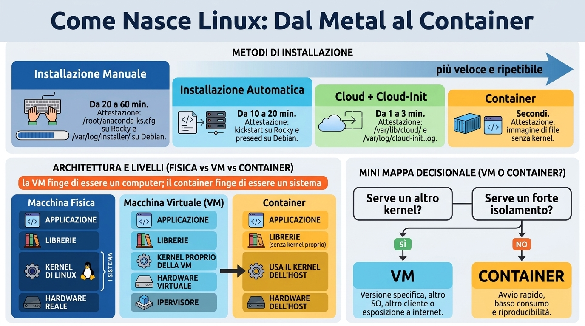
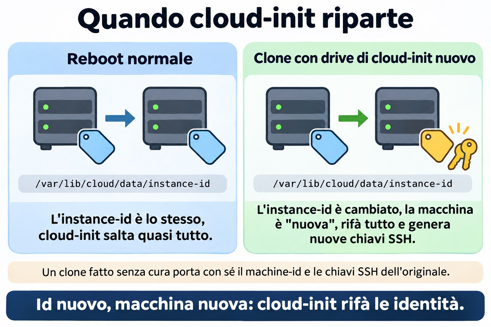
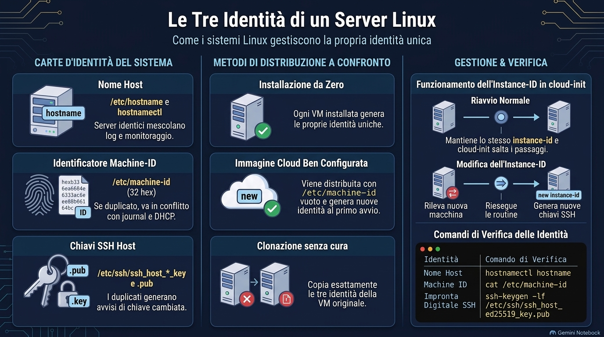
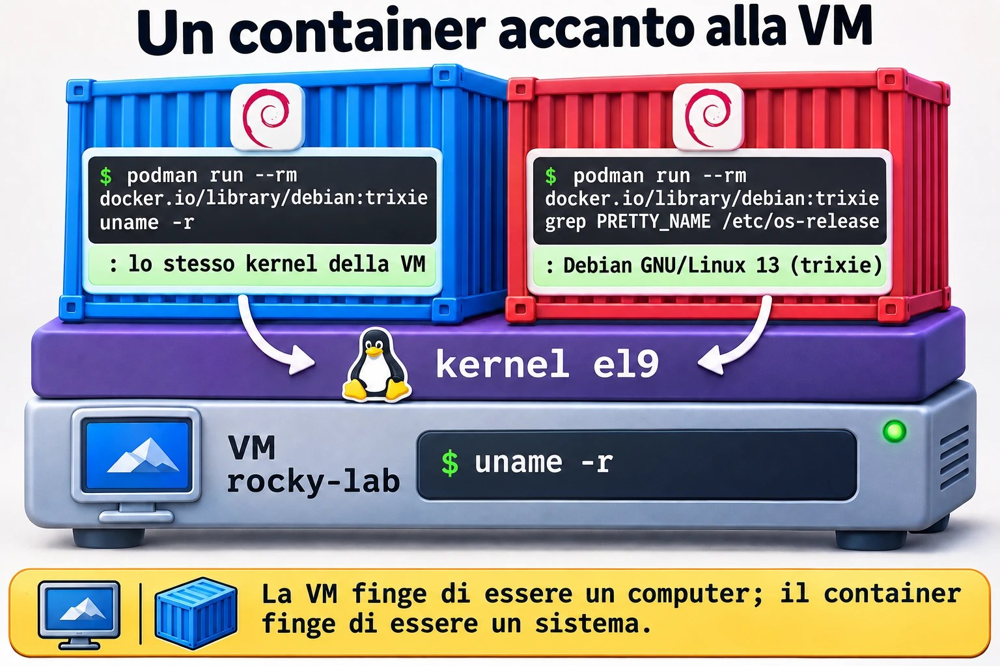
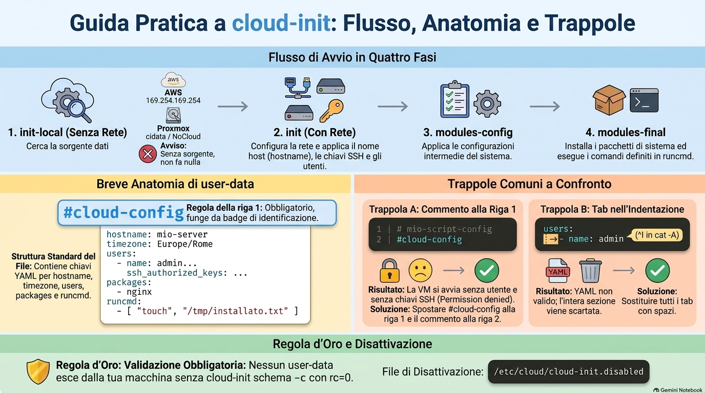

# Lezione 2.1 · Installazione e provisioning

Prima lezione del Modulo 2. Nella Lezione 0.1 hai installato Rocky e Debian a mano, schermata per schermata. Ha funzionato, e ci è voluta un'ora. Ora immagina la richiesta vera: "mi servono sei server web identici entro domani, e tra tre mesi altri sei". Nessuno lo fa con l'installer. Oggi impari i quattro modi in cui nasce un Linux (installazione manuale, installazione automatica, immagine cloud con cloud-init e container), scopri come ognuno lascia una traccia nel sistema e, soprattutto, impari a scegliere. Alla fine guardi un server qualsiasi e dici da dove viene.

| Scheda | Lezione 2.1 |
| --- | --- |
| Modulo | M2 · Sistema, utenti e permessi, lezione 1 di 8 |
| Quando | Settimana 4 |
| Alla fine sei in grado di | Dire se un Linux gira su una macchina fisica, su una VM o in un container, e come è stato installato; leggere la traccia dell'installer su Rocky e Debian; spiegare perché hostname, machine-id e chiavi SSH dell'host devono essere unici; scegliere tra installazione manuale, automatica, immagine cloud e container per una richiesta reale; scrivere e validare uno user-data di cloud-init senza eseguirlo; mostrare, con un comando, che un container usa il kernel dell'host |
| Prerequisiti | Lezioni 0.1 e 0.2 (le VM e l'accesso SSH); Lezione 1.10 (`systemd-detect-virt`) |
| Durata | Circa 2h30 |
| Snapshot | m2a1-inicio e m2a1-fim su entrambe le VM |

## 1 · Riscaldamento

Tre domande, a memoria. Scrivi le risposte; le Soluzioni le verificano in fondo.

1. Nella Lezione 1.10, cosa ha mostrato `systemd-detect-virt` sulle tue VM, e cosa mostrerebbe su un server fisico?
2. Nella Lezione 0.1 hai scelto nell'installer di Rocky il disco, la rete, il fuso orario e gli utenti. Secondo te, l'installer ha conservato quelle risposte da qualche parte dopo aver finito?
3. Secondo te: un container Debian che gira dentro rocky-lab. `uname -r` al suo interno mostra il kernel di Debian o quello di Rocky?

## 2 · Perché conta

Presso un cliente con 40 server, un giorno qualcuno chiede: "questo server com'è stato installato? Se muore, riusciamo a rifarlo uguale?". Se la risposta è "qualcuno l'ha installato a mano nel 2019 e poi ci ha messo le mani", nessuno sa rifarlo. Se è "è nato da un'immagine con questo file di cloud-init, che sta in Git", rifarlo richiede dieci minuti.

Lo stesso vale per l'errore più comune di chi comincia con la virtualizzazione: installare una VM curatissima e clonarla dieci volte. Tutte e dieci nascono con lo stesso machine-id, le stesse chiavi SSH dell'host e lo stesso nome. Il monitoraggio confonde le macchine, l'SSH del tuo notebook urla `REMOTE HOST IDENTIFICATION HAS CHANGED` a ogni server e, a seconda del client DHCP, due di loro si contendono lo stesso IP. Tutto questo ha un nome, ha una causa e ha una riparazione, e comincia in questa lezione.

E poi c'è la domanda di ogni progetto nuovo: "diventa una VM o un container?". Il DeepTutor che usi nel corso gira in un CT di Proxmox, un container. Le VM del tuo lab sono VM. Oggi capisci perché ognuno sta dove sta.

## 3 · Modello mentale

> Ogni Linux nasce in uno di questi quattro modi, e ogni modo lascia un certificato di nascita sul disco. Più vai verso destra, più è veloce e ripetibile, e meno parli con l'installer.

| Modo | Come nasce | Quanto ci mette | Ripetibile? | Certificato che resta |
| --- | --- | --- | --- | --- |
| Installazione manuale | ISO, installer, rispondi alle schermate | Da 20 a 60 min | No: ogni installazione esce un po' diversa | `/root/anaconda-ks.cfg` su Rocky, `/var/log/installer/` su Debian |
| Installazione automatica | ISO + file di risposte (kickstart su Rocky, preseed su Debian) | Da 10 a 20 min, senza nessuno a guardare | Sì | Gli stessi, con le risposte del file |
| Immagine cloud + cloud-init | Un disco pronto e generico; al primo boot, cloud-init legge un file e personalizza | Da 1 a 3 min | Sì, ed è lo standard nel cloud | `/var/lib/cloud/`, `/var/log/cloud-init.log` |
| Container | Un'immagine di file, senza kernel, che gira sopra il kernel dell'host | Secondi | Sì | `/run/.containerenv` (Podman) o `/.dockerenv` (Docker); `systemd-detect-virt` risponde `podman`, `docker` o `lxc` |

E dove gira ciascuno:

```text
  máquina física                VM (KVM no Proxmox)              container
 ┌──────────────────┐        ┌─────────────────────────┐      ┌──────────────────────────┐
 │ aplicação        │        │ aplicação               │      │ aplicação  │ aplicação   │
 │ bibliotecas      │        │ bibliotecas             │      │ bibliotecas│ bibliotecas │
 │ KERNEL do Linux  │        │ KERNEL próprio da VM    │      │ (sem kernel próprio)     │
 │                  │        │ hardware virtual (virtio)│      ├──────────────────────────┤
 │                  │        ├─────────────────────────┤      │ KERNEL do host, um só    │
 │ hardware real    │        │ hipervisor + hardware   │      │ hardware (real ou VM)    │
 └──────────────────┘        └─────────────────────────┘      └──────────────────────────┘
  1 sistema                    vários kernels, isolados         um kernel, vários "mundos"
```

La frase da portarsi a casa: **la VM finge di essere un computer; il container finge di essere un sistema**. La VM ha un kernel proprio e può far girare Windows accanto a Linux. Il container condivide il kernel dell'host e può far girare solo Linux su Linux, ma parte in pochi secondi e consuma quasi niente.


*Più vai verso destra, più è veloce e ripetibile, e meno parli con l'installer.*

## 4 · Concetto a strati

### Essenziale

**Scegliere un sistema.** Prima di installare, qualcuno ha deciso *quale* sistema. Per un server, la domanda non è "qual è il miglior Linux", ma "per quanto tempo questa versione riceve correzioni di sicurezza, e chi mi aiuta se c'è un problema":

| Sistema | Ciclo di vita | Quando ha senso |
| --- | --- | --- |
| Rocky Linux 9 | Correzioni fino a maggio 2032, circa dieci anni per versione maggiore | Server che devono restare uguali per anni; programmi certificati per RHEL |
| Debian 13 | Circa tre anni di supporto normale e altri due di LTS, fino al 2030 | Server snelli, base di Proxmox, chi preferisce la community |
| Ubuntu LTS | Cinque anni gratis, di più con abbonamento | Cloud pubblico, dove è l'immagine più comune |
| Fedora, Arch | Rilascio ogni sei mesi, oppure continuo (*rolling*) | Desktop e test, raramente server |
| Windows Server, macOS | Cicli del produttore, licenza a pagamento | Active Directory e applicazioni Windows; macOS quasi solo su desktop |

**LTS** significa *Long Term Support*: una versione che riceve correzioni per molti anni, senza cambiare versione maggiore. **Rolling** significa che non esiste una "versione": il sistema si aggiorna di continuo. Su un server di un cliente, vuoi LTS.

**I quattro modi di installare**, nell'ordine in cui li incontrerai:

1. **Manuale.** Fai il boot dall'ISO e rispondi all'installer: Anaconda su Rocky, `debian-installer` su Debian. Va bene per la prima volta, per un singolo server fisico e per imparare. Male per rifare la stessa cosa identica.
2. **Automatica.** Lo stesso installer, ma le risposte arrivano da un file. Su Rocky è il **kickstart**; su Debian il **preseed**. Anaconda ti regala perfino il primo: dopo ogni installazione scrive le tue risposte in `/root/anaconda-ks.cfg`, pronto per ripetere l'installazione.
3. **Immagine cloud con cloud-init.** Qualcuno ha già installato il sistema, ha tolto tutto ciò che è unico (nome, chiavi, machine-id) e ha conservato il disco come immagine generica: `Rocky-9-GenericCloud.qcow2`, `debian-13-genericcloud-amd64.qcow2`. Crei la VM a partire da quel disco. Al primo boot, **cloud-init** cerca le istruzioni (nome, utente, chiave SSH, pacchetti, rete) e personalizza la macchina. Funziona così su AWS, Azure, Google Cloud, OpenStack, e anche su Proxmox, con il drive cloud-init che userai nel Modulo 17.
4. **Container.** Non si installa un sistema. Scarichi un'immagine di file (`debian:trixie`, `rockylinux:9`) e fai girare un processo isolato sopra il kernel che esiste già. Con Podman o Docker è un container di **applicazione**: un processo principale, una funzione. Con LXC, come i CT di Proxmox, è un container di **sistema**: ha `systemd`, più servizi e sembra una VM, ma il kernel resta quello dell'host.

**VM o container?** Due domande risolvono quasi sempre:

- **Serve un altro kernel?** Windows, una versione specifica del kernel, moduli propri, un firewall con regole di kernel solo tue: VM.
- **Serve un isolamento forte, perché è di un altro cliente o esposto a internet?** Nel dubbio, VM. Un errore grave nel kernel colpisce tutti i container di quell'host; in una VM colpisce solo la VM.

Se entrambe le risposte sono "no", e vuoi partire in fretta, spendere poco e rifare sempre uguale, container.

### Intermedio

**Il certificato di nascita.** Ogni modo di installare lascia degli indizi. Li cercherai nel lab:

| Indizio | Dove | Cosa dice |
| --- | --- | --- |
| `/root/anaconda-ks.cfg` | Rocky | Le risposte dell'installer, in formato kickstart: lingua, tastiera, disco, rete, fuso orario, pacchetti |
| `/var/log/anaconda/` | Rocky | I log dell'installazione, se qualcosa è andato storto |
| `/var/log/installer/` | Debian | I log di `debian-installer`, il riepilogo dell'hardware e le risposte |
| `/var/lib/cloud/instance/` | Qualunque sistema con cloud-init | L'istanza che cloud-init ha configurato e ciò che ha ricevuto |
| `/var/log/cloud-init.log` | Qualunque sistema con cloud-init | Tutto quello che ha fatto al boot, passo per passo |
| `stat -c '%w' /` | Qualunque sistema | La data in cui è stato creato il file system della root, cioè l'installazione |

**Le tre identità di un'installazione.** Ogni Linux ha tre cose che devono essere uniche in rete:

| Identità | Dove sta | Creata quando | Se due server hanno la stessa |
| --- | --- | --- | --- |
| Nome (hostname) | `/etc/hostname`; lo mostra `hostnamectl` | All'installazione, o da cloud-init | Monitoraggio e log confondono le due macchine |
| machine-id | `/etc/machine-id`, 32 caratteri esadecimali | Al primo boot, se il file è vuoto | Il journal, il DHCP di `systemd-networkd` e altri strumenti pensano che sia la stessa macchina; Debian può perfino ottenere lo stesso IP |
| Chiavi SSH dell'host | `/etc/ssh/ssh_host_*_key` e `.pub` | All'installazione, o al primo boot | Chi si connette non sa più con chi sta parlando, e l'avviso di chiave cambiata diventa rumore che tutti ignorano |

Un'immagine cloud fatta bene esce di fabbrica con `/etc/machine-id` vuoto e senza chiavi SSH dell'host, così ogni VM genera le sue al primo boot. Un clone fatto senza attenzione si porta dietro le tre identità dell'originale. La sfida del Modulo 5 è proprio riparare un clone così.

**Come lavora cloud-init.** Gira solo al boot, in quattro fasi: `init-local` (prima della rete, cerca la sorgente dati), `init` (con la rete: nome, chiavi SSH, utenti), `modules-config` (configurazioni) e `modules-final` (pacchetti e i tuoi comandi `runcmd`). La **sorgente dati** (*datasource*) è il posto da cui legge le istruzioni: su AWS, un indirizzo speciale, `169.254.169.254`; su Proxmox, un CD-ROM virtuale chiamato `cidata` (il tipo *NoCloud*). Se non trova nessuna sorgente, non fa niente.

Le istruzioni sono lo **user-data**, quasi sempre uno YAML che comincia obbligatoriamente con la riga `#cloud-config`:

```yaml
#cloud-config
hostname: web01
timezone: Europe/Rome
users:
  - name: rodrigo
    groups: [wheel]
    sudo: "ALL=(ALL) NOPASSWD:ALL"
    shell: /bin/bash
    ssh_authorized_keys:
      - ssh-ed25519 AAAAC3...sua-chave-publica rodrigo@notebook
packages:
  - chrony
runcmd:
  - [systemctl, enable, --now, chronyd]
```

Riga per riga: il nome della macchina; il fuso orario; un utente `rodrigo`, nel gruppo `wheel` (il gruppo di `sudo` su Rocky), con `sudo` senza password e la tua chiave pubblica; il pacchetto `chrony` installato; e un comando alla fine del primo boot. Nota che non c'è nessuna password: l'accesso avviene solo con la chiave. È lo standard nel cloud, ed è il motivo per cui compare `NOPASSWD`: l'utente nasce senza password, quindi un `sudo` che la chiedesse non funzionerebbe mai.

**Quando gira di nuovo?** cloud-init memorizza l'*instance-id* della sorgente dati. In un normale reboot l'id è lo stesso, e salta quasi tutto. Se l'id cambia, come in un clone che riceve un nuovo drive cloud-init, pensa che sia una macchina nuova e rifà tutto da capo, compresa la generazione di nuove chiavi SSH. È così che le immagini cloud non hanno mai il problema dei cloni.

### Ponte Windows

| In Windows | In Linux | Cosa cambia |
| --- | --- | --- |
| Installare con `setup.exe` dell'ISO | Anaconda o `debian-installer` | Quasi niente |
| `unattend.xml` (installazione automatica) | Kickstart su Rocky, preseed su Debian | Il formato. L'idea è la stessa: un file di risposte |
| `sysprep /generalize` e un'immagine | Immagine cloud generica + `cloud-init` | Linux non ha il SID; il problema equivalente sono il machine-id e le chiavi SSH dell'host |
| SID duplicato nei cloni | machine-id e chiavi SSH duplicati | Stessa malattia, stessa cura: pulire prima di farne un'immagine |
| Hyper-V | KVM, che Proxmox usa | Sono entrambi hypervisor di tipo 1 |
| WSL2 | Una VM leggera con un vero kernel Linux | Per questo `uname -r` in WSL2 mostra un kernel `microsoft-standard` |
| Container di Windows Server | Podman, Docker, LXC | In Linux il container è pane quotidiano; in Windows è raro |



*cloud-init rifà tutto solo quando l'instance-id cambia.*

### Avanzato

**Tipi di hypervisor.** Il tipo 1 gira direttamente sull'hardware: KVM (e quindi Proxmox), VMware ESXi, Hyper-V, Xen. Il tipo 2 gira come programma dentro un altro sistema: VirtualBox, VMware Workstation. KVM è un modulo del kernel Linux; il kernel dell'host diventa l'hypervisor.

**Paravirtualizzazione.** Una VM può fingere hardware vecchio, che ogni sistema conosce (una scheda di rete e1000, un disco IDE), oppure usare dispositivi fatti per la virtualizzazione, i **virtio**, che richiedono un driver nel guest e sono molto più veloci. Linux ha già i driver virtio nel kernel. Questi driver sono i *guest driver*, insieme al **guest agent** (`qemu-guest-agent`), che hai installato nella Lezione 0.2 perché Proxmox potesse parlare con la VM.

**Il kickstart come documentazione.** `/root/anaconda-ks.cfg` è un file di testo che riproduce la tua installazione. Servito via HTTP e passato al boot con `inst.ks=http://servidor/ks.cfg`, installa da solo il Rocky successivo. Su Debian l'equivalente è `preseed/url=http://servidor/preseed.cfg`. Nelle aziende con server fisici si installa così: boot dalla rete (PXE) e un kickstart per ogni tipo di server.

**cloud-init su Proxmox.** Proxmox genera lo user-data a partire dai campi della VM (`ciuser`, `sshkeys`, `ipconfig0`) e lo scrive su un piccolo CD-ROM virtuale. Per uno user-data tuo, completo, esiste l'opzione `--cicustom`. Lo monterai nel Modulo 17, con template e `qm clone`.

**Disattivare cloud-init.** Un file vuoto in `/etc/cloud/cloud-init.disabled` impedisce a cloud-init di girare al boot, anche se è installato. È il modo sicuro per avere il pacchetto su una VM che non deve essere riconfigurata, e lo userai nel lab.

## 5 · Rocky × Debian

| Cosa | Rocky 9 | Debian 13 |
| --- | --- | --- |
| Installer | Anaconda (grafico o testo) | `debian-installer` (testo o grafico) |
| File di risposte | Kickstart | Preseed |
| Traccia dell'installazione | `/root/anaconda-ks.cfg` e `/var/log/anaconda/` | `/var/log/installer/` |
| Layout predefinito del disco | LVM: `rl-root`, `rl-swap`, `/boot` e `/boot/efi` | Partizioni semplici, o LVM se l'hai scelto |
| Gruppo di `sudo` | `wheel` | `sudo` |
| Utente predefinito dell'immagine cloud | `rocky` | `debian` |
| Installare cloud-init | `sudo dnf install -y cloud-init` | `sudo apt install -y --no-install-recommends cloud-init` |
| Installare Podman | `sudo dnf install -y podman` | `sudo apt install -y podman` |

## 6 · Lab guidato

Il percorso: prima scopri da dove vengono le tue due VM, come se fossero server di un nuovo cliente. Poi scegli il modo giusto di installare per una richiesta reale, prepari cloud-init senza lasciare che tocchi niente, scrivi e validi uno user-data, e finisci vedendo un container che condivide il kernel con la VM.

### Passo 1 · Snapshot e la prima domanda: dove sono?

Sul nodo Proxmox, prima di tutto:

```bash
qm snapshot 201 m2a1-inicio
qm snapshot 202 m2a1-inicio
```

Entra in rocky-lab via SSH e chiedi dove ti trovi:

```bash
systemd-detect-virt; echo "rc=$?"
systemd-detect-virt --container; echo "rc=$?"
hostnamectl
```

Output atteso: `kvm` con `rc=0`, poi `none` con `rc=1`. La prima riga dice che sotto c'è un hypervisor; la seconda, che non sei dentro un container. In `hostnamectl` cerca tre righe: `Chassis: vm`, `Virtualization: kvm` e `Hardware Vendor: QEMU`. Il "produttore" del tuo computer è il programma che lo simula.

Fai lo stesso su debian-lab. Le risposte sono uguali: entrambe sono VM dello stesso Proxmox.

### Passo 2 · Il certificato di nascita

Su rocky-lab:

```bash
sudo ls -l /root/anaconda-ks.cfg
sudo grep -E '^(lang|keyboard|timezone|network|ignoredisk|autopart|part|volgroup|logvol)' /root/anaconda-ks.cfg
sudo ls /var/log/anaconda/
stat -c '%w' /
```

`ls -l` mostra `-rw-------`: solo root legge. `grep` mostra le tue risposte della Lezione 0.1, in formato kickstart: la lingua, la tastiera, il fuso `Europe/Rome`, la scheda `enp6s18`, il disco e il partizionamento. L'ultima riga mostra data e ora in cui è stato creato il file system della root: il giorno dell'installazione.

Nota cosa `grep` **non** mostra: le righe `rootpw` e `user`. Contengono l'hash delle password, ed è per questo che il file è solo di root. Nella vita reale, chi copia un `anaconda-ks.cfg` da usare come modello cancella quelle righe prima di metterlo su un server web o in Git.

Su debian-lab:

```bash
sudo ls /var/log/installer/
sudo cat /var/log/installer/lsb-release
sudo grep -i -m3 -E 'ethernet|scsi' /var/log/installer/hardware-summary
stat -c '%w' /
```

`debian-installer` conserva un'altra cosa: non un file per ripetere l'installazione, ma il suo diario. `syslog` ha tutto quello che è successo; `hardware-summary`, l'hardware che ha trovato, qui le schede virtio di Proxmox; `lsb-release`, la versione dell'installer. La cartella `cdebconf/` contiene le risposte, comprese le password, e resta fuori da questo passo per lo stesso motivo di `rootpw`.

Se `stat -c '%w' /` mostra `-`, il file system non conserva la data di creazione. Usa la cartella dell'installer: `ls -ld --time-style=long-iso /var/log/installer` su Debian, oppure `rpm -qi basesystem | grep 'Install Date'` su Rocky.

### Passo 3 · Le tre identità

Su entrambe le VM, una alla volta:

```bash
hostnamectl hostname
cat /etc/machine-id
ssh-keygen -lf /etc/ssh/ssh_host_ed25519_key.pub
```

Annota le tre risposte di ogni VM, una accanto all'altra. Il nome è diverso, il machine-id è diverso (32 caratteri esadecimali) e l'impronta della chiave SSH dell'host (`SHA256:...`) è diversa. Deve andare così: entrambe sono state installate da zero, e ogni installazione ha generato le proprie.

Ora una domanda su cui riflettere, senza comandi: ti ricordi la prima volta che sei entrato in ogni VM via SSH, nella Lezione 0.2? Il client ha chiesto `Are you sure you want to continue connecting (yes/no)?` e ha mostrato un'impronta. Era questa. Il tuo notebook ha salvato la chiave in `~/.ssh/known_hosts` e da lì in poi la verifica a ogni connessione.

### Passo 4 · La sfida, prima della soluzione

Senza guardare la sezione 4, rispondi per iscritto: se spegni debian-lab, cloni la VM in Proxmox e accendi il clone, quali delle tre identità avrà il clone **uguali** a quelle dell'originale? E cosa dirà il tuo notebook quando entrerai via SSH all'IP del clone, se ottiene lo stesso IP dell'originale?

Verifica con la tabella delle tre identità, nella sezione 4. Oggi non cloni: è la sfida del Modulo 5.

**Decidi 1 · I sei server.** Un cliente chiede, per domani, sei server web Rocky identici sul suo Proxmox. Tra tre mesi ne vuole altri sei, identici ai primi. Come fai?

- **A)** Installi a mano dall'ISO, sei volte, con attenzione e una lista di cosa scegliere in ogni schermata.
- **B)** Ne installi uno a mano, lo sistemi per bene e lo cloni cinque volte in Proxmox.
- **C)** Usi l'immagine cloud di Rocky e uno user-data di cloud-init conservato in Git, cambiando il nome di ogni server.
- **D)** Crei una sola VM e fai girare i sei server web come sei container al suo interno.

Scegli un'opzione prima di continuare.

| Se hai scelto | Risultato | Perché |
| --- | --- | --- |
| A | ❌ Sbagliato | Funziona, ma richiede sei ore, e i sei escono un po' diversi: una schermata risposta in un altro modo, un pacchetto in più. Tra tre mesi nessuno si ricorda le scelte. |
| B | ❌ Sbagliato | Veloce, ma i sei cloni nascono con lo stesso machine-id e le stesse chiavi SSH dell'host dell'originale, e con lo stesso nome. Si può riparare a mano, ed è proprio quello che ci si dimentica di fare. |
| C | ✅ Giusto | Ogni VM nasce dalla stessa immagine pulita, genera identità proprie al primo boot e riceve nome, utente, chiave e pacchetti dallo stesso file. Tra tre mesi lo stesso file ne fa altri sei identici in pochi minuti. |
| D | ❌ Sbagliato | Può essere una buona architettura un giorno, ma non è la richiesta: il cliente vuole sei server. E i sei condividono un kernel e una VM; se questa cade, cadono tutti. |

**Da ricordare:** clonare copia tutto, anche ciò che deve essere unico. Un'immagine cloud è un clone che sa di essere un clone.


*Nome, machine-id e chiavi SSH: tre identità che un clone sbadato copia insieme a tutto il resto.*

### Passo 5 · cloud-init, con la cintura allacciata

Installerai cloud-init su entrambe le VM per usare il suo validatore. Ma le VM sono già configurate, e cloud-init non deve toccare niente. Quindi, **prima** di installare, il file che lo disattiva.

Su rocky-lab:

```bash
sudo mkdir -p /etc/cloud
sudo touch /etc/cloud/cloud-init.disabled
sudo dnf install -y cloud-init
cloud-init --version
cloud-init status --long
```

Su debian-lab, le stesse righe, sostituendo `dnf` con:

```bash
sudo apt install -y --no-install-recommends cloud-init
```

Lo `status` deve mostrare `status: disabled` e, nelle righe sotto, il motivo: il file `/etc/cloud/cloud-init.disabled`. Finché esiste, cloud-init resta installato e non gira al boot. Senza, in un boot futuro, cloud-init cercherebbe una sorgente dati; sulle tue VM non ce n'è nessuna, e probabilmente non farebbe niente. "Probabilmente" non basta su un server di un cliente. Il file trasforma il "probabilmente" in "con certezza".

### Passo 6 · Scrivere e validare uno user-data

Su rocky-lab:

```bash
mkdir -p ~/lab21
cd ~/lab21
cat > user-data.yaml <<'EOF'
#cloud-config
hostname: web01
timezone: Europe/Rome
users:
  - name: rodrigo
    groups: [wheel]
    sudo: "ALL=(ALL) NOPASSWD:ALL"
    shell: /bin/bash
    ssh_authorized_keys:
      - ssh-ed25519 AAAAC3NzaC1lZDI1NTE5AAAAIexemploexemploexemploexemploexemplo rodrigo@notebook
packages:
  - chrony
runcmd:
  - [systemctl, enable, --now, chronyd]
EOF
cloud-init schema -c user-data.yaml; echo "rc=$?"
```

La risposta contiene `Valid schema` e `rc=0`. Il validatore controlla lo YAML e che ogni chiave esista e abbia il tipo giusto. Non controlla che la chiave SSH sia vera: per questo, sostituisci la riga d'esempio con la tua chiave pubblica (il contenuto del `.pub` del tuo notebook, quello della Lezione 0.2). La chiave pubblica può andare in Git; quella privata, mai.

Il file non è stato usato da nessuno: cloud-init è disattivato, e `schema` si limita a leggere. È così che si lavora: lo user-data si scrive e si valida sulla tua macchina, si conserva in Git, e solo dopo lo si consegna a una VM nuova.

**La tua sfida.** Fai ora `user-data-debian.yaml`, per un server Debian chiamato `web02`. Cosa cambia? Pensa al gruppo di `sudo` (sezione 5) e al nome del pacchetto dell'orologio, che su Debian è comunque `chrony`, ma il servizio si chiama `chrony`, non `chronyd`. Valida con `schema` finché non ottieni `rc=0`. La risposta è nelle Soluzioni.

### Passo 7 · Un container accanto alla VM

Su rocky-lab:

```bash
sudo dnf install -y podman
uname -r
podman run --rm docker.io/library/debian:trixie uname -r
podman run --rm docker.io/library/debian:trixie grep PRETTY_NAME /etc/os-release
podman run --rm docker.io/library/debian:trixie ls -l /run/.containerenv
```

La prima volta scarica l'immagine di Debian, circa 50 MB; le altre partono in meno di un secondo. Confronta le prime due righe di output: l'`uname -r` della VM e quello del container sono **lo stesso**, un kernel `el9` di Rocky. Il container dice di essere `Debian GNU/Linux 13 (trixie)`, perché i suoi file sono di Debian, ma a far girare tutto è il kernel di rocky-lab. Il file `/run/.containerenv` è il marchio che Podman lascia dentro ogni container; è su di esso che `systemd-detect-virt` si basa per rispondere `podman`.

Fai lo specchio su debian-lab, se vuoi vedere il contrario:

```bash
sudo apt install -y podman
podman run --rm quay.io/rockylinux/rockylinux:9 grep PRETTY_NAME /etc/os-release
podman run --rm quay.io/rockylinux/rockylinux:9 uname -r
```

Un "Rocky" con il kernel di Debian. `--rm` cancella il container quando termina; l'immagine resta salvata per la volta dopo. Immagini, layer e registry sono argomento del Modulo 18. Oggi basta la frase della sezione 3: la VM finge di essere un computer, il container finge di essere un sistema.



*Il container porta i file di un altro sistema, ma usa il kernel della VM.*

## 7 · Rompi e ripara

### Guasto A · Lo user-data che nessuno ha letto

A un collega piacciono i file ben documentati e ha iniziato lo user-data con un commento. Fai come lui, su rocky-lab:

```bash
cd ~/lab21
{ echo '# user-data do web01 - mantido pela equipe'; cat user-data.yaml; } > user-data-colega.yaml
head -3 user-data-colega.yaml
```

**Osserva.**

```bash
cloud-init schema -c user-data-colega.yaml; echo "rc=$?"
```

Il validatore rifiuta, con `rc=1`, e dice che il file deve **iniziare** con `#cloud-config`. Lo YAML è perfetto; anche il contenuto.

**Diagnosi.** `#cloud-config` sembra un commento, e per lo YAML lo è. Per cloud-init è un'altra cosa: la prima riga dello user-data dice **di che tipo di file si tratta**. Può essere `#cloud-config`, può essere `#!/bin/bash` (uno script, che si limita a eseguire), possono essere altri formati. cloud-init legge la prima riga, e solo quella, per decidere. Con un commento qualunque lì, non riconosce il tipo.

Ed è qui che sta il pericolo: il validatore si è lamentato perché glielo hai chiesto tu. Su una VM vera, nessuno glielo chiede. cloud-init registra un avviso nel suo log, la VM si avvia normalmente, e si avvia **senza il tuo utente, senza la tua chiave e senza il nome**. Provi l'SSH e ottieni `Permission denied`, senza nessun indizio sul perché.

**Decidi A · La riparazione.** Cosa risolve?

- **A)** Spostare `#cloud-config` alla riga 1 e il commento del collega alla riga 2.
- **B)** Rinominare il file in `user-data.yml`, che è l'estensione che cloud-init si aspetta.
- **C)** Mettere `---`, il marcatore di inizio documento YAML, nella prima riga.
- **D)** Sulla VM nuova, eseguire `sudo cloud-init clean` e riavviare, perché lo rilegga.

Scegli un'opzione prima di continuare.

| Se hai scelto | Risultato | Perché |
| --- | --- | --- |
| A | ✅ Giusto | Il tipo si decide dalla prima riga, e solo da quella. Dopo `#cloud-config` possono esserci quanti commenti vuoi. |
| B | ❌ Sbagliato | cloud-init non guarda l'estensione. Su Proxmox e NoCloud il file non ha nemmeno un'estensione: si chiama `user-data`. |
| C | ❌ Sbagliato | Ora la prima riga è `---`, e cloud-init continua a non sapere il tipo. Lo YAML accetta il `---`, ma a decidere è la prima riga. |
| D | ❌ Sbagliato | Leggerà lo stesso file e arriverà alla stessa conclusione. Rieseguire un file sbagliato dà lo stesso errore, solo più tardi. |

**Da ricordare:** `#cloud-config` non è un commento, è un badge. Riga 1, da solo, senza spazi né prima né dopo.

**Ripara.**

```bash
{ echo '#cloud-config'; echo '# user-data do web01 - mantido pela equipe'; tail -n +3 user-data-colega.yaml; } > user-data-colega.ok
mv user-data-colega.ok user-data-colega.yaml
head -3 user-data-colega.yaml
cloud-init schema -c user-data-colega.yaml; echo "rc=$?"
```

`tail -n +3` prende il file a partire dalla riga 3, saltando il commento e il vecchio `#cloud-config`. Ora: `Valid schema` e `rc=0`. Nota che hai scritto in un file nuovo e solo dopo hai sostituito: leggere e scrivere sullo stesso file, nella stessa riga, cancella il file prima di leggerlo.

### Guasto B · Il tab invisibile

Un altro collega ha modificato lo user-data in un editor che inserisce un tab quando si preme il tasto Tab. Riproduci il danno:

```bash
cp user-data.yaml user-data-tab.yaml
sed -i 's/^    shell:/\tshell:/' user-data-tab.yaml
cat user-data-tab.yaml
```

Nel `cat` il file sembra uguale; al massimo, la riga di `shell` è un po' disallineata.

**Osserva.**

```bash
cloud-init schema -c user-data-tab.yaml; echo "rc=$?"
```

`rc=1`. Il messaggio dice che il file non è uno YAML valido e indica `found character '\t' that cannot start any token`, con il numero della riga.

**Diagnosi.** Chiedi di vedere l'invisibile:

```bash
cat -A user-data-tab.yaml | grep -n '\^I'
```

`cat -A` mostra ogni carattere nascosto: il tab diventa `^I`, e la fine della riga diventa `$`. La riga 8 comincia con `^Ishell:`. YAML usa gli **spazi** per dire chi sta dentro chi, e vieta il tab nell'indentazione. Non è pignoleria: un tab vale 4 colonne in un editor e 8 in un altro, e YAML si rifiuta di indovinare.

**Decidi B · La riparazione.** Cosa risolve?

- **A)** Sostituire il tab con quattro spazi, allineando `shell:` con `sudo:` sopra.
- **B)** Sostituire anche l'indentazione delle altre righe con dei tab, così è tutto uguale.
- **C)** Mettere il valore tra virgolette: `shell: "/bin/bash"`.
- **D)** Ignorare il validatore: cloud-init è tollerante e se la cava al momento.

Scegli un'opzione prima di continuare.

| Se hai scelto | Risultato | Perché |
| --- | --- | --- |
| A | ✅ Giusto | Con gli spazi, e allo stesso livello delle righe sorelle, `shell` torna a far parte dell'utente `rodrigo`. |
| B | ❌ Sbagliato | Il tab è vietato in qualsiasi indentazione YAML. Hai moltiplicato l'errore. |
| C | ❌ Sbagliato | Il problema è prima di `shell`, all'inizio della riga. Le virgolette proteggono i valori, non l'indentazione. |
| D | ❌ Sbagliato | cloud-init usa lo stesso lettore YAML del validatore. Se il file non si apre, l'intera sezione viene scartata: nessun utente, nessun pacchetto, niente. |

**Da ricordare:** YAML si indenta con gli spazi, mai con i tab. Quando uno YAML "giusto" viene rifiutato, il primo comando è `cat -A`.

**Ripara.**

```bash
sed -i 's/^\t/    /' user-data-tab.yaml
cat -A user-data-tab.yaml | grep -c '\^I'
cloud-init schema -c user-data-tab.yaml; echo "rc=$?"
```

`grep -c` conta `0` tab, e il validatore torna a `Valid schema`. Perché non succeda di nuovo nel tuo `vim`, il Modulo 3 mostra come configurare l'editor per sostituire il tab con gli spazi da solo.

### La lezione

I due guasti di oggi hanno la stessa faccia: un file che **sembra giusto** e che cloud-init, in realtà, ignorerebbe. E lo ignora in silenzio, perché gira al primo boot, senza nessuno a guardare, su una VM a cui non riesci ancora ad accedere. Il prezzo di uno user-data sbagliato non è un messaggio di errore; è una VM irraggiungibile e una diagnosi dalla console di Proxmox. La regola pratica: **nessuno user-data esce dalla tua macchina senza `cloud-init schema -c` con `rc=0`**. Ci vuole un secondo. Nella Lezione 0.2 hai imparato a testare la connessione prima di chiudere la sessione; qui è lo stesso istinto, prima di creare la VM.



*cloud-init gira una sola volta, senza nessuno a guardare: valida lo user-data prima, perché dopo sbaglia in silenzio.*

## 8 · Trappole

| Cosa digiti o vedi | Cosa succede | Come evitarla |
| --- | --- | --- |
| Clonare una VM pronta e accendere il clone | Stesso machine-id, stesse chiavi SSH dell'host, stesso nome | Usare un'immagine con cloud-init, oppure pulire le identità prima (Modulo 5) |
| `users:` senza la riga `- default` | L'utente predefinito dell'immagine (`rocky`, `debian`) non viene più creato | Se vuoi entrambi, inizia la lista con `- default` |
| `sudo: "ALL=(ALL) NOPASSWD:ALL"` su ogni server | Chi ruba la tua chiave SSH diventa root senza nessuna password | Accettabile in lab e su VM usa e getta; in produzione, da discutere con il team |
| Commento prima di `#cloud-config` | cloud-init non riconosce il file e la VM parte senza niente | `#cloud-config` sempre alla riga 1 |
| Tab nell'indentazione dello YAML | L'intero file viene rifiutato | Solo spazi; verificare con `cat -A` |
| Installare cloud-init su un server già configurato | Al prossimo boot potrebbe provare a configurare la macchina | `touch /etc/cloud/cloud-init.disabled` prima di installare |
| `rm /etc/machine-id` per "generarne un altro" | Alcuni servizi si rompono al boot per mancanza del file | Svuotare con `truncate -s 0 /etc/machine-id`; systemd lo genera al boot (Modulo 5) |
| Un container per cliente "per isolare" | Tutti condividono lo stesso kernel; un guasto in esso espone tutti | L'isolamento forte tra clienti è la VM |
| Distribuzione rolling su un server di un cliente | Grandi aggiornamenti in qualsiasi momento, senza finestra | LTS: Rocky, Debian stable, Ubuntu LTS |
| `cat /root/anaconda-ks.cfg` incollato in un ticket o in Git | Espone l'hash delle password | Cancellare le righe `rootpw` e `user` prima di copiare |
| `uname -r` dentro un container per sapere il sistema | Mostra il kernel dell'host, non quello del container | `cat /etc/os-release` |
| Pensare che la chiave privata vada nello user-data | Fuga di dati: resta scritta nella VM e in Git | Nello user-data, solo la chiave **pubblica** |

## 9 · Quiz

Dieci domande, senza consultare. Scrivi la lettera o la risposta di ciascuna e solo dopo apri le Soluzioni.

**1.** Su un server Rocky installato dall'ISO, quale file conserva le risposte dell'installazione, in formato kickstart, pronte per essere ripetute?

- **A)** `/var/log/installer/syslog`
- **B)** `/etc/kickstart.conf`
- **C)** `/root/anaconda-ks.cfg`
- **D)** `/var/lib/cloud/instance/user-data.txt`

**2.** Esegui `uname -r` dentro un container Debian, su un host Rocky 9. Cosa appare?

- **A)** Il kernel di Debian 13
- **B)** Il kernel di Rocky 9, perché il container usa il kernel dell'host
- **C)** Niente: i container non hanno kernel e il comando fallisce
- **D)** La versione di Podman

**3.** Qual è la prima riga di uno user-data nel formato di configurazione di cloud-init?

**4.** Quali di questi sono hypervisor di tipo 1, che girano direttamente sull'hardware?

- **A)** VirtualBox e VMware Workstation
- **B)** KVM (in Proxmox), Hyper-V e VMware ESXi
- **C)** Podman e Docker
- **D)** WSL1 e Wine

**5.** Cosa risponde `systemd-detect-virt` dentro un container LXC di Proxmox?

- **A)** `kvm`
- **B)** `none`
- **C)** `lxc`
- **D)** `proxmox`

**6.** Cita le tre identità che un clone di VM eredita dall'originale e che devono essere uniche.

**7.** Perché le immagini cloud ufficiali di Rocky e Debian arrivano senza password di root e senza utente con password?

**8.** Fino a quando Rocky Linux 9 riceve aggiornamenti di sicurezza, e perché questo pesa nella scelta per un cliente?

**9.** Ti serve il validatore di cloud-init su un server già in produzione. Cosa fai prima di installare il pacchetto, e perché?

**10.** *Which file holds the unique identifier used by systemd and D-Bus to identify a Linux installation, and must be regenerated when a VM is cloned?*

- **A)** `/etc/hostname`
- **B)** `/etc/machine-id`
- **C)** `/var/lib/cloud/instance-id`
- **D)** `/etc/ssh/ssh_host_ed25519_key`
- **E)** `/proc/sys/kernel/random/uuid`

## 10 · Flashcard e promemoria

### Da sapere a memoria

- `systemd-detect-virt` risponde `kvm`, `lxc`, `podman`... oppure `none`, con codice 1, su una macchina fisica.
- Il certificato: `/root/anaconda-ks.cfg` su Rocky, `/var/log/installer/` su Debian, `/var/lib/cloud/` su una VM da immagine.
- Le tre identità uniche: nome (`hostnamectl`), `/etc/machine-id` e le chiavi `/etc/ssh/ssh_host_*`.
- User-data: la riga 1 è `#cloud-config`; indentazione solo con spazi; validare con `cloud-init schema -c arquivo`.
- `/etc/cloud/cloud-init.disabled` disattiva cloud-init prima che tocchi qualcosa.
- La VM finge di essere un computer (kernel proprio); il container finge di essere un sistema (kernel dell'host).

### Da consultare

| Domanda | Comando o file |
| --- | --- |
| Fisica, VM o container? | `systemd-detect-virt`; `hostnamectl` |
| Chi ha prodotto l'"hardware"? | `cat /sys/class/dmi/id/sys_vendor` |
| Quando è stato installato? | `stat -c '%w' /`; `ls -ld --time-style=long-iso /var/log/installer` |
| Come è stato installato (Rocky)? | `sudo grep -v -E '^(rootpw\|user)' /root/anaconda-ks.cfg` |
| Come è stato installato (Debian)? | `sudo ls /var/log/installer/` |
| Viene da un'immagine con cloud-init? | `cloud-init status --long`; `ls /var/lib/cloud/instance` |
| Quale user-data ha ricevuto la VM? | `sudo cat /var/lib/cloud/instance/user-data.txt` |
| Impronta della chiave dell'host | `ssh-keygen -lf /etc/ssh/ssh_host_ed25519_key.pub` |
| Sono in un container Podman? | `ls /run/.containerenv` |
| Fino a quando la versione è supportata? | Pagina del ciclo di vita della distribuzione; `cat /etc/os-release` per conoscere la versione |

### Flashcard

| Fronte | Retro |
| --- | --- |
| Quattro modi di installare | Manuale dall'ISO, automatica (kickstart/preseed), immagine + cloud-init, container |
| Di chi è il kickstart? | Dell'installer Anaconda: Rocky, RHEL, Fedora. Boot con `inst.ks=` |
| Di chi è il preseed? | Di debian-installer. Boot con `preseed/url=` |
| Hypervisor tipo 1 × tipo 2 | Il tipo 1 gira sull'hardware (KVM, ESXi, Hyper-V); il tipo 2 gira sopra un sistema (VirtualBox, Workstation) |
| Cosa condivide il container con l'host? | Il kernel. Ha file, processi e rete propri, ma non un kernel proprio |
| Perché un'immagine cloud non ha password? | Una password incorporata sarebbe uguale in tutte le copie. L'accesso arriva dalla chiave nello user-data |
| Datasource | Dove cloud-init cerca i dati: `169.254.169.254` nel cloud, disco `cidata` (NoCloud) su Proxmox |
| `instance-id` | Se cambia, cloud-init capisce "macchina nuova" e riesegue i moduli di primo boot |
| LTS × rolling | LTS: versione fissa, solo correzioni, per anni. Rolling: sempre l'ultima, senza versione |
| `Valid schema` | Risposta di `cloud-init schema -c` quando lo user-data è corretto |

## 11 · Checklist e chiusura

- [ ] Dico, su qualsiasi server, se è fisico, VM o container, e con quale comando.
- [ ] Trovo il certificato di nascita di un Rocky e di un Debian, e so cosa non copiarne.
- [ ] Spiego le tre identità e cosa succede a esse in un clone.
- [ ] Scelgo tra installazione manuale, automatica, immagine con cloud-init e container, e motivo la scelta.
- [ ] Scrivo uno user-data con utente, chiave, fuso orario e pacchetto, e valido con `rc=0`.
- [ ] Riconosco subito i due guasti di oggi: badge fuori dalla riga 1 e tab nell'indentazione.
- [ ] Mostro, con due comandi, che un container usa il kernel dell'host.

**Ultimo esercizio, senza guardare la lezione.** Su un foglio, o in `vim` se ti senti già a tuo agio, scrivi da zero il `user-data-debian.yaml` della sfida del Passo 6: server `web02`, utente `rodrigo` con la tua chiave pubblica e sudo, fuso `Europe/Rome`, pacchetto `chrony` con il servizio attivo. Poi valida su debian-lab:

```bash
cloud-init schema -c ~/lab21/user-data-debian.yaml; echo "rc=$?"
```

Apri le Soluzioni solo dopo `rc=0`, oppure dopo tre tentativi.

**Snapshot di fine.** Sul nodo Proxmox:

```bash
qm snapshot 201 m2a1-fim
qm snapshot 202 m2a1-fim
```

## 12 · Nella vita reale

**Missione della settimana, sola lettura.** Scegli tre server reali che amministri o segui: uno fisico, una VM e, se c'è, un container. Su ciascuno, senza `sudo` quando possibile e senza cambiare niente:

1. `systemd-detect-virt` e `hostnamectl`: cos'è, e chi è il "produttore".
2. `ls -l /root/anaconda-ks.cfg /var/log/installer 2>/dev/null`: com'è nato. Senza accesso root, l'`ls` su `/root` fallisce, e anche questa è una risposta.
3. `cloud-init status 2>/dev/null` e `ls /var/lib/cloud/instance 2>/dev/null`: viene da un'immagine?
4. `stat -c '%w' /`: quando è nato.
5. `grep PRETTY_NAME /etc/os-release`: quale versione, e fino a quando è supportata.
6. Sul Proxmox del cliente, se hai accesso in lettura: `qm list` e `pct list`, per vedere quante VM e quanti container convivono lì.

**Per il diario.** Una riga per server, nel formato: `nome · física/VM/container · como foi instalado · data · fim do suporte`. Se due server hanno lo stesso `machine-id`, annotalo in evidenza: hai appena trovato un clone fatto male, e il Modulo 5 insegna a ripararlo. Non correggere niente questa settimana; registra e basta.

**Sfida della settimana.** Tra tutti i server che hai guardato, qual è quello con la fine del supporto più vicina? Scrivi due frasi per il responsabile: qual è la data e cosa succede se non si fa niente entro allora. Non inviarle ancora; tienile per quando l'argomento salterà fuori.

**Domani, senza guardare.** Prima di aprire il terminale, rispondi a memoria: quale comando dice se sei su una VM? Dov'è il certificato su Rocky, e su Debian? Quali sono le tre identità di un server? Qual è la prima riga di uno user-data? Se sbagli qualcosa, torna alla sezione 10, non all'intera lezione.

## 13 · Con DeepTutor

Usa il DeepTutor della tua rete locale dopo il lab, non al suo posto. I comandi iniziano con `!`:

- `!quiz Aula 2.1`: dieci domande nuove su installazione, VM, container e cloud-init.
- `!explica cloud-init`: il percorso del primo boot, dal datasource al `runcmd`, in linguaggio semplice.
- `!feynman VM e container`: spieghi tu la differenza e lui indica dove sei rimasto vago.
- `!quebra user-data`: ti consegna uno user-data con un difetto nascosto da trovare con `cat -A` e `schema`.
- `!quiz 2.1`: domande su Linux come sistema virtualizzato.
- `!cartoes Aula 2.1`: le flashcard della sezione 10, in ordine di ripasso.
- `!erro`: incolla un messaggio di `cloud-init schema` e lui spiega la riga.
- `!revisao`: cosa ripassare di questa lezione e delle precedenti, in base a quello che hai sbagliato finora.

## Soluzioni commentate

### Riscaldamento

1. Sulle tue VM, `kvm`, con codice 0. Su una macchina fisica, `none`, con codice 1: il comando non "fallisce", risponde che non c'è virtualizzazione, e il codice 1 è il modo per dire "no" agli script. In un container LXC di Proxmox, `lxc`.
2. Sì. Anaconda ha scritto `/root/anaconda-ks.cfg`, un kickstart pronto per ripetere l'installazione. debian-installer ha scritto il diario in `/var/log/installer/`, con le risposte in `cdebconf/`.
3. Il kernel di rocky-lab, un `el9`. Il container ha i file di Debian, ma a far girare i suoi processi è il kernel dell'host. È quello che hai visto nel Passo 7.

### Quiz

1. **C.** `/var/log/installer/syslog` è di Debian; `user-data.txt` è di una VM creata da un'immagine; `/etc/kickstart.conf` non esiste.
2. **B.** Un container non ha un kernel proprio. Il comando funziona e mostra il kernel dell'host.
3. `#cloud-config`, da solo, alla riga 1. Con qualsiasi altra cosa prima, cloud-init non riconosce il file.
4. **B.** VirtualBox e Workstation sono di tipo 2; Podman e Docker sono container; WSL1 e Wine traducono le chiamate, non virtualizzano.
5. **C.** `lxc`. `none` sarebbe la risposta su una macchina fisica o su una VM interrogata con `--container`.
6. Il nome (hostname), `/etc/machine-id` e le chiavi SSH dell'host in `/etc/ssh/ssh_host_*`. Se il clone ottiene lo stesso IP via DHCP, anche l'IP, perché alcuni client DHCP usano il machine-id per identificarsi.
7. Perché ogni copia dell'immagine avrebbe la stessa password, e sarebbe pubblicata su internet insieme all'immagine. L'accesso viene consegnato alla creazione, tramite la chiave pubblica dello user-data.
8. Fino a maggio 2032. Un server di un cliente di solito vive cinque anni o più; scegliere una versione a fine supporto significa commissionare una migrazione a breve.
9. Crea `/etc/cloud/cloud-init.disabled` con `sudo touch`. Così cloud-init resta installato, il validatore funziona, e al prossimo boot non prova a configurare una macchina già configurata.
10. Tabella qui sotto.

| Se hai scelto | Risultato | Perché |
| --- | --- | --- |
| A | ❌ Sbagliato | `/etc/hostname` è il nome, una delle tre identità, ma non è l'identificatore di systemd e D-Bus. |
| B | ✅ Giusto | `/etc/machine-id` ha 32 caratteri esadecimali generati all'installazione; il journal, il DHCP e altri servizi lo usano. In un clone, si svuota il file perché systemd ne generi un altro al boot. |
| C | ❌ Sbagliato | L'`instance-id` è di cloud-init e arriva dal datasource, da fuori della VM; non è quello che usa systemd. |
| D | ❌ Sbagliato | È la chiave privata dell'host SSH. Deve essere unica anche in un clone, ma è un'altra identità. |
| E | ❌ Sbagliato | Quel file restituisce un UUID nuovo a ogni lettura. È un generatore, non un identificatore. |

### Ultimo esercizio

```yaml
#cloud-config
# user-data di web02 (Debian)
hostname: web02
timezone: Europe/Rome
users:
  - name: rodrigo
    groups: [sudo]
    sudo: "ALL=(ALL) NOPASSWD:ALL"
    shell: /bin/bash
    ssh_authorized_keys:
      - ssh-ed25519 AAAAC3...sua-chave-publica rodrigo@notebook
packages:
  - chrony
runcmd:
  - [systemctl, enable, --now, chrony]
```

Le due differenze rispetto a Rocky: il gruppo è `sudo`, non `wheel`, e il servizio è `chrony`, non `chronyd`. Il validatore non ne coglie nessuna: `wheel` è un nome di gruppo valido, solo che su Debian non dà nessun potere; e `runcmd` è testo libero per `schema`. Errori così emergono solo sulla VM, al primo boot. Per questo, chi mantiene user-data per due famiglie mantiene due file, e prova ciascuno una volta su una VM usa e getta prima di usarlo sul serio.

---

<!-- navegacao -->
[← Lezione 1.10 · Il software libero in pratica](1.10-software-livre-na-pratica.md) · [Indice delle lezioni](../01-aulas.md) · [Lezione 2.2 · Hardware e dispositivi →](2.2-hardware-e-dispositivos.md)
