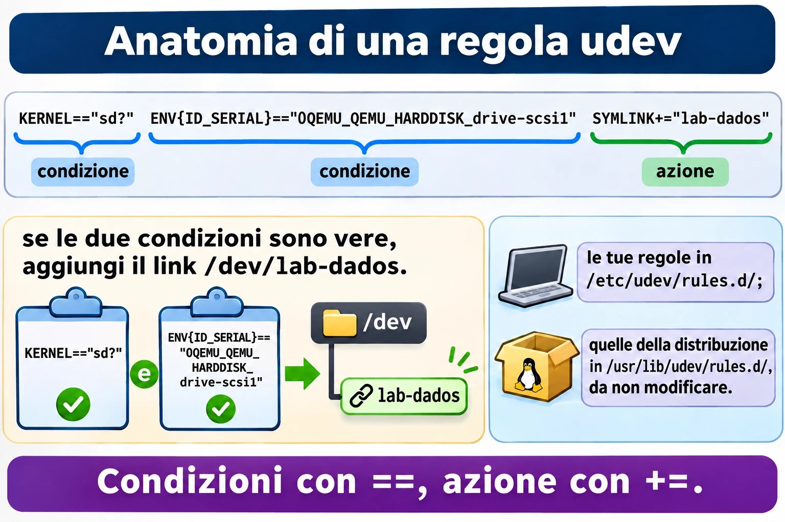
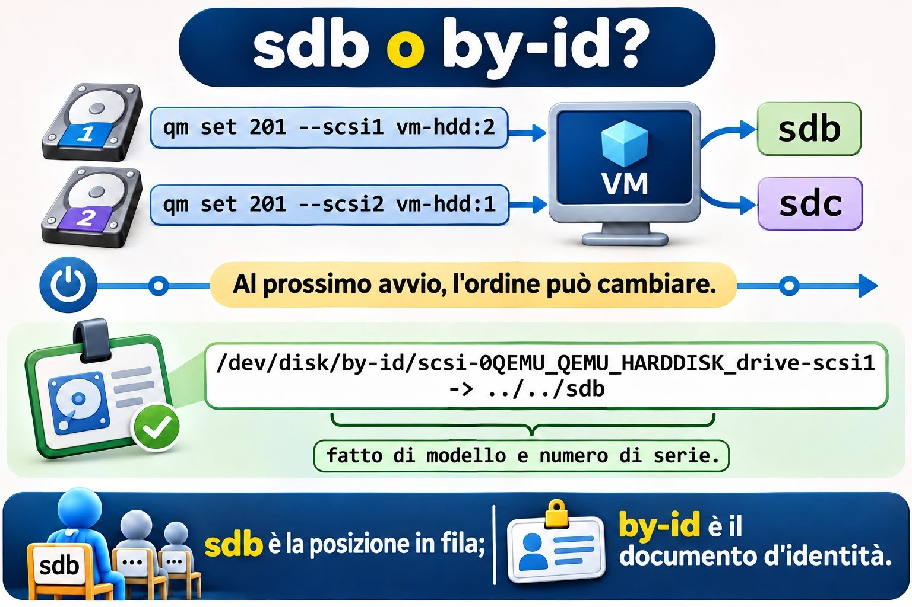
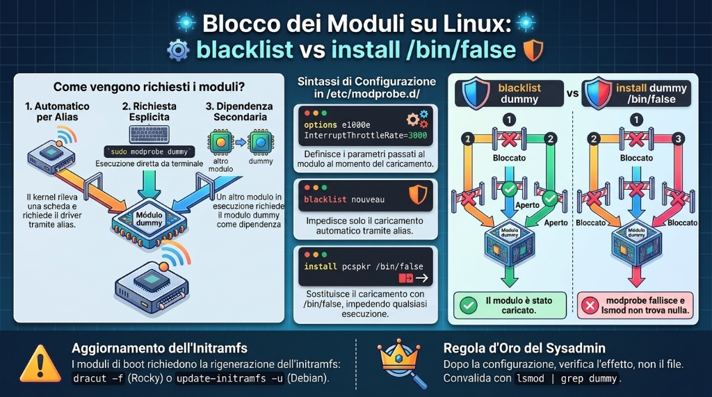

# Lezione 2.2 · Hardware e dispositivi

Seconda lezione del Modulo 2. Il cliente telefona: "abbiamo messo un disco nuovo nel server e non compare", oppure "quale di queste due schede di rete è quella di internet?", oppure ancora "il server è lento, manca memoria?". In tutti e tre i casi, la prima cosa da fare non è configurare niente, ma **chiedere al kernel cosa sta vedendo**. Oggi impari a fare questo inventario in due minuti, capisci come un pezzo fisico diventa un file in `/dev`, colleghi un disco con la VM accesa e guardi il kernel riceverlo dal vivo. Alla fine dai al disco un nome che non cambia e blocchi un driver nel modo giusto, che non è il modo che quasi tutti usano.

| Scheda | Lezione 2.2 |
| --- | --- |
| Modulo | M2 · Sistema, utenti e permessi, lezione 2 di 8 |
| Quando | Settimana 4 |
| Alla fine sei in grado di | Fare l'inventario di CPU, memoria, dischi, schede e USB di qualsiasi server; dire quale driver gestisce ogni scheda; seguire dal vivo l'arrivo di un dispositivo; spiegare il percorso pezzo → kernel → `/sys` → udev → `/dev`; scegliere un nome di disco che non cambia tra un boot e l'altro; scrivere una regola udev; caricare, rimuovere e bloccare davvero un modulo del kernel |
| Prerequisiti | Lezione 2.1 (VM × container, `systemd-detect-virt`); Lezioni 1.5 e 1.6 (`grep` e pipe) |
| Durata | Circa 2h |
| Snapshot | m2a2-inicio e m2a2-fim su entrambe le VM |

## 1 · Riscaldamento

Tre domande, a memoria. Scrivi le risposte; le Soluzioni le verificano in fondo.

1. Nella Lezione 0.1, la scheda di rete delle VM si chiamava `enp6s18`. Secondo te, perché un nome così strano, e non `eth0`, come nei vecchi tutorial?
2. In Linux "tutto è un file". Secondo te: se il disco è un file, in quale cartella si trova, e come si chiama?
3. In Windows, dove guardi quale driver sta usando una scheda? Secondo te: qual è l'equivalente in Linux, un programma o una cartella?

## 2 · Perché conta

L'inventario è il lavoro più sottovalutato del sysadmin. In un intervento, le prime domande sono sempre le stesse: quanti processori, quanta memoria resta, che dischi ci sono e se sono SSD, quale scheda di rete è collegata allo switch. Chi risponde in due minuti, via SSH, risolve prima che qualcuno debba andare al datacenter.

E c'è l'errore che butta giù i server: il disco che cambia nome. Oggi il disco di backup è `/dev/sdb`. Qualcuno inserisce una chiavetta, o cambia una controller, o il kernel semplicemente trova i dischi in un altro ordine al boot, e il disco di backup diventa `/dev/sdc`. Lo script di backup, che scriveva su `/dev/sdb`, ora scrive su un altro disco. Oppure `/etc/fstab` non trova il disco e il server si ferma al boot chiedendo la password di root sulla console. Nomi come `sdb` sono posizioni in una coda, non identità. L'identità è il numero di serie, e oggi impari a usarla.

Infine, i driver. Una scheda che "non funziona" è quasi sempre un modulo che non si è caricato, o che qualcuno ha bloccato. Saper caricare, rimuovere e bloccare un modulo è ciò che separa "reinstallo tutto" da "risolto in cinque minuti".

## 3 · Modello mentale

> Un pezzo esiste per te solo dopo aver attraversato quattro piani. Quando qualcosa "non compare", sali i piani, uno per uno, finché trovi dove si è fermato.

```text
 4. você            lsblk, ip link, lspci, lsusb, free, lscpu        "o que eu vejo"
                        ▲
 3. /dev            /dev/sdb, /dev/disk/by-id/...                    as portas, criadas pelo udev
                        ▲
 2. /sys e /proc    /sys/block/sdb, /sys/class/net/enp6s18           o que o kernel sabe, em arquivos
                        ▲
 1. kernel+driver   o módulo (virtio_net, virtio_scsi, usb-storage)  quem fala com a peça
                        ▲
 0. a peça          disco, placa, pendrive (real ou virtual)
```

Leggi dal basso verso l'alto. Il pezzo compare sul bus (PCI, USB, SCSI). Il kernel cerca un **driver** che sappia parlarci; in Linux, quasi ogni driver è un **modulo**, un pezzo di kernel che si carica e si scarica a sistema acceso. Il kernel pubblica ciò che ha trovato in `/sys`, una cartella di file che non esistono su disco. **udev**, un servizio di systemd, riceve l'avviso "è arrivato un pezzo", ne legge i dati e crea la porta in `/dev`, insieme a nomi extra e stabili. Solo allora i programmi la vedono.

I tre controlli che risolvono il 90% dei casi:

| Sintomo | Piano | Domanda |
| --- | --- | --- |
| Non compare in `lspci` né in `lsusb` | 0 | Il pezzo è collegato? La VM ha il disco? Il cavo? |
| Compare in `lspci`, ma senza `Kernel driver in use` | 1 | Manca il modulo, oppure è bloccato |
| Ha il driver, ma non ha il nome che mi aspettavo in `/dev` | 3 | udev ha dato un altro nome, o l'ordine è cambiato |


*Quando qualcosa non compare, sali i piani uno per uno finché trovi dove si è fermato.*

## 4 · Concetto a strati

### Essenziale

**I pezzi.** Quello che il lavoro quotidiano si aspetta che tu riconosca:

| Pezzo | Cosa fa | Come lo mostra Linux |
| --- | --- | --- |
| Processore (CPU) | Esegue i programmi; ha core (*cores*) e, a volte, due thread per core (*threads*) | `lscpu`, `nproc`, `/proc/cpuinfo` |
| Memoria (RAM) | Conserva ciò che è in uso; si perde allo spegnimento | `free -h`, `/proc/meminfo` |
| Swap | Un'area del disco usata come memoria di riserva, molto più lenta | `swapon --show`, `free -h` |
| Disco HDD | Disco che ruota; economico, grande e lento | `lsblk`, colonna `ROTA` = 1 |
| Disco SSD e NVMe | Senza parti in movimento; l'NVMe va direttamente sul bus PCIe ed è il più veloce | `ROTA` = 0; l'NVMe si chiama `nvme0n1` |
| Scheda di rete | Collega il server allo switch | `ip -br link`, `lspci` |
| Periferiche USB | Chiavetta, tastiera, token, UPS | `lsusb` |
| Firmware (BIOS o UEFI) | Il programma della scheda madre che accende tutto e chiama il bootloader del sistema | `ls /sys/firmware/efi` esiste solo in UEFI (Modulo 4) |

**I nomi dei dischi.** Il nome dice come il disco è collegato, non cosa è:

| Nome | Cos'è |
| --- | --- |
| `/dev/sda`, `/dev/sdb`... | Dischi SATA, SAS, USB e SCSI, compreso lo SCSI virtuale di Proxmox |
| `/dev/sda1`, `/dev/sda2` | Le partizioni di `sda` |
| `/dev/nvme0n1`, `/dev/nvme0n1p1` | Il primo disco NVMe e la sua prima partizione (nota la `p`) |
| `/dev/vda`, `/dev/vdb` | Disco virtio-blk in una VM |
| `/dev/mmcblk0` | Schede SD e memorie eMMC, come in un Raspberry Pi |
| `/dev/sr0` | Il lettore CD/DVD, compreso quello virtuale |

La lettera (`a`, `b`, `c`) viene assegnata **nell'ordine in cui il kernel trova i dischi**. Non è fissa.

**L'inventario in sei comandi.** Impara a memoria questa sequenza; apre ogni intervento:

```bash
lscpu | head -20        # processore: modello, core, virtualizzazione
free -h                 # memoria: guarda la colonna "available"
lsblk                   # dischi, partizioni e dove sono montati
lspci                   # schede sul bus PCI
lsusb                   # cosa c'è sull'USB
ip -br link             # schede di rete e se il cavo è "UP"
```

### Intermedio

**`/proc` e `/sys`, le due finestre del kernel.** Nessuno dei due esiste su disco; il kernel inventa il contenuto nel momento in cui lo leggi.

|  | `/proc` | `/sys` |
| --- | --- | --- |
| Nato per | Mostrare i processi (`/proc/1234`) | Mostrare i dispositivi e i driver |
| Organizzazione | Vecchia e mescolata: processi, memoria, CPU, configurazioni | Un albero: bus → dispositivo → driver |
| Esempi | `/proc/cpuinfo`, `/proc/meminfo`, `/proc/partitions`, `/proc/modules` | `/sys/block/sda/size`, `/sys/class/net/enp6s18/address`, `/sys/module/` |
| Chi lo usa | Tu, `free`, `top`, `ps` | udev, `lsblk`, `ip` |

**I moduli del kernel.** Il driver di una scheda è quasi sempre un file `.ko` in `/lib/modules/$(uname -r)/`. I comandi:

| Comando | Cosa fa |
| --- | --- |
| `lsmod` | Elenca i moduli caricati e chi dipende da chi (legge `/proc/modules`) |
| `modinfo nome` | Mostra il file, la descrizione, i parametri e le dipendenze del modulo |
| `sudo modprobe nome` | Carica il modulo **e le sue dipendenze** |
| `sudo modprobe -r nome` | Rimuove il modulo, se nessuno lo sta usando |
| `lspci -k` | Mostra, per ogni scheda, il driver in uso (`Kernel driver in use`) e quelli che andrebbero bene (`Kernel modules`) |

Esistono anche `insmod` e `rmmod`, che caricano e rimuovono **un file**, senza risolvere le dipendenze. Vale la pena riconoscerli; nel lavoro di tutti i giorni usa `modprobe`.

**Configurare i moduli.** File `.conf` in `/etc/modprobe.d/`. Tre righe che userai:

```text
options e1000e InterruptThrottleRate=3000   # parâmetro passado ao carregar
blacklist nouveau                            # não carregar AUTOMATICAMENTE
install pcspkr /bin/false                    # nunca carregar, nem se alguém pedir
```

La differenza tra `blacklist` e `install ... /bin/false` è la trappola della lezione. Ci cascherai nel lab, di proposito.

**udev.** Quando arriva un pezzo, il kernel manda un evento (`add`); quando se ne va, un altro (`remove`). `systemd-udevd` riceve l'evento, raccoglie le informazioni sul pezzo (produttore, modello, numero di serie) e applica delle **regole**:

- `/usr/lib/udev/rules.d/`: le regole della distribuzione. Non modificarle: il prossimo aggiornamento le sovrascrive.
- `/etc/udev/rules.d/`: le tue. Un file con lo stesso nome di uno della distribuzione lo sostituisce.

Le regole creano i nomi stabili che devi usare in script e configurazioni:

| Cartella | Nome basato su | Cambia se... |
| --- | --- | --- |
| `/dev/disk/by-id/` | Modello e numero di serie del disco | Sostituisci il disco |
| `/dev/disk/by-uuid/` | L'UUID del file system | Formatti di nuovo (Modulo 9) |
| `/dev/disk/by-path/` | Il percorso fisico: controller e porta | Sposti il cavo su un'altra porta |
| `/dev/disk/by-label/` | L'etichetta che hai dato formattando | Cambi l'etichetta |

**Il nome della scheda di rete.** `enp6s18` è un nome **prevedibile**, dato da udev in base alla posizione fisica: `en` = Ethernet, `p6` = bus PCI 6, `s18` = slot 18. Il vecchio `eth0` veniva assegnato nell'ordine di scoperta, come `sdb`, e con due schede l'`eth0` di oggi poteva essere l'`eth1` di domani. Su un server fisico vedrai anche `eno1` (scheda onboard, numerata dal firmware) e `ens1f0` (scheda in slot, porta 0).

**Hotplug e coldplug.** Un pezzo collegato a sistema acceso è *hotplug*: il kernel manda l'evento subito. Un pezzo che c'era già al boot è *coldplug*: udev, all'avvio, chiede al kernel di ripetere gli eventi di tutto ciò che esiste già (`udevadm trigger`), e tratta tutto allo stesso modo.

### Ponte Windows

| In Windows | In Linux | Cosa cambia |
| --- | --- | --- |
| Gestione dispositivi | `lspci -k`, `lsusb`, `lsblk` | Tre comandi invece di una finestra, e funzionano via SSH |
| Driver `.sys` installato dal produttore | Modulo `.ko`, quasi sempre già nel kernel | In Linux raramente si installa un driver: arriva con il kernel |
| "Disabilita dispositivo" | `install modulo /bin/false` in `/etc/modprobe.d/` | Blocca il driver, non il pezzo |
| Lettera di unità `D:` | `/dev/sdb` e il punto di montaggio | La lettera di Windows è il luogo dove si monta; `sdb` è il pezzo |
| Disco > proprietà > numero di serie | `/dev/disk/by-id/` e `lsblk -o +SERIAL` |  |
| Gestione attività > Prestazioni | `lscpu`, `free -h`, `top` |  |
| `msinfo32` | `sudo dmidecode`, `hostnamectl` | `dmidecode` legge le tabelle del firmware: produttore, modello, seriale del server |

### Avanzato

**`lspci -k` mostra due piani.** In una VM, la scheda di rete compare come `Virtio network device` con `Kernel driver in use: virtio-pci`. Ma il modulo di rete è `virtio_net`. Non è una contraddizione: `virtio-pci` gestisce la conversazione con il bus PCI; sopra di esso, `virtio_net` gestisce la rete. Il link `/sys/class/net/enp6s18/device/driver` punta a quello di sopra.

**udev e D-Bus.** udev crea i file in `/dev`. I programmi che devono **reagire** a un pezzo nuovo, come l'ambiente grafico che apre una finestra quando colleghi una chiavetta, non leggono udev direttamente: ascoltano **D-Bus**, il bus di messaggi del sistema, dove servizi come `udisks2` avvisano "è arrivato un disco". Su un server si usa poco; basta conoscere il ruolo di ciascuno.

**Regole udev.** Una regola è una riga di coppie chiave-operatore-valore. Le chiavi con `==` o `!=` sono **condizioni**; le chiavi con `=`, `+=` o `:=` sono **azioni**:

```text
KERNEL=="sd?", ENV{ID_SERIAL}=="0QEMU_QEMU_HARDDISK_drive-scsi1", SYMLINK+="lab-dados"
└─ condição ─┘ └──────────────── condição ─────────────────────┘ └──── ação ─────────┘
```

Se tutte le condizioni sono vere, le azioni avvengono. `udevadm info` mostra le variabili che puoi usare, e `udevadm monitor` mostra gli eventi dal vivo.

**`dmesg` e `journalctl -k`.** I messaggi del kernel stanno in un buffer in memoria che `dmesg` legge; anche il journal li conserva, con la data, e `journalctl -k` mostra solo quelli. Su Debian, leggere il buffer richiede root (`kernel.dmesg_restrict = 1`). Usa `sudo` su entrambe le distribuzioni e non pensarci più.



*Una regola udev si legge come un "se... allora": condizioni con `==` e un'azione con `+=`.*

## 5 · Rocky × Debian

| Cosa | Rocky 9 | Debian 13 |
| --- | --- | --- |
| `lspci` e `lsusb` | Pacchetti `pciutils` e `usbutils`; possono mancare nell'installazione minima | Gli stessi pacchetti; possono mancare nell'installazione minima |
| `dmesg` senza `sudo` | Funziona | Bloccato (`dmesg_restrict = 1`) |
| `journalctl -k` senza `sudo` | Solo per chi è nel gruppo `wheel` o `systemd-journal` | Solo per chi è nel gruppo `adm` o `systemd-journal` |
| Moduli | `/lib/modules/$(uname -r)/` | `/lib/modules/$(uname -r)/` |
| Regole udev della distribuzione | `/usr/lib/udev/rules.d/` | `/usr/lib/udev/rules.d/` |
| Validare una regola udev | `udevadm test` (il systemd di Rocky 9 non ha ancora `verify`) | `udevadm verify arquivo.rules` |
| Primo disco delle VM del lab | `sda`, oppure `vda` se la VM usa virtio-blk | `sda`, oppure `vda` se la VM usa virtio-blk |

## 6 · Lab guidato

Il percorso: fai l'inventario delle due VM come faresti presso un nuovo cliente, scopri quale driver gestisce ogni scheda, colleghi un disco con la VM accesa e guardi il suo arrivo, dai al disco un nome che non cambia e finisci mettendo le mani sui moduli del kernel. Il disco che creerai **resta** sulle VM: è il materiale del Modulo 9.

### Passo 1 · Snapshot e strumenti

Sul nodo Proxmox:

```bash
qm snapshot 201 m2a2-inicio
qm snapshot 202 m2a2-inicio
```

Sulle VM, assicurati di avere `lspci` e `lsusb`:

```bash
sudo dnf install -y pciutils usbutils        # rocky-lab
sudo apt install -y pciutils usbutils        # debian-lab
```

### Passo 2 · L'inventario in due minuti

Su rocky-lab:

```bash
lscpu | grep -E '^(Model name|CPU\(s\)|Thread|Core|Socket|Hypervisor|Virtualization)'
nproc
free -h
sudo swapon --show
lsblk -o NAME,SIZE,TYPE,ROTA,MOUNTPOINTS
```

Cosa leggere in ciascuno:

- In `lscpu`, la riga `Hypervisor vendor: KVM` conferma ciò che hai visto nella Lezione 2.1. `CPU(s)` è il numero di processori che la VM ha ricevuto, ed è lo stesso di `nproc`.
- In `free -h`, guarda la colonna **`available`**, non `free`. Linux usa la memoria che avanza come cache del disco; la colonna `free` sembra bassa, ed è un bene. `available` è ciò che i programmi possono ancora usare.
- In `lsblk`, Rocky mostra il disco, le partizioni e i volumi LVM (`rl-root`, `rl-swap`) creati dall'installer. La colonna `ROTA` dice `1` per un disco che ruota. In una VM, Proxmox di solito dice `1` anche con un SSD sotto, a meno che l'opzione `ssd=1` sia attiva sul disco. Il sistema sa solo ciò che l'hardware gli racconta.

Ora le schede:

```bash
lspci
lsusb
ip -br link
```

`lspci` elenca le schede virtuali di QEMU: la controller SCSI e la scheda di rete, entrambe `Virtio`, più i bridge PCI. `lsusb` mostra i bus USB e, probabilmente, un `QEMU USB Tablet`: il mouse della console di Proxmox. `ip -br link` mostra `lo` ed `enp6s18`, con `UP`.

Fai lo stesso su debian-lab. Annota le differenze: la dimensione della memoria, il layout del disco (Debian di solito usa partizioni semplici, senza LVM) e nient'altro. I pezzi sono gli stessi.

### Passo 3 · Chi guida ogni scheda

Su rocky-lab:

```bash
lspci -k | grep -A3 -i -E 'ethernet|scsi'
readlink /sys/class/net/enp6s18/device/driver
lsmod | grep -E '^virtio|^Module'
sudo modinfo virtio_net | grep -E '^(filename|description|depends)'
```

`lspci -k` mostra `Kernel driver in use: virtio-pci` su entrambe le schede. `readlink` risponde con un percorso che termina in `virtio_net`. Hanno ragione entrambi: `virtio-pci` parla con il bus, e `virtio_net` fa la rete sopra di esso (sezione 4, Avanzato). `lsmod` mostra i moduli caricati e, nella colonna `Used by`, chi dipende da ciascuno. `modinfo` mostra dove si trova il file `.ko`.

Ora sali i piani del modello mentale per la scheda di rete, dal basso verso l'alto:

```bash
lspci | grep -i ethernet                         # piano 0: il pezzo esiste
ls /sys/class/net/enp6s18/                       # piano 2: il kernel ha pubblicato
cat /sys/class/net/enp6s18/address               # il MAC, letto direttamente dal kernel
cat /sys/class/net/enp6s18/operstate             # up o down
ip -br link show enp6s18                         # piano 4: ciò che vedi
```

`ip` non inventa niente: legge ciò che c'è in `/sys`. Per questo, quando un comando "mente", il primo posto dove controlli è `/sys`.

### Passo 4 · Un disco nuovo, con la VM accesa

Prepara due finestre SSH su rocky-lab. Nella prima, fotografa i dischi e lascia il monitor di udev in ascolto:

```bash
lsblk -d -o NAME,SIZE,SERIAL > ~/discos-antes.txt
cat ~/discos-antes.txt
sudo udevadm monitor --kernel --udev --subsystem-match=block
```

Nella seconda, lascia parlare il kernel:

```bash
sudo journalctl -k -f
```

Ora, sul nodo Proxmox, crea un disco da 2 GB e collegalo alla VM. `vm-hdd` è lo storage Ceph della lezione 0.1; se il tuo ha un altro nome, `pvesm status` te lo mostra:

```bash
qm set 201 --scsi1 vm-hdd:2,discard=on,iothread=1,ssd=1
```

Guarda le due finestre. In `journalctl`, il kernel annuncia il disco: `sd ... [sdb] ... (2.15 GB/2.00 GiB)`, e la riga `Attached SCSI disk`. Nel monitor arrivano coppie di righe: `KERNEL[...] add` (il kernel ha avvisato) e subito dopo `UDEV [...] add` (udev ha finito di creare le porte). È il modello mentale in azione, piano per piano, in meno di un secondo.

Ferma il monitor e `journalctl` con `Ctrl+C` e confronta:

```bash
lsblk -d -o NAME,SIZE,SERIAL > ~/discos-depois.txt
diff ~/discos-antes.txt ~/discos-depois.txt
```

`diff` mostra la riga nuova. Nota il nome: probabilmente `sdb`, ma può essere un altro, a seconda di come è collegato il disco principale. Se il disco di sistema è `vda` (virtio-blk), quello nuovo, entrato nella controller SCSI, diventa `sda`. Questo è il punto: **il nome non l'hai scelto tu**, e non devi contarci.

Fai lo stesso su debian-lab, con `qm set 202 --scsi1 vm-hdd:2,discard=on,iothread=1,ssd=1`.

### Passo 5 · Il nome che non cambia

Su rocky-lab:

```bash
ls -l /dev/disk/by-id/ | grep -v -- '-part'
udevadm info --query=property --name=/dev/sdb | grep -E '^(ID_SERIAL|ID_MODEL|ID_PATH|DEVLINKS)='
```

(Se il tuo disco nuovo non è `sdb`, cambia il nome qui e nei prossimi passi.)

`ls -l` mostra link come `scsi-0QEMU_QEMU_HARDDISK_drive-scsi1 -> ../../sdb`. Il nome del link viene dal modello e dal numero di serie; la destinazione, `sdb`, è solo la posizione attuale. `udevadm info` mostra da dove udev ha preso questo dato: la variabile `ID_SERIAL`, con il valore `0QEMU_QEMU_HARDDISK_drive-scsi1`. Su un server fisico, al suo posto compaiono il modello e il numero di serie stampati sull'etichetta del disco.

Per vedere perché è importante, collega un secondo disco, da 1 GB, e guarda la coda avanzare:

```bash
qm set 201 --scsi2 vm-hdd:1                       # sul nodo Proxmox
```

```bash
lsblk -d -o NAME,SIZE,SERIAL                     # su rocky-lab
```

Ora c'è un `sdc` da 1 GB. In questo boot, l'ordine è quello di arrivo. Al prossimo boot, il kernel trova i dischi tutti insieme, e l'ordine può cambiare. Il `by-id` di ciascuno non cambia mai.

**Decidi 1 · Il disco del backup.** Il cliente userà il disco da 2 GB come destinazione del backup notturno. Lo script ha bisogno di un percorso per il disco. Quale scrivi?

- **A)** `/dev/sdb`, perché è il nome che il disco ha adesso ed è scritto in `lsblk`.
- **B)** `/dev/disk/by-id/scsi-0QEMU_QEMU_HARDDISK_drive-scsi1`.
- **C)** `/dev/disk/by-path/...`, il percorso della porta della controller.
- **D)** Fa lo stesso: Linux dà sempre i nomi nello stesso ordine, purché nessuno tocchi l'hardware.

Scegli un'opzione prima di continuare.

| Se hai scelto | Risultato | Perché |
| --- | --- | --- |
| A | ❌ Sbagliato | Funziona fino al primo boot in cui l'ordine cambia, o finché qualcuno inserisce una chiavetta. Allora il backup scrive sul disco sbagliato, e nessuno se ne accorge finché non gli serve. |
| B | ✅ Giusto | Il nome deriva dal numero di serie. Il disco può cambiare porta, controller e lettera: il link continua a puntare a lui. |
| C | ❌ Sbagliato | Non cambia con l'ordine del boot, ma cambia se qualcuno sposta il cavo su un'altra porta o cambia la controller. È utile quando vuoi "il disco che sta nella baia 3", non "questo disco". |
| D | ❌ Sbagliato | I dischi vengono trovati in parallelo, e il primo a rispondere si prende la lettera. In un server con più dischi, l'ordine cambia da un boot all'altro senza che nessuno tocchi niente. |

**Da ricordare:** `sdb` è la posizione nella coda; `by-id` è il documento d'identità. In script e configurazioni, usa il documento.

Quando il disco avrà un file system, nel Modulo 9, il nome preferito per `/etc/fstab` sarà l'UUID. Oggi il disco è vuoto e non ha UUID: `ls /dev/disk/by-uuid/` non mostra niente di lui.

Prima di continuare, scollega il disco da 1 GB, che serviva solo per la dimostrazione. Sul nodo Proxmox:

```bash
qm set 201 --delete scsi2
```

Esce dalla VM e diventa un disco "non usato" (`unused0`) nella configurazione. Cancellalo dall'interfaccia di Proxmox, in *Hardware*, selezionando `Unused Disk 0` e cliccando su *Remove*. Quello da 2 GB resta.



*Il nome `sdb` è la posizione nella coda; il link in `by-id` segue il disco.*

### Passo 6 · Una regola udev: il disco con il tuo nome

Farai creare a udev `/dev/lab-dados`, che punta al disco da 2 GB, ovunque si trovi. Su rocky-lab, conferma il valore di `ID_SERIAL` del **tuo** disco:

```bash
udevadm info --query=property --name=/dev/sdb | grep '^ID_SERIAL='
```

Scrivi la regola, con il tuo valore al posto dell'esempio:

```bash
sudo tee /etc/udev/rules.d/99-lab.rules <<'EOF'
# disco dati del lab, tramite numero di serie
KERNEL=="sd?", ENV{ID_SERIAL}=="0QEMU_QEMU_HARDDISK_drive-scsi1", SYMLINK+="lab-dados"
EOF
sudo udevadm control --reload
sudo udevadm trigger /dev/sdb
ls -l /dev/lab-dados
```

`ls -l` mostra `/dev/lab-dados -> sdb`. `control --reload` fa rileggere le regole a udev; `trigger` ripete l'evento del disco, come se fosse appena arrivato. A un boot, niente di tutto questo serve: le regole valgono per ogni evento.

Leggi la regola ad alta voce: "**se** il kernel ha chiamato il dispositivo `sd` più una lettera, **e** il numero di serie è questo, **allora** aggiungi il link `lab-dados`". Due condizioni con `==`, un'azione con `+=`. Il `+=` aggiunge alla lista dei link; con `=`, cancelleresti i link che le regole della distribuzione avevano già creato, come quelli di `by-id`.

Fai lo stesso su debian-lab. Lì, valida la regola con il verificatore:

```bash
sudo udevadm verify /etc/udev/rules.d/99-lab.rules
```

### Passo 7 · Moduli: caricare, rimuovere, leggere

Userai il modulo `dummy`, che crea una scheda di rete finta. Non tocca niente di reale, ed è sicuro caricarlo e rimuoverlo. Su rocky-lab:

```bash
lsmod | grep dummy; echo "rc=$?"
sudo modprobe dummy
lsmod | grep dummy
ip -br link show dummy0
sudo modinfo dummy | grep -E '^(filename|description|parm)'
sudo modprobe -r dummy
ip -br link show dummy0; echo "rc=$?"
```

Il primo `grep` non trova niente (`rc=1`). Dopo `modprobe`, il modulo compare in `lsmod` e una scheda `dummy0` compare in `ip`. `modinfo` mostra che accetta il parametro `numdummies`, che dice quante schede creare. `modprobe -r` rimuove il modulo, e la scheda scompare (`Device "dummy0" does not exist`).

Ora con un parametro, nel modo in cui si configura un driver vero:

```bash
echo 'options dummy numdummies=3' | sudo tee /etc/modprobe.d/lab-dummy.conf
sudo modprobe dummy
ip -br link | grep dummy
sudo modprobe -r dummy
```

Tre schede: `dummy0`, `dummy1`, `dummy2`. `modprobe` ha letto il file di `/etc/modprobe.d/` e ha passato il parametro da solo. È così che si regola il driver di una scheda di rete o di una controller: un `options` in un file, e la regolazione vale a ogni boot.

Ripeti su debian-lab, se vuoi vedere che è identico. Lascia `lab-dummy.conf` su entrambe: il Guasto B parte da lì.

## 7 · Rompi e ripara

### Guasto A · La regola che udev ha ignorato

Un collega ha "sistemato" la tua regola. Fai quello che ha fatto lui, su rocky-lab:

```bash
sudo sed -i 's/KERNEL=="sd?"/KERNEL="sd?"/' /etc/udev/rules.d/99-lab.rules
cat /etc/udev/rules.d/99-lab.rules
sudo udevadm control --reload
sudo udevadm trigger /dev/sdb
```

**Osserva.**

```bash
ls -l /dev/lab-dados
```

`No such file or directory`. Il link è sparito. Nessun comando ha dato errore: `reload` e `trigger` sono tornati in silenzio.

**Diagnosi.** udev non si lamenta nel terminale; si lamenta nel suo log:

```bash
sudo journalctl -u systemd-udevd --since '-5min' | tail -5
```

Il messaggio indica il file e la riga, `99-lab.rules:2`, e parla di **operatore non valido** per `KERNEL`. Il collega ha sostituito `==` con `=`. In udev, `KERNEL` può essere solo una condizione: il nome lo dà il kernel, e udev non può cambiarlo. Una condizione scritta con l'operatore di azione non ha senso, e udev scarta l'intera riga. Al trigger successivo, poiché nessuna regola chiede più `lab-dados`, cancella il link.

Su debian-lab, il verificatore lo scopre prima, senza bisogno del log: `sudo udevadm verify /etc/udev/rules.d/99-lab.rules` risponde con la riga e il motivo.

**Decidi A · La riparazione.** Cosa risolve?

- **A)** Rimettere `KERNEL=` come `KERNEL==` e ripetere `reload` e `trigger`.
- **B)** Riavviare la VM: al boot, udev legge le regole da zero.
- **C)** Rinominare il file in `10-lab.rules`, perché giri prima delle regole della distribuzione.
- **D)** Sostituire `SYMLINK+=` con `SYMLINK=`, per forzare la creazione del link.

Scegli un'opzione prima di continuare.

| Se hai scelto | Risultato | Perché |
| --- | --- | --- |
| A | ✅ Giusto | Con `==`, la riga torna ad avere due condizioni e un'azione, e udev la accetta. |
| B | ❌ Sbagliato | Al boot, legge lo stesso file con lo stesso errore e scarta la stessa riga. Riavviare non corregge il testo. |
| C | ❌ Sbagliato | Con il nome `10-`, la regola gira **prima** di quelle della distribuzione, e `ID_SERIAL` non esiste ancora: sono loro a crearlo. La regola non scatterebbe mai. Il `99-` esiste per questo. |
| D | ❌ Sbagliato | Il problema è nella condizione, non nell'azione. E `SYMLINK=` cancellerebbe i link della distribuzione, come quelli di `by-id`. |

**Da ricordare:** `==` chiede, `=` comanda. Una regola udev che "non fa niente" ha la risposta in `journalctl -u systemd-udevd`.

**Ripara.**

```bash
sudo sed -i 's/KERNEL="sd?"/KERNEL=="sd?"/' /etc/udev/rules.d/99-lab.rules
sudo udevadm control --reload
sudo udevadm trigger /dev/sdb
ls -l /dev/lab-dados
```

Il link torna. Se vuoi vedere la regola valutata, riga per riga, senza cambiare niente: `sudo udevadm test /sys/class/block/sdb 2>&1 | grep -i lab`.

### Guasto B · Il modulo che non ha obbedito

Il cliente vuole che il modulo `dummy` non venga mai caricato sul server. Fai quello che si legge su ogni forum, su rocky-lab:

```bash
echo 'blacklist dummy' | sudo tee /etc/modprobe.d/lab-bloqueio.conf
sudo modprobe dummy
```

**Osserva.**

```bash
lsmod | grep dummy
ip -br link | grep dummy
```

Il modulo si è caricato. Le tre schede `dummy` ci sono, compreso il parametro di `lab-dummy.conf`. Il `blacklist` non ha fatto niente.

**Diagnosi.** Leggi cosa dice lo stesso `modprobe` a riguardo:

```bash
man modprobe.d | grep -A6 -i '^ *blacklist'
```

Il `blacklist` dice: non usare gli **alias** (*aliases*) di questo modulo. Quando il kernel trova una scheda, non chiede "carica `e1000e`"; chiede "carica il driver per la scheda con codice `pci:v00008086d000015BC...`", e `modprobe` cerca quale modulo ha quell'alias. Il `blacklist` taglia solo quella strada, quella automatica. Un `modprobe dummy` per nome è una richiesta esplicita, e `modprobe` obbedisce. Anche un altro modulo che dipende da quello bloccato lo tira dentro.

**Decidi B · La riparazione.** Il cliente vuole che il modulo non si carichi **in nessun modo**. Cosa risolve?

- **A)** Sostituire la riga con `install dummy /bin/false`.
- **B)** Cancellare il file `dummy.ko` da `/lib/modules/`.
- **C)** Mettere la riga `blacklist dummy` anche in `/etc/modules-load.d/`.
- **D)** Eseguire `sudo modprobe -r dummy` ogni volta che qualcuno lo carica.

Scegli un'opzione prima di continuare.

| Se hai scelto | Risultato | Perché |
| --- | --- | --- |
| A | ✅ Giusto | `install` sostituisce il caricamento con un comando. Con `/bin/false`, qualsiasi richiesta, automatica, esplicita o per dipendenza, esegue `false` e fallisce. |
| B | ❌ Sbagliato | Funziona fino al prossimo aggiornamento del kernel, che riporta il file in una cartella nuova. E hai toccato un file che appartiene a un pacchetto. |
| C | ❌ Sbagliato | Quella cartella dice quali moduli **caricare** al boot, non quali bloccare. La sintassi è un'altra: una lista di nomi. |
| D | ❌ Sbagliato | Non è un blocco, è una pulizia. Tra il caricamento e la rimozione, il modulo è stato nel kernel. |

**Da ricordare:** `blacklist` blocca l'automatico; `install modulo /bin/false` blocca tutto. In pratica, i due insieme, nello stesso file.

**Ripara.**

```bash
sudo modprobe -r dummy
printf 'blacklist dummy\ninstall dummy /bin/false\n' | sudo tee /etc/modprobe.d/lab-bloqueio.conf
sudo modprobe dummy; echo "rc=$?"
lsmod | grep dummy; echo "rc=$?"
```

`modprobe` fallisce, con un messaggio sul comando di installazione `/bin/false`, e `lsmod` non trova niente. Il blocco è vero.

Ora annulla il blocco, perché il lab non ne ha bisogno, e verifica:

```bash
sudo rm /etc/modprobe.d/lab-bloqueio.conf
sudo modprobe dummy && lsmod | grep dummy
sudo modprobe -r dummy
```

Un dettaglio che frega molti: se il modulo bloccato è di qualcosa che parte al boot, come il driver video, può trovarsi anche dentro l'**initramfs**, l'immagine che il kernel carica prima del disco. Allora bisogna rigenerare l'initramfs (`dracut -f` su Rocky, `update-initramfs -u` su Debian) perché il blocco valga fin dal primo secondo. Questo è argomento del Modulo 4.



*Il blacklist chiude solo la porta automatica; install /bin/false le chiude tutte.*

### La lezione

I due guasti di oggi hanno la stessa forma: **un comando che torna senza errore e non fa ciò che pensavi**. udev ha accettato il `reload` e ha scartato la regola in silenzio. Il `blacklist` è stato scritto e non ha bloccato niente. Con hardware e driver, quasi niente si lamenta nel terminale; il posto dei reclami è il log (`journalctl -u systemd-udevd`, `journalctl -k`), e la conferma è sempre vedere il risultato: il link esiste? il modulo è in `lsmod`? L'abitudine di questa lezione è la stessa della 0.2 e della 2.1, solo più esigente: **dopo aver configurato, controlla l'effetto, non il file**.

## 8 · Trappole

| Cosa digiti o vedi | Cosa succede | Come evitarla |
| --- | --- | --- |
| `/dev/sdb` in uno script o in `fstab` | Un giorno l'ordine cambia e lo script scrive sul disco sbagliato | `/dev/disk/by-id/...`, oppure l'UUID dopo aver formattato |
| `free` mostra poca memoria libera | Panico inutile: è la cache del disco | Guardare la colonna `available` |
| `lspci` dà `command not found` | Manca il pacchetto in un'installazione minima | `pciutils`; per `lsusb`, `usbutils` |
| `dmesg` dà `Operation not permitted` su Debian | Lettura del buffer del kernel ristretta a root | `sudo dmesg` oppure `sudo journalctl -k` |
| `blacklist modulo` per "spegnere" un driver | Si carica comunque se richiesto per nome o per dipendenza | Aggiungere `install modulo /bin/false` |
| `sudo modprobe -r virtio_net` (o il driver della tua scheda) via SSH | La scheda sparisce e la tua sessione cade con lei | Mai rimuovere il driver della scheda da cui sei connesso; usare la console |
| Modificare una regola in `/usr/lib/udev/rules.d/` | Il prossimo aggiornamento cancella la tua modifica | Copiare in `/etc/udev/rules.d/` con lo stesso nome e modificare lì |
| `KERNEL="sd?"` in una regola udev | L'intera riga viene scartata, in silenzio | `==` nelle condizioni, `=` o `+=` nelle azioni |
| `SYMLINK="nome"` invece di `SYMLINK+=` | Cancella i link creati da altre regole | `SYMLINK+=` |
| Regola udev con numero basso, come `10-` | Gira prima delle regole che creano `ID_SERIAL` e non scatta mai | Regole proprie con `99-` |
| `insmod arquivo.ko` | Fallisce se il modulo dipende da un altro non ancora caricato | `modprobe nome`, che risolve le dipendenze |
| `ROTA 1` in una VM e la conclusione "il disco è lento" | La VM sa solo ciò che l'hypervisor le racconta | Chiedere all'hypervisor; su Proxmox, l'opzione `ssd=1` del disco |

## 9 · Quiz

Dieci domande, senza consultare. Scrivi la lettera o la risposta di ciascuna e solo dopo apri le Soluzioni.

**1.** Quale comando mostra, per ogni scheda PCI, il driver del kernel in uso?

- **A)** `lsmod`
- **B)** `lspci -k`
- **C)** `lsusb -v`
- **D)** `modinfo`

**2.** Hai scritto `blacklist e1000e` e il modulo continua a caricarsi quando un collega esegue `modprobe e1000e`. Perché, e cosa blocca davvero?

**3.** Dove mette l'amministratore le proprie regole udev?

- **A)** `/usr/lib/udev/rules.d/`
- **B)** `/etc/udev/rules.d/`
- **C)** `/dev/udev/`
- **D)** `/sys/udev/rules/`

**4.** In `lsblk -o NAME,ROTA`, un disco compare con `ROTA` uguale a `0`. Cosa dice?

**5.** Come chiama Linux la prima partizione del primo disco NVMe?

- **A)** `/dev/nvme1`
- **B)** `/dev/nvme0n1p1`
- **C)** `/dev/sda1`
- **D)** `/dev/nvme0p1`

**6.** Perché la scheda di rete delle VM si chiama `enp6s18` e non `eth0`? Cosa significa ogni pezzo del nome?

**7.** Quale comando carica un modulo risolvendone le dipendenze?

- **A)** `insmod`
- **B)** `modprobe`
- **C)** `lsmod`
- **D)** `depmod`

**8.** Il cliente dice che il server "è senza memoria" perché `free -h` mostra `free 180Mi` su un totale di 8 GiB. Quale colonna guardi prima di essere d'accordo?

- **A)** `shared`
- **B)** `buff/cache`
- **C)** `available`
- **D)** `used`

**9.** Stai per collegare una chiavetta al server e vuoi vedere, dal vivo, cosa dice il kernel quando arriva. Cita due comandi che lo mostrano.

**10.** *Which pseudo-filesystem exposes the kernel's view of devices, buses and drivers as a directory tree, and is the main source of information for udev?*

- **A)** `/proc`
- **B)** `/sys`
- **C)** `/dev`
- **D)** `/run/udev`
- **E)** `/etc/udev`

## 10 · Flashcard e promemoria

### Da sapere a memoria

- L'inventario: `lscpu`, `free -h`, `lsblk`, `lspci`, `lsusb`, `ip -br link`.
- I quattro piani: pezzo → kernel e driver → `/sys` e `/proc` → udev crea `/dev` → tu.
- `lspci -k` dice quale driver gestisce ogni scheda.
- `sdb` è una posizione nella coda; `/dev/disk/by-id/` è identità.
- In udev, `==` è condizione e `+=` è azione; le tue regole stanno in `/etc/udev/rules.d/99-*.rules`.
- `blacklist` blocca l'automatico; `install modulo /bin/false` blocca tutto.

### Da consultare

| Domanda | Comando o file |
| --- | --- |
| Quanti processori? È una VM? | `lscpu`; `nproc` |
| Manca memoria? | `free -h`, colonna `available`; `swapon --show` |
| Che dischi ci sono, SSD o HDD? | `lsblk -o NAME,SIZE,TYPE,ROTA,MODEL,SERIAL,MOUNTPOINTS` |
| Qual è il numero di serie del disco? | `lsblk -d -o NAME,SERIAL`; `ls -l /dev/disk/by-id/` |
| Che schede ci sono e con quale driver? | `lspci -k` |
| Cosa c'è sull'USB? | `lsusb`; `lsusb -t` mostra l'albero |
| Quale driver gestisce la scheda di rete? | `readlink /sys/class/net/enp6s18/device/driver` |
| Cosa ha detto il kernel al boot? | `sudo journalctl -k -b`; `sudo dmesg` |
| Vedere arrivare un pezzo, dal vivo | `sudo journalctl -k -f`; `sudo udevadm monitor` |
| Le variabili udev di un disco | `udevadm info --query=property --name=/dev/sdb` |
| Applicare una nuova regola udev | `sudo udevadm control --reload; sudo udevadm trigger /dev/sdb` |
| Perché la regola non ha funzionato? | `sudo journalctl -u systemd-udevd`; `udevadm verify` (Debian) |
| Moduli caricati | `lsmod` |
| Su un modulo | `modinfo nome` |
| Caricare e rimuovere | `sudo modprobe nome`; `sudo modprobe -r nome` |
| Parametri e blocchi | File `.conf` in `/etc/modprobe.d/` |
| Produttore, modello e seriale del server | `sudo dmidecode -t system`; `hostnamectl` |

### Flashcard

| Fronte | Retro |
| --- | --- |
| `/proc` × `/sys` | `/proc`: processi e informazioni generali del kernel. `/sys`: l'albero di dispositivi e driver |
| Chi crea i file in `/dev`? | udev (`systemd-udevd`), a partire dagli eventi del kernel |
| A cosa serve D-Bus? | Bus di messaggi: avvisa i programmi, come l'ambiente grafico, che è successo qualcosa |
| Hotplug × coldplug | Hotplug: pezzo collegato a sistema acceso. Coldplug: c'era già al boot; udev ripete gli eventi |
| `modprobe` × `insmod` | `modprobe` risolve le dipendenze e legge `/etc/modprobe.d/`; `insmod` carica solo un file |
| `enp6s18` | Ethernet, bus PCI 6, slot 18: nome prevedibile, dato dalla posizione |
| `nvme0n1p2` | Disco NVMe 0, namespace 1, partizione 2 |
| `vda` | Disco virtio-blk in una VM |
| `ROTA` | `1`: disco che ruota. `0`: SSD o NVMe |
| `options` in `/etc/modprobe.d/` | Passa parametri al modulo ogni volta che viene caricato |

## 11 · Checklist e chiusura

- [ ] Faccio l'inventario di CPU, memoria, dischi, schede e USB di un server in due minuti.
- [ ] Dico quale driver gestisce ogni scheda, con `lspci -k` e con `/sys`.
- [ ] Spiego i quattro piani e so in quale cercare quando qualcosa "non compare".
- [ ] Guardo l'arrivo di un disco con `journalctl -k -f` e `udevadm monitor`.
- [ ] Scelgo `by-id` invece di `sdb` e spiego perché.
- [ ] Scrivo una regola udev che crea un link tramite il numero di serie, e faccio la diagnosi quando non funziona.
- [ ] Carico, rimuovo, configuro e blocco davvero un modulo.

**Ultimo esercizio, senza guardare.** Su debian-lab, senza aprire questa lezione, scrivi da zero due file:

1. `/etc/udev/rules.d/99-lab.rules`, che crea `/dev/lab-dados` per il disco da 2 GB, tramite il numero di serie.
2. `/etc/modprobe.d/lab-bloqueio.conf`, che impedisce in ogni modo il caricamento di `dummy`.

Poi dimostra entrambi: `ls -l /dev/lab-dados` mostra il link, e `sudo modprobe dummy` fallisce. Apri le Soluzioni solo dopo, oppure dopo tre tentativi. Alla fine, cancella `lab-bloqueio.conf`.

**Snapshot di fine.** Sul nodo Proxmox:

```bash
qm snapshot 201 m2a2-fim
qm snapshot 202 m2a2-fim
```

## 12 · Nella vita reale

**Missione della settimana, sola lettura.** Scegli tre server reali: possibilmente uno fisico, una VM e uno che sia "con problemi" o "lento". Su ciascuno, senza cambiare niente:

1. `lscpu | grep -E '^(Model name|CPU\(s\)|Hypervisor)'` e `free -h`: quanto processore e quanta memoria, e quanto è `available`.
2. `lsblk -o NAME,SIZE,TYPE,ROTA,MODEL,MOUNTPOINTS`: quanti dischi, di che tipo, e cosa è montato dove.
3. `lspci -k | grep -A3 -i ethernet` (oppure `ip -br link`, se non c'è `lspci`): quali schede di rete, con quale driver, e quali sono `UP`.
4. `sudo journalctl -k -b -p warning | tail -20`: gli avvisi del kernel dall'ultimo boot. Cerca parole come `I/O error`, `reset`, `link is down`, `temperature`.
5. `grep -r -v '^#' /etc/modprobe.d/ 2>/dev/null` e `ls /etc/udev/rules.d/`: qualcuno ha già toccato driver o regole su questo server?
6. Su un fisico, se hai `sudo`: `sudo dmidecode -t system | grep -E 'Manufacturer|Product|Serial'`. È il numero di serie che il supporto del produttore ti chiederà.

**Per il diario.** Una riga per server: `nome · CPUs · RAM total/available · discos (SSD/HDD) · placas de rede e driver · avisos do kernel`. Se il punto 4 mostra `I/O error` su un disco, annotalo in evidenza e avvisa il responsabile: è il tipo di avviso che arriva settimane prima che il disco muoia. Non provare a ripararlo questa settimana; registra e basta.

**Sfida della settimana.** Cerca, nei server che segui, un `/etc/fstab`, uno script di backup o una pianificazione che usi `/dev/sdX` direttamente. In due frasi, scrivi il rischio e il nome stabile che useresti al suo posto. Non cambiare niente; tienilo per la revisione del Modulo 9.

**Domani, senza guardare.** Prima di aprire il terminale, rispondi a memoria: quali sono i sei comandi dell'inventario? Quale comando mostra il driver di ogni scheda? Qual è la differenza tra `blacklist` e `install ... /bin/false`? Perché `by-id` e non `sdb`? Se sbagli qualcosa, torna alla sezione 10, non all'intera lezione.

## 13 · Con DeepTutor

Usa il DeepTutor della tua rete locale dopo il lab, non al suo posto. I comandi iniziano con `!`:

- `!quiz Aula 2.2`: dieci domande nuove su inventario, `/sys`, udev e moduli.
- `!explica udev`: il percorso dall'evento del kernel al link in `/dev`, in linguaggio semplice.
- `!feynman blacklist e install`: spieghi tu la differenza e lui indica dove sei rimasto vago.
- `!quebra regra do udev`: ti consegna una regola con un difetto nascosto da trovare.
- `!quiz 2.2`: domande su hardware, `/proc`, `/sys`, udev e moduli.
- `!cartoes Aula 2.2`: le flashcard della sezione 10, in ordine di ripasso.
- `!erro`: incolla un messaggio di `journalctl -k` o di `modprobe` e lui spiega la riga.
- `!revisao`: cosa ripassare di questa lezione e delle precedenti, in base a quello che hai sbagliato finora.

## Soluzioni commentate

### Riscaldamento

1. Il nome è **prevedibile**: udev lo costruisce a partire dalla posizione fisica della scheda. `en` = Ethernet, `p6` = bus PCI 6, `s18` = slot 18. `eth0` veniva assegnato nell'ordine in cui il kernel trovava le schede, e con due schede l'ordine poteva cambiare da un boot all'altro.
2. In `/dev`. Il primo disco SCSI/SATA è `/dev/sda` (o `/dev/vda` con virtio-blk, o `/dev/nvme0n1` su un NVMe). Non è un file con dei dati, ma una porta: leggere e scrivere su di esso è leggere e scrivere sul disco.
3. In Windows, Gestione dispositivi. In Linux, un programma, `lspci -k` (e `lsusb`, `lsblk`), e una cartella, `/sys`, da cui questi programmi leggono.

### Quiz

1. **B.** `lsmod` elenca i moduli, senza dire di quale scheda; `lsusb -v` è solo USB; `modinfo` descrive un modulo di cui sai già il nome.
2. Il `blacklist` impedisce solo il caricamento **automatico**, tramite l'alias dell'hardware. Un `modprobe` con il nome è una richiesta esplicita e viene soddisfatta. Per bloccare davvero: `install e1000e /bin/false` in un file di `/etc/modprobe.d/`.
3. **B.** `/usr/lib/udev/rules.d/` è della distribuzione e viene sovrascritto negli aggiornamenti; `/dev` e `/sys` vengono creati dal sistema al momento.
4. Che il disco non è rotazionale: SSD o NVMe. In una VM, è ciò che dichiara l'hypervisor, non necessariamente il disco fisico.
5. **B.** Controller 0, namespace 1, partizione 1. La `p` separa il numero della partizione, perché il nome del disco finisce già con un numero.
6. Perché udev dà nomi prevedibili, in base alla posizione fisica: `en` (Ethernet), `p6` (bus PCI 6), `s18` (slot 18). Così la stessa scheda ha sempre lo stesso nome, anche se se ne aggiunge un'altra.
7. **B.** `insmod` carica un file senza risolvere le dipendenze; `lsmod` elenca; `depmod` genera la mappa delle dipendenze che `modprobe` usa.
8. **C.** `available` stima quanto i programmi possono ancora usare, contando la cache che il kernel libera quando serve. Con `available` alta, il server non è senza memoria: sta usando l'avanzo come cache del disco, il che è un bene.
9. `sudo journalctl -k -f` (o `sudo dmesg -w`) per i messaggi del kernel, e `sudo udevadm monitor` per gli eventi del kernel e di udev.
10. Tabella qui sotto.

| Se hai scelto | Risultato | Perché |
| --- | --- | --- |
| A | ❌ Sbagliato | Anche `/proc` è del kernel, ma è nato per i processi e mescola di tutto. L'albero dei dispositivi sta in `/sys`. |
| B | ✅ Giusto | Il sysfs, montato in `/sys`, pubblica ogni bus, dispositivo e driver come cartelle e file. udev legge da lì i dati che usa nelle regole. |
| C | ❌ Sbagliato | `/dev` è il risultato: le porte che udev crea dopo aver letto `/sys`. |
| D | ❌ Sbagliato | È dove udev conserva il proprio database, non la vista del kernel. |
| E | ❌ Sbagliato | Sono le configurazioni e le regole di udev, scritte dall'amministratore. |

### Ultimo esercizio

`/etc/udev/rules.d/99-lab.rules`, con l'`ID_SERIAL` del tuo disco:

```text
# disco de dados do lab, pelo número de série
KERNEL=="sd?", ENV{ID_SERIAL}=="0QEMU_QEMU_HARDDISK_drive-scsi1", SYMLINK+="lab-dados"
```

Applicare e dimostrare:

```bash
sudo udevadm verify /etc/udev/rules.d/99-lab.rules
sudo udevadm control --reload
sudo udevadm trigger /dev/sdb
ls -l /dev/lab-dados
```

`/etc/modprobe.d/lab-bloqueio.conf`:

```text
blacklist dummy
install dummy /bin/false
```

Dimostrare e annullare:

```bash
sudo modprobe dummy; echo "rc=$?"
sudo rm /etc/modprobe.d/lab-bloqueio.conf
```

Gli errori più comuni qui: `KERNEL=` con un solo `=` (la riga viene scartata); `SYMLINK=` senza il `+` (cancella i link di `by-id`); e solo il `blacklist`, senza l'`install`, che passa il test del boot e fallisce il test di `modprobe`. Se la regola non ha funzionato e `verify` non si è lamentato, controlla l'`ID_SERIAL`: un carattere diverso, e la condizione non è mai vera.

---

<!-- navegacao -->
[← Lezione 2.1 · Installazione e provisioning](2.1-instalacao-e-provisionamento.md) · [Indice delle lezioni](../01-aulas.md) · [Lezione 2.3 · Processi e log →](2.3-processos-e-logs.md)
