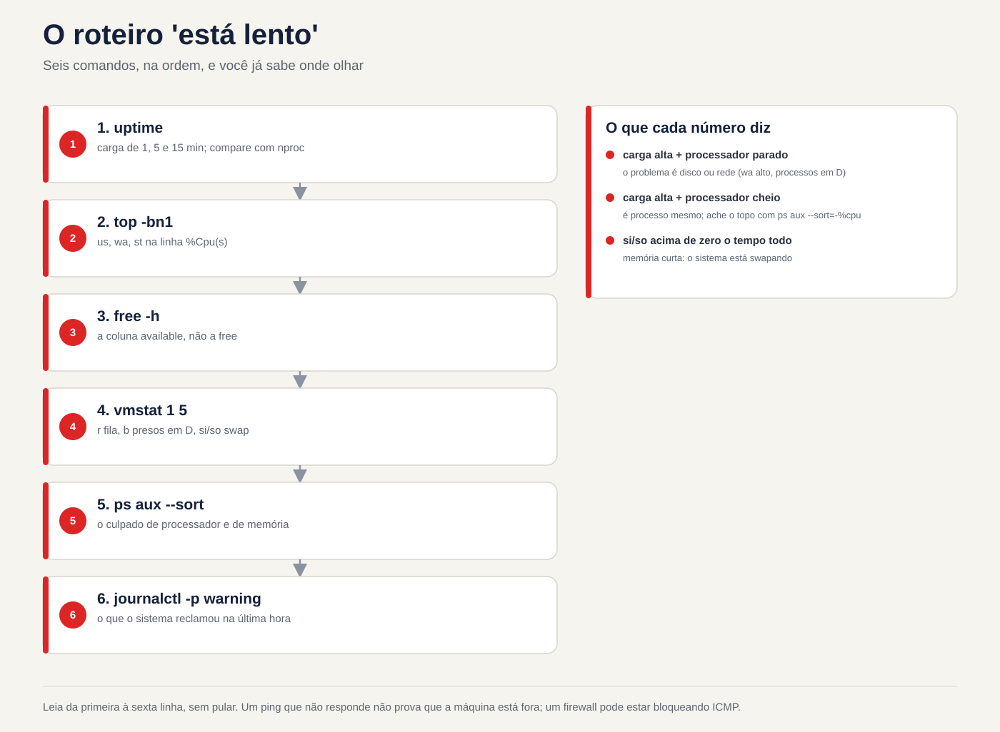

# Lezione 2.3 · Processi e log

Terza lezione del Modulo 2. Il telefono squilla: "il server è lento". È la frase più comune a sostegno e la più vaga. Lento perché? Un processore che mangia processi? La memoria è esaurita e il sistema utilizza lo scambio? Un record soffocato che trattiene tutti? Oggi impari come rispondere in cinque minuti, via SSH, senza riavviare nulla: chi è in esecuzione, quanto consuma ciascuno, come chiedere educatamente a un programma di fermarsi e come forzarlo, e dove il sistema ha notato cosa è successo prima del tuo arrivo. Alla fine, sai leggere il diario come qualcuno che legge la cartella clinica di un paziente.

| File | lezione 2.3 |
| --- | --- |
| Modulo | M2 · Sistema, utenti e permessi, lezione 3 di 8 |
| Quando | Settimana 4 |
| Alla fine puoi | Elencare e filtrare i processi con `ps`, `pgrep` e `top`; leggere le colonne che contano (PID, PPID, `%CPU`, `%MEM`, `STAT`); spiegare cos'è il carico medio; inviare segnali con `kill` e sapere quando usarli; cambiare priorità con `nice` e `renice`; eseguire lavori in background che sopravvivono al logout; trovare nel diario cosa è successo, quando e con chi; rendere permanente la rivista |
| Articoli di prova | LE 014.3 (il sistema in esecuzione: processi, `ps`, `top`, `free`, log, `journalctl`) · LPIC-1 103.5 (creare, monitorare e terminare processi) · LPIC-1 103.6 (priorità del processo) · RHCSA (identificare e terminare processi ad alto consumo; regolare la priorità; individuare e interpretare i log e il journal; conservare il journal) |
| Prerequisiti | lezione 2.2 (`free -h`, colonna `available`; `journalctl -k`); lezioni 1.5 e 1.6 (`grep` e tubi) |
| Tempo | Circa 2h |
| Istantanee | m2a3-start e m2a3-end in entrambe le VM |

## 1 · Riscaldamento

Tre domande, appena mi vengono in mente. Scrivi le risposte; la chiave di risposta viene visualizzata alla fine.

1. In Windows, apri Task Manager e fai clic su "Termina attività". Indovina: il programma ha la possibilità di salvare ciò che stava facendo prima di chiudersi o semplicemente scompare?
2. Esegui uno script lungo su SSH, la connessione si interrompe. Indovina: lo script continua a essere eseguito sul server o muore insieme?
3. `top` mostra `load average: 4.00`. Indovina: è un bene, un male o dipende da cosa?

## 2 · Perché è importante

"È lento" e "fermo" sono la metà delle chiamate. La persona che risolve il problema non è quella che conosce più comandi; è qualcuno che ha uno script e lo segue sempre nello stesso ordine: caricamento → processore → memoria → disco → processo colpevole → cosa dice il log. Con questo script arrivi al server, esegui quattro comandi e dici al client cosa sta succedendo, prima che finisca di spiegare.

E c'è la riflessione che fa danno: `kill -9`. Il programma va in crash, l'amministratore invia `-9`, il programma scompare. Ma il database non ha avuto il tempo di scrivere ciò che era in memoria, il file di blocco è stato lasciato indietro e il servizio non è più attivo. Conoscere la differenza tra chiedere di uscire e scollegare è ciò che separa la risoluzione dalla creazione della chiamata successiva.

Infine, il registro. Quando il cliente dice "ieri notte è caduto", tu non c'eri. Il diario era. Ma solo se scritto su disco: nella configurazione predefinita di Rocky, il journal resta in memoria e scompare ad ogni avvio. La domanda "cosa è successo prima del riavvio?" muore insieme. Oggi risolverai questo problema in entrambe le VM.

## 3 · Modello mentale

> Ogni processo è un bambino. Ha un numero (PID), un genitore (PPID), un proprietario, uno stato e una casella di posta del segnale. Non esegui un processo; gli mandi una lettera.

```text
systemd (PID 1)                       ← o avô de todos; adota os órfãos
 ├─ sshd                              ← serviço
 │   └─ sshd: rodrigo                 ← a sua conexão
 │       └─ bash                      ← o seu shell
 │           ├─ sleep 600 &           ← um filho em segundo plano (job)
 │           └─ ps -ef --forest       ← o comando que você acabou de digitar
 ├─ chronyd
 └─ crond
```

Quattro idee guidano la lezione:

| Idea | Cosa intendi | Conseguenza |
| --- | --- | --- |
| Albero | Ogni processo nasce da un altro (`fork`); il primo è `systemd`, PID 1 | Uccidere il padre può portare con sé i figli, oppure lasciarli orfani, adottati dal PID 1 |
| Stato | In corsa (`R`), addormentato in attesa di qualcosa (`S`), bloccato in attesa del disco (`D`), fermo (`T`), zombie (`Z`) | Un `D` non risponde ad alcun segnale, nemmeno a `-9`: attende il disco |
| Segnale | Un messaggio numerato: 15 chiede di andarsene, 9 uccide, 1 avverte "il terminale non c'è più" | Il processo può gestire 15 e 1; 9 non lo raggiunge mai, il kernel agisce direttamente |
| Registrazione | Tutto ciò che il processo scrive nell'output degli errori e tutto ciò che vedono il kernel e systemd, va nel journal | Se non veniva scritto su disco, scompariva all'avvio |


*Ogni processo è figlio di un altro: PID, PPID, proprietario, stato e una casella di segnale.*

## 4 · Concetto a strati

### Essenziale

**Vedi i processi.** Due stili di `ps` sono sopravvissuti nella pratica; memorizzarne uno per ciascuno:

```bash
ps aux                       # Stile BSD: tutto, con %CPU, %MEM, proprietario
ps -ef                       # Stile Unix: tutto, con PPID (il genitore)
ps -ef --forest              # l'albero
ps -o pid,ppid,user,stat,%cpu,%mem,cmd -p 1234     # solo le colonne che desideri, da un PID
```

| Colonna | Voglio dire |
| --- | --- |
| `PID` | Il numero del processo; unico mentre vive |
| `PPID` | Numero del padre |
| `USER` | Il proprietario; è con il suo consenso che il processo agisce (lezione 2.7) |
| `%CPU` | Quanto processore ha utilizzato (media da quando ha iniziato, al `ps`; ora, al `top`) |
| `%MEM` e `RSS` | Quanta memoria fisica occupa |
| `STAT` | Lo stato: `R`, `S`, `D`, `T`, `Z`, più lettere di dettaglio (`s` = leader della sessione, `+` = in primo piano, `<` = alta priorità, `N` = bassa priorità) |
| `TTY` | Il terminale; `?` significa che non esistono servizi |

**Trova un processo per nome.** `pgrep` risponde con il PID; anche `pidof`; `ps` con `grep` funziona, ma lo stesso `grep` appare nell'elenco:

```bash
pgrep -a sshd          # PID e riga di comando
pgrep -u rodrigo       # tutti i processi utente
pidof chronyd
```

**Il pannello live: `top`.** Apri e impara cinque tasti: `P` ordina per processore, `M` per memoria, `1` mostra ciascun core, `k` invia un segnale, `q` esce. Le prime cinque righe sono il riepilogo del server:

```text
top - 14:02:11 up 3 days,  2 users,  load average: 0.42, 0.30, 0.25   ← carga de 1, 5 e 15 minutos
Tasks: 128 total,   1 running, 127 sleeping,   0 stopped,   0 zombie
%Cpu(s):  2.0 us,  1.0 sy,  0.0 ni, 96.5 id,  0.5 wa,  0.0 hi,  0.0 si,  0.0 st
MiB Mem :   1967.4 total,    210.3 free,    612.9 used,   1144.2 buff/cache
MiB Swap:   2048.0 total,   2048.0 free,      0.0 used.   1354.5 avail Mem
```

Nella riga `%Cpu(s)`, tre numeri raccontano la storia: `us` (programmi funzionanti), `wa` (processore fermo **in attesa del disco**) e `st` (tempo che l'hypervisor ha rubato alla VM per darlo a un altro). `id` high e `wa` high contemporaneamente: il problema è il disco, non il processore.

**Il carico medio.** Il `load average` è il numero medio di processi che richiedono il processore o sono in attesa del disco (stati `R` e `D`). Confrontare con il numero di core (`nproc`): caricare 4 su una macchina a 4 core è pieno; in un 16, è una pausa; in uno di 1, è una coda. I tre numeri, 1, 5 e 15 minuti, ti dicono dove sta andando: `4.0, 2.0, 0.5` sta peggiorando adesso; `0.5, 2.0, 4.0` sta migliorando.

**Segnali.** `kill` non uccide: invia un segnale. Quelli che usi:

| Segnale | Numero | Cosa fa | Quando |
| --- | --- | --- | --- |
| `SIGTERM` | 15| Chiedi di finire; il programma può salvare, chiudere file, eliminare file di blocco | Sempre prima. È lo standard del `kill` |
| `SIGKILL` | 9| Il kernel rimuove immediatamente il processo; non lo sa | Solo dopo 15 è fallito e hai aspettato |
| `SIGHUP` | 1| "Il terminale è spento." Molti servizi lo interpretano come "rileggere la configurazione" | Ricarica un vecchio servizio senza eliminarlo |
| `SIGINT` | 2| Cosa dice `Ctrl+C` | Interrompe ciò che è presente sul terminale |
| `SIGSTOP` e `SIGCONT` | 19 e 18| Congelare e scongelare; `Ctrl+Z` manda un cugino di 19 anni, `SIGTSTP` | Pausa senza uccidere |

```bash
kill 1234              # invia 15
kill -9 1234           # invia 9
kill -l                # elenca tutti i segni
pkill -u fulano sleep  # mandane 15 a tutto il "sonno" di questo ragazzo
killall sleep          # mandane 15 a tutti "dormi", tutti
```

**Dove sono i log.** Due fonti che oggi coesistono:

| Fonte | Cos'è | Come leggere |
| --- | --- | --- |
| systemd Diario | Database binario con tutto: kernel, servizi, login, con data, priorità e unità | `journalctl` |
| File in `/var/log` | Testo, registrato da `rsyslog` dal giornale, e da programmi che scrivono direttamente | `less`, `tail -f`, `grep` |

In Rocky, `rsyslog` è installato e registra `/var/log/messages` e `/var/log/secure` (login e `sudo`). In Debian 13 non arriva: il journal è la fonte e `/var/log` ha poco altro oltre ai log di `apt` e `dpkg`.

### Intermediate

**`journalctl`, i filtri che risolvono.** Il journal è grande; il valore è nel filtro:

| Domanda | Comando |
| --- | --- |
| Cos'è successo in questo stivale? | `journalctl -b` |
| E all'avvio precedente, prima dell'arresto anomalo? | `journalctl -b -1` (solo se il giornale è permanente) |
| Che stivali conosce il giornale? | `journalctl --list-boots` |
| Solo un servizio | `journalctl -u sshd` (Rocky) o `-u ssh` (Debian) |
| Solo errori e peggio | `journalctl -p err` (livelli: `emerg`, `alert`, `crit`, `err`, `warning`, `notice`, `info`, `debug`) |
| In una finestra di tempo | `journalctl --since '2026-11-02 08:00' --until '09:30'`; oppure `--since '-1h'`, `--since yesterday` |
| Dal vivo | `journalctl -f` |
| Le ultime righe | `journalctl -n 50` |
| Di un programma, per nome | `journalctl -t sudo`; `journalctl _COMM=sshd` |
| Da un PID | `journalctl _PID=1234` |
| Nessuna impaginazione, da utilizzare con `grep` | `journalctl --no-pager` |
| Con la spiegazione dell'errore, quando è presente | `journalctl -xe` |

I filtri si sommano: `journalctl -u sshd -p warning --since today` sono gli "avvisi SSH di oggi".

**Il journal che scompare all'avvio.** `systemd-journald` lo memorizza in `/var/log/journal/` **se la cartella esiste**; In caso contrario, salvatelo in `/run/log/journal/`, che rimane in memoria e scompare all'avvio. La decisione viene presa mediante l'opzione `Storage=` nel `/etc/systemd/journald.conf`:

| `Storage=` | Comportamento |
| --- | --- |
| `auto` (predefinito) | Scrive su disco se esiste `/var/log/journal/`; altrimenti solo in memoria |
| `persistent` | Creare la cartella e salvarla sul disco |
| `volatile` | Solo in memoria |

In Rocky 9, la cartella non esiste dopo l'installazione: il journal è volatile e `rsyslog` è quello che memorizza la cronologia in `/var/log/messages`. In Debian 13, la cartella viene creata al momento dell'installazione e il journal è già permanente. Li controllerai entrambi in laboratorio, perché "lo standard" cambia da una versione all'altra e ciò che conta è ciò che c'è sulla macchina.

**Priorità: `nice` e `renice`.** Il *bello* va da `-20` (più priorità) a `19` (meno). L'impostazione predefinita è `0`. Un processo "bello" (high nice) cede il processore ad altri:

```bash
nice -n 10 tar czf /tmp/backup.tgz /etc     # inizia ora con un bel 10
renice -n 15 -p 1234                        # cambiarne uno già in esecuzione
ps -o pid,ni,cmd -p 1234                    # controllo
```

L'utente ordinario può solo **aumentare** l'aspetto gradevole dei propri processi (diventare più gradevoli). Diminuire o modificare quelli degli altri richiede root. In `top`, la colonna `NI` mostra il valore e `PR` mostra la priorità calcolata dal kernel da esso.

**Primo piano e sfondo.** Nella shell, un comando con `&` alla fine viene eseguito in background, come un *job*:

| Comando | Che cosa significa |
| --- | --- |
| `comando &` | Funziona in background; la shell mostra `[1] 4321` (numero lavoro e PID) |
| `Ctrl+Z` | Metti in pausa ciò che è in primo piano |
| `jobs -l` | Elenca i lavori per questa shell |
| `bg %1` | Il lavoro 1 continua in background |
| `fg %1` | Porta il lavoro 1 in primo piano |
| `kill %1` | Invia 15 al lavoro 1 |

I lavori provengono dalla **shell**: se la shell muore, invia `SIGHUP` ai suoi figli, e muoiono insieme. Per sopravvivere al logout:

| Modo | Come | Quando |
| --- | --- | --- |
| `nohup comando &` | Ignorare `SIGHUP`; l'uscita va a `nohup.out` | Un comando separato, veloce da ricordare; fai il test |
| `tmux` (o `screen`) | Una sessione terminale che continua sul server; si esce e si ritorna con `tmux attach` | Nel modo quotidiano: aggiornamento lungo, copia grande |
| `systemd-run --user` o un'unità di servizio | systemd si occupa del processo | Cose che devono essere sempre eseguite (Modulo 4) |

### Windows Bridge

| Su Windows | Su Linux | Cosa cambia |
| --- | --- | --- |
| Task Manager, scheda Processi | `top`, `ps aux` | `top` funziona su SSH e mostra il carico medio, cosa che Windows non |
| "Termina compito" | `kill PID` (15) | Linux chiede prima; il programma può dire addio |
| "Finalizza albero dei processi" | `kill -9` o `pkill -P PPID` per i bambini |  |
| Priorità: "Sotto la norma" | `renice -n 10` | La scala è invertita: numero più alto, priorità più bassa |
| Visualizzatore eventi | `journalctl` | Filtri sulla riga di comando invece di fare clic su |
| Registri di applicazione, sistema, sicurezza | `journalctl -u serviço`, `journalctl -k`, `/var/log/secure` o `journalctl -t sudo` |  |
| Attività che continua dopo la disconnessione | `tmux`, `nohup` o un servizio |  |

### Avanzato

**`/proc/PID/`, il processo interno.** Ogni processo ha una cartella: `/proc/1234/cmdline` (la riga di comando), `/proc/1234/status` (stato, memoria, proprietario), `/proc/1234/fd/` (i file aperti, come i collegamenti), `/proc/1234/cwd` (la cartella in cui si trova). `ps` e `top` si leggono da lì. Quando un disco è pieno e non riesci a trovare il file, `ls -l /proc/*/fd 2>/dev/null | grep deleted` mostra il file cancellato che un processo tiene ancora aperto: lo spazio ritorna solo alla chiusura del processo.

**Zombie e orfano.** Un processo terminato si trova nella tabella come `Z` finché il suo genitore non legge il suo codice di uscita. Uno zombie non spreca processore o memoria, ma solo una riga nella tabella; Non ha senso mandargli il `kill` perché è già morto. È il padre che decide: o lo legge, oppure muore, e poi `systemd` lo adotta e lo ripulisce. Un **orfano** è l'opposto: il genitore è morto e il bambino è ancora vivo, adottato dal PID 1.

**Lo stato `D`.** Un processo in `D` (*sonno ininterrotto*) è all'interno del kernel in attesa del disco o della rete (un NFS che si è bloccato, ad esempio). Nessun segnale ti farà uscire da lì, nemmeno 9. Se ne vedi diversi in `D` e il carico è elevato con il processore fermo, il problema è nella memoria. Il riavvio del server potrebbe addirittura causarne il blocco allo spegnimento.

**`systemd-cgls` e `systemd-cgtop`.** Systemd raggruppa i processi di ciascun servizio in un *cgroup*. `systemd-cgls` rappresenta l'albero per servizio; `systemd-cgtop` mostra il consumo per servizio, non per processo. Su un server con un servizio che apre un centinaio di processi si vede di chi è la colpa.

**`sudo journalctl` × gruppi.** Senza `sudo`, `journalctl` mostra solo i messaggi propri dell'utente. I membri del gruppo `wheel` (Rocky), `adm` (Debian) o `systemd-journal` (entrambi) leggono tutto senza `sudo`.

### Cosa rientra nel test

- **LE 014.3**: cos'è un processo, `ps`, `top`, `free`, dove sono i log, `journalctl` basic.
- **LPIC-1 103.5**: `ps`, `pgrep`, `pkill`, `kill`, `killall`, `top`, `free`, `uptime`, `watch`, `nohup`, `jobs`, `bg`, `fg`, `&`, `screen` e `tmux`; i segnali, per nome e numero.
- **LPIC-1 103.6**: `nice`, `renice`, l'intervallo da `-20` a `19`, chi può scaricare nice, le colonne `NI` e `PR`.
- **RHCSA**: trova e termina il processo che consuma di più; regolare la priorità; `journalctl` con filtri unitari, prioritari e temporali; rendere permanente il diario.

## 5 · Rocky × Debian

| Cosa | Roccioso 9 | Debian 13 |
| --- | --- | --- |
| Journal su disco dopo l'installazione | No: `/var/log/journal/` non esiste, giornale volatile | Sì: la cartella esiste e il diario è permanente |
| `rsyslog` | Installato e attivo; registra `/var/log/messages` e `/var/log/secure` | Non viene installato; la fonte è la rivista |
| Registro di accesso e `sudo` nel testo | `/var/log/secure` | Non ce n'è; utilizzare `journalctl -t sudo` e `journalctl -u ssh` |
| Nome unità SSH | `sshd` | `ssh` |
| Chiunque legga l'intero giornale senza `sudo` | Gruppi `wheel` e `systemd-journal` | Gruppi `adm` e `systemd-journal` |
| `tmux` | `dnf install tmux` | `apt install tmux` |
| `pstree` | Pacchetto `psmisc`, generalmente installato | Pacchetto `psmisc`, potrebbe mancare |
| `killall` | Pacchetto `psmisc` | Pacchetto `psmisc` |

## 6 · Laboratorio guidato

Fare tutto prima in rocky-lab e ripetere in debian-lab. Dove Debian cambia, il passo avverte. Aprire **due** terminali SSH sulla stessa VM: terminale 1 per creare i processi, terminale 2 per osservare.


*Leggi dalla prima alla sesta riga, senza saltare. Un ping che non risponde non dimostra che la macchina è fuori servizio; un firewall potrebbe bloccare ICMP.*


### Passaggio 0 · Istantanea

In Proxmox, acquisire l'istantanea `m2a3-inicio` delle due VM. Se qualcosa va storto seriamente, torna qui.

### Passo 1 · Il tuo albero

Nel terminale 1:

```bash
echo $$                          # il PID della tua shell
ps -o pid,ppid,user,stat,cmd -p $$
ps -ef --forest | grep -B3 -A1 "$$"
```

Segui `PPID` verso l'alto: il tuo `bash` è figlio di un `sshd: rodrigo`, che è figlio di un altro `sshd`, che è figlio di `systemd`, PID 1. Ora controlla il nonno:

```bash
ps -o pid,user,cmd -p 1
nproc                            # quanti core ha la VM
uptime                           # Da quanto tempo è acceso e la carica?
```

Nota `nproc`. Ti servirà per leggere il payload tra poco.

### Passo 2 · Primo piano e sfondo

Sempre sul terminale 1:

```bash
sleep 600 &                      # [1] e un PID
sleep 700                        # Questo contiene il terminale
```

Il secondo `sleep` ha intrappolato il terminale. Premere `Ctrl+Z`. La shell risponde `[2]+ Stopped`. Adesso:

```bash
jobs -l                          # 1 in corsa, 2 fermi
ps -o pid,stat,cmd -C sleep      # l'arresto appare con STAT T
bg %2                            # 2 riprende a funzionare in background
jobs -l
fg %1                            # porta 1 in primo piano
```

Il terminale è di nuovo bloccato, ora su `sleep 600`. Premere `Ctrl+C`: riceve `SIGINT` e termina. Pulisci l'altro:

```bash
kill %2
jobs -l                          # vuoto
```

**Decidi 1 · Il terminale si è bloccato.** Hai eseguito una copia tramite SSH che richiederà un'ora, senza `&`. Il terminale è bloccato e ne hai bisogno. Cosa fare senza perdere la copia?

- **A)** `Ctrl+C` e ripetere con `&` alla fine.
- **B)** `Ctrl+Z` e poi `bg`.
- **C)** Aprire un altro terminale e inviare `kill -STOP` nella copia.
- **D)** Chiudere la finestra SSH; la copia continua da sola.

Scegliere la lettera prima di guardare la tabella.

| Se hai selezionato | Risultato | Perché |
| --- | --- | --- |
| A | ❌ Sbagliato | `Ctrl+C` interrompe la copia e si ricomincia da capo. |
| B| ✅ Giusto | `Ctrl+Z` mette in pausa e ritorna al terminale; `bg` fa sì che la copia continui in background, dove si trovava. |
| C| ❌ Sbagliato | `SIGSTOP` blocca la copia, ma il terminale 1 rimane bloccato in attesa. Hai appena cambiato il problema. |
| D | ❌ Sbagliato | Quando la connessione si interrompe, la shell riceve `SIGHUP` e lo trasmette ai suoi figli. La copia muore. Il passaggio 5 lo mostra dal vivo. |

**Da correggere:** `Ctrl+Z`, `bg`. E, se deve sopravvivere al logout, non è ancora abbastanza: vedi Passo 5.

### Passo 3 · Fai rumore e trova il colpevole

Nel terminale 1, crea un processo che mangia un intero core:

```bash
yes > /dev/null &
```

Nel terminale 2, apri `top`. Premere `P` (ordina per processore). `yes` sale al massimo, vicino al 100%. Premere `1` per vedere i nuclei separati: uno di essi è pieno. Riga di avviso `%Cpu(s)`: `us` è aumentato. Aspetta un attimo e guarda il caricamento: il primo numero va a 1.

Esci con `q` e controlla la stessa cosa senza il pannello, come lo incolli in un ticket:

```bash
uptime
ps aux --sort=-%cpu | head -5
top -bn1 | head -12              # un ritratto della cima, nel testo
```

Ora abbassa la sua priorità. Sul terminale 2, come utente:

```bash
PID=$(pgrep -x yes)
ps -o pid,ni,pri,cmd -p $PID     # NI 0
renice -n 10 -p $PID
ps -o pid,ni,pri,cmd -p $PID     # NI 10
renice -n 0 -p $PID              # prova a tornare indietro
```

L'ultimo `renice` fallisce con `Permission denied`. Sei riuscito a diventare più carino, ma non puoi tornare indietro senza essere root.

**Decidi 2 · Chi può cosa.** Un utente normale esegue un processo con nice `10`. Quale di queste cose può fare da solo?

- **A)** `renice -n 5` (torna a 5)
- **B)** `renice -n 15`
- **C)** `renice -n -5`
- **D)** `renice -n 15` nel processo di un altro utente

Scegli la lettera prima di guardare la tabella.

| Se hai selezionato | Risultato | Perché |
| --- | --- | --- |
| A | ❌ Sbagliato | Abbassare il bello significa chiedere maggiore priorità. L'utente ordinario sale e basta. |
| B| ✅ Giusto | Aumentare la bellezza del processo stesso è sempre consentito: è cedere il passo ad altri. |
| C| ❌ Sbagliato | Il bel negativo è la priorità sopra il normale, solo root. |
| D | ❌ Sbagliato | Processo da un altro utente, solo root, anche solo per renderlo più delicato. |

**Da risolvere:** più bello, priorità più bassa. L'utente normale sale solo e solo di propria iniziativa.

Termina `yes` educatamente e controlla:

```bash
kill $PID
pgrep -x yes; echo "rc=$?"       # rc=1: non ne è rimasto nessuno
```

### Passo 4 · Chiedi di uscire e scollegare 

Crea un falso "servizio" che si comporti come uno reale: scrive un file di blocco quando sale, si rifiuta di salire se il blocco esiste e cancella il blocco quando riceve `SIGTERM`.

```bash
cat > ~/lab-servico.sh <<'EOF'
#!/bin/bash
TRAVA=/tmp/lab-servico.lock
if [ -e "$TRAVA" ]; then
  echo "ERRO: já está rodando (PID $(cat "$TRAVA")). Saindo." >&2
  logger -t lab-servico "recusei subir: trava $TRAVA existe"
  exit 1
fi
echo $$ > "$TRAVA"
trap 'logger -t lab-servico "TERM recebido, trava removida"; rm -f "$TRAVA"; exit 0' TERM
logger -t lab-servico "iniciado, PID $$"
while true; do sleep 2; done
EOF
chmod +x ~/lab-servico.sh
```

Nel terminale 1:

```bash
~/lab-servico.sh &
cat /tmp/lab-servico.lock        # il suo PID
```

Nel terminale 2, seguire ciò che dice:

```bash
journalctl -t lab-servico -f
```

Nel terminale 1, inviare `SIGTERM`:

```bash
kill $(cat /tmp/lab-servico.lock)
ls /tmp/lab-servico.lock         # Nessun file del genere
```

Il terminale 2 ha mostrato `TERM recebido, trava removida`, circa due secondi dopo `kill`. Questo ritardo è dovuto al fatto che il programma termina ciò che stava facendo (`sleep 2`) prima di elaborare il segnale. È ciò che fa un database per registrare ciò che era in memoria. Lasciare aperto il terminale 2; usi di nuovo il lucchetto nella pausa B.

**Decidi 3 · I secondi di attesa.** Invii `kill` a un servizio e non scompare subito. Cosa fa?

- **A)** Invia `kill -9` immediatamente: si è fermato.
- **B)** Attendi qualche secondo e verifica con `ps -p PID`; solo se rimane in vita dopo un tempo ragionevole, `kill -9`.
- **C)** Riavvia il server.
- **D)** Invia `kill -1`, che è più forte di 15.

Scegli la lettera prima di guardare la tabella.

| Se hai selezionato | Risultato | Perché |
| --- | --- | --- |
| A | ❌ Sbagliato | Il programma dice addio: registra, chiude, cancella la serratura. `-9` lo ferma a metà e lascia lo sporco. |
| B| ✅ Giusto | 15 è una richiesta. Dategli tempo. `systemctl stop` fa esattamente questo: invia 15, attende 90 secondi per impostazione predefinita e solo dopo invia 9. |
| C| ❌ Sbagliato | Restart invia i 15 a tutti, compreso lui, e porta via il resto. |
| D | ❌ Sbagliato | 1 non è "più forte"; è un altro messaggio ("il terminale non c'è più" o "rileggere la configurazione"). Molti servizi non finiscono nemmeno con questo. |

**Da risolvere:** 15, attendere, controllare; solo allora 9. Questo è ciò che fa lo stesso systemd.

### Passo 5 · Sopravvivere alla connessione drop

Ora il test che risponde alla domanda 2 del riscaldamento. Sul terminale 1:

```bash
sleep 901 &                      # un lavoro comune
nohup sleep 902 > /dev/null 2>&1 &   # un lavoro immune da SIGHUP
pgrep -a sleep
kill -HUP $$                     # simula la caduta: il tuo guscio riceve il SIGHUP
```

La connessione del terminale 1 si chiude, come se la rete fosse interrotta. Nel terminale 2:

```bash
pgrep -a sleep
```

Solo `sleep 902` è sopravvissuto. Quando la shell riceve `SIGHUP`, lo passa a ciascun lavoro e `sleep 901` è morto. `nohup` ha fatto sì che `902` ignorasse questo segnale, ed è stato adottato da `systemd`: controlla suo padre.

```bash
ps -o pid,ppid,cmd -p $(pgrep -f 'sleep 902')
```

`PPID` non è più la tua shell, che è morta: è `systemd --user` o PID 1. Un dettaglio fuorviante: se inizi a digitare `exit`, Bash, per impostazione predefinita, **non** invia `SIGHUP` ai lavori, e `sleep 901` sopravvivrebbe. Ciò che uccide è la caduta, non il `exit`. Ecco perché nel test è stata utilizzata la caduta.

Ora nel modo quotidiano. Installa `tmux` (`sudo dnf install -y tmux` su Rocky, `sudo apt install -y tmux` su Debian), ricollega il terminale 1 e:

```bash
tmux new -s lab
sleep 903                        # all'interno di tmux, in primo piano
```

Premi `Ctrl+B` e poi `D` (da *stacca*). Esci da tmux e `sleep 903` rimane dentro. Simula di nuovo la caduta con `kill -HUP $$`, riconnettiti e:

```bash
tmux ls                          # la sessione "laboratorio" continua
tmux attach -t lab               # rientri dentro, col sonno ancora in corso
```

Premi `Ctrl+C` per finire `sleep`, esci da tmux con `exit` e cancella l'altro: `pkill -f 'sleep 902'`.

### Passo 6 · Leggi il diario

Registra un tuo messaggio e ritrovalo:

```bash
logger -t lab-aula23 "teste de leitura do journal"
journalctl -t lab-aula23
```

Se qualche `journalctl` di questa lezione risulta vuoto o ti avverte che non vedi altri messaggi delle persone, il tuo utente non è in un gruppo che legge l'intero diario (vedi Avanzate). Ripeti con `sudo` e scrivi nell'agenda in quale gruppo si trova `rodrigo`: `id rodrigo`.

Ora i filtri che utilizzerai ogni settimana. Eseguilo uno per uno e leggi l'output:

```bash
journalctl -b -n 20                         # la fine di questo avvio
journalctl -u sshd --since today            # su Debian: -u ssh
journalctl -p err -b                        # solo errori e peggio, su questo avvio
journalctl -t sudo --since '-1h'            # chi ha usato sudo nell'ultima ora
journalctl --since '-10min' -o short-precise   # con millisecondi
journalctl -t lab-servico -o verbose -n 1   # tutti i campi su una riga
```

L'ultimo mostra che ogni riga del giornale è un record con i campi: `_PID`, `_UID`, `_COMM`, `_SYSTEMD_UNIT`, `_BOOT_ID`. È attraverso questi campi che filtrano `-u`, `-t` e `_PID=`.

In Rocky, confrontare con il file di testo:

```bash
sudo tail -5 /var/log/messages
sudo grep lab-aula23 /var/log/messages
sudo tail -5 /var/log/secure                # accessi e sudo
```

In Debian i due file non esistono: confermare con `ls /var/log/messages /var/log/secure`.

### Passo 7 · Il journal sopravvive all'avvio?

```bash
ls -ld /var/log/journal /run/log/journal 2>&1
journalctl --list-boots
journalctl --disk-usage
```

Se `/var/log/journal` non esiste e `--list-boots` mostra una sola riga, anche con la VM riavviata prima, il journal è volatile. Il risultato atteso è volatile in Rocky e permanente in Debian, ma ciò che conta è ciò che ha mostrato la tua macchina.

**Decidi 4 · Rendi permanente.** In Rocky, vuoi che il diario sopravviva all'avvio, in modo che un aggiornamento al pacchetto `systemd` non lo annulli. Cosa fa?

- **A)** Modifica `/usr/lib/systemd/journald.conf` e inserisci `Storage=persistent`.
- **B)** Crea `/etc/systemd/journald.conf.d/50-lab.conf` con `[Journal]` e `Storage=persistent` e riavvia `systemd-journald`.
- **C)** `sudo cp -r /run/log/journal /var/log/`.
- **D)** Installa `rsyslog`: ha già salvato tutto.

Scegli la lettera prima di guardare il tabella.

| Se hai selezionato | Risultato | Perché |
| --- | --- | --- |
| A | ❌ Sbagliato | I file in `/usr/lib` appartengono al pacchetto; il prossimo aggiornamento potrebbe sovrascriverlo. La regola è la stessa della lezione 2.2 con udev: l'amministratore scrive in `/etc`. |
| B| ✅ Giusto | Un file in `/etc/systemd/journald.conf.d/` è tuo, sopravvive agli aggiornamenti e mostra la modifica in un unico posto. Anche la modifica diretta di `/etc/systemd/journald.conf` funziona e appare anche nel test. |
| C| ❌ Sbagliato | Hai copiato ciò che già esisteva, ma journald continua a scrivere in memoria. Al successivo avvio, sul disco non è andato nulla di nuovo. |
| D | ❌ Sbagliato | `rsyslog` è già installato in Rocky e salva il testo. Ma `journalctl -b -1`, con i filtri per unità e priorità, resta vuoto. |

**Per risolvere:** `Storage=persistent` in un file `/etc/systemd/journald.conf.d/`, riavvia journald, verifica con `--list-boots` dopo l'avvio.

Fallo su entrambe le VM, anche se Debian è già permanente: in questo modo è esplicito e un cambio di standard in futuro non cambierà il tuo server.

```bash
sudo mkdir -p /etc/systemd/journald.conf.d
printf '[Journal]\nStorage=persistent\n' | sudo tee /etc/systemd/journald.conf.d/50-lab.conf
sudo systemctl restart systemd-journald
ls -ld /var/log/journal
journalctl --disk-usage
```

La cartella `/var/log/journal` ora esiste. Riavvia la VM (`sudo systemctl reboot`), riconnettiti e:

```bash
journalctl --list-boots          # ora due righe o più
journalctl -b -1 -n 5            # la fine del boot precedente: lo shutdown
```

Hai appena letto cosa è successo prima di riavviare. Questo è ciò che il cliente vuole sapere quando dice "la notte scorsa è caduto".

### Passo 8 · Lo script "è lento"

Assembla tutto in uno script di cinque comandi ed eseguilo in ordine. Non c'è niente di sbagliato nelle VM adesso; L'obiettivo è sapere cosa è normale in loro, per riconoscere in seguito ciò che è anormale.

```bash
uptime                                       # 1. il carico, rispetto a nproc
top -bn1 | head -5                           # 2. us, wa, st nella riga %Cpu
free -h                                      # 3. la colonna disponibile
vmstat 1 5                                   # 4. r (coda), b (bloccato in D), si/so (scambio), wa
ps aux --sort=-%cpu | head -5                # 5. il colpevole del processore
ps aux --sort=-%mem | head -5                # e memoria
journalctl -p warning --since '-1h' --no-pager | tail -20   # 6. cosa ha lamentato il sistema
```

In `vmstat`, la prima riga è la media dall'avvio; leggere dal secondo in poi. Le colonne che contano: `r` (processi che richiedono processore), `b` (bloccato in `D`), `si` e `so` (memoria che va avanti e indietro dallo swap: sempre sopra lo zero è segno di memoria corta) e `wa`.

Copia l'output dei sei comandi delle due VM nell'agenda, con la data. È la tua linea di base.

## 7 · Interrompi e correggi

### Interruzione A · Il disco pieno che nessuno trova

La chiamata: "il disco è pieno, ma abbiamo eliminato il file di grandi dimensioni e non è stato liberato nulla". Gioca in Rocky-Lab. Nel terminale 1:

```bash
df -h /var/tmp
dd if=/dev/zero of=/var/tmp/lab-grande.log bs=1M count=200
sleep 3600 < /var/tmp/lab-grande.log &      # un processo che mantiene il file aperto
rm /var/tmp/lab-grande.log
```

**Nota.**

```bash
df -h /var/tmp                    # i 200 MB sono ancora occupati
sudo du -sh /var/tmp              # ma la cartella non ha quasi nulla
ls -l /var/tmp/lab-grande.log     # Nessun file del genere
```

`df` dice che il posto è occupato; `du` non trova chi lo occupa. Hanno ragione entrambi.

**Diagnostique.** Su Linux, `rm` non cancella il contenuto; eliminare il **nome**. Il contenuto viene liberato solo quando nessun nome lo indica **e** nessun processo lo tiene aperto. `du` aggiunge i nomi trovati; `df` chiede al file system quanto è occupato. Chi detiene il fascicolo? La cartella `/proc/PID/fd/` di ciascun processo mostra i file aperti e il kernel contrassegna quelli eliminati con `(deleted)`:

```bash
sudo find /proc/[0-9]*/fd -lname '*(deleted)' -printf '%p -> %l\n' 2>/dev/null | grep -v memfd
```

Una linea punta a `/var/tmp/lab-grande.log (deleted)` e il numero al centro è il PID di `sleep`. Se è installato `lsof`, appare `sudo lsof +L1` con il nome del programma. Nel mondo reale, questo processo è un servizio che scrive in un registro che qualcuno ha cancellato manualmente, invece di utilizzare `logrotate`.

**Decidi A · La correzione.** Cosa libera spazio?

- **A)** Termina o riavvia il processo che contiene il file.
- **B)** Riavvia il server.
- **C)** Esegui `rm -f /var/tmp/lab-grande.log` da nuovo, con `-f`.
- **D)** Eseguire `fsck` sul file system.

Scegliere la lettera prima di guardare la tabella.

| Se hai selezionato | Risultato | Perché |
| --- | --- | --- |
| A | ✅ Giusto | Quando il processo chiude il file, il kernel vede che non è rimasto alcun nome o lettore e libera immediatamente i blocchi. In un vero servizio, `systemctl restart` su di esso. |
| B| ⚠️ Funziona, ma | Lo spazio ritorna, perché tutti i processi si chiudono. Ma hai disattivato l'intero server per risolvere un processo. |
| C| ❌ Sbagliato | Non c'è più un nome da cancellare. `rm` risponde che il file non esiste, con o senza `-f`. |
| D | ❌ Sbagliato | Non c'è nessun errore nel file system: sta facendo esattamente quello che dovrebbe. E `fsck` in un sistema montato è pericoloso. |

**Da risolvere:** `df` pieno e `du` vuoto = file eliminato e ancora aperto. `/proc/*/fd` o `lsof +L1` mostrano chi lo detiene.

**Riparalo.**

```bash
kill %1                           # o il PID trovato mostrato
df -h /var/tmp                    # i 200 MB sono tornati
```

Quando il processo non può essere riavviato (un database nel bel mezzo della giornata lavorativa, ad esempio), esiste un trucco di emergenza: svuotare il file lungo il percorso in `/proc`, con `sudo truncate -s 0 /proc/PID/fd/N`. Il processo continua con il file aperto, ma ora vuoto. Utilizzare con cautela e solo nei log: in un file di dati, hai appena cancellato i dati.

### Break B · Il servizio che non si riavvia dopo il kill -9

La chiamata: "il servizio è andato in crash, l'ho killato e ora non si riavvia più". Utilizzare `lab-servico.sh` dal passaggio 4. Nel terminale 2, lasciare il journal aperto:

```bash
journalctl -t lab-servico -f
```

Nel terminale 1, caricare il servizio e terminare nel modo sbagliato:

```bash
~/lab-servico.sh &
kill -9 $(cat /tmp/lab-servico.lock)
~/lab-servico.sh &
```

**Nota.**

```bash
jobs -l
cat /tmp/lab-servico.lock
```

Il secondo avvio non è riuscito con `ERRO: já está rodando`. Il diario mostra `iniciado` e poi `recusei subir`, ma niente `TERM recebido`: il programma non ha mai saputo che sarebbe morto.

**Diagnose.** `SIGKILL` non viene consegnato al programma: il kernel lo rimuove direttamente. Il `trap` che ha cancellato il lock non è mai stato eseguito e il lock aveva il PID di un processo morto. Confermare che nessuno abbia questo PID:

```bash
PIDVELHO=$(cat /tmp/lab-servico.lock)
ps -p "$PIDVELHO" -o pid,cmd; echo "rc=$?"     # rc=1: non esiste
pgrep -af lab-servico; echo "rc=$?"           # nessun servizio di laboratorio in funzione
```

È la stessa cosa che succede con `dnf` ("in attesa del blocco"), con un PostgreSQL che lascia `postmaster.pid`, con qualsiasi servizio che utilizza un file PID.

**Decidi B · La correzione.** Cosa fai?

- **A)** Controlla che il PID del blocco non esista più, elimina il blocco e riavvia il servizio.
- **B)** Invia nuovamente `kill -9` nel PID della serratura.
- **C)** Cancella direttamente la serratura, senza controllare nulla, e vai su.
- **D)** Riavvia il server per cancellare `/tmp`.

Scegli la lettera prima di guardare la tabella.

| Se hai selezionato | Risultato | Perché |
| --- | --- | --- |
| A | ✅ Giusto | Il blocco è lì per impedire due copie. Hai dimostrato che non esiste alcuna copia; ora è spazzatura e può andarsene. |
| B| ❌ Sbagliato | Non esiste alcun processo con quel numero. `kill` risponde a `No such process`. Peggio ancora: se il numero è già stato riutilizzato da un altro processo, hai appena ucciso una persona innocente. |
| C| ⚠️ Funziona, ma | Oggi funziona. Il giorno in cui il servizio è effettivamente in esecuzione e "semplicemente lento", carichi una seconda copia sopra la prima ed entrambi scrivono sugli stessi dati. |
| D | ❌ Sbagliato | Rilascia tutto per eliminare un file. E non sempre risolve: in Debian 13 `/tmp` viene pulito all'avvio, in Rocky rimane sul disco e il lock sopravvive. |

**Per risolvere:** dopo un `kill -9`, cercare lo sporco: lock, PID, file temporaneo. Verificare che il proprietario sia morto prima della pulizia.

**Ripararlo.**

```bash
ps -p "$(cat /tmp/lab-servico.lock)" > /dev/null || rm -f /tmp/lab-servico.lock
~/lab-servico.sh &
kill %1                           # ora nel modo giusto
ls /tmp/lab-servico.lock          # Nessun file del genere: il lucchetto è uscito con esso
```

Il diario, nel terminale 2, mostra `iniciado` e `TERM recebido, trava removida`. Il ciclo si è chiuso in modo pulito.

### La lezione

Le due interruzioni rappresentano lo stesso tipo di problema: **l'effetto continua dopo che la causa è scomparsa dalla vista**. Il file eliminato continuava a occupare il disco perché era trattenuto da un processo. La serratura continuava a bloccarsi perché il processo che avrebbe dovuto spegnerla è stato strappato dalla presa. Nei processi, quello che vedi in `ls` non è lo stato completo: il resto è in `/proc`, nel journal e nei file che i programmi lasciano. L'abitudine di questa lezione: **prima di uccidere, chiedere cosa prevede il processo; dopo aver ucciso, controlla cosa ha lasciato**.

## 8 · Trappole

| Digiti o vedi | Cosa succede | Quello giusto |
| --- | --- | --- |
| `kill -9` come primo tentativo | Il programma non registra, non chiude, non toglie il lucchetto | `kill PID`, attendere, verificare; `-9` solo alla fine |
| `kill` in un processo nello stato `D` | Niente: nemmeno il 9 lo tira fuori di lì | Esaminare il disco o la rete prevista (`dmesg`, `journalctl -k`) |
| `kill` in uno zombie (`Z`) | Niente: è già morto | Tratta il genitore: riavvia il servizio che lo ha creato |
| `ps aux \| grep nginx` | `grep` stesso compare nell'elenco | `pgrep -a nginx`, oppure `ps aux \| grep [n]ginx` |
| `killall` senza pensare | Uccide tutti i processi con quel nome, da tutti gli utenti (come root) | `pkill -u usuario nome`, oppure il PID |
| `load average: 4.00` e la conclusione "è sovraccarico" | Dipende dai nuclei | Confronta con `nproc` |
| Carico elevato e `%Cpu` quasi fermo | Non è un processore: è un disco o una rete (`wa` alto, processi a `D`) | `vmstat 1`, colonna `b`; `top`, riga `wa` |
| `comando &` e chiudere SSH | Il lavoro muore con la caduta | `nohup`, `tmux` o un servizio |
| `renice -n -5` come utente abituale | `Permission denied` | Solo root scarica bene |
| `journalctl -b -1` dà `Specified boot ID not found` | Il diario è volatile: l'avvio precedente non è stato salvato | `Storage=persistent` |
| Modifica `/usr/lib/systemd/journald.conf` | L'aggiornamento sovrascrive | `/etc/systemd/journald.conf.d/*.conf` |
| `journalctl` senza filtro | Migliaia di righe, ti arrendi | `-u`, `-p`, `--since`, `-t`, `-b` |
| `rm` nel log gigante di un servizio in esecuzione | Lo spazio non ritorna | Riavviare il servizio, oppure `truncate -s 0` nel file **prima** di eliminare |
| `journalctl -u sshd` su Debian | Vuoto | In Debian l'unità è `ssh` |

## 9 · Quiz

Dieci domande, senza consultazione. Scrivere la lettera o rispondere a ciascuna e solo dopo aprire la chiave di risposta.

**1.** Che segnale invia `kill` quando non si dice nulla?

- **A)** `SIGKILL` (9)
- **B)** `SIGHUP` (1)
- **C)** `SIGTERM` (15)
- **D)** `SIGINT` (2)

**2.** Una VM con 2 core mostra `load average: 6.10, 3.20, 1.05`. Cosa ne pensi del carico, attuale e nel trend?

**3.** Quale comando mostra solo gli errori e i peggiori dell'avvio corrente?

- **A)** `journalctl -b -p err`
- **B)** `journalctl --errors`
- **C)** `journalctl -b -1`
- **D)** `journalctl -k`

**4.** `df` mostra il disco Pieno al 100%, ma `du` alla radice equivale a molto meno. Qual è la causa più probabile e con quale comando confermi?

**5.** Quale intervallo di valori accetta *nice* e quale dà maggiore priorità?

- **A)** Da 0 a 99; 99 ha più priorità
- **B)** Da -20 a 19; -20 è più prioritario
- **C)** Da -20 a 19; 19 ha più priorità
- **D)** da 1 a 10; 10 è più prioritario

**6.** Esegui `tar` tramite SSH, la connessione si interrompe e `tar` muore. Nomina due modi per eseguirlo di nuovo in modo che sopravviva al prossimo arresto anomalo.

**7.** In un `ps aux`, appare un processo con `STAT` uguale a `Z`. Che cos'è e perché `kill -9` non serve?

**8.** Dove inserire la configurazione per rendere permanente il giornale, in modo che l'aggiornamento del pacchetto non lo annulli?

- **A)** `/usr/lib/systemd/journald.conf`
- **B)** `/etc/systemd/journald.conf.d/50-meu.conf`
- **C)** `/var/log/journal/journald.conf`
- **D)** `/run/systemd/journald.conf`

**9.** Scrivere un comando che mostri i messaggi dal servizio `sshd` dalle 8 di oggi.

**10.** *Un processo è nello stato `D` e ignora `kill -9`. Cosa significa lo stato `D`?*

- **A)** *Il processo è un demone ed è protetto dai segnali*
- **B)** *Il processo è stato interrotto da `SIGSTOP`*
- **C)** *Il processo è in modalità di sospensione continua, in attesa di I/O all'interno del kernel*
- **D)** *Il processo è morto e attende che il suo genitore raccolga l'uscita status*

## 10 · Flashcard e colla

### Per conoscerlo a memoria

- La sceneggiatura "è lenta": `uptime` → `top` (us, wa, st) → `free -h` → `vmstat 1 5` → `ps aux --sort=-%cpu` → `journalctl -p warning`.
- Il carico medio è paragonato a `nproc`. Il carico elevato con il processore arrestato è il disco.
- `kill` invia 15. Attendere, controllare e solo allora 9.
- Nice passa da `-20` (più priorità) a `19` (meno). Gli utenti ordinari salgono solo e solo nel proprio.
- Job muore quando la connessione si interrompe; `nohup` e `tmux` sopravvivono.
- Giornale permanente: `Storage=persistent` in `/etc/systemd/journald.conf.d/`, riavviare il giornaled, verificare con `--list-boots`.
- `df` pieno e `du` vuoto: file cancellato e ancora aperto.

### Per consultare

| Domanda | Comando |
| --- | --- |
| Tutti i processi, con proprietario e consumo | `ps aux` |
| Con suo padre, su un albero | `ps -ef --forest`; `pstree -p` |
| Colonne scelte | `ps -o pid,ppid,user,stat,ni,%cpu,%mem,cmd -p PID` |
| Chi spende di più | `ps aux --sort=-%cpu \| head`; `ps aux --sort=-%mem \| head` |
| PID per nome | `pgrep -a nome`; `pidof nome` |
| Pannello live | `top` (`P`, `M`, `1`, `k`, `q`); ritratto nel testo: `top -bn1` |
| Carica e nuclei | `uptime`; `nproc` |
| Coda, scambio e attesa del disco | `vmstat 1 5` |
| Chiedi di uscire | `kill PID`; `pkill -u usuario nome` |
| Scollegare | `kill -9 PID` |
| Ricarica configurazione (vecchio servizio) | `kill -HUP PID` |
| Priorità | `nice -n 10 comando`; `renice -n 10 -p PID` |
| Lavori | `comando &`, `Ctrl+Z`, `jobs -l`, `bg %1`, `fg %1`, `kill %1` |
| Sopravvivi esci | `nohup comando &`; `tmux new -s nome`, `Ctrl+B D`, `tmux attach -t nome` |
| Aprire file di un processo | `ls -l /proc/PID/fd`; `lsof -p PID` |
| Eliminato e ancora aperto | `sudo lsof +L1`; `sudo find /proc/[0-9]*/fd -lname '*(deleted)'` |
| Consumo per servizio | `systemd-cgtop`; albero: `systemd-cgls` |
| Diario di questo avvio, di quello precedente, l'elenco | `journalctl -b`; `journalctl -b -1`; `journalctl --list-boots` |
| Per servizio, priorità, orario | `journalctl -u sshd -p warning --since '-1h'` |
| Per programma o PID | `journalctl -t sudo`; `journalctl _PID=1234` |
| Dal vivo | `journalctl -f`; `journalctl -u nome -f` |
| Scrivi sul diario | `logger -t etiqueta "mensagem"` |
| Spazio diario | `journalctl --disk-usage`; chiaro: `sudo journalctl --vacuum-time=30d` |
| Registri di testo (Rocky) | `/var/log/messages`, `/var/log/secure` |

### Flashcard

| Davanti | Verso |
| --- | --- |
| PID × PPID | Il numero del processo × il numero di suo padre |
| Chi è il PID 1? | `systemd`: padre di tutti e che adotta gli orfani |
| `STAT` `R`, `S`, `D`, `T`, `Z` | In esecuzione, in sonno, bloccato in attesa del disco, fermo, zombie |
| Segnale 15×9 | 15 chiede di uscire e il programma può ripulirsi; 9 il kernel lo rimuove immediatamente |
| Segnale 1 | `SIGHUP`: il terminale non c'è più; in molti servizi, "rileggere la configurazione" |
| Cosa dice `Ctrl+C`? E il `Ctrl+Z`? | `SIGINT` (2); `SIGTSTP` (20), che pausa |
| Zombie | Processo che è già terminato ed è in attesa che il genitore legga il codice di uscita; non spreca risorse e non muore con `kill` |
| Orfano | Processo il cui padre è morto; Il PID 1 lo adotta |
| Bello 19×-20 | 19: il più gentile, la meno prioritaria; -20: priorità più alta, solo root |
| `wa` alto in `top` | Il processore è fermo in attesa del disco |
| `st` alto in `top` | L'hypervisor sta sottraendo il processore alla VM |
| `Storage=auto` | Scrive su disco solo se esiste `/var/log/journal` |
| Dove vedere `sudo` e gli accessi in Rocky? E in Debian? | `/var/log/secure`; `journalctl -t sudo` e `journalctl -u ssh` |
| Perché il `exit` non ha interrotto il lavoro, ma il crash lo ha fatto? | Bash invia `SIGHUP` ai lavori solo quando riceve `SIGHUP` (o con `huponexit` attivato) |

## 11 · Checklist di output

- [ ] Leggo l'albero dei processi e trovo il genitore di qualsiasi processo.
- [ ] Eseguo lo script "è lento" in ordine e spiego cosa dice ciascun numero.
- [ ] Confronto il caricamento con il numero di core e so quando la colpa è del disco.
- [ ] Mando il segnale giusto, nell'ordine giusto, e spiego perché 9 è l'ultimo.
- [ ] Regolo la priorità con `nice` e `renice` e so cosa può fare l'utente medio.
- [ ] Eseguo un lungo lavoro che sopravvive all'interruzione della connessione, con `nohup` e con `tmux`.
- [ ] Filtraggio il journal per avvio, servizio, priorità, programma e ora.
- [ ] Lascio il journal permanente e leggo cosa è successo prima dell'ultimo avvio.
- [ ] Trovo il processo che contiene un file eliminato.

**Ultimo esercizio, senza guardare.** In Debian-lab, senza aprire questa lezione:

1. Carica due processi mangia-processori: `yes > /dev/null &` due volte.
2. Trovali entrambi per nome e mostra il PID, nice e `%CPU` di ciascuno in un unico comando.
3. Lasciane uno con un bel 15 e controlla in `top` che la colonna `NI` sia cambiata.
4. Termina entrambi con il segno destro e dimostra che non ne rimane nessuno.
5. Mostra, dal diario, tutte le volte che hai utilizzato `sudo` oggi.
6. Mostra le ultime cinque righe dell'avvio precedente.

Apri il modello solo dopo o dopo tre tentativi.

**Chiusura istantanee.** Rimangono il diario permanente e `~/lab-servico.sh`: si torna a utilizzarli entrambi nel Modulo 4. Nel nodo Proxmox:

```bash
qm snapshot 201 m2a3-fim
qm snapshot 202 m2a3-fim
```

## 12 · Nella vita reale

**Missione della settimana, di sola lettura.** Scegli tre real server: preferibilmente uno che qualcuno ha chiamato "lento", uno che si è riavviato da solo una volta e che è silenzioso. In ognuno, senza cambiare nulla e senza uccidere nulla:

1. `nproc; uptime`: la carica, rispetto ai nuclei. I tre numeri salgono o scendono?
2. `top -bn1 | head -12`: i valori di `us`, `wa` e `st`, e i tre processi in alto.
3. `free -h` e `vmstat 1 5`: quanto vale `available` e se le colonne `si` e `so` superano lo zero.
4. `ps aux --sort=-%mem | head -5`: chi occupa più memoria. Sai cosa è ciascuno? Se non lo sai, scoprilo dal nome del pacchetto: `rpm -qf $(command -v nome)` o `dpkg -S $(command -v nome)`.
5. `journalctl --list-boots | tail -5` e `ls -ld /var/log/journal`: il giornale è permanente? Quanti stivali ricorda? Quando è stato l'ultimo?
6. `sudo journalctl -p err -b --no-pager | tail -20`: errori da questo avvio. Scegline uno che non capisci e cercalo.
7. Se hai accesso a uno che si riavvia da solo: `sudo journalctl -b -1 -n 50 --no-pager`. La fine dell'avvio precedente è stata un arresto regolare o il journal si è semplicemente interrotto?

**Nel journal.** Una riga per server: `nome · núcleos · carga 1/5/15 · us/wa/st · available · swap em uso? · journal permanente? boots guardados · erro que mais apareceu`. Sul server "lento", scrivi la tua ipotesi in una frase: processore, memoria, disco o nessuno dei due. Se il journal di un server client è volatile, prendi nota e portalo come suggerimento al responsabile: è lui che decide la modifica.

**Sfida della settimana.** Sui server che segui, cerca un processo che qualcuno ha lasciato in esecuzione con `nohup` o all'interno di un `screen` o `tmux` dimenticato (`pgrep -a tmux`, `pgrep -a screen`, `ps -ef | grep -i nohup`). In due frasi, scrivi cosa fa e perché dovrebbe essere un servizio systemd. Non cambiare nulla; salvalo per il Modulo 4.

**Domani, senza guardare.** Prima di aprire il terminale, rispondi a mente aperta: quali sono i passaggi dello script "it's slow", in ordine? Qual è la differenza tra il segno 15 e il segno 9? Chi può scaricare nice? Cosa rende permanente il diario? Perché `df` e `du` non sono d'accordo? Se commetti errori, torna alla sezione 10, non all'intera lezione.

## 13 · Con DeepTutor

Utilizza DeepTutor sulla rete locale dopo il laboratorio, non al suo posto. I comandi iniziano con `!`:

- `!quiz Aula 2.3`: dieci nuove domande su processi, segnali, priorità e journal.
- `!explica carga média`: cosa entra nel conto, perché si confronta con i core e perché aumenta il carico lento del disco.
- `!feynman SIGTERM e SIGKILL`: spieghi la differenza e indica dove era rimasto vacante.
- `!quebra servidor lento`: ti dà l'output di un `top` e un `vmstat` in modo da poter trovare il colpevole.
- `!simulado LPIC-1 103.5`: domande stile esame su processi, segnali e lavori.
- `!cartoes Aula 2.3`: le flashcard della sezione 10, in ordine di revisione.
- `!erro`: incolla una riga da `journalctl -p err` e spiega cosa dice e dove cercare dopo.
- `!revisao`: cosa rivedere da questa lezione e da quelle precedenti, quindi finora hai sbagliato.

## Commentati risposta

### Riscaldamento

1. "Termina attività" di Windows chiede innanzitutto al programma di chiudersi (come 15) e, se non risponde, forza l'uscita (come 9). Su Linux si sceglie: `kill` richiede, `kill -9` forza la chiusura. La differenza è che qui controlli tu il tempo di attesa.
2. Dipende da come ne sei uscito. Se la connessione si interrompe, la shell riceve `SIGHUP` e lo passa ai job, e lo script muore. Se si esce con `exit`, Bash, per impostazione predefinita, non inoltra il segnale e di solito sopravvive un lavoro in background. Per non dipendere da questo: `nohup`, `tmux` o un servizio.
3. Dipende dal numero di core. Il carico 4 con 4 core è pieno; con 16 è spento; con 1 c'è una coda di 3 in attesa. E dipende da cosa stai aspettando: se si tratta di un processore o di un disco.

### Quiz

1. **C.** Il valore predefinito è `SIGTERM`. Devi chiedere 9 (`-9` o `-KILL`); 1 e 2 sono altri messaggi.
2. Adesso è sovraccarico: 6 processi che vogliono un turno per 2 core, una coda di 4. E peggiora velocemente: 1 in 15 minuti, 3 in 5, 6 nell'ultimo minuto. Qualcosa è iniziato pochi minuti fa. Passaggio successivo: `top`, esaminando `us` e `wa`.
3. **A.** `-b` è l'avvio corrente, `-p err` è la priorità `err` e la peggiore. `--errors` non esiste; `-b -1` è l'avvio precedente; `-k` è solo il kernel.
4. Un file eliminato che qualche processo ha ancora aperto. Confermare con `sudo lsof +L1` o `sudo find /proc/[0-9]*/fd -lname '*(deleted)'`. Risolvere riavviando il processo che lo contiene.
5. **B.** Da `-20` a `19`; più piccolo, maggiore è la priorità. I valori da 0 a 99 sono priorità in tempo reale, un'altra questione.
6. `nohup tar ... &` (ignora `SIGHUP`, l'output va a `nohup.out`) ed eseguito all'interno di `tmux` o `screen`, uscendo con `Ctrl+B D`. Una terza via, per le cose che si ripetono: trasformarlo in un servizio o eseguirlo con `systemd-run` (Modulo 4).
7. È uno zombie: è già finito e aspetta solo che il padre legga il codice di uscita. `kill -9` è inutile perché non c'è più niente da uccidere. Il padre è quello che decide: o legge, oppure ricomincia; quando muore, `systemd` adotta lo zombie e lo ripulisce.
8. **B.** I file in `/etc/systemd/journald.conf.d/` sono di proprietà dell'amministratore e sopravvivono agli aggiornamenti. `/usr/lib` proviene dalla confezione; `/var/log/journal` memorizza i dati, non la configurazione; `/run` scompare all'avvio.
9. `journalctl -u sshd --since '08:00'` (o `--since 'today 08:00'`). Su Debian, `-u ssh`.
10. Tabella seguente.

| Se hai selezionato | Risultato | Perché |
| --- | --- | --- |
| A | ❌ Sbagliato | Essendo un servizio non protegge da alcun segnale. Un servizio in `S` muore con 9 come tutti gli altri. |
| B| ❌ Sbagliato | Questo è lo stato `T`. E un processo in `T` muore con 9. |
| C| ✅ Giusto | `D` è la sospensione ininterrotta: il processo è all'interno del kernel in attesa del completamento di un'operazione su disco o rete e nessun segnale viene gestito finché non termina. |
| D | ❌ Sbagliato | Questo è lo zombie, stato `Z`. |

### Ultimo esercizio

```bash
yes > /dev/null & yes > /dev/null &
ps -o pid,ni,%cpu,cmd -C yes
renice -n 15 -p $(pgrep -x yes | head -1)
top                                   # Colonna P, NI; q partire
pkill -x yes                          # inviane 15 a entrambi
pgrep -x yes; echo "rc=$?"            # RC=1
journalctl -t sudo --since today
journalctl -b -1 -n 5
```

Se `journalctl -t sudo` è vuoto senza `sudo`, non sei in un gruppo che legge l'intero diario: ripeti con `sudo`, oppure verifica con `id`. Se `-b -1` ha risposto `Specified boot ID not found`, il journal non è ancora permanente in debian-lab o la VM non è stata riavviata dal passo 7: controllare `50-lab.conf` e `--list-boots`.

---

<!-- navegacao -->
[← lezione 2.2 · Hardware e dispositivi](2.2-hardware-e-dispositivos.md) · [Indice lezioni](../01-aulas.md) · [lezione 2.4 · Rete nella vita quotidiana →](2.4-rede-no-dia-a-dia.md)
