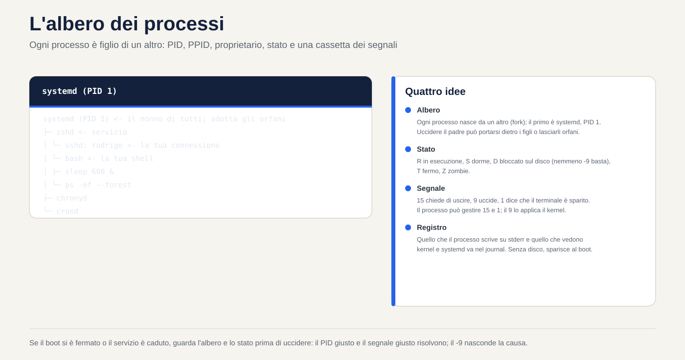
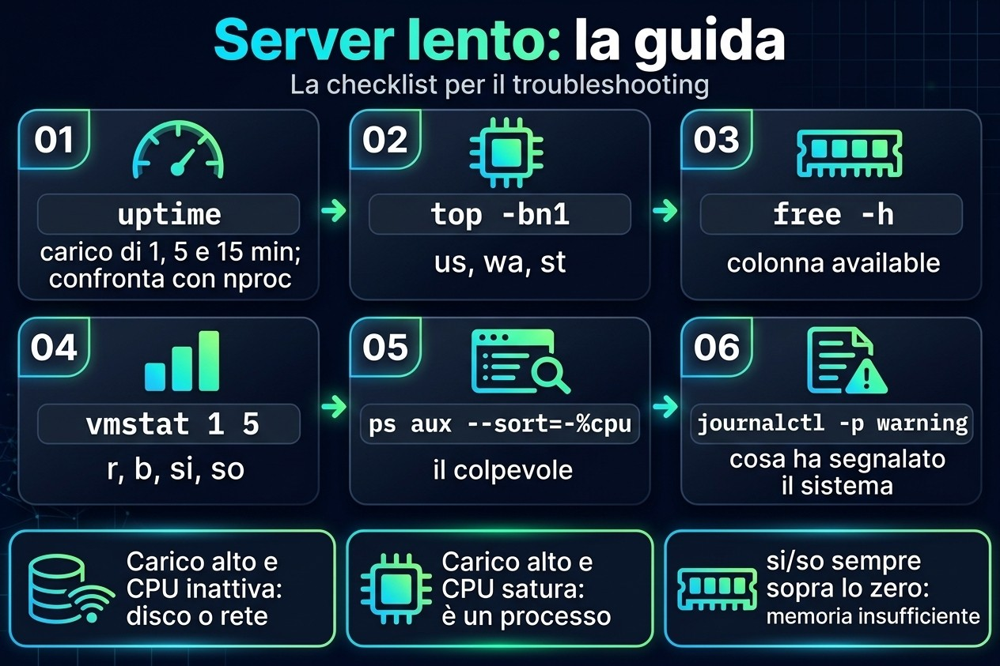

# Lezione 2.3 · Processi e log

Terza lezione del Modulo 2. Squilla il telefono: "il server è lento". È la frase più comune del supporto e la più vaga. Lento perché? Un processo che si mangia il processore? La memoria è finita e il sistema sta usando lo swap? Un disco ingolfato che tiene fermi tutti? Oggi impari a rispondere in cinque minuti, via SSH, senza riavviare niente: chi sta girando, quanto consuma ciascuno, come chiedere gentilmente a un programma di fermarsi e come costringerlo, e dove il sistema ha annotato cosa è successo prima del tuo arrivo. Alla fine sai leggere il journal come si legge la cartella clinica di un paziente.

| Scheda | Lezione 2.3 |
| --- | --- |
| Modulo | M2 · Sistema, utenti e permessi, lezione 3 di 8 |
| Quando | Settimana 4 |
| Alla fine sei in grado di | Elencare e filtrare i processi con `ps`, `pgrep` e `top`; leggere le colonne che contano (PID, PPID, `%CPU`, `%MEM`, `STAT`); spiegare cos'è il load average; inviare segnali con `kill` e sapere quando usare ciascuno; cambiare la priorità con `nice` e `renice`; eseguire lavori in background che sopravvivono al logout; trovare nel journal cosa è successo, quando e con chi; rendere permanente il journal |
| Prerequisiti | Lezione 2.2 (`free -h`, colonna `available`; `journalctl -k`); Lezioni 1.5 e 1.6 (`grep` e pipe) |
| Durata | Circa 2h |
| Snapshot | m2a3-inicio e m2a3-fim su entrambe le VM |

## 1 · Riscaldamento

Tre domande, a memoria. Scrivi le risposte; le Soluzioni le verificano in fondo.

1. In Windows, apri Gestione attività e clicchi su "Termina attività". Secondo te: il programma ha la possibilità di salvare ciò che stava facendo prima di chiudersi, o sparisce e basta?
2. Esegui uno script lungo via SSH, la tua connessione cade. Secondo te: lo script continua a girare sul server o muore insieme alla connessione?
3. `top` mostra `load average: 4.00`. Secondo te: è un bene, un male, o dipende da cosa?

## 2 · Perché conta

"È lento" e "si è fermato" sono metà dei ticket. Chi li risolve non è chi sa più comandi; è chi ha una scaletta e la segue sempre nello stesso ordine: carico → processore → memoria → disco → il processo colpevole → cosa dice il log. Con questa scaletta, arrivi sul server, esegui quattro comandi e dici al cliente cosa sta succedendo, prima che abbia finito di spiegare.

E c'è il riflesso che fa danni: `kill -9`. Il programma si è bloccato, l'amministratore manda il `-9`, il programma sparisce. Ma il database non ha avuto il tempo di scrivere ciò che aveva in memoria, il file di lock è rimasto lì, e il servizio non riparte più. Sapere la differenza tra chiedere di uscire e staccare la spina è ciò che separa risolvere dal creare il prossimo ticket.

Infine, il log. Quando il cliente dice "ieri sera è caduto", tu non c'eri. Il journal sì. Ma solo se viene scritto su disco: nella configurazione predefinita di Rocky, il journal sta in memoria e sparisce a ogni boot. Il "cos'è successo prima del riavvio?" muore insieme a lui. Oggi lo ripari su entrambe le VM.

## 3 · Modello mentale

> Ogni processo è un figlio. Ha un numero (PID), un padre (PPID), un proprietario, uno stato e una cassetta delle lettere per i segnali. Non comandi un processo; gli mandi una lettera.

```text
systemd (PID 1)                       ← o avô de todos; adota os órfãos
 ├─ sshd                              ← serviço
 │   └─ sshd: rodrigo                 ← a sua conexão
 │       └─ bash                      ← o seu shell
 │           ├─ sleep 600 &           ← um filho em segundo plano (job)
 │           └─ ps -ef --forest       ← o comando que você acabou de digitar
 ├─ chronyd
 └─ crond
```

Quattro idee reggono la lezione:

| Idea | Cosa significa | Conseguenza |
| --- | --- | --- |
| Albero | Ogni processo nasce da un altro (`fork`); il primo è `systemd`, PID 1 | Uccidere il padre può portarsi via i figli, o lasciarli orfani, adottati dal PID 1 |
| Stato | In esecuzione (`R`), addormentato in attesa di qualcosa (`S`), bloccato in attesa del disco (`D`), fermo (`T`), zombie (`Z`) | Un `D` non risponde a nessun segnale, nemmeno al `-9`: aspetta il disco |
| Segnale | Un messaggio numerato: 15 chiede di uscire, 9 uccide, 1 avvisa "il terminale è sparito" | Il processo può gestire il 15 e l'1; il 9 non arriva mai fino a lui, il kernel agisce direttamente |
| Registro | Tutto ciò che il processo scrive sullo standard error, e tutto ciò che il kernel e systemd vedono, va nel journal | Se non è stato scritto su disco, è sparito al boot |



*Ogni processo è figlio di un altro: PID, PPID, proprietario, stato e una cassetta dei segnali.*

## 4 · Concetto a strati

### Essenziale

**Vedere i processi.** Due stili di `ps` sono sopravvissuti nella pratica; impara a memoria uno per tipo:

```bash
ps aux                       # stile BSD: tutti, con %CPU, %MEM, proprietario
ps -ef                       # stile Unix: tutti, con PPID (il padre)
ps -ef --forest              # l'albero
ps -o pid,ppid,user,stat,%cpu,%mem,cmd -p 1234     # solo le colonne che vuoi, di un PID
```

| Colonna | Significa |
| --- | --- |
| `PID` | Il numero del processo; unico finché vive |
| `PPID` | Il numero del padre |
| `USER` | Il proprietario; è con i suoi permessi che il processo agisce (Lezione 2.7) |
| `%CPU` | Quanto del processore ha usato (media da quando è partito, in `ps`; adesso, in `top`) |
| `%MEM` e `RSS` | Quanta memoria fisica occupa |
| `STAT` | Lo stato: `R`, `S`, `D`, `T`, `Z`, più lettere di dettaglio (`s` = leader di sessione, `+` = in primo piano, `<` = priorità alta, `N` = priorità bassa) |
| `TTY` | Il terminale; `?` significa che non ce l'ha, come i servizi |

**Trovare un processo per nome.** `pgrep` risponde con il PID; anche `pidof`; `ps` con `grep` funziona, ma nella lista compare lo stesso `grep`:

```bash
pgrep -a sshd          # PID e riga di comando
pgrep -u rodrigo       # tutti i processi dell'utente
pidof chronyd
```

**Il pannello dal vivo: `top`.** Aprilo e impara cinque tasti: `P` ordina per processore, `M` per memoria, `1` mostra ogni core, `k` manda un segnale, `q` esce. Le prime cinque righe sono il riepilogo del server:

```text
top - 14:02:11 up 3 days,  2 users,  load average: 0.42, 0.30, 0.25   ← carga de 1, 5 e 15 minutos
Tasks: 128 total,   1 running, 127 sleeping,   0 stopped,   0 zombie
%Cpu(s):  2.0 us,  1.0 sy,  0.0 ni, 96.5 id,  0.5 wa,  0.0 hi,  0.0 si,  0.0 st
MiB Mem :   1967.4 total,    210.3 free,    612.9 used,   1144.2 buff/cache
MiB Swap:   2048.0 total,   2048.0 free,      0.0 used.   1354.5 avail Mem
```

Nella riga `%Cpu(s)`, tre numeri raccontano la storia: `us` (programmi al lavoro), `wa` (processore fermo **in attesa del disco**) e `st` (tempo che l'hypervisor ha rubato alla VM per darlo a un'altra). `id` alto e `wa` alto allo stesso tempo: il problema è il disco, non il processore.

**Il load average.** Il `load average` è il numero medio di processi che vogliono il processore o sono in attesa del disco (stati `R` e `D`). Confrontalo con il numero di core (`nproc`): carico 4 su una macchina da 4 core è pieno; su una da 16, è margine; su una da 1, è coda. I tre numeri, di 1, 5 e 15 minuti, dicono dove sta andando: `4.0, 2.0, 0.5` sta peggiorando adesso; `0.5, 2.0, 4.0` sta migliorando.

**Segnali.** `kill` non uccide: manda un segnale. Quelli che usi:

| Segnale | Numero | Cosa fa | Quando |
| --- | --- | --- | --- |
| `SIGTERM` | 15 | Chiede di terminare; il programma può salvare, chiudere i file, cancellare il file di lock | Sempre per primo. È il predefinito di `kill` |
| `SIGKILL` | 9 | Il kernel rimuove subito il processo; lui non lo sa | Solo dopo che il 15 è fallito e hai aspettato |
| `SIGHUP` | 1 | "Il terminale si è spento". Molti servizi lo interpretano come "rileggi la configurazione" | Ricaricare un servizio vecchio senza abbatterlo |
| `SIGINT` | 2 | Quello che manda `Ctrl+C` | Interrompere ciò che è nel terminale |
| `SIGSTOP` e `SIGCONT` | 19 e 18 | Congelare e scongelare; `Ctrl+Z` manda un cugino del 19, `SIGTSTP` | Mettere in pausa senza uccidere |

```bash
kill 1234              # manda il 15
kill -9 1234           # manda il 9
kill -l                # elenca tutti i segnali
pkill -u fulano sleep  # manda il 15 a tutti gli "sleep" di fulano
killall sleep          # manda il 15 a tutti gli "sleep", di chiunque
```

**Dove stanno i log.** Due fonti, che oggi convivono:

| Fonte | Cos'è | Come leggerla |
| --- | --- | --- |
| Journal di systemd | Database binario con tutto: kernel, servizi, login, con data, priorità e unit | `journalctl` |
| File in `/var/log` | Testo, scritto da `rsyslog` a partire dal journal, e da programmi che scrivono direttamente | `less`, `tail -f`, `grep` |

Su Rocky, `rsyslog` è installato e scrive `/var/log/messages` e `/var/log/secure` (login e `sudo`). Su Debian 13, non c'è: il journal è la fonte, e `/var/log` contiene poco oltre ai log di `apt` e `dpkg`.

### Intermedio

**`journalctl`, i filtri che risolvono.** Il journal è grande; il valore sta nel filtrare:

| Domanda | Comando |
| --- | --- |
| Cos'è successo in questo boot? | `journalctl -b` |
| E nel boot precedente, prima della caduta? | `journalctl -b -1` (solo se il journal è permanente) |
| Quali boot conosce il journal? | `journalctl --list-boots` |
| Solo un servizio | `journalctl -u sshd` (Rocky) oppure `-u ssh` (Debian) |
| Solo errori e peggio | `journalctl -p err` (livelli: `emerg`, `alert`, `crit`, `err`, `warning`, `notice`, `info`, `debug`) |
| In una finestra di tempo | `journalctl --since '2026-11-02 08:00' --until '09:30'`; oppure `--since '-1h'`, `--since yesterday` |
| Dal vivo | `journalctl -f` |
| Le ultime righe | `journalctl -n 50` |
| Di un programma, per nome | `journalctl -t sudo`; `journalctl _COMM=sshd` |
| Di un PID | `journalctl _PID=1234` |
| Senza paginazione, da usare con `grep` | `journalctl --no-pager` |
| Con la spiegazione dell'errore, quando esiste | `journalctl -xe` |

I filtri si sommano: `journalctl -u sshd -p warning --since today` sono "gli avvisi di SSH di oggi".

**Il journal che sparisce al boot.** `systemd-journald` scrive in `/var/log/journal/` **se la cartella esiste**; altrimenti scrive in `/run/log/journal/`, che sta in memoria e sparisce al boot. A decidere è l'opzione `Storage=` in `/etc/systemd/journald.conf`:

| `Storage=` | Comportamento |
| --- | --- |
| `auto` (il predefinito) | Scrive su disco se `/var/log/journal/` esiste; altrimenti, solo in memoria |
| `persistent` | Crea la cartella e scrive su disco |
| `volatile` | Solo in memoria |

Su Rocky 9, la cartella non esiste dopo l'installazione: il journal è volatile e `rsyslog` è quello che conserva lo storico in `/var/log/messages`. Su Debian 13, la cartella viene creata all'installazione e il journal è già permanente. Le verificherai entrambe nel lab, perché "il predefinito" cambia tra una versione e l'altra e conta ciò che c'è sulla macchina.

**Priorità: `nice` e `renice`.** Il *nice* va da `-20` (più priorità) a `19` (meno). Il predefinito è `0`. Un processo "gentile" (nice alto) cede il processore agli altri:

```bash
nice -n 10 tar czf /tmp/backup.tgz /etc     # parte già con nice 10
renice -n 15 -p 1234                        # ne cambia uno già in esecuzione
ps -o pid,ni,cmd -p 1234                    # verifica
```

Un utente comune può solo **aumentare** il nice dei propri processi (diventare più gentile). Diminuirlo, o toccare quelli degli altri, richiede root. In `top`, la colonna `NI` mostra il valore, e `PR` mostra la priorità che il kernel ha calcolato a partire da esso.

**Primo e secondo piano.** Nella shell, un comando con `&` alla fine gira in background, come un *job*:

| Comando | Cosa fa |
| --- | --- |
| `comando &` | Gira in background; la shell mostra `[1] 4321` (numero del job e PID) |
| `Ctrl+Z` | Mette in pausa ciò che è in primo piano |
| `jobs -l` | Elenca i job di questa shell |
| `bg %1` | Continua il job 1 in background |
| `fg %1` | Porta il job 1 in primo piano |
| `kill %1` | Manda il 15 al job 1 |

I job sono della **shell**: se la shell muore, manda `SIGHUP` ai figli, ed essi muoiono con lei. Per sopravvivere al logout:

| Modo | Come | Quando |
| --- | --- | --- |
| `nohup comando &` | Ignora `SIGHUP`; l'output va in `nohup.out` | Un comando isolato, facile da ricordare |
| `tmux` (o `screen`) | Una sessione di terminale che continua sul server; esci e torni con `tmux attach` | Il modo di tutti i giorni: aggiornamento lungo, copia grande |
| `systemd-run --user` o una unit di servizio | systemd si occupa del processo | Cose che devono girare sempre (Modulo 4) |

### Ponte Windows

| In Windows | In Linux | Cosa cambia |
| --- | --- | --- |
| Gestione attività, scheda Processi | `top`, `ps aux` | `top` funziona via SSH e mostra il load average, che Windows non mostra |
| "Termina attività" | `kill PID` (15) | Linux chiede prima; il programma può salutare |
| "Termina albero di processi" | `kill -9`, oppure `pkill -P PPID` per i figli |  |
| Priorità: "Sotto la norma" | `renice -n 10` | La scala è invertita: numero più alto, priorità più bassa |
| Visualizzatore eventi | `journalctl` | Filtri da riga di comando invece di clic |
| Log di Applicazioni, Sistema, Sicurezza | `journalctl -u serviço`, `journalctl -k`, `/var/log/secure` o `journalctl -t sudo` |  |
| Attività che continua dopo il logoff | `tmux`, `nohup`, o un servizio |  |

### Avanzato

**`/proc/PID/`, il processo dall'interno.** Ogni processo ha una cartella: `/proc/1234/cmdline` (la riga di comando), `/proc/1234/status` (stato, memoria, proprietario), `/proc/1234/fd/` (i file aperti, come link), `/proc/1234/cwd` (la cartella in cui si trova). `ps` e `top` leggono da lì. Quando un disco è pieno e non trovi il file, `ls -l /proc/*/fd 2>/dev/null | grep deleted` mostra il file cancellato che un processo tiene ancora aperto: lo spazio torna solo quando il processo lo chiude.

**Zombie e orfano.** Un processo terminato resta nella tabella come `Z` finché il padre non legge il suo codice di uscita. Uno zombie non consuma processore né memoria, solo una riga nella tabella; è inutile mandargli `kill`, perché è già morto. A risolvere è il padre: o legge, o muore, e allora `systemd` lo adotta e fa pulizia. Un **orfano** è il contrario: il padre è morto e il figlio continua vivo, adottato dal PID 1.

**Lo stato `D`.** Un processo in `D` (*uninterruptible sleep*) è dentro il kernel in attesa del disco o della rete (un NFS caduto, per esempio). Nessun segnale lo tira fuori da lì, nemmeno il 9. Se ne vedi diversi in `D` e il carico alto con il processore fermo, il problema è nello storage. Riavviare il server può perfino bloccarsi allo spegnimento a causa loro.

**`systemd-cgls` e `systemd-cgtop`.** systemd raggruppa i processi di ogni servizio in un *cgroup*. `systemd-cgls` mostra l'albero per servizio; `systemd-cgtop` mostra il consumo per servizio, e non per processo. Su un server con un servizio che apre cento processi, è lì che vedi chi è il colpevole.

**`sudo journalctl` × gruppi.** Senza `sudo`, `journalctl` mostra solo i messaggi dell'utente stesso. I membri del gruppo `wheel` (Rocky), `adm` (Debian) o `systemd-journal` (entrambi) leggono tutto senza `sudo`.

## 5 · Rocky × Debian

| Cosa | Rocky 9 | Debian 13 |
| --- | --- | --- |
| Journal su disco dopo l'installazione | No: `/var/log/journal/` non esiste, journal volatile | Sì: la cartella esiste e il journal è permanente |
| `rsyslog` | Installato e attivo; scrive `/var/log/messages` e `/var/log/secure` | Non installato; il journal è la fonte |
| Log di login e `sudo` in testo | `/var/log/secure` | Non c'è; usa `journalctl -t sudo` e `journalctl -u ssh` |
| Nome della unit di SSH | `sshd` | `ssh` |
| Chi legge tutto il journal senza `sudo` | Gruppi `wheel` e `systemd-journal` | Gruppi `adm` e `systemd-journal` |
| `tmux` | `dnf install tmux` | `apt install tmux` |
| `pstree` | Pacchetto `psmisc`, in genere installato | Pacchetto `psmisc`, può mancare |
| `killall` | Pacchetto `psmisc` | Pacchetto `psmisc` |

## 6 · Lab guidato

Fai tutto prima su rocky-lab e ripeti su debian-lab. Dove Debian cambia, il passo avvisa. Apri **due** terminali SSH sulla stessa VM: il terminale 1 per creare i processi, il terminale 2 per osservare.


*Segui dal primo al sesto passo, senza saltare.*


### Passo 0 · Snapshot

Su Proxmox, fai lo snapshot `m2a3-inicio` di entrambe le VM. Se qualcosa va molto male, torni qui.

### Passo 1 · Il tuo albero

Nel terminale 1:

```bash
echo $$                          # il PID della tua shell
ps -o pid,ppid,user,stat,cmd -p $$
ps -ef --forest | grep -B3 -A1 "$$"
```

Segui il `PPID` verso l'alto: il tuo `bash` è figlio di un `sshd: rodrigo`, che è figlio di un altro `sshd`, che è figlio di `systemd`, PID 1. Ora verifica il nonno:

```bash
ps -o pid,user,cmd -p 1
nproc                            # quanti core ha la VM
uptime                           # da quanto tempo è accesa e il carico
```

Annota `nproc`. Ti servirà per leggere il carico fra poco.

### Passo 2 · Primo e secondo piano

Ancora nel terminale 1:

```bash
sleep 600 &                      # [1] e un PID
sleep 700                        # questo blocca il terminale
```

Il secondo `sleep` ha bloccato il terminale. Premi `Ctrl+Z`. La shell risponde `[2]+ Stopped`. Ora:

```bash
jobs -l                          # l'1 in esecuzione, il 2 fermo
ps -o pid,stat,cmd -C sleep      # quello fermo compare con STAT T
bg %2                            # il 2 riprende a girare, in background
jobs -l
fg %1                            # porta l'1 in primo piano
```

Il terminale è di nuovo bloccato, ora su `sleep 600`. Premi `Ctrl+C`: riceve `SIGINT` e termina. Pulisci l'altro:

```bash
kill %2
jobs -l                          # vuoto
```

**Decidi 1 · Il terminale bloccato.** Hai lanciato via SSH una copia che durerà un'ora, senza `&`. Il terminale è bloccato e ti serve. Cosa fai senza perdere la copia?

- **A)** `Ctrl+C` e la rilanci con `&` alla fine.
- **B)** `Ctrl+Z` e poi `bg`.
- **C)** Apri un altro terminale e mandi `kill -STOP` alla copia.
- **D)** Chiudi la finestra SSH; la copia continua da sola.

Scegli un'opzione prima di continuare.

| Se hai scelto | Risultato | Perché |
| --- | --- | --- |
| A | ❌ Sbagliato | `Ctrl+C` interrompe la copia, e ricominci da zero. |
| B | ✅ Giusto | `Ctrl+Z` mette in pausa e restituisce il terminale; `bg` fa continuare la copia in background, dal punto in cui era. |
| C | ❌ Sbagliato | `SIGSTOP` congela la copia, ma il terminale 1 resta bloccato in attesa di lei. Hai solo cambiato problema. |
| D | ❌ Sbagliato | Quando la connessione cade, la shell riceve `SIGHUP` e lo inoltra ai figli. La copia muore. Il Passo 5 lo mostra dal vivo. |

**Da ricordare:** `Ctrl+Z`, `bg`. E, se deve sopravvivere al logout, questo non basta ancora: vedi il Passo 5.

### Passo 3 · Fare rumore e trovare il colpevole

Nel terminale 1, crea un processo che si mangia un core intero:

```bash
yes > /dev/null &
```

Nel terminale 2, apri `top`. Premi `P` (ordina per processore). `yes` va in cima, vicino al 100%. Premi `1` per vedere i core separati: uno è pieno. Nota la riga `%Cpu(s)`: `us` è salito. Aspetta un minuto e guarda il carico: il primo numero si avvicina a 1.

Esci con `q` e verifica la stessa cosa senza pannello, nel modo in cui lo incolli in un ticket:

```bash
uptime
ps aux --sort=-%cpu | head -5
top -bn1 | head -12              # una fotografia di top, in testo
```

Ora abbassa la sua priorità. Nel terminale 2, come il tuo utente:

```bash
PID=$(pgrep -x yes)
ps -o pid,ni,pri,cmd -p $PID     # NI 0
renice -n 10 -p $PID
ps -o pid,ni,pri,cmd -p $PID     # NI 10
renice -n 0 -p $PID              # prova a tornare indietro
```

L'ultimo `renice` fallisce con `Permission denied`. Sei riuscito a diventare più gentile, ma non riesci a tornare indietro senza essere root.

**Decidi 2 · Chi può cosa.** Un utente comune esegue un processo con nice `10`. Quale di queste cose riesce a fare da solo?

- **A)** `renice -n 5` (tornare a 5)
- **B)** `renice -n 15`
- **C)** `renice -n -5`
- **D)** `renice -n 15` su un processo di un altro utente

Scegli un'opzione prima di continuare.

| Se hai scelto | Risultato | Perché |
| --- | --- | --- |
| A | ❌ Sbagliato | Abbassare il nice significa chiedere più priorità. Un utente comune può solo salire. |
| B | ✅ Giusto | Alzare il nice del proprio processo è sempre permesso: sta cedendo il posto agli altri. |
| C | ❌ Sbagliato | Un nice negativo è priorità superiore al normale, solo root. |
| D | ❌ Sbagliato | Il processo di un altro utente, solo root, anche solo per renderlo più gentile. |

**Da ricordare:** nice più alto, priorità più bassa. L'utente comune può solo salire, e solo sui propri processi.

Termina `yes` nel modo educato e verifica:

```bash
kill $PID
pgrep -x yes; echo "rc=$?"       # rc=1: non ce n'è più nessuno
```

### Passo 4 · Chiedere di uscire e staccare la spina

Crea un "servizio" finto che si comporta come uno vero: scrive un file di lock quando parte, si rifiuta di partire se il lock esiste e cancella il lock quando riceve `SIGTERM`.

```bash
cat > ~/lab-servico.sh <<'EOF'
#!/bin/bash
TRAVA=/tmp/lab-servico.lock
if [ -e "$TRAVA" ]; then
  echo "ERRO: já está rodando (PID $(cat "$TRAVA")). Saindo." >&2
  logger -t lab-servico "recusei subir: trava $TRAVA existe"
  exit 1
fi
echo $$ > "$TRAVA"
trap 'logger -t lab-servico "TERM recebido, trava removida"; rm -f "$TRAVA"; exit 0' TERM
logger -t lab-servico "iniciado, PID $$"
while true; do sleep 2; done
EOF
chmod +x ~/lab-servico.sh
```

Nel terminale 1:

```bash
~/lab-servico.sh &
cat /tmp/lab-servico.lock        # il suo PID
```

Nel terminale 2, segui cosa dice:

```bash
journalctl -t lab-servico -f
```

Nel terminale 1, manda `SIGTERM`:

```bash
kill $(cat /tmp/lab-servico.lock)
ls /tmp/lab-servico.lock         # No such file
```

Il terminale 2 ha mostrato `TERM recebido, trava removida`, un paio di secondi dopo il `kill`. Quel ritardo è il programma che finisce ciò che stava facendo (lo `sleep 2`) prima di gestire il segnale. È ciò che fa un database per scrivere quello che aveva in memoria. Lascia aperto il terminale 2; userai di nuovo il lock nel Guasto B.

**Decidi 3 · I secondi di attesa.** Mandi `kill` a un servizio e non sparisce subito. Cosa fai?

- **A)** Mandi subito `kill -9`: si è bloccato.
- **B)** Aspetti qualche secondo e controlli con `ps -p PID`; solo se è ancora vivo dopo un tempo ragionevole, `kill -9`.
- **C)** Riavvii il server.
- **D)** Mandi `kill -1`, che è più forte del 15.

Scegli un'opzione prima di continuare.

| Se hai scelto | Risultato | Perché |
| --- | --- | --- |
| A | ❌ Sbagliato | Il programma si sta congedando: scrive, chiude, cancella il lock. Il `-9` lo interrompe a metà e lascia sporcizia. |
| B | ✅ Giusto | Il 15 è una richiesta. Dai tempo. `systemctl stop` fa esattamente questo: manda il 15, aspetta 90 secondi per impostazione predefinita, e solo allora manda il 9. |
| C | ❌ Sbagliato | Riavviare manda il 15 a tutti, anche a lui, e abbatte tutto il resto insieme. |
| D | ❌ Sbagliato | L'1 non è "più forte"; è un altro messaggio ("il terminale è sparito", o "rileggi la configurazione"). Molti servizi non terminano nemmeno con lui. |

**Da ricordare:** 15, aspetta, verifica; solo allora 9. È ciò che fa lo stesso systemd.

### Passo 5 · Sopravvivere alla caduta della connessione

Ora il test che risponde alla domanda 2 del Riscaldamento. Nel terminale 1:

```bash
sleep 901 &                      # un job comune
nohup sleep 902 > /dev/null 2>&1 &   # un job immune a SIGHUP
pgrep -a sleep
kill -HUP $$                     # simula la caduta: la tua shell riceve SIGHUP
```

La connessione del terminale 1 si chiude, come se la rete fosse caduta. Nel terminale 2:

```bash
pgrep -a sleep
```

Solo `sleep 902` è sopravvissuto. Quando la shell riceve `SIGHUP`, lo inoltra a ogni job, e `sleep 901` è morto. `nohup` ha fatto ignorare quel segnale al `902`, che è stato adottato da `systemd`: controlla il suo padre.

```bash
ps -o pid,ppid,cmd -p $(pgrep -f 'sleep 902')
```

Il `PPID` non è più la tua shell, che è morta: è `systemd --user` oppure il PID 1. Un dettaglio che inganna: se esci digitando `exit`, Bash, per impostazione predefinita, **non** manda `SIGHUP` ai job, e `sleep 901` sopravviverebbe. Ciò che uccide è la caduta, non l'`exit`. Per questo il test ha usato la caduta.

Ora il modo di tutti i giorni. Installa `tmux` (`sudo dnf install -y tmux` su Rocky, `sudo apt install -y tmux` su Debian), riconnetti il terminale 1 e:

```bash
tmux new -s lab
sleep 903                        # dentro tmux, comunque in primo piano
```

Premi `Ctrl+B` e poi `D` (da *detach*). Esci da tmux e `sleep 903` continua lì dentro. Simula di nuovo la caduta con `kill -HUP $$`, riconnetti e:

```bash
tmux ls                          # la sessione "lab" c'è ancora
tmux attach -t lab               # ci rientri, con lo sleep ancora in esecuzione
```

Premi `Ctrl+C` per terminare lo `sleep`, esci da tmux con `exit` e pulisci l'altro: `pkill -f 'sleep 902'`.

### Passo 6 · Leggere il journal

Scrivi un tuo messaggio e ritrovalo:

```bash
logger -t lab-aula23 "teste de leitura do journal"
journalctl -t lab-aula23
```

Se qualche `journalctl` di questa lezione risulta vuoto o avvisa che non vedi i messaggi degli altri, il tuo utente non è in un gruppo che legge tutto il journal (vedi Avanzato). Ripeti con `sudo` e annota nel diario in quale gruppo si trova `rodrigo`: `id rodrigo`.

Ora i filtri che userai ogni settimana. Eseguine uno alla volta e leggi l'output:

```bash
journalctl -b -n 20                         # la fine di questo boot
journalctl -u sshd --since today            # su Debian: -u ssh
journalctl -p err -b                        # solo errori e peggio, in questo boot
journalctl -t sudo --since '-1h'            # chi ha usato sudo nell'ultima ora
journalctl --since '-10min' -o short-precise   # con i millisecondi
journalctl -t lab-servico -o verbose -n 1   # tutti i campi di una riga
```

L'ultimo mostra che ogni riga del journal è un record con dei campi: `_PID`, `_UID`, `_COMM`, `_SYSTEMD_UNIT`, `_BOOT_ID`. È su questi campi che filtrano `-u`, `-t` e `_PID=`.

Su Rocky, confronta con il file di testo:

```bash
sudo tail -5 /var/log/messages
sudo grep lab-aula23 /var/log/messages
sudo tail -5 /var/log/secure                # login e sudo
```

Su Debian, i due file non esistono: conferma con `ls /var/log/messages /var/log/secure`.

### Passo 7 · Il journal sopravvive al boot?

```bash
ls -ld /var/log/journal /run/log/journal 2>&1
journalctl --list-boots
journalctl --disk-usage
```

Se `/var/log/journal` non esiste e `--list-boots` mostra una sola riga, anche con la VM già riavviata prima, il journal è volatile. Il risultato atteso è volatile su Rocky e permanente su Debian, ma conta ciò che ha mostrato la tua macchina.

**Decidi 4 · Renderlo permanente.** Su Rocky, vuoi che il journal sopravviva al boot, in un modo che un aggiornamento del pacchetto `systemd` non annulli. Cosa fai?

- **A)** Modificare `/usr/lib/systemd/journald.conf` e mettere `Storage=persistent`.
- **B)** Creare `/etc/systemd/journald.conf.d/50-lab.conf` con `[Journal]` e `Storage=persistent`, e riavviare `systemd-journald`.
- **C)** `sudo cp -r /run/log/journal /var/log/`.
- **D)** Installare `rsyslog`: conserva già tutto.

Scegli un'opzione prima di continuare.

| Se hai scelto | Risultato | Perché |
| --- | --- | --- |
| A | ❌ Sbagliato | I file in `/usr/lib` appartengono al pacchetto; il prossimo aggiornamento può sovrascriverli. La regola è la stessa della Lezione 2.2 con udev: l'amministratore scrive in `/etc`. |
| B | ✅ Giusto | Un file in `/etc/systemd/journald.conf.d/` è tuo, sopravvive agli aggiornamenti e mostra la modifica in un solo posto. Anche modificare direttamente `/etc/systemd/journald.conf` funziona, e lo troverai su molti server. |
| C | ❌ Sbagliato | Hai copiato ciò che esisteva già, ma journald continua a scrivere in memoria. Al prossimo boot, niente di nuovo è finito su disco. |
| D | ❌ Sbagliato | `rsyslog` è già installato su Rocky e conserva il testo. Ma `journalctl -b -1`, con i filtri per unit e priorità, resta vuoto. |

**Da ricordare:** `Storage=persistent` in un file di `/etc/systemd/journald.conf.d/`, riavviare journald, verificare con `--list-boots` dopo un boot.

Fallo su entrambe le VM, anche se Debian è già permanente: così è esplicito, e un cambio di impostazione predefinita in futuro non cambia il tuo server.

```bash
sudo mkdir -p /etc/systemd/journald.conf.d
printf '[Journal]\nStorage=persistent\n' | sudo tee /etc/systemd/journald.conf.d/50-lab.conf
sudo systemctl restart systemd-journald
ls -ld /var/log/journal
journalctl --disk-usage
```

La cartella `/var/log/journal` ha iniziato a esistere. Riavvia la VM (`sudo systemctl reboot`), riconnettiti e:

```bash
journalctl --list-boots          # ora due righe, o più
journalctl -b -1 -n 5            # la fine del boot precedente: lo spegnimento
```

Hai appena letto cosa è successo prima del riavvio. È questo che il cliente vuole sapere quando dice "ieri sera è caduto".

### Passo 8 · La scaletta "è lento"

Metti tutto insieme in una scaletta di cinque comandi ed eseguila in ordine. Adesso non c'è niente che non va nelle VM; l'obiettivo è sapere cosa è normale per loro, per riconoscere l'anomalia dopo.

```bash
uptime                                       # 1. il carico, confrontato con nproc
top -bn1 | head -5                           # 2. us, wa, st nella riga %Cpu
free -h                                      # 3. la colonna available
vmstat 1 5                                   # 4. r (coda), b (bloccati in D), si/so (swap), wa
ps aux --sort=-%cpu | head -5                # 5. il colpevole del processore
ps aux --sort=-%mem | head -5                #    e quello della memoria
journalctl -p warning --since '-1h' --no-pager | tail -20   # 6. di cosa si è lamentato il sistema
```

In `vmstat`, la prima riga è la media dal boot; leggi dalla seconda in poi. Le colonne che contano: `r` (processi che vogliono il processore), `b` (bloccati in `D`), `si` e `so` (memoria che va e viene dallo swap: sopra zero in continuazione è segno di memoria scarsa) e `wa`.

Copia l'output dei sei comandi di entrambe le VM nel tuo diario, con la data. È la tua linea di base.

## 7 · Rompi e ripara

### Guasto A · Il disco pieno che nessuno trova

La richiesta: "il disco è pieno, ma abbiamo cancellato il file grande e non ha liberato niente". Riproduci su rocky-lab. Nel terminale 1:

```bash
df -h /var/tmp
dd if=/dev/zero of=/var/tmp/lab-grande.log bs=1M count=200
sleep 3600 < /var/tmp/lab-grande.log &      # un processo che tiene il file aperto
rm /var/tmp/lab-grande.log
```

**Osserva.**

```bash
df -h /var/tmp                    # i 200 MB risultano ancora occupati
sudo du -sh /var/tmp              # ma la cartella non contiene quasi niente
ls -l /var/tmp/lab-grande.log     # No such file
```

`df` dice che lo spazio è occupato; `du` non trova chi lo occupa. Hanno ragione entrambi.

**Diagnosi.** In Linux, `rm` non cancella il contenuto; cancella il **nome**. Il contenuto viene liberato solo quando nessun nome punta a esso **e** nessun processo lo tiene aperto. `du` somma i nomi che trova; `df` chiede al file system quanto è occupato. Chi tiene il file? La cartella `/proc/PID/fd/` di ogni processo mostra i file aperti, e il kernel marca quelli cancellati con `(deleted)`:

```bash
sudo find /proc/[0-9]*/fd -lname '*(deleted)' -printf '%p -> %l\n' 2>/dev/null | grep -v memfd
```

Una riga indica `/var/tmp/lab-grande.log (deleted)`, e il numero a metà percorso è il PID dello `sleep`. Se `lsof` è installato, `sudo lsof +L1` mostra lo stesso, con il nome del programma. Nel mondo reale, quel processo è un servizio che scrive in un log che qualcuno ha cancellato a mano, invece di usare `logrotate`.

**Decidi A · La riparazione.** Cosa libera lo spazio?

- **A)** Terminare o riavviare il processo che tiene il file.
- **B)** Riavviare il server.
- **C)** Rieseguire `rm -f /var/tmp/lab-grande.log`, con `-f`.
- **D)** Eseguire `fsck` sul file system.

Scegli un'opzione prima di continuare.

| Se hai scelto | Risultato | Perché |
| --- | --- | --- |
| A | ✅ Giusto | Quando il processo chiude il file, il kernel vede che non restano né nomi né lettori e libera subito i blocchi. In un servizio vero, `systemctl restart` su di esso. |
| B | ⚠️ Funziona, ma | Lo spazio torna, perché tutti i processi si chiudono. Solo che hai abbattuto l'intero server per risolvere un processo. |
| C | ❌ Sbagliato | Non c'è più un nome da cancellare. `rm` risponde che il file non esiste, con o senza `-f`. |
| D | ❌ Sbagliato | Non c'è nessun errore nel file system: sta facendo esattamente ciò che deve. E `fsck` su un file system montato è pericoloso. |

**Da ricordare:** `df` pieno e `du` vuoto = file cancellato e ancora aperto. `/proc/*/fd` o `lsof +L1` mostrano chi lo tiene.

**Ripara.**

```bash
kill %1                           # oppure il PID che find ha mostrato
df -h /var/tmp                    # i 200 MB sono tornati
```

Quando il processo non può essere riavviato (un database in pieno orario di lavoro, per esempio), c'è un trucco d'emergenza: svuotare il file tramite il percorso in `/proc`, con `sudo truncate -s 0 /proc/PID/fd/N`. Il processo continua ad avere il file aperto, ma ora vuoto. Usalo con cautela, e solo sui log: su un file di dati, hai appena cancellato i dati.

### Guasto B · Il servizio che non riparte dopo il kill -9

La richiesta: "il servizio si è bloccato, l'ho ucciso e ora non riparte più". Usa `lab-servico.sh` del Passo 4. Nel terminale 2, lascia aperto il journal:

```bash
journalctl -t lab-servico -f
```

Nel terminale 1, avvia il servizio e uccidilo nel modo sbagliato:

```bash
~/lab-servico.sh &
kill -9 $(cat /tmp/lab-servico.lock)
~/lab-servico.sh &
```

**Osserva.**

```bash
jobs -l
cat /tmp/lab-servico.lock
```

Il secondo avvio è fallito con `ERRO: já está rodando`. Il journal mostra `iniciado` e subito dopo `recusei subir`, ma nessun `TERM recebido`: il programma non ha mai saputo che stava per morire.

**Diagnosi.** `SIGKILL` non viene consegnato al programma: il kernel lo rimuove direttamente. Il `trap` che cancellava il lock non è mai girato, e il lock è rimasto con il PID di un processo morto. Verifica che nessuno abbia quel PID:

```bash
PIDVELHO=$(cat /tmp/lab-servico.lock)
ps -p "$PIDVELHO" -o pid,cmd; echo "rc=$?"     # rc=1: non esiste
pgrep -af lab-servico; echo "rc=$?"           # nessun lab-servico in esecuzione
```

È lo stesso che succede con `dnf` ("waiting for lock"), con un PostgreSQL che lascia il `postmaster.pid`, con qualsiasi servizio che usa un file di PID.

**Decidi B · La riparazione.** Cosa fai?

- **A)** Verificare che il PID del lock non esista più, cancellare il lock e avviare il servizio.
- **B)** Mandare di nuovo `kill -9` al PID del lock.
- **C)** Cancellare il lock direttamente, senza controllare niente, e avviare.
- **D)** Riavviare il server per pulire `/tmp`.

Scegli un'opzione prima di continuare.

| Se hai scelto | Risultato | Perché |
| --- | --- | --- |
| A | ✅ Giusto | Il lock esiste per impedire due copie. Hai dimostrato che non c'è nessuna copia; ora è spazzatura e può andare. |
| B | ❌ Sbagliato | Non c'è nessun processo con quel numero. `kill` risponde `No such process`. Peggio: se il numero è già stato riusato da un altro processo, hai appena ucciso un innocente. |
| C | ⚠️ Funziona, ma | Oggi funziona. Il giorno in cui il servizio sarà davvero in esecuzione e "solo lento", ne avvierai una seconda copia sopra la prima, ed entrambe scriveranno sugli stessi dati. |
| D | ❌ Sbagliato | Abbatte tutto per cancellare un file. E non sempre risolve: su Debian 13 `/tmp` viene pulito al boot, su Rocky resta sul disco e il lock sopravvive. |

**Da ricordare:** dopo un `kill -9`, cerca la sporcizia: lock, PID, file temporanei. Verifica che il proprietario sia morto prima di pulire.

**Ripara.**

```bash
ps -p "$(cat /tmp/lab-servico.lock)" > /dev/null || rm -f /tmp/lab-servico.lock
~/lab-servico.sh &
kill %1                           # ora nel modo giusto
ls /tmp/lab-servico.lock          # No such file: il lock se n'è andato con lui
```

Il journal, nel terminale 2, mostra `iniciado` e `TERM recebido, trava removida`. Il ciclo si è chiuso pulito.

### La lezione

I due guasti sono lo stesso tipo di problema: **l'effetto continua dopo che la causa è sparita dalla vista**. Il file cancellato continuava a occupare il disco perché un processo lo teneva. Il lock continuava a bloccare perché il processo che doveva cancellarlo è stato strappato dalla presa. Nei processi, ciò che vedi con `ls` non è lo stato intero: il resto sta in `/proc`, nel journal e nei file che i programmi si lasciano dietro. L'abitudine di questa lezione: **prima di uccidere, chiedi cosa tiene il processo; dopo aver ucciso, controlla cosa ha lasciato**.

## 8 · Trappole

| Cosa digiti o vedi | Cosa succede | Come evitarla |
| --- | --- | --- |
| `kill -9` come primo tentativo | Il programma non scrive, non chiude, non pulisce il lock | `kill PID`, aspettare, verificare; `-9` solo alla fine |
| `kill` su un processo in stato `D` | Niente: nemmeno il 9 lo tira fuori da lì | Indagare il disco o la rete che sta aspettando (`dmesg`, `journalctl -k`) |
| `kill` su uno zombie (`Z`) | Niente: è già morto | Occuparsi del padre: riavviare il servizio che lo ha creato |
| `ps aux \| grep nginx` | Nella lista compare lo stesso `grep` | `pgrep -a nginx`, oppure `ps aux \| grep [n]ginx` |
| `killall` senza pensarci | Uccide tutti i processi con quel nome, di tutti gli utenti (come root) | `pkill -u usuario nome`, oppure il PID |
| `load average: 4.00` e la conclusione "è sovraccarico" | Dipende dai core | Confrontare con `nproc` |
| Carico alto e `%Cpu` quasi fermo | Non è il processore: è disco o rete (`wa` alto, processi in `D`) | `vmstat 1`, colonna `b`; `top`, riga `wa` |
| `comando &` e chiudere l'SSH | Il job muore con la caduta | `nohup`, `tmux` o un servizio |
| `renice -n -5` come utente comune | `Permission denied` | Solo root abbassa il nice |
| `journalctl -b -1` dà `Specified boot ID not found` | Il journal è volatile: il boot precedente non è stato conservato | `Storage=persistent` |
| Modificare `/usr/lib/systemd/journald.conf` | L'aggiornamento sovrascrive | `/etc/systemd/journald.conf.d/*.conf` |
| `journalctl` senza filtro | Migliaia di righe, ti arrendi | `-u`, `-p`, `--since`, `-t`, `-b` |
| `rm` sul log gigante di un servizio in esecuzione | Lo spazio non torna | Riavviare il servizio, oppure `truncate -s 0` sul file **prima** di cancellarlo |
| `journalctl -u sshd` su Debian | Vuoto | Su Debian la unit è `ssh` |

## 9 · Quiz

Dieci domande, senza consultare. Scrivi la lettera o la risposta di ciascuna e solo dopo apri le Soluzioni.

**1.** Quale segnale manda `kill` quando non ne specifichi nessuno?

- **A)** `SIGKILL` (9)
- **B)** `SIGHUP` (1)
- **C)** `SIGTERM` (15)
- **D)** `SIGINT` (2)

**2.** Una VM con 2 core mostra `load average: 6.10, 3.20, 1.05`. Cosa dici sul carico, adesso e nella tendenza?

**3.** Quale comando mostra solo gli errori e peggio del boot attuale?

- **A)** `journalctl -b -p err`
- **B)** `journalctl --errors`
- **C)** `journalctl -b -1`
- **D)** `journalctl -k`

**4.** `df` mostra il disco pieno al 100%, ma `du` sulla root somma molto meno. Qual è la causa più probabile, e con quale comando la confermi?

**5.** Quale intervallo di valori accetta il *nice*, e quale dà più priorità?

- **A)** Da 0 a 99; 99 è più priorità
- **B)** Da -20 a 19; -20 è più priorità
- **C)** Da -20 a 19; 19 è più priorità
- **D)** Da 1 a 10; 10 è più priorità

**6.** Esegui `tar` via SSH, la connessione cade, e `tar` è morto. Cita due modi di rieseguirlo perché sopravviva alla prossima caduta.

**7.** In un `ps aux`, un processo compare con `STAT` uguale a `Z`. Cos'è, e perché `kill -9` non serve?

**8.** Dove metti la configurazione per rendere permanente il journal, in un modo che l'aggiornamento del pacchetto non annulli?

- **A)** `/usr/lib/systemd/journald.conf`
- **B)** `/etc/systemd/journald.conf.d/50-meu.conf`
- **C)** `/var/log/journal/journald.conf`
- **D)** `/run/systemd/journald.conf`

**9.** Scrivi un comando che mostri i messaggi del servizio `sshd` dalle 8 di oggi.

**10.** *A process is in state `D` and ignores `kill -9`. What does the `D` state mean?*

- **A)** *The process is a daemon and is protected from signals*
- **B)** *The process has been stopped by `SIGSTOP`*
- **C)** *The process is in uninterruptible sleep, waiting for I/O inside the kernel*
- **D)** *The process is dead and waiting for its parent to collect the exit status*

## 10 · Flashcard e promemoria

### Da sapere a memoria

- La scaletta "è lento": `uptime` → `top` (us, wa, st) → `free -h` → `vmstat 1 5` → `ps aux --sort=-%cpu` → `journalctl -p warning`.
- Il load average si confronta con `nproc`. Carico alto con processore fermo è disco.
- `kill` manda il 15. Aspetta, verifica, e solo allora il 9.
- Il nice va da `-20` (più priorità) a `19` (meno). L'utente comune può solo salire, e solo sui propri processi.
- Il job muore alla caduta della connessione; `nohup` e `tmux` sopravvivono.
- Journal permanente: `Storage=persistent` in `/etc/systemd/journald.conf.d/`, riavviare journald, verificare con `--list-boots`.
- `df` pieno e `du` vuoto: file cancellato e ancora aperto.

### Da consultare

| Domanda | Comando |
| --- | --- |
| Tutti i processi, con proprietario e consumo | `ps aux` |
| Con il padre, ad albero | `ps -ef --forest`; `pstree -p` |
| Colonne scelte | `ps -o pid,ppid,user,stat,ni,%cpu,%mem,cmd -p PID` |
| Quelli che consumano di più | `ps aux --sort=-%cpu \| head`; `ps aux --sort=-%mem \| head` |
| PID dal nome | `pgrep -a nome`; `pidof nome` |
| Pannello dal vivo | `top` (`P`, `M`, `1`, `k`, `q`); fotografia in testo: `top -bn1` |
| Carico e core | `uptime`; `nproc` |
| Coda, swap e attesa del disco | `vmstat 1 5` |
| Chiedere di uscire | `kill PID`; `pkill -u usuario nome` |
| Staccare la spina | `kill -9 PID` |
| Ricaricare la configurazione (servizio vecchio) | `kill -HUP PID` |
| Priorità | `nice -n 10 comando`; `renice -n 10 -p PID` |
| Job | `comando &`, `Ctrl+Z`, `jobs -l`, `bg %1`, `fg %1`, `kill %1` |
| Sopravvivere al logout | `nohup comando &`; `tmux new -s nome`, `Ctrl+B D`, `tmux attach -t nome` |
| File aperti di un processo | `ls -l /proc/PID/fd`; `lsof -p PID` |
| Cancellati e ancora aperti | `sudo lsof +L1`; `sudo find /proc/[0-9]*/fd -lname '*(deleted)'` |
| Consumo per servizio | `systemd-cgtop`; albero: `systemd-cgls` |
| Journal di questo boot, del precedente, l'elenco | `journalctl -b`; `journalctl -b -1`; `journalctl --list-boots` |
| Per servizio, priorità, tempo | `journalctl -u sshd -p warning --since '-1h'` |
| Per programma o PID | `journalctl -t sudo`; `journalctl _PID=1234` |
| Dal vivo | `journalctl -f`; `journalctl -u nome -f` |
| Scrivere nel journal | `logger -t etiqueta "mensagem"` |
| Spazio del journal | `journalctl --disk-usage`; pulire: `sudo journalctl --vacuum-time=30d` |
| Log in testo (Rocky) | `/var/log/messages`, `/var/log/secure` |

### Flashcard

| Fronte | Retro |
| --- | --- |
| PID × PPID | Il numero del processo × il numero di suo padre |
| Chi è il PID 1? | `systemd`: padre di tutti e chi adotta gli orfani |
| `STAT` `R`, `S`, `D`, `T`, `Z` | In esecuzione, addormentato, bloccato in attesa del disco, fermo, zombie |
| Segnale 15 × 9 | Il 15 chiede di uscire e il programma può pulire; il 9 lo rimuove subito il kernel |
| Segnale 1 | `SIGHUP`: il terminale è sparito; in molti servizi, "rileggi la configurazione" |
| Cosa manda `Ctrl+C`? E `Ctrl+Z`? | `SIGINT` (2); `SIGTSTP` (20), che mette in pausa |
| Zombie | Processo già terminato che aspetta che il padre legga il codice di uscita; non consuma risorse e non muore con `kill` |
| Orfano | Processo il cui padre è morto; il PID 1 lo adotta |
| Nice 19 × -20 | 19: il più gentile, meno priorità; -20: il più prioritario, solo root |
| `wa` alto in `top` | Il processore è fermo in attesa del disco |
| `st` alto in `top` | L'hypervisor sta togliendo processore alla VM |
| `Storage=auto` | Scrive su disco solo se `/var/log/journal` esiste |
| Dove vedere `sudo` e login su Rocky? E su Debian? | `/var/log/secure`; `journalctl -t sudo` e `journalctl -u ssh` |
| Perché `exit` non ha ucciso il job, ma la caduta sì? | Bash manda `SIGHUP` ai job solo quando lui stesso riceve `SIGHUP` (o con `huponexit` attivo) |

## 11 · Checklist e chiusura

- [ ] Leggo l'albero dei processi e trovo il padre di qualsiasi processo.
- [ ] Eseguo la scaletta "è lento" in ordine e spiego cosa dice ogni numero.
- [ ] Confronto il carico con il numero di core e so quando la colpa è del disco.
- [ ] Mando il segnale giusto, nell'ordine giusto, e spiego perché il 9 è l'ultimo.
- [ ] Regolo la priorità con `nice` e `renice` e so cosa può fare l'utente comune.
- [ ] Eseguo un lavoro lungo che sopravvive alla caduta della connessione, con `nohup` e con `tmux`.
- [ ] Filtro il journal per boot, servizio, priorità, programma e tempo.
- [ ] Rendo permanente il journal e leggo cosa è successo prima dell'ultimo boot.
- [ ] Trovo il processo che tiene un file cancellato.

**Ultimo esercizio, senza guardare.** Su debian-lab, senza aprire questa lezione:

1. Avvia due processi che si mangiano il processore: `yes > /dev/null &` due volte.
2. Trovali per nome e mostra PID, nice e `%CPU` di ciascuno in un solo comando.
3. Lascia uno dei due con nice 15 e verifica in `top` che la colonna `NI` sia cambiata.
4. Termina entrambi con il segnale giusto e dimostra che non ne è rimasto nessuno.
5. Mostra, dal journal, tutte le volte che hai usato `sudo` oggi.
6. Mostra le ultime cinque righe del boot precedente.

Apri le Soluzioni solo dopo, oppure dopo tre tentativi.

**Snapshot di fine.** Il journal permanente e `~/lab-servico.sh` restano: userai di nuovo entrambi nel Modulo 4. Sul nodo Proxmox:

```bash
qm snapshot 201 m2a3-fim
qm snapshot 202 m2a3-fim
```

## 12 · Nella vita reale

**Missione della settimana, sola lettura.** Scegli tre server reali: possibilmente uno che qualcuno ha già chiamato "lento", uno che si è riavviato da solo qualche volta e uno tranquillo. Su ciascuno, senza cambiare niente e senza uccidere niente:

1. `nproc; uptime`: il carico, confrontato con i core. I tre numeri stanno salendo o scendendo?
2. `top -bn1 | head -12`: i valori di `us`, `wa` e `st`, e i tre processi in cima.
3. `free -h` e `vmstat 1 5`: quanto è `available`, e se le colonne `si` e `so` superano zero.
4. `ps aux --sort=-%mem | head -5`: chi occupa più memoria. Sai cos'è ciascuno? Se non lo sai, scoprilo dal nome del pacchetto: `rpm -qf $(command -v nome)` oppure `dpkg -S $(command -v nome)`.
5. `journalctl --list-boots | tail -5` e `ls -ld /var/log/journal`: il journal è permanente? Quanti boot ricorda? Quando è stato l'ultimo?
6. `sudo journalctl -p err -b --no-pager | tail -20`: gli errori di questo boot. Scegline uno che non capisci e cercalo.
7. Se hai accesso a uno che si è riavviato da solo: `sudo journalctl -b -1 -n 50 --no-pager`. La fine del boot precedente è stata uno spegnimento normale, o il journal semplicemente si interrompe?

**Per il diario.** Una riga per server: `nome · núcleos · carga 1/5/15 · us/wa/st · available · swap em uso? · journal permanente? boots guardados · erro que mais apareceu`. Sul server "lento", scrivi la tua ipotesi in una frase: processore, memoria, disco o nessuno dei tre. Se il journal di un server di un cliente è volatile, annotalo e portalo al responsabile come suggerimento: la modifica la decide lui.

**Sfida della settimana.** Nei server che segui, cerca un processo che qualcuno ha lasciato in esecuzione con `nohup` o dentro uno `screen` o `tmux` dimenticato (`pgrep -a tmux`, `pgrep -a screen`, `ps -ef | grep -i nohup`). In due frasi, scrivi cosa fa e perché dovrebbe essere un servizio di systemd. Non cambiare niente; tienilo per il Modulo 4.

**Domani, senza guardare.** Prima di aprire il terminale, rispondi a memoria: quali sono i passi della scaletta "è lento", in ordine? Qual è la differenza tra il segnale 15 e il 9? Chi può abbassare il nice? Cosa rende permanente il journal? Perché `df` e `du` discordano? Se sbagli qualcosa, torna alla sezione 10, non all'intera lezione.

## 13 · Con DeepTutor

Usa il DeepTutor della tua rete locale dopo il lab, non al suo posto. I comandi iniziano con `!`:

- `!quiz Aula 2.3`: dieci domande nuove su processi, segnali, priorità e journal.
- `!explica carga média`: cosa entra nel calcolo, perché si confronta con i core e perché un disco lento fa salire il carico.
- `!feynman SIGTERM e SIGKILL`: spieghi tu la differenza e lui indica dove sei rimasto vago.
- `!quebra servidor lento`: ti consegna l'output di un `top` e di un `vmstat` perché tu trovi il colpevole.
- `!quiz 2.3`: domande su processi, segnali e job.
- `!cartoes Aula 2.3`: le flashcard della sezione 10, in ordine di ripasso.
- `!erro`: incolla una riga di `journalctl -p err` e lui spiega cosa dice e dove guardare dopo.
- `!revisao`: cosa ripassare di questa lezione e delle precedenti, in base a quello che hai sbagliato finora.

## Soluzioni commentate

### Riscaldamento

1. "Termina attività" di Windows prima chiede al programma di chiudersi (come il 15) e, se non risponde, lo chiude a forza (come il 9). In Linux, scegli tu: `kill` chiede, `kill -9` chiude a forza. La differenza è che qui controlli il tempo di attesa.
2. Dipende da come sei uscito. Se la connessione cade, la shell riceve `SIGHUP` e lo inoltra ai job, e lo script muore. Se esci con `exit`, Bash, per impostazione predefinita, non inoltra il segnale, e un job in background di solito sopravvive. Per non dipendere da questo: `nohup`, `tmux` o un servizio.
3. Dipende dal numero di core. Carico 4 con 4 core è pieno; con 16 è margine; con 1 è una coda di 3 in attesa. E dipende da cosa sta aspettando: processore o disco.

### Quiz

1. **C.** Il predefinito è `SIGTERM`. Il 9 bisogna chiederlo (`-9` o `-KILL`); l'1 e il 2 sono altri messaggi.
2. Adesso è sovraccarico: 6 processi in attesa del proprio turno per 2 core, una coda di 4. E sta peggiorando in fretta: 1 in 15 minuti, 3 in 5, 6 nell'ultimo minuto. Qualcosa è cominciato da pochi minuti. Prossimo passo: `top`, guardando `us` e `wa`.
3. **A.** `-b` è il boot attuale, `-p err` è la priorità `err` e peggio. `--errors` non esiste; `-b -1` è il boot precedente; `-k` è solo il kernel.
4. Un file cancellato che qualche processo tiene ancora aperto. Lo confermi con `sudo lsof +L1` o `sudo find /proc/[0-9]*/fd -lname '*(deleted)'`. Si risolve riavviando il processo che lo tiene.
5. **B.** Da `-20` a `19`; più è basso, più priorità. I valori da 0 a 99 sono delle priorità real-time, un altro argomento.
6. `nohup tar ... &` (ignora `SIGHUP`, l'output va in `nohup.out`) e lanciarlo dentro `tmux` o `screen`, uscendo con `Ctrl+B D`. Un terzo modo, per le cose che si ripetono: trasformarlo in un servizio o lanciarlo con `systemd-run` (Modulo 4).
7. È uno zombie: ha già terminato e aspetta solo che il padre legga il codice di uscita. `kill -9` non serve perché non c'è più niente da uccidere. A risolvere è il padre: o legge, o viene riavviato; quando muore, `systemd` adotta lo zombie e lo pulisce.
8. **B.** I file in `/etc/systemd/journald.conf.d/` sono dell'amministratore e sopravvivono agli aggiornamenti. `/usr/lib` è del pacchetto; `/var/log/journal` contiene i dati, non la configurazione; `/run` sparisce al boot.
9. `journalctl -u sshd --since '08:00'` (oppure `--since 'today 08:00'`). Su Debian, `-u ssh`.
10. Tabella qui sotto.

| Se hai scelto | Risultato | Perché |
| --- | --- | --- |
| A | ❌ Sbagliato | Essere un servizio non protegge da nessun segnale. Un servizio in `S` muore con il 9 come qualsiasi altro. |
| B | ❌ Sbagliato | Quello è lo stato `T`. E un processo in `T` muore con il 9. |
| C | ✅ Giusto | `D` è il sonno ininterrompibile: il processo è dentro il kernel in attesa che finisca un'operazione di disco o di rete, e nessun segnale viene gestito finché non termina. |
| D | ❌ Sbagliato | Quello è lo zombie, stato `Z`. |

### Ultimo esercizio

```bash
yes > /dev/null & yes > /dev/null &
ps -o pid,ni,%cpu,cmd -C yes
renice -n 15 -p $(pgrep -x yes | head -1)
top                                   # P, colonna NI; q per uscire
pkill -x yes                          # manda il 15 a entrambi
pgrep -x yes; echo "rc=$?"            # rc=1
journalctl -t sudo --since today
journalctl -b -1 -n 5
```

Se `journalctl -t sudo` è risultato vuoto senza `sudo`, non sei in un gruppo che legge tutto il journal: ripeti con `sudo`, oppure verifica con `id`. Se `-b -1` ha risposto `Specified boot ID not found`, il journal non è ancora permanente su debian-lab oppure la VM non si è riavviata dal Passo 7: controlla `50-lab.conf` e `--list-boots`.

---

<!-- navegacao -->
[← Lezione 2.2 · Hardware e dispositivi](2.2-hardware-e-dispositivos.md) · [Indice delle lezioni](../01-aulas.md) · [Lezione 2.4 · La rete di tutti i giorni →](2.4-rede-no-dia-a-dia.md)
