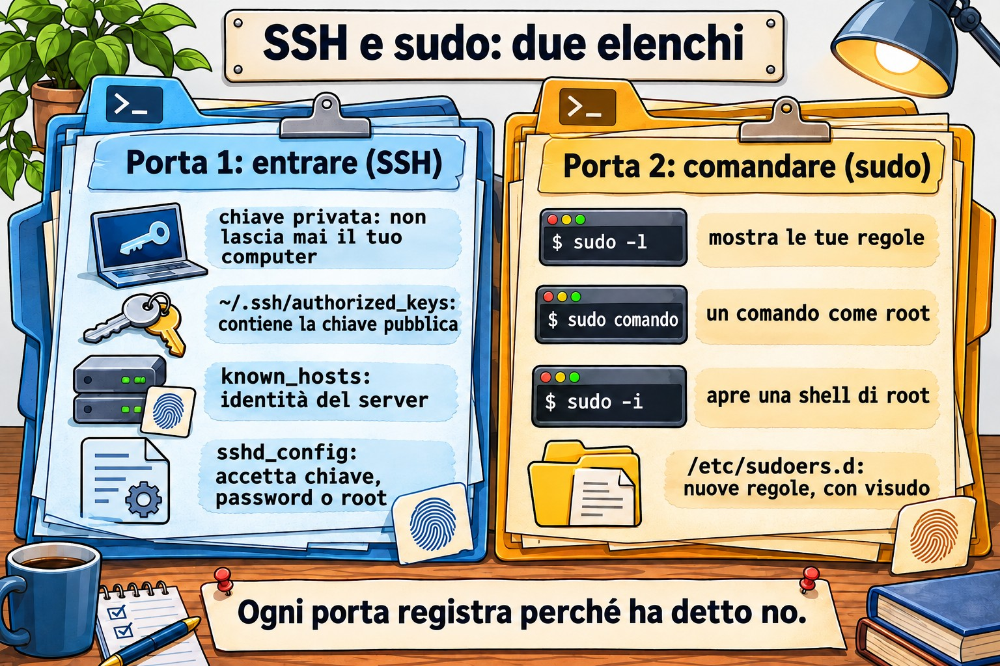

# Lezione 2.5 · Accesso remoto e privilegi

Quinta lezione del Modulo 2. Quasi ogni lavoro su un server comincia con due cose: entrarci e ottenere il potere di modificarlo. Entrambe sembrano semplici finché non falliscono. La chiave che "ha sempre funzionato" comincia a chiedere la password perché qualcuno ha dato `chmod` alla cartella sbagliata. La regola di `sudo` creata ieri non vale perché il file ha un punto nel nome. Compare l'avviso che l'identità del server è cambiata, e il tecnico lo cancella senza pensarci. Oggi impari come SSH decide se ti lascia entrare, come `sudo` decide cosa puoi fare, e dove ciascuno lascia scritto il motivo quando dice no. Alla fine entri da una VM nell'altra senza password, con un alias breve, e sai leggere il log quando smette di funzionare.

| Scheda | Lezione 2.5 |
| --- | --- |
| Modulo | M2 · Sistema, utenti e permessi, lezione 5 di 8 |
| Quando | Settimana 5 |
| Alla fine sei in grado di | Dire che tipo di account è ogni utente dall'UID e dalla shell; usare `sudo`, `sudo -i` e `su -` sapendo cosa cambia ciascuno; leggere e creare regole in `/etc/sudoers.d` con `visudo`; verificare l'identità di un server alla prima connessione; creare una chiave SSH, installarla su un altro server e entrare senza password; usare `~/.ssh/config` per gli alias; copiare file con `scp` e `rsync`; cambiare la configurazione di `sshd` con un file dedicato, testare prima di applicare e controllare il valore che vale; trovare nel log perché un login o un `sudo` è stato rifiutato |
| Prerequisiti | Lezione 2.4 (la scala di rete; le righe `rocky-lab` e `debian-lab` in `/etc/hosts`); Lezione 2.3 (`journalctl -u`); Lezione 1.4 (permessi letti con `ls -l`) |
| Durata | Circa 2h30 |
| Snapshot | m2a5-inicio e m2a5-fim su entrambe le VM |

## 1 · Riscaldamento

Tre domande, a mente. Scrivi le risposte; le soluzioni le trovi alla fine.

1. Entri in un server con una chiave SSH da mesi. Oggi chiede la password. Scommetti: il problema è sul tuo computer o sul server?
2. In Windows, un amministratore clicca su "Esegui come amministratore". Scommetti: in Linux, `sudo` apre una sessione di root o esegue come root un solo comando?
3. La prima volta che entri in un server via SSH, ti chiede `Are you sure you want to continue connecting (yes/no)?`. Scommetti: cosa protegge questa domanda?

## 2 · Perché conta

La password via SSH è il primo bersaglio di qualsiasi server esposto. Basta guardare il log di un server con la porta 22 aperta su internet: migliaia di tentativi al giorno, con `root`, `admin`, `test`, `oracle`. La chiave SSH risolve il problema, ma solo per chi capisce cosa sta facendo. La chiave privata copiata sul server sbagliato, l'`authorized_keys` con le chiavi di chi ha lasciato l'azienda tre anni fa e la cartella `.ssh` con permessi aperti sono rilievi comuni in qualsiasi audit.

Con `sudo` è lo stesso. Una buona regola dice chi può fare cosa, e il log mostra chi l'ha fatto. Una cattiva regola dà `ALL` a tutti, oppure è modificata senza `visudo` e smette di valere senza avviso. E l'abitudine di entrare direttamente come `root` cancella le tracce: nel log compare "root ha fatto", e nessuno sa quale dei cinque tecnici fosse.

Il terzo punto è l'avviso di identità. Quando SSH dice che la chiave del server è cambiata, può essere solo una reinstallazione. Può anche essere un'altra macchina che risponde al suo posto. Chi cancella l'avviso senza verificare si allena a ignorare l'unico allarme che SSH possiede.

## 3 · Modello mentale

> Entrare e comandare sono due porte diverse. SSH decide se entri; `sudo` decide cosa puoi fare dopo. Ognuno ha la sua lista, e ognuno scrive nel log perché ha detto no.

```text
Seu computador                         Servidor
──────────────                         ────────
~/.ssh/known_hosts   ◄── confere ───   /etc/ssh/ssh_host_*_key.pub   "é mesmo esse servidor?"
~/.ssh/id_ed25519    ─── prova ────►   ~/.ssh/authorized_keys        "você tem a chave privada
 (privada, fica aqui)                   (só as públicas)               de uma destas públicas?"
                                       sshd_config + sshd_config.d   "esse método é permitido?"
                                              │
                                              ▼  entrou como rodrigo
                                       /etc/sudoers + sudoers.d      "rodrigo pode rodar isto
                                                                       como root?"
                                       journal / /var/log/secure     "por que disse não"
```

Quattro idee portano la lezione:

| Idea | Cosa significa | Conseguenza |
| --- | --- | --- |
| La chiave ha due metà | La privata resta con te e non esce mai; la pubblica va su ogni server dove vuoi entrare | Se qualcuno ti chiede la tua chiave, la risposta è sempre il file `.pub` |
| I due lati si verificano a vicenda | Il server verifica la tua chiave in `authorized_keys`; tu verifichi quella del server in `known_hosts` | L'avviso di identità cambiata è il tuo lato che dice "non è chi era" |
| `sshd` è diffidente | Se la tua cartella personale, la `.ssh` o l'`authorized_keys` possono essere modificate da altri, ignora la chiave | Una chiave che ha smesso di funzionare è, quasi sempre, un permesso o un proprietario sbagliato sul server |
| `sudo` è per comando e lascia tracce | Ogni `sudo` viene controllato nelle regole e annotato nel log con il tuo nome | Preferisci `sudo comando` a restare loggato come root; il log racconta chi ha fatto |


*Entrare non è comandare: SSH e sudo sono due porte con liste e log propri.*

## 4 · Concetto a strati

### Essenziale

**Che tipo di account è questo.** Ogni account ha un numero, l'UID. Il sistema decide chi è chi dal numero, non dal nome:

```bash
id                                     # você: UID, grupo principal, todos os grupos
id root
getent passwd root rodrigo chronyd     # a linha de cada um no /etc/passwd
```

```text
root:x:0:0:root:/root:/bin/bash
rodrigo:x:1000:1000:Rodrigo:/home/rodrigo:/bin/bash
chronyd:x:994:991:chrony system user:/var/lib/chrony:/sbin/nologin
```

| Campo | Esempio | Significato |
| --- | --- | --- |
| 1 · nome | `rodrigo` | Il nome che digiti |
| 2 · password | `x` | La password è in `/etc/shadow`, che legge solo root |
| 3 · UID | `1000` | Il numero dell'account |
| 4 · GID | `1000` | Il gruppo principale |
| 5 · descrizione | `Rodrigo` | Testo libero, il nome completo |
| 6 · cartella personale | `/home/rodrigo` | Da dove parte il login |
| 7 · shell | `/bin/bash` | Il programma che parte al login. `/sbin/nologin` o `/usr/sbin/nologin` = non entra |

Tre tipi di account, in base all'UID:

| Tipo | UID | A cosa serve | Shell tipica |
| --- | --- | --- | --- |
| root | 0 | L'amministratore. Il kernel non controlla i permessi per l'UID 0 | `/bin/bash` |
| Account di sistema | da 1 a 999 | Un servizio gira con questo account (`chronyd`, `sshd`, `apache`), per non girare come root | `nologin` |
| Utente normale | da 1000 in su | Persone | `/bin/bash` |

Il nome `root` non ha nulla di speciale: qualsiasi account con UID 0 è root. Una seconda riga con UID 0 in `/etc/passwd` è uno dei primi segnali di intrusione che un audit cerca.

**Chi c'è qui.** Tre comandi, dal più breve al più completo:

```bash
whoami                 # quem eu sou agora
who                    # quem está logado, de onde
w                      # quem está logado e o que está fazendo
last -n 10             # os últimos logins, inclusive os que já saíram
```

**`sudo`: un comando come root.** `sudo` chiede la **tua** password, controlla nelle regole se puoi, esegue il comando e lo annota nel log:

```bash
sudo whoami            # root
sudo -l                # o que eu posso fazer com sudo
```

Dopo la prima password, `sudo` non la richiede per alcuni minuti (5, di default). `sudo -k` dimentica la password subito.

**Entrare in un'altra macchina.** SSH è già quello che usi per arrivare alle VM:

```bash
ssh rodrigo@10.1.0.52          # usuário@máquina
ssh debian-lab                 # mesmo usuário que você é agora; nome do /etc/hosts
ssh debian-lab 'uptime'        # roda um comando lá e volta
exit                           # sai da sessão remota
```

### Intermedio

**`sudo -i`, `su -` e `sudo su`.** I tre aprono una shell di root, e non sono uguali:

| Comando | Chiede la password di chi | Resta nel log | Ambiente |
| --- | --- | --- | --- |
| `sudo comando` | La tua | Ogni comando, con il tuo nome | Il tuo, con `PATH` sicuro |
| `sudo -i` | La tua | L'apertura della shell, con il tuo nome; ciò che fai dentro, no | Quello di root, come in un login |
| `su -` | **Quella di root** | Solo che qualcuno è diventato root | Quello di root, come in un login |
| `sudo su` | La tua | Che hai eseguito `su` | Ereditato a metà: evitalo |

`su -` richiede che root abbia una password e che tu la conosca, il che significa che ogni tecnico conosce la stessa password. In un server ben configurato, la password di root resta custodita e nessuno la usa nel lavoro di tutti i giorni: tutti entrano con il proprio nome e usano `sudo`. Il `-` (o `-l`) di `su` conta: senza, diventi root con l'ambiente del tuo utente, e i comandi di `/usr/sbin` potrebbero non essere trovati.

**Chi può usare `sudo`.** Le regole stanno in `/etc/sudoers` e nei file di `/etc/sudoers.d/`. La riga che conta su Rocky:

```text
%wheel  ALL=(ALL)       ALL
```

E su Debian:

```text
%sudo   ALL=(ALL:ALL) ALL
```

| Pezzo | Significato |
| --- | --- |
| `%wheel` | Chi: il `%` indica un gruppo. Senza `%`, è un utente |
| `ALL=` | Su quali macchine vale la regola. In pratica, sempre `ALL` |
| `(ALL)` o `(ALL:ALL)` | Come chi puoi eseguire: qualsiasi utente (e qualsiasi gruppo) |
| `ALL` alla fine | Quali comandi. Può essere un elenco con il percorso completo |

Per dare `sudo` a qualcuno, la regola pratica è metterlo nel gruppo, non scrivere una regola nuova: `wheel` su Rocky, `sudo` su Debian. Per dare un solo comando, crea un file in `/etc/sudoers.d/`, **sempre** con `visudo`:

```bash
sudo visudo -f /etc/sudoers.d/backup
```

```text
backup  ALL=(root)  NOPASSWD: /usr/bin/systemctl restart chronyd
```

`visudo` apre l'editor e, al salvataggio, controlla la sintassi; se c'è un errore, chiede prima di scrivere. `sudo visudo -c` controlla tutti i file in una volta.

**L'identità del server.** Alla prima connessione, SSH mostra l'impronta digitale della chiave del server:

```text
The authenticity of host 'debian-lab (10.1.0.52)' can't be established.
ED25519 key fingerprint is SHA256:Qm3k...x9E.
Are you sure you want to continue connecting (yes/no/[fingerprint])?
```

La cosa giusta è confrontarla con l'impronta che il server stesso mostra, per un'altra via (la console di Proxmox, la documentazione):

```bash
ssh-keygen -lf /etc/ssh/ssh_host_ed25519_key.pub     # no servidor
```

Se coincidono, `yes`. La chiave finisce nel tuo `~/.ssh/known_hosts`, e da lì in poi SSH la verifica da solo a ogni connessione.

**Chiave SSH in quattro comandi.**

```bash
ssh-keygen -t ed25519 -C "rodrigo@rocky-lab"     # cria o par; peça uma frase-senha
ls -l ~/.ssh/                                    # id_ed25519 (privada) e id_ed25519.pub (pública)
ssh-copy-id debian-lab                           # instala a pública lá; pede a senha uma última vez
ssh debian-lab                                   # entra com a chave
```

`ssh-copy-id` aggiunge la chiave pubblica all'`~/.ssh/authorized_keys` dell'altro lato e sistema i permessi. Ogni riga di quel file è una chiave che può entrare come quell'utente.

La passphrase protegge la chiave privata se qualcuno copia il file. Per non digitarla a ogni connessione, `ssh-agent` tiene la chiave aperta in memoria finché dura la sessione:

```bash
eval "$(ssh-agent -s)"
ssh-add                    # pede a frase-senha uma vez
ssh-add -l                 # as chaves que o agente guarda
```

**Copiare file.** `scp` copia come `cp`, con `máquina:` davanti al percorso remoto:

```bash
scp arquivo.txt debian-lab:/tmp/            # daqui para lá
scp debian-lab:/etc/os-release ./           # de lá para cá
```

Per le cartelle e le copie che si ripetono, `rsync` copia solo ciò che è cambiato:

```bash
rsync -av pasta/ debian-lab:~/pasta/        # -a preserva permissões e datas; -v mostra
rsync -av --dry-run pasta/ debian-lab:~/pasta/   # mostra o que faria, sem fazer
```

La barra alla fine di `pasta/` cambia tutto: con la barra, copia il **contenuto** della cartella; senza barra, copia la cartella **dentro** la destinazione. Nel dubbio, `--dry-run`.

### Ponte Windows

| In Windows | In Linux | Cosa cambia |
| --- | --- | --- |
| Gruppo Administrators | Gruppo `wheel` (Rocky) o `sudo` (Debian) | Essere nel gruppo non fa nulla da solo: devi comunque chiedere con `sudo` |
| "Esegui come amministratore" (UAC) | `sudo comando` | Un comando alla volta, con la tua password, annotato nel log |
| `runas /user:outro` | `sudo -u outro comando` |  |
| Account Administrator integrato | `root` | In un server ben configurato, nessuno entra direttamente come root |
| Desktop remoto, PowerShell Remoting | `ssh` | Testo, non schermo; lo stesso protocollo per entrare e per copiare |
| PuTTY e Pageant | `ssh` e `ssh-agent` | Windows 10 e 11 includono già OpenSSH: `ssh` funziona in PowerShell |
| WinSCP | `scp`, `sftp`, `rsync` |  |
| Chiavi in `C:\Users\voce\.ssh\` | Chiavi in `~/.ssh/` | Stesso formato. In Windows non c'è `ssh-copy-id`: vedi sotto |

Dal tuo PC Windows alle VM, senza `ssh-copy-id`, da PowerShell:

```text
ssh-keygen -t ed25519
type $env:USERPROFILE\.ssh\id_ed25519.pub | ssh rodrigo@10.1.0.51 "mkdir -p ~/.ssh && chmod 700 ~/.ssh && cat >> ~/.ssh/authorized_keys && chmod 600 ~/.ssh/authorized_keys"
```

### Avanzato

**Perché `sshd` rifiuta una chiave giusta.** Con `StrictModes yes`, il default, `sshd` controlla il proprietario e i permessi della tua cartella personale, di `~/.ssh` e di `~/.ssh/authorized_keys`. Se uno qualsiasi di essi può essere modificato dal gruppo o da altri, ignora le chiavi e passa al metodo successivo, in genere la password. Il client non sa perché: vede solo la richiesta di password. Il motivo sta nel log del server:

```text
Authentication refused: bad ownership or modes for directory /home/rodrigo
```

| Percorso | Permesso sicuro |
| --- | --- |
| `~` (la cartella personale) | Senza scrittura per gruppo e altri: `700` o `755` |
| `~/.ssh` | `700` |
| `~/.ssh/authorized_keys` | `600` |
| `~/.ssh/id_ed25519` (privata, sul client) | `600`. Troppo aperta, lo stesso `ssh` la rifiuta: `UNPROTECTED PRIVATE KEY FILE!` |
| `~/.ssh/config` (sul client) | `600`. Troppo aperto: `Bad owner or permissions` |

Su Rocky c'è una seconda causa: SELinux. Un `authorized_keys` creato in `/tmp` e spostato con `mv` si porta dietro l'etichetta sbagliata, e `sshd` non riesce a leggerlo. `restorecon -Rv ~/.ssh` risolve. SELinux ha un modulo tutto suo più avanti; per ora, ricorda che una chiave rifiutata su Rocky con i permessi giusti è il sospettato successivo.

**`ssh -v` mostra la conversazione.** Lato client, `-v` mostra ogni metodo tentato:

```text
debug1: Offering public key: /home/rodrigo/.ssh/id_ed25519 ED25519 SHA256:...
debug1: Authentications that can continue: publickey,password
debug1: Next authentication method: password
```

"Offering" seguito da "can continue" significa che il server ha ricevuto la chiave e non l'ha accettata. Se la riga "Offering" non compare nemmeno, il problema è dal tuo lato: la chiave non esiste, ha un altro nome o `~/.ssh/config` ne indica un'altra.

**La configurazione di `sshd` vale per il primo valore.** `/etc/ssh/sshd_config` comincia con `Include /etc/ssh/sshd_config.d/*.conf`, e i file vengono letti in ordine alfabetico. Per la maggior parte delle opzioni **vale il primo valore trovato**, e i successivi vengono ignorati. Per questo il tuo file deve avere un numero basso, come `10-empresa.conf`: un `99-empresa.conf` perde contro il `50-redhat.conf` di Rocky su tutto ciò che entrambi definiscono. Il modo per sapere cosa vale davvero:

```bash
sudo sshd -t                                   # confere a sintaxe; sem saída = ok
sudo sshd -T | grep -i passwordauthentication  # o valor que vale, depois de ler tudo
```

Hai cambiato qualcosa? `sudo sshd -t` prima, `systemctl reload` dopo, e una seconda sessione aperta mentre testi. Un errore in `sshd_config` con l'unica sessione chiusa significa andare alla console.

**`~/.ssh/config`, alias e pattern.** Sul client, un file riunisce ciò che digiteresti ogni volta:

```text
Host deb
    HostName debian-lab
    User rodrigo
    IdentityFile ~/.ssh/id_ed25519

Host *
    ServerAliveInterval 60
```

`ssh deb`, `scp arquivo deb:/tmp/` e `rsync ... deb:` cominciano a usare tutto questo. `ServerAliveInterval` manda un segnale ogni 60 secondi ed evita che i firewall facciano cadere la sessione ferma.

**`sudoers.d` ignora i file con il punto.** `sudo` legge i file di `/etc/sudoers.d/` ma salta quelli che hanno un `.` nel nome o finiscono con `~`. Un `/etc/sudoers.d/backup.conf` viene ignorato senza alcun avviso. È la causa numero uno di "ho creato la regola e non funziona". E la riga `#includedir /etc/sudoers.d` in fondo a `/etc/sudoers` di Rocky **non** è un commento, nonostante il `#`: è l'istruzione che legge la cartella. Su Debian 13 compare come `@includedir`, che fa lo stesso.

**Il log di `sudo` e di SSH.**

```bash
sudo journalctl _COMM=sudo -n 10          # os últimos sudo, nas duas
sudo journalctl -u sshd -n 20             # Rocky; no Debian, -u ssh
sudo tail -20 /var/log/secure             # Rocky: sudo, su e SSH no mesmo arquivo
```

## 5 · Rocky × Debian

| Cosa | Rocky 9 | Debian 13 |
| --- | --- | --- |
| Gruppo con `sudo` | `wheel` | `sudo` |
| Inclusione di `sudoers.d` | `#includedir /etc/sudoers.d` | `@includedir /etc/sudoers.d` |
| Unit di SSH | `sshd.service` | `ssh.service` (anche il nome `sshd` funziona, come alias) |
| File extra del produttore | `/etc/ssh/sshd_config.d/50-redhat.conf` | Nessuno di default |
| Log di `sudo`, `su` e SSH | `/var/log/secure` e il journal | Solo il journal, perché `rsyslog` non è installato |
| `known_hosts` | Nomi leggibili | Nomi offuscati (`HashKnownHosts yes` in `/etc/ssh/ssh_config`): cerca con `ssh-keygen -F nome` |
| `PermitRootLogin` di default | `prohibit-password` (root solo con chiave), a meno che tu non abbia scelto un'altra opzione all'installazione | `prohibit-password` |
| Shell degli account di sistema | `/sbin/nologin` | `/usr/sbin/nologin` |
| UID del primo utente | 1000 | 1000 |
| Password di root | Impostata o bloccata, a seconda dell'installazione: `sudo passwd -S root` | Se hai dato una password a root all'installazione, il primo utente non entra nel gruppo `sudo` |
| `last` | Già installato | Se manca, `sudo apt install wtmpdb` e usa `wtmpdb last` |
| `rsync` | `dnf install rsync` se manca | `apt install rsync` se manca |
| SELinux che controlla `~/.ssh` | Sì | No (Debian non attiva SELinux) |

## 6 · Lab guidato

In questo lab le due VM dialogano tra loro: rocky-lab è il "tuo computer" e debian-lab è il "server". Tieni aperto un terminale su ciascuna, dal tuo PC, come nelle lezioni precedenti. I passi dicono su quale VM eseguire. I nomi `rocky-lab` e `debian-lab` vengono dal `/etc/hosts` che hai sistemato nella Lezione 2.4; se `getent hosts debian-lab` risulta vuoto su rocky-lab, aggiungi la riga prima di cominciare.


*Entrare non è la stessa cosa che comandare. Un utente può entrare via SSH e non avere alcun sudo.*


### Passo 0 · Snapshot

In Proxmox, crea lo snapshot `m2a5-inicio` di entrambe le VM. In questo lab tocchi `sshd` e `sudo`, le due porte da cui entri. Se le chiudi entrambe, la console di Proxmox e lo snapshot sono la tua via di ritorno.

### Passo 1 · Chi è chi negli account

Su rocky-lab:

```bash
id
whoami
getent passwd root "$USER"
awk -F: '$3 == 0 {print $1}' /etc/passwd                        # quem tem UID 0
awk -F: '$3 >= 1 && $3 < 1000 {print $1, $3, $7}' /etc/passwd   # contas de sistema
awk -F: '$3 >= 1000 && $3 < 60000 {print $1, $3, $7}' /etc/passwd   # pessoas
```

Il primo `awk` deve elencare solo `root`. Il secondo elenca decine di account, quasi tutti con `nologin` in fondo: sono i servizi. Il terzo deve elencare solo te. Il limite di 60000 toglie dall'elenco l'account `nobody` (UID 65534), che è di sistema nonostante il numero alto.

Ora, chi c'è sulla macchina:

```bash
who
w
last -n 5
```

`who` mostra le tue sessioni SSH, con l'IP del tuo PC tra parentesi. `w` mostra, in più, cosa sta eseguendo ogni sessione e da quanto tempo è ferma. `last` legge lo storico: anche i login già usciti e i reboot.

Ripeti su debian-lab. Lì, la shell degli account di sistema compare come `/usr/sbin/nologin`. Se `last` non esiste, installa il sostituto: `sudo apt install wtmpdb` e usa `wtmpdb last -n 5`.

**Decidi 1 · La riga strana.** In un audit, `getent passwd` di un server di un cliente mostra, tra gli account normali, questa riga:

```text
suporte:x:0:1001:Suporte Externo:/home/suporte:/bin/bash
```

Cos'è?

- **A)** Un utente normale: il nome non è `root`, e la cartella personale sta in `/home`.
- **B)** Un secondo account root, con un altro nome. Va indagato.
- **C)** Un account di sistema, perché il nome è quello di un servizio.
- **D)** Innocua, perché il gruppo principale è 1001, che è di un utente normale.

Scegli un'opzione prima di continuare.

| Se hai scelto | Risultato | Perché |
| --- | --- | --- |
| A | ❌ Sbagliata | Il sistema non guarda né il nome né la cartella: guarda l'UID. Con UID 0, chi entra come `suporte` ha tutto il potere di root. |
| B | ✅ Giusta | UID 0 è root, qualunque sia il nome. Può essere una scorciatoia creata da un vecchio tecnico o una porta di servizio nascosta. In entrambi i casi, non è una correzione da fare da solo: annota, mostra al responsabile e guarda con `last suporte` chi lo ha usato. |
| C | ❌ Sbagliata | Un account di sistema ha UID tra 1 e 999 e, in genere, `nologin`. Questo ha UID 0 e `/bin/bash`. |
| D | ❌ Sbagliata | Il gruppo principale non limita nulla. Il kernel non controlla i permessi per l'UID 0, qualunque sia il gruppo. |

**Da ricordare:** a comandare è il numero. `awk -F: '$3 == 0' /etc/passwd` deve elencare solo `root`.

### Passo 2 · `sudo` e `su`, e la traccia di ciascuno

Su rocky-lab:

```bash
getent group wheel           # você deve aparecer no fim da linha
sudo -l                      # o que você pode fazer
sudo -u nobody id            # rodar como outro usuário, não só como root
sudo -k                      # esquece a senha
sudo -n true; echo "rc=$?"   # -n = não pergunte; sem senha guardada, falha
```

`sudo -l` termina con una riga `(ALL) ALL`: viene dalla regola del gruppo `wheel`. `sudo -n` risponde `a password is required` e `rc=1`. È così che uno script scopre, senza bloccarsi, che avrebbe bisogno di una password.

Ora i tre modi per diventare root. Esegui ciascuno, guarda l'output ed esci con `exit`:

```bash
sudo -i
whoami; pwd; echo "$HOME"
exit
```

Sei root, in `/root`, con l'ambiente di root. Ora `su -`:

```bash
sudo passwd -S root
su -
```

`passwd -S` mostra lo stato della password di root. Se compare `L` o `LK`, la password è bloccata, e `su -` fallirà con `Authentication failure`. È la situazione normale in un server ben configurato: nessuno usa la password di root. Se compare `P` o `PS` e conosci la password, `su -` funziona e chiede la password **di root**, non la tua. Non creare né cambiare la password di root per questo passo.

Ora la traccia. Su rocky-lab:

```bash
sudo journalctl _COMM=sudo -n 6 --no-pager
sudo grep -E 'sudo|su:' /var/log/secure | tail -6
```

Ogni `sudo` compare con il tuo nome, la directory in cui eri e il comando completo: `rodrigo : TTY=pts/0 ; PWD=/home/rodrigo ; USER=nobody ; COMMAND=/usr/bin/id`. `sudo -i` compare come `COMMAND=/bin/bash`, e ciò che hai fatto al suo interno non compare. È il prezzo di restare in una shell di root.

Ripeti su debian-lab, sostituendo `wheel` con `sudo` nel `getent group` e saltando il `grep` di `/var/log/secure`, che lì non esiste: il journal tiene tutto.

**Decidi 2 · Venti minuti di root.** Devi indagare su un problema e ti serve eseguire una sequenza di comandi come root per una ventina di minuti. L'azienda esige di sapere chi ha fatto ogni manutenzione. Quale usi?

- **A)** `sudo -i`
- **B)** `su -`
- **C)** `sudo su`
- **D)** `su`, senza il trattino

Scegli un'opzione prima di continuare.

| Se hai scelto | Risultato | Perché |
| --- | --- | --- |
| A | ✅ Giusta | Chiede la tua password, lascia nel log che **tu** hai aperto la shell di root, e dà l'ambiente di root, come in un login. Perché la traccia sia completa, la cosa migliore in assoluto è `sudo comando` a ogni comando, ma per una sessione lunga `sudo -i` è lo standard. |
| B | ⚠️ Funziona, ma | Diventi root, ma ti è servita la password di root, che così è conosciuta da più persone. Il log dice che qualcuno è diventato root dalla tua sessione, ma la politica "ognuno con il proprio nome" smette di valere quando tutti sanno la stessa password. |
| C | ⚠️ Funziona, ma | Il log mostra che hai eseguito `su`, quindi la traccia c'è. Ma sono due programmi per fare il lavoro di uno, e l'ambiente resta ereditato a metà. `sudo -i` fa lo stesso, fatto bene. |
| D | ❌ Sbagliata | Chiede la password di root e mantiene il tuo ambiente. Su Debian, il `PATH` dell'utente non ha `/usr/sbin`, e comandi come `useradd` danno `command not found`. |

**Da ricordare:** shell di root con traccia = `sudo -i`. Un solo comando = `sudo comando`.

### Passo 3 · La prima connessione e l'identità del server

Su **debian-lab**, scopri l'impronta digitale della chiave del server stesso:

```bash
ssh-keygen -lf /etc/ssh/ssh_host_ed25519_key.pub
```

Annota la parte dopo `SHA256:`. Su **rocky-lab**, connettiti:

```bash
ssh debian-lab
```

SSH mostra `ED25519 key fingerprint is SHA256:...` e chiede se ti fidi. Confronta con ciò che hai annotato. Se è uguale, `yes`, e digita la password del tuo utente su debian-lab. Al suo interno:

```bash
hostname
who                  # a sua sessão vinda de 10.1.0.51 (ou de rocky-lab)
exit
```

Se SSH non ha chiesto nulla, ti eri già connesso prima: `ssh-keygen -F debian-lab` mostra la riga salvata.

Ora guarda cosa è stato salvato, su rocky-lab:

```bash
cat ~/.ssh/known_hosts
ssh-keygen -F debian-lab
```

Su Rocky, la riga comincia con il nome `debian-lab`, leggibile. SSH salva il nome **che hai digitato**: un `ssh 10.1.0.52` chiederebbe di nuovo, perché per lui è un'altra voce.

Ora il percorso inverso. Su rocky-lab, esegui `ssh-keygen -lf /etc/ssh/ssh_host_ed25519_key.pub` e annota la sua impronta digitale. Su debian-lab, connettiti, confronta prima del `yes` e digita la password:

```bash
ssh rocky-lab hostname
cat ~/.ssh/known_hosts
ssh-keygen -F rocky-lab
```

Su Debian, la riga di `known_hosts` comincia con `|1|` seguito da lettere: il nome è offuscato (`HashKnownHosts yes`). Chi copia il file non scopre dove di solito vai. `ssh-keygen -F rocky-lab` trova comunque la riga.

### Passo 4 · Una chiave, installata sull'altro lato

Su rocky-lab, crea la coppia di chiavi. Quando chiede la passphrase, usane una vera: è ciò che protegge la chiave se qualcuno copia il file.

```bash
ssh-keygen -t ed25519 -C "rodrigo@rocky-lab"
ls -l ~/.ssh/
cat ~/.ssh/id_ed25519.pub
```

`ls -l` mostra la privata `id_ed25519` con `-rw-------` (600) e la pubblica `id_ed25519.pub` con `-rw-r--r--` (644). La pubblica è una riga sola: il tipo, la chiave e il commento.

**Decidi 3 · Il file che parte.** Una collega che amministra debian-lab scrive: "mandami la tua chiave SSH che ti abilito l'accesso". Quale file mandi?

- **A)** `~/.ssh/id_ed25519.pub`
- **B)** `~/.ssh/id_ed25519`
- **C)** `~/.ssh/known_hosts`
- **D)** L'`~/.ssh/authorized_keys` di rocky-lab

Scegli un'opzione prima di continuare.

| Se hai scelto | Risultato | Perché |
| --- | --- | --- |
| A | ✅ Giusta | La pubblica è fatta per essere distribuita. Entra nell'`authorized_keys` del server, e solo chi ha la privata corrispondente riesce a usarla. |
| B | ❌ Sbagliata | È la privata. Chi ha quel file entra come te in ogni server che si fida di quella chiave. Se è uscita dalla tua macchina, la risposta è generarne un'altra e sostituirla ovunque. |
| C | ❌ Sbagliata | È l'elenco delle impronte dei server che **tu** hai visitato. Non dà accesso a nulla, e rivela dove di solito vai. |
| D | ❌ Sbagliata | È l'elenco di chi può entrare **su rocky-lab**. Non c'è nulla di tuo, a meno che tu non ce l'abbia messo. |

**Da ricordare:** la privata non esce mai dalla macchina dove è stata creata. Ti hanno chiesto la chiave? È il `.pub`.

Ora installa la pubblica su debian-lab. `ssh-copy-id` chiede la tua password di debian-lab un'ultima volta:

```bash
ssh-copy-id debian-lab
```

Su **debian-lab**, controlla cosa ha fatto:

```bash
ls -ld ~/.ssh ~/.ssh/authorized_keys
cat ~/.ssh/authorized_keys
```

La cartella con `drwx------` (700), il file con `-rw-------` (600), e al suo interno la stessa riga del `cat ~/.ssh/id_ed25519.pub` di rocky-lab.

Torna su rocky-lab ed entra:

```bash
ssh debian-lab hostname
```

Leggi con attenzione cosa chiede. Non è più `rodrigo@debian-lab's password:`, la password del server. È `Enter passphrase for key '/home/rodrigo/.ssh/id_ed25519':`, la passphrase della tua chiave, che non viaggia mai in rete. Per non digitare la passphrase a ogni connessione, carica l'agent:

```bash
eval "$(ssh-agent -s)"
ssh-add
ssh-add -l
ssh debian-lab hostname          # agora sem perguntar nada
```

L'agent vale per questo terminale. Chiudi il terminale e se ne va, insieme alla chiave aperta in memoria.

### Passo 5 · Un alias e comandi remoti

Su rocky-lab, crea `~/.ssh/config`:

```bash
cat >> ~/.ssh/config <<'EOF'
Host deb
    HostName debian-lab
    User rodrigo
    IdentityFile ~/.ssh/id_ed25519

Host *
    ServerAliveInterval 60
EOF
chmod 600 ~/.ssh/config
```

Ora basta `deb`:

```bash
ssh deb hostname
ssh deb 'uptime; df -h /'
ssh -t deb 'sudo systemctl status ssh --no-pager | head -5'
```

`-t` dà un terminale alla sessione, e `sudo` dall'altro lato ne ha bisogno per chiedere la password. Senza `-t`, il `sudo` remoto si lamenta di non avere dove chiedere.

Ora il test che usano gli script. `BatchMode=yes` vieta a SSH di chiedere qualsiasi cosa: se dovesse chiedere password o passphrase, fallisce subito invece di bloccarsi.

```bash
ssh -o BatchMode=yes -o ConnectTimeout=5 deb true && echo "chave ok"
```

Con l'agent caricato, risponde `chave ok`. In un terminale nuovo, senza l'agent, lo stesso comando fallisce con `Permission denied`: la chiave esiste, ma è chiusa dalla passphrase. È così che verifichi, su un elenco di server, dove la chiave funziona già:

```bash
for h in deb; do
    printf '%-12s ' "$h"
    ssh -o BatchMode=yes -o ConnectTimeout=5 "$h" 'hostname' 2>&1 | head -1
done
```

Oggi l'elenco ha un solo nome. Nella vita reale ne ha venti, e il ciclo mostra in una schermata quali rispondono.

### Passo 6 · Copiare file

Su rocky-lab, prepara una cartella:

```bash
mkdir -p ~/lab-copia/sub
echo um > ~/lab-copia/a.txt
echo dois > ~/lab-copia/sub/b.txt
```

`scp`, per un file:

```bash
scp ~/lab-copia/a.txt deb:/tmp/
ssh deb cat /tmp/a.txt
scp deb:/etc/os-release ~/os-release-debian
head -2 ~/os-release-debian
```

`rsync` deve essere installato **su entrambe le estremità**. Su rocky-lab:

```bash
sudo dnf install -y rsync
ssh -t deb 'sudo apt install -y rsync'
```

Ora la copia della cartella, prima mostrando cosa farebbe:

```bash
rsync -av --dry-run ~/lab-copia/ deb:lab-copia/
rsync -av ~/lab-copia/ deb:lab-copia/
ssh deb 'find ~/lab-copia -type f'
```

I due file compaiono lì, in `~/lab-copia/a.txt` e `~/lab-copia/sub/b.txt`. Esegui di nuovo lo stesso `rsync`: elenca la cartella e non copia nulla, perché nulla è cambiato. Modifica un file e riesegui:

```bash
echo um-mudado > ~/lab-copia/a.txt
rsync -av ~/lab-copia/ deb:lab-copia/       # só a.txt
sha256sum ~/lab-copia/a.txt
ssh deb sha256sum lab-copia/a.txt           # o mesmo hash
```

Ora l'errore classico, di proposito. Senza la barra alla fine dell'origine:

```bash
rsync -av ~/lab-copia deb:lab-copia/
ssh deb 'find ~/lab-copia -type f'
```

È comparso `~/lab-copia/lab-copia/a.txt`: senza la barra, `rsync` ha copiato la **cartella** dentro la destinazione. Con la barra, copia il **contenuto**. In un backup vero, questo errore duplica i dati, o peggio, con `--delete`, cancella la destinazione giusta.

Pulisci le due estremità:

```bash
ssh deb 'rm -r ~/lab-copia /tmp/a.txt'
rm -r ~/lab-copia ~/os-release-debian
```

### Passo 7 · Cambiare `sshd` senza chiudersi fuori

Prima di toccare `sshd`, la regola: **una seconda sessione aperta sulla stessa VM**, che non chiudi fino alla fine del passo. Se la modifica va male, è da lì che la annulli.

Oggi cambi un'opzione innocua, che non influisce sul login: `X11Forwarding`, che permette di aprire finestre grafiche attraverso la connessione. **Non** toccare `PasswordAuthentication` né `PermitRootLogin` nel lab di oggi.

Su **debian-lab**:

```bash
grep -n -i -E '^include|x11forwarding' /etc/ssh/sshd_config
ls /etc/ssh/sshd_config.d/
sudo sshd -T | grep -i x11forwarding
```

`Include` compare in cima al file, e `X11Forwarding yes` più sotto. `sshd -T` risponde `x11forwarding yes`. Crea il tuo file:

```bash
echo 'X11Forwarding no' | sudo tee /etc/ssh/sshd_config.d/10-lab.conf
sudo sshd -t && sudo systemctl reload ssh
sudo sshd -T | grep -i x11forwarding
```

Ora risponde `no`. Il tuo file viene letto da `Include`, in cima, prima della riga `X11Forwarding yes` del file principale, e vale il primo valore. `sshd -t` senza output significa sintassi corretta; il `&&` fa il reload solo se passa.

Ora dimostra la regola del primo valore:

```bash
echo 'X11Forwarding yes' | sudo tee /etc/ssh/sshd_config.d/99-lab.conf
sudo sshd -T | grep -i x11forwarding
```

Resta `no`. `99-lab.conf` è stato letto, ma dopo `10-lab.conf`, e il suo valore è stato ignorato. Ora su **rocky-lab**:

```bash
ls /etc/ssh/sshd_config.d/
grep -i x11 /etc/ssh/sshd_config.d/50-redhat.conf
echo 'X11Forwarding no' | sudo tee /etc/ssh/sshd_config.d/99-lab.conf
sudo sshd -t && sudo systemctl reload sshd
sudo sshd -T | grep -i x11forwarding
```

**Decidi 4 · Il valore che non ha preso.** Su rocky-lab, `sshd -t` è passato, il reload è stato fatto, e `sshd -T` continua a rispondere `x11forwarding yes`. Perché?

- **A)** `50-redhat.conf` viene letto prima di `99-lab.conf` e definisce già `X11Forwarding yes`; vale il primo valore. Il file ha bisogno di un numero più basso, come `10-lab.conf`.
- **B)** Il `reload` non basta: serve `systemctl restart sshd`.
- **C)** C'è un errore di sintassi in `99-lab.conf`.
- **D)** La cosa giusta è scrivere la riga in fondo a `/etc/ssh/sshd_config`, non in `sshd_config.d`.

Scegli un'opzione prima di continuare.

| Se hai scelto | Risultato | Perché |
| --- | --- | --- |
| A | ✅ Giusta | Il `grep` ha mostrato la riga in `50-redhat.conf`. In ordine alfabetico, `50` viene prima di `99`, e `sshd` tiene il primo valore che legge. Rinomina in `10-lab.conf` e `sshd -T` cambia. |
| B | ❌ Sbagliata | `sshd -T` non guarda nemmeno il processo in esecuzione: legge i file e mostra il risultato. Se `-T` dice `yes`, i file dicono `yes`, e nessun restart lo cambia. |
| C | ❌ Sbagliata | `sshd -t` avrebbe mostrato l'errore, e il `&&` avrebbe impedito il reload. |
| D | ❌ Sbagliata | `Include` è in cima a `sshd_config`. Una riga in fondo al file principale viene letta **dopo** tutti i file di `sshd_config.d`, e perde contro `50-redhat.conf` allo stesso modo. |

**Da ricordare:** in `sshd`, vale il primo valore. File tuo = numero basso. E a dire cosa vale è `sshd -T`, non il file che hai modificato.

Se il tuo `grep` su `50-redhat.conf` non ha mostrato nessuna riga `X11Forwarding`, la tua versione non definisce quell'opzione lì, e `sshd -T` aveva già risposto `no`. La regola continua a valere per le opzioni che definisce: `grep -v '^#' /etc/ssh/sshd_config.d/50-redhat.conf` mostra quali.

Ripara e verifica:

```bash
sudo mv /etc/ssh/sshd_config.d/99-lab.conf /etc/ssh/sshd_config.d/10-lab.conf
sudo sshd -t && sudo systemctl reload sshd
sudo sshd -T | grep -i x11forwarding        # no
```

Annulla tutto su entrambe le VM. Su rocky-lab:

```bash
sudo rm /etc/ssh/sshd_config.d/10-lab.conf
sudo sshd -t && sudo systemctl reload sshd
sudo sshd -T | grep -i x11forwarding        # yes, como antes
```

Su debian-lab:

```bash
sudo rm /etc/ssh/sshd_config.d/10-lab.conf /etc/ssh/sshd_config.d/99-lab.conf
sudo sshd -t && sudo systemctl reload ssh
sudo sshd -T | grep -i x11forwarding        # yes, como antes
```

Solo adesso chiudi la seconda sessione.

### Passo 8 · Lo script del "non riesco a entrare via SSH"

Quando qualcuno dice che non riesce a entrare, il messaggio del client indica il gradino. I primi tre sono della Lezione 2.4; gli altri sono di questa lezione.

| Il client mostra | Il gradino | Cosa guardare |
| --- | --- | --- |
| Resta bloccato fino a `Connection timed out` | Rete o firewall che scarta | La scala della Lezione 2.4 |
| `No route to host` | Rete, o firewall che rifiuta | `sudo firewall-cmd --list-all` sulla destinazione |
| `Connection refused` | `sshd` non ascolta lì | `systemctl status sshd` (o `ssh`); `sudo ss -tlnp \| grep :22` |
| `WARNING: REMOTE HOST IDENTIFICATION HAS CHANGED!` | L'identità del server | Verifica l'impronta per un'altra via prima di qualsiasi altra cosa |
| `Permission denied (publickey)` | Il server accetta solo chiavi, e nessuna è stata accettata | `ssh -v`; sul server, il log e i permessi |
| Chiede la password quando dovrebbe usare la chiave | La chiave è stata offerta e rifiutata | Il log del server dice il motivo |
| `Permission denied (publickey,password)` dopo la password | Password sbagliata, o l'utente non può entrare | Il log del server: `Failed password` o `not allowed` |
| `UNPROTECTED PRIVATE KEY FILE!` | La tua chiave privata, sul client | `chmod 600 ~/.ssh/id_ed25519` |
| `Bad owner or permissions on ~/.ssh/config` | Il tuo `config`, sul client | `chmod 600 ~/.ssh/config` |

Su rocky-lab, guarda prima il percorso di successo, raccontato da `-v`:

```bash
ssh -v deb true 2>&1 | grep -E 'Offering|Authentications that|Authenticated to'
```

Vedi la chiave offerta e, alla fine, `Authenticated to debian-lab ... using "publickey"`. Ora forza un fallimento, vietando la chiave e le domande:

```bash
ssh -o PubkeyAuthentication=no -o BatchMode=yes deb true
```

La risposta è `Permission denied (publickey,password)`: il server offre entrambi i metodi, e tu non hai potuto usarne nessuno. Su **debian-lab**, guarda come il server ha raccontato la stessa storia:

```bash
sudo journalctl -u ssh -n 5 --no-pager
```

Compare una riga come `Connection closed by authenticating user rodrigo 10.1.0.51 port ... [preauth]`: l'utente, l'IP da cui è arrivato e il fatto che non è riuscito a entrare. Client e server, fianco a fianco, raccontano la stessa connessione. È questa l'abitudine: **quando SSH dice no, leggi entrambi i lati**.

## 7 · Rompi e ripara

### Guasto A · La chiave che ha ricominciato a chiedere la password

La richiesta: "ieri entravo senza password nel server, oggi la chiede". Nessuno ha toccato la chiave. Riproducilo su **debian-lab**. Prima, assicurati che il terminale di debian-lab che hai aperto dal tuo PC resti aperto, e non chiuderlo durante il guasto: le sessioni aperte non cadono, ma le nuove connessioni possono cominciare a chiedere la password.

```bash
ls -ld ~                 # anote a permissão de agora
chmod g+w ~
ls -ld ~
```

Su rocky-lab, con l'agent caricato:

```bash
ssh deb hostname
```

**Osserva.** Invece di rispondere `debian-lab`, SSH chiede `rodrigo@debian-lab's password:`. Premi Ctrl+C. La chiave c'è, l'agent è caricato, dal tuo lato non è cambiato nulla.

**Diagnostica.** Prima il lato client, senza lasciare che SSH chieda nulla:

```bash
ssh -v -o BatchMode=yes deb true 2>&1 | grep -E 'Offering|Authentications that|denied'
```

Compare la riga `Offering public key: ... ED25519`, seguita da `Authentications that can continue: publickey,password`. Il client ha offerto la chiave e il server non l'ha accettata. La causa sta dall'altro lato. Su debian-lab:

```bash
sudo journalctl -u ssh -n 10 --no-pager | grep -i -E 'refused|bad'
```

```text
Authentication refused: bad ownership or modes for directory /home/rodrigo
```

`sshd` ha trovato la cartella personale con scrittura per il gruppo. Chi può scrivere in `~` può sostituire l'intera `~/.ssh`, compreso l'`authorized_keys`. Con `StrictModes yes`, il default, `sshd` non si fida di nessuna chiave custodita lì e passa alla password, senza dire nulla al client. Nella vita reale, questo compare dopo che qualcuno ha eseguito `chmod -R 775 /home/fulano` per "aprire una cartella condivisa", o per uno script di deploy che ha sistemato proprietario e permessi della cartella sbagliata.

**Decidi A · La riparazione.** Cosa fai?

- **A)** Togliere la scrittura al gruppo sulla cartella personale, tornando al permesso che hai annotato.
- **B)** Mettere `StrictModes no` in un file in `/etc/ssh/sshd_config.d/`.
- **C)** Generare una chiave nuova e rieseguire `ssh-copy-id`.
- **D)** `chmod 777 ~/.ssh`, perché `sshd` riesca a leggere la cartella.

Scegli un'opzione prima di continuare.

| Se hai scelto | Risultato | Perché |
| --- | --- | --- |
| A | ✅ Giusta | Il log ha indicato la cartella esatta e il motivo. `chmod g-w ~` riporta allo stato sicuro, e la chiave torna a funzionare senza toccare altro. |
| B | ⚠️ Funziona, ma | La chiave torna a funzionare, ma hai spento il controllo per **tutti** gli utenti del server. La cartella resta aperta, e ora chiunque del gruppo può mettere una sua chiave nel tuo `authorized_keys` e entrare come te. |
| C | ❌ Sbagliata | La chiave non è mai stata il problema. `ssh-copy-id` non tocca i permessi della cartella personale, e la chiave nuova viene rifiutata per lo stesso motivo. |
| D | ❌ Sbagliata | Peggiora: ora anche `~/.ssh` è aperta a tutti, e `sshd` continua a rifiutare. `sshd` legge tutto come root; non ha mai avuto bisogno di permessi in più. |

**Da ricordare:** chiave giusta che ha cominciato a chiedere la password = permesso o proprietario sul server. Il motivo esatto sta nel log di `sshd`, mai nel client.

**Ripara.** Su debian-lab:

```bash
chmod g-w ~
ls -ld ~                 # igual ao que você anotou
```

Su rocky-lab:

```bash
ssh -o BatchMode=yes deb hostname        # debian-lab, sem pedir nada
```

### Guasto B · La regola di `sudo` che non vale

La richiesta: "il collega ha creato una regola perché il monitoraggio riavvii chronyd senza password, e continua a chiederla". Riproducilo su **rocky-lab**, creando il file come ha fatto il collega:

```bash
echo 'rodrigo ALL=(root) NOPASSWD: /usr/bin/systemctl restart chronyd' | sudo tee /etc/sudoers.d/lab.conf
sudo chmod 440 /etc/sudoers.d/lab.conf
sudo visudo -cf /etc/sudoers.d/lab.conf
```

`visudo -cf` controlla la sintassi di un solo file e risponde `parsed OK`. La regola è corretta. Ora testa come la testerebbe il monitoraggio, senza password memorizzata e senza lasciare che `sudo` chieda:

```bash
sudo -k
sudo -n systemctl restart chronyd; echo "rc=$?"
```

**Osserva.** `sudo: a password is required` e `rc=1`. La regola dice `NOPASSWD`, la sintassi è passata, il percorso di `systemctl` è giusto.

**Diagnostica.** Chiedi a `sudo` cosa pensa che tu possa fare:

```bash
sudo -l
```

L'elenco mostra la regola di `wheel`, `(ALL) ALL`, e non mostra la riga `NOPASSWD`. `sudo` non ha letto il file. Guarda come viene inclusa la cartella e cosa c'è dentro:

```bash
sudo grep -n includedir /etc/sudoers
ls -l /etc/sudoers.d/
```

La riga `#includedir /etc/sudoers.d` c'è, e anche il file. Resta il nome: `sudo` salta i file di `sudoers.d` che hanno un punto nel nome o finiscono con `~`. L'idea è ignorare le copie che gli editor e i gestori di pacchetti lasciano, come `backup.rpmsave` o `regra~`. L'effetto collaterale è che `lab.conf`, che sembra il nome più naturale del mondo, viene ignorato senza alcun avviso. È scritto in `man sudoers`, nella parte su `includedir`.

**Decidi B · La riparazione.** Cosa fa valere la regola?

- **A)** Rinominare il file con un nome senza punto, come `/etc/sudoers.d/lab-chronyd`.
- **B)** Copiare la riga in fondo a `/etc/sudoers`, con `sudo visudo`.
- **C)** Cambiare il permesso del file in `600`.
- **D)** Riavviare il servizio di `sudo`.

Scegli un'opzione prima di continuare.

| Se hai scelto | Risultato | Perché |
| --- | --- | --- |
| A | ✅ Giusta | Senza il punto, `includedir` legge il file. La regola resta isolata in un file con un nome che dice cosa fa, facile da trovare e da cancellare. |
| B | ⚠️ Funziona, ma | La regola comincia a valere, ma mescolata al file del pacchetto. In un aggiornamento di `sudo`, il file nuovo può arrivare come `sudoers.rpmnew`, e qualcuno deve unire le modifiche a mano. Una regola tua vive in `sudoers.d`. |
| C | ❌ Sbagliata | Il permesso non è il problema: `440` è il default. Un permesso sbagliato fa lamentare `sudo` ad alta voce, con un messaggio di errore. Qui è rimasto in silenzio perché non ha nemmeno aperto il file. |
| D | ❌ Sbagliata | Non esiste un servizio di `sudo`. Legge le regole ogni volta che lo chiami: se la regola valesse, varrebbe già al comando successivo. |

**Da ricordare:** in `/etc/sudoers.d/`, nome senza punto. E il test della regola è `sudo -l`, non `visudo -c`.

**Ripara.**

```bash
sudo mv /etc/sudoers.d/lab.conf /etc/sudoers.d/lab-chronyd
sudo visudo -c
sudo -l | grep -i nopasswd
sudo -k
sudo -n systemctl restart chronyd; echo "rc=$?"     # rc=0, sem senha
sudo journalctl _COMM=sudo -n 2 --no-pager
```

`visudo -c` ora elenca `lab-chronyd` tra i file letti. `sudo -l` mostra la riga `NOPASSWD`. Il restart parte senza password, e il log mostra che sei stato tu.

Annulla:

```bash
sudo rm /etc/sudoers.d/lab-chronyd
sudo visudo -c
```

### La lezione

I due guasti falliscono in silenzio. Nel A, `sshd` rifiuta la chiave e offre la password come se nulla fosse. Nel B, `sudo` ignora il file senza una riga di avviso, e `visudo -cf` dice comunque `parsed OK`. In nessuno dei due casi il messaggio che l'utente vede racconta il motivo. L'abitudine di questa lezione: **controlla l'effetto, non il file**. Per SSH, `ssh -o BatchMode=yes` lato client e il log lato server. Per `sudo`, `sudo -l` e `sudo -n`. Per `sshd`, `sshd -T`. Il file dice cosa volevi; questi comandi dicono cosa ha capito il sistema.

## 8 · Trappole

| Cosa digiti o vedi | Cosa succede | Come evitarla |
| --- | --- | --- |
| Mandare `id_ed25519` quando ti chiedono la tua chiave | Chi la riceve entra come te ovunque | Manda solo il `.pub`. Se la privata è uscita, generane un'altra e sostituiscila |
| Rispondere `yes` all'avviso di identità senza verificare | Accetti qualsiasi macchina che risponda a quel nome | Confronta con `ssh-keygen -lf` eseguito sul server stesso |
| `ssh-keygen -R servidor` d'istinto, vedendo `HOST IDENTIFICATION HAS CHANGED` | Cancelli l'unico allarme di SSH | Scopri prima perché è cambiato: reinstallazione, IP riutilizzato o un'altra macchina |
| Chiave senza passphrase "per comodità" | Chi copia il file usa la chiave subito | Passphrase e `ssh-agent`. Senza passphrase, solo chiavi di automazione, con restrizioni sul server |
| `chmod -R 775` sulla cartella personale | La chiave smette di funzionare, senza avviso sul client | Cartella personale senza scrittura per gruppo e altri |
| Modificare `/etc/sudoers` direttamente con `vim` o `nano` | Un errore di sintassi può far rifiutare tutto a `sudo`, a seconda della versione | `sudo visudo`, o `sudo visudo -f /etc/sudoers.d/nome` |
| `/etc/sudoers.d/regra.conf` | Ignorato, senza avviso | Nome senza punto: `/etc/sudoers.d/regra` |
| Cancellare il `#` di `#includedir` "perché è un commento" | Diventa una riga non valida su Rocky; `visudo` si lamenta | `#includedir` è un'istruzione. Lascialo com'è |
| `NOPASSWD: ALL` per "smettere di chiedere la password" | Chiunque abbia accesso alla tua sessione diventa root | `NOPASSWD` solo per comandi esatti, con il percorso completo |
| `99-empresa.conf` in `sshd_config.d` | Perde contro `50-redhat.conf` su Rocky | Numero basso: `10-empresa.conf`. Verifica con `sshd -T` |
| `systemctl reload sshd` senza `sshd -t` prima | Con un errore, `sshd` non ricarica; in un restart, non parte | `sudo sshd -t && sudo systemctl reload sshd` |
| Cambiare `sshd` con una sola sessione aperta | Se va male, risolve solo la console | Seconda sessione aperta finché non verifichi che entri |
| `systemctl restart sshd` su Debian | `Unit sshd.service not found`, oppure funziona tramite l'alias, a seconda della versione | Su Debian, l'unit è `ssh` |
| `sudo` remoto senza `-t` | `sudo` non ha dove chiedere la password | `ssh -t servidor 'sudo comando'` |
| `rsync -av pasta destino/` senza la barra sull'origine | Crea `destino/pasta/` | `pasta/` copia il contenuto. Nel dubbio, `--dry-run` |
| `su` senza il `-` | Root con il tuo ambiente; su Debian, `useradd` sparisce dal `PATH` | `sudo -i`, o `su -` se ti serve davvero la password di root |

## 9 · Quiz

Dieci domande, senza consultare. Scrivi la lettera o la risposta di ognuna e solo dopo apri le Soluzioni.

**1.** Cosa dà a un account i poteri di root?

- **A)** Chiamarsi `root`.
- **B)** Avere UID 0.
- **C)** Stare nel gruppo `wheel` o `sudo`.
- **D)** Avere `/bin/bash` come shell.

**2.** Qual è la differenza tra `sudo -i` e `su -` quanto alla password richiesta e a ciò che resta nel log?

**3.** Un collega ha creato `/etc/sudoers.d/backup.conf` con una regola corretta, e `sudo -l` dell'utente `backup` non la mostra. Perché, e qual è la riparazione?

**4.** Quale comando installa la tua chiave pubblica nell'`authorized_keys` di un altro server?

- **A)** `ssh-keygen -R servidor`
- **B)** `ssh-add servidor`
- **C)** `ssh-copy-id servidor`
- **D)** `scp ~/.ssh/id_ed25519 servidor:~/.ssh/`

**5.** Un utente entrava con la chiave in un server e oggi SSH chiede la password. Dove guardi per prima cosa, e quale comando mostra il motivo?

**6.** Su Rocky, hai creato `/etc/ssh/sshd_config.d/99-empresa.conf` con `X11Forwarding no`, hai eseguito `sshd -t` e `reload`, e `sshd -T` continua a dire `x11forwarding yes`. Perché, e cosa fai?

**7.** Qual è la shell tipica di un account di sistema, e cosa fa?

- **A)** `/bin/bash`: l'account entra normalmente.
- **B)** `/bin/sh`: l'account entra con una shell più semplice.
- **C)** `/sbin/nologin` o `/usr/sbin/nologin`: rifiuta il login interattivo.
- **D)** `/bin/false`: cancella l'account al prossimo login.

**8.** Scrivi il comando che copia il **contenuto** di `/srv/site` in `/srv/site` sul server `web01`, preservando permessi e date, e mostrando prima cosa farebbe.

**9.** Connettendoti a un server che usi ogni giorno, compare `WARNING: REMOTE HOST IDENTIFICATION HAS CHANGED!`. In ordine, cosa fai?

**10.** *Which file on the server lists the public keys that are allowed to log in as a given user?*

- **A)** `~/.ssh/known_hosts`
- **B)** `~/.ssh/authorized_keys`
- **C)** `/etc/ssh/ssh_host_ed25519_key.pub`
- **D)** `~/.ssh/id_ed25519`

## 10 · Flashcard e promemoria

### Da sapere a memoria

- A comandare è l'UID. 0 è root; da 1 a 999, account di sistema; da 1000 in su, persone.
- `sudo comando` = la tua password, un comando, annotato con il tuo nome. `sudo -i` = shell di root con traccia dell'apertura. `su -` = la password di root.
- La chiave ha due metà: la privata resta; la pubblica va nell'`authorized_keys` di ogni server.
- Il server verifica la tua chiave in `authorized_keys`; tu verifichi quella del server in `known_hosts`.
- Chiave giusta che chiede la password = permesso o proprietario sbagliato sul server. Leggi il log di `sshd`.
- In `sshd`, vale il primo valore. File tuo in `sshd_config.d` con numero basso, e verifica con `sshd -T`.
- In `sudoers.d`, nome senza punto. Modifica con `visudo`, verifica con `sudo -l`.
- Prima di toccare `sshd`: `sshd -t`, seconda sessione aperta, solo allora `reload`.

### Da consultare

| Domanda | Comando |
| --- | --- |
| Chi sono, i miei gruppi | `id`; `whoami` |
| La riga di un account | `getent passwd nome` |
| Account con UID 0 | `awk -F: '$3 == 0' /etc/passwd` |
| Chi è loggato | `who`; con cosa sta facendo: `w` |
| Ultimi login | `last -n 10`; su Debian 13, se manca: `wtmpdb last` |
| Tentativi falliti | `sudo lastb -n 10` (Rocky); su entrambi: `sudo journalctl -u sshd \| grep -i failed` |
| Stato della password di root | `sudo passwd -S root` |
| Cosa posso fare con `sudo` | `sudo -l` |
| Dimenticare la password di `sudo` | `sudo -k` |
| Testare senza lasciar chiedere | `sudo -n comando` |
| Eseguire come un altro utente | `sudo -u nome comando` |
| Modificare le regole | `sudo visudo`; file proprio: `sudo visudo -f /etc/sudoers.d/nome` |
| Controllare la sintassi | `sudo visudo -c`; un file: `sudo visudo -cf arquivo` |
| Log di `sudo` | `sudo journalctl _COMM=sudo -n 20`; Rocky: `/var/log/secure` |
| Impronta digitale del server | `ssh-keygen -lf /etc/ssh/ssh_host_ed25519_key.pub` |
| Trovare e cancellare in `known_hosts` | `ssh-keygen -F nome`; `ssh-keygen -R nome` |
| Creare una chiave | `ssh-keygen -t ed25519 -C "comentário"` |
| Installare la chiave | `ssh-copy-id servidor`; da Windows: `type ...\id_ed25519.pub \| ssh servidor "cat >> ~/.ssh/authorized_keys"` |
| Agent | `eval "$(ssh-agent -s)"`; `ssh-add`; `ssh-add -l` |
| Testare la chiave senza domande | `ssh -o BatchMode=yes -o ConnectTimeout=5 servidor true` |
| Vedere la conversazione | `ssh -v servidor` |
| Comando remoto con `sudo` | `ssh -t servidor 'sudo comando'` |
| Copiare un file | `scp origem servidor:/destino/`; da lì: `scp servidor:/arquivo ./` |
| Copiare una cartella | `rsync -av --dry-run pasta/ servidor:pasta/`, poi senza `--dry-run` |
| Configurazione di `sshd` | `/etc/ssh/sshd_config` e `/etc/ssh/sshd_config.d/*.conf` |
| Sintassi e valore che vale | `sudo sshd -t`; `sudo sshd -T \| grep -i opção` |
| Applicare | Rocky: `sudo systemctl reload sshd`; Debian: `sudo systemctl reload ssh` |
| Log di SSH | Rocky: `sudo journalctl -u sshd`; Debian: `sudo journalctl -u ssh` |
| Permessi che `sshd` richiede | `ls -ld ~ ~/.ssh ~/.ssh/authorized_keys`; su Rocky, anche `ls -Z ~/.ssh` |
| Etichetta SELinux di `~/.ssh` (Rocky) | `restorecon -Rv ~/.ssh` |

### Flashcard

| Fronte | Retro |
| --- | --- |
| UID di root, account di sistema e persone | 0; da 1 a 999; da 1000 in su |
| Due account con UID 0 | Due account root. Indaga su quello che non si chiama `root` |
| `sudo -i` × `su -` | `sudo -i` chiede la tua password e registra il tuo nome; `su -` chiede la password di root |
| A cosa serve il `-` di `su -` | Caricare l'ambiente di root, come in un login |
| Gruppo di `sudo` su Rocky e su Debian | `wheel` e `sudo` |
| `#includedir` in `/etc/sudoers` | Non è un commento: è l'istruzione che legge `/etc/sudoers.d` |
| `/etc/sudoers.d/regra.conf` | Ignorato: i nomi con un punto o che finiscono con `~` vengono saltati |
| Perché usare `visudo` | Controlla la sintassi prima di scrivere |
| `sudo -n` | Non chiede mai; senza password memorizzata o `NOPASSWD`, fallisce |
| File che va sul server | Il `.pub`. La privata non esce mai |
| `authorized_keys` | Sul server: le chiavi pubbliche che possono entrare come quell'utente |
| `known_hosts` | Sul client: le impronte dei server che hai accettato |
| `\|1\|...` in `known_hosts` | Nome offuscato (`HashKnownHosts yes`, default su Debian). Cerca con `ssh-keygen -F` |
| Permessi di `~/.ssh` e `authorized_keys` | 700 e 600 |
| `Authentication refused: bad ownership or modes` | `StrictModes` ha rifiutato la chiave per permesso o proprietario sbagliato |
| Passphrase × password | La passphrase apre la tua chiave privata e non viaggia; la password è dell'utente sul server |
| `BatchMode=yes` | SSH non chiede nulla; se dovesse, fallisce |
| `sshd -t` × `sshd -T` | `-t` controlla la sintassi; `-T` mostra il valore che vale di ogni opzione |
| Quale valore vale in `sshd` | Il primo letto. I drop-in vengono prima del resto di `sshd_config`, in ordine alfabetico |
| Unit di SSH su Rocky e su Debian | `sshd` e `ssh` |
| `rsync pasta/` × `rsync pasta` | Con la barra copia il contenuto; senza barra crea `pasta` dentro la destinazione |
| `scp` moderno | Usa il protocollo SFTP sotto il cofano, da OpenSSH 9 |

## 11 · Checklist di uscita

- [ ] Dico il tipo di un account guardando la riga di `/etc/passwd`, e trovo gli account con UID 0.
- [ ] Spiego la differenza tra `sudo comando`, `sudo -i` e `su -`, e quale lascia traccia di cosa.
- [ ] Creo una regola in `/etc/sudoers.d` con `visudo`, con un nome che funziona, e la dimostro con `sudo -l` e `sudo -n`.
- [ ] Verifico l'impronta di un server prima di rispondere `yes`.
- [ ] Creo una chiave con passphrase, la installo su un altro server e entro senza password.
- [ ] Uso `ssh-agent` e `~/.ssh/config` con un alias.
- [ ] Copio un file con `scp` e una cartella con `rsync`, azzeccando la barra.
- [ ] Cambio un'opzione di `sshd` con un file in `sshd_config.d`, testo, applico e verifico con `sshd -T`.
- [ ] Quando SSH dice no, leggo `ssh -v` sul client e il log sul server.

**Ultimo esercizio, senza guardare.** Questa volta, debian-lab è il "tuo computer" e rocky-lab è il "server". Senza aprire questa lezione:

1. Su debian-lab, crea una chiave Ed25519 con passphrase e commento `rodrigo@debian-lab`.
2. Installa la chiave su rocky-lab e entra senza la password dell'utente.
3. Crea l'alias `rk` in `~/.ssh/config` di debian-lab, con i permessi giusti, ed esegui `ssh rk 'hostname; id'`.
4. Dimostra, con una riga che non chiede nulla, che la chiave funziona.
5. Su rocky-lab, crea una regola che permetta al tuo utente di eseguire `systemctl status chronyd` come root senza password. Dimostra che vale, e cancellala.
6. Su rocky-lab, scopri il valore che vale di `PermitRootLogin` e di `PasswordAuthentication`, senza aprire nessun file.

Apri le Soluzioni solo dopo, o dopo tre tentativi.

**Snapshot di chiusura.** La chiave di rocky-lab installata su debian-lab e l'alias `deb` restano: li usi entrambi nella Lezione 2.6, per creare utenti su una VM a partire dall'altra. I file di test di `sshd` e di `sudoers.d` sono già stati cancellati nei passi. Sul nodo Proxmox:

```bash
qm snapshot 201 m2a5-fim
qm snapshot 202 m2a5-fim
```

## 12 · Nella vita reale

**Missione della settimana, sola lettura.** Scegli tre server reali: preferibilmente uno esposto a internet (web, e-mail, VPN), uno interno e uno che amministrano più persone. Su ciascuno, senza cambiare nulla:

1. `sudo sshd -T | grep -E '^(permitrootlogin|passwordauthentication|pubkeyauthentication|port|allowusers|allowgroups) '`: root entra? Entra con la password? C'è una restrizione su chi entra?
2. `ls /etc/ssh/sshd_config.d/` e `grep -v -E '^#|^$' /etc/ssh/sshd_config.d/*.conf`: chi ha cambiato cosa, e c'è qualche file con un numero alto che potrebbe perdere contro un altro?
3. `sudo ls -l /etc/sudoers.d/` e `sudo grep -v -E '^#|^$' /etc/sudoers /etc/sudoers.d/*`, ricordando che le righe `#includedir` non compaiono in questo filtro: chi ha `ALL`? C'è `NOPASSWD: ALL`? Qualche file con un punto nel nome, che non ha mai valso?
4. `getent group wheel sudo` e `awk -F: '$3 == 0' /etc/passwd`: chi può diventare root, e c'è qualcun altro con UID 0?
5. `last -n 20` e `sudo lastb -n 20` (o, su Debian 13, `wtmpdb last`): chi entra, da dove, e quanti tentativi falliscono. Nel journal: `sudo journalctl -u sshd --since today | grep -c 'Failed password'` (su Debian, `-u ssh`).
6. Per ogni utente con una cartella in `/home` e per root: `sudo wc -l /home/*/.ssh/authorized_keys /root/.ssh/authorized_keys 2>/dev/null` e `sudo awk '{print FILENAME": "$NF}' /home/*/.ssh/authorized_keys 2>/dev/null`. Quante chiavi, e il commento di ognuna dice di chi è?

**Per il diario.** Una riga per server: `nome · root entra? com senha? · arquivos em sshd_config.d · quem tem sudo · NOPASSWD? · UID 0 extra? · falhas de login hoje · chaves no authorized_keys (sem dono conhecido?)`. Chiave senza commento, di una persona che se n'è andata o di origine sconosciuta: annotala e portala al responsabile. Decide lui se toglierla.

**Sfida della settimana.** Su uno dei server che segui, scrivi la raccomandazione di rafforzamento dell'accesso in al massimo cinque frasi: cosa hai visto (password accettata per root? password accettata da internet? `NOPASSWD: ALL`? chiavi senza proprietario?), il rischio di ogni punto e cosa cambieresti, nell'ordine giusto. L'ordine conta: prima di raccomandare `PasswordAuthentication no`, la raccomandazione deve garantire che tutti quelli che entrano abbiano già una chiave funzionante, e che esista una console per quando va male. Non cambiare nulla; consegna al responsabile.

**Domani, senza guardare.** Prima di aprire il terminale, rispondi a mente: quale UID è root, quale è un account di sistema? Che password chiede `sudo -i`, e che password chiede `su -`? Quale file mandi quando ti chiedono la tua chiave? Dove il server tiene le chiavi che possono entrare, e dove tieni tu le impronte dei server? La chiave chiede improvvisamente la password: dove guardi? Perché `regra.conf` non vale in `sudoers.d`? Quale valore vale in `sshd`, il primo o l'ultimo? Se sbagli qualcosa, torna alla sezione 10, non a tutta la lezione.

## 13 · Con DeepTutor

Usa il DeepTutor della tua rete locale dopo il lab, non al suo posto. I comandi iniziano con `!`:

- `!quiz Aula 2.5`: dieci domande nuove su account, `sudo`, chiavi SSH e `sshd`.
- `!explica StrictModes`: perché `sshd` rifiuta una chiave giusta, e come leggere il log quando succede.
- `!feynman sudo -i e su -`: tu spieghi la differenza e lui indica dove sei rimasto vago.
- `!quebra ssh pede senha`: descrive un server dove la chiave ha smesso di funzionare e ti consegna gli output di `ssh -v`, del log e di `ls -ld`, uno alla volta, perché tu trovi la causa.
- `!quiz 2.5 ssh`: compiti pratici, come configurare una chiave tra due macchine e dare `sudo` a un gruppo.
- `!cartoes Aula 2.5`: le flashcard della sezione 10, in ordine di ripasso.
- `!erro`: incolla il messaggio di un `ssh`, `scp` o `sudo` fallito e lui dice il gradino e cosa guardare dopo.
- `!revisao`: cosa ripassare di questa lezione e delle precedenti, in base a ciò che hai sbagliato finora.

## Soluzioni commentate

### Riscaldamento

1. Quasi sempre sul server. La chiave dal tuo lato è la stessa di ieri; ciò che è cambiato è che `sshd` ha smesso di fidarsi. Il motivo più comune è un permesso o un proprietario sbagliato sulla cartella personale, su `~/.ssh` o su `authorized_keys`, ed è scritto nel log di `sshd`: `Authentication refused: bad ownership or modes`. La seconda causa comune è che qualcuno abbia cancellato o sovrascritto `authorized_keys`. `ssh -v` dal tuo lato conferma che la chiave è stata offerta e rifiutata.
2. Un solo comando, come root. `sudo` chiede la tua password, controlla le regole, esegue quel comando e lo annota nel log. Per una sessione di root esiste `sudo -i`, ma l'uso normale è `sudo` comando per comando, che somiglia più all'UAC che a entrare come Administrator.
3. Ti protegge dal parlare con la macchina sbagliata. La domanda mostra l'impronta della chiave del server; se la confronti con quella che il server stesso mostra, hai la garanzia che sia lui. Da lì in poi, `known_hosts` conserva quell'impronta, e SSH avvisa se cambia, che è il segnale di una reinstallazione o di un'altra macchina al suo posto.

### Quiz

1. **B.** Il kernel decide dal numero. Il nome `root` è solo il nome dell'account che ha UID 0; i gruppi `wheel` e `sudo` danno solo il diritto di **chiedere** con `sudo`; la shell non dà alcun potere.
2. `sudo -i` chiede la **tua** password e registra nel log, con il tuo nome, che hai aperto una shell di root. `su -` chiede la password **di root** e il log registra solo che qualcuno è diventato root dalla tua sessione; inoltre, richiede che root abbia una password e che sia conosciuta.
3. A causa del punto nel nome: `sudo` ignora i file di `sudoers.d` con `.` nel nome o che finiscono con `~`. Riparazione: `sudo mv /etc/sudoers.d/backup.conf /etc/sudoers.d/backup`, `sudo visudo -c` e, come utente `backup`, `sudo -l` per vedere la regola.
4. **C.** `ssh-copy-id` aggiunge la tua chiave pubblica all'`~/.ssh/authorized_keys` del server e sistema i permessi. `ssh-keygen -R` cancella una riga di `known_hosts`; `ssh-add` carica la chiave nell'agent; lo `scp` dell'opzione D copia la tua chiave **privata** sul server, che è esattamente ciò che non si fa mai.
5. Sul server, nel log di `sshd`: `sudo journalctl -u sshd -n 20` su Rocky, `-u ssh` su Debian, cercando `Authentication refused`. Poi, `ls -ld ~ ~/.ssh ~/.ssh/authorized_keys` dell'utente. Lato client, `ssh -v` conferma che la chiave è stata offerta. Su Rocky, se i permessi sono giusti, `ls -Z ~/.ssh` e `restorecon -Rv ~/.ssh`.
6. `50-redhat.conf` viene letto prima di `99-empresa.conf` e definisce già `X11Forwarding yes`; in `sshd`, vale il primo valore. Rinomina con un numero minore di 50, come `10-empresa.conf`, esegui `sudo sshd -t && sudo systemctl reload sshd` e verifica con `sudo sshd -T | grep -i x11forwarding`.
7. **C.** `nologin` mostra un messaggio e termina, e l'account non ottiene una shell interattiva, che è ciò che si vuole da un servizio. `/bin/false` fa qualcosa di simile, senza il messaggio, e non cancella nulla.
8. `rsync -av --dry-run /srv/site/ web01:/srv/site/`, controllare l'elenco, e poi lo stesso comando senza `--dry-run`. La barra alla fine di `/srv/site/` è ciò che fa copiare il contenuto; senza, il risultato sarebbe `/srv/site/site/` nella destinazione.
9. Fermati e non rispondere ancora nulla. Scopri perché la chiave è cambiata: il server è stato reinstallato? L'IP è diventato di un'altra macchina? Verifica la nuova impronta per un'altra via, eseguendo `ssh-keygen -lf /etc/ssh/ssh_host_ed25519_key.pub` dalla console o chiedendo a chi amministra. Solo se coincide, cancella la riga vecchia con `ssh-keygen -R servidor` e riconnettiti, accettando la nuova. Se non c'è una spiegazione, trattalo come un incidente.
10. Tabella qui sotto.

| Se hai scelto | Risultato | Perché |
| --- | --- | --- |
| A | ❌ Sbagliata | `known_hosts` sta sul client e contiene le chiavi dei **server** che hai accettato. Non dà accesso a nessuno. |
| B | ✅ Giusta | `~/.ssh/authorized_keys` nella cartella dell'utente, sul server, ha una chiave pubblica per riga. Chi dimostra di avere la privata di una di esse entra come quell'utente. |
| C | ❌ Sbagliata | È la chiave pubblica del server stesso, quella che compare nella domanda della prima connessione. Identifica la macchina, non autorizza utenti. |
| D | ❌ Sbagliata | È la chiave privata di chi sta sul client. Non dovrebbe mai trovarsi sul server. |

### Ultimo esercizio

Su debian-lab:

```bash
ssh-keygen -t ed25519 -C "rodrigo@debian-lab"
ssh-copy-id rocky-lab
ssh rocky-lab hostname
cat >> ~/.ssh/config <<'EOF'
Host rk
    HostName rocky-lab
    User rodrigo
EOF
chmod 600 ~/.ssh/config
eval "$(ssh-agent -s)"; ssh-add
ssh rk 'hostname; id'
ssh -o BatchMode=yes -o ConnectTimeout=5 rk true && echo "chave ok"
```

`ssh rocky-lab hostname` subito dopo `ssh-copy-id` chiede la passphrase della chiave, non la password dell'utente: è il segnale che la chiave è stata accettata. Senza l'agent caricato, il test con `BatchMode` fallisce, perché la chiave è chiusa.

Su rocky-lab:

```bash
sudo visudo -f /etc/sudoers.d/lab-status
```

```text
rodrigo ALL=(root) NOPASSWD: /usr/bin/systemctl status chronyd
```

```bash
sudo -l | grep -i nopasswd
sudo -k
sudo -n systemctl status chronyd | cat; echo "rc=${PIPESTATUS[0]}"
sudo rm /etc/sudoers.d/lab-status
sudo visudo -c
sudo sshd -T | grep -E '^(permitrootlogin|passwordauthentication) '
```

Attenzione al test della regola: `sudo` accetta senza password solo il comando **esattamente** come sta nella regola. Un `sudo -n systemctl status chronyd --no-pager` chiederebbe la password, perché `--no-pager` non è nella regola. Il `| cat` evita il paginatore senza cambiare il comando che `sudo` controlla, e `PIPESTATUS` mostra il codice di `systemctl`, non quello di `cat`. Nella regola, potresti scrivere `/usr/bin/systemctl status chronyd *` per accettare opzioni extra, ma ogni `*` in una regola di `sudo` allarga ciò che permette; in produzione, la preferenza è il comando esatto.

`PermitRootLogin` dovrebbe risultare `prohibit-password` e `PasswordAuthentication` `yes`, a meno che tu non abbia scelto altro all'installazione. Il nome del file della regola non ha punto, e `visudo -f` ha controllato la sintassi al salvataggio.

Se `ssh rk` ha chiesto la password dell'utente invece della passphrase, la chiave non è stata accettata: controlla il log su rocky-lab con `sudo journalctl -u sshd -n 10` e i permessi con `ls -ld ~ ~/.ssh ~/.ssh/authorized_keys`. Se è tutto a `700` e `600`, esegui `restorecon -Rv ~/.ssh` su rocky-lab: su Rocky, SELinux è il sospettato successivo.

---

<!-- navegacao -->
[← Lezione 2.4 · La rete di tutti i giorni](2.4-rede-no-dia-a-dia.md) · [Indice delle lezioni](../01-aulas.md) · [Lezione 2.6 · Utenti e gruppi →](2.6-usuarios-e-grupos.md)
