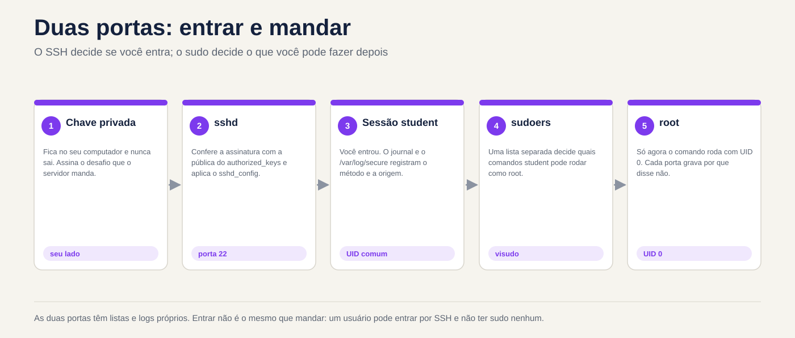
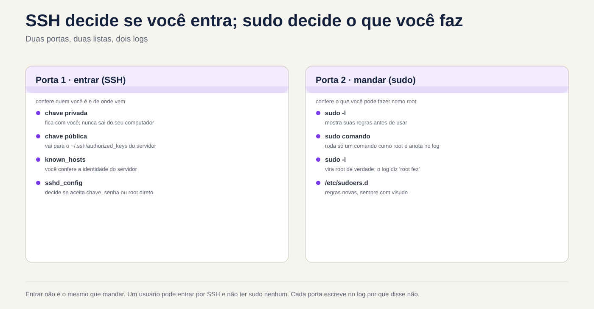

# Lezione 2.5 · Accesso remoto e privilegi

Quinta lezione del Modulo 2. Quasi tutto il lavoro su un server inizia con due cose: entrarci e acquisire il potere di cambiarlo. Entrambi sembrano semplici finché non falliscono. La chiave che "ha sempre funzionato" inizia a chiedere la password perché qualcuno ha inserito `chmod` nella cartella sbagliata. La regola in `sudo` creata ieri non è valida perché il file ha un punto nel nome. Appare l'avviso che l'identità del server è cambiata e il tecnico lo cancella senza pensarci. Oggi imparerai come SSH decide se farti entrare, come `sudo` decide cosa puoi fare e dove tutti lasciano scritto il motivo quando dicono di no. Alla fine, accedi da una VM all'altra senza password, con un breve nickname e sai come leggere il registro quando smette di funzionare.

| File | lezione 2.5 |
| --- | --- |
| Modulo | M2 · Sistema, utenti e permessi, lezione 5 di 8 |
| Quando | Settimana 5 |
| Alla fine puoi | Indica quale tipo di account possiede ciascun utente tramite UID e shell; utilizzare `sudo`, `sudo -i` e `su -` sapendo cosa cambia in ognuno di essi; leggere e creare regole in `/etc/sudoers.d` con `visudo`; verificare l'identità di un server alla prima connessione; creare una chiave SSH, installarla su un altro server e accedere senza password; utilizzare `~/.ssh/config` per i soprannomi; copiare file con `scp` e `rsync`; modificare la configurazione di `sshd` con un proprio file, testare prima dell'applicazione e verificare il valore; trovare nel registro il motivo per cui un login o un `sudo` è stato rifiutato |
| Articoli di prova | LE 015.1 (sicurezza di base e tipi di utente: root, utente normale, account di sistema; `id`, `who`, `w`, `last`, `su`, `sudo`) · LPIC-1 110.1 (attività di amministrazione della sicurezza: `sudo`, `su`, `who`, `w`, `last`) · LPIC-1 110.3 (protezione dei dati con crittografia: chiavi OpenSSH, `ssh-agent`, `known_hosts`, `authorized_keys`) · RHCSA (accesso a sistemi remoti con SSH; configurazione dell'autenticazione tramite chiave; trasferimento di file in modo sicuro; cambio utente; concessione `sudo`) |
| Prerequisiti | lezione 2.4 (la scala della rete; righe `rocky-lab` e `debian-lab` in `/etc/hosts`); lezione 2.3 (`journalctl -u`); lezione 1.4 (permessi letti con `ls -l`) |
| Tempo | Intorno alle 2:30 |
| Istantanee | m2a5-start e m2a5-end in entrambe le VM |

## 1 · Riscaldamento

Tre domande, appena mi vengono in mente. Scrivi le risposte; la chiave di risposta viene visualizzata alla fine.

1. Sono mesi che accedi a un server con una chiave SSH. Oggi chiede una password. Indovina: il problema è con il tuo computer o con il server?
2. Su Windows, un amministratore fa clic su "Esegui come amministratore". Indovina: su Linux, `sudo` apre una sessione root o esegue semplicemente un comando come root?
3. La prima volta che accedi tramite SSH a un server, viene richiesto `Are you sure you want to continue connecting (yes/no)?`. Indovina: cosa protegge questa domanda?

## 2 · Perché è importante

La password su SSH è il primo obiettivo di qualsiasi server esposto. Basta guardare il log di un server con la porta 22 aperta verso internet: migliaia di tentativi al giorno, con `root`, `admin`, `test`, `oracle`. La chiave SSH risolve questo problema, ma solo per coloro che capiscono cosa stanno facendo. La chiave privata copiata sul server sbagliato, `authorized_keys` con chiavi di qualcuno che ha lasciato l'azienda tre anni fa e la cartella `.ssh` con autorizzazione aperta sono risultati comuni in ogni audit.

Con `sudo` è lo stesso. Una buona regola dice chi può fare cosa e il registro mostra chi lo ha fatto. Una regola sbagliata dà `ALL` a tutti, oppure viene modificata senza `visudo` e smette di essere valida senza preavviso. E l'abitudine di inserire come `root` cancella direttamente la traccia: nel log risulta "root did", e nessuno sa quale dei cinque tecnici fosse.

Il terzo punto è l'avviso di identità. Quando SSH dice che la chiave del server è cambiata, potrebbe trattarsi semplicemente di una reinstallazione. Potrebbe anche essere un'altra macchina che risponde al suo posto. Chiunque cancelli l'avviso senza controllare si allena a ignorare l'unico allarme di cui dispone SSH.

## 3 · Modello mentale

> Enter e send sono due porte diverse. SSH decide se accedi; `sudo` decide cosa puoi fare dopo. Ognuno ha la sua lista e ognuno scrive nel registro il motivo per cui ha detto di no.

```text
Seu computador                         Servidor
──────────────                         ────────
~/.ssh/known_hosts   ◄── confere ───   /etc/ssh/ssh_host_*_key.pub   "é mesmo esse servidor?"
~/.ssh/id_ed25519    ─── prova ────►   ~/.ssh/authorized_keys        "você tem a chave privada
 (privada, fica aqui)                   (só as públicas)               de uma destas públicas?"
                                       sshd_config + sshd_config.d   "esse método é permitido?"
                                              │
                                              ▼  entrou como rodrigo
                                       /etc/sudoers + sudoers.d      "rodrigo pode rodar isto
                                                                       como root?"
                                       journal / /var/log/secure     "por que disse não"
```

Quattro idee guidano la lezione:

| Idea | Cosa intendi | Conseguenza |
| --- | --- | --- |
| La chiave ha due metà | Il bagno resta con te e non se ne va mai; quello pubblico va ad ogni server in cui vuoi entrare | Se qualcuno ti chiede la chiave, la risposta è sempre `.pub` |
| Le due parti si conferiscono | Il server controlla la tua chiave in `authorized_keys`; puoi controllare il server in `known_hosts` | L'avviso di identità modificata è il tuo lato che dice "non sei quello che eri" |
| `sshd` è sospetto | Se la vostra cartella Inizio, `.ssh` o `authorized_keys` può essere modificata da altri, ignora il | La chiave che ha smesso di funzionare ha quasi sempre l'autorizzazione o il proprietario sbagliato sul server |
| `sudo` è a comando e lascia traccia | Ogni `sudo` viene controllato nel regolamento e annotato nel log con il suo nome | Preferisci `sudo comando` all'accesso come root; il registro indica chi ha eseguito l'operazione |



*Inserire non significa inviare: SSH e sudo sono due porte con i propri elenchi e registri.*

## 4 · Concetto a più livelli

### Essenziale

**Che tipo di account è questo.** Ogni account ha un numero, l'UID. Il sistema decide chi è chi in base al numero, non al nome:

```bash
id                                     # u: UID, gruppo principale, tutti i gruppi
id root
getent passwd root rodrigo chronyd     # ogni riga in /etc/passwd
```

```text
root:x:0:0:root:/root:/bin/bash
rodrigo:x:1000:1000:Rodrigo:/home/rodrigo:/bin/bash
chronyd:x:994:991:chrony system user:/var/lib/chrony:/sbin/nologin
```

| Campo | Esempio | Voglio dire |
| --- | --- | --- |
| 1 · nome | `rodrigo` | Il nome immesso |
| 2 · password | `x` | La password è in `/etc/shadow`, che solo root legge |
| 3 · IDU | `1000` | Il numero di conto |
| 4 · GID | `1000` | Il gruppo principale |
| 5 · descrizione | `Rodrigo` | Testo libero, nome completo |
| 6 · cartella personale | `/home/rodrigo` | Dove inizia il login |
| 7 · conchiglia | `/bin/bash` | Il programma che viene eseguito all'accesso. `/sbin/nologin` o `/usr/sbin/nologin` = non inserire |

Tre tipi di conto, per UID:

| Digitare | UID | Per cosa | Shell tipica |
| --- | --- | --- | --- |
| radice | 0| L'amministratore. Il kernel non concede l'autorizzazione per UID 0 | `/bin/bash` |
| Conto di sistema | da 1 a 999 | Con esso viene eseguito un servizio (`chronyd`, `sshd`, `apache`), quindi non viene eseguito come root | `nologin` |
| Utente comune | 1000 in poi | Persone | `/bin/bash` |

Il nome `root` non è niente di speciale: qualsiasi account con UID 0 è root. Una seconda riga con UID 0 in `/etc/passwd` è uno dei primi segnali di intrusione che un audit cerca.

**Chi è qui.** Tre comandi, dal più breve al più completo:

```bash
whoami                 # chi sono io adesso
who                    # chi ha effettuato l'accesso, da dove
w                      # chi ha effettuato l'accesso e cosa sta facendo
last -n 10             # gli ultimi accessi, compresi quelli già usciti
```

**`sudo`: un comando come root.** `sudo` chiede la **tua** password, controlla le regole se puoi, esegue il comando e lo scrive nel log:

```bash
sudo whoami            # radice
sudo -l                # cosa posso fare con sudo
```

Dopo la prima password, `sudo` fa non chiedere più per qualche minuto (5, per impostazione predefinita). `sudo -k` dimentica subito la password.

**Accedi a un'altra macchina.** SSH è già quello che usi per accedere alle VM:

```bash
ssh rodrigo@10.1.0.52          # utente@macchina
ssh debian-lab                 # stesso utente che sei adesso; /etc/nome host
ssh debian-lab 'uptime'        # eseguire un comando andata e ritorno
exit                           # uscire dalla sessione remota
```

### Intermediate

**`sudo -i`, `su -` e `sudo su`.** I tre aprono una shell di root e non sono la stessa cosa:

| Comando | Chiede la password a qualcuno | Rimane nel registro | Ambiente |
| --- | --- | --- | --- |
| `sudo comando` | Tuo | Ogni comando, con il suo nome | Vostro, con l'assicurazione `PATH` |
| `sudo -i` | Tuo | L'apertura della conchiglia, con il suo nome; quello che fai dentro, no | Quello root, come in un login |
| `su -` | **Radice** | Ma qualcuno è diventato root | Quello root, come in un login |
| `sudo su` | Tuo | Che hai eseguito `su` | Ereditato a metà: evita |

`su -` richiede che root abbia una password e che tu la conosca, il che significa che ogni tecnico conosce la stessa password. Su un server ben configurato, la password di root viene salvata e nessuno la usa quotidianamente: ognuno entra con il proprio nome e usa `sudo`. `-` (o `-l`) di `su` è importante: senza di esso diventi root nel tuo ambiente utente e i comandi di `/usr/sbin` potrebbero non essere trovati.

**Chi può usare `sudo`.** Le regole sono in `/etc/sudoers` e nei file `/etc/sudoers.d/`. La linea che conta in Rocky:

```text
%wheel  ALL=(ALL)       ALL
```

E in Debian:

```text
%sudo   ALL=(ALL:ALL) ALL
```

| Pezzo | Voglio dire |
| --- | --- |
| `%wheel` | Chi: `%` significa gruppo. Senza `%` si tratta di un utente |
| `ALL=` | Su quali macchine si applica la regola? In pratica sempre `ALL` |
| `(ALL)` o `(ALL:ALL)` | Come puoi eseguire: qualsiasi utente (e qualsiasi gruppo) |
| `ALL` alla fine | Cosa comanda. Può essere un elenco con il percorso completo |

Per dare `sudo` a qualcuno, la regola pratica è inserirlo nel gruppo, non scrivere una nuova regola: `wheel` in Rocky, `sudo` in Debian. Per dare un solo comando creare un file in `/etc/sudoers.d/`, **sempre** con `visudo`:

```bash
sudo visudo -f /etc/sudoers.d/backup
```

```text
backup  ALL=(root)  NOPASSWD: /usr/bin/systemctl restart chronyd
```

O `visudo` apre l'editor, e al salvataggio controlla la sintassi; Se c'è un errore, chiede prima di registrare. `sudo visudo -c` controlla tutti i file contemporaneamente.

**L'identità del server.** Alla prima connessione, SSH mostra l'impronta digitale della chiave del server:

```text
The authenticity of host 'debian-lab (10.1.0.52)' can't be established.
ED25519 key fingerprint is SHA256:Qm3k...x9E.
Are you sure you want to continue connecting (yes/no/[fingerprint])?
```

La cosa giusta da fare è confrontarla con l'impronta digitale che il server stesso mostra, in un altro modo (la console Proxmox, la documentazione):

```bash
ssh-keygen -lf /etc/ssh/ssh_host_ed25519_key.pub     # sul server
```

Se corrispondono, `yes`. La chiave va al tuo `~/.ssh/known_hosts` e da quel momento in poi SSH la controlla da sola per ogni connessione.

**Chiave SSH in quattro comandi.**

```bash
ssh-keygen -t ed25519 -C "rodrigo@rocky-lab"     # crea la coppia; chiedere una passphrase
ls -l ~/.ssh/                                    # id_ed25519 (privato) e id_ed25519.pub (pubblico)
ssh-copy-id debian-lab                           # installa lì quello pubblico; chiede la password un'ultima volta
ssh debian-lab                                   # entrare con la chiave
```

Il `ssh-copy-id` aggiunge la chiave pubblica al `~/.ssh/authorized_keys` dall'altra parte e imposta le autorizzazioni. Ogni riga di questo file è una chiave che può essere immessa come utente.

La passphrase protegge la chiave privata se qualcuno copia il file. Per evitare di digitarlo ad ogni connessione, `ssh-agent` mantiene in memoria la chiave aperta per tutta la durata della sessione:

```bash
eval "$(ssh-agent -s)"
ssh-add                    # chiede la passphrase una volta
ssh-add -l                 # le chiavi che l'agente conserva
```

**Copia file.** `scp` copia come `cp`, con `máquina:` davanti al percorso remoto:

```bash
scp arquivo.txt debian-lab:/tmp/            # da qui a lì
scp debian-lab:/etc/os-release ./           # da lì a qui
```

Per cartelle e copie ripetute, `rsync` copia solo ciò che è cambiato:

```bash
rsync -av pasta/ debian-lab:~/pasta/        # -a conserva permessi e date; -v mostra
rsync -av --dry-run pasta/ debian-lab:~/pasta/   # Mostra cosa faresti, senza fare
```

La barra finale di `pasta/` cambia tutto: con la barra copia il **contenuto** della cartella; senza barra, copia la cartella **all'interno** della destinazione. In caso di dubbio, `--dry-run`.

### Ponte Windows

| Su Windows | Su Linux | Cosa cambia |
| --- | --- | --- |
| Gruppo Amministratori | Gruppo `wheel` (Rocky) o `sudo` (Debian) | Essere nel gruppo da soli non fa nulla: ordini comunque con `sudo` |
| "Esegui come amministratore" (UAC) | `sudo comando` | Un comando alla volta, con la tua password, annotata nel registro |
| `runas /user:outro` | `sudo -u outro comando` |  |
| Account amministratore integrato | `root` | Su un server ben configurato, nessuno accede direttamente come root |
| Desktop remoto, comunicazione remota PowerShell | `ssh` | Testo, non schermo; lo stesso protocollo per inserire e copiare |
| PuTTY e spettacolo | `ssh` e `ssh-agent` | Windows 10 e 11 dispongono già di OpenSSH: `ssh` funziona in PowerShell |
| WinSCP | `scp`, `sftp`, `rsync` |  |
| Digitare `C:\Users\voce\.ssh\` | Tasti in `~/.ssh/` | Stesso formato. Su Windows non c'è `ssh-copy-id`: vedi sotto |

Dal tuo PC Windows alle VM, senza `ssh-copy-id`, tramite PowerShell:

```text
ssh-keygen -t ed25519
type $env:USERPROFILE\.ssh\id_ed25519.pub | ssh rodrigo@10.1.0.51 "mkdir -p ~/.ssh && chmod 700 ~/.ssh && cat >> ~/.ssh/authorized_keys && chmod 600 ~/.ssh/authorized_keys"
```

### Advanced

**Perché `sshd` rifiuta una determinata chiave.** Con `StrictModes yes`, quello predefinito, `sshd` controlla il proprietario e i permessi della tua cartella Inizio, `~/.ssh` e `~/.ssh/authorized_keys`. Se qualcuno di questi può essere modificato dal gruppo o da altri, salta i tasti e passa al metodo successivo, solitamente la password. Il cliente non sa perché: vede solo la richiesta di password. Il motivo è nel registro del server:

```text
Authentication refused: bad ownership or modes for directory /home/rodrigo
```

| Percorso | Autorizzazione protetta |
| --- | --- |
| `~` (la cartella home) | Divieto di scrittura per gruppi e altri: `700` o `755` |
| `~/.ssh` | `700` |
| `~/.ssh/authorized_keys` | `600` |
| `~/.ssh/id_ed25519` (privato, a carico del cliente) | `600`. Troppo aperto, lo stesso `ssh` rifiuta: `UNPROTECTED PRIVATE KEY FILE!` |
| `~/.ssh/config` (sul cliente) | `600`. Troppo aperto: `Bad owner or permissions` |

In Rocky c'è una seconda causa: SELinux. Un `authorized_keys` creato in `/tmp` e spostato con `mv` porta l'etichetta sbagliata e `sshd` non può leggerlo. `restorecon -Rv ~/.ssh` risolve. SELinux ha il proprio modulo successivo; per ora, tieni presente che una chiave rifiutata in Rocky con determinate autorizzazioni è il prossimo sospettato.

**`ssh -v` mostra la conversazione.** Sul lato client, `-v` mostra ogni metodo provato:

```text
debug1: Offering public key: /home/rodrigo/.ssh/id_ed25519 ED25519 SHA256:...
debug1: Authentications that can continue: publickey,password
debug1: Next authentication method: password
```

"Offerta" seguita da "può continuare" significa che il server ha ricevuto la chiave e non l'ha accettata. Se la riga "Offerta" non appare nemmeno, il problema è dalla tua parte: la chiave non esiste, è con un altro nome oppure `~/.ssh/config` punta a qualcos'altro.

**La configurazione di `sshd` è valida per il primo valore.** `/etc/ssh/sshd_config` inizia con `Include /etc/ssh/sshd_config.d/*.conf` e i file vengono letti in ordine alfabetico. Per la maggior parte delle opzioni, **il primo valore trovato è valido** e quelli successivi vengono ignorati. Ecco perché il tuo file deve avere un numero basso, come `10-empresa.conf`: un `99-empresa.conf` perde contro il `50-redhat.conf` di Rocky in tutto ciò che entrambi definiscono. Il modo per sapere cosa vale davvero:

```bash
sudo sshd -t                                   # controlla la sintassi; nessuna via d'uscita = ok
sudo sshd -T | grep -i passwordauthentication  # quanto vale, dopo aver letto tutto
```

È cambiato? `sudo sshd -t` prima, `systemctl reload` dopo e una seconda sessione aperta durante il test. Un errore in `sshd_config` con l'unica sessione chiusa va alla console.

**`~/.ssh/config`, nickname e pattern.** Sul client, un file unisce ciò che digiteresti ogni volta:

```text
Host deb
    HostName debian-lab
    User rodrigo
    IdentityFile ~/.ssh/id_ed25519

Host *
    ServerAliveInterval 60
```

`ssh deb`, `scp arquivo deb:/tmp/` e `rsync ... deb:` iniziano a utilizzare tutto questo. `ServerAliveInterval` invia un segnale ogni 60 secondi e impedisce ai firewall di eliminare la sessione interrotta.

**`sudoers.d` ignora i file con un punto.** `sudo` legge i file da `/etc/sudoers.d/` ma salta quelli che hanno `.` nel nome o terminano in `~`. Un `/etc/sudoers.d/backup.conf` viene ignorato senza preavviso. È la causa numero uno del "Ho creato la regola e non funziona". E la riga `#includedir /etc/sudoers.d` alla fine del `/etc/sudoers` di Rocky **non** è un commento, nonostante `#`: è l'istruzione che legge la cartella. In Debian 13 appare come `@includedir`, che fa lo stesso.

**Il `sudo` e il registro SSH.**

```bash
sudo journalctl _COMM=sudo -n 10          # l'ultimo sudo, in entrambi
sudo journalctl -u sshd -n 20             # roccioso; su Debian, -u ssh
sudo tail -20 /var/log/secure             # Rocky: sudo, su e SSH nello stesso file
```

### Cosa è testato

- **LE 015.1**: root, utente comune e account di sistema; ID 0; `id`, `whoami`, `who`, `w`, `last`; `su` × `sudo`; `/etc/passwd`, `/etc/shadow`, `/etc/group` (per riconoscere i campi).
- **LPIC-1 110.1**: `sudo`, `/etc/sudoers`, `visudo`, `su -`; `who`, `w`, `last`; trova account con UID 0 o senza password.
- **LPIC-1 110.3**: `ssh-keygen`, `ssh-copy-id`, `ssh-agent`, `ssh-add`; `~/.ssh/known_hosts`, `~/.ssh/authorized_keys`, `~/.ssh/id_*`; le chiavi del server in `/etc/ssh/ssh_host_*`; tipi di chiave (RSA, ECDSA, Ed25519).
- **RHCSA**: ingresso tramite SSH; configurare l'autenticazione con chiave tra due macchine; copiare file con `scp`, `sftp` o `rsync`; cambiare utente con `su`; dare `sudo` ad un utente o gruppo; modificare `PermitRootLogin` o `PasswordAuthentication` e verificare. Nel test, una virgola sbagliata in `sudoers` senza `visudo` può costare l'intera domanda.

## 5 · Rocky × Debian

| Cosa | Roccioso 9 | Debian13 |
| --- | --- | --- |
| Gruppo con `sudo` | `wheel` | `sudo` |
| Inclusione di `sudoers.d` | `#includedir /etc/sudoers.d` | `@includedir /etc/sudoers.d` |
| Unità SSH | `sshd.service` | `ssh.service` (il nome `sshd` funziona anche come soprannome) |
| File aggiuntivo del produttore | `/etc/ssh/sshd_config.d/50-redhat.conf` | Nessuno per impostazione predefinita |
| Log di `sudo`, `su` e SSH | `/var/log/secure` e il giornale | Solo il giornale, perché `rsyslog` non è installato |
| `known_hosts` | Nomi leggibili | Nomi criptati (`HashKnownHosts yes` in `/etc/ssh/ssh_config`): cercare con `ssh-keygen -F nome` |
| `PermitRootLogin`preimpostazione | `prohibit-password` (solo root con chiave), a meno che non sia stata selezionata un'altra opzione durante l'installazione | `prohibit-password` |
| Shell degli account di sistema | `/sbin/nologin` | `/usr/sbin/nologin` |
| UID primo utente | 1000 | 1000 |
| Password di root | Impostato o bloccato a seconda dell'installazione: `sudo passwd -S root` | Se durante l'installazione avete fornito a root una password, il primo utente non entrerà nel gruppo `sudo` |
| `last` | Già installato | Se mancante, `sudo apt install wtmpdb` e utilizzare `wtmpdb last` |
| `rsync` | `dnf install rsync` se manca | `apt install rsync` se manca |
| SELinux esamina `~/.ssh` | Sì | No (Debian non attiva SELinux) |

## 6 · Laboratorio guidato

In questo laboratorio le due VM parlano tra loro: rock-lab è il "tuo computer" e debian-lab è il "server". Tieni aperto un terminale in ognuna, dal tuo PC, come nelle lezioni precedenti. I passaggi indicano su quale VM eseguire. I nomi `rocky-lab` e `debian-lab` provengono da `/etc/hosts` che hai modificato nella Lezione 2.4; se `getent hosts debian-lab` risulta vuoto in Rocky-Lab, aggiungere la riga prima di iniziare.


*Inserire non equivale a inviare. Un utente può accedere tramite SSH e non avere alcun sudo.*


### Passaggio 0 · Istantanea

In Proxmox, acquisire uno snapshot `m2a5-inicio` delle due VM. In questo laboratorio tocchi `sshd` e `sudo`, le due porte da cui entri. Se li chiudi entrambi, la console Proxmox e l'istantanea saranno al tuo fianco.

### Passo 1 · Chi è chi negli account

In Rocky-Lab:

```bash
id
whoami
getent passwd root "$USER"
awk -F: '$3 == 0 {print $1}' /etc/passwd                        # chi ha UID 0
awk -F: '$3 >= 1 && $3 < 1000 {print $1, $3, $7}' /etc/passwd   # conti di sistema
awk -F: '$3 >= 1000 && $3 < 60000 {print $1, $3, $7}' /etc/passwd   # persone
```

Il primo `awk` dovrebbe elencare solo `root`. La seconda elenca decine di account, quasi tutti con `nologin` alla fine: si tratta di servizi. La terza parte deve elencare solo te. Il limite di 60000 rimuove dall'elenco l'account `nobody` (UID 65534), che nonostante il numero elevato è un account di sistema.

Ora chi c'è sulla macchina:

```bash
who
w
last -n 5
```

`who` mostra le vostre sessioni SSH, con l'IP del vostro PC tra parentesi. `w` mostra anche cosa è in esecuzione ciascuna sessione e da quanto tempo è stata interrotta. `last` legge la cronologia: inclusi gli accessi già terminati e i riavvii.

Ripeti in debian-lab. Lì, la shell degli account di sistema appare come `/usr/sbin/nologin`. Se `last` non esiste, installa il sostituto: `sudo apt install wtmpdb` e usa `wtmpdb last -n 5`.

**Decidi 1 · La riga strana.** In un audit, il `getent passwd` di un server client mostra, tra gli account normali, questa riga:

```text
suporte:x:0:1001:Suporte Externo:/home/suporte:/bin/bash
```

Che cos'è?

- **A)** Un utente normale: il nome non è `root` e la cartella home è in `/home`.
- **B)** Un secondo account root, con un altro nome. Da indagare.
- **C)** Un account di sistema, perché il nome proviene da un servizio.
- **D)** Innocuo, perché il gruppo principale è 1001, che è per un utente comune.

Scegliere la lettera prima di guardare la tabella.

| Se hai selezionato | Risultato | Perché |
| --- | --- | --- |
| A | ❌ Sbagliato | Il sistema non guarda il nome o la cartella: guarda l'UID. Con UID 0 chi entra come `suporte` ha tutto il potere di root. |
| B | ✅ Giusto | L'UID 0 è root, qualunque sia il nome. Potrebbe essere una scorciatoia creata da un vecchio tecnico o una backdoor. In entrambi i casi non è una correzione che fai da solo: scrivila, mostrala al responsabile e vedi nel `last suporte` chi l'ha utilizzata. |
| C| ❌ Sbagliato | L'account di sistema ha un UID compreso tra 1 e 999 e generalmente `nologin`. Questo ha UID 0 e `/bin/bash`. |
| D | ❌ Sbagliato | Il gruppo principale non limita nulla. Il kernel non concede l'autorizzazione all'UID 0, qualunque sia il gruppo. |

**Da risolvere:** il numero è in carica. `awk -F: '$3 == 0' /etc/passwd` dovrebbe elencare solo `root`.

### Passaggio 2 · `sudo` e `su` e la traccia di ciascuno

In rocky-lab:

```bash
getent group wheel           # dovresti apparire alla fine della riga
sudo -l                      # cosa puoi fare?
sudo -u nobody id            # esegui come un altro utente, non solo come root
sudo -k                      # dimenticare la password
sudo -n true; echo "rc=$?"   # -n = non chiedere; nessuna password salvata, errore
```

Il `sudo -l` termina con una riga `(ALL) ALL`: deriva dalla regola del gruppo `wheel`. `sudo -n` risponde a `a password is required` e `rc=1`. Ecco come uno script scopre, senza bloccarsi, che avrebbe bisogno di una password.

Ora i tre modi per diventare root. Eseguirli tutti, guardare l'output ed uscire con `exit`:

```bash
sudo -i
whoami; pwd; echo "$HOME"
exit
```

Sei root, in `/root`, con l'ambiente root. Ora `su -`:

```bash
sudo passwd -S root
su -
```

`passwd -S` mostra lo stato della password root. Se appare `L` o `LK`, la password è bloccata e `su -` fallirà con `Authentication failure`. Questo è normale su un server ben configurato: nessuno usa la password di root. Se appare `P` o `PS` e conosci la password, `su -` funziona e richiede la password di **root**, non la tua. Non creare o modificare la password di root per questo passaggio.

Ora il percorso. In rocky-lab:

```bash
sudo journalctl _COMM=sudo -n 6 --no-pager
sudo grep -E 'sudo|su:' /var/log/secure | tail -6
```

Ogni `sudo` appare con il tuo nome, la directory in cui ti trovi e il comando completo: `rodrigo : TTY=pts/0 ; PWD=/home/rodrigo ; USER=nobody ; COMMAND=/usr/bin/id`. `sudo -i` appare come `COMMAND=/bin/bash` e ciò che hai fatto al suo interno non appare. Questo è il prezzo per restare in una shell root.

Ripeti in debian-lab, cambiando `wheel` in `sudo` in `getent group` e saltando `grep` di `/var/log/secure`, che lì non esiste: il journal memorizza tutto.

**Decidi 2 · Venti minuti di root.** Stai per indagare su un problema e devi eseguire una sequenza di comandi come root per qualche ventina di minuti. L'azienda richiede di sapere chi ha eseguito ciascuna manutenzione. Quale usi?

- **A)** `sudo -i`
- **B)** `su -`
- **C)** `sudo su`
- **D)** `su`, senza trattino

Scegli la lettera prima di guardare la tabella.

| Se hai selezionato | Risultato | Perché |
| --- | --- | --- |
| A | ✅ Giusto | Richiede la tua password, lascia nel registro che **tu** ha aperto la shell di root e fornisce l'ambiente di root, come un login. Affinché il percorso sia completo, l'opzione migliore è `sudo comando` per ogni comando, ma per una sessione lunga `sudo -i` è quella predefinita. |
| B| ⚠️ Funziona, ma | Diventi root, ma avevi bisogno della password di root, che poi sarà conosciuta da più persone. Il log dice che qualcuno è diventato root dalla tua sessione, ma la politica "ognuno con il proprio nome" non è più valida quando tutti conoscono la stessa password. |
| C| ⚠️ Funziona, ma | Il registro mostra che hai eseguito `su`, quindi la traccia esiste. Ma ci sono due programmi che fanno il lavoro di uno solo, e l'ambiente è per metà ereditato. `sudo -i` fa lo stesso, giusto. |
| D | ❌ Sbagliato | Richiede la password di root e mantiene il tuo ambiente. In Debian, il `PATH` dell'utente non ha `/usr/sbin` e comandi come `useradd` danno `command not found`. |

**Per risolvere:** shell root con traccia = `sudo -i`. Solo un comando = `sudo comando`.

### Passo 3 · La prima connessione e l'identità del server

In **debian-lab**, trovare l'impronta digitale della chiave del server:

```bash
ssh-keygen -lf /etc/ssh/ssh_host_ed25519_key.pub
```

Notare il bit dopo `SHA256:`. Da **rocky-lab**, connettiti:

```bash
ssh debian-lab
```

SSH mostra `ED25519 key fingerprint is SHA256:...` e ti chiede se ti fidi. Confronta con quello che hai scritto. Se è lo stesso, `yes` e inserisci la tua password utente debian-lab. Al suo interno:

```bash
hostname
who                  # la tua sessione proveniente da 10.1.0.51 (o da Rocky-Lab)
exit
```

Se SSH non ha chiesto nulla, ti eri già connesso prima: `ssh-keygen -F debian-lab` mostra la riga salvata.

Ora guarda cosa è stato salvato, in rocky-lab:

```bash
cat ~/.ssh/known_hosts
ssh-keygen -F debian-lab
```

In Rocky, la riga inizia con il nome `debian-lab`, leggibile. SSH memorizza il nome **che hai inserito**: un `ssh 10.1.0.52` te lo chiederebbe di nuovo, perché per questo si tratta di un'altra registrazione.

Ora al contrario. Nel laboratorio roccioso, esegui `ssh-keygen -lf /etc/ssh/ssh_host_ed25519_key.pub` e scrivi la sua impronta digitale. In debian-lab, connettersi, confrontare prima di `yes` e inserire la password:

```bash
ssh rocky-lab hostname
cat ~/.ssh/known_hosts
ssh-keygen -F rocky-lab
```

In Debian, la riga `known_hosts` inizia con `|1|` seguita da lettere: il nome è criptato (`HashKnownHosts yes`). Chi copia il file non scoprirà dove vai di solito. `ssh-keygen -F rocky-lab` trova comunque la linea.

### Passo 4 · Una chiave, installata sull'altro lato

In Rocky-Lab, creare la coppia di chiavi. Quando ti viene chiesta la passphrase, usane una vera: è quella che protegge la chiave se qualcuno copia il file.

```bash
ssh-keygen -t ed25519 -C "rodrigo@rocky-lab"
ls -l ~/.ssh/
cat ~/.ssh/id_ed25519.pub
```

`ls -l` indica il `id_ed25519` privato con `-rw-------` (600) e il `id_ed25519.pub` pubblico con `-rw-r--r--` (644). Quella pubblica è una sola riga: il tipo, la chiave e il commento.

**Decidi 3 · Il file che va.** Un collega che amministra debian-lab scrive: "inviami la tua chiave SSH e ti darò l'accesso". Quale file inviare?

- **A)** `~/.ssh/id_ed25519.pub`
- **B)** `~/.ssh/id_ed25519`
- **C)** `~/.ssh/known_hosts`
- **D)** Rocky-lab's `~/.ssh/authorized_keys`

Scegli la lettera prima di guardare la tabella.

| Se hai selezionato | Risultato | Perché |
| --- | --- | --- |
| A | ✅ Giusto | Il pubblico è fatto per essere distribuito. Va nel `authorized_keys` del server e solo chi ha la toilette corrispondente può usarlo. |
| B| ❌ Sbagliato | E' quello privato. Chiunque abbia questo file entra in ogni server che si fida di questa chiave come te. Se ha lasciato la tua macchina, la risposta è generarne un'altra e cambiarla ovunque. |
| C| ❌ Sbagliato | È l'elenco delle impronte digitali dei server che **tu** hai visitato. Non ti dà accesso a nulla e lo consegna dove vai abitualmente. |
| D | ❌ Sbagliato | E' la lista di chi può entrare in **rocky-lab**. Non c'è niente di tuo, a meno che tu non lo metta lì. |

**Da risolvere:** la toilette non lascia mai la macchina dove è stata creata. Hanno chiesto la chiave? È `.pub`.

Ora installa quello pubblico in debian-lab. `ssh-copy-id` richiede la tua password debian-lab un'ultima volta:

```bash
ssh-copy-id debian-lab
```

In **debian-lab**, controlla cosa ha fatto:

```bash
ls -ld ~/.ssh ~/.ssh/authorized_keys
cat ~/.ssh/authorized_keys
```

La cartella con `drwx------` (700), il file con `-rw-------` (600), e al suo interno la stessa riga di `cat ~/.ssh/id_ed25519.pub` da rocky-lab.

Torna a rocky-lab e inserisci:

```bash
ssh debian-lab hostname
```

Leggi attentamente ciò che ti chiede. Non è più `rodrigo@debian-lab's password:`, la password del server. È `Enter passphrase for key '/home/rodrigo/.ssh/id_ed25519':`, la passphrase della tua chiave, che non viaggia mai attraverso la rete. Per evitare di digitare la frase per ogni connessione, caricare l'agente:

```bash
eval "$(ssh-agent -s)"
ssh-add
ssh-add -l
ssh debian-lab hostname          # ora senza chiedere nulla
```

L'agente è valido per questo terminale. Chiudi il terminale e scomparirà, insieme alla chiave di apertura in memoria.

### Passo 5 · Un nickname e comandi remoti

In rocky-lab, crea `~/.ssh/config`:

```bash
cat >> ~/.ssh/config <<'EOF'
Host deb
    HostName debian-lab
    User rodrigo
    IdentityFile ~/.ssh/id_ed25519

Host *
    ServerAliveInterval 60
EOF
chmod 600 ~/.ssh/config
```

Ora è sufficiente `deb`:

```bash
ssh deb hostname
ssh deb 'uptime; df -h /'
ssh -t deb 'sudo systemctl status ssh --no-pager | head -5'
```

`-t` fornisce alla sessione un terminale e `sudo` dall'altra parte ne ha bisogno per chiedere la password. Senza `-t`, il `sudo` remoto si lamenta di non sapere dove chiedere.

Ora il test che utilizzano gli script. `BatchMode=yes` impedisce a SSH di chiedere qualsiasi cosa: se avesse bisogno di chiedere una password o una passphrase, fallisce immediatamente invece di bloccarsi.

```bash
ssh -o BatchMode=yes -o ConnectTimeout=5 deb true && echo "chave ok"
```

Con l'agente caricato, risponde `chave ok`. Su un nuovo terminale, senza l'agente, lo stesso comando fallisce con `Permission denied`: la chiave esiste, ma è chiusa dalla passphrase. Ecco come verificare, in una lista di server, dove funziona già la chiave:

```bash
for h in deb; do
    printf '%-12s ' "$h"
    ssh -o BatchMode=yes -o ConnectTimeout=5 "$h" 'hostname' 2>&1 | head -1
done
```

Oggi la lista ha un solo nome. Nella vita reale, ne ha venti e il loop mostra su uno schermo quali rispondono.

### Passo 6 · Copiare i file

In Rocky-Lab, preparare una cartella:

```bash
mkdir -p ~/lab-copia/sub
echo um > ~/lab-copia/a.txt
echo dois > ~/lab-copia/sub/b.txt
```

O `scp`, per un file:

```bash
scp ~/lab-copia/a.txt deb:/tmp/
ssh deb cat /tmp/a.txt
scp deb:/etc/os-release ~/os-release-debian
head -2 ~/os-release-debian
```

O `rsync` deve essere installato **ad entrambe le estremità**. In rocky-lab:

```bash
sudo dnf install -y rsync
ssh -t deb 'sudo apt install -y rsync'
```

Ora copia la cartella, mostrando prima cosa farebbe:

```bash
rsync -av --dry-run ~/lab-copia/ deb:lab-copia/
rsync -av ~/lab-copia/ deb:lab-copia/
ssh deb 'find ~/lab-copia -type f'
```

I due file appaiono lì, in `~/lab-copia/a.txt` e `~/lab-copia/sub/b.txt`. Esegui di nuovo lo stesso `rsync`: elenca la cartella e non copia nulla, perché non è cambiato nulla. Cambiare un file ed eseguirlo di nuovo:

```bash
echo um-mudado > ~/lab-copia/a.txt
rsync -av ~/lab-copia/ deb:lab-copia/       # solo un.txt
sha256sum ~/lab-copia/a.txt
ssh deb sha256sum lab-copia/a.txt           # lo stesso hashish
```

Ora il classico errore, apposta. Senza la barra alla fine della sorgente è apparso:

```bash
rsync -av ~/lab-copia deb:lab-copia/
ssh deb 'find ~/lab-copia -type f'
```

`~/lab-copia/lab-copia/a.txt`: senza la barra, `rsync` ha copiato la **cartella** nella destinazione. Con la barra, copia il **contenuto**. In un backup reale, questo errore duplica i dati o, peggio, con `--delete`, cancella la destinazione giusta.

Pulisci entrambe le estremità:

```bash
ssh deb 'rm -r ~/lab-copia /tmp/a.txt'
rm -r ~/lab-copia ~/os-release-debian
```

### Passo 7 · Cambia `sshd` senza chiuderti in

Prima di toccare `sshd`, la regola: **una seconda sessione aperta nella stessa VM**, che non si chiude fino alla fine del passo. Se la modifica va storta, ecco perché la annulli.

Oggi si modifica un'opzione innocua, che non influisce sul login: `X11Forwarding`, che permette di aprire finestre grafiche tramite la connessione. **Non** toccare `PasswordAuthentication` o `PermitRootLogin` nel lab di oggi.

In **debian-lab**:

```bash
grep -n -i -E '^include|x11forwarding' /etc/ssh/sshd_config
ls /etc/ssh/sshd_config.d/
sudo sshd -T | grep -i x11forwarding
```

`Include` appare all'inizio del file e `X11Forwarding yes` sotto. `sshd -T` risponde `x11forwarding yes`. Crea il tuo file:

```bash
echo 'X11Forwarding no' | sudo tee /etc/ssh/sshd_config.d/10-lab.conf
sudo sshd -t && sudo systemctl reload ssh
sudo sshd -T | grep -i x11forwarding
```

Ora rispondi `no`. Il tuo file viene letto da `Include`, in alto, prima della riga `X11Forwarding yes` del file principale, e conta il primo valore. Vicolo cieco `sshd -t` significa sintassi corretta; `&&` si ricarica solo se passa.

Ora dimostra la regola del primo valore:

```bash
echo 'X11Forwarding yes' | sudo tee /etc/ssh/sshd_config.d/99-lab.conf
sudo sshd -T | grep -i x11forwarding
```

Continua `no`. È stato letto `99-lab.conf`, ma dopo `10-lab.conf` e il suo valore è stato ignorato. Ora in **rocky-lab**:

```bash
ls /etc/ssh/sshd_config.d/
grep -i x11 /etc/ssh/sshd_config.d/50-redhat.conf
echo 'X11Forwarding no' | sudo tee /etc/ssh/sshd_config.d/99-lab.conf
sudo sshd -t && sudo systemctl reload sshd
sudo sshd -T | grep -i x11forwarding
```

**Decidi 4 · Il valore che non è stato preso.** In rocky-lab, `sshd -t` è stato superato, la ricarica è stata eseguita e `sshd -T` continua a rispondere a `x11forwarding yes`. Perché?

- **A)** `50-redhat.conf` si legge prima di `99-lab.conf` e definisce già `X11Forwarding yes`; il primo valore è valido. Il file necessita di un numero più piccolo, ad esempio `10-lab.conf`.
- **B)** `reload` non è sufficiente: serve `systemctl restart sshd`.
- **C)** C'è un errore di sintassi in `99-lab.conf`.
- **D)** La cosa giusta da fare è scrivere la riga alla fine di `/etc/ssh/sshd_config`, non a `sshd_config.d`.

Scegliere la lettera prima di guardare tabella.

| Se hai selezionato | Risultato | Perché |
| --- | --- | --- |
| A | ✅ Giusto | `grep` ha mostrato la riga in `50-redhat.conf`. In ordine alfabetico, `50` precede `99` e `sshd` assume il primo valore che legge. Rinominarlo in modifiche `10-lab.conf` e `sshd -T`. |
| B| ❌ Sbagliato | `sshd -T` non guarda nemmeno il processo in esecuzione: legge i file e mostra il risultato. Se `-T` dice `yes`, i file dicono `yes` e nessun riavvio lo cambia. |
| C| ❌ Sbagliato | `sshd -t` avrebbe mostrato l'errore e `&&` avrebbe impedito il ricaricamento. |
| D | ❌ Sbagliato | `Include` è sopra `sshd_config`. Una riga alla fine del file principale viene letta **dopo** tutti i file in `sshd_config.d` e perde allo stesso modo in `50-redhat.conf`. |

**Per correggere:** in `sshd` vale il primo valore. Il tuo file = numero basso. E ciò che conta è `sshd -T`, non il file che hai modificato.

Se il tuo `grep` in `50-redhat.conf` non mostrava alcuna riga `X11Forwarding`, la tua versione non definisce quell'opzione lì e `sshd -T` ha già risposto a `no`. La regola continua ad applicarsi alle opzioni che definisce: `grep -v '^#' /etc/ssh/sshd_config.d/50-redhat.conf` mostra quali.

Correggi e controlla:

```bash
sudo mv /etc/ssh/sshd_config.d/99-lab.conf /etc/ssh/sshd_config.d/10-lab.conf
sudo sshd -t && sudo systemctl reload sshd
sudo sshd -T | grep -i x11forwarding        # nodo
```

Annulla tutto in entrambe le VM. In Rocky-Lab:

```bash
sudo rm /etc/ssh/sshd_config.d/10-lab.conf
sudo sshd -t && sudo systemctl reload sshd
sudo sshd -T | grep -i x11forwarding        # sì, come prima
```

In Debian-Lab:

```bash
sudo rm /etc/ssh/sshd_config.d/10-lab.conf /etc/ssh/sshd_config.d/99-lab.conf
sudo sshd -t && sudo systemctl reload ssh
sudo sshd -T | grep -i x11forwarding        # sì, come prima
```

Solo ora chiudi la seconda sessione.

### Passo 8 · Lo script "Non riesco ad accedere tramite SSH"

Quando qualcuno dice che non riesce ad accedere, il messaggio del client punta al passaggio. I primi tre appartengono alla lezione 2.4; gli altri appartengono a questa lezione.

| Il cliente mostra | Il passo | Cosa guardare |
| --- | --- | --- |
| Resta fermo fino al `Connection timed out` | Interruzione della rete o del firewall | La scala della lezione 2.4 |
| `No route to host` | Rete o firewall che rifiuta | `sudo firewall-cmd --list-all` a destinazione |
| `Connection refused` | `sshd` lì non ascolta | `systemctl status sshd` (o `ssh`); `sudo ss -tlnp \| grep :22` |
| `WARNING: REMOTE HOST IDENTIFICATION HAS CHANGED!` | L'identità del server | Controllare l'impronta digitale nell'altro modo prima di fare qualsiasi cosa |
| `Permission denied (publickey)` | Il server accetta solo chiavi e nessuna è stata accettata | `ssh -v`; sul server, il registro e le autorizzazioni |
| Richiede la password quando dovrebbe essere utilizzata la chiave | La chiave è stata offerta e rifiutata | Il registro del server indica il motivo |
| `Permission denied (publickey,password)` dopo la password | Password errata oppure l'utente non riesce ad accedere | Il registro del server: `Failed password` o `not allowed` |
| `UNPROTECTED PRIVATE KEY FILE!` | La tua chiave privata, sul client | `chmod 600 ~/.ssh/id_ed25519` |
| `Bad owner or permissions on ~/.ssh/config` | Il tuo `config`, sul client | `chmod 600 ~/.ssh/config` |

In Rocky-Lab, vedi prima il percorso verso il successo, raccontato da `-v`:

```bash
ssh -v deb true 2>&1 | grep -E 'Offering|Authentications that|Authenticated to'
```

Vedi la chiave offerta e, alla fine, `Authenticated to debian-lab ... using "publickey"`. Ora forza un errore, disabilitando la chiave e le domande:

```bash
ssh -o PubkeyAuthentication=no -o BatchMode=yes deb true
```

La risposta è `Permission denied (publickey,password)`: il server offre entrambi i metodi e non sei riuscito a utilizzarne nessuno. In **debian-lab**, vedere come il server ha raccontato la stessa storia:

```bash
sudo journalctl -u ssh -n 5 --no-pager
```

Appare una riga come `Connection closed by authenticating user rodrigo 10.1.0.51 port ... [preauth]`: l'utente, l'IP da cui proviene e il fatto che non è mai entrato. Client e server, fianco a fianco, contano la stessa connessione. Questa è l'abitudine: **quando SSH dice no, leggere entrambi i lati**.

## 7 · Interrompere e correggere

### Interrompere A · La chiave che richiedeva nuovamente la password

La chiamata: "ieri sono entrato nel server senza password, oggi me la chiede". Nessuno ha toccato la chiave. Riproduci in **debian-lab**. Innanzitutto, assicurati che il terminale debian-lab che hai aperto sul tuo PC rimanga aperto e non chiuderlo durante l'arresto anomalo: le sessioni aperte non si interrompono, ma le nuove connessioni potrebbero iniziare a richiedere una password.

```bash
ls -ld ~                 # annota ora il permesso
chmod g+w ~
ls -ld ~
```

In rock-lab, con l'agente caricato:

```bash
ssh deb hostname
```

**Nota.** Invece di rispondere `debian-lab`, SSH chiede `rodrigo@debian-lab's password:`. Premi Ctrl+C. La chiave c'è, l'agente è caricato, non è cambiato nulla da parte tua.

**Diagnose.** Prima il lato client, senza che SSH chieda nulla:

```bash
ssh -v -o BatchMode=yes deb true 2>&1 | grep -E 'Offering|Authentications that|denied'
```

Appare la riga `Offering public key: ... ED25519`, seguita da `Authentications that can continue: publickey,password`. Il client ha offerto la chiave e il server non l'ha accettata. La causa è dall'altra parte. In debian-lab:

```bash
sudo journalctl -u ssh -n 10 --no-pager | grep -i -E 'refused|bad'
```

```text
Authentication refused: bad ownership or modes for directory /home/rodrigo
```

`sshd` ho trovato la cartella home con la scritta per il gruppo. Chiunque possa scrivere nel `~` può modificare l'intero `~/.ssh`, compreso il `authorized_keys`. Nello standard `StrictModes yes` il `sshd` non si fida di nessuna chiave ivi memorizzata e passa alla password senza dire nulla al client. Nella vita reale, questo appare dopo che qualcuno esegue `chmod -R 775 /home/fulano` per "rilasciare una cartella condivisa" o uno script di distribuzione che ottiene il proprietario e l'autorizzazione della cartella sbagliata.

**Decidi · La correzione.** Cosa fai?

- **A)** Rimuovi la scrittura del gruppo nella cartella home, tornando all'autorizzazione che hai annotato.
- **B)** Inserisci `StrictModes no` in un file in `/etc/ssh/sshd_config.d/`.
- **C)** Generare una nuova chiave ed eseguire nuovamente `ssh-copy-id`.
- **D)** `chmod 777 ~/.ssh`, in modo che `sshd` possa leggere la cartella.

Scegliere la lettera prima di guardare la tabella.

| Se hai selezionato | Risultato | Perché |
| --- | --- | --- |
| A | ✅ Giusto | Il registro indicava la cartella esatta e il motivo. `chmod g-w ~` ritorna nello stato sicuro e la chiave funziona nuovamente senza modificare nient'altro. |
| B| ⚠️ Funziona, ma | Il passaggio funziona di nuovo, ma hai disattivato le conferenze per **tutti** gli utenti sul server. La cartella rimane aperta e ora chiunque nel gruppo può inserire la propria chiave nel tuo `authorized_keys` ed entrare come te. |
| C| ❌ Sbagliato | La chiave non è mai stata il problema. `ssh-copy-id` non modifica i permessi della cartella Inizio e la nuova chiave viene rifiutata per lo stesso motivo. |
| D | ❌ Sbagliato | C'è di peggio: ora anche il `~/.ssh` è aperto a tutti, e il `sshd` continua a rifiutare. `sshd` legge tutto come root; non ha mai avuto bisogno di più permessi. |

**Da risolvere:** chiave corretta che ha iniziato a richiedere la password = autorizzazione o proprietario sul server. Il motivo esatto è nel registro `sshd`, mai nel client.

**Risolvilo.** In Debian-lab:

```bash
chmod g-w ~
ls -ld ~                 # uguale a quello che hai scritto
```

In Rocky-Lab:

```bash
ssh -o BatchMode=yes deb hostname        # debian-lab, senza chiedere nulla
```

### Interruzione B · La regola `sudo` non valida

Il ticket: "il collega ha creato una regola per il monitoraggio per riavviare chronyd senza password e continua a chiedere una password". Riproducilo in **rocky-lab**, creando il file come ha fatto il tuo collega:

```bash
echo 'rodrigo ALL=(root) NOPASSWD: /usr/bin/systemctl restart chronyd' | sudo tee /etc/sudoers.d/lab.conf
sudo chmod 440 /etc/sudoers.d/lab.conf
sudo visudo -cf /etc/sudoers.d/lab.conf
```

`visudo -cf` controlla la sintassi di un singolo file e risponde `parsed OK`. La regola è giusta. Ora testa come testerebbe il monitoraggio, senza una password salvata e senza lasciare che `sudo` chieda:

```bash
sudo -k
sudo -n systemctl restart chronyd; echo "rc=$?"
```

**Osserva.** `sudo: a password is required` e `rc=1`. La regola dice `NOPASSWD`, la sintassi è passata, il percorso `systemctl` è corretto.

**Diagnostique.** Chiedi a `sudo` cosa pensa che tu possa fare:

```bash
sudo -l
```

L'elenco mostra la regola per `wheel`, `(ALL) ALL` e non mostra la riga `NOPASSWD`. `sudo` non ha letto il file. Guarda come è inclusa la cartella e cosa contiene:

```bash
sudo grep -n includedir /etc/sudoers
ls -l /etc/sudoers.d/
```

La riga `#includedir /etc/sudoers.d` c'è, così come il file. Resta solo il nome: `sudo` salta i file di `sudoers.d` che hanno un punto nel nome o che terminano in `~`. L'idea è di ignorare le copie lasciate dagli editor e dai gestori dei pacchetti, come `backup.rpmsave` o `regra~`. L'effetto collaterale è che `lab.conf`, che sembra il nome più naturale del mondo, viene ignorato senza alcun preavviso. È scritto in `man sudoers`, nella parte relativa a `includedir`.

**Decidi B · La correzione.** Cosa rende valida la regola?

- **A)** Rinomina il file con un nome senza punto, come `/etc/sudoers.d/lab-chronyd`.
- **B)** Copia la riga fino alla fine di `/etc/sudoers`, con `sudo visudo`.
- **C)** Cambia i permessi del file in `600`.
- **D)** Riavviare il servizio `sudo`.

Scegliere la lettera prima di guardare la tabella.

| Se hai selezionato | Risultato | Perché |
| --- | --- | --- |
| A | ✅ Giusto | Senza il punto `includedir` legge il file. La regola resta isolata in un file con un nome che dice cosa fa, facile da trovare ed eliminare. |
| B| ⚠️ Funziona, ma | La regola entra in vigore, ma mescolata con il file del pacchetto. In un aggiornamento a `sudo`, il nuovo file potrebbe presentarsi come `sudoers.rpmnew` e qualcuno dovrà assemblare le modifiche manualmente. La tua regola risiede nel `sudoers.d`. |
| C| ❌ Sbagliato | Il problema non è l'autorizzazione: `440` è l'impostazione predefinita. Un'autorizzazione errata fa sì che `sudo` si lamenti ad alta voce, con un messaggio di errore. Qui è rimasto in silenzio perché non ha nemmeno aperto il fascicolo. |
| D | ❌ Sbagliato | Non esiste un servizio `sudo`. Legge le regole ogni volta che lo chiami: se la regola fosse valida, lo sarebbe già nel comando successivo. |

**Da correggere:** in `/etc/sudoers.d/`, nome senza punto. E il test della regola è `sudo -l`, non `visudo -c`.

**Fix.**

```bash
sudo mv /etc/sudoers.d/lab.conf /etc/sudoers.d/lab-chronyd
sudo visudo -c
sudo -l | grep -i nopasswd
sudo -k
sudo -n systemctl restart chronyd; echo "rc=$?"     # rc=0, nessuna password
sudo journalctl _COMM=sudo -n 2 --no-pager
```

`visudo -c` ora elenca `lab-chronyd` tra i file letti. `sudo -l` mostra la riga `NOPASSWD`. Il riavvio viene eseguito senza password e il registro mostra che sei stato tu.

Annulla:

```bash
sudo rm /etc/sudoers.d/lab-chronyd
sudo visudo -c
```

### La lezione

Entrambe le interruzioni falliscono silenziosamente. In A, `sshd` rifiuta la chiave e offre la password come se nulla fosse successo. In B, `sudo` ignora il file senza riga di avviso e `visudo -cf` dice ancora `parsed OK`. In nessuno dei due casi il messaggio visualizzato dall'utente ne spiega il motivo. L'abitudine di questa lezione: **controlla l'effetto, non il file**. Per SSH, `ssh -o BatchMode=yes` sul lato client e registrazione sul lato server. Per `sudo`, `sudo -l` e `sudo -n`. Per `sshd`, `sshd -T`. Il file dice quello che volevi; questi comandi dicono ciò che il sistema ha capito.

## 8 · Insidie

| Digiti o vedi | Cosa succede | Quello giusto |
| --- | --- | --- |
| Invia `id_ed25519` quando ti viene richiesta la chiave | Chi riceve entra ovunque come te | Basta inviare `.pub`. Se la toilette non c'è più, generane un'altra e cambiala |
| Rispondi `yes` all'avviso d'identità senza controllare | Accetti qualsiasi macchina che risponda con quel nome | Confrontare con `ssh-keygen -lf` eseguito sul server stesso |
| `ssh-keygen -R servidor` nella riflessione, vedendo `HOST IDENTIFICATION HAS CHANGED` | Cancella l'unico allarme SSH | Scopri prima perché è cambiato: reinstallazione, IP riproposto o un altro computer |
| Chiave senza passphrase "per facilità" | Chi copia il file utilizza immediatamente la chiave | Passphrase e `ssh-agent`. Nessuna frase, solo chiave di automazione, con limitazione sul server |
| `chmod -R 775` nella cartella home | La chiave smette di funzionare, senza preavviso sul client | Cartella personale senza scrittura per gruppi e altri |
| Modificare `/etc/sudoers` direttamente con `vim` o `nano` | Un errore di sintassi può far sì che `sudo` rifiuti tutto, a seconda della versione | `sudo visudo`, oppure `sudo visudo -f /etc/sudoers.d/nome` |
| `/etc/sudoers.d/regra.conf` | Ignorato, senza preavviso | Nome senza punto: `/etc/sudoers.d/regra` |
| Eliminare `#` da `#includedir` "perché è un commento" | Diventa una riga non valida in Rocky; `visudo` lamenta | `#includedir` è un'istruzione. Lasciarlo così com'è |
| `NOPASSWD: ALL` per "smettere di chiedere la password" | Chiunque abbia accesso alla tua sessione diventa root | `NOPASSWD` solo per comandi esatti, con percorso completo |
| `99-empresa.conf` in `sshd_config.d` | Perde contro `50-redhat.conf` a Rocky | Numero basso: `10-empresa.conf`. Controllalo con `sshd -T` |
| `systemctl reload sshd` senza `sshd -t` prima | Con errore `sshd` non si ricarica; al riavvio non sale | `sudo sshd -t && sudo systemctl reload sshd` |
| Cambia `sshd` con una sola sessione aperta | Se va storto, solo la console lo risolve | Seconda sessione aperta fino al check-in |
| `systemctl restart sshd` su Debian | `Unit sshd.service not found`, o funziona tramite nickname, a seconda della versione | In Debian, l'unità è `ssh` |
| `sudo` remoto senza `-t` | `sudo` non può chiedere la password da nessuna parte | `ssh -t servidor 'sudo comando'` |
| `rsync -av pasta destino/` senza la barra all'origine | Crea `destino/pasta/` | `pasta/` copia il contenuto. In caso di dubbio, `--dry-run` |
| `su` senza `-` | Root con il tuo ambiente; in Debian, `useradd` scompare da `PATH` | `sudo -i`, o `su -` se hai davvero bisogno della password di root |

## 9 · Quiz

Dieci domande, senza consultazione. Scrivi la lettera o la risposta a ciascuna e solo dopo apri la chiave di risposta.

**1.** Cosa rende un account dotato di poteri di root?

- **A)** Si chiama `root`.
- **B)** Avere UID 0.
- **C)** Essere nel gruppo `wheel` o `sudo`.
- **D)** Avere `/bin/bash` come shell.

**2.** Qual è la differenza tra `sudo -i` e `su -` in termini di password richiesta e cosa si trova nel log?

**3.** Un collega ha creato `/etc/sudoers.d/backup.conf` con una regola corretta e il `sudo -l` dell'utente `backup` non la mostra. Perché e qual è la soluzione?

**4.** Quale comando installa la tua chiave pubblica su `authorized_keys` di un altro server?

- **A)** `ssh-keygen -R servidor`
- **B)** `ssh-add servidor`
- **C)** `ssh-copy-id servidor`
- **D)** `scp ~/.ssh/id_ed25519 servidor:~/.ssh/`

**5.** Un utente è entrato in un server con una chiave e oggi SSH chiede una password. Dove guardi prima e quale comando mostra il motivo?

**6.** In Rocky, hai creato `/etc/ssh/sshd_config.d/99-empresa.conf` con `X11Forwarding no`, hai eseguito `sshd -t` e `reload` e `sshd -T` continua a dire `x11forwarding yes`. Perché e cosa fai?

**7.** Qual è la shell tipica per un account di sistema e cosa fa?

- **A)** `/bin/bash`: il conto entra normalmente.
- **B)** `/bin/sh`: il conto entra con una shell più semplice.
- **C)** `/sbin/nologin` o `/usr/sbin/nologin`: rifiuta il login interattivo.
- **D)** `/bin/false`: cancella l'account al prossimo accesso.

**8.** Scrivi il comando che copia il **contenuto** di `/srv/site` in `/srv/site` sul server `web01`, preservando permessi e date e mostrando in anticipo cosa farebbe.

**9.** Quando ti connetti a un server che usi ogni giorno, appare `WARNING: REMOTE HOST IDENTIFICATION HAS CHANGED!`. In ordine, cosa fai?

**10.** *Quale file sul server elenca le chiavi pubbliche a cui è consentito accedere come un determinato utente?*

- **A)** `~/.ssh/known_hosts`
- **B)** `~/.ssh/authorized_keys`
- **C)** `/etc/ssh/ssh_host_ed25519_key.pub`
- **D)** `~/.ssh/id_ed25519`

## 10 · Flashcard e colla

### Conoscerlo a memoria

- L'UID è responsabile. 0 è radice; da 1 a 999, conti di sistema; 1000 persone in poi.
- `sudo comando` = la tua password, un comando, annotato con il tuo nome. `sudo -i` = guscio di radice con traccia di apertura. `su -` = la password di root.
- La chiave ha due metà: rimane quella privata; quello pubblico va al `authorized_keys` di ogni server.
- Il server controlla la tua chiave in `authorized_keys`; puoi controllare quello del server in `known_hosts`.
- Tasto destro che richiede password = autorizzazione o proprietario sbagliato sul server. Leggere il log `sshd`.
- In `sshd` è valido il primo valore. Il tuo file in `sshd_config.d` con un numero basso e verifica con `sshd -T`.
- In `sudoers.d`, nome senza punto. Modificare con `visudo`, verificare con `sudo -l`.
- Prima di toccare `sshd`: `sshd -t`, seconda sessione aperta, solo allora `reload`.

### Consultare

| Domanda | Comando |
| --- | --- |
| Chi sono, i miei gruppi | `id`; `whoami` |
| La linea di un conto | `getent passwd nome` |
| Conti con UID 0 | `awk -F: '$3 == 0' /etc/passwd` |
| Chi ha effettuato l'accesso | `who`; con quello che stai facendo: `w` |
| Ultimi accessi | `last -n 10`; in Debian 13, se mancante: `wtmpdb last` |
| Tentativi falliti | `sudo lastb -n 10` (Roccioso); in entrambi: `sudo journalctl -u sshd \| grep -i failed` |
| Stato della password di root | `sudo passwd -S root` |
| Cosa posso fare con `sudo` | `sudo -l` |
| Dimenticare la password `sudo` | `sudo -k` |
| Prova senza fare domande | `sudo -n comando` |
| Esegui come un altro utente | `sudo -u nome comando` |
| Modifica regole | `sudo visudo`; proprio file: `sudo visudo -f /etc/sudoers.d/nome` |
| Controlla la sintassi | `sudo visudo -c`; un file: `sudo visudo -cf arquivo` |
| `sudo` Registro | `sudo journalctl _COMM=sudo -n 20`; Rocky: `/var/log/secure` |
| Impronta digitale del server | `ssh-keygen -lf /etc/ssh/ssh_host_ed25519_key.pub` |
| Trovare ed eliminare in `known_hosts` | `ssh-keygen -F nome`; `ssh-keygen -R nome` |
| Crea chiave | `ssh-keygen -t ed25519 -C "comentário"` |
| Installare la chiave | `ssh-copy-id servidor`; Finestre: `type ...\id_ed25519.pub \| ssh servidor "cat >> ~/.ssh/authorized_keys"` |
| Agente | `eval "$(ssh-agent -s)"`; `ssh-add`; `ssh-add -l` |
| Prova la chiave senza domande | `ssh -o BatchMode=yes -o ConnectTimeout=5 servidor true` |
| Vedi la conversazione | `ssh -v servidor` |
| Controllo remoto con `sudo` | `ssh -t servidor 'sudo comando'` |
| Copia file | `scp origem servidor:/destino/`; da lì: `scp servidor:/arquivo ./` |
| Copia cartella | `rsync -av --dry-run pasta/ servidor:pasta/`, quindi senza `--dry-run` |
| Configurazione `sshd` | `/etc/ssh/sshd_config` e `/etc/ssh/sshd_config.d/*.conf` |
| Sintassi e valore che conta | `sudo sshd -t`; `sudo sshd -T \| grep -i opção` |
| Applicare | Roccioso: `sudo systemctl reload sshd`; Debian: `sudo systemctl reload ssh` |
| Registro SSH | Roccioso: `sudo journalctl -u sshd`; Debian: `sudo journalctl -u ssh` |
| Autorizzazioni richieste dal `sshd` | `ls -ld ~ ~/.ssh ~/.ssh/authorized_keys`; in Rocky, anche `ls -Z ~/.ssh` |
| `~/.ssh` (Rocky) Etichetta SELinux | `restorecon -Rv ~/.ssh` |

### Flashcard

| Davanti | Verso |
| --- | --- |
| UID root, account di sistema e persone | 0; da 1 a 999; 1000 in poi |
| Due account con UID 0 | Due account root. Investiga su quello che non si chiama `root` |
| `sudo -i` × `su -` | `sudo -i` chiede la tua password e registra il tuo nome; `su -` richiede la password di root |
| A cosa serve `-` di `su -` | Carica l'ambiente root, come un login |
| Gruppo `sudo` su Rocky e Debian | `wheel` e `sudo` |
| `#includedir` in `/etc/sudoers` | Non è un commento: è l'istruzione che recita `/etc/sudoers.d` |
| `/etc/sudoers.d/regra.conf` | Ignorati: i nomi con punto o che terminano con `~` vengono saltati |
| Perché usare `visudo` | Controlla la sintassi prima di scrivere |
| `sudo -n` | Non chiede mai; senza password salvata o `NOPASSWD`, guasto |
| File che va al server | Il `.pub`. Il bagno non esce mai |
| `authorized_keys` | Sul server: le chiavi pubbliche che possono accedere come quell'utente |
| `known_hosts` | Sul client: le impronte digitali dei server che hai accettato |
| `\|1\|...` in `known_hosts` | Nome codificato (`HashKnownHosts yes`, predefinito in Debian). Cercare con `ssh-keygen -F` |
| Autorizzazioni `~/.ssh` e `authorized_keys` | 700 e 600 |
| `Authentication refused: bad ownership or modes` | `StrictModes` chiave rifiutata per autorizzazione o proprietario errato |
| Passphrase × password | La passphrase apre la tua chiave privata e non viaggia; la password appartiene all'utente sul server |
| `BatchMode=yes` | SSH non chiede nulla; se necessario, fallisce |
| `sshd -t` × `sshd -T` | `-t` controlla la sintassi; `-T` mostra il valore di ciascuna opzione |
| Qual è il valore in `sshd` | La prima lettura. I drop-in vengono prima del resto del `sshd_config`, in ordine alfabetico |
| Unità SSH su Rocky e Debian | `sshd` e `ssh` |
| `rsync pasta/` × `rsync pasta` | Con la barra, copia il contenuto; senza barra crea `pasta` all'interno della destinazione |
| `scp` moderno | Utilizza il protocollo SFTP sottostante, poiché OpenSSH 9 |

## 11 · Checklist di output

- [ ] Indico il tipo di un account guardando la riga `/etc/passwd` e trovo account con UID 0.
- [ ] Spiego la differenza tra `sudo comando`, `sudo -i` e `su -` e lascia traccia di cosa.
- [ ] Creo una regola in `/etc/sudoers.d` con `visudo`, con un nome che funziona, e la provo con `sudo -l` e `sudo -n`.
- [ ] Controllo l'impronta digitale di un server prima di rispondere `yes`.
- [ ] Creo una chiave con una passphrase, la installo su un altro server e accedo senza password.
- [ ] Utilizzo `ssh-agent` e `~/.ssh/config` con nickname.
- [ ] Copio un file con `scp` e una cartella con `rsync`, premendo la barra.
- [ ] Cambio un'opzione in `sshd` per un file in `sshd_config.d`, testo, applico e controllo con `sshd -T`.
- [ ] Quando SSH dice no, leggo `ssh -v` sul client e il log sul server.

**Ultimo esercizio, senza guardare.** Questo volta, debian-lab è il "tuo computer" e rocky-lab è il "server". Senza aprire questa lezione:

1. In debian-lab, creare una chiave Ed25519 con passphrase e commento `rodrigo@debian-lab`.
2. Installa la chiave in rocky-lab e accedi senza la password dell'utente.
3. Creare il nickname `rk` in `~/.ssh/config` di debian-lab, con i giusti permessi, ed eseguire `ssh rk 'hostname; id'`.
4. Dimostrare, con una riga che non chiede nulla, che la chiave funziona.
5. In Rocky-Lab, crea una regola che permetta al tuo utente di eseguire `systemctl status chronyd` come root senza password. Dimostra che ne vale la pena ed eliminalo.
6. In rock-lab, scoprire il valore di `PermitRootLogin` e `PasswordAuthentication`, senza aprire alcun file.

Aprire il template solo dopo, o dopo tre tentativi.

**Chiusura istantanee.** La chiave rock-lab installata in debian-lab e il nickname `deb` rimangono: si usano entrambi nella lezione 2.6, per creare utenti in una VM dall'altro. I file di test per `sshd` e `sudoers.d` sono già stati cancellati nei passaggi. Sul nodo Proxmox:

```bash
qm snapshot 201 m2a5-fim
qm snapshot 202 m2a5-fim
```

## 12 · Nella vita reale

**Missione della settimana, sola lettura.** Scegli tre server reali: preferibilmente uno esposto a Internet (web, email, VPN), uno interno e uno gestito da più persone. In ognuno, senza cambiare nulla:

1. `sudo sshd -T | grep -E '^(permitrootlogin|passwordauthentication|pubkeyauthentication|port|allowusers|allowgroups) '`: entra root? Accedi con la password? Ci sono restrizioni su chi entra?
2. `ls /etc/ssh/sshd_config.d/` e `grep -v -E '^#|^$' /etc/ssh/sshd_config.d/*.conf`: chi ha modificato cosa ed eventuali file con un numero elevato che potrebbero essere persi a favore di un altro?
3. `sudo ls -l /etc/sudoers.d/` e `sudo grep -v -E '^#|^$' /etc/sudoers /etc/sudoers.d/*`, ricordando che in questo filtro non compaiono le righe `#includedir`: chi ha `ALL`? C'è `NOPASSWD: ALL`? Qualche file con un punto nel nome che non è mai stato valido?
4. `getent group wheel sudo` e `awk -F: '$3 == 0' /etc/passwd`: chi può diventare root e c'è qualcun altro con UID 0?
5. `last -n 20` e `sudo lastb -n 20` (o, in Debian 13, `wtmpdb last`): chi entra, da dove e quanti tentativi falliscono. Nella rivista: `sudo journalctl -u sshd --since today | grep -c 'Failed password'` (in Debian, `-u ssh`).
6. Per ogni utente con cartella in `/home` e root: `sudo wc -l /home/*/.ssh/authorized_keys /root/.ssh/authorized_keys 2>/dev/null` e `sudo awk '{print FILENAME": "$NF}' /home/*/.ssh/authorized_keys 2>/dev/null`. Quante chiavi e nel commento di ognuna è indicato a chi appartiene?

**Per l'agenda.** Una riga per server: `nome · root entra? com senha? · arquivos em sshd_config.d · quem tem sudo · NOPASSWD? · UID 0 extra? · falhas de login hoje · chaves no authorized_keys (sem dono conhecido?)`. Chiave senza commento, di qualcuno che se n'è andato o di provenienza sconosciuta: annotatela e portatela al responsabile. È lui che decide di rimuoverlo.

**Sfida della settimana.** Su uno dei server che segui, scrivi la raccomandazione per rafforzare l'accesso in un massimo di cinque frasi: cosa hai visto (password accettata per root? password accettata su Internet? `NOPASSWD: ALL`? chiavi senza proprietario?), il rischio di ogni punto e cosa cambieresti, nel giusto ordine. L'ordine è importante: prima di raccomandare il `PasswordAuthentication no`, la raccomandazione deve garantire che tutti coloro che entrano abbiano già una chiave funzionante e che ci sia una console per quando le cose vanno male. Non cambiare nulla; consegnato al responsabile.

**Domani, senza guardare.** Prima di aprire il terminale, rispondi a testa in giù: quale UID è root, quale è l'account di sistema? Quale password richiede `sudo -i` e quale password richiede `su -`? Che file invii quando ti chiedono la chiave? Dove conserva il server le chiavi che possono accedere e dove conservi le impronte digitali dei server? La chiave improvvisamente chiede una password: dove guardi? Perché il `regra.conf` non si applica al `sudoers.d`? Quale valore è valido in `sshd`, il primo o l'ultimo? Se commetti errori, torna alla sezione 10, non all'intera lezione.

## 13 · Con DeepTutor

Utilizza DeepTutor sulla rete locale dopo il laboratorio, non al suo posto. I comandi iniziano con `!`:

- `!quiz Aula 2.5`: dieci nuove domande sugli account, `sudo`, chiavi SSH e `sshd`.
- `!explica StrictModes`: perché `sshd` rifiuta una determinata chiave e come leggere il registro quando accade.
- `!feynman sudo -i e su -`: spieghi la differenza e indica dove è rimasta libera.
- `!quebra ssh pede senha`: descrive un server in cui la chiave ha smesso di funzionare e ti fornisce gli output di `ssh -v`, il log e `ls -ld`, uno alla volta, in modo da poter trovare la causa.
- `!simulado RHCSA ssh`: attività di tipo prova, come configurare una chiave tra due macchine e dare `sudo` a un group.
- `!cartoes Aula 2.5`: la sezione 10 flashcard, in ordine di revisione.
- `!erro`: incolla il messaggio da un `ssh`, `scp` o `sudo` fallito e ti dice il passaggio e cosa guardare dopo.
- `!revisao`: cosa rivedere da questa lezione e da quelle precedenti, in base agli errori che hai sbagliato finora.

## Commentati risposta

### Riscaldamento

1. Quasi sempre sul server. La chiave dalla tua parte è la stessa di ieri; ciò che è cambiato è che `sshd` ha smesso di fidarsi di lei. Il motivo più comune è l'autorizzazione o il proprietario errato nella cartella home, in `~/.ssh` o `authorized_keys`, ed è scritto nel registro `sshd`: `Authentication refused: bad ownership or modes`. La seconda causa comune è che qualcuno cancella o sovrascrive `authorized_keys`. `ssh -v` da parte tua conferma che la chiave è stata offerta e rifiutata.
2. Un solo comando, come root. `sudo` chiede la tua password, controlla le regole, esegue quel comando e lo annota nel log. Per una sessione root, esiste `sudo -i`, ma l'utilizzo normale è `sudo` comando per comando, che è più simile all'UAC che all'accesso come amministratore.
3. Ti protegge dal parlare con la macchina sbagliata. La domanda mostra l'impronta digitale della chiave del server; Se controlli cosa mostra il server stesso, è sicuro che sia lui. Da quel momento in poi, `known_hosts` mantiene questa impressione e SSH ti avvisa se cambia, il che è un segno di reinstallazione o di un'altra macchina al suo posto.

### Quiz

1. **B.** Il kernel decide il numero. Il nome `root` è semplicemente il nome dell'account che ha UID 0; i gruppi `wheel` e `sudo` danno diritto di **chiedere** solo con `sudo`; il guscio non fornisce alcuna alimentazione.
2. `sudo -i` chiede la **tua** password e registra nel log, con il tuo nome, che hai aperto una shell di root. `su -` richiede la password di **root** e il log registra solo che qualcuno è diventato root dalla tua sessione; inoltre è necessario che root abbia una password e che sia conosciuta.
3. A causa del punto nel nome: `sudo` ignora i file da `sudoers.d` con `.` nel nome o che terminano in `~`. Correzione: `sudo mv /etc/sudoers.d/backup.conf /etc/sudoers.d/backup`, `sudo visudo -c` e, come utente `backup`, `sudo -l` per vedere la regola.
4. **C.** `ssh-copy-id` aggiunge la sua chiave pubblica a `~/.ssh/authorized_keys` sul server e imposta i permessi. `ssh-keygen -R` cancella una riga da `known_hosts`; `ssh-add` carica la chiave nell'agent; `scp` dell'opzione D copia la tua chiave **privata** sul server, che è esattamente ciò che non fai mai.
5. Sul server, nel log `sshd`: `sudo journalctl -u sshd -n 20` su Rocky, `-u ssh` su Debian, cercando `Authentication refused`. Quindi utente `ls -ld ~ ~/.ssh ~/.ssh/authorized_keys`. Dal lato del cliente, `ssh -v` conferma che la chiave è stata offerta. In Rocky, se le autorizzazioni sono corrette, `ls -Z ~/.ssh` e `restorecon -Rv ~/.ssh`.
6. `50-redhat.conf` si legge prima di `99-empresa.conf` e definisce già `X11Forwarding yes`; in `sshd` conta il primo valore. Rinominalo con un numero inferiore a 50, come `10-empresa.conf`, esegui `sudo sshd -t && sudo systemctl reload sshd` e controllalo con `sudo sshd -T | grep -i x11forwarding`.
7. **C.** `nologin` mostra un messaggio e si chiude e l'account non ottiene una shell interattiva, che è ciò che desideri da un servizio. `/bin/false` fa qualcosa di simile, senza il messaggio, e non cancella nulla.
8. `rsync -av --dry-run /srv/site/ web01:/srv/site/`, controllare l'elenco e poi lo stesso comando senza `--dry-run`. La barra alla fine di `/srv/site/` è ciò che provoca la copia del contenuto; senza di essa il risultato sarebbe `/srv/site/site/` a destinazione.
9. Fermati e non rispondere ancora a nulla. Scopri perché la chiave è cambiata: il server è stato reinstallato? L'IP apparteneva a un'altra macchina? Controlla la nuova impronta in un altro modo, eseguendo `ssh-keygen -lf /etc/ssh/ssh_host_ed25519_key.pub` sulla console o chiedendo a chi la amministra. Se va a segno, cancella la vecchia linea con `ssh-keygen -R servidor` e riconnettiti, accettando quella nuova. Se non c'è alcuna spiegazione, trattalo come un incidente.
10. Tabella seguente.

| Se hai selezionato | Risultato | Perché |
| --- | --- | --- |
| A | ❌ Sbagliato | `known_hosts` si trova sul client e detiene le chiavi dei **server** che hai accettato. Non dà accesso a nessuno. |
| B| ✅ Giusto | `~/.ssh/authorized_keys` nella cartella utente sul server ha una chiave pubblica per riga. Chiunque dimostri di avere accesso ad uno di essi entra come tale utente. |
| C| ❌ Sbagliato | È la chiave pubblica del server stesso, quella che appare nella prima domanda di connessione. Identifica la macchina, non autorizza gli utenti. |
| D | ❌ Sbagliato | È la chiave privata di chiunque si trovi sul client. Non dovrebbe mai essere sul server. |

### Ultimo esercizio

Da Debian Lab:

```bash
ssh-keygen -t ed25519 -C "rodrigo@debian-lab"
ssh-copy-id rocky-lab
ssh rocky-lab hostname
cat >> ~/.ssh/config <<'EOF'
Host rk
    HostName rocky-lab
    User rodrigo
EOF
chmod 600 ~/.ssh/config
eval "$(ssh-agent -s)"; ssh-add
ssh rk 'hostname; id'
ssh -o BatchMode=yes -o ConnectTimeout=5 rk true && echo "chave ok"
```

`ssh rocky-lab hostname` subito dopo `ssh-copy-id` chiede la passphrase della chiave, non la password dell'utente: è il segno che la chiave è stata accettata. Senza l'agente caricato il test con `BatchMode` fallisce perché lo switch è chiuso.

Presso Rocky-Lab:

```bash
sudo visudo -f /etc/sudoers.d/lab-status
```

```text
rodrigo ALL=(root) NOPASSWD: /usr/bin/systemctl status chronyd
```

```bash
sudo -l | grep -i nopasswd
sudo -k
sudo -n systemctl status chronyd | cat; echo "rc=${PIPESTATUS[0]}"
sudo rm /etc/sudoers.d/lab-status
sudo visudo -c
sudo sshd -T | grep -E '^(permitrootlogin|passwordauthentication) '
```

Fare attenzione al test della regola: `sudo` accetta solo il comando **esattamente** come indicato nella regola senza password. Un `sudo -n systemctl status chronyd --no-pager` chiederebbe una password, perché `--no-pager` non è nella regola. `| cat` evita il cercapersone senza modificare il comando dato da `sudo`, e `PIPESTATUS` mostra il codice di `systemctl`, non quello di `cat`. Nella regola, potresti scrivere `/usr/bin/systemctl status chronyd *` per accettare opzioni extra, ma ogni `*` in una regola `sudo` espande ciò che consente; Nella produzione, la preferenza è il comando esatto.

`PermitRootLogin` dovrebbe essere `prohibit-password` e `PasswordAuthentication` `yes`, a meno che non si scelga qualcos'altro durante l'installazione. Il nome del file delle regole non ha un punto e `visudo -f` ha controllato la sintassi al momento del salvataggio.

Se `ssh rk` richiedeva la password dell'utente al posto della passphrase, la chiave non veniva accettata: verificare il log di rocky-lab con `sudo journalctl -u sshd -n 10` e i permessi con `ls -ld ~ ~/.ssh ~/.ssh/authorized_keys`. Se tutto è in `700` e `600`, esegui `restorecon -Rv ~/.ssh` in rocky-lab: in Rocky, SELinux è il prossimo sospettato.

---

<!-- navegacao -->
[← lezione 2.4 · Le reti nella vita quotidiana](2.4-rede-no-dia-a-dia.md) · [Indice delle lezioni](../01-aulas.md) · [lezione 2.6 · Utenti e gruppi →](2.6-usuarios-e-grupos.md)
