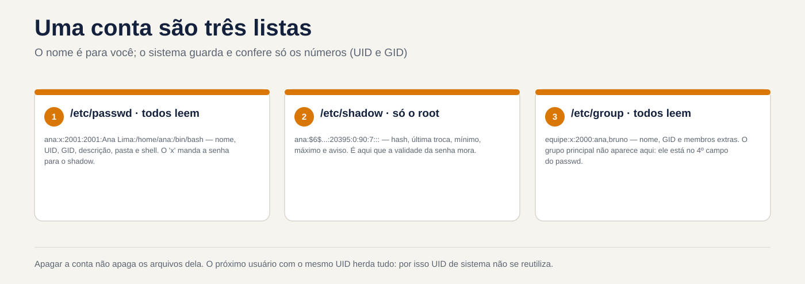
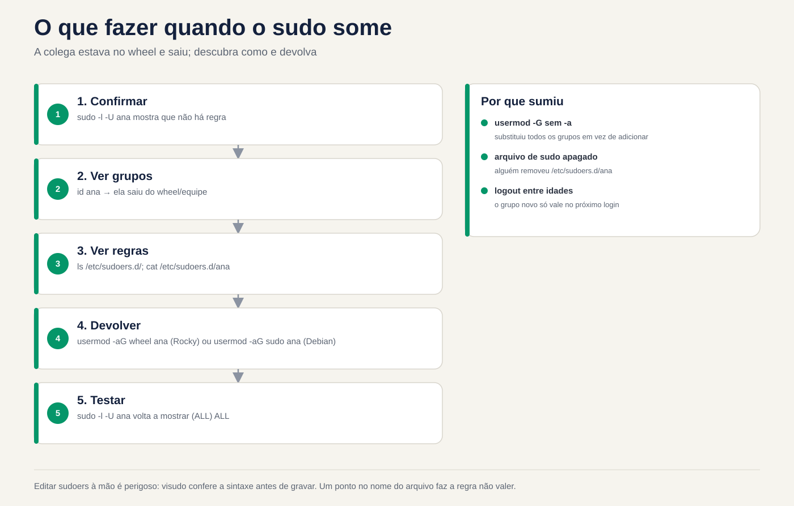

# Lezione 2.6 · Utenti e gruppi

Sesta lezione del Modulo 2. La creazione di un utente richiede un comando. Il vero lavoro è nel resto del ciclo: lo stagista che entra lunedì, il collega che cambia settore e ha bisogno di un altro gruppo, il lavoratore in somministrazione con una scadenza per uscire, il dipendente che è stato licenziato alle 17 e non può più entrare alle 17.05. Ogni passo ha un modo giusto e un modo che sembra giusto. `usermod -G` senza `-a` rimuove la persona da tutti gli altri gruppi senza preavviso. `useradd` di Debian crea l'account senza la cartella home. `passwd -l` blocca la password, ma la chiave SSH continua ad arrivare. E `userdel` lascia con noncuranza i file che verranno ereditati dall'utente creato successivamente. Oggi esegui l'intero ciclo su entrambe le VM, con gli stessi numeri su entrambe, e crei utenti debian-lab da rocky-lab, utilizzando la chiave e il nickname `deb` della lezione 2.5.

| File | lezione 2.6 |
| --- | --- |
| Modulo | M2 · Sistema, utenti e permessi, lezione 6 di 8 |
| Quando | Settimana 5 |
| Alla fine puoi | Leggere `/etc/passwd`, `/etc/shadow` e `/etc/group` campo per campo; sapere da dove provengono gli schemi di un nuovo conto (`useradd -D`, `/etc/login.defs`, `/etc/skel`); creare utenti e gruppi con UID e GID scelti, uguali su più server; inserire e uscire le persone dai gruppi senza eliminarne altri; forzare la modifica della password e impostare la scadenza della password e dell'account; bloccare un account reale, inclusa la chiave SSH; eliminare un account senza lasciare file orfani; seguire uno script quando un utente non riesce ad accedere |
| Articoli di prova | LE 015.2 (creare utenti e gruppi: `/etc/passwd`, `/etc/shadow`, `/etc/group`, `/etc/skel`, `useradd`, `groupadd`, `passwd`) · LPIC-1 107.1 (gestire account utenti e gruppi: `useradd`, `usermod`, `userdel`, `groupadd`, `groupmod`, `groupdel`, `passwd`, `chage`, `getent`, `/etc/skel`, `/etc/login.defs`) · RHCSA (creare, eliminare e modificare utenti locali; modificare password e regolare la scadenza delle password; creare, eliminare e modificare gruppi locali e chi appartiene ad essi; configurare l'accesso come superutente) |
| Prerequisiti | lezione 2.5 (tipi di account per UID; `sudo`; la chiave rock-lab installata in debian-lab e il nickname `deb`); lezione 1.4 (proprietario e permessi letti con `ls -l`) |
| Meteo | Intorno alle 2:30 |
| Istantanee | m2a6-start e m2a6-end in entrambe le VM |

## 1 · Riscaldamento

Tre domande, appena mi vengono in mente. Scrivi le risposte; la chiave di risposta viene visualizzata alla fine.

1. Esegui `usermod -G financeiro ana` per inserire Ana nel gruppo finanziario. Indovina: continua nei gruppi in cui era già?
2. Un dipendente è stato licenziato. Esegui `passwd -l joao`, che blocca la sua password. Indovina: se ha una chiave SSH installata, riesce comunque a entrare?
3. Elimini l'utente `temp` con `userdel temp` e una settimana dopo crei l'utente `carla`. Intuizione: potrebbe succedere che Carla diventi proprietaria dei file che appartenevano a `temp`?

## 2 · Perché è importante

I conti sono la prima cosa che un audit esamina e la prima cosa che cerca un utente malintenzionato. I risultati si ripetono in quasi tutti i server vecchi di qualche anno: account di persone che se ne sono andate mesi fa, ancora attivi; un utente del servizio con shell `/bin/bash` e password; il gruppo `wheel` con nove persone quando ne servivano tre; File senza proprietario in `/srv` perché qualcuno ha cancellato l'account senza guardare cosa conteneva.

Il ciclo di vita di un account ha quattro momenti e ognuno presenta un errore classico:

| Momento | Cosa chiede l'azienda | Il classico errore |
| --- | --- | --- |
| Ingresso | "Bruno inizia lunedì, stesso accesso di Ana" | Copiare manualmente la riga del `/etc/passwd` oppure dimenticare la cartella personale |
| Cambia | "Ana si è trasferita nella finanza" | `usermod -G` senza `-a`: escono tutti gli altri gruppi, compreso `sudo` |
| Scadenza | "L'appaltatore resta fino al 31 dicembre" | Scrivilo su carta e dimenticalo. Quello che è certo è che il conto scadrà da solo |
| Uscita | "João era disconnesso, taglia tutto adesso" | `passwd -l` e basta. La sua chiave SSH continua ad arrivare |

E c'è il problema che si presenta solo quando hai più di un server: lo stesso utente con numeri diversi su ognuno. Ana ha l'UID 1001 su un server e 1003 sull'altro. Quando un disco o una cartella di rete passano da un disco all'altro, i file su di esso appaiono come appartenenti a qualcun altro. Il sistema memorizza il numero, non il nome.

## 3 · Modello mentale

> Un conto è una riga composta da tre file di testo. Il nome è per te; il sistema memorizza e controlla solo i numeri. Ogni comando in questa lezione è un modo sicuro per modificare queste righe.

```text
/etc/passwd   (todos leem)        ana:x:2001:2001:Ana Lima:/home/ana:/bin/bash
                                       │   │    │      │        │         │
                                       │  UID  GID  descrição  pasta    shell
                                       └─ a senha não está aqui: "x" = veja o shadow

/etc/shadow   (só o root lê)      ana:$6$...:20395:0:90:7:::
                                       │      │   │  │  │
                                     hash  última  mín máx aviso   (+ inativa, expira)
                                            troca

/etc/group    (todos leem)        equipe:x:2000:ana,bruno
                                     │      │    │
                                   nome    GID  membros extras (o grupo principal não aparece aqui)

/etc/skel/                        modelo copiado para a pasta pessoal de cada conta nova
/etc/login.defs                   padrões: faixa de UID, validade de senha, criar pasta
```

Quattro idee guidano la lezione:

| Idea | Cosa intendi | Conseguenza |
| --- | --- | --- |
| Il sistema memorizza i numeri | File, processi e autorizzazioni memorizzano UID e GID, non nomi | L'eliminazione di un account non elimina i suoi file; l'utente successivo con lo stesso numero eredita tutto |
| Gruppo principale e gruppi extra | La principale è nel campo 4 del `/etc/passwd`; gli extra, nel campo 4 del `/etc/group` | `usermod -G` scambia l'intera lista degli extra; `-aG` aggiunge |
| Password e account sono cose diverse | La password potrebbe essere bloccata con l'account attivo e l'account potrebbe scadere con la password valida | Per interrompere veramente l'accesso, far scadere l'account; password di blocco non per la chiave SSH |
| I gruppi sono validi al momento del login | Il processo riceve l'elenco dei gruppi all'avvio della sessione | Chiunque sia stato inserito in un gruppo accede solo ad una nuova sessione |



*Il nome è per te; il sistema memorizza e controlla solo i numeri.*

## 4 · Concetto a strati

### Essenziale

**Leggi i tre elenchi.** Usa `getent` invece di aprire il file: mostra la stessa riga, e funziona anche quando gli account provengono da una directory centrale, come Active Directory, oggetto del corso EX342 in seguito.

```bash
getent passwd rodrigo
getent group rodrigo
sudo getent shadow rodrigo | cut -d: -f1,3-     # senza l'hashish
id rodrigo
```

```text
rodrigo:x:1000:1000:Rodrigo:/home/rodrigo:/bin/bash
rodrigo:x:1000:
rodrigo:20380:0:99999:7:::
uid=1000(rodrigo) gid=1000(rodrigo) groups=1000(rodrigo),10(wheel)
```

Il `cut` rimuove il secondo campo, l'hash della password. Non è la password, ma non c'è motivo di lasciarla sullo schermo, nella cronologia del terminale o in una chiamata. I campi in `/etc/shadow`:

| Campo | Esempio | Voglio dire |
| --- | --- | --- |
| 1 · nome | `rodrigo` | Il conto |
| 2 · hash | `$6$...` o `$y$...` | La password criptata. `!` o `!!` all'inizio = password bloccata; `*` = mai avuto una password |
| 3 · ultimo scambio | `20380` | Giorni dal 1° gennaio 1970. `0` = modifica al prossimo accesso |
| 4 · minimo | `0` | Giorni che devi aspettare per cambiare di nuovo |
| 5 · massimo | `99999` | Giorni fino alla scadenza della password. `99999` = mai, in pratica |
| 6 · avvertenza | `7` | Giorni di preavviso prima della scadenza |
| 7 · inattivo | vuoto | Giorni dopo la vincita, quando puoi ancora partecipare e scambiare |
| 8 · scade | vuoto | Data di scadenza del **conto**, in giorni dal 1970 |

Nessuno legge questi numeri a memoria. `chage -l` traduce:

```bash
sudo chage -l rodrigo
```

**Crea un utente e un gruppo.** Lo stesso comando funziona allo stesso modo in Rocky e Debian quando non ti fidi delle impostazioni predefinite:

```bash
sudo groupadd -g 2000 equipe
sudo useradd -u 2001 -c "Ana Lima" -m -s /bin/bash ana
sudo passwd ana
```

| Opzione | Fare |
| --- | --- |
| `-u 2001` | Scegli l'UID. Senza di esso, `useradd` prende l'UID più grande in uso + 1 |
| `-c "Ana Lima"` | La descrizione, il nome completo |
| `-m` | Creare la cartella home copiando `/etc/skel` |
| `-s /bin/bash` | La conchiglia |
| `-g grupo` | Il gruppo principale. Senza di esso, crea un gruppo con lo stesso nome dell'account |
| `-G a,b` | Sono già stati creati gruppi aggiuntivi |

`passwd ana` chiede due volte la nuova password. Come root, non richiede la vecchia password.

**Inserisci ed esci dai gruppi.**

```bash
sudo usermod -aG equipe ana        # aggiunge. La -a è ciò che conta
sudo gpasswd -a bruno equipe       # lo stesso, in un altro modo
sudo gpasswd -d bruno equipe       # prelevare da un unico gruppo
getent group equipe
```

**Elimina.**

```bash
sudo userdel -r ana                # elimina account, cartella Inizio e casella di posta locale
sudo groupdel equipe
```

### Intermedio

**Da dove provengono le impostazioni predefinite.** Un nuovo account viene creato in tre posizioni:

| Luogo | Cosa definisce | Visualizza con |
| --- | --- | --- |
| `/etc/login.defs` | Gamma UID e GID di persone e sistemi; validità della password predefinita; viene creata la cartella personale; autorizzazione cartella; gruppo con nome account | `grep -v -E '^#\|^$' /etc/login.defs` |
| `/etc/default/useradd` | Shell predefinita, cartella home, `/etc/skel`, account inattivo | `useradd -D` |
| `/etc/skel/` | I file che vanno nella nuova cartella home | `ls -la /etc/skel` |

La modifica di uno di essi si applica solo agli account **creati successivamente**. Mettere `PASS_MAX_DAYS 90` in `login.defs` non cambia la validità di chi già esiste; per questi è `chage`.

**`useradd` × `adduser`.** In Rocky, `adduser` è solo un altro nome per `useradd`. In Debian, `adduser` è un altro programma: interattivo, crea la cartella, chiede password e nome e usa i propri valori predefiniti, da `/etc/adduser.conf`. Negli script e nei test, utilizzare `useradd` con opzioni esplicite: il comando è lo stesso in entrambe le famiglie e fa esattamente quello che è scritto.

**Validità password e account.**

```bash
sudo chage -d 0 ana                  # cambiare la password al prossimo accesso
sudo chage -M 90 -m 1 -W 7 ana       # scadenza tra 90 giorni, attendere 1 per lo scambio, avvisare 7 in anticipo
sudo chage -E 2026-12-31 bruno       # l'ACCOUNT scade in quella data
sudo chage -E -1 bruno               # rimuovere la data di scadenza
sudo chage -l bruno
```

`passwd -e ana` fa lo stesso di `chage -d 0`. La differenza tra password scaduta e account scaduto è la più importante nel test:

|  | Password scaduta (`-M`, `-d 0`) | Conto scaduto (`-E`) |
| --- | --- | --- |
| Cosa succede al login | Accedi, ma prima sei obbligato a cambiare la password | Non è possibile entrare, né con password né con chiave |
| Messaggio | `You are required to change your password immediately` | `Your account has expired; please contact your system administrator` |
| Per cosa | Politica sulla password, password iniziale | In outsourcing con scadenza, arresto |

**Blocca × scade × rimuovi guscio.** Tre chiavistelli, ciascuno chiude una porta:

| Comando | Chiudi | Non chiude |
| --- | --- | --- |
| `usermod -L` o `passwd -l` | Accedi con password | Chiave SSH, `su` creata da root, processi che sono già in esecuzione |
| `usermod -e 1` o `chage -E 0` | Ogni login che passa attraverso PAM, con password o chiave | Processi già in esecuzione |
| `usermod -s /sbin/nologin` | Guscio interattivo | Trasferimento file tramite SFTP, se configurato senza shell; processi in esecuzione |

Per hackerare una persona reale: far scadere l'account, bloccare la password e terminare qualunque cosa sia in esecuzione con `loginctl terminate-user nome` o `pkill -u nome`.

**I gruppi sono validi all'accesso.** Il kernel fornisce l'elenco dei gruppi al processo all'avvio della sessione. Se inserisci Ana nel gruppo `equipe` adesso, la sessione che aveva già aperto continuerà senza di esso:

```bash
id ana          # ora legge /etc/group: mostra team
id              # esegui ALL'INTERNO della vecchia sessione di Ana: non viene visualizzato
```

Deve uscire ed entrare di nuovo. Per testare subito, senza uscire, `newgrp equipe` apre una nuova shell con il gruppo.

### Ponte Windows

| Finestre | Linux | La differenza che conta |
| --- | --- | --- |
| `lusrmgr.msc`, `net user`, `New-LocalUser` | `useradd`, `usermod`, `userdel` | In Linux tutto è testo: puoi leggerlo e controllarlo con `getent` e `grep` |
| SID (`S-1-5-21-...-1001`) | UID | Il SID è univoco per macchina o dominio; l'UID è semplicemente un numero e lo stesso numero su due server è la stessa persona per |
| Gruppo Amministratori | `wheel` (Rocky) o `sudo` (Debian) | Essere nel gruppo dà diritto a **chiedere** con `sudo`, non diretto |
| "L'utente deve modificare la password all'accesso successivo" | `chage -d 0` | Idem |
| "Il conto scade tra" | `chage -E data` | Lo stesso, e blocca anche la chiave SSH |
| "Account disabilitato" | `chage -E 0`, più `usermod -L` | `passwd -l` da solo non è "disabilita": la chiave SSH rimane |
| `Add-LocalGroupMember` | `usermod -aG` o `gpasswd -a` | Su Windows non si verifica alcun errore di dimenticanza `-a` |
| Profilo standard (`C:\Users\Default`) | `/etc/skel` | Idem: copiato al momento della creazione, solo per i nuovi account |
| L'account eliminato lascia il SID orfano nelle autorizzazioni | L'account eliminato lascia l'UID orfano nei file | Su Linux, l'utente successivo con lo stesso UID eredita tutto |

### Advanced

**UID e GID uguali su tutti i server.** Quando i server condividono file (NFS, dischi che cambiano macchine, backup ripristinati altrove), l'UID deve essere lo stesso su tutti. Senza rubrica centrale, la regola è scegliere il numero al momento della creazione, con `-u` e `-g`, e trascriverlo. Una corsia riservata al solo personale aziendale, lontana dalle 1000 utilizzate dall'impianto, impedisce gli incidenti. In una rubrica centrale il numero viene da lì, e questo è ciò che fa EX342.

**`vipw` e `vigr`.** Se dovete modificare manualmente `/etc/passwd` o `/etc/group`, usate `sudo vipw` e `sudo vigr`. Bloccano il file mentre lo modifichi, quindi nessun `useradd` può registrare contemporaneamente, e alla fine ti chiedono se vuoi modificare anche `shadow` o `gshadow`. Stesso ruolo di `visudo` per `sudoers`.

**`pwck` e `grpck`.** Verificare la coerenza dei quattro elenchi: righe mal formate, cartella personale inesistente, gruppo inesistente, account in `passwd` senza riga in `shadow`. Con `-r` si leggono e basta e non cambiano nulla:

```bash
sudo pwck -r
sudo grpck -r
```

**Le copie con `-`.** Ogni volta che un comando del pacchetto `shadow` scrive `/etc/passwd`, `/etc/shadow`, `/etc/group` o `/etc/gshadow`, salva la versione precedente con un `-` alla fine del nome: `/etc/group-`. È il tuo "annullamento" in un solo passaggio. `diff /etc/group- /etc/group` mostra esattamente cosa è cambiato con l'ultimo comando.

**Password del gruppo e `gshadow`.** `/etc/gshadow` memorizza la password del gruppo e gli amministratori del gruppo (`gpasswd -A`). Password di gruppo che quasi nessuno usa; L'amministratore di gruppo è utile quando il capo di un settore può aggiungere e rimuovere persone dal suo gruppo senza avere `sudo`.

**Account di sistema.** `useradd -r` crea un account nell'intervallo di sistema (sotto 1000), senza cartella e, se lo chiedi, senza shell: `useradd -r -s /sbin/nologin -d /var/lib/app app`. Ecco come un pacchetto crea l'utente di un servizio.

**Algoritmo hash.** L'inizio del secondo campo di `shadow` dice l'algoritmo: `$6$` è SHA-512, standard in Rocky 9; `$y$` è yescrypt, standard in Debian 13. L'algoritmo deriva da `ENCRYPT_METHOD` in `login.defs` e dalla configurazione PAM, ed è valido solo per le password modificate successivamente.

### Cosa rientra nel test

- **LE e LPIC-1:** i sette campi di `/etc/passwd`, i campi di `/etc/shadow` e `/etc/group`; il ruolo dei `/etc/skel` e `/etc/login.defs`; le opzioni del `useradd` (`-m`, `-d`, `-s`, `-u`, `-g`, `-G`, `-c`, `-e`, `-r`); la differenza tra `-G` e `-aG` nel `usermod`; `userdel -r`; `chage -l`, `-d`, `-M`, `-m`, `-W`, `-I`, `-E`; cosa significano `!` e `*` nel campo password; `getent`.
- **RHCSA:** compiti pratici, successivamente verificati tramite script. Crea utenti con UID esatto, gruppo extra, shell esatta (incluso `nologin`) e password definita; creare un gruppo con GID esatto; inserire l'utente nel gruppo senza togliere nulla agli altri; validità password (`chage`) e default per i nuovi utenti (`login.defs`); dare `sudo` a un gruppo. Lo script corrisponde a `id`, `getent` e `chage -l`, quindi controllalo tu stesso prima di completare l'attività.

## 5 · Rocky × Debian

| Cosa | Roccioso 9 | Debian 13 |
| --- | --- | --- |
| `useradd` crea la cartella Inizio senza `-m` | Sì (`CREATE_HOME yes` in `login.defs`) | **NO**. Senza `-m` l'account viene creato senza cartella |
| `useradd` shell predefinita | `/bin/bash` | `/bin/sh` (verificare con `useradd -D`) |
| `adduser` | Un altro nome per `useradd` | Proprio programma interattivo con `/etc/adduser.conf` |
| Gruppo `sudo` | `wheel` | `sudo` |
| Intervallo UID persone | da 1000 a 60000 | Da 1000 a 60000 |
| Algoritmo hash | SHA-512 (`$6$`) | sìcrypt (`$y$`) |
| Password bloccata in `shadow` | `!!` per account creato senza password; `!` dopo `passwd -l` | `!` |
| `passwd -S` | `ana PS ...` con l'algoritmo tra parentesi | `ana P ...` |
| `/etc/skel` | `.bashrc`, `.bash_profile`, `.bash_logout` | `.bashrc`, `.profile`, `.bash_logout` |
| Casella postale locale cancellata da `userdel -r` | `/var/spool/mail/nome` | `/var/mail/nome`, se esiste |
| Shell degli account di sistema | `/sbin/nologin` | `/usr/sbin/nologin` |
| `lastlog` (ultimo accesso per ogni account) | Disponibile | Potrebbe mancare in Debian 13; usare `last` o `wtmpdb last` |

## 6 · Laboratorio guidato

In questo laboratorio, rocky-lab è la tua stazione di lavoro: crei lì gli account e, utilizzando la chiave e il nickname `deb` della lezione 2.5, crei gli stessi account in debian-lab senza aprire un'altra sessione. Mantieni comunque un terminale aperto su ciascuna VM, dal tuo PC: pochi passaggi testano l'accesso di un altro utente e nel frattempo vorrai che la tua sessione `rodrigo` sia intatta.


*Modificare i sudoer manualmente è pericoloso: visudo controlla la sintassi prima di salvare.*


Password: i passaggi richiedono di impostare le password per gli utenti di prova. Utilizzare una password lab che si utilizza solo su queste VM e inserirla personalmente quando richiesto da `passwd`.

### Passo 0 · Istantanea e il percorso di debian-lab

In Proxmox, acquisire l'istantanea `m2a6-inicio` delle due VM. In rocky-lab, controlla che la chiave e il nickname dell'ultima lezione funzionino ancora:

```bash
eval "$(ssh-agent -s)"; ssh-add
ssh -o BatchMode=yes deb 'hostname; id -un'
```

La risposta deve essere `debian-lab` e `rodrigo`, senza alcuna domanda. Se richiede una password, torna allo script del passo 8 della Lezione 2.5 prima di procedere: l'intero lab dipende da questo percorso.

### Passo 1 · I tre elenchi, campo per campo

In rocky-lab:

```bash
getent passwd rodrigo root chronyd nobody
getent group wheel rodrigo
sudo getent shadow rodrigo root | cut -d: -f1,3-
sudo getent shadow rodrigo | cut -c1-12
```

L'ultimo comando mostra solo l'inizio dell'hash: `rodrigo:$6$...`. `$6$` è SHA-512. Ora la stessa cosa in Debian-Lab, da dove ti trovi:

```bash
ssh deb 'getent passwd rodrigo; getent group sudo'
ssh -t deb 'sudo getent shadow rodrigo | cut -c1-12'
```

In Debian l'inizio è `$y$`: yescrypt. `-t` serve per `sudo` avere uno spazio dove chiedere la password, come nell'ultima lezione. Confronta anche la riga in `root` in `shadow` di rocky-lab: se il secondo campo inizia con `!` o è `*`, la password di root è bloccata o non è mai esistita, che corrisponde a `passwd -S root` della lezione 2.5.

Ora conta gli account di ciascun tipo:

```bash
awk -F: '$3 >= 1000 && $3 < 65534 {print $1, $3, $7}' /etc/passwd
awk -F: '$3 > 0 && $3 < 1000' /etc/passwd | wc -l
```

Il primo elenca le persone, con la shell. Il secondo conta gli account di sistema: decine, uno per servizio. `nobody`, con UID 65534, è un account speciale per "nessuno" ed è escluso da entrambi.

### Passo 2 · Da dove provengono i pattern

Sulle due VM, eseguire ciascuna riga in una e poi nell'altra (in Debian-lab, prefisso con `ssh deb`):

```bash
useradd -D
grep -E '^(UID_MIN|UID_MAX|SYS_UID_MAX|PASS_MAX_DAYS|PASS_WARN_AGE|CREATE_HOME|USERGROUPS_ENAB|HOME_MODE|ENCRYPT_METHOD)' /etc/login.defs
ls -la /etc/skel
```

Nota tre differenze: la `SHELL=` di `useradd -D`, la riga `CREATE_HOME` (che esiste in Rocky e non in Debian) e i file `/etc/skel`. Di seguito spiegano Decide e Break B.

**Decide 1 · L'utente Debian.** È necessario creare l'utente `bruno` in debian-lab, tramite script, in modo che possa entrare tramite SSH con la cartella home e Bash. Quale comando?

- **A)** `sudo useradd bruno`
- **B)** `sudo useradd -m -s /bin/bash bruno`
- **C)** `sudo adduser bruno`
- **D)** `sudo useradd -s /bin/bash bruno`

Scegliere la lettera prima di guardare la tabella.

| Se hai selezionato | Risultato | Perché |
| --- | --- | --- |
| A | ❌ Sbagliato | In Debian, senza `-m` non c'è la cartella home e la shell predefinita è `/bin/sh`. Bruno entra, riceve `Could not chdir to home directory` e un prompt `$` senza cronologia né frecce. È la pausa B di questa lezione. |
| B| ✅ Giusto | `-m` crea la cartella e copia `/etc/skel`; `-s` definisce la shell. Lo stesso comando fa lo stesso in Rocky. Nello scripting, l'esplicito batte lo standard. |
| C| ⚠️ Funziona, ma | In Debian, `adduser` crea tutto correttamente, ma è interattivo: richiede password, nome completo, numero di telefono. In uno script si blocca in attesa di una risposta, a meno che non si passino le opzioni per non chiedere. E in Rocky è proprio `useradd`, con un comportamento diverso. |
| D | ❌ Sbagliato | La shell va bene, ma senza `-m` non c'è ancora nessuna cartella. Metà del problema. |

**Da risolvere:** nello script e nel test, `useradd -m -s /bin/bash`, sempre. Non fidarti del modello di distribuzione.

### Passo 3 · Gli stessi utenti, con gli stessi numeri, su entrambe le VM

In rocky-lab:

```bash
sudo groupadd -g 2000 equipe
sudo useradd -u 2001 -c "Ana Lima" -m -s /bin/bash ana
sudo useradd -u 2002 -c "Bruno Costa" -m -s /bin/bash bruno
sudo passwd ana
sudo passwd bruno
id ana; id bruno
ls -la /home/ana
```

Nota: senza `-g`, ognuno ha un gruppo con il proprio nome, con lo stesso numero UID (`gid=2001(ana)`). È `USERGROUPS_ENAB yes` di `login.defs`. La cartella `/home/ana` contiene i file di `/etc/skel`, tutti di `ana`, e la cartella è `drwx------`: va dentro solo quello.

Ora debian-lab, da rocky-lab. Un comando alla volta, per vedere dove fallirebbe:

```bash
ssh -t deb 'sudo groupadd -g 2000 equipe'
ssh -t deb 'sudo useradd -u 2001 -c "Ana Lima" -m -s /bin/bash ana'
ssh -t deb 'sudo useradd -u 2002 -c "Bruno Costa" -m -s /bin/bash bruno'
ssh -t deb 'sudo passwd ana'
ssh -t deb 'sudo passwd bruno'
```

Verifica che i numeri corrispondano:

```bash
for u in ana bruno; do echo "rocky:  $(id $u)"; echo "debian: $(ssh deb id $u)"; done
```

Le righe devono essere uguali due a due. Nella vita reale, questo è ciò che garantisce che un backup del `/home/ana` di rock-lab, ripristinato in debian-lab, rimanga di Ana.

Verifica il login reale, da rock-lab a debian-lab, con la password che hai definito:

```bash
ssh ana@debian-lab 'pwd; echo $SHELL; ls -a'
```

Rispondi: `/home/ana`, `/bin/bash` e i file Debian `skel`, con `.profile` al posto di `.bash_profile`.

### Passo 4 · Gruppi: aggiungi senza eliminare

Su Rocky-Lab, prima una sessione di Ana che rimarrà aperta. Nel **terminale rocky-lab che hai aperto sul tuo PC**, entra come Ana e lascialo lì:

```bash
ssh ana@localhost
id
```

Appare solo con `groups=2001(ana)`. Nell'altro terminale, come `rodrigo`:

**Decidi 2 · Inserisci Ana nel gruppo.** Ana deve unirsi al gruppo `equipe`, senza perdere nessun gruppo che già possiede, oggi o in futuro. Quale comando?

- **A)** `sudo usermod -G equipe ana`
- **B)** `sudo usermod -aG equipe ana`
- **C)** `sudo vim /etc/group` e aggiungere `ana` alla fine della riga di `equipe`
- **D)** `newgrp equipe`

Scegliere la lettera prima di guardare la tabella.

| Se hai selezionato | Risultato | Perché |
| --- | --- | --- |
| A | ❌ Sbagliato | Oggi sembra funzionare, perché Ana non ha altri gruppi extra. Ma `-G` senza `-a` **scambia** l'intera lista: se fosse in `wheel`, lo lascerebbe. Usa il comando giusto ogni volta, non quello che funziona oggi. È la pausa A. |
| B | ✅ Giusto | Il `-a` di *append* aggiunge il gruppo e mantiene gli altri. `sudo gpasswd -a ana equipe` fa lo stesso ed ha anche ragione. |
| C| ⚠️ Funziona, ma | Il risultato nel file è lo stesso, ma la modifica manuale rischia di commettere errori di battitura e `vim` non blocca il file contro la scrittura simultanea di un altro comando. Se si modifica manualmente, è `sudo vigr`. |
| D | ❌ Sbagliato | `newgrp` apre la **tua** shell con un altro gruppo attivo e solo se ne fai già parte. Non inserire nessuno in nessun gruppo. |

**Per risolvere:** un gruppo extra viene aggiunto con `usermod -aG` o `gpasswd -a`. Senza `-a` è una sostituzione.

Ruota quello di destra e aggiungi Bruno dall'altro lato:

```bash
sudo usermod -aG equipe ana
sudo gpasswd -a bruno equipe
getent group equipe
diff /etc/group- /etc/group
```

Il `getent` mostra `equipe:x:2000:ana,bruno`. `diff` mostra la riga prima e dopo l'**ultimo** comando: `/etc/group-` è la copia salvata da `gpasswd`.

Ora torna al terminale dove Ana è loggata:

```bash
id                 # all'interno della vecchia sessione di Ana
id ana             # cosa dice il sistema adesso
```

La prima non mostra `equipe`; il secondo mostra. La sessione di Ana ha ricevuto l'elenco dei gruppi all'inizio. Uscire (`exit`) e rientrare con `ssh ana@localhost`: ora `id` mostra `equipe`. Esci di nuovo.

Fai lo stesso su debian-lab, tramite `deb`:

```bash
ssh -t deb 'sudo usermod -aG equipe ana && sudo gpasswd -a bruno equipe && getent group equipe'
```

### Passo 5 · Password iniziale e validità

In rocky-lab, la politica aziendale: password iniziale cambiata al primo accesso, validità di 90 giorni, preavviso di 7. E Bruno è in outsourcing, con un contratto fino al 31 dicembre.

**Decidi 3 · Password cambiata al primo accesso.** Imposta un password iniziale di Ana e voglio che sia costretta a cambiarla al primo accesso. Quale comando?

- **A)** `sudo chage -d 0 ana`
- **B)** `sudo chage -M 0 ana`
- **C)** `sudo passwd -l ana`
- **D)** Cambia `PASS_MAX_DAYS` in `0` in `/etc/login.defs`

Scegli la lettera prima di guardare la tabella.

| Se hai selezionato | Risultato | Perché |
| --- | --- | --- |
| A | ✅ Giusto | Imposta la data dell'ultimo scambio sul giorno zero. La password viene considerata scaduta e all'accesso successivo sarà necessario modificarla. `sudo passwd -e ana` fa lo stesso. |
| B | ⚠️ Funziona, ma | È obbligata a cambiarla adesso, ma anche **ogni** volta in seguito: con una validità massima di zero giorni, la nuova password è già scaduta. Riceverai una chiamata domani. |
| C| ❌ Sbagliato | Blocca la password. Non riesce nemmeno a cambiarsi. |
| D | ❌ Sbagliato | `login.defs` si applica solo agli account creati successivamente. Ana esiste già e non cambia nulla. |

**Da risolvere:** modifica al prossimo accesso = `chage -d 0`. Validità = `chage -M`. Impostazione predefinita per fatture future = `login.defs`.

Applica polizza:

```bash
sudo chage -d 0 ana
sudo chage -M 90 -W 7 ana
sudo chage -E 2026-12-31 bruno
sudo chage -l ana
sudo chage -l bruno
sudo passwd -S ana
```

`chage -l ana` dice `Last password change : password must be changed` e `Maximum number of days between password change : 90`. Bruno dice `Account expires : Dec 31, 2026`.

Test Primo accesso di Ana:

```bash
ssh ana@localhost
```

Dopo la password attuale, SSH mostra `WARNING: Your password has expired. You must change your password now and login again!`. Richiede nuovamente la password corrente e due volte quella nuova e chiude la connessione. Entra nuovamente con la nuova password: ora vai direttamente. Esci.

Ripeti la policy in debian-lab:

```bash
ssh -t deb 'sudo chage -d 0 ana && sudo chage -M 90 -W 7 ana && sudo chage -E 2026-12-31 bruno && sudo chage -l bruno'
```

### Passo 6 · Interrompere l'accesso: cosa chiude ogni blocco

La chiamata: "Bruno è stato disconnesso ora, interrompere l'accesso". Innanzitutto, prepara lo scenario che di solito presenta la vita reale: Bruno ha una chiave SSH installata. Su rocky-lab, usa la tua chiave pubblica come se fosse la sua, solo per il test:

```bash
sudo install -d -m 700 -o bruno -g bruno /home/bruno/.ssh
sudo install -m 600 -o bruno -g bruno ~/.ssh/id_ed25519.pub /home/bruno/.ssh/authorized_keys
ssh -o BatchMode=yes bruno@localhost id
```

Inserita come `bruno`, utilizzando la chiave. Ora il primo lucchetto, quello che usano quasi tutti:

```bash
sudo usermod -L bruno
sudo passwd -S bruno
ssh -o BatchMode=yes bruno@localhost id
```

`passwd -S` dice `LK` (Rocky) o `L` (Debian): password bloccata. E `ssh` **entra comunque**. Il lock mette un `!` davanti all'hash; Ciò impedisce il controllo della password, ma la chiave non utilizza una password. Con lo standard `UsePAM yes` di entrambe le distribuzioni, anche `sshd` non tiene conto di questo `!`.

Il secondo crash, quello che conta:

```bash
sudo chage -E 0 bruno
ssh -o BatchMode=yes bruno@localhost id; echo "rc=$?"
sudo journalctl -u sshd -n 5 --no-pager | grep -i -E 'expired|bruno'
```

Ora `ssh` fallisce e il log dice perché: l'account è scaduto. La scadenza viene controllata da PAM nella fase dell'account, che si applica alla password e alla chiave. Nella vita reale, completerei il taglio con `sudo loginctl terminate-user bruno`, per chiudere le sessioni aperte, e poi con lo script di uscita Decide 4.

**Decide 4 · Fine alle 17:00.** Il dipendente se n'è andato. Il manager dice che i suoi file verranno ancora esaminati per un mese. Qual è la sequenza giusta per oggi?

- **A)** `sudo userdel -r joao`
- **B)** `sudo chage -E 0 joao`, `sudo usermod -L joao`, fine sessioni; cancellare l'account dopo la revisione, con i file già archiviati
- **C)** `sudo userdel joao`, mantenendo la cartella personale per la revisione
- **D)** `sudo passwd -d joao`, per rimuovere la propria password

Scegliere la lettera prima di guardare la tabella.

| Se hai selezionato | Risultato | Perché |
| --- | --- | --- |
| A | ⚠️ Funziona, ma | L'accesso termina immediatamente, ma con esso va anche la cartella personale, con ciò che il gestore ha voluto rivedere. E i suoi file fuori dalla cartella Home, in `/srv` o `/tmp`, sono orfani. L'eliminazione è l'ultimo passaggio, non il primo. |
| B | ✅ Giusto | Expire chiude la password e la chiave; bloccare la password è il secondo livello; le sessioni di chiusura eliminano ciò che era aperto. L'account continua a esistere, quindi i file continuano ad avere un proprietario e un nome. Dopo la revisione, lo archivi, cerchi cosa c'era fuori dalla cartella e lo elimini. |
| C| ❌ Sbagliato | La cartella rimane, ma ora appartiene a un numero senza nome. Il successivo utente creato potrà ricevere questo numero ed ereditare tutto. È il passaggio 7. |
| D | ❌ Sbagliato | `passwd -d` **cancella** la password: l'account ora non ha più password. Secondo la configurazione, entra senza digitare nulla nella console. E' l'opposto di quello che vuoi. |

**Per risolvere:** interrompere l'accesso = far scadere l'account (`chage -E 0`), bloccare la password (`usermod -L`) ed eliminare le sessioni. L'eliminazione dell'account avverrà più tardi.

Annulla le serrature di Bruno, perché ritorna nelle lezioni successive:

```bash
sudo chage -E 2026-12-31 bruno
sudo usermod -U bruno
sudo rm /home/bruno/.ssh/authorized_keys
sudo rmdir /home/bruno/.ssh
ssh -o BatchMode=yes bruno@localhost id; echo "rc=$?"
```

L'ultimo `ssh` ora fallisce (`rc=255`) perché la chiave è stata rimossa, non a causa della scadenza. È lo stato giusto: Bruno entra solo con la sua password.

### Passo 7 · Elimina senza lasciare eredità

In Rocky-Lab, crea un account temporaneo, lascia un file fuori dalla cartella personale ed eliminalo nel modo sbagliato:

```bash
sudo useradd -m -s /bin/bash temp1
id temp1
sudo -u temp1 touch /tmp/relatorio-temp1
sudo userdel temp1
ls -ld /home/temp1 /tmp/relatorio-temp1
```

`id` ha dato `uid=2003`: il più grande UID in uso (2002, da Bruno) più uno. Dopo `userdel` senza `-r` la cartella e il file sono ancora lì, e `ls` mostra `2003` al posto del proprietario: un numero senza nome. Cerca tutto in questa situazione:

```bash
sudo find / -xdev \( -nouser -o -nogroup \) -ls 2>/dev/null
```

Appaiono la cartella, il file e un altro che non hai creato: `/var/spool/mail/temp1`, la casella di posta locale che `useradd` di Rocky crea per ogni account. Anche `userdel` senza `-r` l'ha lasciata indietro.

Ora cosa succede una settimana dopo, quando arriva una nuova persona:

```bash
sudo useradd -m -s /bin/bash carla
id carla
ls -ld /home/temp1 /tmp/relatorio-temp1
```

Carla ha ricevuto l'UID 2003, il numero gratuito più alto. E `ls` ora mostra `carla` come proprietario della cartella e del file di `temp1`. Nessuno le ha dato nulla: il sistema memorizza solo il numero. Su un server reale, la cartella del dipendente precedente, con fogli di calcolo ed e-mail, ha appena cambiato proprietario.

Cancella tutto, con i percorsi precisati:

```bash
sudo userdel -r carla
sudo rm -r /home/temp1
sudo rm /tmp/relatorio-temp1
sudo rm /var/spool/mail/temp1
sudo find / -xdev \( -nouser -o -nogroup \) -ls 2>/dev/null
```

L'ultimo `find` ritorna vuoto. Il modo giusto per eliminare un account, nell'ordine: cercare i suoi file fuori dalla cartella (`sudo find / -xdev -user nome`), archiviare o trasmettere a un altro proprietario ciò che conta (`chown`), e solo allora `userdel -r nome`.

### Passaggio 8 · Lo script "l'utente non può accedere"

Quando un utente dice che non può accedere, seguilo dall'alto verso il basso. Ogni riga risponde a una domanda e la prima che va storta ne è la causa:

| Domanda | Comando | Cosa cercare |
| --- | --- | --- |
| Il conto esiste? | `getent passwd nome` | Vuoto = non esiste oppure il nome è sbagliato |
| La shell ti lascia entrare? | il 7° campo della stessa riga | `nologin` o `false` = non entra tramite shell |
| La password è bloccata? | `sudo passwd -S nome` | `L` o `LK` |
| L'account è scaduto o la password è scaduta? | `sudo chage -l nome` | `Account expires` nel passato; `password must be changed` |
| La cartella personale esiste ed è sua? | `ls -ld ~nome` | Non esiste, oppure proprietario e permesso errati |
| Tramite SSH: la chiave è accettata? | `ls -ld ~nome ~nome/.ssh ~nome/.ssh/authorized_keys` | Gli errori nella lezione 2.5 |
| Cosa ha detto il server? | `sudo journalctl -u sshd -n 20` (Debian: `-u ssh`) | `expired`, `Failed password`, `not allowed`, `refused` |

Prova lo script con Bruno, presso rocky-lab:

```bash
getent passwd bruno
sudo passwd -S bruno
sudo chage -l bruno | grep -i expires
ls -ld ~bruno
```

Va bene: esiste, Bash, password valida, conta fino a 12/31, la sua cartella. Entra.

## 7 · Rompi e aggiusta

### Pausa A · Il collega che ha perso `sudo`

Lo scenario: Ana è diventata amministratore junior e ha guadagnato `sudo`. In rocky-lab:

```bash
sudo usermod -aG wheel ana
sudo -l -U ana | tail -2
id ana
```

`sudo -l -U ana` mostra `(ALL) ALL` e `id` mostra `ana`, `wheel` e `equipe`. Una settimana dopo arriva la chiamata: "Ana si occuperà anche dei fogli di calcolo finanziari, inseritela nel gruppo". Chiunque abbia risposto ha fatto questo:

```bash
sudo groupadd financeiro
sudo usermod -G financeiro ana
```

**Osservare.** Nessun messaggio di errore. Il giorno dopo Ana apre un ticket: "`sudo` dice che non posso più farlo". Scopri come lei:

```bash
sudo -l -U ana
```

```text
User ana is not allowed to run sudo on rocky-lab.
```

**Diagnosi.** Inizia con i suoi gruppi, quindi chiedi al sistema cosa è cambiato:

```bash
id ana
diff /etc/group- /etc/group
```

`id` mostra solo `ana` e `financeiro`. `wheel` e `equipe` non ci sono più. `diff` racconta la storia: sulla falsariga di `wheel` e `equipe`, il `ana` c'era prima e non c'è più; sulla riga del `financeiro`, è apparsa. `usermod -G` ha ricevuto la lista `financeiro` e ha fatto esattamente quello che dice il manuale: la lista dei gruppi extra di Ana **è diventata** questa. Nella vita reale, lo stesso errore rimuove qualcuno dal gruppo che dà accesso alla cartella di rete, al database o a `docker`, e la chiamata arriva ore dopo, a un'altra persona, senza connessione apparente.

**Decidi A · La correzione.** Cosa esegui?

- **A)** `sudo usermod -aG wheel,equipe ana`
- **B)** `sudo usermod -G wheel ana`
- **C)** Crea `/etc/sudoers.d/ana` con `ana ALL=(ALL) ALL`
- **D)** `sudo userdel -r ana` e crea nuovamente l'account, con i gruppi giusti

Scegli la lettera prima di guardare la tabella.

| Se hai selezionato | Risultato | Perché |
| --- | --- | --- |
| A | ✅ Giusto | Restituisce esattamente i due gruppi che `diff` mostrava mancanti e mantiene `financeiro`, che era la richiesta. `-a` impedisce la ripetizione dell'errore di riparazione. |
| B| ❌ Sbagliato | Ancora lo stesso errore: ora Ana è solo nel `wheel` e perde il `financeiro` appena vinto e il `equipe`. |
| C| ⚠️ Funziona, ma | `sudo` ritorna, ma lungo un nuovo percorso di cui nessuno ricorderà l'esistenza. `equipe` manca ancora e il giorno in cui rimuoveranno Ana da `wheel`, avrà ancora `sudo` in quel file. Correggi la causa, non il sintomo. |
| D | ❌ Sbagliato | Cancellata la sua cartella Inizio a causa di un problema di gruppo. E se il nuovo account non riceve lo stesso UID, i suoi file altrove rimangono orfani. |

**Per risolvere:** quando i gruppi scompaiono, `diff /etc/group- /etc/group` mostra cosa è stato modificato dall'ultimo comando. Fix restituisce esattamente ciò che è venuto fuori, con `-aG`.

**Fix.**

```bash
sudo usermod -aG wheel,equipe ana
id ana
sudo -l -U ana | tail -2
```

Ora ripulisci la scena. Ana non ha bisogno di `sudo` nelle lezioni successive, e il gruppo `financeiro` era solo per rompere:

```bash
sudo gpasswd -d ana wheel
sudo gpasswd -d ana financeiro
sudo groupdel financeiro
id ana
```

Il `id` finale deve riportare `ana` e `equipe`. Si noti che `gpasswd -d` prende da **un** solo gruppo: è il modo sicuro per rimuovere, così come `-aG` è il modo sicuro per aggiungere.

### Break B · Il nuovo utente Debian

La chiamata: "Ho creato l'utente di João in debian-lab, entra ma il terminale è strano, senza frecce e senza colore". Riproduci ciò che ha fatto il creatore. In rocky-lab:

```bash
ssh -t deb 'sudo useradd -c "Joao Teste" joao && sudo passwd joao'
ssh joao@debian-lab
```

**Observe.** Il login funziona, ma:

```text
Could not chdir to home directory /home/joao: No such file or directory
$
```

Prova a premere la freccia su: appare `^[[A`. Prova `cd`: dà un errore, perché non c'è nessuna cartella a cui tornare. Uscire con `exit`.

**Diagnostique.** Lo script per il passo 8, nelle prime due righe e nella quinta:

```bash
ssh deb 'getent passwd joao; ls -ld /home/joao; useradd -D | grep SHELL'
```

```text
joao:x:2003:2003:Joao Teste:/home/joao:/bin/sh
ls: cannot access '/home/joao': No such file or directory
SHELL=/bin/sh
```

Due problemi, una causa. `/etc/passwd` punta a una cartella che non esiste e a `/bin/sh`, che in Debian è `dash`: una piccola e veloce shell per script, senza cronologia, senza completamento tramite Tab e senza frecce. Il `useradd` di Debian ha fatto esattamente quello che dice il suo standard: senza `-m` non crea una cartella; senza `-s` utilizzare `/bin/sh`. Chiunque l'abbia creato era abituato a Rocky, dove lo stesso comando avrebbe funzionato. Nella vita reale, questo appare ovunque uno script di creazione utente creato per una famiglia viene eseguito su un'altra.

**Decidi B · La correzione.** João non ha ancora salvato alcun file. Cosa fare?

- **A)** Eliminare l'account e crearlo di nuovo, con `useradd -u 2003 -c "Joao Teste" -m -s /bin/bash joao`, e impostare la password.
- **B)** `sudo mkdir /home/joao`
- **C)** `sudo usermod -s /bin/bash joao` e il gioco è fatto.
- **D)** `sudo adduser joao`, che in Debian crea tutto correttamente.

Scegliere la lettera prima di guardare il tabella.

| Se hai selezionato | Risultato | Perché |
| --- | --- | --- |
| A | ✅ Giusto | Nuovo account, senza file: ricreare con opzioni esplicite è la strada più breve e lascia tutto come un account creato dall'inizio, con lo stesso UID. Se João avesse già dei file, la soluzione sarebbe creare la cartella senza eliminare l'account: `install -d -m 700 -o joao -g joao /home/joao`, copiare `skel` con `cp -rT /etc/skel /home/joao`, colpire il proprietario con `chown -R joao:joao /home/joao` e cambiare la shell con `usermod -s /bin/bash joao`. |
| B| ❌ Sbagliato | La cartella ora esiste, ma appartiene a root: João ci entra e non riesce a registrare nulla. Senza i file `skel` e con la shell ancora `/bin/sh`. |
| C| ⚠️ Funziona, ma | Risolve lo strano terminale, ma João non ha ancora la cartella. Il primo programma che tenta di scrivere una configurazione su `~` fallirà. |
| D | ❌ Sbagliato | `adduser` rifiuta: `The user 'joao' already exists`. Crea nuovi account, non corregge quelli esistenti. |

**Da risolvere:** utente che entra in `/` con `$` e senza frecce = senza cartella e con `/bin/sh`. In Debian, `useradd` sempre con `-m -s /bin/bash`.

**Fix.**

```bash
ssh -t deb 'sudo userdel joao && sudo useradd -u 2003 -c "Joao Teste" -m -s /bin/bash joao && sudo passwd joao'
ssh joao@debian-lab 'pwd; echo $SHELL'
```

La risposta è `/home/joao` e `/bin/bash`. João era semplicemente al verde; cancella:

```bash
ssh -t deb 'sudo userdel -r joao'
ssh deb 'getent passwd joao; ls -d /home/joao'
```

`getent` torna vuoto e `ls` dice che la cartella non esiste.

### La lezione

Le due interruzioni hanno la stessa radice: un comando che ha fatto esattamente quello che ha detto, senza preavviso, e un risultato diverso da quello che la persona immaginava. `usermod -G` ha sostituito l'elenco perché è ciò che fa `-G`. `useradd` di Debian non ha creato una cartella perché il suo default è non crearla. Nessuno dei due ha commesso un errore. L'abitudine di questa lezione: **dopo aver creato o modificato un account, verificare con `id`, `getent` e `chage -l`, come farebbe uno script di correzione di prova**. E quando qualcosa non c'è più, il `diff` tra il file e la copia con `-` mostra cosa è cambiato con l'ultimo comando.

## 8 · Insidie

| Digiti o vedi | Cosa succede | Quello giusto |
| --- | --- | --- |
| `usermod -G grupo nome` | La persona lascia tutti gli altri gruppi extra, compreso `sudo` | `usermod -aG grupo nome` o `gpasswd -a nome grupo` |
| `useradd nome` su Debian | Conto senza cartella personale e con `/bin/sh` | `useradd -m -s /bin/bash nome`, in entrambe le famiglie |
| `adduser` in uno script su Debian | Lo script si blocca in attesa delle domande | `useradd` con opzioni esplicite |
| `passwd -l` disconnettere qualcuno | La chiave SSH continua ad arrivare | `chage -E 0`, `usermod -L` e chiudere le sessioni |
| `passwd -d nome` | Elimina la password: l'account rimane con **nessuna** password | `passwd -l` bloccare; `passwd -d` quasi mai |
| `userdel nome` senza guardare i file | File orfani; l'utente successivo con lo stesso UID eredita tutto | `find / -xdev -user nome` prima, archivio, dopo `userdel -r` |
| `chage -M 0` per forzare l'interruttore | La password scade ogni volta, per sempre | `chage -d 0` o `passwd -e` |
| Modificare `PASS_MAX_DAYS` in `login.defs` e attendere l'effetto | Valido solo per i nuovi account | `chage -M` in ogni conto già esistente |
| Metti qualcuno in un gruppo e chiedigli di testare nella stessa sessione | L'accesso non viene visualizzato; la sessione ha il vecchio elenco | Disconnettersi e riconnettersi oppure `newgrp grupo` per testare |
| Stesso utente con UID diverso su ciascun server | I file copiati o collegati in rete vengono visualizzati come | di qualcun altro `useradd -u` e `groupadd -g` con numeri scelti e annotati |
| Modificare `/etc/passwd` o `/etc/group` con `vim` | Un errore di battitura interrompe il login; nessun blocco contro la registrazione di un altro comando | `usermod`, `gpasswd`; a mano, solo con `vipw` o `vigr` |
| `sudo cat /etc/shadow` durante una chiamata o su uno schermo condiviso | Gli hash sono esposti | `sudo getent shadow nome \| cut -d: -f1,3-` |
| `groupdel` di un gruppo principale di qualcuno | `cannot remove the primary group of user` | Modificare il gruppo principale (`usermod -g`) o eliminare l'account prima di |
| `userdel` con l'utente loggato | `user nome is currently used by process N` | `loginctl terminate-user nome`, verificare con `who`, poi cancellare |

## 9 · Quiz

Dieci domande, senza consultare. Scrivere la lettera o la risposta a ciascuna e solo dopo aprire la chiave di risposta.

**1.** In `/etc/passwd` la riga è `ana:x:2001:2001:Ana Lima:/home/ana:/bin/bash`. Dov'è la password di Ana e cosa significa `x`?

**2.** Quale comando aggiunge l'utente `bruno` al gruppo `docker` senza rimuoverlo dagli altri?

- **A)** `usermod -G docker bruno`
- **B)** `usermod -aG docker bruno`
- **C)** `groupmod -G bruno docker`
- **D)** `newgrp docker bruno`

**3.** Hai inserito Ana nel gruppo `equipe`. Dice che nel terminale già aperto non ha ancora accesso alla cartella del gruppo. Cosa sta succedendo e cosa fa?

**4.** Scrivi il comando che crea l'utente `carlos`, con UID 3010, gruppo extra `equipe`, cartella home creata e shell Bash, in un modo che funzioni allo stesso modo in Rocky e Debian.

**5.** Qual è la differenza tra `chage -d 0 nome` e `chage -E 0 nome`?

**6.** Un dipendente se n'è andato. Hai eseguito `passwd -l joao` e un'ora dopo il registro mostra `Accepted publickey for joao`. Perché e cosa mancava?

**7.** Quale file viene copiato nella cartella Inizio di ogni nuovo account?

- **A)** `/etc/login.defs`
- **B)** `/etc/default/useradd`
- **C)** `/etc/skel/`
- **D)** `/etc/profile`

**8.** Hai cancellato l'utente `temp` con `userdel temp`. Quindi ha creato `carla` e lei è diventata proprietaria della vecchia cartella `temp`. Spiega il motivo e scrivi il comando che avresti dovuto eseguire prima di `userdel` per trovare i file `temp`.

**9.** A cosa serve il file `/etc/group-` e in che modo è d'aiuto quando un utente perde improvvisamente dei gruppi?

**10.** *Una politica aziendale richiede che ogni nuovo account abbia una validità massima della password di 60 giorni. Gli account esistenti non devono essere interessati. Quale modifica soddisfa questo requisito?*

- **A)** *Esegui `chage -M 60` per ogni utente in `/etc/passwd`.*
- **B)** *Imposta `PASS_MAX_DAYS 60` in `/etc/login.defs`.*
- **C)** *Imposta `INACTIVE=60` in `/etc/default/useradd`.*
- **D)** *Aggiungi `-M 60` alla riga `SHELL=` in `/etc/default/useradd`.*

## 10 · Flashcard e colla

### Da conoscere a memoria

- Un conto è una riga in `/etc/passwd`, `/etc/shadow` e `/etc/group`. Il sistema memorizza il numero, non il nome.
- `usermod -aG` aggiunge; `usermod -G` sostituisce. `gpasswd -a` e `gpasswd -d` operano in un unico gruppo.
- I gruppi sono validi al login: chi vince un gruppo necessita di una nuova sessione.
- In Debian, `useradd -m -s /bin/bash`. Senza questa, senza cartella e con `/bin/sh`.
- La password scaduta richiede di cambiarla; Il conto scaduto non entra. `chage -d 0` × `chage -E 0`.
- `passwd -l` non per chiave SSH. Taglia accesso = `chage -E 0` + `usermod -L` + chiudi sessioni.
- Prima di `userdel`, `find / -xdev -user nome`. Senza questo, l'UID successivo eredita i file.
- `login.defs` e `skel` sono validi solo per i nuovi account.

### Per consultare

| Domanda | Comando |
| --- | --- |
| La riga per un account o gruppo | `getent passwd nome`; `getent group grupo` |
| UID, GID e gruppi | `id nome` |
| Validità password e account | `sudo chage -l nome` |
| Stato della password | `sudo passwd -S nome` |
| Riga di `shadow` senza cancelletto | `sudo getent shadow nome \| cut -d: -f1,3-` |
| Impostazioni predefinite nuovo account | `useradd -D`; `grep -v -E '^#\|^$' /etc/login.defs`; `ls -la /etc/skel` |
| Crea gruppo con GID | `sudo groupadd -g 2000 equipe` |
| Crea utente completo | `sudo useradd -u 2001 -c "Nome" -m -s /bin/bash -G equipe nome` |
| Conto di sistema | `sudo useradd -r -s /sbin/nologin -d /var/lib/app app` |
| Imposta password | `sudo passwd nome` |
| Aggiungi a un gruppo | `sudo usermod -aG grupo nome` o `sudo gpasswd -a nome grupo` |
| Rimuovi da un gruppo | `sudo gpasswd -d nome grupo` |
| Cambia la shell | `sudo usermod -s /bin/bash nome` |
| Cambia il gruppo principale | `sudo usermod -g grupo nome` |
| Rinomina il gruppo o modifica GID | `sudo groupmod -n novo velho`; `sudo groupmod -g 2100 grupo` |
| Cambia password al prossimo accesso | `sudo chage -d 0 nome` o `sudo passwd -e nome` |
| Validità della password | `sudo chage -M 90 -m 1 -W 7 nome` |
| Conto con data di scadenza | `sudo chage -E 2026-12-31 nome`; eliminare: `-E -1` |
| Blocca e sblocca la password | `sudo usermod -L nome`; `sudo usermod -U nome` |
| Scade l'account ora | `sudo chage -E 0 nome` |
| Elimina sessioni | `sudo loginctl terminate-user nome` |
| File per un account | `sudo find / -xdev -user nome` |
| File senza proprietario | `sudo find / -xdev \( -nouser -o -nogroup \)` |
| Elimina account e cartella | `sudo userdel -r nome` |
| Elimina gruppo | `sudo groupdel grupo` |
| Cosa è cambiato con l'ultimo comando | `diff /etc/group- /etc/group`; `sudo diff /etc/shadow- /etc/shadow` |
| Modifica a mano, con blocco | `sudo vipw`; `sudo vigr` |
| Controlla la consistenza | `sudo pwck -r`; `sudo grpck -r` |
| Persone meccaniche | `awk -F: '$3 >= 1000 && $3 < 65534' /etc/passwd` |
| UID ripetuti | `cut -d: -f3 /etc/passwd \| sort -n \| uniq -d` |

### Flashcard

| Davanti | Verso |
| --- | --- |
| I 7 campi di `/etc/passwd` | nome : x : UID : GID : descrizione : cartella home : shell |
| Il `x` nel 2° campo del `/etc/passwd` | La password è in `/etc/shadow`, che solo root legge |
| `!` all'inizio dell'hash, in `shadow` | Password bloccata |
| `*` nel campo password | L'account non ha mai avuto una password; impossibile accedere tramite password |
| 3° campo di `shadow` = `0` | Cambia password al prossimo accesso |
| 4° campo del `/etc/group` | Gli arti in più. Chi ha il gruppo come gruppo principale non appare lì |
| `usermod -G` × `usermod -aG` | Sostituisce l'elenco dei gruppi aggiuntivi × aggiunge all'elenco |
| `gpasswd -d nome grupo` | Prendi da un singolo gruppo |
| `chage -d 0` | Password scaduta: entra, ma devi cambiarla |
| `chage -E 0` | Conto scaduto: non è possibile entrare, nemmeno con la chiave |
| `chage -M 0` | La password scade ogni volta, per sempre. Quasi sempre un errore |
| `passwd -d` | Elimina la password: l'account rimane senza password |
| Ciò che `passwd -l` non chiude | Login tramite chiave SSH e sessioni già aperte |
| `/etc/skel` | Modello di cartella personale, copiato al momento della creazione |
| `/etc/login.defs` | Impostazioni predefinite per i **nuovi** account: intervallo UID, scadenza, creazione cartella |
| `useradd -D` | Mostra la shell predefinita, la cartella home e `skel` |
| `useradd` su Debian senza `-m` | Nessuna cartella personale; conchiglia `/bin/sh` |
| `adduser` su Rocky × su Debian | Un altro nome per `useradd` × proprio programma interattivo |
| `useradd -r` | Account di sistema, UID inferiore a 1000 |
| UID scelto da `useradd` senza `-u` | UID della persona più grande in uso + 1 |
| `/etc/group-` | La versione precedente, salvata dall'ultimo comando che ha scritto il file |
| `vipw` e `vigr` | Modificare manualmente `passwd` e `group` con il lucchetto |
| `$6$` × `$y$` in hash | SHA-512 (Rocky 9) × yescrypt (Debian 13) |
| Il nuovo gruppo non viene visualizzato nella sessione aperta | I gruppi sono validi al momento del login. Esci ed entra, oppure `newgrp` |

## 11 · Esci dalla lista di controllo

- [ ] Leggo una riga da `/etc/passwd`, `/etc/shadow` e `/etc/group` e dico cosa significa ciascun campo.
- [ ] So da dove provengono le impostazioni predefinite per un nuovo account e che si applicano solo ai nuovi account.
- [ ] Creo un utente e un gruppo con un UID e un GID scelti, lo stesso su entrambe le VM, con la cartella e la shell giuste.
- [ ] Inserisco e rimuovo una persona da un gruppo senza modificare le altre.
- [ ] Spiego perché un nuovo gruppo non appare in una sessione già aperta.
- [ ] Forzo un cambio password al primo accesso e definisco validità della password e data di scadenza dell'account.
- [ ] Interrompo l'accesso da una persona reale, anche tramite chiave SSH, e dimostro che è stato violato.
- [ ] Cancello un account senza lasciare file orfani.
- [ ] Seguo lo script "l'utente non può accedere" finché non trovo la causa.

**Ultimo esercizio, senza guardare.** Tutto in debian-lab, da rocky-lab a `deb`, o direttamente in un terminale debian-lab. Senza aprire questa lezione:

1. Creare il gruppo `suporte` con GID 2100.
2. Creare l'utente `dani`, con UID 2101, nome "Dani Rocha", cartella home, Bash e i gruppi extra `suporte` e `equipe`. Imposta una password.
3. Fai cambiare la sua password al primo accesso e l'account scade il 30 giugno 2027.
4. Dai a Dani `sudo` senza rimuoverla da nessun gruppo. Dimostra con due comandi che lei è nei tre gruppi e può usare `sudo`.
5. Adesso è stato disconnesso: taglia l'accesso e dimostra, con un comando, che non entra più tramite SSH.
6. Elimina Dani e il gruppo `suporte` senza lasciare file orfani e dimostra che non è rimasto nulla.

Apri il modello solo dopo o dopo tre tentativi.

**Chiusura istantanee.** Sono nelle due VM, con gli stessi numeri: il gruppo `equipe` (GID 2000), Ana (UID 2001) e Bruno (UID 2002), entrambi in `equipe`, Ana con la password già cambiata e Bruno con l'account in scadenza il 31/12. Nella Lezione 2.7, li utilizzerai tutti e tre per testare i permessi: chi legge, chi scrive e perché. Dai un'occhiata prima:

```bash
for u in ana bruno; do echo "rocky:  $(id $u)"; echo "debian: $(ssh deb id $u)"; done
```

Sul nodo Proxmox:

```bash
qm snapshot 201 m2a6-fim
qm snapshot 202 m2a6-fim
```

## 12 · Nella vita reale

**Missione della settimana, sola lettura.** Scegli tre real server: preferibilmente uno che esiste da anni, uno recente e uno gestito da più persone. In ognuno, senza cambiare nulla:

1. `awk -F: '$3 >= 1000 && $3 < 65534 {print $1, $3, $7}' /etc/passwd`: chi sono i titolari dei conti? Li riconosci tutti? Qualcuno che se n'è andato?
2. `awk -F: '$3 < 1000 && $7 !~ /(nologin|false|sync|shutdown|halt)$/ {print $1, $3, $7}' /etc/passwd`: qualsiasi account di sistema, diverso da root, con una vera shell?
3. `cut -d: -f3 /etc/passwd | sort -n | uniq -d` e `awk -F: '$3 == 0' /etc/passwd`: UID ripetuto? Qualcun altro con UID 0?
4. `getent group wheel sudo adm docker`: chi c'è nei gruppi che danno il potere? È necessario che lo sia?
5. Per ogni persona della lista 1: `sudo chage -l nome | grep -E 'Last password|Password expires|Account expires'`. Sono anni che non viene cambiata una password? Conto in outsourcing senza data di scadenza? E `last -n 1 nome` (in Debian 13, se mancante, `wtmpdb last`): quando è stato inserito l'ultima volta?
6. `sudo find / -xdev \( -nouser -o -nogroup \) 2>/dev/null | head -20` e `sudo pwck -r`: file orfani? Righe incoerenti?
7. Se c'è più di un servitore della stessa squadra: `id nome` della stessa persona su due di essi. I numeri corrispondono?

**Per l'agenda.** Una riga per server: `nome · pessoas com conta · contas de quem saiu? · contas de sistema com shell · UID 0 extra? · quem está em wheel/sudo/docker · senhas sem troca há mais de 1 ano · contas sem expiração que deveriam ter · arquivos órfãos · UIDs iguais entre servidores?`. Account della persona che se n'è andata, account di sistema con shell, UID extra 0: annotatelo e portatelo alla persona responsabile. È lui che decide di disattivarlo.

**Sfida della settimana.** Scrivi il copione di uscita di un dipendente per il tuo team, fino a otto righe, nell'ordine corretto: cosa fai nel momento in cui la persona se ne va (scadenza, blocco, interruzione sessioni, controllo chiavi e `sudo`), cosa fai durante la revisione del file e cosa fai alla fine (cerca file fuori dalla cartella, archivia, elimina). Per ogni riga, il comando e come dimostrarne il funzionamento. Non si applicano a nessun conto reale; consegnato al responsabile come proposta.

**Domani, senza guardare.** Prima di aprire il terminale, rispondi a testa in giù: quali sono i sette campi di `/etc/passwd`? Cosa fa il `-a` del `usermod -aG` e cosa succede senza di esso? Perché non viene visualizzato un nuovo gruppo nella sessione già aperta? Qual è la differenza tra `chage -d 0` e `chage -E 0`? `passwd -l` impedisce l'immissione della chiave SSH? Cosa esegui prima di un `userdel` e perché? Se commetti errori, torna alla sezione 10, non all'intera lezione.

## 13 · Con DeepTutor

Utilizza DeepTutor sulla rete locale dopo il laboratorio, non al suo posto. I comandi iniziano con `!`:

- `!quiz Aula 2.6`: dieci nuove domande su account, gruppi, validità della password e ciclo di vita di un account.
- `!explica usermod -G e -aG`: perché si rimuove la persona dagli altri gruppi, con un esempio di prima e dopo `/etc/group`.
- `!feynman conta expirada e senha vencida`: spieghi la differenza e lui fa notare dove ha lasciato nel vago.
- `!quebra usuário não entra`: descrive un utente che non riesce ad accedere e ti fornisce gli output di `getent`, `passwd -S`, `chage -l` e il registro, uno alla volta, in modo che tu possa trovare la causa.
- `!simulado RHCSA usuários`: attività in stile esame, con UID, GID, gruppi extra, shell esatta e validità, e quale script di correzione controlla.
- `!cartoes Aula 2.6`: le flashcard della sezione 10, in ordine di revisione.
- `!erro`: incolla il messaggio di un `useradd`, `usermod`, `userdel` o `groupdel` che non è riuscito e ti dice la causa e cosa guardare.
- `!revisao`: cosa rivedere da questa lezione e da quelle precedenti, da cosa hai sbagliato finora.

## Risposta commentata

### Riscaldamento

1. No. `-G` senza `-a` **sostituisce** l'elenco dei gruppi aggiuntivi: Ana ora si trova solo in `financeiro`, oltre al suo gruppo principale. Se era in `wheel`, perdeva `sudo`. Il comando corretto è `usermod -aG financeiro ana`. È la pausa A.
2. Entra. `passwd -l` inserisce un `!` davanti all'hash della password e ciò impedisce solo il controllo della password. La chiave SSH non utilizza la password e con l'impostazione predefinita `UsePAM yes` `sshd` non vede quella `!`. Per dirla davvero: `chage -E 0`, che fa sì che PAM rifiuti l'account, per password e chiave.
3. Può, ed è comune. `userdel` senza `-r` lascia la cartella e i file, che mantengono solo il numero del proprietario. `useradd` assegna all'account successivo l'UID più alto in uso più uno e, se l'account eliminato era l'ultimo, al successivo viene assegnato esattamente il suo numero. `ls` inizia a mostrare Carla come la proprietaria di tutto. È il passaggio 7.

### Quiz

1. In `/etc/shadow`, che legge solo root. `x` nel 2° campo di `/etc/passwd` significa esattamente che: "la password è in `shadow`". `/etc/passwd` deve essere leggibile da tutti, perché i programmi comuni traducono l'UID nel nome con esso; Ecco perché la password è venuta fuori da lui.
2. **B.** `-a` aggiunge. La A sostituisce l'intero elenco; la C non esiste in questa forma (`groupmod` cambia il gruppo, non i membri in questo modo); D apre una shell con un altro gruppo attivo e non inserisce nessuno in nessun gruppo.
3. La sua sessione ha ricevuto l'elenco dei gruppi all'inizio, prima che tu scherzassi. `id ana` eseguito da te mostra `equipe`, ma `id` eseguito nella vecchia sessione no. Ha bisogno di uscire e rientrare. Per testare immediatamente, senza uscire, `newgrp equipe` apre una nuova shell con il gruppo.
4. `sudo useradd -u 3010 -G equipe -m -s /bin/bash carlos`, e poi `sudo passwd carlos`. `-m` e `-s` sono obbligatori per funzionare allo stesso modo in Debian, dove l'impostazione predefinita è senza cartella e con `/bin/sh`. Il gruppo `equipe` deve esistere prima di.
5. `chage -d 0` lascia scaduta la **password**: la persona entra, ma è costretta a cambiarla prima. `chage -E 0` fa scadere l'**account**: la persona non può entrare assolutamente, né con una password né con una chiave. Il primo riguarda la password iniziale; il secondo, per lo spegnimento.
6. `passwd -l` blocca solo la password. La sua chiave SSH rimane nel `authorized_keys` e nel `UsePAM yes` il `sshd` non controlla il blocco della password. Manca `sudo chage -E 0 joao`, che fa sì che PAM rifiuti l'account a qualsiasi accesso, e `sudo loginctl terminate-user joao`, per eliminare le sessioni aperte. Quindi, come livello aggiuntivo, rimuovi o rinomina `authorized_keys` da esso.
7. **C.** `/etc/skel/` è il modello di cartella personale. `login.defs` e `/etc/default/useradd` definiscono standard ma non vengono copiati; `/etc/profile` viene letto al login di tutti, non copiato.
8. Il sistema memorizza il proprietario come numero. `userdel` senza `-r` è uscito dalla cartella con l'UID di `temp` senza nome. `useradd` ha dato a Carla l'UID più grande in uso più uno, che era il numero gratuito di `temp`, e `ls` ha iniziato a tradurre quel numero come `carla`. Prima `userdel`: `sudo find / -xdev -user temp`, ritrovare tutto ciò che era suo, decidere cosa archiviare e passare ad altro proprietario, e solo poi `sudo userdel -r temp`.
9. È la versione di `/etc/group` prima dell'ultimo comando che hai scritto. I comandi del pacchetto `shadow` (`useradd`, `usermod`, `gpasswd`, `groupadd` e altri) salvano questa copia. Quando qualcuno perde improvvisamente dei gruppi, `diff /etc/group- /etc/group` mostra esattamente quali righe sono state modificate dall'ultimo comando e la correzione restituisce ciò che è andato perso con `usermod -aG`.
10. Tabella seguente.

| Se hai selezionato | Risultato | Perché |
| --- | --- | --- |
| A | ❌ Sbagliato | Cambia gli account che **già esistono**, esattamente ciò che vieta la politica, e non cambia nulla per gli account futuri. |
| B | ✅ Giusto | `PASS_MAX_DAYS` di `/etc/login.defs` viene letto da `useradd` solo al momento della creazione. I nuovi account vengono creati dopo 60 giorni; quelli vecchi rimangono così come sono. |
| C| ❌ Sbagliato | `INACTIVE` definisce quanti giorni dopo la scadenza della password l'account può ancora accedere per modificarla. Non è la validità della password. |
| D | ❌ Sbagliato | La riga `SHELL=` definisce la shell predefinita. Non accetta opzioni di scadenza. |

### Ultimo esercizio

Direttamente in un terminale Debian-lab (tramite Rocky-Lab, inserire ogni riga all'interno di `ssh -t deb '...'`):

```bash
sudo groupadd -g 2100 suporte
sudo useradd -u 2101 -c "Dani Rocha" -m -s /bin/bash -G suporte,equipe dani
sudo passwd dani
sudo chage -d 0 -E 2027-06-30 dani
sudo usermod -aG sudo dani
id dani
sudo -l -U dani | tail -2
sudo chage -l dani
```

`id` deve mostrare `dani`, `suporte`, `equipe` e `sudo`. `sudo -l -U dani` mostra `(ALL : ALL) ALL`, che proviene dal gruppo `sudo` in Debian. `chage -l` mostra `password must be changed` e `Account expires : Jun 30, 2027`. `chage` accetta entrambe le opzioni nello stesso comando.

Interruzione dell'accesso:

```bash
sudo chage -E 0 dani
sudo usermod -L dani
sudo loginctl terminate-user dani
```

`loginctl` potrebbe rispondere che non esiste alcuna sessione Dani; okay, non c'era. La prova, da rocky-lab:

```bash
ssh -o BatchMode=yes dani@debian-lab true; echo "rc=$?"
```

Con `BatchMode`, SSH non richiede una password e fallisce (`rc=255`). Per vedere il motivo lato server, dopo un tentativo di password: `sudo journalctl -u ssh -n 5 --no-pager`, che mostra l'account scaduto.

La pulizia:

```bash
sudo find / -xdev -user dani 2>/dev/null
sudo userdel -r dani
sudo groupdel suporte
getent passwd dani; getent group suporte
sudo find / -xdev \( -nouser -o -nogroup \) 2>/dev/null
id ana; id bruno
```

Il primo `find` dovrebbe trovare solo la cartella `/home/dani` e il suo contenuto, che `userdel -r` cancella. Se trovi qualcosa che non va, decidi prima di eliminare l'account. I due `getent` ritornano vuoti, anche l'ultimo `find`, e Ana e Bruno continuano come prima, entrambi in `equipe`. Se `userdel` risponde `user dani is currently used by process`, esegui nuovamente `loginctl terminate-user dani` e controlla con `who`.

Se `groupdel suporte` dice `cannot remove the primary group`, è perché hai creato Dani con `-g suporte` invece che `-G`: il gruppo è diventato il suo gruppo principale. Dato che l'account è già stato cancellato, ciò non dovrebbe accadere; se succede, `getent passwd | grep ':2100:'` mostra chi ha ancora `suporte` come primario.

---

<!-- navegacao -->
[← lezione 2.5 · Accesso remoto e privilegi](2.5-acesso-remoto-e-privilegios.md) · [Indice lezione](../01-aulas.md) · [lezione 2.7 · Autorizzazioni e proprietario →](2.7-permissoes-e-dono.md)
