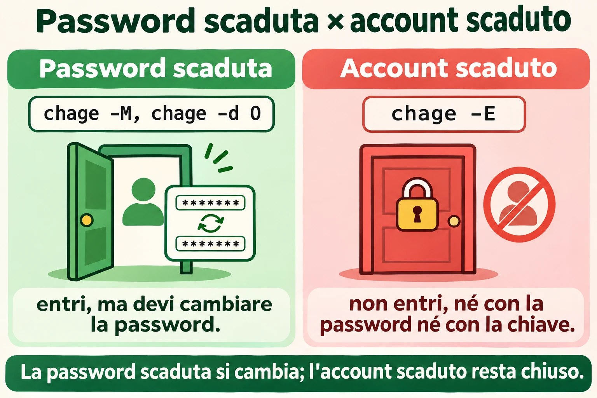
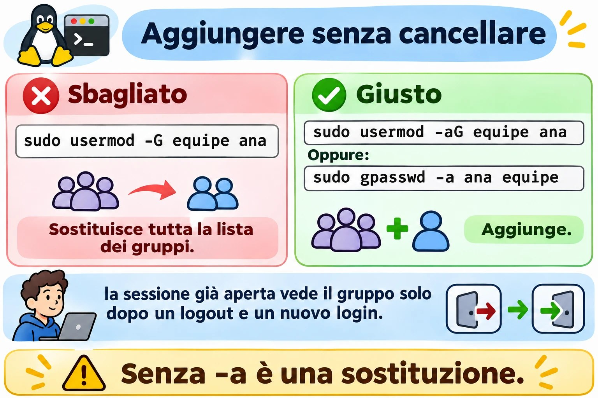
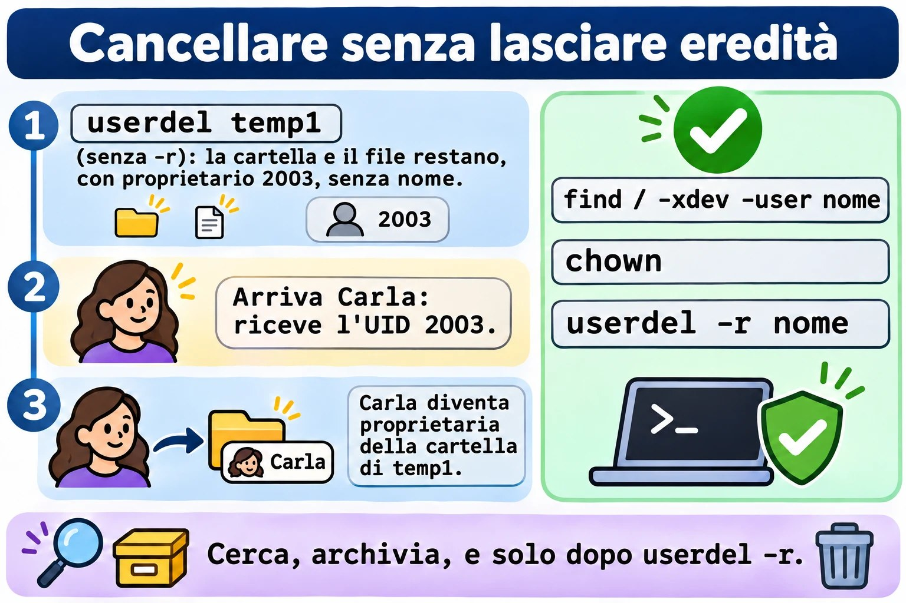

# Lezione 2.6 · Utenti e gruppi

Sesta lezione del Modulo 2. Creare un utente richiede un comando. Il lavoro vero sta nel resto del ciclo: lo stagista che arriva il lunedì, la collega che cambia reparto e ha bisogno di un altro gruppo, il collaboratore esterno con una scadenza, il dipendente licenziato alle 17 che non deve più poter entrare alle 17:05. Ogni fase ha un modo giusto e un modo che sembra giusto. `usermod -G` senza `-a` toglie la persona da tutti gli altri gruppi senza avvisare. `useradd` su Debian crea l'account senza home directory. `passwd -l` blocca la password, ma la chiave SSH continua a entrare. E `userdel` fatto senza attenzione lascia file che il prossimo utente creato eredita. Oggi fai il ciclo completo sulle due VM, con gli stessi numeri su entrambe, e crei da rocky-lab gli utenti della debian-lab, usando la chiave e l'alias `deb` della Lezione 2.5.

| Scheda | Lezione 2.6 |
| --- | --- |
| Modulo | M2 · Sistema, utenti e permessi, lezione 6 di 8 |
| Quando | Settimana 5 |
| Alla fine sei in grado di | Leggere `/etc/passwd`, `/etc/shadow` e `/etc/group` campo per campo; sapere da dove arrivano i valori predefiniti di un account nuovo (`useradd -D`, `/etc/login.defs`, `/etc/skel`); creare utenti e gruppi con UID e GID scelti, uguali su più server; aggiungere e togliere persone dai gruppi senza cancellare gli altri; forzare il cambio password e impostare la scadenza di password e account; bloccare davvero un account, chiave SSH compresa; cancellare un account senza lasciare file orfani; seguire una procedura quando un utente non riesce a entrare |
| Prerequisiti | Lezione 2.5 (tipi di account in base all'UID; `sudo`; la chiave di rocky-lab installata su debian-lab e l'alias `deb`); Lezione 1.4 (proprietario e permessi letti con `ls -l`) |
| Durata | Circa 2h30 |
| Snapshot | m2a6-inicio e m2a6-fim su entrambe le VM |

## 1 · Riscaldamento

Tre domande, a memoria. Scrivi le risposte; le Soluzioni le verificano alla fine.

1. Lanci `usermod -G financeiro ana` per mettere Ana nel gruppo financeiro. Scommessa: resta nei gruppi in cui era già?
2. Un dipendente è stato licenziato. Lanci `passwd -l joao`, che blocca la sua password. Scommessa: se ha una chiave SSH installata, riesce ancora a entrare?
3. Cancelli l'utente `temp` con `userdel temp` e, una settimana dopo, crei l'utente `carla`. Scommessa: può succedere che Carla diventi proprietaria dei file che erano di `temp`?

## 2 · Perché conta

Gli account sono la prima cosa che guarda un audit e la prima che cerca un attaccante. I rilievi si ripetono in quasi ogni server con qualche anno di vita: account di persone che se ne sono andate mesi fa, ancora attivi; un utente di servizio con shell `/bin/bash` e password; il gruppo `wheel` con nove persone quando ne servivano tre; file senza proprietario in `/srv` perché qualcuno ha cancellato l'account senza guardare cosa possedeva.

Il ciclo di vita di un account ha quattro momenti, e ognuno ha il suo errore classico:

| Momento | Cosa chiede l'azienda | L'errore classico |
| --- | --- | --- |
| Ingresso | "Bruno inizia lunedì, stesso accesso di Ana" | Copiare a mano la riga di `/etc/passwd`, o dimenticare la home directory |
| Cambio | "Ana è passata alla contabilità" | `usermod -G` senza `-a`: esce da tutti gli altri gruppi, compreso quello di `sudo` |
| Scadenza | "Il collaboratore esterno resta fino al 31 dicembre" | Segnarlo su un foglio e dimenticarsene. La cosa giusta è far scadere l'account da solo |
| Uscita | "João è stato licenziato, taglia tutto adesso" | `passwd -l` e basta. La sua chiave SSH continua a entrare |

E c'è il problema che compare solo quando hai più di un server: lo stesso utente con numeri diversi su ciascuno. Ana è UID 1001 su un server e 1003 sull'altro. Quando un disco o una cartella di rete passa da uno all'altro, i suoi file risultano di un'altra persona. Il sistema memorizza il numero, non il nome.

## 3 · Modello mentale

> Un account è una riga in tre file di testo. Il nome è per te; il sistema memorizza e controlla solo i numeri. Ogni comando di questa lezione è un modo sicuro di modificare quelle righe.

```text
/etc/passwd   (todos leem)        ana:x:2001:2001:Ana Lima:/home/ana:/bin/bash
                                       │   │    │      │        │         │
                                       │  UID  GID  descrição  pasta    shell
                                       └─ a senha não está aqui: "x" = veja o shadow

/etc/shadow   (só o root lê)      ana:$6$...:20395:0:90:7:::
                                       │      │   │  │  │
                                     hash  última  mín máx aviso   (+ inativa, expira)
                                            troca

/etc/group    (todos leem)        equipe:x:2000:ana,bruno
                                     │      │    │
                                   nome    GID  membros extras (o grupo principal não aparece aqui)

/etc/skel/                        modelo copiado para a pasta pessoal de cada conta nova
/etc/login.defs                   padrões: faixa de UID, validade de senha, criar pasta
```

Quattro idee reggono la lezione:

| Idea | Cosa significa | Conseguenza |
| --- | --- | --- |
| Il sistema memorizza numeri | File, processi e permessi memorizzano UID e GID, non nomi | Cancellare un account non cancella i suoi file; il prossimo utente con lo stesso numero eredita tutto |
| Gruppo principale e gruppi supplementari | Il principale è nel 4º campo di `/etc/passwd`; i supplementari, nel 4º campo di `/etc/group` | `usermod -G` sostituisce l'intera lista dei supplementari; `-aG` ne aggiunge uno |
| Password e account sono cose diverse | La password può essere bloccata con l'account attivo, e l'account può scadere con la password valida | Per tagliare davvero l'accesso, fai scadere l'account; bloccare la password non ferma la chiave SSH |
| I gruppi valgono al login | Il processo riceve la lista dei gruppi quando inizia la sessione | Chi è stato messo in un gruppo ottiene l'accesso solo in una sessione nuova |


*Il nome è per te; il sistema memorizza e controlla solo i numeri.*

## 4 · Concetto a livelli

### Essenziale

**Leggere le tre liste.** Usa `getent` invece di aprire il file: mostra la stessa riga e funziona anche quando gli account arrivano da una directory centrale, come Active Directory, argomento di un modulo più avanti.

```bash
getent passwd student
getent group student
sudo getent shadow student | cut -d: -f1,3-     # senza l'hash
id student
```

```text
student:x:1000:1000:Student:/home/student:/bin/bash
student:x:1000:
student:20380:0:99999:7:::
uid=1000(student) gid=1000(student) groups=1000(student),10(wheel)
```

`cut` toglie il secondo campo, l'hash della password. Non è la password, ma non c'è motivo di lasciarlo a schermo, nella cronologia del terminale o in un ticket. I campi di `/etc/shadow`:

| Campo | Esempio | Significa |
| --- | --- | --- |
| 1 · nome | `student` | L'account |
| 2 · hash | `$6$...` o `$y$...` | La password codificata. `!` o `!!` all'inizio = password bloccata; `*` = non ha mai avuto password |
| 3 · ultimo cambio | `20380` | Giorni dal 1º gennaio 1970. `0` = cambiarla al prossimo login |
| 4 · minimo | `0` | Giorni da aspettare prima di poterla cambiare di nuovo |
| 5 · massimo | `99999` | Giorni prima che la password scada. `99999` = mai, in pratica |
| 6 · avviso | `7` | Giorni di preavviso prima della scadenza |
| 7 · inattività | vuoto | Giorni dopo la scadenza in cui si può ancora entrare e cambiarla |
| 8 · scadenza | vuoto | Data in cui scade l'**account**, in giorni dal 1970 |

Nessuno legge questi numeri a memoria. `chage -l` li traduce:

```bash
sudo chage -l student
```

**Creare un utente e un gruppo.** Lo stesso comando funziona uguale su Rocky e su Debian quando non ti fidi dei valori predefiniti:

```bash
sudo groupadd -g 2000 equipe
sudo useradd -u 2001 -c "Ana Lima" -m -s /bin/bash ana
sudo passwd ana
```

| Opzione | Fa |
| --- | --- |
| `-u 2001` | Sceglie l'UID. Senza, `useradd` prende il più alto UID in uso + 1 |
| `-c "Ana Lima"` | La descrizione, il nome completo |
| `-m` | Crea la home directory, copiando `/etc/skel` |
| `-s /bin/bash` | La shell |
| `-g grupo` | Il gruppo principale. Senza, crea un gruppo con lo stesso nome dell'account |
| `-G a,b` | I gruppi supplementari già alla creazione |

`passwd ana` chiede due volte la nuova password. Come root, non chiede la vecchia.

**Aggiungere e togliere dai gruppi.**

```bash
sudo usermod -aG equipe ana        # aggiunge. Il -a è ciò che conta
sudo gpasswd -a bruno equipe       # lo stesso, in un altro modo
sudo gpasswd -d bruno equipe       # toglie da un solo gruppo
getent group equipe
```

**Cancellare.**

```bash
sudo userdel -r ana                # cancella l'account, la home directory e la casella di posta locale
sudo groupdel equipe
```

### Intermedio

**Da dove arrivano i valori predefiniti.** Un account nuovo nasce da tre posti:

| Posto | Cosa definisce | Vedi con |
| --- | --- | --- |
| `/etc/login.defs` | Intervallo di UID e GID per persone e sistema; scadenza password predefinita; se crea la home directory; permessi della home; gruppo con il nome dell'account | `grep -v -E '^#\|^$' /etc/login.defs` |
| `/etc/default/useradd` | Shell predefinita, directory base, `/etc/skel`, account inattivo | `useradd -D` |
| `/etc/skel/` | I file che finiscono nella nuova home directory | `ls -la /etc/skel` |

Modificare uno qualsiasi di questi vale solo per gli account **creati dopo**. Mettere `PASS_MAX_DAYS 90` in `login.defs` non cambia la scadenza di nessuno di quelli esistenti; per loro serve `chage`.

**`useradd` × `adduser`.** Su Rocky, `adduser` è solo un altro nome di `useradd`. Su Debian, `adduser` è un altro programma: interattivo, crea la home, chiede password e nome, e usa valori predefiniti propri, da `/etc/adduser.conf`. Negli script e nei compiti che richiedono esattezza, usa `useradd` con le opzioni esplicite: il comando è lo stesso nelle due famiglie e fa esattamente ciò che c'è scritto.

**Scadenza di password e account.**

```bash
sudo chage -d 0 ana                  # cambiare la password al prossimo login
sudo chage -M 90 -m 1 -W 7 ana       # scade tra 90 giorni, attende 1 per cambiarla, avvisa 7 prima
sudo chage -E 2026-12-31 bruno       # l'ACCOUNT scade in questa data
sudo chage -E -1 bruno               # toglie la data di scadenza
sudo chage -l bruno
```

`passwd -e ana` fa lo stesso di `chage -d 0`. La differenza tra password scaduta e account scaduto è quella che confonde di più:

|  | Password scaduta (`-M`, `-d 0`) | Account scaduto (`-E`) |
| --- | --- | --- |
| Cosa succede al login | Entra, ma è obbligato a cambiare la password prima | Non entra, né con password né con chiave |
| Messaggio | `You are required to change your password immediately` | `Your account has expired; please contact your system administrator` |
| A cosa serve | Policy delle password, password iniziale | Collaboratore esterno con scadenza, licenziamento |

**Bloccare × far scadere × togliere la shell.** Tre blocchi, ognuno chiude una porta:

| Comando | Chiude | Non chiude |
| --- | --- | --- |
| `usermod -L` o `passwd -l` | Login con password | Chiave SSH, `su` fatto da root, processi già in esecuzione |
| `usermod -e 1` o `chage -E 0` | Ogni login che passa da PAM, con password o chiave | Processi già in esecuzione |
| `usermod -s /sbin/nologin` | Shell interattiva | Trasferimento di file via SFTP, se configurato senza shell; processi in esecuzione |

Per tagliare davvero una persona: far scadere l'account, bloccare la password e terminare tutto ciò che è in esecuzione con `loginctl terminate-user nome` o `pkill -u nome`.

**I gruppi valgono al login.** Il kernel consegna la lista dei gruppi al processo quando inizia la sessione. Se hai messo Ana nel gruppo `equipe` adesso, la sessione che aveva già aperta continua a non averlo:

```bash
id ana          # legge /etc/group di adesso: mostra equipe
id              # eseguito DENTRO la vecchia sessione di Ana: non lo mostra
```

Deve uscire e rientrare. Per provare subito, senza uscire, `newgrp equipe` apre una shell nuova già con il gruppo.



*La password scaduta obbliga a cambiarla; l'account scaduto non fa entrare.*

### Ponte Windows

| Windows | Linux | Differenza che conta |
| --- | --- | --- |
| `lusrmgr.msc`, `net user`, `New-LocalUser` | `useradd`, `usermod`, `userdel` | Su Linux tutto è testo: puoi leggere e verificare con `getent` e `grep` |
| SID (`S-1-5-21-...-1001`) | UID | Il SID è unico per macchina o dominio; l'UID è solo un numero, e lo stesso numero su due server è la stessa persona per i file |
| Gruppo Administrators | `wheel` (Rocky) o `sudo` (Debian) | Far parte del gruppo dà il diritto di **chiedere** con `sudo`, non di poter fare direttamente |
| "L'utente deve cambiare la password al prossimo accesso" | `chage -d 0` | Uguale |
| "L'account scade il" | `chage -E data` | Uguale, e blocca anche la chiave SSH |
| "Account disabilitato" | `chage -E 0`, più `usermod -L` | `passwd -l` da solo non è "disabilitare": la chiave SSH continua |
| `Add-LocalGroupMember` | `usermod -aG` o `gpasswd -a` | Su Windows non esiste l'errore di dimenticare il `-a` |
| Profilo predefinito (`C:\Users\Default`) | `/etc/skel` | Uguale: copiato alla creazione, solo per gli account nuovi |
| Un account cancellato lascia un SID orfano nei permessi | Un account cancellato lascia un UID orfano nei file | Su Linux, il prossimo utente con lo stesso UID eredita tutto |

### Avanzato

**UID e GID uguali su tutti i server.** Quando i server condividono file (NFS, dischi che cambiano macchina, backup ripristinato altrove), l'UID deve essere lo stesso ovunque. Senza una directory centrale, la regola è scegliere il numero alla creazione, con `-u` e `-g`, e annotarlo. Un intervallo riservato alle persone dell'azienda, lontano dal 1000 usato dall'installazione, evita collisioni. Con una directory centrale, il numero arriva da lì, argomento di un modulo più avanti.

**`vipw` e `vigr`.** Se devi modificare `/etc/passwd` o `/etc/group` a mano, usa `sudo vipw` e `sudo vigr`. Bloccano il file mentre modifichi, così nessun `useradd` scrive nello stesso momento, e alla fine chiedono se vuoi modificare anche `shadow` o `gshadow`. Lo stesso ruolo di `visudo` per `sudoers`.

**`pwck` e `grpck`.** Controllano la coerenza delle quattro liste: righe malformate, home directory inesistente, gruppo inesistente, account in `passwd` senza riga in `shadow`. Con `-r`, solo leggono e non cambiano nulla:

```bash
sudo pwck -r
sudo grpck -r
```

**Le copie con `-`.** Ogni volta che un comando del pacchetto `shadow` scrive `/etc/passwd`, `/etc/shadow`, `/etc/group` o `/etc/gshadow`, conserva la versione precedente con un `-` in fondo al nome: `/etc/group-`. È il tuo "annulla" di un passo. `diff /etc/group- /etc/group` mostra esattamente cosa ha cambiato l'ultimo comando.

**Password di gruppo e `gshadow`.** `/etc/gshadow` contiene la password di gruppo e gli amministratori di gruppo (`gpasswd -A`). La password di gruppo non la usa quasi nessuno; l'amministratore di gruppo è utile quando il responsabile di un reparto può aggiungere e togliere persone dal suo gruppo senza avere `sudo`.

**Account di sistema.** `useradd -r` crea un account nell'intervallo di sistema (sotto 1000), senza home e, se lo chiedi, senza shell: `useradd -r -s /sbin/nologin -d /var/lib/app app`. È così che un pacchetto crea l'utente di un servizio.

**Algoritmo dell'hash.** L'inizio del secondo campo di `shadow` indica l'algoritmo: `$6$` è SHA-512, predefinito su Rocky 9; `$y$` è yescrypt, predefinito su Debian 13. L'algoritmo viene da `ENCRYPT_METHOD` in `login.defs` e dalla configurazione di PAM, e vale solo per le password cambiate dopo.

## 5 · Rocky × Debian

| Cosa | Rocky 9 | Debian 13 |
| --- | --- | --- |
| `useradd` crea la home senza `-m` | Sì (`CREATE_HOME yes` in `login.defs`) | **No**. Senza `-m`, l'account nasce senza home |
| Shell predefinita di `useradd` | `/bin/bash` | `/bin/sh` (verifica con `useradd -D`) |
| `adduser` | Altro nome di `useradd` | Programma a sé, interattivo, con `/etc/adduser.conf` |
| Gruppo di `sudo` | `wheel` | `sudo` |
| Intervallo di UID per le persone | da 1000 a 60000 | da 1000 a 60000 |
| Algoritmo dell'hash | SHA-512 (`$6$`) | yescrypt (`$y$`) |
| Password bloccata in `shadow` | `!!` per account creato senza password; `!` dopo `passwd -l` | `!` |
| `passwd -S` | `ana PS ...` con l'algoritmo tra parentesi | `ana P ...` |
| `/etc/skel` | `.bashrc`, `.bash_profile`, `.bash_logout` | `.bashrc`, `.profile`, `.bash_logout` |
| Casella di posta locale cancellata da `userdel -r` | `/var/spool/mail/nome` | `/var/mail/nome`, se esiste |
| Shell degli account di sistema | `/sbin/nologin` | `/usr/sbin/nologin` |
| `lastlog` (ultimo login di ogni account) | Disponibile | Può mancare su Debian 13; usa `last` o `wtmpdb last` |

## 6 · Lab guidato

In questo lab rocky-lab è la tua postazione di lavoro: crei gli account lì e, con la chiave e l'alias `deb` della Lezione 2.5, crei gli stessi account su debian-lab senza aprire un'altra sessione. Tieni comunque un terminale aperto su ogni VM, dal tuo PC: alcuni passi provano il login di un altro utente, e ti conviene avere intatta la tua sessione di `student` nel frattempo.


*Modificare sudoers a mano è pericoloso: visudo controlla la sintassi prima di salvare.*


Password: i passi ti chiedono di impostare password per gli utenti di prova. Usa una password da laboratorio che usi solo su queste VM, e digitala tu quando `passwd` la chiede.

### Passo 0 · Snapshot e la strada verso debian-lab

Su Proxmox, crea lo snapshot `m2a6-inicio` di entrambe le VM. Su rocky-lab, verifica che la chiave e l'alias della lezione scorsa continuino a funzionare:

```bash
eval "$(ssh-agent -s)"; ssh-add
ssh -o BatchMode=yes deb 'hostname; id -un'
```

La risposta deve essere `debian-lab` e `student`, senza alcuna domanda. Se chiede la password, torna alla procedura del Passo 8 della Lezione 2.5 prima di proseguire: tutto il lab dipende da questo percorso.

### Passo 1 · Le tre liste, campo per campo

Su rocky-lab:

```bash
getent passwd student root chronyd nobody
getent group wheel student
sudo getent shadow student root | cut -d: -f1,3-
sudo getent shadow student | cut -c1-12
```

L'ultimo comando mostra solo l'inizio dell'hash: `student:$6$...`. `$6$` è SHA-512. Ora la stessa cosa su debian-lab, da dove ti trovi:

```bash
ssh deb 'getent passwd student; getent group sudo'
ssh -t deb 'sudo getent shadow student | cut -c1-12'
```

Su Debian l'inizio è `$y$`: yescrypt. `-t` serve perché `sudo` abbia dove chiedere la tua password, come nella lezione scorsa. Confronta anche la riga di `root` nello `shadow` di rocky-lab: se il secondo campo inizia con `!` o è `*`, la password di root è bloccata o non è mai esistita, il che combacia con `passwd -S root` della Lezione 2.5.

Ora conta gli account di ogni tipo:

```bash
awk -F: '$3 >= 1000 && $3 < 65534 {print $1, $3, $7}' /etc/passwd
awk -F: '$3 > 0 && $3 < 1000' /etc/passwd | wc -l
```

Il primo elenca le persone, con la shell. Il secondo conta gli account di sistema: decine, uno per servizio. `nobody`, con UID 65534, è un account speciale per "nessuno" e resta fuori da entrambi.

### Passo 2 · Da dove arrivano i valori predefiniti

Su entrambe le VM, eseguendo ogni riga su una e poi sull'altra (su debian-lab, prefissa con `ssh deb`):

```bash
/usr/sbin/useradd -D
grep -E '^(UID_MIN|UID_MAX|SYS_UID_MAX|PASS_MAX_DAYS|PASS_WARN_AGE|CREATE_HOME|USERGROUPS_ENAB|HOME_MODE|ENCRYPT_METHOD)' /etc/login.defs
ls -la /etc/skel
```

Annota tre differenze: lo `SHELL=` di `useradd -D`, la riga `CREATE_HOME` (che esiste su Rocky e non su Debian) e i file di `/etc/skel`. Spiegano la Decisione seguente e il Guasto B.

**Decidi 1 · L'utente su Debian.** Devi creare l'utente `bruno` su debian-lab, da script, in modo che entri via SSH con home directory e Bash. Quale comando?

- **A)** `sudo useradd bruno`
- **B)** `sudo useradd -m -s /bin/bash bruno`
- **C)** `sudo adduser bruno`
- **D)** `sudo useradd -s /bin/bash bruno`

Scegli un'opzione prima di continuare.

| Se hai scelto | Risultato | Perché |
| --- | --- | --- |
| A | ❌ Sbagliato | Su Debian, senza `-m` non c'è home directory, e la shell predefinita è `/bin/sh`. Bruno entra, riceve `Could not chdir to home directory` e un prompt `$` senza cronologia né frecce. È il Guasto B di questa lezione. |
| B | ✅ Giusto | `-m` crea la home e copia `/etc/skel`; `-s` imposta la shell. Lo stesso comando fa la stessa cosa su Rocky. Negli script, l'esplicito batte il predefinito. |
| C | ⚠️ Funziona, ma | Su Debian `adduser` crea tutto correttamente, ma è interattivo: chiede password, nome completo, telefono. In uno script si blocca in attesa di risposta, a meno che tu non passi le opzioni per non chiedere. E su Rocky è solo `useradd`, con un comportamento diverso. |
| D | ❌ Sbagliato | La shell è giusta, ma senza `-m` continua a mancare la home. Metà del problema. |

**Da ricordare:** negli script e nei compiti che richiedono esattezza, `useradd -m -s /bin/bash`, sempre. Non fidarti del valore predefinito della distribuzione.

### Passo 3 · Gli stessi utenti, con gli stessi numeri, su entrambe le VM

Su rocky-lab:

```bash
sudo groupadd -g 2000 equipe
sudo useradd -u 2001 -c "Ana Lima" -m -s /bin/bash ana
sudo useradd -u 2002 -c "Bruno Costa" -m -s /bin/bash bruno
sudo passwd ana
sudo passwd bruno
id ana; id bruno
ls -la /home/ana
```

Nota: senza `-g`, ognuno ha ottenuto un gruppo con il proprio nome, con lo stesso numero dell'UID (`gid=2001(ana)`). È `USERGROUPS_ENAB yes` in `login.defs`. La directory `/home/ana` contiene i file di `/etc/skel`, tutti di `ana`, e la directory è `drwx------`: entra solo lei.

Ora debian-lab, da rocky-lab. Un comando alla volta, per vedere dove fallirebbe:

```bash
ssh -t deb 'sudo groupadd -g 2000 equipe'
ssh -t deb 'sudo useradd -u 2001 -c "Ana Lima" -m -s /bin/bash ana'
ssh -t deb 'sudo useradd -u 2002 -c "Bruno Costa" -m -s /bin/bash bruno'
ssh -t deb 'sudo passwd ana'
ssh -t deb 'sudo passwd bruno'
```

Verifica che i numeri coincidano:

```bash
for u in ana bruno; do echo "rocky:  $(id $u)"; echo "debian: $(ssh deb id $u)"; done
```

Le righe devono essere uguali due a due. Nella vita reale, è questo che garantisce che un backup di `/home/ana` di rocky-lab, ripristinato su debian-lab, continui a essere di Ana.

Prova il login vero, da rocky-lab a debian-lab, con la password che hai impostato:

```bash
ssh ana@debian-lab 'pwd; echo $SHELL; ls -a'
```

Risposta: `/home/ana`, `/bin/bash`, e i file di `skel` di Debian, con `.profile` al posto di `.bash_profile`.

### Passo 4 · Gruppi: aggiungere senza cancellare

Su rocky-lab, prima una sessione di Ana che resterà aperta. Nel **terminale di rocky-lab che hai aperto dal PC**, entra come Ana e lasciala lì:

```bash
ssh ana@localhost
id
```

Compare solo con `groups=2001(ana)`. Nell'altro terminale, come `student`:

**Decidi 2 · Mettere Ana nel gruppo.** Ana deve entrare nel gruppo `equipe`, senza perdere nessun gruppo che ha già, oggi o in futuro. Quale comando?

- **A)** `sudo usermod -G equipe ana`
- **B)** `sudo usermod -aG equipe ana`
- **C)** `sudo vim /etc/group` e aggiungere `ana` in fondo alla riga di `equipe`
- **D)** `newgrp equipe`

Scegli un'opzione prima di continuare.

| Se hai scelto | Risultato | Perché |
| --- | --- | --- |
| A | ❌ Sbagliato | Oggi sembra funzionare, perché Ana non ha altri gruppi supplementari. Ma `-G` senza `-a` **sostituisce** l'intera lista: se fosse nel `wheel`, ne uscirebbe. Usa sempre il comando giusto, non quello che funziona oggi. È il Guasto A. |
| B | ✅ Giusto | Il `-a` di *append* aggiunge il gruppo e mantiene gli altri. `sudo gpasswd -a ana equipe` fa lo stesso ed è altrettanto giusto. |
| C | ⚠️ Funziona, ma | Il risultato nel file è lo stesso, ma modificare a mano rischia un errore di battitura che rompe la riga, e `vim` non blocca il file contro un altro comando che scrive nello stesso momento. Se devi modificare a mano, usa `sudo vigr`. |
| D | ❌ Sbagliato | `newgrp` apre una shell **tua** con un altro gruppo attivo, e solo se ne fai già parte. Non mette nessuno in nessun gruppo. |

**Da ricordare:** un gruppo supplementare si aggiunge con `usermod -aG` o `gpasswd -a`. Senza `-a`, è una sostituzione.

Esegui quello giusto, e aggiungi Bruno nell'altro modo:

```bash
sudo usermod -aG equipe ana
sudo gpasswd -a bruno equipe
getent group equipe
diff /etc/group- /etc/group
```

`getent` mostra `equipe:x:2000:ana,bruno`. `diff` mostra la riga prima e dopo l'**ultimo** comando: `/etc/group-` è la copia che `gpasswd` ha conservato.

Ora torna al terminale dove Ana è collegata:

```bash
id                 # dentro la vecchia sessione di Ana
id ana             # cosa dice il sistema adesso
```

Il primo non mostra `equipe`; il secondo sì. La sessione di Ana ha ricevuto la lista dei gruppi quando è iniziata. Esci (`exit`) e rientra con `ssh ana@localhost`: adesso `id` mostra `equipe`. Esci di nuovo.

Fai lo stesso su debian-lab, tramite `deb`:

```bash
ssh -t deb 'sudo usermod -aG equipe ana && sudo gpasswd -a bruno equipe && getent group equipe'
```



*Senza -a, usermod sostituisce l'intera lista dei gruppi.*

### Passo 5 · Password iniziale e scadenza

Su rocky-lab, la policy aziendale: password iniziale cambiata al primo login, scadenza di 90 giorni, preavviso di 7. E Bruno è un collaboratore esterno, con contratto fino al 31 dicembre.

**Decidi 3 · Password cambiata al primo login.** Hai impostato una password iniziale per Ana e vuoi che sia obbligata a cambiarla al primo login. Quale comando?

- **A)** `sudo chage -d 0 ana`
- **B)** `sudo chage -M 0 ana`
- **C)** `sudo passwd -l ana`
- **D)** Cambiare `PASS_MAX_DAYS` a `0` in `/etc/login.defs`

Scegli un'opzione prima di continuare.

| Se hai scelto | Risultato | Perché |
| --- | --- | --- |
| A | ✅ Giusto | Porta la data dell'ultimo cambio al giorno zero. La password conta come scaduta, e il prossimo login obbliga a cambiarla. `sudo passwd -e ana` fa lo stesso. |
| B | ⚠️ Funziona, ma | È obbligata a cambiarla adesso, ma anche **ogni** volta dopo: con scadenza massima di zero giorni, la password nuova nasce già scaduta. Domani ti arriverà un ticket. |
| C | ❌ Sbagliato | Blocca la password. Non riesce nemmeno a entrare per cambiarla. |
| D | ❌ Sbagliato | `login.defs` vale solo per gli account creati dopo. Ana esiste già e non cambia nulla. |

**Da ricordare:** cambiare al prossimo login = `chage -d 0`. Scadenza = `chage -M`. Valore predefinito per gli account futuri = `login.defs`.

Applica la policy:

```bash
sudo chage -d 0 ana
sudo chage -M 90 -W 7 ana
sudo chage -E 2026-12-31 bruno
sudo chage -l ana
sudo chage -l bruno
sudo passwd -S ana
```

`chage -l ana` dice `Last password change : password must be changed` e `Maximum number of days between password change : 90`. Quello di Bruno dice `Account expires : Dec 31, 2026`.

Prova il primo login di Ana:

```bash
ssh ana@localhost
```

Dopo la password attuale, SSH mostra `WARNING: Your password has expired. You must change your password now and login again!`. Chiede di nuovo la password attuale e due volte quella nuova, poi chiude la connessione. Rientra con la password nuova: adesso entri direttamente. Esci.

Ripeti la policy su debian-lab:

```bash
ssh -t deb 'sudo chage -d 0 ana && sudo chage -M 90 -W 7 ana && sudo chage -E 2026-12-31 bruno && sudo chage -l bruno'
```

### Passo 6 · Tagliare l'accesso: cosa chiude ogni blocco

La richiesta: "Bruno è stato licenziato adesso, taglia l'accesso". Prima, prepara lo scenario che la vita reale di solito ha: Bruno ha una chiave SSH installata. Su rocky-lab, usa la tua chiave pubblica come se fosse la sua, solo per la prova:

```bash
sudo install -d -m 700 -o bruno -g bruno /home/bruno/.ssh
sudo install -m 600 -o bruno -g bruno ~/.ssh/id_ed25519.pub /home/bruno/.ssh/authorized_keys
ssh -o BatchMode=yes bruno@localhost id
```

Sei entrato come `bruno`, con la chiave. Ora il primo blocco, quello che usano quasi tutti:

```bash
sudo usermod -L bruno
sudo passwd -S bruno
ssh -o BatchMode=yes bruno@localhost id
```

`passwd -S` dice `LK` (Rocky) o `L` (Debian): password bloccata. E `ssh` **entra comunque**. Il blocco mette un `!` davanti all'hash; questo impedisce alla password di combaciare, ma la chiave non usa la password. Con `UsePAM yes`, predefinito su entrambe le distribuzioni, anche `sshd` non guarda quel `!`.

Il secondo blocco, quello che vale:

```bash
sudo chage -E 0 bruno
ssh -o BatchMode=yes bruno@localhost id; echo "rc=$?"
sudo journalctl -u sshd -n 5 --no-pager | grep -i -E 'expired|bruno'
```

Adesso `ssh` fallisce, e il log dice perché: l'account è scaduto. La scadenza viene controllata da PAM nella fase di account, che vale per password e chiave. Nella vita reale, completeresti il taglio con `sudo loginctl terminate-user bruno`, per far cadere le sessioni aperte, e poi la procedura di uscita della Decisione 4.

**Decidi 4 · Licenziato alle 17.** Il dipendente se n'è andato. Il responsabile dice che i suoi file saranno ancora rivisti per un mese. Qual è la sequenza giusta per oggi?

- **A)** `sudo userdel -r joao`
- **B)** `sudo chage -E 0 joao`, `sudo usermod -L joao`, terminare le sessioni; cancellare l'account dopo la revisione, con i file già archiviati
- **C)** `sudo userdel joao`, mantenendo la home directory per la revisione
- **D)** `sudo passwd -d joao`, per togliergli la password

Scegli un'opzione prima di continuare.

| Se hai scelto | Risultato | Perché |
| --- | --- | --- |
| A | ⚠️ Funziona, ma | L'accesso finisce subito, ma la home directory se ne va con tutto, compreso ciò che il responsabile voleva rivedere. E i suoi file fuori dalla home, in `/srv` o `/tmp`, restano orfani. Cancellare è l'ultimo passo, non il primo. |
| B | ✅ Giusto | Far scadere chiude password e chiave; bloccare la password è il secondo livello; terminare le sessioni fa cadere ciò che era aperto. L'account continua a esistere, quindi i file continuano ad avere proprietario e nome. Dopo la revisione, archivi, cerchi ciò che aveva fuori dalla home e cancelli. |
| C | ❌ Sbagliato | La home resta, ma ora appartiene a un numero senza nome. Il prossimo utente creato può ricevere quel numero ed ereditare tutto. È il Passo 7. |
| D | ❌ Sbagliato | `passwd -d` **cancella** la password: l'account non ha più alcuna password. A seconda della configurazione, entra senza digitare nulla sulla console. È l'opposto di ciò che vuoi. |

**Da ricordare:** tagliare l'accesso = far scadere l'account (`chage -E 0`), bloccare la password (`usermod -L`) e far cadere le sessioni. Cancellare l'account viene dopo.

Annulla i blocchi di Bruno, perché tornerà nelle prossime lezioni:

```bash
sudo chage -E 2026-12-31 bruno
sudo usermod -U bruno
sudo rm /home/bruno/.ssh/authorized_keys
sudo rmdir /home/bruno/.ssh
ssh -o BatchMode=yes bruno@localhost id; echo "rc=$?"
```

L'ultimo `ssh` adesso fallisce (`rc=255`) perché la chiave è stata rimossa, non per la scadenza. È lo stato giusto: Bruno entra solo con la sua password.

### Passo 7 · Cancellare senza lasciare eredità

Su rocky-lab, crea un account temporaneo, lascia un suo file fuori dalla home e cancellalo nel modo sbagliato:

```bash
sudo useradd -m -s /bin/bash temp1
id temp1
sudo -u temp1 touch /tmp/relatorio-temp1
sudo userdel temp1
ls -ld /home/temp1 /tmp/relatorio-temp1
```

`id` ha dato `uid=2003`: il più alto UID in uso (2002, di Bruno) più uno. Dopo `userdel` senza `-r`, la directory e il file sono ancora lì, e `ls` mostra `2003` al posto del proprietario: un numero senza nome. Cerca tutto ciò che si trova in questa situazione:

```bash
sudo find / -xdev \( -nouser -o -nogroup \) -ls 2>/dev/null
```

Compaiono la directory, il file e un altro che non hai creato tu: `/var/spool/mail/temp1`, la casella di posta locale che `useradd` di Rocky crea per ogni account. Anche `userdel` senza `-r` l'ha lasciata indietro.

Ora cosa succede una settimana dopo, quando arriva una persona nuova:

```bash
sudo useradd -m -s /bin/bash carla
id carla
ls -ld /home/temp1 /tmp/relatorio-temp1
```

Carla ha ricevuto l'UID 2003, il numero libero più alto. E `ls` adesso mostra `carla` come proprietaria della directory e del file di `temp1`. Nessuno le ha dato niente: il sistema memorizza solo il numero. Su un server vero, la cartella del dipendente precedente, con fogli di calcolo ed e-mail, ha appena cambiato proprietario.

Pulisci tutto, con i percorsi scritti per esteso:

```bash
sudo userdel -r carla
sudo rm -r /home/temp1
sudo rm /tmp/relatorio-temp1
sudo rm /var/spool/mail/temp1
sudo find / -xdev \( -nouser -o -nogroup \) -ls 2>/dev/null
```

Il `find` finale torna vuoto. Il modo giusto di cancellare un account, in ordine: cercare i suoi file fuori dalla home (`sudo find / -xdev -user nome`), archiviare o passare a un altro proprietario ciò che conta (`chown`), e solo allora `userdel -r nome`.



*Cancellare senza -r lascia un UID libero; la persona successiva eredita la cartella.*

### Passo 8 · La procedura per "l'utente non riesce a entrare"

Quando un utente dice che non entra, segui dall'alto verso il basso. Ogni riga risponde a una domanda, e la prima che va male è la causa:

| Domanda | Comando | Cosa cercare |
| --- | --- | --- |
| L'account esiste? | `getent passwd nome` | Vuoto = non esiste, o il nome è sbagliato |
| La shell lo lascia entrare? | il 7º campo della stessa riga | `nologin` o `false` = non entra da shell |
| La password è bloccata? | `sudo passwd -S nome` | `L` o `LK` |
| L'account è scaduto o la password è scaduta? | `sudo chage -l nome` | `Account expires` nel passato; `password must be changed` |
| La home directory esiste ed è sua? | `ls -ld ~nome` | Non esiste, o proprietario e permessi sbagliati |
| Via SSH: la chiave viene accettata? | `ls -ld ~nome ~nome/.ssh ~nome/.ssh/authorized_keys` | Gli errori della Lezione 2.5 |
| Cosa ha detto il server? | `sudo journalctl -u sshd -n 20` (Debian: `-u ssh`) | `expired`, `Failed password`, `not allowed`, `refused` |

Prova la procedura con Bruno, su rocky-lab:

```bash
getent passwd bruno
sudo passwd -S bruno
sudo chage -l bruno | grep -i expires
ls -ld ~bruno
```

Tutto a posto: esiste, Bash, password valida, account fino al 31/12, home sua. Lui entra.

## 7 · Rompi e ripara

### Guasto A · La collega che ha perso `sudo`

Lo scenario: Ana è diventata amministratrice junior e ha ottenuto `sudo`. Su rocky-lab:

```bash
sudo usermod -aG wheel ana
sudo -l -U ana | tail -2
id ana
```

`sudo -l -U ana` mostra `(ALL) ALL`, e `id` mostra `ana`, `wheel` e `equipe`. Una settimana dopo, arriva il ticket: "Ana si occuperà anche dei fogli di calcolo della contabilità, mettila nel gruppo". Chi l'ha gestito ha fatto così:

```bash
sudo groupadd financeiro
sudo usermod -G financeiro ana
```

**Osserva.** Nessun messaggio di errore. Il giorno dopo, Ana apre un ticket: "`sudo` dice che non posso più". Verifica come lei:

```bash
sudo -l -U ana
```

```text
User ana is not allowed to run sudo on rocky-lab.
```

**Diagnostica.** Parti dai suoi gruppi, poi chiedi al sistema cosa è cambiato:

```bash
id ana
diff /etc/group- /etc/group
```

`id` mostra solo `ana` e `financeiro`. Sono spariti `wheel` e `equipe`. `diff` racconta la storia: nelle righe di `wheel` e `equipe`, `ana` c'era prima e ora non c'è più; nella riga di `financeiro`, è comparsa. `usermod -G` ha ricevuto la lista `financeiro` e ha fatto esattamente ciò che dice il manuale: la lista dei gruppi supplementari di Ana **è diventata** quella. Nella vita reale, lo stesso errore toglie qualcuno dal gruppo che dà accesso alla cartella di rete, al database o a `docker`, e il ticket arriva ore dopo, per un'altra persona, senza un legame apparente.

**Decidi A · La riparazione.** Cosa esegui?

- **A)** `sudo usermod -aG wheel,equipe ana`
- **B)** `sudo usermod -G wheel ana`
- **C)** Creare `/etc/sudoers.d/ana` con `ana ALL=(ALL) ALL`
- **D)** `sudo userdel -r ana` e ricreare l'account, con i gruppi giusti

Scegli un'opzione prima di continuare.

| Se hai scelto | Risultato | Perché |
| --- | --- | --- |
| A | ✅ Giusto | Restituisce esattamente i due gruppi che `diff` ha mostrato come spariti, e mantiene `financeiro`, che era la richiesta. Il `-a` evita di ripetere l'errore nella riparazione. |
| B | ❌ Sbagliato | Lo stesso errore, di nuovo: adesso Ana resta solo nel `wheel`, e perde `financeiro`, che aveva appena ottenuto, e `equipe`. |
| C | ⚠️ Funziona, ma | `sudo` torna, ma da una strada nuova, che nessuno ricorderà che esiste. `equipe` continua a mancare, e il giorno in cui toglieranno Ana dal `wheel`, lei avrà ancora `sudo` per quel file. Ripara la causa, non il sintomo. |
| D | ❌ Sbagliato | Cancella la sua home directory per un problema di gruppo. E se l'account nuovo non riceve lo stesso UID, i suoi file in altri posti restano orfani. |

**Da ricordare:** quando i gruppi spariscono, `diff /etc/group- /etc/group` mostra cosa ha cambiato l'ultimo comando. La riparazione restituisce esattamente ciò che è uscito, con `-aG`.

**Ripara.**

```bash
sudo usermod -aG wheel,equipe ana
id ana
sudo -l -U ana | tail -2
```

Ora ripulisci lo scenario. Ana non ha bisogno di `sudo` nelle prossime lezioni, e il gruppo `financeiro` serviva solo per il guasto:

```bash
sudo gpasswd -d ana wheel
sudo gpasswd -d ana financeiro
sudo groupdel financeiro
id ana
```

L'`id` finale deve mostrare `ana` e `equipe`. Nota che `gpasswd -d` toglie da **un** solo gruppo: è il modo sicuro di rimuovere, così come `-aG` è il modo sicuro di aggiungere.

### Guasto B · Il nuovo utente su Debian

La richiesta: "ho creato l'utente di João su debian-lab, entra ma il terminale è strano, senza frecce e senza colori". Riproduci ciò che ha fatto chi l'ha creato. Su rocky-lab:

```bash
ssh -t deb 'sudo useradd -c "Joao Teste" joao && sudo passwd joao'
ssh joao@debian-lab
```

**Osserva.** Il login funziona, ma:

```text
Could not chdir to home directory /home/joao: No such file or directory
$
```

Prova a premere la freccia su: compare `^[[A`. Prova `cd`: dà errore, perché non c'è una home a cui tornare. Esci con `exit`.

**Diagnostica.** La procedura del Passo 8, nelle prime due righe e nella quinta:

```bash
ssh deb 'getent passwd joao; ls -ld /home/joao; /usr/sbin/useradd -D | grep SHELL'
```

```text
joao:x:2003:2003:Joao Teste:/home/joao:/bin/sh
ls: cannot access '/home/joao': No such file or directory
SHELL=/bin/sh
```

Due problemi, una causa. `/etc/passwd` punta a una directory che non esiste e a `/bin/sh`, che su Debian è `dash`: una shell piccola, veloce per gli script, senza cronologia, senza completamento con Tab e senza frecce. `useradd` di Debian ha fatto esattamente ciò che dice il suo valore predefinito: senza `-m`, non crea la home; senza `-s`, usa `/bin/sh`. Chi l'ha creato era abituato a Rocky, dove lo stesso comando avrebbe funzionato. Nella vita reale, questo compare ovunque uno script di creazione utenti scritto per una famiglia gira sull'altra.

**Decidi B · La riparazione.** João non ha ancora salvato nessun file. Cosa fai?

- **A)** Cancellare l'account e ricrearlo, con `useradd -u 2003 -c "Joao Teste" -m -s /bin/bash joao`, e impostare la password.
- **B)** `sudo mkdir /home/joao`
- **C)** `sudo usermod -s /bin/bash joao`, e basta.
- **D)** `sudo adduser joao`, che su Debian crea tutto correttamente.

Scegli un'opzione prima di continuare.

| Se hai scelto | Risultato | Perché |
| --- | --- | --- |
| A | ✅ Giusto | Account nuovo, senza file: ricrearlo con le opzioni esplicite è la strada più breve e lo lascia come un account creato bene fin dall'inizio, con lo stesso UID. Se João avesse già dei file, la riparazione sarebbe creare la home senza cancellare l'account: `install -d -m 700 -o joao -g joao /home/joao`, copiare `skel` con `cp -rT /etc/skel /home/joao`, sistemare il proprietario con `chown -R joao:joao /home/joao` e cambiare la shell con `usermod -s /bin/bash joao`. |
| B | ❌ Sbagliato | La directory comincia a esistere, ma è di root: João ci entra e non riesce a scrivere nulla. Senza i file di `skel`, e con la shell ancora `/bin/sh`. |
| C | ⚠️ Funziona, ma | Risolve il terminale strano, ma João continua a non avere una home. Il primo programma che prova a scrivere una configurazione in `~` fallirà. |
| D | ❌ Sbagliato | `adduser` rifiuta: `The user 'joao' already exists`. Crea account nuovi, non ripara quelli esistenti. |

**Da ricordare:** utente che entra in `/` con `$` e senza frecce = senza home e con `/bin/sh`. Su Debian, `useradd` sempre con `-m -s /bin/bash`.

**Ripara.**

```bash
ssh -t deb 'sudo userdel joao && sudo useradd -u 2003 -c "Joao Teste" -m -s /bin/bash joao && sudo passwd joao'
ssh joao@debian-lab 'pwd; echo $SHELL'
```

La risposta è `/home/joao` e `/bin/bash`. João serviva solo per il guasto; cancellalo:

```bash
ssh -t deb 'sudo userdel -r joao'
ssh deb 'getent passwd joao; ls -d /home/joao'
```

`getent` torna vuoto e `ls` dice che la directory non esiste.


*Su Debian, useradd senza -m e senza -s crea un account senza cartella e con la shell minima.*

### La lezione

I due guasti hanno la stessa radice: un comando che ha fatto esattamente ciò che gli è stato detto, senza avvisi, e un risultato diverso da quello che la persona immaginava. `usermod -G` ha sostituito la lista perché è questo che fa `-G`. `useradd` di Debian non ha creato la home perché il suo comportamento predefinito è non crearla. Nessuno dei due ha dato errore. L'abitudine di questa lezione: **dopo aver creato o modificato un account, verifica con `id`, `getent` e `chage -l`, come farebbe uno script di verifica**. E, quando qualcosa è sparito, il `diff` tra il file e la copia con `-` mostra cosa ha cambiato l'ultimo comando.

## 8 · Trappole

| Digiti o vedi | Cosa succede | Come evitarla |
| --- | --- | --- |
| `usermod -G grupo nome` | La persona esce da tutti gli altri gruppi supplementari, compreso quello di `sudo` | `usermod -aG grupo nome` o `gpasswd -a nome grupo` |
| `useradd nome` su Debian | Account senza home directory e con `/bin/sh` | `useradd -m -s /bin/bash nome`, nelle due famiglie |
| `adduser` in uno script su Debian | Lo script si blocca in attesa delle domande | `useradd` con le opzioni esplicite |
| `passwd -l` per disattivare qualcuno | La chiave SSH continua a entrare | `chage -E 0`, `usermod -L` e terminare le sessioni |
| `passwd -d nome` | Cancella la password: l'account resta **senza** password | `passwd -l` per bloccare; `passwd -d` quasi mai |
| `userdel nome` senza guardare i file | File orfani; il prossimo utente con lo stesso UID eredita tutto | `find / -xdev -user nome` prima, archiviare, poi `userdel -r` |
| `chage -M 0` per forzare il cambio | La password scade ogni volta, per sempre | `chage -d 0` o `passwd -e` |
| Cambiare `PASS_MAX_DAYS` in `login.defs` e aspettarsi un effetto | Vale solo per gli account nuovi | `chage -M` su ogni account già esistente |
| Mettere qualcuno in un gruppo e chiedergli di provare nella stessa sessione | L'accesso non compare; la sessione ha la lista vecchia | Uscire e rientrare, o `newgrp grupo` per provare |
| Lo stesso utente con UID diverso su ogni server | File copiati o in rete risultano di un'altra persona | `useradd -u` e `groupadd -g` con numeri scelti e annotati |
| Modificare `/etc/passwd` o `/etc/group` con `vim` | Un errore di battitura rompe il login; nessun blocco contro un altro comando che scrive | `usermod`, `gpasswd`; a mano, solo con `vipw` o `vigr` |
| `sudo cat /etc/shadow` in un ticket o su uno schermo condiviso | Gli hash restano esposti | `sudo getent shadow nome \| cut -d: -f1,3-` |
| `groupdel` di un gruppo che è principale di qualcuno | `cannot remove the primary group of user` | Cambiare il gruppo principale (`usermod -g`) o cancellare prima l'account |
| `userdel` con l'utente collegato | `user nome is currently used by process N` | `loginctl terminate-user nome`, verificare con `who`, poi cancellare |

## 9 · Quiz

Dieci domande, senza consultare. Scrivi la lettera o la risposta di ciascuna e solo dopo apri le Soluzioni.

**1.** In `/etc/passwd`, la riga è `ana:x:2001:2001:Ana Lima:/home/ana:/bin/bash`. Dov'è la password di Ana, e cosa significa la `x`?

**2.** Quale comando aggiunge l'utente `bruno` al gruppo `docker` senza toglierlo dagli altri?

- **A)** `usermod -G docker bruno`
- **B)** `usermod -aG docker bruno`
- **C)** `groupmod -G bruno docker`
- **D)** `newgrp docker bruno`

**3.** Hai messo Ana nel gruppo `equipe`. Lei dice che, nel terminale che era già aperto, continua a non avere accesso alla cartella del gruppo. Cosa sta succedendo, e cosa fa lei?

**4.** Scrivi il comando che crea l'utente `carlos`, con UID 3010, gruppo supplementare `equipe`, home directory creata e shell Bash, in un modo che funzioni uguale su Rocky e su Debian.

**5.** Qual è la differenza tra `chage -d 0 nome` e `chage -E 0 nome`?

**6.** Un dipendente se n'è andato. Hai eseguito `passwd -l joao`, e un'ora dopo il log mostra `Accepted publickey for joao`. Perché, e cosa è mancato?

**7.** Quale file viene copiato nella home directory di ogni account nuovo?

- **A)** `/etc/login.defs`
- **B)** `/etc/default/useradd`
- **C)** `/etc/skel/`
- **D)** `/etc/profile`

**8.** Hai cancellato l'utente `temp` con `userdel temp`. Poi hai creato `carla`, ed è diventata proprietaria della vecchia directory di `temp`. Spiega perché, e scrivi il comando che avresti dovuto eseguire prima di `userdel` per trovare i file di `temp`.

**9.** A cosa serve il file `/etc/group-`, e come aiuta quando un utente ha perso dei gruppi all'improvviso?

**10.** *A company policy requires every new account to have a maximum password age of 60 days. Existing accounts must not be affected. Which change meets this requirement?*

- **A)** *Run `chage -M 60` for every user in `/etc/passwd`.*
- **B)** *Set `PASS_MAX_DAYS 60` in `/etc/login.defs`.*
- **C)** *Set `INACTIVE=60` in `/etc/default/useradd`.*
- **D)** *Add `-M 60` to the `SHELL=` line in `/etc/default/useradd`.*

## 10 · Flashcard e promemoria

### Da sapere a memoria

- Un account è una riga in `/etc/passwd`, `/etc/shadow` e `/etc/group`. Il sistema memorizza il numero, non il nome.
- `usermod -aG` aggiunge; `usermod -G` sostituisce. `gpasswd -a` e `gpasswd -d` toccano un solo gruppo.
- I gruppi valgono al login: chi ha ottenuto un gruppo ha bisogno di una sessione nuova.
- Su Debian, `useradd -m -s /bin/bash`. Senza, niente home e con `/bin/sh`.
- Password scaduta obbliga a cambiarla; account scaduto non entra. `chage -d 0` × `chage -E 0`.
- `passwd -l` non ferma la chiave SSH. Tagliare l'accesso = `chage -E 0` + `usermod -L` + terminare le sessioni.
- Prima di `userdel`, `find / -xdev -user nome`. Senza, il prossimo UID eredita i file.
- `login.defs` e `skel` valgono solo per gli account nuovi.

### Da consultare

| Domanda | Comando |
| --- | --- |
| La riga di un account o gruppo | `getent passwd nome`; `getent group grupo` |
| UID, GID e gruppi | `id nome` |
| Scadenza di password e account | `sudo chage -l nome` |
| Stato della password | `sudo passwd -S nome` |
| Riga di `shadow` senza hash | `sudo getent shadow nome \| cut -d: -f1,3-` |
| Valori predefiniti di un account nuovo | `useradd -D`; `grep -v -E '^#\|^$' /etc/login.defs`; `ls -la /etc/skel` |
| Creare un gruppo con GID | `sudo groupadd -g 2000 equipe` |
| Creare un utente completo | `sudo useradd -u 2001 -c "Nome" -m -s /bin/bash -G equipe nome` |
| Account di sistema | `sudo useradd -r -s /sbin/nologin -d /var/lib/app app` |
| Impostare la password | `sudo passwd nome` |
| Aggiungere a un gruppo | `sudo usermod -aG grupo nome` o `sudo gpasswd -a nome grupo` |
| Togliere da un gruppo | `sudo gpasswd -d nome grupo` |
| Cambiare la shell | `sudo usermod -s /bin/bash nome` |
| Cambiare il gruppo principale | `sudo usermod -g grupo nome` |
| Rinominare un gruppo o cambiare GID | `sudo groupmod -n novo velho`; `sudo groupmod -g 2100 grupo` |
| Cambiare la password al prossimo login | `sudo chage -d 0 nome` o `sudo passwd -e nome` |
| Scadenza della password | `sudo chage -M 90 -m 1 -W 7 nome` |
| Account con data di scadenza | `sudo chage -E 2026-12-31 nome`; togliere: `-E -1` |
| Bloccare e sbloccare la password | `sudo usermod -L nome`; `sudo usermod -U nome` |
| Far scadere l'account adesso | `sudo chage -E 0 nome` |
| Far cadere le sessioni | `sudo loginctl terminate-user nome` |
| File di un account | `sudo find / -xdev -user nome` |
| File senza proprietario | `sudo find / -xdev \( -nouser -o -nogroup \)` |
| Cancellare account e home | `sudo userdel -r nome` |
| Cancellare un gruppo | `sudo groupdel grupo` |
| Cosa ha cambiato l'ultimo comando | `diff /etc/group- /etc/group`; `sudo diff /etc/shadow- /etc/shadow` |
| Modificare a mano, con blocco | `sudo vipw`; `sudo vigr` |
| Verificare la coerenza | `sudo pwck -r`; `sudo grpck -r` |
| Le persone della macchina | `awk -F: '$3 >= 1000 && $3 < 65534' /etc/passwd` |
| UID ripetuti | `cut -d: -f3 /etc/passwd \| sort -n \| uniq -d` |

### Flashcard

| Fronte | Retro |
| --- | --- |
| I 7 campi di `/etc/passwd` | nome : x : UID : GID : descrizione : home directory : shell |
| La `x` nel 2º campo di `/etc/passwd` | La password è in `/etc/shadow`, che legge solo root |
| `!` all'inizio dell'hash, in `shadow` | Password bloccata |
| `*` nel campo della password | L'account non ha mai avuto password; non entra con la password |
| 3º campo di `shadow` = `0` | Cambiare la password al prossimo login |
| 4º campo di `/etc/group` | I membri supplementari. Chi ha il gruppo come principale non compare lì |
| `usermod -G` × `usermod -aG` | Sostituisce la lista dei gruppi supplementari × aggiunge alla lista |
| `gpasswd -d nome grupo` | Toglie da un solo gruppo |
| `chage -d 0` | Password scaduta: entra, ma deve cambiarla |
| `chage -E 0` | Account scaduto: non entra, nemmeno con la chiave |
| `chage -M 0` | La password scade ogni volta, per sempre. Quasi sempre un errore |
| `passwd -d` | Cancella la password: l'account resta senza password |
| Cosa non chiude `passwd -l` | Login con chiave SSH e sessioni già aperte |
| `/etc/skel` | Modello della home directory, copiato alla creazione |
| `/etc/login.defs` | Valori predefiniti per gli account **nuovi**: intervallo di UID, scadenza, creare la home |
| `useradd -D` | Mostra la shell predefinita, la directory base e `skel` |
| `useradd` su Debian senza `-m` | Senza home directory; shell `/bin/sh` |
| `adduser` su Rocky × su Debian | Altro nome di `useradd` × programma interattivo a sé |
| `useradd -r` | Account di sistema, UID sotto 1000 |
| UID scelto da `useradd` senza `-u` | Il più alto UID di persona in uso + 1 |
| `/etc/group-` | La versione precedente, conservata dall'ultimo comando che ha scritto il file |
| `vipw` e `vigr` | Modificare `passwd` e `group` a mano, con blocco |
| `$6$` × `$y$` nell'hash | SHA-512 (Rocky 9) × yescrypt (Debian 13) |
| Un gruppo nuovo non compare nella sessione aperta | I gruppi valgono al login. Uscire e rientrare, o `newgrp` |

## 11 · Checklist di uscita

- [ ] Leggo una riga di `/etc/passwd`, di `/etc/shadow` e di `/etc/group` e dico cosa significa ogni campo.
- [ ] So da dove arrivano i valori predefiniti di un account nuovo, e che valgono solo per gli account nuovi.
- [ ] Creo utente e gruppo con UID e GID scelti, uguali sulle due VM, con home e shell corrette.
- [ ] Aggiungo e tolgo una persona da un gruppo senza toccare gli altri.
- [ ] Spiego perché un gruppo nuovo non compare in una sessione già aperta.
- [ ] Forzo il cambio password al primo login e imposto la scadenza della password e la data di scadenza dell'account.
- [ ] Taglio davvero l'accesso di una persona, chiave SSH compresa, e dimostro che ha funzionato.
- [ ] Cancello un account senza lasciare file orfani.
- [ ] Seguo la procedura per "l'utente non riesce a entrare" fino a trovare la causa.

**Ultimo esercizio, senza guardare.** Tutto su debian-lab, da rocky-lab tramite `deb`, oppure direttamente in un terminale di debian-lab. Senza aprire questa lezione:

1. Crea il gruppo `suporte` con GID 2100.
2. Crea l'utente `dani`, con UID 2101, nome "Dani Rocha", home directory, Bash e i gruppi supplementari `suporte` e `equipe`. Imposta una password.
3. Fai in modo che la sua password sia cambiata al primo login e che l'account scada il 30 giugno 2027.
4. Dai `sudo` a Dani senza toglierla da nessun gruppo. Dimostra con due comandi che è nei tre gruppi e può usare `sudo`.
5. Ora è stata licenziata: taglia l'accesso e dimostra, con un comando, che non entra più via SSH.
6. Cancella Dani e il gruppo `suporte` senza lasciare nessun file orfano, e dimostra che non è rimasto nulla.

Apri le Soluzioni solo dopo questo, o dopo tre tentativi.

**Snapshot di chiusura.** Restano su entrambe le VM, con gli stessi numeri: il gruppo `equipe` (GID 2000), Ana (UID 2001) e Bruno (UID 2002), entrambi in `equipe`, Ana con la password già cambiata e Bruno con l'account in scadenza il 31/12. Nella Lezione 2.7, userai i tre per provare i permessi: chi legge, chi scrive, e perché. Verifica prima:

```bash
for u in ana bruno; do echo "rocky:  $(id $u)"; echo "debian: $(ssh deb id $u)"; done
```

Sul nodo Proxmox:

```bash
qm snapshot 201 m2a6-fim
qm snapshot 202 m2a6-fim
```

## 12 · Nella vita reale

**Missione della settimana, sola lettura.** Scegli tre server reali: possibilmente uno che esiste da anni, uno recente e uno amministrato da più persone. Su ciascuno, senza cambiare nulla:

1. `awk -F: '$3 >= 1000 && $3 < 65534 {print $1, $3, $7}' /etc/passwd`: chi sono le persone con un account? Le riconosci tutte? Qualcuno che se n'è andato?
2. `awk -F: '$3 < 1000 && $7 !~ /(nologin|false|sync|shutdown|halt)$/ {print $1, $3, $7}' /etc/passwd`: qualche account di sistema, oltre a root, con una shell vera?
3. `cut -d: -f3 /etc/passwd | sort -n | uniq -d` e `awk -F: '$3 == 0' /etc/passwd`: UID ripetuto? Qualcun altro con UID 0?
4. `getent group wheel sudo adm docker`: chi è nei gruppi che danno potere? Deve esserci?
5. Per ogni persona dell'elenco 1: `sudo chage -l nome | grep -E 'Last password|Password expires|Account expires'`. C'è una password non cambiata da anni? Un account di collaboratore esterno senza data di scadenza? E `last -n 1 nome` (su Debian 13, se manca, `wtmpdb last`): quando è entrato l'ultima volta?
6. `sudo find / -xdev \( -nouser -o -nogroup \) 2>/dev/null | head -20` e `sudo pwck -r`: file orfani? Righe incoerenti?
7. Se c'è più di un server dello stesso team: `id nome` della stessa persona su due di essi. I numeri coincidono?

**Per il diario.** Una riga per server: `nome · pessoas com conta · contas de quem saiu? · contas de sistema com shell · UID 0 extra? · quem está em wheel/sudo/docker · senhas sem troca há mais de 1 ano · contas sem expiração que deveriam ter · arquivos órfãos · UIDs iguais entre servidores?`. Account di chi se n'è andato, account di sistema con shell, UID 0 extra: annota e porta al responsabile. È lui che decide se disattivare.

**Sfida della settimana.** Scrivi la procedura di uscita di un dipendente per il tuo team, in al massimo otto righe, nell'ordine giusto: cosa si fa nel minuto in cui la persona se ne va (far scadere, bloccare, far cadere le sessioni, controllare chiavi e `sudo`), cosa si fa durante la revisione dei file, e cosa si fa alla fine (cercare i file fuori dalla home, archiviare, cancellare). Per ogni riga, il comando e come dimostrare che ha funzionato. Non applicarla a nessun account reale; consegnala al responsabile come proposta.

**Domani, senza guardare.** Prima di aprire il terminale, rispondi a memoria: quali sono i sette campi di `/etc/passwd`? Cosa fa il `-a` di `usermod -aG`, e cosa succede senza? Perché un gruppo nuovo non compare nella sessione che era già aperta? Qual è la differenza tra `chage -d 0` e `chage -E 0`? `passwd -l` impedisce l'ingresso con la chiave SSH? Cosa esegui prima di un `userdel`, e perché? Se sbagli qualcosa, torna alla sezione 10, non all'intera lezione.

## 13 · Con DeepTutor

Usa DeepTutor della tua rete locale dopo il lab, non al suo posto. I comandi iniziano con `!`:

- `!quiz Aula 2.6`: dieci domande nuove su account, gruppi, scadenza delle password e ciclo di vita di un account.
- `!explica usermod -G e -aG`: perché uno toglie la persona dagli altri gruppi, con un esempio di prima e dopo di `/etc/group`.
- `!feynman conta expirada e senha vencida`: tu spieghi la differenza e lui indica dove sei stato vago.
- `!quebra usuário não entra`: descrive un utente che non riesce a entrare e ti consegna gli output di `getent`, `passwd -S`, `chage -l` e del log, uno alla volta, perché tu trovi la causa.
- `!quiz 2.6 usuários`: compiti pratici, con UID, GID, gruppi supplementari, shell e scadenza esatti, e il comando che verifica ciascuno.
- `!cartoes Aula 2.6`: le flashcard della sezione 10, in ordine di ripasso.
- `!erro`: incolla il messaggio di un `useradd`, `usermod`, `userdel` o `groupdel` fallito e lui dice la causa e cosa guardare.
- `!revisao`: cosa rivedere di questa lezione e delle precedenti, in base a ciò che hai sbagliato finora.

## Soluzioni commentate

### Riscaldamento

1. No. `-G` senza `-a` **sostituisce** la lista dei gruppi supplementari: Ana resta solo in `financeiro`, oltre al suo gruppo principale. Se era nel `wheel`, ha perso `sudo`. Il comando giusto è `usermod -aG financeiro ana`. È il Guasto A.
2. Entra. `passwd -l` mette un `!` davanti all'hash della password, e questo impedisce solo alla password di combaciare. La chiave SSH non usa la password, e con `UsePAM yes`, predefinito, `sshd` non guarda quel `!`. Per tagliare davvero: `chage -E 0`, che fa rifiutare l'account a PAM, per password e chiave.
3. Può, ed è comune. `userdel` senza `-r` lascia la home e i file, che memorizzano solo il numero del proprietario. `useradd` dà al prossimo account il più alto UID in uso più uno, e, se l'account cancellato era l'ultimo, il prossimo riceve esattamente il suo numero. `ls` comincia a mostrare Carla come proprietaria di tutto. È il Passo 7.

### Quiz

1. In `/etc/shadow`, che legge solo root. La `x` nel 2º campo di `/etc/passwd` significa esattamente questo: "la password è in `shadow`". `/etc/passwd` deve essere leggibile da tutti, perché i programmi comuni traducono l'UID in nome da lì; per questo la password è uscita da esso.
2. **B.** Il `-a` aggiunge. La A sostituisce l'intera lista; la C non esiste in quella forma (`groupmod` cambia il gruppo, non i membri in quel modo); la D apre una shell con un altro gruppo attivo e non mette nessuno in nessun gruppo.
3. La sua sessione ha ricevuto la lista dei gruppi quando è iniziata, prima che tu intervenissi. `id ana` eseguito da te mostra `equipe`, ma `id` eseguito dentro la vecchia sessione non lo mostra. Deve uscire e rientrare. Per provare subito, senza uscire, `newgrp equipe` apre una shell nuova già con il gruppo.
4. `sudo useradd -u 3010 -G equipe -m -s /bin/bash carlos`, e poi `sudo passwd carlos`. `-m` e `-s` sono obbligatori per funzionare uguale su Debian, dove il comportamento predefinito è senza home e con `/bin/sh`. Il gruppo `equipe` deve esistere prima.
5. `chage -d 0` rende scaduta la **password**: la persona entra, ma è obbligata a cambiarla prima di qualsiasi altra cosa. `chage -E 0` fa scadere l'**account**: la persona non entra in nessun modo, né con password né con chiave. Il primo serve per la password iniziale; il secondo, per il licenziamento.
6. `passwd -l` blocca solo la password. La sua chiave SSH resta in `authorized_keys`, e con `UsePAM yes` `sshd` non guarda il blocco della password. Sono mancati `sudo chage -E 0 joao`, che fa rifiutare l'account a PAM in qualsiasi login, e `sudo loginctl terminate-user joao`, per far cadere le sessioni aperte. Poi, come livello extra, togliere o rinominare il suo `authorized_keys`.
7. **C.** `/etc/skel/` è il modello della home directory. `login.defs` e `/etc/default/useradd` definiscono valori predefiniti, ma non vengono copiati; `/etc/profile` viene letto al login di tutti, non copiato.
8. Il sistema memorizza il proprietario come numero. `userdel` senza `-r` ha lasciato la directory con l'UID di `temp`, senza nome. `useradd` ha dato a Carla il più alto UID in uso più uno, che era il numero liberato da `temp`, e `ls` ha cominciato a tradurre quel numero come `carla`. Prima di `userdel`: `sudo find / -xdev -user temp`, per trovare tutto ciò che era suo, decidere cosa archiviare e passare a un altro proprietario, e solo allora `sudo userdel -r temp`.
9. È la versione di `/etc/group` prima dell'ultimo comando che ci ha scritto. I comandi del pacchetto `shadow` (`useradd`, `usermod`, `gpasswd`, `groupadd` e altri) conservano questa copia. Quando qualcuno ha perso dei gruppi all'improvviso, `diff /etc/group- /etc/group` mostra esattamente quali righe ha cambiato l'ultimo comando, e la riparazione restituisce ciò che è sparito con `usermod -aG`.
10. Tabella qui sotto.

| Se hai scelto | Risultato | Perché |
| --- | --- | --- |
| A | ❌ Sbagliato | Cambia gli account che **esistono già**, esattamente ciò che la policy vieta, e non cambia nulla per gli account futuri. |
| B | ✅ Giusto | `PASS_MAX_DAYS` di `/etc/login.defs` viene letto da `useradd` solo alla creazione. Gli account nuovi nascono con 60 giorni; quelli vecchi restano come sono. |
| C | ❌ Sbagliato | `INACTIVE` definisce quanti giorni dopo la scadenza della password l'account può ancora entrare per cambiarla. Non è la scadenza della password. |
| D | ❌ Sbagliato | La riga `SHELL=` definisce la shell predefinita. Non accetta opzioni di scadenza. |

### Ultimo esercizio

Direttamente in un terminale di debian-lab (da rocky-lab, metti ogni riga dentro `ssh -t deb '...'`):

```bash
sudo groupadd -g 2100 suporte
sudo useradd -u 2101 -c "Dani Rocha" -m -s /bin/bash -G suporte,equipe dani
sudo passwd dani
sudo chage -d 0 -E 2027-06-30 dani
sudo usermod -aG sudo dani
id dani
sudo -l -U dani | tail -2
sudo chage -l dani
```

`id` deve mostrare `dani`, `suporte`, `equipe` e `sudo`. `sudo -l -U dani` mostra `(ALL : ALL) ALL`, che viene dal gruppo `sudo` su Debian. `chage -l` mostra `password must be changed` e `Account expires : Jun 30, 2027`. `chage` accetta le due opzioni nello stesso comando.

Il taglio dell'accesso:

```bash
sudo chage -E 0 dani
sudo usermod -L dani
sudo loginctl terminate-user dani
```

`loginctl` può rispondere che non c'è nessuna sessione di Dani; va bene, non ce n'era. La prova, da rocky-lab:

```bash
ssh -o BatchMode=yes dani@debian-lab true; echo "rc=$?"
```

Con `BatchMode`, SSH non chiede la password e fallisce (`rc=255`). Per vedere il motivo dal lato server, dopo un tentativo con password: `sudo journalctl -u ssh -n 5 --no-pager`, che mostra l'account scaduto.

La pulizia:

```bash
sudo find / -xdev -user dani 2>/dev/null
sudo userdel -r dani
sudo groupdel suporte
getent passwd dani; getent group suporte
sudo find / -xdev \( -nouser -o -nogroup \) 2>/dev/null
id ana; id bruno
```

Il primo `find` deve trovare solo la directory `/home/dani` e ciò che contiene, che `userdel -r` cancella. Se trova qualcosa fuori da essa, decidi prima di cancellare l'account. I due `getent` tornano vuoti, anche l'ultimo `find`, e Ana e Bruno restano come erano, entrambi in `equipe`. Se `userdel` risponde `user dani is currently used by process`, esegui di nuovo `loginctl terminate-user dani` e verifica con `who`.

Se `groupdel suporte` dice `cannot remove the primary group`, è perché hai creato Dani con `-g suporte` invece di `-G`: il gruppo è diventato il suo principale. Poiché l'account è già stato cancellato, non dovrebbe succedere; se succede, `getent passwd | grep ':2100:'` mostra chi ha ancora `suporte` come principale.

---

<!-- navegacao -->
[← Lezione 2.5 · Accesso remoto e privilegi](2.5-acesso-remoto-e-privilegios.md) · [Indice delle lezioni](../01-aulas.md) · [Lezione 2.7 · Permessi e proprietario →](2.7-permissoes-e-dono.md)
