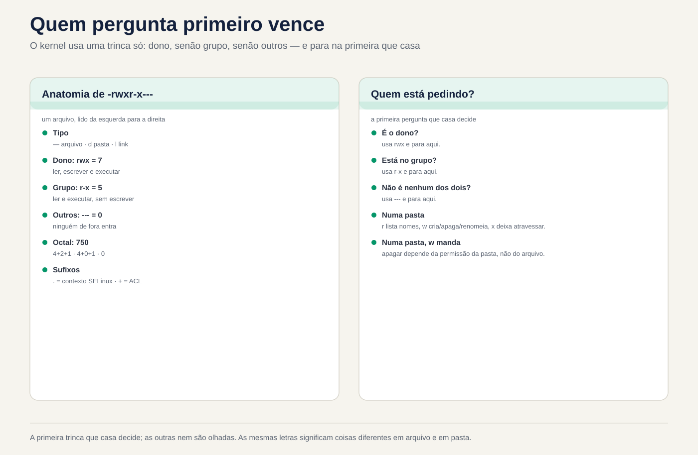
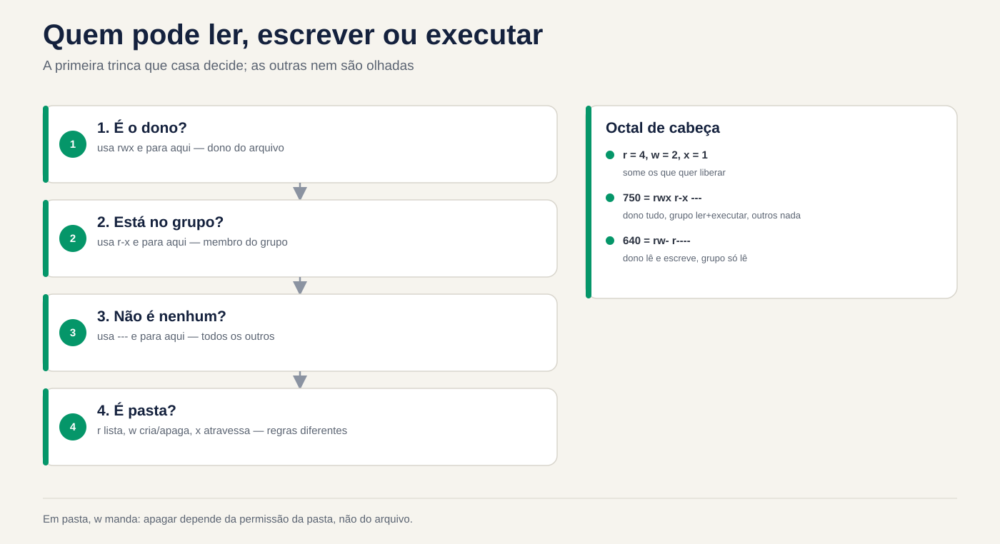

# Lezione 2.7 · Permessi e proprietario

Settima lezione del Modulo 2. "Permesso negato" è il messaggio di errore più comune nella vita di un amministratore di sistema, e la risposta più comune è la peggiore: `chmod -R 777`. Il problema scompare e ne compaiono tre: qualcuno cancella tutto, SSH smette di accettare la chiave e l'audit successivo contrassegna la cartella in rosso. Oggi impari a leggere le nove lettere di un `ls -l` come fa il kernel e a dare a ciascuno esattamente l'accesso di cui ha bisogno. Utilizzi Ana, Bruno e il gruppo `equipe` della lezione 2.6, con gli stessi numeri in entrambe le VM, per testare chi legge, chi scrive e chi cancella e perché.

| File | lezione 2.7 |
| --- | --- |
| Modulo | M2 · Sistema, utenti e permessi, lezione 7 di 8 |
| Quando | Settimana 5 |
| Alla fine puoi | Leggere i permessi di file e cartelle e dire chi può cosa; spiegare cosa significano `r`, `w` e `x` in una cartella; utilizzare `chmod` in modalità simbolica e ottale, anche in interi alberi senza danneggiare le cartelle; cambiare proprietario e gruppo con `chown` e `chgrp`; prevedere e adattare `umask`; seguire uno script quando viene visualizzato "Autorizzazione negata" |
| Articoli di prova | LE 015.3 (autorizzazioni e proprietario: `ls -l`, `chmod`, `chown`, `chgrp`, `umask`) · LPIC-1 104.5 (gestire le autorizzazioni e il proprietario dei file: modalità simbolica e ottale, `umask`, `chown`, `chgrp`) · RHCSA (elencare, definire e modificare i permessi ugo/rwx pattern; diagnosticare e correggere i problemi di autorizzazione dei file) |
| Prerequisiti | lezione 2.6 (Ana, UID 2001; Bruno, UID 2002; gruppo `equipe`, GID 2000, su entrambe le VM; i gruppi sono validi al login); lezione 2.5 (`sudo`, il cognome `deb`); lezione 1.8 (permesso di eseguire uno script) |
| Tempo | Intorno alle 2:30 |
| Istantanee | m2a7-start e m2a7-end in entrambe le VM |

## 1 · Riscaldamento

Tre domande, appena mi vengono in mente. Scrivi le risposte; la chiave di risposta viene visualizzata alla fine.

1. Il file `relatorio.txt` si chiama `-r--r--r-- root root` e si trova nella cartella `drwxrwxrwx`. Indovina: Ana, che non è root, può cancellarlo?
2. Hai creato `backup.sh` ed è `-rw-r--r--`. Indovina: `./backup.sh` funziona? E `bash backup.sh`?
3. Il file `nota.txt` è `----rw---- ana equipe` e Ana è nel gruppo `equipe`. Indovina: Ana riesce a leggere il proprio file?

## 2 · Perché è importante

Quasi ogni richiesta di autorizzazione rientra in uno dei quattro casi e ognuno ha una risposta sbagliata che sembra funzionare:

| Il cosiddetto | La risposta sbagliata | Cosa provoca |
| --- | --- | --- |
| "Bruno non può modificare il foglio di calcolo di Ana nella cartella del team" | `chmod -R 777 /srv/equipe` | Qualsiasi account sulla macchina, incluso il server web, legge, modifica ed elimina tutto |
| "Lo script di backup dice che l'autorizzazione è stata negata" | `chmod 777 backup.sh` | Chiunque può modificare il contenuto di uno script che root esegue ogni notte |
| "Ho caricato il sito web e ora dice 403" | `chmod -R 644 /var/www/site` | Le cartelle perdono `x` e nessuno ci entra, nemmeno il web server |
| "SSH ha smesso di accettare la mia chiave" | Genera un'altra chiave | Il problema era una cartella con scritto per il gruppo; o `sshd` rifiuta la chiave di proposito |

In tutti e quattro i casi, il vero risolutore fa la stessa cosa: chiede **chi** sta provando, **cosa** sta cercando di fare e **dove**, e legge i permessi per l'intero percorso. Questo è ciò che ti alleni oggi.

## 3 · Modello mentale

> Ogni file ha un proprietario, un gruppo e tre autorizzazioni. Il kernel chiede "chi sei?" e ne usa **uno** solo tre: quello del proprietario, se sei tu il proprietario; altrimenti il ​​gruppo, se sei nel gruppo; tranne quello degli altri. Decide il primo che si sposa e gli altri non si guardano nemmeno.

```text
  -rwxr-x---.  1  ana  equipe  2048  nov 3 09:12  fechamento.sh
  │└┬┘└┬┘└┬┘│     │    │
  │ │  │  │ │     │    └─ grupo do arquivo
  │ │  │  │ │     └────── dono do arquivo
  │ │  │  │ └─ "." = tem contexto SELinux (Rocky); "+" = tem ACL (Aula 8.5)
  │ │  │  └─── outros: quem não é o dono nem está no grupo   ---  = 0
  │ │  └────── grupo:  quem está no grupo equipe             r-x  = 5
  │ └───────── dono:   a ana                                 rwx  = 7
  └─────────── tipo: - arquivo, d pasta, l link
                                                           octal: 750

  Quem está pedindo?
     é o dono?  ── sim ──▶ usa rwx         (e para aqui)
        │ não
     está no grupo?  ── sim ──▶ usa r-x    (e para aqui)
        │ não
     usa ---
```

Le stesse lettere significano cose diverse in un fascicolo e in una cartella. Questa tabella risolve la metà delle chiamate:

| Testi | In un file | In una cartella |
| --- | --- | --- |
| `r` (4) | Leggi il contenuto | Elenca i nomi presenti in |
| `w` (2) | Modifica contenuto | Crea, elimina e rinomina ciò che c'è dentro, **indipendentemente dal permesso del file** |
| `x` (1) | Esegui come programma | Entra nella cartella e sfogliala per trovare qualcosa al suo interno |

Quattro idee guidano la lezione:

| Idea | Cosa intendi | Conseguenza |
| --- | --- | --- |
| Solo un viaggio | Proprietario, se non gruppo, se non altri. I conti non tornano | Un proprietario con meno autorizzazioni di quelle del gruppo ottiene quella del proprietario |
| L'eliminazione è compito della cartella | L'eliminazione di un file modifica la cartella, non il file | Un file `r--r--r--` in una cartella con `w` può essere cancellato |
| Conta tutto il percorso | Per arrivare a `/srv/a/b/c.txt` è necessario `x` in `/`, `/srv`, `/srv/a` e `/srv/a/b` | Un file `rw-rw-rw-` all'interno di una cartella senza `x` non è raggiungibile |
| La nascita decide | Ogni nuovo file nasce con il gruppo principale di chi lo ha creato e con il `umask` di chi lo ha creato | La maggior parte dei problemi relativi alle cartelle condivise riguardano il gruppo sbagliato o `umask` al momento della creazione |



*Decide la prima tripla che corrisponde; gli altri non si guardano nemmeno.*

## 4 · Concetto a strati

### Essenziale

**Leggi.** `ls -l` mostra le lettere; `stat` mostra anche il numero, che è quello che digiterai in `chmod`.

```bash
ls -l /etc/passwd /etc/shadow
ls -ld /tmp /home/rodrigo
stat -c '%A %a %U:%G %n' /etc/passwd /etc/shadow /tmp
```

```text
-rw-r--r--. 1 root root 1532 nov  3 08:10 /etc/passwd
----------. 1 root root  987 nov  3 08:10 /etc/shadow
-rw-r--r-- 644 root:root /etc/passwd
---------- 0 root:root /etc/shadow
drwxrwxrwt 1777 root:root /tmp
```

`-d` di `ls -ld` mostra la cartella stessa, anziché ciò che c'è al suo interno. `/etc/shadow` con `0` non è un errore: nessuno ha i permessi e solo root, che ignora i permessi di lettura e scrittura, può leggere. `t` alla fine di `/tmp` e `1` prima di `1777` sono la parte adesiva, oggetto della lezione 2.8. L'esempio è tratto da Rocky-Lab; in debian-lab `ls -l` viene fornito senza `.` dopo i permessi e `/etc/shadow` appare come `-rw-r----- root shadow`.

**Il numero.** Ogni tripla diventa una cifra che si somma a `r`=4, `w`=2, `x`=1:

| Testi | Conto | Cifra | Utilizzo tipico |
| --- | --- | --- | --- |
| `rwx` | 4+2+1 | 7| Proprietario della cartella o dello script |
| `rw-` | 4+2 | 6| Proprietario file comune |
| `r-x` | 4+1 | 5| Cartella o gruppo di script |
| `r--` | 4| 4| Sola lettura |
| `---` | 0| 0| Niente |

I numeri che digiterai quasi sempre: `644` e `755` (file e cartelle pubblici predefiniti), `640` e `750` (solo il gruppo legge), `600` e `700` (solo il proprietario), `660` e `770` (il gruppo lavora insieme).

**Modifica permessi: `chmod`.** Due modi per dire la stessa cosa:

```bash
chmod 750 fechamento.sh          # ottale: definisce tre terzine contemporaneamente
chmod u=rwx,g=rx,o= fechamento.sh   # simbolico: stesso risultato
chmod u+x backup.sh              # simbolico relativo: aggiunge x al proprietario, non cambia nient'altro
chmod g-w,o-r planilha.csv       # rimuovi w dal gruppo e r dagli altri
chmod a+r leiame.txt             # a = tutti, le tre terzine
```

| Parte | Voglio dire |
| --- | --- |
| `u`, `g`, `o`, `a` | Proprietario (*utente*), gruppo, altri, tutti |
| `+`, `-`, `=` | Aggiungere, togliere, definire esattamente (ciò che non è scritto diventa `-`) |
| `r`, `w`, `x` | I permessi |

Octal sono utili per **definire** l'intero stato. Il simbolico relativo serve per **cambiare una cosa** senza saperlo o senza cambiare il resto. Solo il proprietario del file e root possono eseguire `chmod` su di esso.

**Cambia proprietario e gruppo: `chown` e `chgrp`.**

```bash
sudo chown ana planilha.csv            # cambiare proprietario
sudo chown ana:equipe planilha.csv     # proprietario e gruppo
sudo chown :equipe planilha.csv        # semplicemente il gruppo
chgrp equipe planilha.csv              # solo il gruppo, senza sudo, se sei il proprietario e fai parte del gruppo
sudo chown -R ana:equipe /srv/projeto  # l'intero albero
```

Solo root cambia il proprietario di un file. Un utente comune può modificare il gruppo di un suo file, ma solo per un gruppo di cui fa parte.

### Intermedio

**O `umask`.** I programmi che creano file richiedono generalmente `666` per i file e `777` per le cartelle. `umask` è l'elenco di cosa **prendere** da questa richiesta:

| `umask` | Nuovo file | Nuova cartella | Da dove viene |
| --- | --- | --- | --- |
| `0022` | `644` `rw-r--r--` | `755` `rwxr-xr-x` | La radice; utenti comuni su Debian |
| `0002` | `664` `rw-rw-r--` | `775` `rwxrwxr-x` | Utenti abituali di Rocky, che hanno un proprio gruppo personale |
| `0027` | `640` `rw-r-----` | `750` `rwxr-x---` | Server rinforzati, script che generano dati interni |
| `0077` | `600` `rw-------` | `700` `rwx------` | Gli script che generano chiavi, password, dump bancari |

```bash
umask          # 0022, per esempio
umask -S       # u=rwx,g=rx,o=rx: ciò che è SINISTRA, in lettere
umask 027      # solo per questa shell e ciò che apre
```

`umask` non aggiungono mai autorizzazioni. Non nasce un nuovo file con `x`, qualunque sia `umask`, perché il programma ha richiesto `666`: ecco perché ogni nuovo script necessita di `chmod u+x`. `umask` si applica al processo e a tutto ciò che apre; Il valore predefinito per ogni accesso proviene da `/etc/login.defs` e dai file di inizializzazione della shell, e il tuo `~/.bashrc` può modificarlo per te.

**Testa come qualcun altro.** Invece di chiedere ad Ana di riprovare, chiedi al kernel:

```bash
sudo -u ana cat /srv/equipe/planilha.csv
sudo -u ana test -w /srv/equipe/planilha.csv && echo "a Ana pode escrever"
namei -l /srv/equipe/planilha.csv
```

`sudo -u ana` esegue il comando come Ana, con i suoi gruppi, senza chiederle la password. `namei -l` mostra proprietario, gruppo e permessi per ogni cartella nel percorso, da `/` al file. È lo strumento numero uno quando il file sembra corretto e l'accesso fallisce comunque.

**Altri strumenti per salvare gli errori:**

```bash
install -m 640 -o ana -g equipe modelo.csv /srv/equipe/   # copiare con modalità, proprietario e gruppo
install -d -m 770 -o root -g equipe /srv/equipe           # crea una cartella con modalità, proprietario e gruppo
cp -p origem destino               # modalità di conservazione della copia, proprietario (se root) e date
chmod --reference=modelo.csv novo.csv   # copiare i permessi da un altro file
```

`cp` senza `-p` crea il nuovo file come **tuo**, con il tuo `umask`: ecco perché un file copiato da un altro server "perde" i permessi.

### Windows Bridge

| Su Windows | Su Linux | La differenza che fa |
| --- | --- | --- |
| Scheda Sicurezza, elenco di utenti e gruppi | Tre gemelli: proprietario, un gruppo, altri | In Linux standard, un file ha **un** gruppo. Inoltre, ci sono le ACL (lezione 8.5) |
| I permessi si sommano e Nega vince | Utilizza i primi tre corrispondenti, senza aggiungere | Il proprietario con meno permessi del gruppo ottiene quello del proprietario |
| "Tutti: controllo totale" | `777` | Stesso errore, stesso risultato |
| "Prendersi proprietà" (*assumersi proprietà*) | `sudo chown` | In Linux, solo root cambia il proprietario |
| Ereditarietà delle autorizzazioni dalla cartella principale | Non esiste; `umask` e il gruppo dei creatori decidono | Un nuovo file **non** eredita i permessi della cartella. Il gruppo può essere ereditato con setgid (lezione 2.8) |
| L'eliminazione è un'autorizzazione per i file | La cancellazione è autorizzata `w` per la **cartella** | Un file di sola lettura può essere eliminato da chiunque scriva nella cartella |

### Advanced

**La radice e `x`.** La radice ignora `r` e `w` in qualsiasi file e `r` e `x` in qualsiasi cartella. Ma per **eseguire** un file, anche root ha bisogno che almeno una delle tre triplette abbia `x`. Ecco perché `sudo ./backup.sh` fallisce in uno script `644`.

**I permessi vengono controllati all'apertura.** Il kernel controlla i permessi quando il processo apre il file. Un processo che aveva già il file aperto continua a leggere e scrivere dopo un `chmod 000`. Nella vita reale: ottenere l'autorizzazione da un registro non interrompe il servizio che sta già scrivendo su di esso.

**Senza `r` in una cartella, con `x`.** Una cartella `711` (`rwx--x--x`) permette ad altri di entrare e aprire un file di cui **conoscono già il nome**, ma non di elencarlo. Questo è il modo in cui i vecchi server lasciavano `~/public_html` accessibile al server web senza esporre l'elenco dei file nella cartella home.

**Gli indicatori dopo le lettere.** Un `.` dopo i permessi significa che il file ha un contesto SELinux, quello normale in Rocky. Un `+` significa che c'è un ACL, permessi extra oltre alle tre triple, che `ls -l` non mostra; `getfacl arquivo` viene visualizzato. Se le tre triplette dicono di sì e l'accesso fallisce, la causa è in uno di questi due livelli: lezione 8.5 per ACL, lezione 12.3 per SELinux.

**La quarta cifra.** `stat` a volte mostra quattro cifre, come `1777` in `/tmp`. Il primo sono i permessi speciali: setuid (4), setgid (2) e sticky (1). È la lezione 2.8.

### Cosa c'è nel test

- **LE 015.3:** leggi `ls -l`; convertire tra lettere e ottale; cosa fanno i `r`, `w` e `x` in una cartella; `chmod`, `chown`, `chgrp`; il `umask` e il risultato in nuovi file e cartelle.
- **LPIC-1 104.5:** lo stesso, con modalità simbolica completa (`u+x`, `g=rx`, `o-rwx`, `a+r`), conteggi `chmod -R`, `chown usuario:grupo` e `umask`.
- **RHCSA:** l'attività è pronta per essere controllata tramite script: "il file X deve appartenere all'utente Y e al gruppo Z, con lettura e scrittura per il proprietario e il gruppo e niente per gli altri". L'errore di una cifra è un'attività pari a zero. Controlla spesso con `stat -c '%a %U:%G %n'`.

## 5 · Rocky × Debian

| Cosa | Roccioso 9 | Debian 13 |
| --- | --- | --- |
| `umask` da un utente comune | In generale `0002` (ogni persona ha un gruppo personale, quindi il gruppo può guadagnare `w`) | In generale `0022` |
| `umask` dalla radice | `0022` | `0022` |
| Modalità della cartella personale creata da `useradd -m` | `700` (`HOME_MODE 0700` in `login.defs`) | Dipende dalla versione `login.defs`: `700` o `755`. Verificare con `ls -ld /home/*` |
| Indicatore dopo le autorizzazioni in `ls -l` | `.` (contesto SELinux) | Niente, o `+` quando è presente ACL |
| `/etc/shadow` | `0` (`----------`), proprietario `root:root` | `640` (`-rw-r-----`), gruppo `shadow` |
| Gruppo di coloro che utilizzano `sudo` | `wheel` | `sudo` |
| `namei`, `stat`, `install` | Nel pacchetto base (`util-linux`, `coreutils`) | Idem |
| Quando le crepe dicono "può" e l'accesso fallisce | Sospetto SELinux (`ls -Z`, Lezione 12.3) | Sospetto ACL o AppArmor, che funziona per programma e non per file |

## 6 · Laboratorio guidato

In questo laboratorio sei `rodrigo`, con `sudo`, e testi tutto **come Ana e come Bruno** con `sudo -u`. Nessuno ha bisogno di inserire la password di nessuno: risponde il kernel per loro, con i gruppi che effettivamente hanno. Gli esperimenti sono in `/srv/lab27`, che potete confondere a vostro piacimento. La cartella `/srv/equipe`, creata al Passo 5, è per la lezione 2.8, che termina la sfida del modulo sopra di essa.


*Nella cartella, comandi w: l'eliminazione dipende dal permesso della cartella, non del file.*


### Passo 0 · Istantanea e il percorso di debian-lab

In Proxmox, scattare uno snapshot `m2a7-inicio` delle due VM. In rocky-lab, controllare il percorso verso debian-lab e gli account della lezione 2.6:

```bash
eval "$(ssh-agent -s)"; ssh-add
ssh -o BatchMode=yes deb 'hostname; id -un'
id ana; id bruno
ssh deb 'id ana; id bruno'
```

Le quattro righe di `id` devono mostrare `uid=2001(ana)` e `uid=2002(bruno)`, entrambi con `2000(equipe)` nell'elenco dei gruppi, su entrambe le VM. Se `equipe` manca in qualcuno di essi, torna al Passo 4 della Lezione 2.6: l'intero laboratorio dipende da questo.

### Passo 1 · Leggi come legge il kernel

Nelle due VM (in Debian-lab, prefisso `ssh deb`):

```bash
stat -c '%A %a %U:%G %n' /etc/passwd /etc/shadow /etc/sudoers /tmp /home/*
```

Per ogni riga, rispondi a tre domande ad alta voce: chi è il proprietario, cos'è il gruppo e cosa fa Ana, chi non è nessuno dei due, tu può farlo. Esempio di risposta a `/home/bruno` con `drwx------ 700 bruno:bruno`: "il proprietario è Bruno; Ana non è Bruno e non è nel gruppo `bruno`, quindi rientra negli altri, `---`; non entra, non elenca, non legge niente".

Ora conferma con il kernel, invece di fidarti della tua lettura:

```bash
sudo -u ana ls /home/bruno
sudo -u ana cat /etc/shadow
sudo -u ana cat /etc/passwd | tail -2
```

I primi due danno `Permission denied`; il terzo funziona. Notare le differenze tra le VM: `/etc/shadow` (`0` in Rocky, `640 root:shadow` in Debian) e la modalità delle cartelle home.

### Passo 2 · `r`, `w` e `x` in una cartella, uno alla volta

Montare il banco di prova in rocky-lab:

```bash
sudo mkdir -p /srv/lab27/caixa
echo "conteúdo da nota" | sudo tee /srv/lab27/caixa/nota.txt >/dev/null
sudo chmod 755 /srv/lab27
sudo chmod 644 /srv/lab27/caixa/nota.txt
```

Per ciascuna modalità nella tabella, eseguire `chmod` e i due test come Ana e confrontare con la colonna "Previsto":

```bash
sudo chmod 755 /srv/lab27/caixa      # passare alla modalità linea
sudo -u ana ls -l /srv/lab27/caixa
sudo -u ana cat /srv/lab27/caixa/nota.txt
```

| Modalità cartella | Trio degli altri | `ls -l` come Ana | `cat nota.txt` come Ana | Previsto |
| --- | --- | --- | --- | --- |
| `755` | `r-x` | Elenco normale | Funziona | Inserisci ed elenca |
| `754` | `r--` | I nomi compaiono, ma con errori `?????????` e `cannot access` | `Permission denied` | Elenca i nomi, non inserire |
| `751` | `--x` | `cannot open directory` | Funziona | Entra senza elencare: chi conosce il nome, apre |
| `750` | `---` | `Permission denied` | `Permission denied` | Niente |

La riga `754` è la più strana e la più importante: `r` senza `x` riporta solo la lista dei nomi, perché leggere i dettagli di un file (proprietario, dimensione, modalità) richiede di **entrare** nella cartella. Quando vedi `?????????` in un `ls -l`, la cartella ha `r` e manca `x`. Riporta la cartella in `755` alla fine.

### Passo 3 · L'eliminazione spetta alla cartella

```bash
sudo mkdir /srv/lab27/aberta
sudo chmod 777 /srv/lab27/aberta
echo "relatório final" | sudo tee /srv/lab27/aberta/relatorio.txt >/dev/null
sudo chmod 444 /srv/lab27/aberta/relatorio.txt
stat -c '%A %U:%G %n' /srv/lab27/aberta /srv/lab27/aberta/relatorio.txt
sudo -u ana sh -c 'echo "editado" > /srv/lab27/aberta/relatorio.txt'
sudo -u ana rm -f /srv/lab27/aberta/relatorio.txt
ls -l /srv/lab27/aberta
```

Ana **non riesce a modificare** il file (`Permission denied`: per lei il file è `r--`), ma **riesce a cancellarlo** e `ls` ritorna vuoto. Senza `-f`, `rm` avrebbe chiesto `remove write-protected regular file?` e sarebbe bastata una "y". Il file è root e di sola lettura per tutti, e non ha fatto alcuna differenza: eliminare significa scrivere nella cartella, e la cartella è `777`.

**Decidi 1 · Proteggi il report.** Ricrei `relatorio.txt` e vuoi che Ana continui a leggere cosa c'è nella cartella `aberta`, ma non può più cancellare nulla lì. Cosa cambi?

- **A)** `sudo chmod 400 /srv/lab27/aberta/relatorio.txt`
- **B)** `sudo chmod 755 /srv/lab27/aberta`
- **C)** `sudo chown root:root /srv/lab27/aberta/relatorio.txt`
- **D)** `sudo chmod 1777 /srv/lab27/aberta`

Scegli la lettera prima di guardare la tabella.

| Se hai selezionato | Risultato | Perché |
| --- | --- | --- |
| A | ❌ Sbagliato | Hai spostato il file e la sua eliminazione dipende dalla cartella. Ana continua con `w` nella cartella e la cancella allo stesso modo. E adesso non legge nemmeno più il verbale. |
| B| ✅ Giusto | La cartella è `rwxr-xr-x`: Ana rientra nelle altre, `r-x`, quindi la elenca e la inserisce, ma non la crea, non la rinomina e non la cancella. Era la richiesta. |
| C| ❌ Sbagliato | Il file era già root. Il proprietario del file non ha importanza durante l'eliminazione; Importa chi scrive nella cartella. |
| D | ⚠️ Funziona, ma | Il bit adesivo (il `1` in primo piano) fa sì che tutti cancellino solo ciò che è loro e Ana smette di cancellare il rapporto root. Può comunque creare file nella cartella, cosa che non è stata richiesta. È lo strumento giusto per le cartelle dove tutti scrivono, come `/tmp`: Lezione 2.8. |

**Per risolvere:** "chi può eliminare?" la risposta è guardando la cartella, mai il file.

Applica a B, ricrea il rapporto e conferma che `sudo -u ana rm -f` ora dà `Permission denied`.

### Passo 4 · `chmod` in entrambe le lingue

Nel tuo `~`, come `rodrigo`:

```bash
printf '#!/bin/bash\necho "backup ok em $(hostname)"\n' > ~/backup.sh
stat -c '%A %a %n' ~/backup.sh
~/backup.sh
bash ~/backup.sh
```

Il file nasce senza `x` (`644` o `664`, a seconda del tuo `umask`), e quindi `~/backup.sh` dà `Permission denied`. `bash ~/backup.sh` funziona perché è `bash` ad eseguirlo, il quale deve solo **leggere** lo script. Adesso, un comando alla volta, pronosticando il risultato **prima** di eseguire `stat`:

```bash
chmod u+x ~/backup.sh;        stat -c '%A %a' ~/backup.sh
chmod 750 ~/backup.sh;        stat -c '%A %a' ~/backup.sh
chmod g-x,o+r ~/backup.sh;    stat -c '%A %a' ~/backup.sh
chmod u=rw,go= ~/backup.sh;   stat -c '%A %a' ~/backup.sh
chmod a+x ~/backup.sh;        stat -c '%A %a' ~/backup.sh
```

Le risposte, da verificare in seguito: `rwx` nel proprietario e il resto così com'era (`744` o `764`); `rwxr-x---` `750`; `rwxr--r--` `744`; `rw-------` `600`; `rwx--x--x` `711`.

Infine, dimostrare che root ha bisogno anche di `x` per eseguire:

```bash
chmod 600 ~/backup.sh
sudo ~/backup.sh
chmod 700 ~/backup.sh && sudo ~/backup.sh
```

Il primo `sudo` fallisce (a seconda della versione di `sudo`, il messaggio è `command not found` o `Permission denied`); il secondo funziona.

### Passo 5 · Cartella proprietario, gruppo e team

Il team vuole una cartella in cui Ana e Bruno lavorano insieme e dove nessun altro possa entrare. In rocky-lab:

```bash
sudo mkdir /srv/equipe
sudo chown root:equipe /srv/equipe
sudo chmod 770 /srv/equipe
ls -ld /srv/equipe
ls /srv/equipe
```

Il `ls -ld` mostra `drwxrwx--- root equipe`, e il suo `ls /srv/equipe` dà `Permission denied`: il `rodrigo` non è in `equipe`, quindi rientra negli altri, `---`. Per guardarti dentro, d'ora in poi utilizzerai `sudo`. Ora Ana crea il foglio di calcolo e Bruno prova ad aggiungere una riga:

```bash
sudo -u ana sh -c 'echo "jan;100" > /srv/equipe/planilha.csv'
sudo ls -l /srv/equipe
sudo -u bruno sh -c 'echo "fev;200" >> /srv/equipe/planilha.csv'
```

Bruno riceve `Permission denied`. `ls -l` spiega perché: il file è nato `ana ana`, con il gruppo **personale** di Ana, non con `equipe`. Bruno non è Ana e non è nel gruppo `ana`, quindi cade negli altri, `r--`. La cartella era giusta; il file è nato con il gruppo sbagliato, perché il nuovo file prende il gruppo principale della persona che lo ha creato.

**Decidi 2 · Bruno non può modificare il foglio di calcolo di Ana.** È arrivata la chiamata. Cosa fai?

- **A)** `sudo chmod -R 777 /srv/equipe`
- **B)** `sudo chgrp equipe /srv/equipe/planilha.csv && sudo chmod g+w /srv/equipe/planilha.csv`
- **C)** `sudo chown bruno /srv/equipe/planilha.csv`
- **D)** `sudo usermod -aG ana bruno`

Scegli la lettera prima di guardare la tabella.

| Se hai selezionato | Risultato | Perché |
| --- | --- | --- |
| A | ❌ Sbagliato | Risolvi Bruno e apri la cartella per tutti gli account sulla macchina, inclusi i servizi. E non risolve nulla per il file successivo: nasce di nuovo con il gruppo sbagliato. |
| B | ✅ Giusto | Il file diventa il gruppo `equipe` e il gruppo guadagna `w`. Bruno, che è in `equipe`, rientra nel triplo del girone, `rw-`. Ana avrebbe potuto fare lo stesso senza `sudo`, perché è la proprietaria e si trova in `equipe`. |
| C| ❌ Sbagliato | Ora Bruno modifica e Ana, che ha creato il foglio di calcolo, cade nella trappola degli altri. Hai cambiato solo chi si lamenta. |
| D | ⚠️ Funziona, ma | Bruno si unisce al gruppo personale di Ana e ora ha accesso a **tutto** che crea con il gruppo `ana`, ovunque sul computer, anche all'esterno della cartella del team. I gruppi personali esistono proprio per non essere condivisi. |

**Per aggiungere:** a una cartella condivisa, il file deve appartenere al gruppo team e contenere `w` nel gruppo. Correggi il gruppo, non aprire gli altri.

Applica a B e conferma:

```bash
sudo -u bruno sh -c 'echo "fev;200" >> /srv/equipe/planilha.csv'
sudo cat /srv/equipe/planilha.csv
sudo -u bruno sh -c 'echo "rascunho" > /srv/equipe/notas-bruno.txt'
sudo ls -l /srv/equipe
```

Per il foglio di calcolo ha funzionato e il problema si è ripresentato nel nuovo file di Bruno: è nato `notas-bruno.txt` `bruno bruno`. Correggi file per file senza ridimensionarlo. La soluzione definitiva è il bit setgid nella cartella, che fa sì che ogni nuovo file erediti il ​​gruppo `equipe`: è la prima cosa nella lezione 2.8. Per ora, lascialo così.

### Passo 6 · Il `umask` che hai e quello che vuoi

Misura il `umask` di ciascuno, su entrambe le VM, con un login completo (`su -` passa attraverso gli stessi file di inizializzazione di un login reale):

```bash
umask
sudo su - ana -c umask
sudo su - root -c umask
ssh deb umask
ssh -t deb 'sudo su - ana -c umask'
```

Scrivi i cinque valori. La sezione 5 dice ciò che di solito appare, ma ciò che conta è ciò a cui la **tua** VM ha risposto: le due distribuzioni decidono il `umask` degli utenti con gruppi personali attraverso percorsi diversi, e questo è già cambiato tra le versioni. Ora guarda l'effetto:

```bash
mkdir ~/umask-teste && cd ~/umask-teste
touch padrao; mkdir dpadrao
( umask 027; touch a027; mkdir d027 )
( umask 077; touch a077; mkdir d077 )
stat -c '%a %A %n' *
cd ~
```

Le parentesi ruotano ogni `umask` in una subshell e la sua shell ritorna normale nella riga successiva. Previsto: `a027` `640`, `d027` `750`, `a077` `600`, `d077` `700`; `padrao` e `dpadrao` seguono `umask` che hai annotato.

**Decidi 3 · Il dump con le password.** Uno script root, eseguito da cron, scarica il database in `/backup/banco.sql`. Il file contiene le password degli utenti dell'applicazione. Oggi nasce `644`. Qual è la correzione giusta?

- **A)** Un `chmod 600 /backup/banco.sql` subito dopo il dump, alla fine dello script
- **B)** Un `umask 077` nella prima riga dello script, prima del dump
- **C)** `sudo chmod 777 /backup`, affinché il file erediti i permessi della cartella
- **D)** Un `umask 777` nella prima riga di script

Scegli la lettera prima di guardare la tabella.

| Se hai selezionato | Risultato | Perché |
| --- | --- | --- |
| A | ⚠️ Funziona, ma | Durante l'intero dump, che può richiedere alcuni minuti, il file è `644` e qualsiasi account legge le password. E se il dump fallisce a metà, `chmod` alla fine non viene nemmeno eseguito. |
| B | ✅ Giusto | Il file è già **nato** `600`. Non c'è alcuna finestra. Insieme alla cartella `/backup` in `700`, è l'impostazione predefinita per qualsiasi script che generi secret. |
| C| ❌ Sbagliato | In Linux, un nuovo file non eredita le autorizzazioni della cartella. E ora qualsiasi account elimina e modifica i backup. |
| D | ❌ Sbagliato | Nasce il file `000`. Root può registrare comunque, perché ignora `r` e `w`, ma qualsiasi altro strumento di ripristino o copia che non viene eseguito come root lo interrompe e appare anche una cartella creata dallo script `000`. Chiudere tutto non è configurare. |

**Da risolvere:** chi genera il segreto definisce `umask` prima di generarlo. Correggerlo in seguito significa lasciare la porta aperta mentre cerchi la chiave.

### Passo 7 · `chmod -R` senza rovinare le cartelle

Il sito di prova, con il classico errore di upload:

```bash
sudo mkdir -p /srv/lab27/site/img
echo '<h1>ok</h1>' | sudo tee /srv/lab27/site/index.html >/dev/null
sudo touch /srv/lab27/site/img/logo.png
sudo chmod -R 644 /srv/lab27/site
sudo -u ana cat /srv/lab27/site/index.html
sudo find /srv/lab27/site -printf '%M %p\n'
```

Ana riceve `Permission denied`, anche con `index.html` `rw-r--r--`. `find` spiega perché: le cartelle `site` e `img` sono diventate `drw-r--r--`, senza `x`, e nessuno attraversa una cartella senza `x`. È il "403 dopo il caricamento" della sezione 2.

**Decidi 4 · Metti in ordine il sito.** Vuoi le cartelle `755` e i file `644`, nell'intero albero. Quale comando?

- **A)** `sudo chmod -R 755 /srv/lab27/site`
- **B)** `sudo chmod -R u=rwX,go=rX /srv/lab27/site`
- **C)** `sudo find /srv/lab27/site -type d -exec chmod 755 {} + -o -type f -exec chmod 644 {} +`
- **D)** `sudo chmod 755 /srv/lab27/site`

Scegliere la lettera prima di guardare la tabella.

| Se hai selezionato | Risultato | Perché |
| --- | --- | --- |
| A | ⚠️ Funziona, ma | Il sito Web ritorna e ogni file diventa eseguibile, incluso `logo.png` e qualsiasi caricamento. Su un server web un file di dati con `x` è un invito a eseguire qualcosa che non dovrebbe. |
| B| ✅ Giusto | Il `X` maiuscolo dà `x` solo alle cartelle e ai file che hanno già `x` in qualche terzina. Poiché `-R 644` ha rimosso `x` da tutti i file, vincono solo le cartelle. Un comando, risultato esatto. |
| C| ✅ Giusto | Più lungo ed esplicito: le cartelle in un modo, i file nell'altro. È quello che usi quando `X` non è sufficiente, ad esempio quando un file ha un `x` errato che vuoi rimuovere. |
| D | ❌ Sbagliato | Solo la cartella principale è fissa. `img` rimane senza `x` e il logo resta spezzato. |

**Per impostare:** su `chmod -R`, utilizzare `X` maiuscolo o separare cartelle e file con `find`. `chmod -R` con un numero tratta solo cartelle e file come se fossero la stessa cosa, e non lo sono.

Esegui B, ripeti `cat` come Ana e `find` e controlla `drwxr-xr-x` nelle cartelle e `-rw-r--r--` nei file.

### Passo 8 · Lo script "Autorizzazione negata", e lo stesso in debian-lab

Quando l'accesso fallisce, seguire sempre lo stesso ordine. Prova con il file che Bruno ha creato al passo 5 e che Ana tenta di modificare:

```bash
sudo -u ana sh -c 'echo "revisado" >> /srv/equipe/notas-bruno.txt'
sudo namei -l /srv/equipe/notas-bruno.txt
sudo -u ana test -w /srv/equipe/notas-bruno.txt && echo "pode escrever" || echo "não pode"
```

`namei` va con `sudo` perché `rodrigo` non incrocia `/srv/equipe`: senza di esso la diagnosi stessa sarebbe `Permission denied`. L'ultima riga di `namei` mostra `bruno bruno` e la risposta viene dalla domanda 4 della tabella.

| Domanda | Comando | Cosa stai cercando |
| --- | --- | --- |
| 1. Chi ci sta provando? | `id bruno` (e l'utente del servizio, se si tratta di un servizio) | Gruppi reali, anche se l'accesso avviene prima dell'adesione al gruppo |
| 2. Fare cosa? | Leggere, scrivere, eseguire, inserire, creare o eliminare | La creazione e l'eliminazione sono autorizzazioni per la **cartella** |
| 3. Il percorso ti permette di arrivare? | `namei -l caminho` | Una cartella senza `x` per quella persona, a qualsiasi livello |
| 4. Quale tris corrisponde? | `stat -c '%A %U:%G' arquivo` | Proprietario, se non gruppo, se non altri. Solo uno |
| 5. Le crepe dicono “può” e falliscono? | `ls -l` (cercare `+` o `.`), `ls -Z`, `mount` | ACL, SELinux, sistema montato `ro` o `noexec`: layer delle lezioni 8.5, 12.3 e 5.x |

Ora ripeti i passaggi 5 e 7 in debian-lab, che sono quelli che lasciano lo stato per la lezione 2.8:

```bash
ssh -t deb 'sudo mkdir -p /srv/equipe && sudo chown root:equipe /srv/equipe && sudo chmod 770 /srv/equipe'
ssh -t deb 'sudo -u ana sh -c "echo jan\;100 > /srv/equipe/planilha.csv" && sudo chgrp equipe /srv/equipe/planilha.csv && sudo chmod g+w /srv/equipe/planilha.csv'
ssh -t deb 'sudo -u bruno sh -c "echo fev\;200 >> /srv/equipe/planilha.csv" && sudo ls -l /srv/equipe && sudo cat /srv/equipe/planilha.csv'
ssh -t deb 'sudo namei -l /srv/equipe/planilha.csv'
```

Il risultato deve essere lo stesso di rock-lab: `drwxrwx--- root equipe` nella cartella, `-rw-rw-r-- ana equipe` nel foglio di calcolo, con le due righe all'interno. Poiché gli UID e il GID sono gli stessi in entrambe le VM (lezione 2.6), un `rsync` della cartella tra di loro manterrebbe i proprietari corretti.

## 7 · Interruzione e correzione

### Interruzione A · La chiave SSH che non arrivava più

Lo scenario: qualcuno voleva "semplificarlo" e ha scritto al gruppo nella cartella home debian-lab. Prima di interrompere, **apri una sessione in debian-lab dal tuo PC e lasciala aperta**: è la via del ritorno. Se tutto va storto, lo stesso vale per la console VM in Proxmox. Quindi, su rocky-lab:

```bash
ssh deb 'stat -c "%A %a %U:%G %n" ~ ~/.ssh ~/.ssh/authorized_keys'
ssh deb 'chmod g+w ~'
```

**Observe.** Prova ad accedere di nuovo, su rocky-lab:

```bash
ssh -o BatchMode=yes deb hostname
```

```text
rodrigo@10.1.0.52: Permission denied (publickey,password).
```

La chiave è la stessa di cinque secondi fa, `authorized_keys` non è cambiato e il server rifiuta. La sessione lasciata aperta continua a funzionare: l'autorizzazione è concessa solo per i nuovi accessi.

**Diagnostique.** Il cliente non conosce il motivo; il server lo sa. Nella sessione aperta di Debian-lab:

```bash
sudo journalctl -u ssh -n 20 --no-pager
ls -ld ~ ~/.ssh ~/.ssh/authorized_keys
```

```text
Authentication refused: bad ownership or modes for directory /home/rodrigo
```

`sshd` ha una regola chiamata `StrictModes`, attivata per impostazione predefinita: se la cartella home, `~/.ssh` o `authorized_keys` può essere modificata da qualcuno diverso dal proprietario, rifiuta la chiave. Il motivo è buono: chiunque scriva nella tua cartella home può modificare l'intero `~/.ssh` e inserire lì la propria chiave. In Rocky, il servizio si chiama `sshd` e il registro dice la stessa cosa.

**Decidi A · La correzione.** Cosa esegui nella sessione aperta?

- **A)** `chmod g-w ~`
- **B)** Inserisci `StrictModes no` in `/etc/ssh/sshd_config` e riavvia `ssh`
- **C)** Genera una nuova chiave in rocky-lab e copiala in debian-lab
- **D)** `chmod -R 777 ~/.ssh`

Scegli la lettera prima di guardare la tabella.

| Se hai selezionato | Risultato | Perché |
| --- | --- | --- |
| A | ✅ Giusto | Togli esattamente ciò che è stato aggiunto. La cartella ritorna come prima e `sshd` accetterà nuovamente la chiave al prossimo login. |
| B| ⚠️ Funziona, ma | La chiave rientra e hai disattivato la protezione per l'intero server, per tutti gli account, in modo da non riparare una cartella. La cartella è ancora sbagliata. |
| C| ❌ Sbagliato | La nuova chiave cade nello stesso `authorized_keys`, nella stessa cartella di `g+w`, e viene rifiutata per lo stesso motivo. Il problema non è mai stato la chiave. |
| D | ❌ Sbagliato | C'è di peggio: ora anche `~/.ssh` e `authorized_keys` sono scrivibili da tutti, e `sshd` ha tre motivi invece di uno. |

**Per risolvere:** quando SSH rifiuta una chiave funzionante, leggere il registro del server prima di modificare la chiave. "cattiva proprietà o modalità" è l'autorizzazione e la correzione è nella cartella.

**Fix.** Nella sessione aperta:

```bash
chmod g-w ~
ls -ld ~
```

E, da rocky-lab, il test fallito:

```bash
ssh -o BatchMode=yes deb hostname
```

La risposta `debian-lab` ritorna senza una domanda. Modalità accettate dal `sshd` per il salvataggio: cartella personale senza `w` per gruppi e altri (`700` o `755`), `~/.ssh` in `700`, `authorized_keys` in `600`, tutto dall'utente.

### Interruzione B · La cartella del team che nessun altro può raggiungere

Lo scenario: in una "protezione di sicurezza", qualcuno ha chiuso la cartella superiore. In rocky-lab, annota la modalità corrente e interrompi:

```bash
stat -c '%a %U:%G %n' /srv /srv/equipe
sudo chmod 700 /srv
```

**Osserva.** Ana e Bruno aprono una chiamata contemporaneamente:

```bash
sudo -u ana cat /srv/equipe/planilha.csv
sudo -u bruno ls /srv/equipe
```

Le due righe danno `Permission denied`. Chi risponde controlla la cartella del team e il file, e tutto è ok: `drwxrwx--- root equipe`, `-rw-rw-r-- ana equipe`, entrambi nel gruppo.

**Diagnostique.** Quando il file e la sua cartella sono corretti, il problema è nel percorso:

```bash
sudo namei -l /srv/equipe/planilha.csv
sudo -u ana namei -l /srv/equipe/planilha.csv
```

```text
f: /srv/equipe/planilha.csv
dr-xr-xr-x root root   /
drwx------ root root   srv
drwxrwx--- root equipe equipe
-rw-rw-r-- ana  equipe planilha.csv
```

Con `sudo` `namei` mostra l'intera catena e appare l'anello interrotto: `srv` in `drwx------`. Ana cade negli altri, `---`, e non attraversa. Ruotato come Ana, `namei` si ferma esattamente a `srv`, con `Permission denied`, e mostra dall'altro lato lo stesso punto. Niente di seguito ha importanza.

**Decidi B · La soluzione.** Cosa esegui?

- **A)** `sudo chmod 755 /srv`
- **B)** `sudo chmod -R 755 /srv`
- **C)** `sudo chmod o+x /srv`
- **D)** `sudo usermod -aG root ana` e lo stesso per Bruno

Scegli il testo prima di guardare la tabella.

| Se hai selezionato | Risultato | Perché |
| --- | --- | --- |
| A | ✅ Giusto | Restituisce la modalità annotata, che è quella predefinita delle due distribuzioni. Cambia una cartella, quella che si è rotta. |
| B| ❌ Sbagliato | Corregge `/srv` e rovina tutto ciò che sta sotto: `/srv/equipe` diventa `755` (ora qualsiasi account legge i fogli di calcolo) e ogni file diventa eseguibile. A `-R` per sistemare una singola cartella. |
| C| ⚠️ Funziona, ma | Basta attraversare `x` e Ana e Bruno tornano al lavoro. `/srv` diventa `701`, diverso dal default e dall'altro server: il prossimo amministratore che confronterà i due perderà tempo con questo. Se chi lo ha chiuso volesse nascondere l'elenco delle cartelle, acconsenti; in caso contrario, torna alle impostazioni predefinite. |
| D | ❌ Sbagliato | Non funziona ed è pericoloso. `/srv` è `700`: il gruppo `root` ha anche `---`. E mettere gli utenti nel gruppo `root` dà loro la possibilità di leggere tutto nel gruppo `root` sulla macchina. |

**Per risolvere:** quando il file e la cartella sono corretti e l'accesso non riesce, eseguire `namei -l`. L'errore è a un livello superiore e la correzione è a quel livello, senza `-R`.

**Risolverlo.**

```bash
sudo chmod 755 /srv
sudo -u ana cat /srv/equipe/planilha.csv
stat -c '%a %n' /srv /srv/equipe
```

Viene visualizzato il foglio di calcolo e le modalità ritornano a `755` e `770`.

### La lezione

I due problemi hanno la stessa radice: i permessi dell'oggetto erano corretti e il problema era **intorno** ad esso. Nella pausa A, la chiave era corretta e la cartella Inizio no. Nella pausa B, il file era corretto e la cartella sopra no. Chi guarda solo il file della chiamata non troverà nessuno dei due. L'abitudine di questa lezione: **leggere l'intero percorso e leggere il log del servizio rifiutato**. `namei -l` e `journalctl` rispondono in dieci secondi a ciò che `chmod 777` nasconde per sempre.

## 8 · Insidie

| Digiti o vedi | Cosa succede | Quello giusto |
| --- | --- | --- |
| `chmod -R 777 pasta` | Aggiungi l'errore e qualsiasi account sulla macchina legge, modifica e cancella tutto | Proprietario, gruppo e `w` corretti del gruppo; `770` o `775` nella cartella, mai `7` nelle altre |
| `chmod -R 644 site` | Cartelle senza `x`: non entra nessuno, il sito dà 403 | `chmod -R u=rwX,go=rX site` o `find` separare le cartelle di file |
| `chmod -R 755 site` | Tutti i file diventano eseguibili | La stessa capitale `X` o `find` |
| `chmod 444 arquivo` per impedire che vengano cancellati | Chi ha `w` nella cartella lo cancella allo stesso modo | Rimuovere `w` dalla cartella o il bit adesivo nella cartella (lezione 2.8) |
| `chmod g+w ~` o `chmod 777 ~/.ssh` | `sshd` rifiuta la chiave: "cattiva proprietà o modalità" | Cartella personale senza `w` per gruppo e altri, `~/.ssh` `700`, `authorized_keys` `600` |
| `chmod 600` dopo aver generato un file con segreto | Il file è leggibile da tutti mentre viene generato | `umask 077` prima di generare |
| `umask 777` o scoprire che `umask` aggiunge l'autorizzazione | `umask` rimuove solo; il nuovo file non riceve mai `x` per questo motivo | Scegliere `umask` in base al risultato: `022`, `002`, `027` o `077` |
| `ls /srv/equipe` dà `Permission denied` come `rodrigo` | Non sei nel gruppo e l'errore è **tuo**, non la cartella | `sudo ls -l` oppure verificare come utente corretto con `sudo -u` |
| `chown bruno arquivo` in modo che Bruno possa modificare | Ana, che l'ha creato, perde l'accesso | `chgrp equipe` e `chmod g+w` |
| `?????????` in `ls -l` | La cartella ha `r` e non ha `x` per te | Date `x` alla cartella per chi deve inserire |
| Le crepe dicono "può" e l'accesso fallisce | ACL (`+`), SELinux (`.`), sistema montato `ro` o `noexec` | `getfacl`, `ls -Z`, `mount`: lezioni 8.5, 12.3 e 5.x |
| `cp` di un file su un'altra macchina ha "perso" i permessi | `cp` crea il file come **tuo**, con il tuo `umask` | `cp -p` come radice, `install -m -o -g` o `rsync -a` |

## 9 · Quiz

Dieci domande, senza consultazione. Scrivere la lettera o rispondere a ciascuna e solo dopo aprire la chiave di risposta.

**1.** Scrivere in ottale: `rwxr-x---`, `rw-r--r--`, `rw-------` e `rwxr-xr-x`.

**2.** Il file è `-rw-r--rw- ana equipe`. Bruno è nel gruppo `equipe`. Può scrivere sul file?

- **A)** Sì, perché gli altri hanno `rw-`
- **B)** No, perché è nel gruppo e il trio del gruppo è `r--`
- **C)** Sì, perché i permessi si sommano
- **D)** No, perché solo il proprietario scrive

**3.** In una cartella, che consente di eliminare un file al suo interno?

**4.** Quale comando dà `x` al proprietario, rimuove `w` dal gruppo e non tocca nient'altro?

- **A)** `chmod 744 arquivo`
- **B)** `chmod u+x,g-w arquivo`
- **C)** `chmod u=x,g=w arquivo`
- **D)** `chmod +x -w arquivo`

**5.** Con `umask 027`, come vengono creati un nuovo file e una nuova cartella? Scrivi in ​​ottale e lettere.

**6.** Una cartella è `drwxr-xr--` e Ana cade in altre. Cosa può fare lì dentro?

- **A)** Elenca i nomi, senza inserire né leggere i file
- **B)** Entra e leggi i file, senza elencarli
- **C)** Elenca, inserisci e leggi
- **D)** Niente

**7.** Quale comando cambia il proprietario in `ana` e il gruppo in `equipe` di `/srv/projeto` e tutto dentro?

**8.** Ana, senza `sudo`, vuole passare il file `relatorio.txt`, che è suo, a Bruno. Cosa succede con `chown bruno relatorio.txt`?

**9.** In un `chmod -R`, cosa fa la maiuscola `X` in modo diverso dalla minuscola `x`?

**10.** *Un file deve essere di proprietà dell'utente `ana` e del gruppo `equipe`, leggibile e scrivibile dal proprietario e dal gruppo e senza accesso per nessun altro. Quali comandi raggiungono questo obiettivo?*

- **A)** *`chown ana:equipe file; chmod 660 file`*
- **B)** *`chown ana file; chmod 770 file`*
- **C)** *`chown equipe:ana file; chmod 660 file`*
- **D)** *`chown ana:equipe file; chmod 664 file`*

## 10 · Flashcard e colla

### Da saperlo a memoria

- Il kernel utilizza **una** tripletta: quella del proprietario, altrimenti quella del gruppo, poi quella degli altri. Non aggiunge.
- `r`=4, `w`=2, `x`=1. `644`/`755` pubblico, `640`/`750` solo il gruppo, `600`/`700` solo il proprietario, `660`/`770` il gruppo lavora insieme.
- In una cartella: `r` elenca, `w` crea ed elimina, `x` entra e attraversa.
- Eliminare significa scrivere nella cartella. La modalità file non protegge da chiunque scriva nella cartella.
- Per accedere a un file, è necessario `x` in tutte le cartelle lungo il percorso. `namei -l` mostra l'intero percorso.
- Il nuovo file viene creato con il gruppo principale di chi lo ha creato e con `umask` di chi lo ha creato. Non eredita nulla dalla cartella.
- `umask` lo porta semplicemente via. Non viene mai creato un nuovo file con `x`.
- `chmod -R` con il numero di cartelle o file rovinati. Usare la maiuscola `X` o `find`.
- Solo root cambia il proprietario. Il proprietario può modificare il gruppo nel proprio gruppo.
- SSH rifiuta la chiave che ha funzionato: leggere il registro del server. "cattiva proprietà o modalità" è il permesso della cartella.

### Consultare

| Domanda | Comando |
| --- | --- |
| Lettere, ottale, proprietario e gruppo | `stat -c '%A %a %U:%G %n' caminho` |
| La cartella stessa, non il contenuto | `ls -ld pasta` |
| Tutto il percorso, livello per livello | `namei -l caminho` (con `sudo` se non si naviga in nessuna cartella) |
| La persona può farlo? | `sudo -u nome test -r arquivo`; `-w`; `-x`; oppure eseguire il comando stesso con `sudo -u nome` |
| Imposta la modalità numeri interi | `chmod 640 arquivo` |
| Cambia solo una cosa | `chmod u+x`, `chmod g-w`, `chmod o=`, `chmod a+r` |
| Albero: cartelle `755`, file `644` | `chmod -R u=rwX,go=rX pasta` |
| Albero, separato con `find` | `find pasta -type d -exec chmod 755 {} + -o -type f -exec chmod 644 {} +` |
| Modalità copia da un altro file | `chmod --reference=modelo novo` |
| Proprietario e gruppo | `sudo chown ana:equipe arquivo`; albero: `sudo chown -R ana:equipe pasta` |
| Solo il gruppo | `chgrp equipe arquivo` |
| Crea cartella con proprietario e modalità | `sudo install -d -m 770 -o root -g equipe /srv/pasta` |
| Copia ora con proprietario e modalità | `sudo install -m 640 -o ana -g equipe origem destino/` |
| Modalità di conservazione della copia e proprietario | `sudo cp -p origem destino`; `sudo rsync -a origem/ destino/` |
| L'attuale `umask` | `umask`; in lettere: `umask -S` |
| `umask` di qualcun altro, in un login completo | `sudo su - nome -c umask` |
| Cambia `umask` solo per un comando | `( umask 077; comando )` |
| Trova ciò che è aperto a tutti | `sudo find /srv -xdev -perm -o+w ! -type l` |
| Trovare file dal gruppo sbagliato | `sudo find /srv/equipe ! -group equipe` |
| Perché SSH ha rifiutato la chiave | `sudo journalctl -u ssh -n 20` (Debian); `-u sshd` (Roccioso) |
| ACL e SELinux, quando le triple dicono "può" | `getfacl arquivo`; `ls -Z arquivo` |

### Flashcard

| Davanti | Verso |
| --- | --- |
| `rwxr-x---` in ottale | `750` |
| `rw-r-----` in ottale | `640` |
| `r` in una cartella | Elenca i nomi |
| `w` in una cartella | Crea, elimina e rinomina il contenuto di |
| `x` in una cartella | Immettere e barrare |
| `?????????` in `ls -l` | La cartella ha `r` e non ha `x` per te |
| Cartella `751` per altri | Entrano e aprono ciò che conoscono per nome, senza elencare |
| Il proprietario ha meno del gruppo | Il proprietario ottiene quello del proprietario. Il primo tris che arriva decide |
| Chi può eliminare un file? | Chi ha `w` e `x` nella cartella (lo sticky bit limita: lezione 2.8) |
| `umask 022` | File `644`, cartella `755` |
| `umask 002` | File `664`, cartella `775` |
| `umask 027` | File `640`, cartella `750` |
| `umask 077` | File `600`, cartella `700` |
| Capitale `X` in `chmod` | `x` solo in cartelle e file che contengono già alcuni `x` |
| `chmod u=rw,go=` | `600` |
| `chown :equipe arquivo` | Basta cambiare il gruppo |
| `chown` senza essere root | `Operation not permitted` |
| Root esegue uno script `644`? | No. Per essere eseguito, anche root ha bisogno di un `x` in qualche tripletta |
| `.` dopo le autorizzazioni | Contesto SELinux (Rocky) |
| `+` dopo le autorizzazioni | Ha ACL: `getfacl` |
| Modalità accettate da `sshd` | Cartella personale senza `w` per gruppo e altri, `~/.ssh` `700`, `authorized_keys` `600` |
| Il nuovo file eredita il gruppo di cartelle? | No, a meno che la cartella non abbia un setgid (lezione 2.8) |

## 11 · Checklist di output

- [ ] Leggo un `ls -l` o un `stat` e dico a chiunque cosa può fare e in che modo.
- [ ] Converto mentalmente tra lettere e ottale, in entrambe le direzioni.
- [ ] Spiego cosa `r`, `w` e `x` fare in una cartella, e mostrare il caso `r` senza `x` nella VM.
- [ ] Spiego perché qualcuno può eliminare un file di sola lettura e come prevenirlo.
- [ ] Utilizzo `chmod` simbolico per modificare solo una cosa e ottale per definire l'intero stato.
- [ ] Creo un albero con le cartelle `755` e `644` file senza lasciare un file eseguibile.
- [ ] Cambio proprietario e gruppo con `chown` e `chgrp` e so chi può farlo ognuno.
- [ ] Misura il `umask` di una persona su entrambe le VM e prevedo la modalità di un nuovo file.
- [ ] Seguo lo script "Permesso negato" finché non trovo il livello del percorso che fallisce.

**Ultimo esercizio, senza guardare.** Tutto in Debian-Lab, da Rocky-Lab a `deb` o direttamente in un terminale Debian-Lab. Senza aprire questa lezione:

1. Creare la cartella `/srv/lab27/entrega`, per root e il gruppo `equipe`, dove il gruppo crea e modifica file e nessun altro entra.
2. Come Ana, crea `entrega/proposta.txt`. Assicurati che Bruno possa modificarlo e che gli altri non possano nemmeno leggerlo. Dimostrare con `sudo -u bruno` e con `rodrigo` stesso, senza `sudo`.
3. Nel tuo `~`, crea lo script `gera-token.sh`, che scrive qualsiasi riga in `~/token.txt`. Il file deve **nascere** `600` e lo script può essere eseguito solo da te. Esegui e prova entrambe le modalità.
4. Crea `/srv/lab27/publico` con una sottocartella e due file, rovinalo con `chmod -R 600` e risolvilo con **un** comando per le cartelle `755` e i file `644`. Dimostrare con `find -printf`.
5. Di', senza eseguire, cosa mostrerà `namei -l /srv/lab27/entrega/proposta.txt` su ogni riga, quindi eseguilo per verificare.

Apri il modello solo dopo, o dopo tre tentativi.

**Chiusura istantanee.** Sono nelle due VM: la cartella `/srv/equipe`, `drwxrwx--- root equipe`, con `planilha.csv` (`ana equipe`, `664`) e le due righe all'interno; a `/srv` torna a `755`; la tua cartella debian-lab home senza `w` per il gruppo. In Rocky-Lab c'è anche `notas-bruno.txt` con il gruppo sbagliato: lascialo, è il punto di partenza della lezione 2.8. Controlla:

```bash
sudo sh -c "stat -c '%A %U:%G %n' /srv /srv/equipe /srv/equipe/*"
ssh -t deb "sudo sh -c 'stat -c \"%A %U:%G %n\" /srv /srv/equipe /srv/equipe/*'"
ssh -o BatchMode=yes deb hostname
```

`sh -c` è fatto apposta. La persona che espande `*` è la shell **prima** che venga eseguito `sudo`, e `rodrigo` non va in `/srv/equipe` (`770`, non è dal gruppo `equipe`). Con `sudo stat ... /srv/equipe/*` `*` arriva letteralmente e `stat` lamenta un file chiamato `*`. All'interno di `sudo sh -c '...'`, root è colui che si espande.

Nel nodo Proxmox:

```bash
qm snapshot 201 m2a7-fim
qm snapshot 202 m2a7-fim
```

## 12 · Nella vita reale

**Missione della settimana, sola lettura.** Scegli tre real server: preferibilmente un file o un server web, uno amministrato da più persone e uno che esiste da anni. In ognuno, senza cambiare nulla:

1. `sudo find / -xdev -type d -perm -o+w ! -perm -1000 2>/dev/null`: cartelle scrivibili da chiunque **senza** sticky bit. Ciascuno è un luogo in cui qualsiasi account elimina il file di qualsiasi altro.
2. `sudo find / -xdev -type f -perm -o+w 2>/dev/null | head -20`: file scrivibili da tutti. Qualche script, configurazione o qualcosa che viene eseguito da root?
3. `stat -c '%a %U:%G %n' /home/* /root`: le cartelle personali sono `700` o `750`? Qualche `755` o peggio? Nella vita reale, chiunque legga la cartella Inizio di qualcun altro legge la cronologia, le chiavi pubbliche e talvolta le password scritte da script.
4. Per ogni persona titolare di un conto: `sudo stat -c '%a %n' ~nome/.ssh ~nome/.ssh/authorized_keys 2>/dev/null`. C'è qualche modo che `sshd` rifiuterebbe o che qualcun altro potrebbe cambiare?
5. Le cartelle condivise del team (`/srv`, `/var/www`, `/opt`, ovunque si trovino): `sudo find PASTA ! -group GRUPO | head` e `sudo find PASTA -perm -o+r -type f | head`. Sono presenti file con il gruppo sbagliato? Ci sono file che altri leggono senza bisogno?
6. Script Cron e backup: `sudo ls -l /etc/cron.d /etc/cron.daily` e modalità file di backup. Qualche dump o copia della configurazione leggibile da tutti?
7. `umask` e `sudo su - root -c umask`. Corrisponde a quello che ti aspettavi per quel server?

**Per il journal.** Una riga per server: `nome · pastas o+w sem sticky · arquivos o+w · pastas pessoais acima de 750 · .ssh ou authorized_keys errados · arquivos com grupo errado nas pastas da equipe · backups legíveis por todos · umask das pessoas e do root`. Accanto a ogni risultato, il comando che **eseguiresti** per risolverlo e chi dovrebbe saperlo per primo. Non aggiustare nulla questa settimana: la missione è vedere.

**Sfida della settimana.** Scrivi, in un massimo di otto righe, lo script "Permesso negato" della tua squadra: le domande nell'ordine giusto (chi, cosa fare, il percorso, quale terzina, gli altri livelli), un comando per ognuna e la regola che `777` non è una correzione. Prova lo script nella successiva ricevuta di autorizzazione visualizzata, prima di modificare qualsiasi cosa.

**Domani, senza guardare.** Prima di aprire il terminale, rispondi a mente aperta: quanto vale `rwxr-x---` in ottale? Cosa fa `x` in una cartella e cosa succede a `r` senza `x`? Perché qualcuno dovrebbe eliminare un file di sola lettura? Con `umask 027` come si crea un file? Quale comando organizza un albero per le cartelle `755` e i file `644`? Quindi, in una delle VM, esegui `sudo sh -c "stat -c '%A %a %U:%G %n' /srv/equipe/*"` e spiega ad Ana, Bruno e `rodrigo` cosa può fare ciascuno in ciascun file.

## 13 · Con DeepTutor

Usa DeepTutor sulla tua rete locale dopo il laboratorio, non al suo posto. I comandi iniziano con `!`:

- `!quiz Aula 2.7`: dieci nuove domande su terzine, ottale, `chmod`, `chown` e `umask`.
- `!explica r w x numa pasta`: cosa consente ciascuna lettera, con le quattro modalità del passo 2 e cosa appare in `ls -l` in ciascuna.
- `!feynman apagar é assunto da pasta`: spieghi perché un file di sola lettura può essere cancellato e indica dove è stato lasciato vacante.
- `!quebra Permission denied`: descrive una chiamata di autorizzazione e fornisce gli output di `id`, `stat`, `namei -l` e il registro, uno alla volta, in modo da poter trovare il livello che non supera.
- `!simulado RHCSA permissões`: attività in stile esame, con proprietario, gruppo e modalità esatti e cosa controllerà lo script di correzione.
- `!cartoes Aula 2.7`: le flashcard della sezione 10, in rivedere l'ordine.
- `!erro`: incolla il messaggio da un `chmod`, `chown`, `ssh` o da un accesso non riuscito e ti indicherà la probabile causa e cosa cercare.
- `!revisao`: cosa rivedere da questa lezione e da quelle precedenti, cosa hai sbagliato finora.

## Foglio di risposte commentato

### Riscaldamento

1. SÌ. L'eliminazione di un file modifica l'elenco dei nomi delle **cartelle** e la cartella è `rwxrwxrwx`. La modalità `r--r--r--` e il proprietario `root` del file non entrano nell'account. `rm` chiede ancora `remove write-protected regular file?` e una "y" o `-f` lo risolve. È il passaggio 3.
2. `./backup.sh` dà `Permission denied`: il file non ha `x` in nessuna terzina, e `umask` non aggiunge mai `x`. `bash backup.sh` funziona, perché `bash` è quello che lo esegue e deve solo **leggere** lo script. Per il primo che opera: `chmod u+x backup.sh`.
3. No. Ana è il proprietario, quindi il kernel usa la tripletta del proprietario, `---`, e basta: la tripletta del gruppo, `rw-`, non viene nemmeno guardata. Poiché è la proprietaria, può risolverlo da sola con `chmod u+rw nota.txt`.

### Quiz

1. `750`, `644`, `600` e `755`. Ogni fessura è la somma di `r`=4, `w`=2 e `x`=1.
2. **B.** Bruno è nel gruppo, quindi la sua terzina è quella del gruppo, `r--`, e il nucleo si ferma lì. Il `rw-` degli altri si applica a coloro che **non** sono il proprietario o fanno parte del gruppo. A e C pensano che le crepe si sommano; D dimentica che il gruppo e gli altri possono avere anche `w`.
3. `w` e `x` nella cartella: `w` per modificare l'elenco dei nomi, `x` per accedervi. La modalità e il proprietario del file non hanno importanza. L'eccezione è la parte adesiva, che fa sì che ognuno cancelli solo ciò che è suo: lezione 2.8.
4. **B.** Il relativo simbolico interessa solo ciò che hai scritto. A definisce le tre terzine e può modificare ciò che già c'era (ad esempio dando `r` agli altri); C definisce il proprietario come **solo** `x` e il gruppo come **solo** `w`; D non è una sintassi valida: `chmod` tenta di leggere `-w` come opzione o come seconda modalità e fallisce.
5. File `640`, `rw-r-----` (l'ordine `666` meno `027`); cartella `750`, `rwxr-x---` (l'ordine `777` meno `027`).
6. **R.** Ana cade negli altri, `r--`: elenca i nomi, ma senza `x` non entra, non vede i dettagli e non legge nessun file. In `ls -l` vedrebbe `?????????`.
7. `sudo chown -R ana:equipe /srv/projeto`. `-R` cambia l'intero albero e `ana:equipe` cambia proprietario e gruppo contemporaneamente.
8. `chown: changing ownership of 'relatorio.txt': Operation not permitted`. Solo root cambia il proprietario di un file, in modo che nessuno possa "cedere" file a qualcun altro, ad esempio per superare la propria quota o per biasimarlo. I percorsi possibili: root fa `chown`, oppure Bruno **copia** il file, e da esso nasce la copia.
9. Il `X` maiuscolo dà `x` solo alle cartelle e ai file che hanno già `x` in qualche terzina. Con `chmod -R u=rwX,go=rX` le cartelle diventano `755` e i file di dati diventano `644`, in un unico comando. `x` minuscolo darebbe `x` a tutto.
10. Tabella seguente.

| Se hai selezionato | Risultato | Perché |
| --- | --- | --- |
| A | ✅ Giusto | Proprietario `ana`, gruppo `equipe`, `rw-rw----`. Esattamente come richiesto, ed è ciò che lo script di correzione corrisponde a qualcosa come `stat -c '%U:%G %a'`. |
| B| ❌ Sbagliato | Il gruppo non è stato definito (rimane com'era), e il `770` dà il `x` che nessuno ha chiesto. Due errori in un'attività risolti dallo script. |
| C| ❌ Sbagliato | Inverte proprietario e gruppo: `chown` è sempre `dono:grupo`. Il file diventa dell'utente `equipe` se esiste e il comando fallisce se non esiste. |
| D | ❌ Sbagliato | `664` dà `r` ad altri e la richiesta non ha consentito l'accesso a nessun altro. Una cifra, attività cancellata. |

### Ultimo esercizio

Direttamente in un terminale Debian-lab (tramite Rocky-Lab, inserisci ogni riga all'interno di `ssh -t deb '...'`):

```bash
sudo install -d -m 770 -o root -g equipe /srv/lab27/entrega
sudo -u ana sh -c 'echo "proposta v1" > /srv/lab27/entrega/proposta.txt'
sudo chgrp equipe /srv/lab27/entrega/proposta.txt
sudo chmod 660 /srv/lab27/entrega/proposta.txt
sudo -u bruno sh -c 'echo "revisado pelo Bruno" >> /srv/lab27/entrega/proposta.txt' && echo "Bruno escreveu"
cat /srv/lab27/entrega/proposta.txt
```

`cat` come `rodrigo`, senza `sudo`, deve dare `Permission denied`: non sei in `equipe`, quindi cade in altri, `---`, già nella cartella. `install -d` crea la cartella con proprietario, gruppo e modalità in un unico comando; `mkdir`, `chown root:equipe` e `chmod 770` danno lo stesso risultato. Invece di `chgrp` con `sudo`, Ana avrebbe potuto fare da sola i `chgrp` e i `chmod`, perché è la proprietaria e si trova nel `equipe`.

La sceneggiatura:

```bash
cat > ~/gera-token.sh <<'EOF'
#!/bin/bash
umask 077
echo "token-$(date +%s)" > ~/token.txt
EOF
chmod 700 ~/gera-token.sh
~/gera-token.sh
stat -c '%a %n' ~/gera-token.sh ~/token.txt
```

`stat` deve riportare `700` nella scrittura e `600` in `token.txt`. `umask 077` viene **prima** della registrazione, quindi il file nasce chiuso. Se il `token.txt` esisteva già, si mantiene il vecchio modo: il `umask` si applica solo al momento della creazione. Spegnilo ed eseguilo di nuovo per testarlo.

L'albero:

```bash
sudo mkdir -p /srv/lab27/publico/docs
sudo touch /srv/lab27/publico/index.html /srv/lab27/publico/docs/manual.txt
sudo chmod -R 600 /srv/lab27/publico
sudo chmod -R u=rwX,go=rX /srv/lab27/publico
sudo find /srv/lab27/publico -printf '%M %p\n'
```

`find` deve contenere `drwxr-xr-x` in entrambe le cartelle e `-rw-r--r--` in entrambi i file. Anche il comando con `find -type d ... -o -type f ...` è corretto.

`namei -l /srv/lab27/entrega/proposta.txt`, ruotato con `sudo`: `/` `dr-xr-xr-x root root` (o `drwxr-xr-x`), `srv` `drwxr-xr-x root root`, `lab27` `drwxr-xr-x root root`, `entrega` `drwxrwx--- root equipe`, `proposta.txt` `-rw-rw---- ana equipe`. Esegui senza `sudo`, come `rodrigo`, si ferma a `entrega` con `Permission denied`, ed è esattamente il livello in cui sei bloccato.

---

<!-- navegacao -->
[← lezione 2.6 · Utenti e gruppi](2.6-usuarios-e-grupos.md) · [Indice delle lezioni](../01-aulas.md) · [lezione 2.8 · Directory e file speciali →](2.8-diretorios-e-arquivos-especiais.md)
