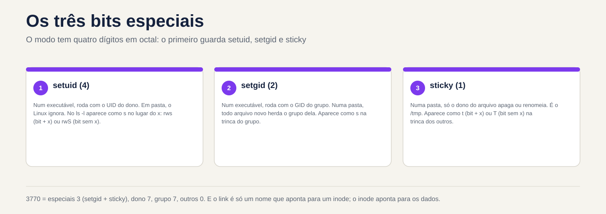
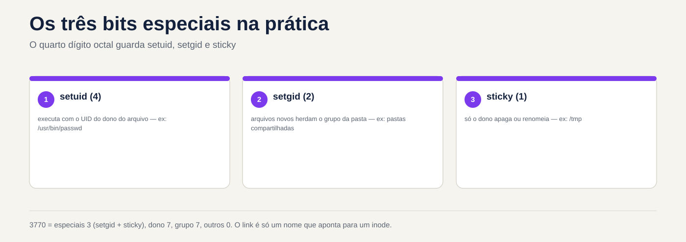

# Lezione 2.8 · Directory e file speciali

Ottava e ultima lezione del Modulo 2. Nella lezione 2.7, la cartella della squadra era quasi pronta: Ana e Bruno entrano, leggono e scrivono, ma ogni nuovo file viene creato con il gruppo sbagliato e uno dei due può cancellare il lavoro dell'altro. Oggi chiudi questo con tre bit nascosti in `ls -l`: **setgid**, che fa sì che la cartella dia al gruppo nuovi file, **sticky**, che impedisce a uno di eliminare il file dell'altro, e **setuid**, che spiega perché Ana può cambiare la propria password su un file che solo root può cambiare. Quindi impari i due tipi di collegamenti, che sono sotto ogni distribuzione con "rollback in un secondo", e passi attraverso `/proc`, `/sys` e `/dev`, le cartelle che sembrano file e sono il kernel a parlare. Alla fine, la sfida del modulo: la cartella `/srv/equipe` funziona davvero, su entrambe le VM.

| File | lezione 2.8 |
| --- | --- |
| Modulo | M2 · Sistema, utenti e permessi, lezione 8 di 8 |
| Quando | Settimana 5 |
| Alla fine puoi | Spiegare e utilizzare lo sticky bit, setuid e setgid, in file e cartelle; leggere `s`, `S`, `t` e `T` in `ls -l`; impostare una cartella di collaborazione in cui ogni nuovo file appartiene al gruppo e nessuno cancella il file dell'altro; trovare programmi con il setuid di un server; creare collegamenti fisici e simbolici e prevedere cosa accadrà quando l'originale scomparirà; modificare un collegamento di distribuzione senza una finestra; leggere le informazioni di sistema nei `/proc`, `/sys` e `/dev` |
| Articoli di prova | LE 015.4 (directory e file speciali: `/tmp`, sticky bit, collegamenti simbolici) · LPIC-1 104.5 (setuid, setgid e sticky bit) e 104.6 (crea e modifica collegamenti fisici e simbolici) · RHCSA (crea collegamenti fisici e simbolici; crea e configura directory con set-GID per la collaborazione; diagnostica e risolve problemi di autorizzazione) |
| Prerequisiti | lezione 2.7 (triple, ottale, `chmod`, `chgrp`, `umask`, `namei -l`; la cartella `/srv/equipe` in `770 root:equipe` su entrambe le VM e `notas-bruno.txt` con il gruppo sbagliato su rock-lab); lezione 2.6 (Ana, Bruno e il gruppo `equipe`); lezione 2.5 (`sudo` e le regole del `sudoers`) |
| Tempo | Intorno alle 2:30 |
| Istantanee | m2a8-start e m2a8-end in entrambe le VM |

## 1 · Riscaldamento

Tre domande, appena mi vengono in mente. Scrivi le risposte; la chiave di risposta viene visualizzata alla fine.

1. `/tmp` è `drwxrwxrwt root root` e Ana ha lasciato il file `ana.txt` lì in `-rw-rw-rw-`. Indovina: Bruno può cancellarlo?
2. `ls -l /usr/bin/passwd` mostra `-rwsr-xr-x root root` e `/etc/shadow` può essere modificato solo da root. Anche così, Ana esegue `passwd` e la sua password cambia in `/etc/shadow`. Indovina: come?
3. Hai un file `relatorio.txt` e crei un collegamento ad esso. Quindi cancellare `relatorio.txt`. Intuizione: il contenuto è ancora accessibile tramite il collegamento?

## 2 · Perché è importante

I tre bit e collegamenti compaiono nelle chiamate che sembrano non avere nulla a che fare con l'autorizzazione:

| Il cosiddetto | La risposta sbagliata | Cosa provoca |
| --- | --- | --- |
| "Ogni volta che Bruno crea un file nella cartella del team, Ana non può modificarlo" | Un cron che esegue `chmod -R 777` ogni minuto | Finestra di un minuto, la cartella si apre per l'intera macchina e il problema si ripresenta nel file successivo |
| "Qualcuno ha eliminato il foglio di calcolo finanziario nella cartella condivisa" | Rimuovere i `w` di tutti nella cartella | Nessuno può più creare nulla; il team invia il file via email |
| "Lo script di backup deve essere eseguito come root, ma è l'operatore a eseguirlo" | `chmod u+s backup.sh` | Non funziona (Linux ignora setuid negli script), e chiunque riprovi con una copia di `bash` crea una backdoor |
| "Il sito è tornato automaticamente alla versione precedente" oppure "il sito è andato inattivo durante la distribuzione" | Eliminare e ricreare manualmente il collegamento `current` | Un momento senza collegamento o collegamento creato **all'interno** della cartella sbagliata |
| "Il disco è pieno, ma `du` non riesce a trovare il file" | Riavviare il server | Il file eliminato era ancora aperto da un processo; `/proc` ha mostrato quale |

Chi lo risolve veramente sa leggere un `s` o un `t` invece di `x`, sa cos'è un inode e sa che `/proc` è il kernel che risponde alle domande. Questo è ciò che ti alleni oggi.

## 3 · Modello Mentale

> La modalità di un file ha **quattro** cifre ottali, non tre. Il primo, che è quasi sempre `0` e quindi scompare, memorizza tre bit speciali: setuid (`4`), setgid (`2`) e sticky (`1`). Non hanno una propria colonna in `ls -l`: ognuna appare **al posto di `x`** di una terzina.

```text
            especiais   dono   grupo  outros
  octal:        3        7      7      0          chmod 3770
  bits:       0 1 1     rwx    rwx    ---
              │ │ └─ sticky (1) ──────────────┐
              │ └─── setgid (2) ───────┐      │
              └───── setuid (4) ─┐     │      │
                                 ▼     ▼      ▼
  ls -l:                 d  rwx   rws   --T      /srv/equipe
                                    │     │
            s minúsculo = bit + x ──┘     └── T maiúsculo = bit sem x
            S maiúsculo = bit sem x          t minúsculo = bit + x

  O que cada um faz:
                 num arquivo executável          numa pasta
  setuid (4)     roda com o UID do DONO          (ignorado no Linux)
  setgid (2)     roda com o GID do GRUPO         arquivo novo herda o GRUPO da pasta
  sticky (1)     (ignorado no Linux)             só o dono do arquivo apaga ou renomeia
```

Il secondo modello è per i collegamenti. Un nome file non **è** il file: è una voce nella cartella che punta a un **inode** e l'inode punta ai dati.

```text
  pasta /srv/lab28/links
  ┌──────────────────────┬────────┐
  │ nome                 │ inode  │
  ├──────────────────────┼────────┤        ┌──────────────┐     ┌───────────────┐
  │ config.conf          │ 131077 │──┬───▶ │ inode 131077 │───▶ │ dados:        │
  │ config-fisico.conf   │ 131077 │──┘     │ dono, modo,  │     │ porta=8080    │
  │ config-simbolico ────┼────────┼──┐     │ links: 2     │     └───────────────┘
  └──────────────────────┴────────┘  │     └──────────────┘
                                     │
                                     └──▶ um inode próprio, cujo conteúdo é só o
                                          TEXTO "config.conf": um caminho, procurado
                                          de novo a cada uso
```

L'hard link è un **secondo nome** per lo stesso inode: l'eliminazione di uno dei nomi non elimina i dati, perché il kernel libera l'inode solo quando il contatore del collegamento raggiunge lo zero e nessun processo lo mantiene aperto. Il collegamento simbolico è un **ticket con un indirizzo**: se l'indirizzo cessa di esistere, il ticket rimane lì, senza puntare a nulla.



*La modalità ha quattro cifre: la prima contiene setuid, setgid e sticky.*

## 4 · Concetto a strati

### Essential

**Lo sticky bit, nelle cartelle.** In una cartella con `w` per più persone, chiunque può cancellare o rinominare qualsiasi file, perché cancellare significa scrivere nella cartella (lezione 2.7). Con lo sticky bit, solo tre account eliminano o rinominano un file: il **proprietario del file**, il **proprietario della cartella** e root. Questo è ciò che protegge `/tmp`, dove tutti scrivono:

```bash
stat -c '%A %a %U:%G %n' /tmp /var/tmp
```

```text
drwxrwxrwt 1777 root:root /tmp
drwxrwxrwt 1777 root:root /var/tmp
```

L'adesivo non cambia chi **legge** o **scrive** il contenuto del file: questo continua con il crack del file. Cambia solo chi elimina e chi rinomina.

**Il setuid, negli eseguibili.** Normalmente, un programma viene eseguito con l'UID di chiunque lo abbia chiamato. Con setuid, viene eseguito con l'UID del **proprietario del file**. `passwd` appartiene a root e ha setuid: quando Ana lo esegue, il processo ha l'UID effettivo di root e può scrivere su `/etc/shadow`. Lo stesso `passwd` garantisce che lei modifichi solo la sua password. Per questo motivo un programma con setuid root è un punto delicato: qualsiasi errore in esso diventa accesso root.

```bash
ls -l /usr/bin/passwd /usr/bin/sudo /usr/bin/su
```

I tre mostrano `-rwsr-xr-x` e il proprietario `root`. Il `s` al posto del `x` del proprietario è il setuid.

**Il setgid, nelle cartelle.** Nella lezione 2.7, ogni nuovo file in `/srv/equipe` nasceva con il gruppo personale della persona che lo ha creato. Con il setgid nella cartella, ogni nuovo file nasce con il **gruppo di cartelle**, e ogni nuova sottocartella nasce con il gruppo e il setgid stesso. È il bit che trasforma una cartella comune in una cartella del team.

**Il setgid, negli eseguibili.** Il programma viene eseguito con il GID del gruppo di file. In Debian, `crontab` è `-rwxr-sr-x root crontab`: funziona con il gruppo `crontab` e, quindi, può registrare nella cartella dove si trovano le tabelle cron di ogni persona, che solo questo gruppo può raggiungere.

**Come accenderlo e spegnerlo.** In modalità simbolica, `u+s` è setuid, `g+s` è setgid, `o+t` (o `+t`) è sticky; con `-` al posto di `+` si spegne. In ottale, la quarta cifra viene preceduta: 

| Comando | Risultato in una cartella `rwxrwx---` |
| --- | --- |
| `chmod g+s pasta` | `drwxrws---` (`2770`) |
| `chmod +t pasta` | `drwxrwx--T` (`1770`) |
| `chmod 3770 pasta` | `drwxrws--T`: setgid e sticky |
| `chmod g-s,-t pasta` | `drwxrwx---` (`770`) |

**Minuscolo o maiuscolo.** I `s` e `t` minuscoli dicono "il bit speciale è attivo **e** lo è anche il `x` di questa terzina." `S` e `T` maiuscole dicono "il bit è attivo e `x` no". In un eseguibile `S` è quasi sempre un errore: un setuid senza `x` per il proprietario è inutile. In una cartella del team come `drwxrws--T`, `T` è normale e lo sticky funziona: gli altri non hanno `x`, ma lo sticky protegge chi c'è dentro, che è il gruppo.

**Entrambi i link.**

```bash
ln config.conf config-fisico.conf          # hard link: un altro nome per lo stesso inode
ln -s config.conf config-simbolico         # collegamento simbolico: un file che contiene un percorso
ls -li
```

`ls -li` mostra il numero dell'inode nella prima colonna e il contatore dei collegamenti dopo la modalità. Quello fisico ha lo **stesso** inode dell'originale e il contatore sale a `2`. Quello simbolico ha il proprio inode, inizia con `l` e mostra la freccia: `config-simbolico -> config.conf`.

|  | Collegamento fisico | Collegamento simbolico |
| --- | --- | --- |
| Cos'è | Un altro nome per lo stesso inode | Un file che contiene un percorso |
| Hanno cancellato l'originale | I dati continuano, sotto l'altro nome | Il collegamento è interrotto: `No such file or directory` |
| Per le cartelle | Non posso | Puoi |
| Tra file system (un altro disco, un'altra partizione) | Non posso | Puoi |
| Autorizzazioni | Quelli nell'inode, che sono gli stessi dell'originale | Il collegamento è sempre `lrwxrwxrwx`; ciò che conta è il modo del destino |
| Utilizzo tipico | Backup incrementali che non duplicano file identici | `current -> releases/v2`, `/etc/localtime`, `/bin -> usr/bin` |

### Intermedio

**Setgid non aggiusta il passato.** L'attivazione di `g+s` in una cartella influisce solo su ciò che viene creato **successivamente**. I file e le sottocartelle già esistenti continuano con il gruppo e la modalità che avevano. Quando si converte una vecchia cartella in una cartella del team, ci sono quattro passaggi, sempre gli stessi:

```bash
sudo chgrp -R equipe /srv/equipe                                  # il gruppo affatto
sudo chmod -R g+rwX /srv/equipe                                   # il gruppo legge e scrive; cartelle attraversabili
sudo find /srv/equipe -type d -exec chmod g+s {} +                # setgid in ogni cartella, non solo in quella superiore
sudo chmod +t /srv/equipe                                         # appiccicoso, se nessuno può cancellare quello di qualcun altro
```

**Setgid dà il gruppo e `umask` dà `w`.** Il nuovo file eredita il **gruppo** della cartella, ma la **modalità** continua a provenire da `umask` di chi lo ha creato. Con `umask 022` nasce il file `rw-r--r--`, dal gruppo `equipe`, e il resto del gruppo si limita a leggere. La cartella del team funziona completamente solo quando i membri hanno `umask 002` (comune per gli utenti con un gruppo personale, misurato nella Lezione 2.7) o quando la cartella ha un ACL standard (Lezione 8.5). Ricordiamo inoltre che `sudo` unisce il `umask` del chiamante con `0022`: un file creato con `sudo -u ana` nasce senza `w` per il gruppo, a meno che il comando non definisca `umask`. Ecco perché, in laboratorio, i test hanno `umask 002` esplicito.

**Il `chmod` numerico e i bit speciali nelle cartelle.** Nel `chmod` di GNU, che è quello delle due VM, una modalità numerica a tre cifre **non disattiva** il setuid o setgid di una **cartella**: `chmod 770` in una cartella `2770` lascia `2770`. Sticky, invece, è disattivato. Per disattivare il setgid di una cartella, utilizzare il simbolico (`chmod g-s`) o uno zero aggiuntivo davanti (`chmod 00770`). Nei file, la modalità numerica è valida esattamente come scritta. In caso di dubbi, verificare con `stat` più tardi.

**Setuid viene ignorato negli script.** Il kernel rispetta solo setuid e setgid nei programmi compilati. In uno script (`#!/bin/bash`) il bit può anche essere attivo e apparire `rws`, ma l'interprete funziona con l'UID del chiamante. Per consentire a qualcuno di eseguire uno script come root, il percorso è una regola in `sudoers` per quello script (Lezione 2.5).

**Percorso relativo o assoluto nel collegamento simbolico.** Il collegamento memorizza il testo esatto che hai scritto. Un collegamento relativo (`ln -s releases/v2 current`) si risolve dalla cartella **dove si trova il collegamento** e continua a funzionare se l'intero albero si sposta. Un collegamento assoluto (`ln -s /srv/app/releases/v2 current`) funziona da qualsiasi luogo, ma si interrompe se `/srv/app` cambia nome. L'errore classico è creare il collegamento relativo pensando alla cartella in cui ci si trova, e non alla cartella del collegamento:

```bash
cd /srv
ln -s app/releases/v2 app/current      # il collegamento cerca /srv/app/app/releases/v2: rotto
ln -s releases/v2 app/current          # il collegamento cerca /srv/app/releases/v2: giusto
```

**Scambiare un collegamento che punta alla cartella.** Se `current` è un collegamento ad una cartella, `ln -s releases/v1 current` non cambia il collegamento: poiché `current` "è" una cartella, `ln` crea un nuovo collegamento **dentro** ad essa, in `releases/v2/v1`. Per scambiare il collegamento stesso, utilizzare `ln -sfn`: `-f` lo sostituisce e `-n` dice di trattare `current` come collegamento, senza accedervi.

**`/proc`, `/sys` e `/dev`.** Le tre cartelle sono file system non su disco:

| Cartella | Tipo (`findmnt`) | Cos'è | Esempi |
| --- | --- | --- | --- |
| `/proc` | `proc` | Il kernel che descrive i processi e il sistema | `/proc/cpuinfo`, `/proc/meminfo`, `/proc/<PID>/`, `/proc/sys/` (i parametri di `sysctl`) |
| `/sys` | `sysfs` | Il kernel che descrive hardware e driver | `/sys/class/net/<placa>/address`, `/sys/block/` |
| `/dev` | `devtmpfs` | File di dispositivo: leggere e scrivere su di essi significa parlare con l'hardware o il kernel | `/dev/sda`, `/dev/null`, `/dev/zero`, `/dev/urandom` |

A `ls -l /proc/meminfo` mostra la dimensione `0`, e un `cat` mostra decine di righe: il contenuto viene generato nel momento in cui leggi. In `/dev` la prima lettera della modalità indica il tipo: `b` è dispositivo a blocchi (dischi), `c` è carattere (terminali, `/dev/null`). Laddove un file normale mostrerebbe la dimensione, `ls -l` mostra due numeri, *major* e *minor*, che indicano al kernel quale driver e quale dispositivo.

**`/tmp` e `/var/tmp`.** Entrambi hanno sticky e `1777`. `/var/tmp` esiste per ciò che deve sopravvivere a un riavvio; `/tmp` può essere un `tmpfs`, in memoria, e viene cancellato all'avvio o in base all'età. Chi fa pulizia è `systemd-tmpfiles`, con le regole del `/usr/lib/tmpfiles.d/tmp.conf`. Non tenere mai nel `/tmp` ciò che non puoi accettare di perdere.

### Ponte Windows

| Su Windows | Su Linux | La differenza che conta |
| --- | --- | --- |
| Autorizzazione "Elimina" NTFS separata da "Scrivi" | Il pezzo appiccicoso nella cartella | In Windows neghi "Elimina" per persona; in Linux, sticky si applica a tutti contemporaneamente: ogni persona cancella solo ciò che è suo |
| Ereditarietà delle autorizzazioni delle cartelle per i nuovi file | Il setgid nella cartella (solo gruppo) e l'ACL predefinito (lezione 8.5) | NTFS eredita l'intero ACL; setgid eredita solo il gruppo e la modalità deriva da `umask` |
| "Esegui come amministratore" e UAC | `sudo` e setuid in alcuni programmi di sistema | Il setuid appartiene al file, non alla persona: si applica a chiunque esegua quel programma |
| Scorciatoia `.lnk` | Niente: `.lnk` è un file che solo Explorer capisce | Un collegamento simbolico funziona con qualsiasi programma, compreso il terminale |
| `mklink /D` e giunzioni | `ln -s` | Stessa idea; in Linux qualsiasi utente crea, senza privilegi speciali |
| `mklink /H` | `ln` (collegamento fisico) | Stessa idea: due nomi, un file |
| Responsabile attività, WMI | `/proc` | In Linux l'informazione è un file che si legge con `cat` e `grep` |
| Gestione dispositivi | `/sys` e `/dev` | Il dispositivo è un file; `lsblk` e `ip link` leggi `/sys` per te |

### Avanzate

**Protezioni kernel sulle cartelle permanenti.** Tre parametri di `sysctl` rafforzano `/tmp` contro gli attacchi classici, dove qualcuno crea prima un collegamento o un file con il nome che verrà utilizzato da un programma root:

```bash
sysctl fs.protected_symlinks fs.protected_hardlinks fs.protected_regular
```

Com `protected_symlinks = 1`, in una cartella con permanente e scrivibile da tutti, un collegamento simbolico viene seguito solo se appartiene a lo stesso proprietario della persona che segue o il proprietario della cartella. Con `protected_hardlinks = 1`, nessuno crea un collegamento fisico al file di qualcun altro che non può leggere e scrivere. Con `protected_regular = 1` nessuno apre con la creazione (`>` o `>>`) un file appartenente a qualcun altro in una cartella permanente e scrivibile, come `/tmp`, anche se il file è `666`. Con `2` la regola vale anche per le cartelle permanenti scrivibili solo dal gruppo, come ad esempio la cartella del team in questa lezione. Nota i valori delle due VM nel passaggio 0.

**Monta senza setuid.** L'opzione `nosuid` in `mount` (e `/etc/fstab`) fa sì che il kernel ignori setuid e setgid di tutto su quel filesystem. E' la configurazione giusta per pendrive, `/tmp` nella propria partizione e cartelle di upload. La lezione 5.x ritorna a `fstab`.

**Capabilities, il setuid affettato.** Invece di fornire l'intera radice a un programma, il kernel consente di fornirne solo una parte, come "apri porte inferiori a 1024" o "invia pacchetti ICMP". `getcap -r /usr/bin 2>/dev/null` mostra quali programmi lo utilizzano. Un vero e proprio audit setuid esamina entrambe le liste.

**Il disco intero che `du` non trova.** Un file cancellato, ma ancora aperto da un processo, continua a occupare spazio: l'inode viene liberato solo quando il cognome scompare **e** l'ultimo processo lo chiude. `/proc` mostra chi lo tiene:

```bash
sudo find /proc/[0-9]*/fd -lname '*(deleted)' -printf '%p -> %l\n' 2>/dev/null
```

Il riavvio del servizio che contiene il file libera spazio senza riavviare il server.

### Cosa c'è nel test

- **LE e LPIC-1:** modalità lettura e scrittura a quattro cifre (`4755`, `2770`, `1777`, `3770`); leggere `s`, `S`, `t` e `T`; sapere dove appare ogni bit in `ls -l`; differenza tra legame fisico e simbolico, con `ln`, `ln -s` e `ls -li`; cosa succede a ciascuno quando l'originale viene cancellato; trova file con setuid con `find -perm`.
- **RHCSA:** crea una cartella di collaborazione con proprietario, gruppo, modalità e setgid esatti e spesso con sticky, in modo che i nuovi file appartengano al gruppo; creare collegamenti fisici e simbolici con i nomi e le destinazioni richieste. La correzione avviene tramite script: il `stat` della cartella e dei file creati devono corrispondere esattamente.

## 5 · Rocky × Debian

| Cosa | laboratorio-roccioso | debian-lab | Come controllare |
| --- | --- | --- | --- |
| `/tmp` | Solitamente si tratta di una cartella sul disco di sistema | Da Debian 13 in poi, `tmpfs` in memoria; prima, cartella su disco | `findmnt /tmp` |
| Pulizia di `/tmp` e `/var/tmp` | Per età, per `systemd-tmpfiles` | Dipende dalla versione: all'avvio, per età o entrambi | `cat /usr/lib/tmpfiles.d/tmp.conf` |
| `crontab` | `-rwsr-xr-x root root`: root setuid | `-rwxr-sr-x root crontab`: setgid del gruppo `crontab` | `ls -l /usr/bin/crontab` |
| Numero di programmi con setuid o setgid | Qualche dozzina | Qualche decina, non sempre uguale | `sudo find / -xdev -type f -perm /6000 \| wc -l` |
| `/bin`, `/sbin`, `/lib` | Collegamenti simbolici per `usr/bin`, `usr/sbin`, `usr/lib` | Gli stessi collegamenti (il "/usr unificato") | `ls -ld /bin /sbin /lib` |
| `/etc/localtime` | Collegamento simbolico a `/usr/share/zoneinfo/...` | Collegamento simbolico a `/usr/share/zoneinfo/...` | `ls -l /etc/localtime` |
| Punto dopo la modalità in `ls -l` | Appare (contesto SELinux) | Non appare | `ls -l /usr/bin/passwd` |
| Nome del disco | `sda` o `vda` a seconda del controller VM in Proxmox | Gli stessi criteri | `lsblk` |

Le regole per i tre bit, i collegamenti e `/proc`, `/sys` e `/dev` provengono dal kernel e da `coreutils` e sono le stesse in entrambe le VM. Ciò che cambia è quale programma di sistema utilizza ciascun bit e come ciascuna distribuzione tratta `/tmp`.

## 6 · Laboratorio guidato

Il formato è lo stesso della lezione 2.7: sei `rodrigo`, con `sudo`, e provi tutto **come Ana e come Bruno** con `sudo -u`. Gli esperimenti sono in `/srv/lab28`. Il passaggio 7 è la sfida del modulo, nella realtà `/srv/equipe`, su entrambe le VM. Ricordatevi che `rodrigo` non è nel gruppo `equipe`: per guardare dentro `/srv/equipe` usate `sudo`.


*Il link è solo un nome che punta a un inode; l'inode punta ai dati.*


### Passo 0 · Protezioni snapshot, percorso e kernel

In Proxmox, acquisisci snapshot `m2a8-inicio` delle due VM. In Rocky-Lab:

```bash
eval "$(ssh-agent -s)"; ssh-add
ssh -o BatchMode=yes deb hostname
sudo stat -c '%A %a %U:%G %n' /srv/equipe /srv/equipe/*
```

```text
drwxrwx--- 770 root:equipe /srv/equipe
stat: cannot statx '/srv/equipe/*': No such file or directory
```

Viene visualizzata la cartella, ma non i file. `sudo` ha ragione; il problema è **chi espande `*`**. Ciò che sostituisce `/srv/equipe/*` con l'elenco dei file è la tua shell, in esecuzione come `rodrigo`, **prima** dell'avvio di `sudo`. `rodrigo` non è nel gruppo `equipe` e non legge la cartella, quindi la shell non trova nulla e passa il testo `/srv/equipe/*` così com'è. Anche il comando conferenza alla fine della Lezione 2.7 si imbatte in questo. Le due strade giuste: lasciare espandere root, con `sudo sh -c '...'`, oppure non usare `*`, con un `find` gestito da root. Questo lab utilizza `find`, che mostra la modalità a quattro cifre con `%m`:

```bash
sudo find /srv/equipe -maxdepth 1 -printf '%M %m %u:%g %p\n'
sysctl fs.protected_symlinks fs.protected_hardlinks fs.protected_regular
ssh deb 'sysctl fs.protected_symlinks fs.protected_hardlinks fs.protected_regular'
```

`/srv/equipe` deve apparire come `drwxrwx--- 770 root:equipe`, con `planilha.csv` in `ana:equipe`. `notas-bruno.txt` compare anche in rock-lab, ed è in `bruno:bruno`: è il problema rimasto dalla lezione 2.7. Nota i tre valori di `sysctl` su entrambe le VM. Quelli comuni sono `1`, `1` e `1`. Se `protected_regular` arriva a `2`, mantieni questo: cambia un test dal passo 7.

Crea la cartella degli esperimenti:

```bash
sudo mkdir -p /srv/lab28
sudo chmod 755 /srv/lab28
```

### Passo 1 · La parte fissa in `/tmp`

Ana lascia un file in `/tmp`, aperto a tutti:

```bash
sudo -u ana bash -c 'echo "rascunho da Ana" > /tmp/ana-lab28.txt; chmod 666 /tmp/ana-lab28.txt'
stat -c '%A %U:%G %n' /tmp /tmp/ana-lab28.txt
```

```text
drwxrwxrwt root:root /tmp
-rw-rw-rw- ana:ana /tmp/ana-lab28.txt
```

Il file è `666` e `/tmp` dà `rwx` a tutti. Secondo la regola della lezione 2.7, cancellare significa scrivere nella cartella, e tutti scrivono in `/tmp`.

**Decide 1 · Bruno esegue `rm -f /tmp/ana-lab28.txt`. Cosa succede?**

- **A)** Il file scompare, perché `/tmp` è `rwx` per tutti
- **B)** `Operation not permitted`, e il file rimane
- **C)** `rm` chiede conferma, perché il file non è suo
- **D)** Il file scompare, perché lui stesso è `666`

Scegliere la lettera prima di guardare la tavolo.

```bash
sudo -u bruno rm -f /tmp/ana-lab28.txt
ls -l /tmp/ana-lab28.txt
```

| Se hai selezionato | Risultato | Perché |
| --- | --- | --- |
| A | ❌ Sbagliato | Sarebbe vero senza il `t` alla fine della modalità. Lo sticky bit modifica la regola di cancellazione: oltre a `w` nella cartella, devi essere il proprietario del file, il proprietario della cartella o root. |
| B| ✅ Giusto | `rm: cannot remove '/tmp/ana-lab28.txt': Operation not permitted`. L'adesivo protegge il file di Ana, anche quando è aperto a tutti. Si noti che il messaggio non è `Permission denied`: è il parlare appiccicoso, non le crepe. |
| C| ❌ Sbagliato | `-f` disattiva qualsiasi domanda da `rm`. E la domanda non decide nulla: decide il kernel, che comunque rifiuta. |
| D | ❌ Sbagliato | La modalità file non decide mai chi elimina: dipende dalla cartella. `666` consente a Bruno di **scrivere nel contenuto**, se le protezioni del kernel lo consentono, ma non di eliminarlo. |

**Da risolvere:** `Operation not permitted` durante l'eliminazione in una cartella in cui è presente `w` è quasi sempre un problema. Controlla `t` alla fine della modalità cartella.

Ora esegui il test al contrario: il proprietario della cartella e root cancellano qualsiasi cosa. Cancella il file di Ana come root, che è proprietaria di `/tmp`:

```bash
sudo rm -f /tmp/ana-lab28.txt
```

### Passo 2 · Il setuid, live

Elenca i programmi con setuid root nelle cartelle dei programmi di sistema, in entrambe le VM:

```bash
find /usr/bin /usr/sbin -perm -4000 -user root -printf '%M %u %p\n' 2>/dev/null
ssh deb "find /usr/bin /usr/sbin -perm -4000 -user root -printf '%M %u %p\n' 2>/dev/null"
```

Il `-perm -4000` significa "con il bit `4000` acceso, qualunque siano gli altri". Riconoscerai `passwd`, `sudo`, `su`, `mount`, `umount`, `chage`, `newgrp`, `gpasswd`. Tutti devono fare, per la persona media, una singola cosa che solo root può fare, e ogni persona è responsabile di limitare ciò che può fare con essa. Confrontate i due elenchi: non sono la stessa cosa, e la differenza è oggetto della sezione Rocky × Debian.

Ora vedi setuid cambia l'identità di un processo. Una copia di `id` con root setuid, solo per l'esperimento:

```bash
sudo cp /usr/bin/id /srv/lab28/id-suid
sudo chmod 4755 /srv/lab28/id-suid
ls -l /srv/lab28/id-suid
sudo -u ana /usr/bin/id
sudo -u ana /srv/lab28/id-suid
```

```text
-rwsr-xr-x. 1 root root ... /srv/lab28/id-suid
uid=2001(ana) gid=2001(ana) groups=2001(ana),2000(equipe)
uid=2001(ana) gid=2001(ana) euid=0(root) groups=2001(ana),2000(equipe)
```

`euid=0(root)` è l'UID **effettivo**, quello che usa il kernel per decidere i permessi. Ana rimane Ana in `uid`, ma quel processo ha i poteri di root. Con `id`, che mostra solo informazioni, ciò è innocuo. Con una copia di `bash`, sarebbe una shell root per chiunque la esegua. Questo è esattamente ciò che un utente malintenzionato cerca in un server.

Ora lo stesso pezzo in uno script:

```bash
printf '#!/bin/bash\nid\n' | sudo tee /srv/lab28/quem.sh >/dev/null
sudo chmod 4755 /srv/lab28/quem.sh
ls -l /srv/lab28/quem.sh
```

**Decide 2 · Ana esegue `/srv/lab28/quem.sh`. Cosa mostra la riga?**

- **A)** `euid=0(root)`, uguale a `id-suid`
- **B)** `uid=2001(ana)`, senza `euid`: il setuid non ha effetto
- **C)** `Permission denied`, perché lo script proviene da root
- **D)** `uid=0(root)`: l'intero script viene eseguito come root

Scegli la lettera prima di guardare la tabella.

```bash
sudo -u ana /srv/lab28/quem.sh
```

| Se hai selezionato | Risultato | Perché |
| --- | --- | --- |
| A | ❌ Sbagliato | Sarebbe una grave falla di sicurezza, ed è per questo che Linux ha smesso di rispettare il bit negli script. Il kernel esegue `/bin/bash`, che non ha setuid, e `bash` legge lo script. |
| B| ✅ Giusto | `ls -l` mostra `rws` e il bit non fa nulla. Per consentire a qualcuno di eseguire uno script come root, lo strumento è una regola in `sudoers` (Lezione 2.5), che registra anche chi lo ha eseguito e quando. |
| C| ❌ Sbagliato | Lo script è `4755`: gli altri hanno `r-x`, e Ana lo legge e lo esegue. Essere root non impedisce a nessuno di eseguire un programma. |
| D | ❌ Sbagliato | Né l'UID effettivo né quello effettivo cambiano. Il setuid nello script viene completamente ignorato. |

**Per risolvere:** setuid funziona solo nei programmi compilati. Alla richiesta di "uno script che l'operatore esegue come root", la risposta è `sudoers`, mai `chmod u+s`.

Cancellare l'esperimento. Un programma con un setuid root dimenticato in una cartella è il genere di cose che un audit trova, e giustamente:

```bash
sudo rm /srv/lab28/id-suid /srv/lab28/quem.sh
```

### Passo 3 · Il setgid in una cartella

Una cartella di progetto di gruppo, ancora senza bit speciali:

```bash
sudo mkdir /srv/lab28/proj
sudo chgrp equipe /srv/lab28/proj
sudo chmod 770 /srv/lab28/proj
sudo -u ana bash -c 'umask 002; touch /srv/lab28/proj/antes.txt'
sudo stat -c '%A %U:%G %n' /srv/lab28/proj /srv/lab28/proj/antes.txt
```

Nasce `antes.txt` `ana:ana`: il gruppo personale di Ana. È il problema del `notas-bruno.txt` che si ripete. Ora attiva setgid e crea un altro file e una sottocartella:

```bash
sudo chmod g+s /srv/lab28/proj
sudo -u ana bash -c 'umask 002; touch /srv/lab28/proj/depois.txt; mkdir /srv/lab28/proj/sub'
sudo find /srv/lab28/proj -printf '%M %m %u:%g %p\n'
```

```text
drwxrws--- 2770 root:equipe /srv/lab28/proj
-rw-rw-r-- 664 ana:ana /srv/lab28/proj/antes.txt
-rw-rw-r-- 664 ana:equipe /srv/lab28/proj/depois.txt
drwxrwsr-x 2775 ana:equipe /srv/lab28/proj/sub
```

Tre cose da leggere lì. La cartella mostra `rws` nel gruppo: setgid con `x`. `depois.txt` è nato dal gruppo `equipe`, senza che nessuno gestisse `chgrp`. E `sub` è nato con il gruppo **e** con il setgid stesso (`2775`): la regola scende dall'albero da sola.

**Decidi 3 · Bruno deve modificare `antes.txt`. Cosa succede ora, con la cartella già in `2770`?**

- **A)** Funziona: setgid ha corretto il gruppo di tutti i file nella cartella
- **B)** Fallisce: `antes.txt` rimane `ana:ana`, e Bruno cade negli altri, `r--`
- **C)** Funziona: Bruno è nel gruppo di cartelle, e basta
- **D)** Fallisce: con setgid, modifica solo il proprietario della cartella

Scegli la lettera prima di guardare la tabella.

```bash
sudo -u bruno bash -c 'echo "linha do Bruno" >> /srv/lab28/proj/antes.txt'
```

| Se hai selezionato | Risultato | Perché |
| --- | --- | --- |
| A | ❌ Sbagliato | setgid agisce solo sulla **creazione** di file. Ciò che già esisteva resta com'era. È l'errore più comune quando si converte una vecchia cartella. |
| B| ✅ Giusto | `Permission denied`. Il file è `664 ana:ana` e Bruno non è Ana né è nel gruppo `ana`. La correzione è nel file: `sudo chgrp equipe antes.txt`. |
| C| ❌ Sbagliato | Il gruppo **cartella** decide chi entra e crea; il gruppo **file** decide chi scrive al suo interno. Sono presenti due controlli diversi. |
| D | ❌ Sbagliato | setgid non limita nulla: sceglie solo il gruppo di nuovi file. |

**Da correggere:** dopo `chmod g+s`, sempre un `chgrp -R` in ciò che già esiste. Il setgid si prende cura del futuro; il passato dipende da te.

Correggi e conferma:

```bash
sudo chgrp equipe /srv/lab28/proj/antes.txt
sudo -u bruno bash -c 'echo "linha do Bruno" >> /srv/lab28/proj/antes.txt'
sudo cat /srv/lab28/proj/antes.txt
```

Infine, vedi `umask` esecuzione della modalità. Bruno crea un file con `umask 022` che `sudo` impone:

```bash
sudo -u bruno touch /srv/lab28/proj/sem-umask.txt
sudo stat -c '%A %U:%G %n' /srv/lab28/proj/sem-umask.txt
```

Il gruppo ha ragione, `equipe`, e la modalità è `rw-r--r--`: Ana legge e non scrive. Il setgid ha dato al gruppo; il `w` del gruppo è con il `umask` del creatore.

### Passo 4 · Collegamento fisico e collegamento simbolico

Ora come te stesso, nella tua cartella:

```bash
sudo install -d -o rodrigo -g rodrigo /srv/lab28/links
cd /srv/lab28/links
echo "porta=8080" > config.conf
ln config.conf config-fisico.conf
ln -s config.conf config-simbolico
ls -li
```

```text
131077 -rw-r--r--. 2 rodrigo rodrigo 11 ... config-fisico.conf
131079 lrwxrwxrwx. 1 rodrigo rodrigo 11 ... config-simbolico -> config.conf
131077 -rw-r--r--. 2 rodrigo rodrigo 11 ... config.conf
```

I numeri di inode saranno diversi nella tua VM; ciò che conta è la relazione. `config.conf` e `config-fisico.conf` hanno lo **stesso** inode e contatore `2`: sono due nomi per un unico file. Il simbolico ha il proprio inode, contatore `1`, dimensione `11`, che è il numero di lettere in `config.conf` e modalità `lrwxrwxrwx`.

Cambia il contenuto con un nome e letto dagli altri:

```bash
echo "porta=9090" > config-fisico.conf
cat config.conf config-simbolico
```

Le due righe mostrano `porta=9090`. Ora cancella l'originale.

**Decidi 4 · Dopo `rm config.conf`, cosa mostrano `cat config-fisico.conf` e `cat config-simbolico`?**

- **A)** Entrambi mostrano `porta=9090`
- **B)** Il fisico mostra `porta=9090`; quello simbolico dà `No such file or directory`
- **C)** Entrambi danno `No such file or directory`
- **D)** Quello fisico dà errore; quello simbolico riporta `porta=9090`, perché ne ha salvata una copia

Scegli la lettera prima di guardare la tabella.

```bash
rm config.conf
cat config-fisico.conf
cat config-simbolico
ls -li
```

| Se hai selezionato | Risultato | Perché |
| --- | --- | --- |
| A | ❌ Sbagliato | Il simbolico non punta all'inode; memorizza il testo `config.conf` e ricerca quel nome ad ogni utilizzo. Il nome è scomparso. |
| B| ✅ Giusto | `rm` ha cancellato un **nome**. L'inode ne aveva due; il contatore è sceso a `1` e i dati sono rimasti. Il simbolico è diventato un collegamento interrotto: `ls` solitamente lo mostra in rosso lampeggiante. |
| C| ❌ Sbagliato | La fisicità non dipende dal nome originale: i due nomi erano uguali in tutto e per tutto, e nemmeno "l'originale" lo è per il kernel. |
| D | ❌ Sbagliato | E' il contrario. Il simbolico non contiene mai contenuto, ma solo un percorso. |

**Per risolvere:** `rm` cancella un nome, non un file. I dati scompaiono solo quando scompare il cognome e nessun processo lo mantiene aperto.

Ricrea il nome e vedrai il collegamento interrotto ritornare da solo:

```bash
echo "porta=7070" > config.conf
cat config-simbolico
```

Il simbolico mostra `porta=7070`, un **nuovo** file con lo stesso nome. Il fisico continua a mostrare `porta=9090`: ora è un altro inode. Verificare con `ls -li`.

Infine, i due limiti del collegamento fisico:

```bash
ln /srv/lab28/proj pasta-fisica
ln /proc/version versao-fisica
```

Il primo dà `hard link not allowed for directory`. Il secondo dà `Invalid cross-device link`: `/proc` è un altro file system. Con `-s` funzionerebbero entrambi.

### Passo 5 · Distribuisci con collegamento simbolico

È lo standard per quasi ogni distribuzione seria: ogni versione in una cartella e un collegamento `current` che indica quale è attiva. Tornare indietro di una versione significa cambiare il collegamento.

```bash
sudo install -d -o rodrigo -g rodrigo /srv/lab28/app
mkdir -p /srv/lab28/app/releases/v1 /srv/lab28/app/releases/v2
echo "versao 1" > /srv/lab28/app/releases/v1/index.html
echo "versao 2" > /srv/lab28/app/releases/v2/index.html
cd /srv/lab28/app
ln -s releases/v1 current
cat current/index.html
```

Il sito, che si leggerebbe `current/index.html`, mostra `versao 1`. È ora di pubblicare la v2. Il collega esegue ciò che sembra ovvio:

```bash
ln -s releases/v2 current
cat current/index.html
ls -l current/ releases/v1/
```

Il sito rimane nella versione 1 ed è apparso un collegamento `v2` **dentro** `releases/v1`. Poiché `current` punta a una cartella, `ln` ha trattato `current` come una cartella e ha creato lì il nuovo collegamento.

**Decidere 5 · Quale comando commuta `current` in v2 tutto in una volta?**

- **A)** `rm current; ln -s releases/v2 current`
- **B)** `ln -sf releases/v2 current`
- **C)** `ln -sfn releases/v2 current`
- **D)** `cp -r releases/v2 current`

Scegliere la lettera prima di guardare la tabella.

| Se hai selezionato | Risultato | Perché |
| --- | --- | --- |
| A | ⚠️ Funziona, ma | Il collegamento è corretto, e tra i due comandi c'è un istante senza `current`: su un sito reale gli accessi da quell'istante danno errore. In una distribuzione automatica, se il secondo comando fallisce, il sito va offline. |
| B| ❌ Sbagliato | `-f` sostituisce, ma senza `-n` `ln` continua ad andare in `current` e crea (o sostituisce) un `v2` all'interno di `releases/v1`. Stesso errore, ora nessun messaggio. |
| C| ✅ Giusto | `-n` fa sì che `ln` tratti `current` come collegamento, senza seguirlo, e `-f` lo sostituisca. Una riga e il collegamento punta già alla v2. |
| D | ❌ Sbagliato | Poiché `current` è un collegamento a una cartella, `cp -r` copia la v2 nella v1. E anche senza questo, una copia non è un collegamento: si perde il "indietro in un secondo". |

**Per risolvere:** il collegamento che punta alla cartella viene sostituito con `ln -sfn`. Senza `-n`, `ln` va nella cartella.

Correggi e prova il rollback:

```bash
rm releases/v1/v2
ln -sfn releases/v2 current
cat current/index.html
ln -sfn releases/v1 current
cat current/index.html
readlink current
```

`versao 2`, poi `versao 1` e `readlink` mostra il testo salvato nel collegamento: `releases/v1`. In produzione, gli strumenti di distribuzione fanno questo senza alcun istante senza collegamento: creano un nuovo collegamento con un altro nome e lo rinominano `current` con `mv -T`, che cambia il nome in un'unica operazione.

### Passo 6 · `/proc`, `/sys` e `/dev`

Su entrambe le VM, senza `sudo`:

```bash
findmnt -n -o TARGET,FSTYPE /proc /sys /dev /tmp
ls -l /proc/meminfo
grep -E 'MemTotal|MemAvailable' /proc/meminfo
grep -c ^processor /proc/cpuinfo
cat /proc/loadavg
cat /proc/sys/kernel/hostname
```

O `ls -l` mostra la dimensione `0` e `grep` trova la dimensione righe: il kernel genera il contenuto quando lo leggi. Il numero di processori è quello che hai fornito alla VM in Proxmox. `/proc/sys/kernel/hostname` è lo stesso parametro di `sysctl kernel.hostname`: `sysctl` è solo un modo di leggere e scrivere in `/proc/sys`.

Ogni processo ha una cartella in `/proc` con il suo numero. `$$` è il numero della tua shell:

```bash
echo $$
ls /proc/$$
readlink /proc/$$/cwd /proc/$$/exe
ls -l /proc/$$/fd
```

`cwd` è la cartella in cui si trova la shell, `exe` è il programma e `fd` mostra i file aperti: `0`, `1` e `2` puntano al tuo terminale (`/dev/pts/...`). Ecco come funzionano `ps`, `top` e `lsof`: lettura di `/proc`.

Now hardware tramite `/sys` e dispositivi tramite `/dev`:

```bash
ls /sys/class/net/
cat /sys/class/net/*/address
ls -l /dev/null /dev/zero /dev/urandom
lsblk
ls -l /dev/sd* /dev/vd* 2>/dev/null
```

`/sys/class/net` elenca le schede di rete, e `address` di ognuna è il MAC, lo stesso che appare sull'hardware della VM in Proxmox. In `/dev`, `/dev/null` è `crw-rw-rw-`: un dispositivo di carattere, aperto a tutti, e al posto della dimensione compaiono due numeri (`1, 3`). I dischi appaiono come `brw-rw---- root disk`: dispositivo a blocchi, solo per root e il gruppo `disk`. Chiunque nel gruppo `disk` legge l'intero disco, indipendentemente dai permessi sui file. È uno dei gruppi che non viene mai dato a una persona comune.

### Passo 7 · La sfida del modulo: il vero `/srv/equipe`

La richiesta, dalla lezione 2.6: **Ana e Bruno creano e modificano file in `/srv/equipe`, e nessuno dei due cancella il file dell'altro**, in entrambe le VM. In Rocky-Lab, lo stato è ora:

```bash
sudo find /srv/equipe -maxdepth 1 -printf '%M %m %u:%g %p\n'
sudo -u ana bash -c 'echo "editado pela Ana" >> /srv/equipe/notas-bruno.txt'
sudo -u bruno rm -fv /srv/equipe/planilha.csv
sudo ls /srv/equipe
```

Attenzione al terzo comando: **elimina** il foglio di calcolo, se possibile. Hai l'istantanea `m2a8-inicio` e il foglio di calcolo ha due righe che puoi ricreare in pochi secondi. Ana non è in grado di modificare `notas-bruno.txt` (`Permission denied`) e Bruno è in grado di eliminare il foglio di calcolo di Ana. Sono questi i due difetti della richiesta. Ricrea il foglio di calcolo:

```bash
printf 'jan;100\nfev;200\n' | sudo -u ana tee /srv/equipe/planilha.csv >/dev/null
sudo chgrp equipe /srv/equipe/planilha.csv
sudo chmod 664 /srv/equipe/planilha.csv
```

**Decidi 6 · Quale sequenza consegna l'intero ordine?**

- **A)** `sudo chmod -R 777 /srv/equipe`
- **B)** `sudo chmod 3770 /srv/equipe`
- **C)** `sudo chgrp -R equipe /srv/equipe`, `sudo find /srv/equipe -type f -exec chmod g+w {} +` e `sudo chmod 3770 /srv/equipe`
- **D)** `sudo chmod 2770 /srv/equipe` e `sudo chgrp -R equipe /srv/equipe`

Scegli la lettera prima di consultare tabella.

| Se hai selezionato | Risultato | Perché |
| --- | --- | --- |
| A | ❌ Sbagliato | Ana modifica `notas-bruno.txt` e qualsiasi account sulla macchina inizia a leggere, modificare ed eliminare tutto, compreso il file dell'altro. Rompe entrambe le metà dell'ordine e crea un nuovo problema. |
| B| ⚠️ Funziona, ma | I nuovi file vengono creati dal gruppo e nessuno elimina quelli degli altri. Ma il `notas-bruno.txt`, che già esisteva, resta il `bruno:bruno`: Ana continua a non modificarlo. È la lezione del passaggio 3. |
| C| ✅ Giusto | I tre problemi, un comando per ciascuno: il gruppo di file già esistenti, il `w` del gruppo in essi contenuto e la cartella con setgid (nuovi file nel gruppo) e sticky (nessuno cancella l'altro). |
| D | ❌ Sbagliato | Corregge il gruppo di tutto e di nuovi file, ma non dà `w` al gruppo dove manca: se `notas-bruno.txt` è nato `644`, Ana continua senza modificare. E, senza il adesivo, Bruno continua a eliminare il foglio di calcolo di Ana. |

**Da incollare:** una cartella del team è `chgrp` e `g+w` in ciò che esiste, e `2770` o `3770` nella cartella. Sticky entra quando la richiesta dice "nessuno cancella quella di qualcun altro".

Applicalo a Rocky-Lab e controlla:

```bash
sudo chgrp -R equipe /srv/equipe
sudo find /srv/equipe -type f -exec chmod g+w {} +
sudo chmod 3770 /srv/equipe
sudo find /srv/equipe -maxdepth 1 -printf '%M %m %u:%g %p\n'
```

```text
drwxrws--T 3770 root:equipe /srv/equipe
-rw-rw-r-- 664 bruno:equipe /srv/equipe/notas-bruno.txt
-rw-rw-r-- 664 ana:equipe /srv/equipe/planilha.csv
```

Ora il test che farebbe un auditor, i sei casi della richiesta:

```bash
sudo -u ana   bash -c 'umask 002; echo "pauta" > /srv/equipe/reuniao-ana.txt'
sudo -u bruno bash -c 'echo "mar;300" >> /srv/equipe/planilha.csv'
sudo -u ana   bash -c 'echo "visto pela Ana" >> /srv/equipe/notas-bruno.txt'
sudo -u bruno rm -f /srv/equipe/reuniao-ana.txt
sudo -u ana   rm -f /srv/equipe/notas-bruno.txt
sudo -u ana   rm -f /srv/equipe/reuniao-ana.txt
sudo find /srv/equipe -maxdepth 1 -type f -printf '%M %u:%g %p\n'
sudo cat /srv/equipe/planilha.csv
```

L'atteso, riga per riga: Ana crea; Bruno modifica il foglio di calcolo di Ana; Ana modifica gli appunti di Bruno; Bruno **non** cancella il file di Ana (`Operation not permitted`); Ana **non** cancella quello di Bruno; Ana cancella il proprio file. Alla fine, il foglio di calcolo ha tre righe. Se il passo 0 mostra `protected_regular = 2`, le due modifiche con `>>` l'una nel file dell'altro falliscono, perché il kernel tratta la cartella permanente del team come `/tmp`. Con il valore predefinito, `1`, funzionano.

Ripeti in debian-lab. Non c'è `notas-bruno.txt` lì e i comandi sono gli stessi: inserisci `ssh deb` ed esegui il blocco dell'applicazione e il blocco di test. Alla fine, confrontiamo le due VM:

```bash
sudo stat -c '%A %a %U:%G' /srv/equipe
ssh -t deb "sudo stat -c '%A %a %U:%G' /srv/equipe"
```

Le due righe identiche, `drwxrws--T 3770 root:equipe`, chiudono la sfida del Modulo 2.

## 7 · Break and fix

### Break A · La "standardizzazione" che ha cancellato un po'

Lo scenario: un collega ha eseguito uno script di "standardizzazione dei permessi" che lascia l'intera cartella condivisa in `770`. Al Rocky-Lab, Ana lascia un file e lo script passa:

```bash
sudo -u ana bash -c 'umask 002; echo "pauta de segunda" > /srv/equipe/pauta-ana.txt'
sudo chmod 770 /srv/equipe
```

**Observe.** Il giorno successivo, Ana apre un ticket: l'agenda è sparita. Test di Bruno:

```bash
sudo -u bruno rm -fv /srv/equipe/pauta-ana.txt
```

`rm` risponde `removed '/srv/equipe/pauta-ana.txt'`. Ieri, lo stesso comando ha dato `Operation not permitted`.

**Diagnostique.** Cosa è cambiato nella cartella?

```bash
sudo stat -c '%A %a %U:%G %n' /srv/equipe
```

```text
drwxrws--- 2770 root:equipe /srv/equipe
```

Il `T` alla fine è sparito e la modalità è `2770`, non `770` come richiesto dallo script. Due cose da leggere lì. Lo sticky è stato disattivato: con esso è scomparsa la protezione dalla cancellazione. E setgid è sopravvissuto, perché `chmod` di GNU non disattiva il setgid di una cartella con una modalità numerica a tre cifre (sezione Intermedia). `ls -l` non aiuterebbe molto in questo caso: la differenza è che `T` diventa `-` sull'ultimo carattere.

**Decidi A · La correzione.** Cosa esegui?

- **A)** `sudo chmod +t /srv/equipe`
- **B)** `sudo chmod -R 3770 /srv/equipe`
- **C)** `sudo chmod 2750 /srv/equipe`, perché il gruppo non può eliminare
- **D)** `sudo chattr +i /srv/equipe/*`, quindi nessuno può cancellare nulla

Scegli la lettera prima di guardare la tabella.

| Se hai selezionato | Risultato | Perché |
| --- | --- | --- |
| A | ✅ Giusto | Attiva solo il bit mancante. La cartella ritorna a `3770`, la stessa di debian-lab. Quindi, correggi lo script, altrimenti l'interruzione si ripresenterà all'esecuzione successiva. |
| B| ❌ Sbagliato | Ripara la cartella e rovina i file: tutti hanno visto `-rwxrws--T`, eseguibile, con setgid e sticky senza significato nel file. A `-R` per fissare una singola cartella, come nella Separazione B della lezione 2.7. |
| C| ❌ Sbagliato | Senza `w` nella cartella, il gruppo non la elimina, né crea o rinomina nulla. Ana e Bruno smettono di lavorare. |
| D | ⚠️ Funziona, ma | Nessuno cancella i file che esistono adesso, nemmeno root senza prima rimuovere l'attributo. Ma nessuno li **modifica** e i nuovi file nascono senza protezione. Risolvi la chiamata e creane altre due. |

**Per risolvere:** quando una protezione scompare dopo un `chmod` numerico, confrontare la modalità **a quattro** cifre, con `stat -c %a`. Un `chmod` a tre cifre può disattivare lo sticky senza che nessuno se ne accorga.

**Fix.**

```bash
sudo chmod +t /srv/equipe
sudo stat -c '%A %a %n' /srv/equipe
sudo -u ana bash -c 'umask 002; echo "pauta de segunda" > /srv/equipe/pauta-ana.txt'
sudo -u bruno rm -f /srv/equipe/pauta-ana.txt
sudo -u ana rm -f /srv/equipe/pauta-ana.txt
```

La modalità ritorna a `drwxrws--T 3770`. Bruno prende `Operation not permitted` e Ana cancella il proprio file. Nello script di standardizzazione, scrivi le quattro cifre (`3770`, non `770`) e termina con un `stat -c '%a %n'` delle cartelle, in modo che il registro mostri cosa è realmente accaduto.

### Interruzione B · Il deploy che non indicava nulla

Lo scenario: la v2 è stata pubblicata da qualcun altro, da un'altra cartella. In rocky-lab:

```bash
cd /srv/lab28
ln -sfn app/releases/v2 app/current
```

**Nota.** Il sito web, che dice `/srv/lab28/app/current/index.html`, scompare:

```bash
cat /srv/lab28/app/current/index.html
ls -l /srv/lab28/app/current
```

```text
cat: /srv/lab28/app/current/index.html: No such file or directory
lrwxrwxrwx. 1 rodrigo rodrigo 15 ... /srv/lab28/app/current -> app/releases/v2
```

La cartella `app/releases/v2` esiste, la vedi con `ls`. E il collegamento dice che punta a esso.

**Diagnostique.** Il collegamento memorizza un testo; la domanda è da dove viene letto questo testo:

```bash
readlink /srv/lab28/app/current
readlink -f /srv/lab28/app/current
namei /srv/lab28/app/current/index.html
```

`readlink` mostra il testo, `app/releases/v2`. `readlink -f` risolve il percorso e mostra `/srv/lab28/app/app/releases/v2`: ancora `app`. `namei` mostra la corrente e si ferma a `app` che non esiste. Un collegamento relativo viene letto dalla cartella **dove si trova il collegamento**, `/srv/lab28/app`, e non dalla cartella in cui si trovava l'autore.

**Decidi B · La correzione.** Cosa esegui?

- **A)** `ln -sfn releases/v2 /srv/lab28/app/current`
- **B)** `ln -sfn /srv/lab28/app/releases/v2 /srv/lab28/app/current`
- **C)** `mkdir -p /srv/lab28/app/app/releases/v2` e copia v2 in lá
- **D)** `rm /srv/lab28/app/current` e `cp -r /srv/lab28/app/releases/v2 /srv/lab28/app/current`

Scegliere la lettera prima di guardare la tabella.

| Se hai selezionato | Risultato | Perché |
| --- | --- | --- |
| A | ✅ Giusto | Il testo del collegamento diventa relativo alla cartella del collegamento, che è ciò che doveva essere. Funziona da qualunque cartella ti trovi e continua a funzionare se l'albero `app` cambia posizione. |
| B| ⚠️ Funziona, ma | Un collegamento assoluto non dipende dalla cartella che lo ha creato e il sito ritorna. Ma se l'applicazione si sposta da `/srv/lab28/app` in un altro posto o viene copiata su un altro server con un percorso diverso, tutti i collegamenti si interrompono. |
| C| ❌ Sbagliato | Fa sì che il collegamento interrotto trovi qualcosa e ora ci sono due copie di v2 in posti diversi. La prossima pubblicazione ne aggiornerà uno e il sito leggerà l'altro. |
| D | ❌ Sbagliato | Funziona fino alla distribuzione successiva e la "modifica del collegamento" è terminata. `current` è diventata una cartella comune e il rollback di un secondo è diventato una copia. |

**Per impostare:** su un collegamento simbolico relativo, il percorso viene conteggiato dalla cartella **link**. Dopo averne creato uno, controllalo con `readlink -f`.

**Fix.**

```bash
ln -sfn releases/v2 /srv/lab28/app/current
readlink -f /srv/lab28/app/current
cat /srv/lab28/app/current/index.html
```

`readlink -f` mostra `/srv/lab28/app/releases/v2`, e il sito ritorna: `versao 2`.

### La lezione

Le due interruzioni hanno la stessa radice: **quello che hai guardato non era ciò che usa il kernel**. Nella pausa A, il `770` richiesto dallo script non era quello che era e la parte importante era nascosta nella quarta cifra. In Break B, il testo del collegamento aveva senso per chi lo digitava e non per il kernel, che lo leggeva da un'altra cartella. L'abitudine di questa lezione: **dopo aver toccato bit o collegamenti speciali, verificare con lo strumento che mostra cosa vede il kernel**: `stat -c %a` per le quattro cifre, `readlink -f` e `namei` per i collegamenti.

## 8 · Insidie

| Digiti o vedi | Cosa succede | Quello giusto |
| --- | --- | --- |
| `chmod g+s` in una cartella e fermarsi lì | I file già esistenti rimangono nel vecchio gruppo | `chgrp -R` e `chmod -R g+rwX` ove presente, `g+s` in ogni cartella |
| La cartella con setgid e Ana continua a non modificare il file di Bruno | Il gruppo ha avuto ragione, ma `umask 022` ha eliminato `w` dal gruppo | `umask 002` per chi lavora in cartella, o ACL standard (Lezione 8.5) |
| `chmod 770` in uno script di standardizzazione | Disattiva sticky e setgid continua: il risultato è `2770` e nessuno se ne accorge | Le quattro cifre (`3770`) e verificare con `stat -c %a` |
| `chmod -R 3770 pasta` | Tutti i file diventano eseguibili, con setgid e sticky | Bit speciali solo nelle cartelle: `find pasta -type d -exec chmod g+s {} +` |
| `chmod u+s script.sh` | `ls` mostra `rws` e lo script viene eseguito come chiunque abbia chiamato | Regola in `sudoers` per la scrittura |
| `chmod u+s` in una copia del `bash` o presso un editore | Una shell o un editor root per qualsiasi account macchina | Mai. Se ne trovi uno, è un incidente di sicurezza |
| Capitale `S` in un eseguibile (`-rwSr--r--`) | Setuid senza `x` per il proprietario: bit non fa nulla | `chmod u+x`, oppure rimuovere il setuid se non dovesse esserci |
| `rm` restituisce `Operation not permitted` con `w` nella cartella | È la parte appiccicosa, non le crepe | Chiedere al proprietario del file, al proprietario della cartella o al root |
| `ln -s releases/v2 current` con `current` punta già ad una cartella | Crea il nuovo collegamento **all'interno** della vecchia cartella; il sito web non cambia | `ln -sfn releases/v2 current` |
| `ln -s app/v2 app/current`, pensando alla cartella in cui ti trovi | Il collegamento cerca `app/app/v2` ed è interrotto | Percorso relativo alla cartella del collegamento, verificato con `readlink -f` |
| Elimina l'originale e attendi il collegamento simbolico per salvare il contenuto | Il collegamento è interrotto | Collegamento fisico, se si trova sullo stesso file system e non è una cartella; oppure copiare |
| `ln` in una cartella o in un altro disco | `hard link not allowed for directory` o `Invalid cross-device link` | `ln -s` |
| `chmod 777` in un collegamento simbolico, sperando di aprire il collegamento | `chmod` segue il collegamento e cambia la **destinazione** | Fare confusione con la destinazione di proposito; la modalità di collegamento non ha mai importanza |
| Salva qualcosa che deve durare in `/tmp` | Aggiungi al riavvio o alla pulizia per età | `/var/tmp` per lunghi periodi temporanei; una cartella separata per il resto |
| Disco pieno e `du` non riesce a trovare il file | File eliminato ancora aperto da un processo | `find /proc/*/fd -lname '*(deleted)'` e riavviare il servizio che lo contiene |

## 9 · Quiz

Dieci domande, senza consultazione. Scrivere la lettera o rispondere a ciascuna e solo dopo aprire il tasto di risposta.

**1.** Scrivere in ottale, con quattro cifre: `drwxrws--T`, `-rwsr-xr-x`, `drwxrwxrwt` e `-rwxr-sr-x`.

**2.** `ls -l` mostra `-rwSr--r-- root root programa`. Cosa significa?

- **A)** Il setuid è attivo e funziona normalmente
- **B)** Il setuid è attivo, ma il proprietario non ha `x`: il bit non ha effetto
- **C)** Il file è un socket
- **D)** Lo sticky è attivo sul proprietario

**3.** In una cartella con sticky bit e `w` per gruppo, chi può eliminare un file Bruno?

**4.** Quale comando elenca tutti i file con setuid di sistema, indipendentemente da altri permessi?

- **A)** `find / -perm -4000 -type f`
- **B)** `find / -perm 4000 -type f`
- **C)** `find / -type s`
- **D)** `ls -lR / | grep rws`

**5.** La cartella è `drwxrws--- root:equipe`. Bruno, con `umask 022`, crea un file al suo interno. In che modo vengono creati proprietario e gruppo?

**6.** Un file ha un contatore di collegamenti `3`. Elimini uno dei nomi. Cosa succede ai dati e qual è il contatore adesso?

**7.** Sei a `/srv` ed esegui `ln -s app/v2 app/current`. Quale percorso cercherà il collegamento `/srv/app/current`?

**8.** Cosa fa un collegamento simbolico rispetto a un collegamento fisico?

- **A)** Punta a una cartella o a un file su un altro file system
- **B)** Conserva i dati quando l'originale viene eliminato
- **C)** Ha le stesse autorizzazioni e lo stesso inode dell'originale
- **D)** Occupa lo stesso spazio su disco dell'originale originale

**9.** Senza programmi diversi da `cat` e `grep`, come fai a sapere quanta memoria ha la macchina e quanti processori vede?

**10.** *Devi configurare `/shared` in modo che ogni nuovo file creato in essa sia automaticamente di proprietà del gruppo `team`. La directory è già di proprietà del gruppo `team`. Quale comando consente di ottenere questo risultato?*

- **A)** *`chmod g+s /shared`*
- **B)** *`chmod u+s /shared`*
- **C)** *`chmod +t /shared`*
- **D)** *`chown -R :team /shared`*

## 10 · Flashcard e colla

### Per scoprirlo cor

- La modalità ha quattro cifre. Il primo aggiunge setuid (`4`), setgid (`2`) e sticky (`1`).
- I bit speciali compaiono al posto di `x`: setuid nel proprietario, setgid nel gruppo, sticky negli altri. Minuscolo: con `x`. Maiuscolo: senza `x`.
- Incollato in una cartella: solo il proprietario del file, il proprietario della cartella e root la cancellano o la rinominano. È `t` di `/tmp`.
- Setgid in una cartella: il nuovo file eredita il gruppo di cartelle e la nuova sottocartella eredita il gruppo e il setgid. Non risolve ciò che già esisteva.
- Il setgid dà al gruppo; il `w` del gruppo deriva dal `umask` del creatore.
- Setuid in un programma: viene eseguito con l'UID del proprietario del file. Nello script viene ignorato: lo strumento è `sudoers`.
- Cartella del team: `chgrp` e `g+w` in ciò che esiste, `2770` nella cartella, `3770` se nessuno può eliminare l'altro.
- Hard link: un altro nome per lo stesso inode. Non si applica alle cartelle o tra file system.
- Collegamento simbolico: un file che memorizza un percorso, letto dalla cartella in cui si trova il collegamento. Si interrompe se la destinazione scompare.
- `rm` cancella un nome. I dati scompaiono con il cognome e l'ultimo processo che li mantiene aperti.
- Il collegamento alla cartella viene modificato con `ln -sfn`.
- `/proc` è il kernel che parla dei processi e del sistema; `/sys`, hardware e driver; `/dev`, i dispositivi.

### Consultare

| Domanda | Comando |
| --- | --- |
| Le quattro cifre della modalità | `stat -c '%A %a %U:%G %n' caminho` |
| Attiva e disattiva la persistenza | `chmod +t pasta`; `chmod -t pasta` |
| Attiva e disattiva setgid | `chmod g+s pasta`; `chmod g-s pasta` |
| Attiva e disattiva setuid | `chmod u+s programa`; `chmod u-s programa` |
| Cartella della squadra, subito | `sudo install -d -m 3770 -o root -g equipe /srv/pasta` |
| Converti una vecchia cartella in una cartella del team | `sudo chgrp -R equipe P`; `sudo chmod -R g+rwX P`; `sudo find P -type d -exec chmod g+s {} +` |
| Programmi con setuid o setgid | `sudo find / -xdev -type f -perm /6000 -printf '%M %u:%g %p\n'` |
| Solo setuid | `sudo find / -xdev -type f -perm -4000` |
| Cartelle scrivibili da tutti senza appiccicoso | `sudo find / -xdev -type d -perm -0002 ! -perm -1000` |
| Programmi con funzionalità | `getcap -r /usr/bin /usr/sbin 2>/dev/null` |
| Crea collegamento fisico e simbolico | `ln alvo nome`; `ln -s alvo nome` |
| Contatore inode e collegamenti | `ls -li`; `stat -c '%i %h %n' arquivo` |
| Tutti i nomi di un inode | `find /ponto-de-montagem -xdev -inum NÚMERO` |
| Il testo e la destinazione effettiva di un collegamento | `readlink link`; `readlink -f link` |
| Modificare un collegamento che punta alla cartella | `ln -sfn alvo-novo link` |
| Collegamenti interrotti in un albero | `find pasta -xtype l` |
| Cos'è ogni cartella speciale | `findmnt -n -o TARGET,FSTYPE /proc /sys /dev /tmp` |
| Memoria, CPU, carico | `grep Mem /proc/meminfo`; `grep -c ^processor /proc/cpuinfo`; `cat /proc/loadavg` |
| Aprire file di un processo | `ls -l /proc/PID/fd` |
| I file eliminati sono ancora aperti | `sudo find /proc/[0-9]*/fd -lname '*(deleted)' -printf '%p -> %l\n' 2>/dev/null` |
| Protezioni del kernel | `sysctl fs.protected_symlinks fs.protected_hardlinks fs.protected_regular` |

### Flashcard

| Davanti | Verso |
| --- | --- |
| `drwxrwxrwt` in ottale | `1777` |
| `drwxrws--T` in ottale | `3770` |
| `-rwsr-xr-x` in ottale | `4755` |
| `-rwxr-sr-x` in ottale | `2755` |
| `s` minuscolo | Bit speciale acceso, con `x` |
| `S` o `T` maiuscolo | Bit speciale attivato, senza `x` |
| Appiccicoso in una cartella | Solo il proprietario del file, il proprietario della cartella e root eliminano o rinominano |
| Setgid in una cartella | Viene creato un nuovo file con il gruppo di cartelle; la nuova sottocartella eredita setgid |
| Setuid in un eseguibile | Viene eseguito con l'UID del proprietario del file (`euid`) |
| Setuid in una sceneggiatura | Ignorato |
| `passwd` con `-rwsr-xr-x root` | Registrare in `/etc/shadow` a nome del chiamante |
| `Operation not permitted` durante la cancellazione, con `w` nel | Pezzi appiccicosi |
| `chmod 770` in una cartella `3770` (GNU) | Resta `2770`: il setgid sopravvive, lo sticky scompare |
| `find -perm -4000` | File con setuid attivato, qualunque siano gli altri bit |
| Collegamento fisico | Un altro nome per lo stesso inode; il contatore dei collegamenti aumenta |
| Collegamento simbolico | File `l` che memorizza un percorso |
| Hanno cancellato l'originale | Fisico: i dati continuano. Simbolico: collegamento interrotto |
| Collegamento fisico alla cartella | `hard link not allowed for directory` |
| Collegamento fisico ad un altro disco | `Invalid cross-device link` |
| `ln -s releases/v2 current`, con `current` che punta alla cartella | Create `v2` inside the old folder |
| Percorso relativo in un collegamento simbolico | Contato dalla cartella dei collegamenti |
| `ls -l /proc/meminfo` mostra `0` | Il contenuto viene generato durante la lettura |
| `b` e `c` all'inizio della modalità | Dispositivo a blocchi (disco) e a caratteri (terminale, `/dev/null`) |
| `/tmp` o `/var/tmp` per ciò che deve sopravvivere al riavvio | `/var/tmp` |
| Gruppo `disk` | Legge interi dischi al di sotto delle autorizzazioni. Mai per una persona comune |

## 11 · Esci dalla lista di controllo

- [ ] Leggo `s`, `S`, `t` e `T` in un `ls -l` e dico di quale bit si tratta e se ha effetto.
- [ ] Converto le modalità a quattro cifre tra lettere e ottale, in entrambe le direzioni.
- [ ] Spiego, con `/tmp`, perché Bruno non cancella il file di Ana, nemmeno `666`.
- [ ] Mostro il `euid=0` di un programma con setuid nella VM, e spiego perché uno script con lo stesso bit non cambia nulla.
- [ ] Trovo i programmi con setuid da un server e riconosco quelli che dovrebbero essere lì.
- [ ] Creo una cartella di gruppo dove i nuovi file appartengono al gruppo e nessuno cancella il file dell'altro, e converto una vecchia cartella senza `-R` nei bit speciali.
- [ ] Creo collegamenti fisici e simbolici, prevedo cosa succede quando l'originale scompare e sistemo un collegamento relativo interrotto.
- [ ] Cambio il collegamento di un deploy con `ln -sfn` e spiego cosa evita `-n`.
- [ ] Leggo memoria, CPU, carico e apro file di un processo direttamente da `/proc`.

**Ultimo esercizio, senza guardare.** Tutto in debian-lab, da rocky-lab a `deb`, o direttamente in un terminale debian-lab. Senza aprire questa lezione:

1. Creare `/srv/lab28/entrega`, dalla root e dal gruppo `equipe`, dove il gruppo crea e modifica, nessun altro entra, ogni nuovo file proviene dal gruppo `equipe` e nessuno cancella il file dell'altro. Un solo comando.
2. Prova i quattro comportamenti: Ana crea, Bruno modifica il file di Ana, Bruno **non** elimina il file di Ana e il file è nato dal gruppo `equipe`.
3. In `/srv/lab28/rel` creare `releases/2026-11-01` e `releases/2026-11-03`, ciascuno con un diverso `index.html`, ed un relativo collegamento `atual` al primo. Passa al secondo e torna indietro, senza mai rimanere senza collegamento e senza creare un collegamento all'interno della cartella. Dimostrare con `readlink -f`.
4. Crea un file, due collegamenti reali e un collegamento simbolico ad esso. Elimina il nome originale e pronuncia, **prima** di eseguire `ls -li`, il conteggio dei collegamenti per ciascun nome e quali funzionano.
5. Elenca i programmi con setuid root debian-lab e spiega, in una frase ciascuno, perché tre di loro hanno bisogno del bit.

Apri il modello solo dopo o dopo tre tentativi.

**Chiusura istantanee.** È la fine del modulo 2, quindi lo stato si applica ai moduli successivi. Si trovano nelle due VM: `/srv/equipe` in `drwxrws--T 3770 root:equipe`, con `planilha.csv` (`ana:equipe`, `664`); in rock-lab, anche `notas-bruno.txt` in `bruno:equipe`, `664`. `/srv/lab28` potrebbe rimanere: non ha un programma con setuid, perché hai cancellato `id-suid` e `quem.sh` al passo 2. Controlla, incluso che non ci sia setuid fuori dal sistema:

```bash
sudo find /srv/equipe -maxdepth 1 -printf '%M %m %u:%g %p\n'
ssh -t deb "sudo find /srv/equipe -maxdepth 1 -printf '%M %m %u:%g %p\n'"
sudo find /srv -perm /6000 -type f
```

L'ultimo comando non può mostrare nulla. Nel nodo Proxmox:

```bash
qm snapshot 201 m2a8-fim
qm snapshot 202 m2a8-fim
```

## 12 · Nella vita reale

**Missione della settimana, sola lettura.** Gli stessi tre real server della settimana scorsa, o altri tre. In ognuno, senza cambiare nulla:

1. `sudo find / -xdev -type f -perm /6000 -printf '%M %u:%g %p\n' 2>/dev/null`: la lista dei programmi con setuid o setgid. Confronta con un'installazione pulita della stessa distribuzione (le tue VM andranno bene). Tutto ciò che non rientra nei `/usr/bin`, `/usr/sbin`, `/usr/lib` e `/usr/libexec` è sospetto fino a prova contraria. Una copia di `bash`, `python`, `find`, `vim` o `less` con setuid è incidentale.
2. Per chi non rientra nello standard: `rpm -qf CAMINHO` (Rocky) o `dpkg -S CAMINHO` (Debian). Il programma che non appartiene a nessun pacchetto e ha setuid root necessita di un proprietario e di una spiegazione.
3. `sudo find / -xdev -type d -perm -0002 ! -perm -1000 2>/dev/null`: cartelle scrivibili da tutti senza sticky. Nella lezione 2.7 contavi solo; ora conosci la soluzione.
4. Le cartelle condivise del team: `stat -c '%A %a %U:%G %n'` in ciascuna. Hai setgid? Hai appiccicoso? All'interno sono presenti file con il gruppo sbagliato (`sudo find PASTA ! -group GRUPO | head`)? È il "file che l'altra persona non può modificare" in attesa di essere chiamato.
5. `findmnt -n -o TARGET,FSTYPE,OPTIONS /tmp /var/tmp /dev/shm`: è `/tmp` `tmpfs` o disco? Hai `nosuid` e `nodev`? E `ls -ld /tmp /var/tmp`: entrambi con `t`?
6. I collegamenti: `ls -l /etc/localtime`, e, sui server delle applicazioni, cercare le cartelle `current` o `releases` (`sudo find /srv /var/www /opt -maxdepth 3 -type l -printf '%p -> %l\n' 2>/dev/null`). I collegamenti sono relativi o assoluti? Qualche guasto (`sudo find /srv /var/www /opt -xtype l 2>/dev/null`)?
7. `sudo find /proc/[0-9]*/fd -lname '*(deleted)' 2>/dev/null | wc -l`: quanti file cancellati sono ancora aperti? Qualsiasi registro o backup di grandi dimensioni, che occupa il disco senza apparire in `du`?

**Per il giornale.** Una riga per server: `nome · programas setuid/setgid fora do padrão · sem pacote · pastas o+w sem sticky · pastas da equipe sem setgid ou com grupo errado · /tmp tmpfs ou disco, com ou sem nosuid · links quebrados · arquivos apagados abertos`. Accanto a ogni risultato, il comando che **eseguiresti** per risolverlo e chi dovrebbe saperlo per primo. Questa settimana non aggiustare nulla: la missione è vedere.

**Sfida della settimana.** Scrivi la procedura "nuova cartella condivisa" del tuo team, in massimo dieci righe: il gruppo, chi vi accede e come, il comando che crea la cartella con proprietario, gruppo e modalità a quattro cifre, il `umask` di chi la utilizzerà, e il test in quattro righe che dimostra che funziona (crea, modifica quelle dell'altro, non cancella quelle dell'altro, gruppo destro). La prossima volta che qualcuno ti chiede una cartella condivisa, usa questa procedura invece di improvvisare.

**Domani, senza guardare.** Prima di aprire il terminale, rispondi a mente aperta: quanto fa `drwxrws--T` in ottale? Cosa fa sticky in una cartella e cosa fa setgid? Perché setuid in uno script non funziona e cosa usare invece? Cosa succede a un collegamento reale e a un collegamento simbolico quando l'originale viene eliminato? Perché `ln -sfn` e non `ln -sf`? Quindi, in una delle VM, esegui `stat -c '%A %a %U:%G %n' /tmp /srv/equipe /usr/bin/passwd /etc/localtime` e spiega ogni riga ad alta voce.

## 13 · Con DeepTutor

Utilizza DeepTutor sulla tua rete locale dopo il laboratorio, non al suo posto. I comandi iniziano con `!`:

- `!quiz Aula 2.8`: dieci nuove domande su sticky, setuid, setgid, links e `/proc`.
- `!explica setgid numa pasta`: cosa cambia in un nuovo file, cosa non cambia e perché `umask` è ancora importante.
- `!feynman sticky bit`: spieghi perché Bruno non cancella il file di Ana in `/tmp` e lui indica dove è stato lasciato vacante.
- `!quebra pasta compartilhada`: descrive una chiamata ("Non posso modificare", "il mio file manca") e fornisce gli output di `stat`, `id` e `ls -l`, uno alla volta, finché non si trova il bit o il gruppo sbagliato.
- `!simulado RHCSA links e set-GID`: attività in stile esame, con nomi esatti, destinazioni, gruppo e modalità e cosa controllerà lo script di correzione.
- `!cartoes Aula 2.8`: il flashcard della sezione 10, in ordine di revisione.
- `!erro`: incolla il messaggio per un `rm`, `ln`, `chmod` o un accesso non riuscito e indica la probabile causa e l'aspetto.
- `!revisao Módulo 2`: cosa rivedere dalle otto lezioni del modulo, cosa hai fatto di sbagliato finora, prima di iniziare il Modulo 3.

## Risposta commentata foglio

### Riscaldamento

1. No. `t` alla fine di `drwxrwxrwt` è il punto fisso: in una cartella con esso, solo il proprietario del file, il proprietario della cartella e root la cancellano o la rinominano. `666` del file permette a Bruno di scrivere sul contenuto, se le protezioni del kernel lo consentono, ma non di cancellarlo. È il passaggio 1.
2. Con `s` al posto del `x` del proprietario: il setuid. `passwd` appartiene a root, quindi funziona con l'UID effettivo di root, chiunque lo abbia chiamato, e può scrivere a `/etc/shadow`. La persona che si assicura che Ana modifichi solo la sua password è `passwd` lui stesso. È il passaggio 2.
3. Dipende dal tipo di collegamento. Con un collegamento reale (`ln`), sì: il collegamento è un altro nome per gli stessi dati e l'eliminazione di un nome non cancella i dati. Con collegamento simbolico (`ln -s`), no: il collegamento memorizza il percorso `relatorio.txt`, che non esiste più, ed è interrotto. È il passaggio 4.

### Quiz

1. `3770`, `4755`, `1777` e `2755`. La prima cifra è la somma dei bit speciali: setgid e sticky give `2 + 1 = 3`; setuid è `4`; solo appiccicoso è `1`; solo setgid è `2`.
2. **B.** La maiuscola `S` significa "setuid on, senza `x` per il proprietario". Nessuno esegue il programma attraverso la tripletta del proprietario e il bit non ha alcun effetto. A ignora la differenza tra minuscolo e maiuscolo; C si confonde con `s` del **primo** carattere, che contrassegna un socket (`srwx...`); D mette il adesivo sulla terzina sbagliata: appare sulle altre.
3. Bruno, proprietario del file; il proprietario della cartella; e la radice. Il `w` del gruppo nella cartella consente a tutti di creare file ma, con Sticky, l'eliminazione e la ridenominazione ora richiedono la proprietà.
4. **A.** `-perm -4000` richiede che il bit `4000` sia attivo e non si occupa del resto. B, senza `-`, cerca mode **esattamente** `4000`, con setuid e nessun altro permesso, e non trova quasi nulla. C cerca socket. D trova `rws` su qualsiasi tripla, incluso setgid, e perde `rwS`.
5. `-rw-r--r--`, proprietario `bruno`, gruppo `equipe`. Il setgid della cartella dà al gruppo; `umask 022` allontana `w` dal gruppo e dagli altri. Ana legge e non modifica.
6. Ai dati non succede nulla: restano accessibili con gli altri due nomi. Il contatore scende a `2`. I dati vengono rilasciati solo quando il contatore raggiunge `0` e nessun processo mantiene il file aperto.
7. `/srv/app/app/v2`. Il collegamento memorizza il testo `app/v2` e viene letto un relativo percorso dalla cartella in cui si trova il collegamento, `/srv/app`. Quello giusto sarebbe `ln -s v2 app/current`.
8. **R.** Solo quello simbolico punta alle cartelle e attraversa i file system, perché memorizza un percorso e non un inode. La B e la C descrivono il collegamento fisico: dati che sopravvivono, stesso inode e stesse autorizzazioni. La D non vale per nessuno dei due: quello fisico non occupa spazio aggiuntivo, perché è solo un nome, e quello simbolico occupa solo il testo del percorso.
9. `grep MemTotal /proc/meminfo` per la memoria e `grep -c ^processor /proc/cpuinfo` per i processori. I due file vengono generati dal kernel in fase di lettura; `free` e `nproc` si leggono negli stessi posti.
10. Tabella seguente.

| Se hai selezionato | Risultato | Perché |
| --- | --- | --- |
| A | ✅ Giusto | Il setgid in una cartella fa sì che ogni nuovo file venga creato con il gruppo di cartelle, che è già `team`. È esattamente la frase della prova: "i file creati al suo interno sono automaticamente di proprietà del gruppo". |
| B| ❌ Sbagliato | Su Linux, il setuid in una cartella viene ignorato. Non cambia il proprietario o il gruppo dei nuovi file. |
| C| ❌ Sbagliato | Sticky decide chi lo elimina, non il gruppo che lo crea. È la parte giusta per un'altra frase del test: "gli utenti possono cancellare solo i propri file". |
| D | ❌ Sbagliato | Cambia il gruppo di ciò che esiste **adesso**. Il primo file creato successivamente nasce con il gruppo di chi lo ha creato, e lo script di correzione crea proprio questo file da controllare. |

### Ultimo esercizio

In un terminale Debian-lab. Utilizzando rocky-lab, inserisci prima `ssh deb` e incolla le righe lì: hanno già virgolette singole e racchiuderle ciascuna in `ssh deb '...'` romperebbe le virgolette.

```bash
sudo install -d -m 3770 -o root -g equipe /srv/lab28/entrega
sudo -u ana bash -c 'umask 002; echo "proposta v1" > /srv/lab28/entrega/proposta.txt'
sudo -u bruno bash -c 'echo "revisado pelo Bruno" >> /srv/lab28/entrega/proposta.txt' && echo "Bruno editou"
sudo -u bruno rm -f /srv/lab28/entrega/proposta.txt
sudo stat -c '%A %a %U:%G %n' /srv/lab28/entrega /srv/lab28/entrega/proposta.txt
```

`rm` di Bruno deve mostrare `Operation not permitted` e `stat` deve mostrare `drwxrws--T 3770 root:equipe` nella cartella e `-rw-rw-r-- ana:equipe` nel file. Se il file arriva `-rw-r--r--`, mancava `umask 002` e il `>>` di Bruno ha fallito con `Permission denied`. `mkdir`, `chgrp equipe` e `chmod 3770` danno lo stesso risultato in tre comandi.

I collegamenti deploy:

```bash
sudo install -d -o rodrigo -g rodrigo /srv/lab28/rel
mkdir -p /srv/lab28/rel/releases/2026-11-01 /srv/lab28/rel/releases/2026-11-03
echo "release 01" > /srv/lab28/rel/releases/2026-11-01/index.html
echo "release 03" > /srv/lab28/rel/releases/2026-11-03/index.html
cd /srv/lab28/rel
ln -s releases/2026-11-01 atual
ln -sfn releases/2026-11-03 atual
readlink -f atual; cat atual/index.html
ln -sfn releases/2026-11-01 atual
readlink -f atual; cat atual/index.html
find /srv/lab28/rel -type l
```

La prima riga esiste perché `/srv/lab28` appartiene a root: `rel` rimane tuo e il resto viene eseguito senza `sudo`. `find` alla fine deve mostrare **un** solo collegamento, `atual`: un secondo collegamento all'interno di alcuni `releases/...` è il segno che mancava `-n`.

Il file si collega:

```bash
cd /srv/lab28/rel
echo "dados" > a.txt
ln a.txt b.txt; ln a.txt c.txt; ln -s a.txt s.txt
rm a.txt
ls -li b.txt c.txt s.txt
```

Prima di eseguire: `b.txt` e `c.txt` con contatore `2`, stesso inode, e funzionante; `s.txt` con contatore `1` e rotto, perché cerca `a.txt`.

O setuid: `find /usr/bin /usr/sbin -perm -4000 -user root`. Scegli tre di queste spiegazioni: `passwd` scrive in `/etc/shadow`, che cambia solo root; `sudo` deve diventare root per eseguire il comando autorizzato; `su` necessita di cambiare identità, cosa che solo root può; `mount` e `umount` devono essere montati, cosa che fa solo root, e loro stessi controllano `/etc/fstab` per far montare solo ciò che viene rilasciato lì con `user`; `chsh` e `chfn` scrivere a `/etc/passwd`.

---

<!-- navegacao -->
[← lezione 2.7 · Autorizzazioni e titolare](2.7-permissoes-e-dono.md) · [Indice delle lezioni](../01-aulas.md) · [lezione 3.1 · Flussi di approfondimento →](3.1-fluxos-a-fundo.md)
