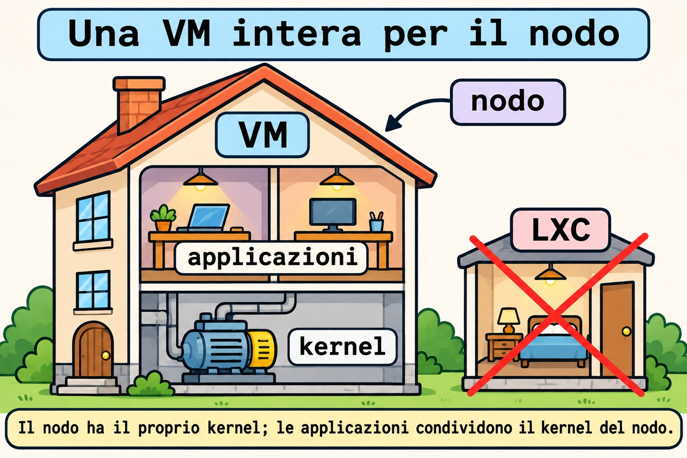
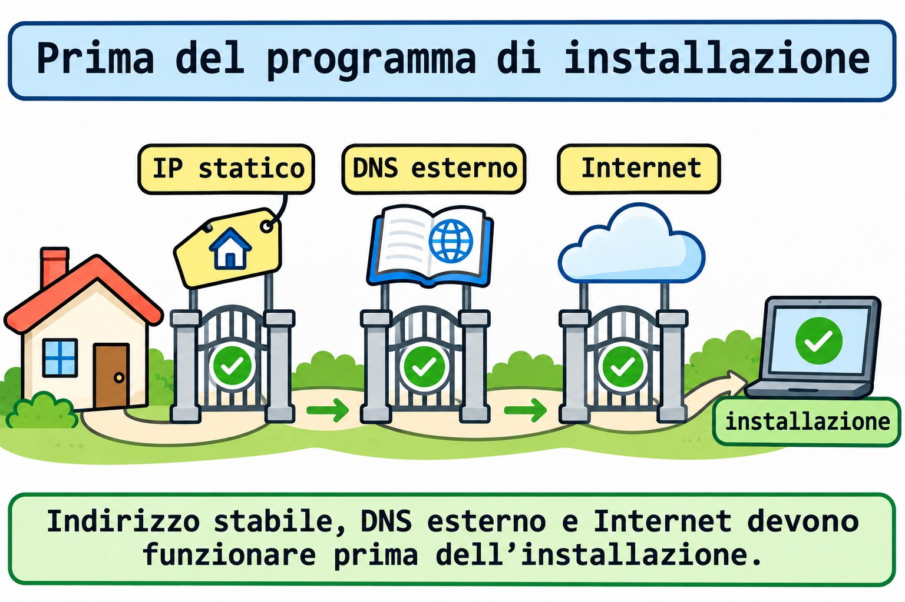

# Lezione 20.1 · Installare su una nuova VM

> **Il cuore di questa lezione:** creare un cluster identificato su una VM pulita, con una sola rete di gestione.

| Scheda | Piano di lavoro |
| --- | --- |
| Modulo | M20 · Dentro NethServer 8, lezione 1 di 7 |
| Prerequisiti | Inventario Proxmox e ISO Rocky 9 verificata |
| Laboratorio | VM 240 ns8-1; client 202 debian-lab; account student |
| Rete | Una scheda sulla rete di gestione, indirizzo statico reale, gateway e DNS esterni |

Usa la [guida del laboratorio M20](../GUIA_BANCADA_M20_IT.md). Raccoglie gli indirizzi modificabili, i nomi locali e l’accesso dal browser. Nessun comando di questo testo è stato eseguito sulle VM durante la preparazione.

## 1 · Riscaldamento

1. Quale kernel appartiene a una VM e quale a un container?
2. Un indirizzo ricevuto oggi tramite DHCP è una configurazione statica?
3. Se il resolver dipende dal servizio che stai per installare, cosa succede prima del suo avvio?

## 2 · Perché conta

Il nodo NS8 è una macchina Linux completa. Preparare indirizzo, storage e accesso di ripristino prima dell’installazione permette di distinguere un problema del sistema da un problema dell’applicazione.

### Ponte Windows

La VM è il computer; il pannello organizza i servizi che esegue. Aprire il pannello non sostituisce il controllo del computer a cui ti sei collegato.

## 3 · Modello mentale



*Il nodo ha il proprio kernel; le applicazioni condividono il kernel del nodo.*

Un cluster NS8 può iniziare con un solo nodo. Qui il nodo iniziale è la VM `240`, nome `ns8-1`, hostname breve `ns8-1` e FQDN `ns8-1.lab.test`. L’account di accesso Linux è `student`.

## 4 · L'essenziale

| Elemento | Scelta in questa lezione |
| --- | --- |
| Sistema | Rocky Linux 9 minimale, installato da zero |
| Risorse | 4 vCPU, 8 GiB RAM, disco 80 GiB e 4 GiB di swap |
| Rete | Una sola interfaccia su vmbr0, IP statico reale di gestione |
| Risoluzione | DNS esterno per Internet; nomi privati locali tramite la guida |
| Accesso | Console Proxmox e browser che raggiunge la rete di gestione |

### Rocky × Debian

L’installazione NS8 di questa lezione avviene sulla nuova Rocky della VM 240. Debian 202 sarà il client. Rocky 201 resta disponibile per il confronto; nessuna delle due viene convertita in nodo NS8.

### Decidi 1

L’inventario mostra una macchina che usa già l’ID 240. Cosa fai?

A. Eliminare la VM perché il nome del laboratorio è noto.

B. Fermarti e riconciliare l’inventario prima di creare o modificare.

C. Creare un CT con lo stesso ID.

## 5 · Lab guidato

### Passo 1 · Creare soltanto la VM 240

**Ipotesi:** L’inventario di un solo host mostra tutte le VM del cluster?

Sull’host Proxmox autorizzato consulta l’inventario globale. Se l’ID 240 è occupato, risolvi il conflitto prima di continuare; non eliminare la macchina esistente.

```bash
pvesh get /cluster/resources --type vm --output-format json-pretty
```

Dall’interfaccia Proxmox crea la VM 240 con nome ns8-1, CPU di tipo host, 4 vCPU, 8 GiB di RAM e disco da 80 GiB sullo storage scelto nell’inventario. Collega l’ISO ufficiale Rocky 9 di cui hai già confrontato il checksum con il riferimento autenticato. Usa una sola scheda VirtIO su vmbr0.

**Output atteso:** Nuova VM e inventario con proprietario, storage e ISO registrati.

**Verifica:** Controlla la configurazione prima di avviare il programma d’installazione del sistema.

### Passo 2 · Preparare sistema e indirizzo

**Ipotesi:** Il nome della VM configura anche l’hostname Linux?

Installa Rocky 9 minimale, con account student, sudo e una credenziale di ripristino conservata fuori dal materiale. Imposta l’hostname a ns8-1.lab.test; hostname -s deve mostrare ns8-1. Prevedi 4 GiB di swap durante l’installazione.

Configura soltanto l’interfaccia di gestione con IP statico riservato, prefisso, gateway e resolver reali del laboratorio. Segui la guida per i nomi locali sul nodo e sulla 202. Il file hosts non fornisce DNS ai container.

```bash
hostname -s
hostname -f
ip -br -4 address
ip -4 route
cat /etc/resolv.conf
getent ahostsv4 ns8-1.lab.test
getent ahostsv4 mirrorlist.nethserver.org
swapon --show
df -h / /home
timedatectl status
```

**Output atteso:** Hostname breve ns8-1, FQDN privato e accesso esterno funzionanti.

**Verifica:** Il resolver deve essere esterno a NS8; non usare loopback o il nodo stesso come nameserver.

### Passo 3 · Scaricare e leggere il programma d’installazione

**Ipotesi:** L’hash locale autentica da solo chi ha pubblicato il file?



*Indirizzo stabile, DNS esterno e Internet devono funzionare prima dell’installazione.*

Accedi come student e usa sudo -i dentro la VM. Il prossimo blocco scrive soltanto nella nuova cartella di lavoro; un errore esce dalla funzione senza chiudere il terminale.

```bash
m20_obter_instalador() {
  if [ "$(hostname -s)" != ns8-1 ] || [ "$(id -u)" -ne 0 ]; then
    printf '%s\n' 'Usa root dentro la VM ns8-1.'
    return 1
  fi
  if [ -e /root/m20-lab ]; then
    printf '%s\n' 'La cartella esiste già; controlla il tentativo precedente prima di continuare.'
    return 1
  fi
  install -d -m 0700 /root/m20-lab || return 1
  dnf install -y curl less openssl || return 1
  curl --fail --show-error --location --proto '=https' --tlsv1.2 --retry 10 --retry-delay 1 --retry-all-errors https://raw.githubusercontent.com/NethServer/ns8-core/ns8-stable/core/install.sh --output /root/m20-lab/install.sh || return 1
  bash -n /root/m20-lab/install.sh || return 1
  sha256sum /root/m20-lab/install.sh > /root/m20-lab/install.sh.sha256
  chmod 0600 /root/m20-lab/install.sh /root/m20-lab/install.sh.sha256
}
m20_obter_instalador && less /root/m20-lab/install.sh
```

**Output atteso:** Script scaricato dalla fonte ufficiale, leggibile e con hash locale registrato.

**Verifica:** Confronta l’URL con la documentazione e leggi lo script; sintassi e checksum locale non sostituiscono questo controllo.

### Passo 4 · Installare nel sistema ospite

**Ipotesi:** Un’installazione incompleta va ripetuta alla cieca?

```bash
m20_instalar() {
  if [ "$(hostname -s)" != ns8-1 ] || [ "$(id -u)" -ne 0 ]; then
    printf '%s\n' 'Questo programma d’installazione va usato soltanto sulla VM ns8-1.'
    return 1
  fi
  sha256sum -c /root/m20-lab/install.sh.sha256 || return 1
  bash /root/m20-lab/install.sh || return 1
  command -v runagent
}
m20_instalar
```

Se la funzione termina senza errori, riavvia soltanto la VM dal pannello Proxmox. Il programma d’installazione aggiorna anche i pacchetti del sistema. Non eseguire un’altra installazione in parallelo e non spegnere l’host.

**Output atteso:** La VM riparte dal disco installato e offre i componenti NS8.

**Verifica:** Accedi nuovamente con student, usa sudo -i e controlla hostname, indirizzo e orologio.

### Passo 5 · Controllare il primo accesso

**Ipotesi:** Un avviso TLS identifica da solo quale macchina ha risposto?


*Console, pannello e cluster rispondono a domande diverse.*

```bash
runagent -l
ss -ltnp '( sport = :443 )'
openssl s_client -connect 127.0.0.1:443 -servername ns8-1.lab.test -showcerts < /dev/null 2>/dev/null | openssl x509 -noout -subject -issuer -dates -fingerprint -sha256
```

Nel browser della VM 202, aperto dalla console seguendo la guida, apri https://IP-DI-GESTIONE/cluster-admin/, sostituendo il segnaposto con l’indirizzo reale dell’inventario. Confronta il certificato mostrato con l’impronta ottenuta dalla console indipendente. Prosegui in questo laboratorio soltanto se coincidono.

Usa l’account iniziale admin e la credenziale indicata nella documentazione ufficiale della versione installata. Cambia subito quella password. L’account del pannello è distinto dall’account Linux student. La 20.4 installerà la fiducia TLS ordinaria per i nomi privati.

**Output atteso:** Pannello della VM attesa e nuova password funzionante in un secondo accesso.

**Verifica:** L’eccezione di bootstrap è limitata; non disattivare la verifica TLS dell’intero browser.

### Passo 6 · Creare e registrare il cluster

**Ipotesi:** La rete della VPN può sovrapporsi a una rete già utilizzata?

Scegli Create cluster e conferma ns8-1.lab.test. Prima di accettare la VPN proposta confronta il CIDR con le reti fisiche, le VPN e le reti dei container del laboratorio. Scegli un blocco senza sovrapposizioni e registralo.

Nel terminale root della VM compila i due indirizzi reali qui sotto prima di eseguire la funzione. Sono gli stessi definiti nella guida. Il file non contiene password.

```bash
NS8_IP=''       # IP reale riservato della VM 240
CLIENT_IP=''    # IP reale della VM 202
NS8_FQDN=ns8-1.lab.test
WIKI_FQDN=wiki.lab.test
m20_registrar_cluster() {
  if [ "$(hostname -s)" != ns8-1 ] || [ "$(id -u)" -ne 0 ] || [ -z "$NS8_IP" ] || [ -z "$CLIENT_IP" ]; then
    printf '%s\n' 'Controlla il nodo e compila i due indirizzi reali.'
    return 1
  fi
  if [ -e /root/m20-lab/operador.env ]; then
    printf '%s\n' 'L’inventario esiste già; controllalo prima di sostituirlo.'
    return 1
  fi
  NODE_ID=$(redis-cli --raw HGET cluster/environment NODE_ID) || return 1
  VPN_CIDR=$(redis-cli --raw GET cluster/network) || return 1
  if ! [[ "$NODE_ID" =~ ^[1-9][0-9]*$ ]] || [ -z "$VPN_CIDR" ]; then
    printf '%s\n' 'Il cluster non ha ancora fornito ID e VPN validi.'
    return 1
  fi
  umask 077
  printf 'NS8_IP=%q\nCLIENT_IP=%q\nNS8_FQDN=%q\nWIKI_FQDN=%q\nNODE_ID=%q\nVPN_CIDR=%q\n' "$NS8_IP" "$CLIENT_IP" "$NS8_FQDN" "$WIKI_FQDN" "$NODE_ID" "$VPN_CIDR" > /root/m20-lab/operador.env
  chmod 0600 /root/m20-lab/operador.env
}
m20_registrar_cluster
redis-cli PING
systemctl --failed --no-pager
```

**Output atteso:** Pannello e file concordano sull’ID reale del leader e sulla VPN.

**Verifica:** In Proxmox crea lo snapshot m20a1-cluster della VM 240 dopo il controllo. È il punto di partenza della 20.2.

### Decidi 2

Il certificato del browser differisce da quello della console. Cosa fai?

A. Fermarti e controllare nome, percorso e certificato prima dell’accesso.

B. Disattivare globalmente la verifica TLS.

C. Accettare perché l’indirizzo sembra noto.

## 6 · Rompi e ripara

### Guasto 1 · Nome locale assente

**Sintomo:** Il browser del laboratorio non trova il nome privato.

**Indagine:** Confronta il nome richiesto e la mappatura della guida.

**Causa:** La mappatura locale manca oppure usa un altro indirizzo.

**Riparazione:** Correggi soltanto la voce M20 seguendo la guida.

**Prevenzione:** Registra separatamente indirizzo reale e nome.

**Verifica:** La risoluzione locale punta all’indirizzo dell’inventario.

### Guasto 2 · Fonte non controllata

**Sintomo:** Non sai indicare da dove proviene lo script salvato.

**Indagine:** Confronta URL e hash con la registrazione dello scaricamento.

**Causa:** Un file trovato sul disco non ne dimostra la provenienza.

**Riparazione:** Scaricalo nuovamente dall’URL ufficiale in una nuova cartella, senza eseguire il file sconosciuto.

**Prevenzione:** Leggi e registra la fonte prima dell’installazione.

**Verifica:** Identifichi i byte effettivamente utilizzati.

### Guasto 3 · Certificato diverso

**Sintomo:** L’impronta del browser differisce da quella ottenuta dalla console.

**Indagine:** Confronta indirizzo, nome e certificato della nuova connessione.

**Causa:** Potresti aver raggiunto un altro endpoint.

**Riparazione:** Interrompi l’accesso e correggi il percorso di connessione.

**Prevenzione:** Mantieni la console come canale indipendente.

**Verifica:** Le impronte coincidono prima di usare credenziali.

## 7 · Trappole

- Nome della VM, hostname breve, FQDN e ID NS8 sono riferimenti diversi.
- Un file hosts locale non sostituisce il resolver esterno dei container.
- Un’installazione interrotta richiede una diagnosi, non una ripetizione automatica.
- Lo snapshot di un solo nodo non è un piano di ripristino per un cluster con più nodi.

## 8 · Quiz

1. Perché LXC non soddisfa questo percorso?

2. Qual è il limite di un checksum calcolato localmente?

3. Perché il DNS del nodo deve essere esterno a NS8?

4. Quale verifica distingue il primo accesso TLS da un’accettazione cieca?

5. Che cosa va verificato prima di scegliere la VPN del cluster?

## 9 · Promemoria

```bash
hostname -s
hostname -f
runagent -l
redis-cli --raw HGET cluster/environment NODE_ID
redis-cli --raw GET cluster/network
```

## 10 · Checklist e chiusura

- [ ] VM 240 creata senza sostituire un’altra macchina.
- [ ] Un’unica rete di gestione statica e Internet controllate.
- [ ] Fonte del programma d’installazione e primo certificato controllati.
- [ ] Cluster creato e file dell’operatore protetto.
- [ ] Snapshot m20a1-cluster registrato.

**Reboot di verifica:** il riavvio dopo l’installazione faceva già parte del lab. Conferma il ritorno del pannello e del cluster prima di salvare lo snapshot di base.

## 11 · Nella vita reale

Leggi l’inventario di un ambiente autorizzato e identifica indirizzo statico, resolver esterno e accesso di ripristino. Registra ciò che manca prima di pianificare l’installazione; questa attività non richiede modifiche.

## 12 · Approfondire quando vuoi

- [Requisiti e risoluzione dei nomi](https://docs.nethserver.org/docs/administrator-manual/installation/system_requirements)
- [Installazione ufficiale](https://docs.nethserver.org/docs/administrator-manual/installation/install)

## Soluzioni commentate

Riscaldamento: LXC condivide il kernel dell’host; un lease non sostituisce la configurazione statica; una dipendenza DNS circolare può impedire l’avvio stesso.

Decidi 1: B. L’inventario globale precede l’uso dell’ID, anche se l’occupante è un CT.

Decidi 2: A. Il certificato diverso impedisce di attribuire la connessione al nodo previsto.

Quiz 1: la distribuzione NS8 in LXC non è supportata; questo laboratorio richiede una VM con kernel proprio.

Quiz 2: l’hash identifica i byte ricevuti; senza un riferimento autenticato non dimostra chi li ha pubblicati.

Quiz 3: il resolver del nodo non può dipendere da un’applicazione ospitata sul nodo, né da un loopback che i container interpreterebbero localmente.

Quiz 4: controllare l’impronta tramite console indipendente prima di usare credenziali; la fiducia normale verrà installata nella 20.4.

Quiz 5: assenza di sovrapposizioni con reti fisiche, VPN e container, oltre alla capacità futura.

[Indice delle lezioni](../01-aulas.md) · [Piano del corso](../00-plano-do-curso.md)

