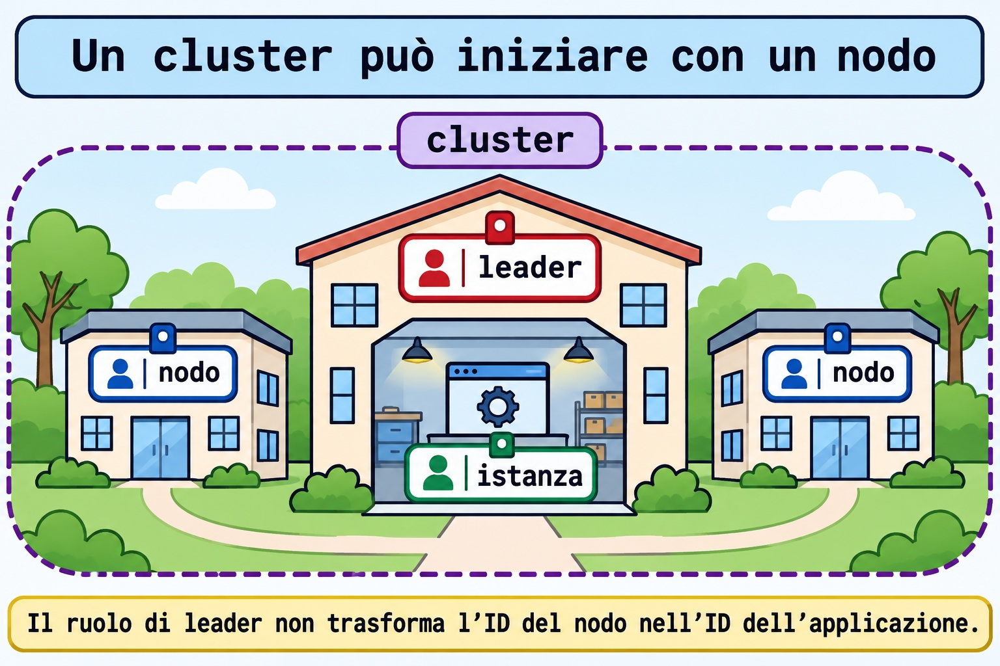
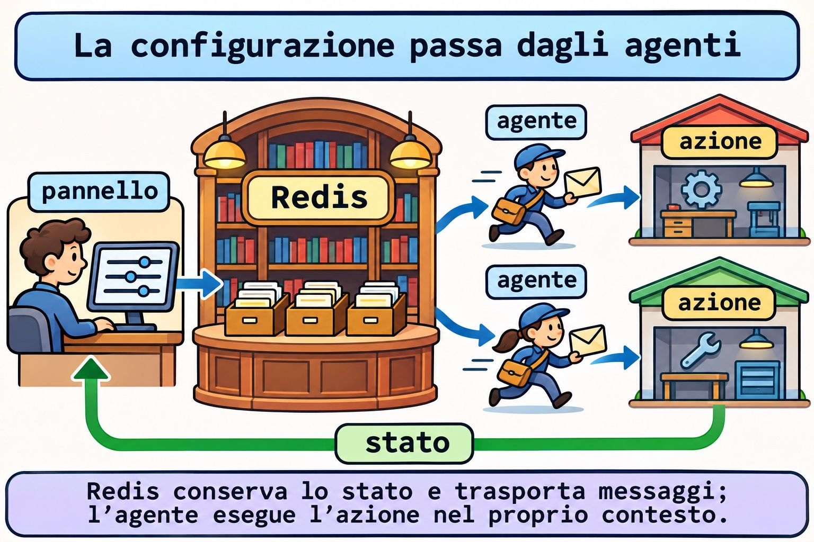

# Lezione 20.2 · Cluster, nodo e modulo

> **Il cuore di questa lezione:** localizzare un’istanza reale e distinguere controllo, esecuzione e identità.

| Scheda | Piano di lavoro |
| --- | --- |
| Modulo | M20 · Dentro NethServer 8, lezione 2 di 7 |
| Quando | Settimana 27 |
| Alla fine | localizzare un’istanza reale e distinguere controllo, esecuzione e identità. |
| Prerequisiti | M18 e M19 corretti; inventario e accesso alla console autorizzati |
| Durata | 90–120 minuti, oltre ai download |
| Snapshot | m20a2-inicio e m20a2-fim; solo VM 240 |

La VM `240`, `ns8-1`, è il primo nodo; la VM `241`, `ns8-2`, entra soltanto nella 20.7. Nome della VM, hostname, ID del nodo e ID dell’applicazione sono campi diversi.

I comandi Proxmox sono indicati come HOST. I comandi NS8 usano Bash come root nella VM, dopo `sudo -i`; non sono comandi per l’host di virtualizzazione.

Usa la [Guida del laboratorio M20](../GUIA_BANCADA_M20_IT.md). L’indirizzo isolato della 240 è `192.0.2.240`; la gestione ha un indirizzo reale riservato e accesso a Internet.

Non eseguire il blocco successivo se una guardia fallisce. Gli output attesi qui sotto non dichiarano un laboratorio già eseguito.

## 1 · Riscaldamento

1. Il numero della VM è necessariamente il numero del nodo NS8?

2. Un nome descrittivo identifica permanentemente i dati di un’applicazione?

3. Se due schermate mostrano la stessa etichetta, hai già dimostrato che mostrano la stessa istanza?

## 2 · Perché conta

Un’applicazione può avere nome descrittivo, ID interno, UUID e nodo associato. Mescolarli ti porta a cercare log nell’utente sbagliato o ad agire su un’altra istanza.

In questa lezione installiamo una sola DokuWiki di laboratorio. Rimane la stessa applicazione nelle lezioni successive; non creeremo una copia per ogni comando dimostrativo.

### Ponte Windows

Un’etichetta del server in una console non equivale al SID di un account né al GUID di un oggetto. Anche qui separiamo presentazione, identità e luogo d’esecuzione.

## 3 · Modello mentale



*Il ruolo di leader non trasforma l’ID del nodo nell’ID dell’applicazione.*

Il leader ospita il pannello di amministrazione del cluster. Il nodo esegue i componenti che gli sono stati assegnati; un’istanza raccoglie le risorse dell’applicazione scelta.

Esiste ancora soltanto la VM 240. Perciò applicazione e controllo si trovano nello stesso luogo, ma questo non rende equivalenti i loro identificatori.



*Redis conserva lo stato e trasporta messaggi; l’agente esegue l’azione nel proprio contesto.*

Redis partecipa alla configurazione e alla comunicazione fra agenti. L’agente dell’istanza riceve un’azione e lavora nel proprio contesto, che può includere un utente Unix rootless.

Leggere lo stato non autorizza a modificare il database. Questa lezione usa soltanto query Redis limitate, senza riversare variabili che possono contenere segreti.

## 4 · L'essenziale

| Identificatore | Chi lo assegna | Domanda a cui risponde |
| --- | --- | --- |
| VMID 240 | Proxmox | Quale macchina virtuale? |
| NODE_ID | NS8 | Quale nodo del cluster? |
| MODULE_ID | NS8 | Quale istanza di applicazione? |
| MODULE_UUID | NS8 | Quale identità di applicazione nel controllo? |
| Etichetta | Operatore nel pannello | Come presentare l’istanza? |

### Rocky × Debian

I due nodi previsti per questo modulo usano Rocky 9. L’identità NS8 non si deduce dal gestore dei pacchetti né dalla distribuzione.

Il comando Podman di root mostra lo storage di root. Per un’applicazione rootless entra nel contesto con `runagent`, senza creare una seconda installazione parallela.

### Decidi 1

Il pannello chiama l’applicazione M20 wiki. Quale valore va in runagent -m?

A. L’etichetta descrittiva, compresi gli spazi.

B. Il MODULE_ID reale dell’istanza, confermato nell’inventario.

C. Il VMID 240.

## 5 · Lab guidato

### Passo 1 · Controllare chi gestisce il controllo

**Ipotesi:** L’ID del primo nodo va copiato da un esempio?

```bash
sudo -i
test "$(id -u)" -eq 0 || exit 1
test "$(hostname -s)" = ns8-1 || exit 1
test -f /root/m20-lab/operador.env && test ! -L /root/m20-lab/operador.env || exit 1
test "$(stat -c '%U:%G:%a' /root/m20-lab/operador.env)" = root:root:600 || exit 1
cat /root/m20-lab/operador.env
. /root/m20-lab/operador.env
test "$NS8_IP" = 192.0.2.240 || exit 1
test "$NS8_FQDN" = ns8-1.lab.test || exit 1
NODE_NOW=$(redis-cli --raw HGET cluster/environment NODE_ID) || exit 1
test "$NODE_NOW" = "$NODE_ID" || exit 1
redis-cli PING
redis-cli ROLE
runagent -l
```

Nel pannello aperto tramite il percorso della guida, consulta Nodes e controlla FQDN, nodo e risorse. L’etichetta Node non è il VMID dell’hypervisor.

**Output atteso:** Il ruolo di leader, l’ID nel file e il nodo del pannello corrispondono alla VM 240.

**Verifica:** Se l’ID letto è diverso, fermati: un file d’inventario di un altro laboratorio non autorizza comandi su questa macchina.

### Passo 2 · Scegliere un’origine dell’applicazione

**Ipotesi:** Il catalogo mostra soltanto applicazioni già installate?

Apri Settings e Software repositories. Abilita il repository `nethforge` già presente, inizialmente disattivato. Aggiorna i metadati e torna al Software center.

Individua DokuWiki. Apri i dettagli, controlla origine, versione disponibile e documentazione. Non usare un’immagine dal nome simile trovata con una ricerca fuori dal catalogo.

Registra che questa applicazione è mantenuta nel repository della comunità. La scelta di aggiornamento e supporto deve considerare quell’origine, non solo il disegno della scheda.

Non aggiungere un repository di test né cambiare la priorità di altri repository per completare questo esercizio. Se la scheda non appare, indaga metadati, DNS e accesso esterno.

**Output atteso:** DokuWiki disponibile dall’origine pianificata e non ancora installata da questo passo.

**Verifica:** Il registro distingue disponibile da installato; conserva versione e data osservate, senza inventare un numero fisso.

### Passo 3 · Installare una sola istanza sul nodo corretto

**Ipotesi:** Fare clic due volte su installa ripete soltanto la verifica?

Prima di installare cerca istanze DokuWiki esistenti nel pannello. Se c’è un’istanza non prevista, riconcilia l’inventario; non sostituirla né crearne un’altra per tentativi.

Sull’HOST controlla la VM 240 e crea lo snapshot della finestra prima dell’installazione. Torna poi alla sessione root della VM per i comandi NS8.

```bash
test "$(qm config 240 | sed -n 's/^name: //p')" = ns8-1 || exit 1
qm snapshot 240 m20a2-inicio || exit 1
```

Nel Software center installa DokuWiki sul nodo reale controllato nel Passo 1. Attendi il completamento dell’attività e apri l’istanza creata; non confondere un download in corso con un’applicazione pronta.

```bash
test "$(id -u)" -eq 0 || exit 1
test "$(hostname -s)" = ns8-1 || exit 1
test ! -L /root/m20-lab/operador.env || exit 1
test "$(stat -c '%U:%G:%a' /root/m20-lab/operador.env)" = root:root:600 || exit 1
. /root/m20-lab/operador.env
runagent -l
read -r -p 'Actual DokuWiki MODULE_ID: ' MODULE_ID
[[ "$MODULE_ID" =~ ^dokuwiki[0-9]+$ ]] || exit 1
test "$(redis-cli --raw HEXISTS cluster/module_uuid "$MODULE_ID")" = 1 || exit 1
MODULE_NODE=$(redis-cli --raw HGET cluster/module_node "$MODULE_ID") || exit 1
test "$MODULE_NODE" = "$NODE_ID" || exit 1
MODULE_UUID=$(redis-cli --raw HGET cluster/module_uuid "$MODULE_ID") || exit 1
[[ "$MODULE_UUID" =~ ^[0-9a-fA-F-]{36}$ ]] || exit 1
getent passwd "$MODULE_ID" || exit 1
```

**Output atteso:** Un’istanza reale, collegata al nodo previsto, con UUID e utente Unix identificati.

**Verifica:** Copia l’ID osservato, non un nome d’esempio. Se formato o posizione sono diversi, fermati e controlla versione installata e pannello.

### Passo 4 · Configurare la wiki senza mescolare gli account

**Ipotesi:** L’amministratore del pannello NS8 è automaticamente l’amministratore della wiki?

Nella configurazione dell’istanza usa host `wiki.lab.test`, nome `M20 Lab`, utente amministrativo `wikiadmin`, nome visualizzato `Lab Admin` e contatto fittizio `wiki-admin@lab.test`. Imposta una password esclusiva nel modulo.

Non abilitare Let’s Encrypt per `.test`. Attiva l’opzione di reindirizzamento HTTP verso HTTPS e salva. La 20.4 installerà la fiducia TLS privata appropriata per quel nome.

L’account della wiki è locale all’applicazione; non confonderlo con student, root, l’utente Unix dell’istanza o l’amministratore del cluster. I domini degli utenti entrano nella 20.5.

```bash
getent ahostsv4 wiki.lab.test
curl --retry 10 --retry-delay 1 --retry-all-errors --max-time 5   --fail --silent --show-error --head http://wiki.lab.test/
openssl s_client -connect 127.0.0.1:443 -servername wiki.lab.test   -showcerts < /dev/null 2>/dev/null |   openssl x509 -noout -subject -issuer -dates -fingerprint -sha256
```

La query HTTP usa soltanto HEAD e non invia credenziali. Controlla la destinazione del reindirizzamento. Nel browser tramite la guida confronta l’impronta del certificato della wiki con la console prima di qualsiasi login, come nell’accesso iniziale della 20.1.

**Output atteso:** Attività di configurazione completata, host corretto e reindirizzamento verso HTTPS.

**Verifica:** Il primo accesso TLS è un’eccezione puntuale di questo laboratorio dopo la verifica dell’identità; non è una dichiarazione di fiducia pubblica. Non inviare password via HTTP.

### Passo 5 · Collegare l’identità al contesto del modulo

**Ipotesi:** Podman eseguito come root vede necessariamente i container rootless della wiki?


*Registra l’identità osservata prima di indagare, spostare o ripristinare.*

```bash
runagent -m "$MODULE_ID" printenv MODULE_ID AGENT_ID
runagent -m "$MODULE_ID" id
runagent -m "$MODULE_ID" podman ps
runagent -m "$MODULE_ID" systemctl --user --type=service --state=running --no-pager
test ! -e /root/m20-lab/operador.before-20-2.env || exit 1
cp -a /root/m20-lab/operador.env /root/m20-lab/operador.before-20-2.env
ENV_NEW=$(mktemp /root/m20-lab/operador.XXXXXX) || exit 1
printf 'NS8_IP=%q
NS8_FQDN=%q
WIKI_FQDN=%q
NODE_ID=%q
VPN_CIDR=%q
MODULE_ID=%q
MODULE_UUID=%q
'   "$NS8_IP" "$NS8_FQDN" "$WIKI_FQDN" "$NODE_ID" "$VPN_CIDR"   "$MODULE_ID" "$MODULE_UUID" > "$ENV_NEW"
chmod 0600 "$ENV_NEW"
mv -f "$ENV_NEW" /root/m20-lab/operador.env
stat -c '%U:%G:%a %n' /root/m20-lab/operador.env
```

Le query printenv richiedono soltanto due variabili d’identità. Non sostituirle con un dump completo dell’ambiente, che può contenere credenziali interne.

Il file dell’operatore contiene soltanto riferimenti senza segreti. La copia precedente conserva lo stato prima di aggiungere l’identità dell’applicazione.

**Output atteso:** Contesto del modulo, utente, container e servizi corrispondono all’istanza reale.

**Verifica:** Se il comando dipende da un’altra istanza o non trova l’utente, fermati. Non aggiungere sudo dentro runagent per fabbricare un risultato.

### Passo 6 · Confrontare pannello e terminale dopo una modifica dell’etichetta

**Ipotesi:** Un’etichetta nuova crea una nuova applicazione?

Nel pannello registra l’etichetta attuale e cambia soltanto l’etichetta descrittiva dell’istanza in `M20 wiki`. Non usare l’opzione di clonazione né cambiare FQDN in questo esercizio.

```bash
test "$(redis-cli --raw HGET cluster/module_node "$MODULE_ID")" = "$NODE_ID" || exit 1
test "$(redis-cli --raw HGET cluster/module_uuid "$MODULE_ID")" = "$MODULE_UUID" || exit 1
runagent -l
runagent -m "$MODULE_ID" podman ps
redis-cli PING
systemctl status agent@cluster.service agent@node.service --no-pager
```

Confronta la posizione del modulo nel pannello con ID e UUID del registro. La modifica dell’etichetta non autorizza a cambiare un utente Unix né una chiave Redis.

**Output atteso:** Etichetta aggiornata, stessa identità e stesso nodo; non è stata creata una seconda istanza.

**Verifica:** Conserva il registro per le lezioni successive. Nella 20.3 verrà creata una pagina fittizia per seguire i dati; nella 20.6 ci sarà una verifica di ripristino.

### Decidi 2

Il pannello risponde, ma il comando nel contesto di un’altra istanza non mostra la wiki. Quale conclusione è valida?

A. È necessario eliminare il database Redis.

B. Podman ha perso tutti i container.

C. Il test ha interrogato un altro contesto; conferma MODULE_ID e nodo prima di agire.

## 6 · Rompi e ripara

### Guasto 1 · ID inesistente

**Sintomo:** Un riferimento di prova non appartiene al cluster.

**Indagine:** Controlla l’assenza con HEXISTS prima del comando e mantieni l’azione soltanto di lettura.

**Causa:** Il nome di una famiglia di applicazioni non identifica un’istanza reale.

**Riparazione:** Torna al MODULE_ID registrato e conferma di nuovo il collegamento al nodo.

**Prevenzione:** Convalida l’identità prima di qualsiasi comando di arresto, rimozione o ripristino.

**Verifica:** Il contesto reale risponde e il riferimento assente viene rifiutato.

```bash
M20_MISSING=dokuwiki999999
test "$(redis-cli --raw HEXISTS cluster/module_uuid "$M20_MISSING")" = 0 || exit 1
if runagent -m "$M20_MISSING" podman ps; then
  printf '%s
' 'STOP: unexpected existing context' >&2
  exit 1
fi
runagent -m "$MODULE_ID" podman ps
```

### Guasto 2 · Etichetta confusa con l’identità

**Sintomo:** Dopo aver cambiato l’etichetta nel pannello, una vecchia annotazione sembra riferirsi a un’altra applicazione.

**Indagine:** Confronta etichetta precedente, MODULE_ID, UUID e nodo; non rinominare file di sistema.

**Causa:** La presentazione è cambiata, ma l’oggetto tecnico non è stato sostituito.

**Riparazione:** Aggiorna l’etichetta nel diario o ripristina soltanto l’etichetta precedente dal pannello.

**Prevenzione:** Registra sempre ID e UUID accanto al nome leggibile da una persona.

**Verifica:** Lo stesso UUID e lo stesso nodo restano associati al MODULE_ID.

### Guasto 3 · Account della wiki nel pannello del cluster

**Sintomo:** Un solo tentativo di accedere al pannello NS8 con wikiadmin viene rifiutato.

**Indagine:** Conferma quale URL e quale insieme di account usa il modulo; non ripetere tentativi di password.

**Causa:** Amministratore dell’applicazione e amministratore del cluster appartengono ad ambiti distinti.

**Riparazione:** Usa l’amministratore del cluster per il pannello NS8 e l’account locale soltanto per la wiki.

**Prevenzione:** Conserva credenziali separate e non uguagliare le password fra quei ruoli.

**Verifica:** Ogni account funziona soltanto nell’ambito previsto, tramite HTTPS con identità verificata.

## 7 · Trappole

Non concludere dall’icona verde di una schermata. Confronta identità, attività completata e risposta funzionale lungo il percorso usato dal client.

Lo snapshot dell’intera VM aiuta a tornare indietro da una prova locale, ma non sostituisce il backup dell’applicazione e della configurazione del cluster.

Una password o un token non appartiene al diario pubblicato. Registra nomi, orari e risultati; conserva i segreti separatamente.

## 8 · Quiz

1. Perché il VMID non è il NODE_ID?

2. Che cosa distingue etichetta, MODULE_ID e UUID?

3. Qual è il ruolo di Redis in questo modello?

4. Perché non usare podman di root per concludere che la wiki è scomparsa?

5. Cambiare l’etichetta descrittiva deve cambiare l’UUID?

## 9 · Promemoria

```bash
runagent -l
redis-cli PING
redis-cli ROLE
redis-cli HGET cluster/environment NODE_ID
redis-cli HGET cluster/module_node "$MODULE_ID"
redis-cli HGET cluster/module_uuid "$MODULE_ID"
```

**Flashcard:** Cluster → controllo; nodo → posizione; istanza → applicazione identificata.

**Flashcard:** UUID → segui l’identità; conferma ID e nodo dopo uno spostamento o ripristino.

## 10 · Checklist e chiusura

- [ ] Una sola DokuWiki installata dall’origine scelta.

- [ ] Pannello e terminale concordano su identità e nodo.

- [ ] Inventario root:root 0600, senza password né token.

- [ ] Nessuna modifica manuale di Redis, utente del modulo o file generato.

- [ ] Wiki conservata per la 20.3 e il backup futuro.

**Reboot di verifica:** Nella finestra concordata, riavvia soltanto la VM 240 e riconnettiti dalla gestione. Non riavviare l’host Proxmox.

```bash
systemctl reboot
```

Dopo il ritorno, usa nuovamente la sessione root nella VM corretta e ripeti la verifica:

```bash
test "$(id -u)" -eq 0 || exit 1
test "$(hostname -s)" = ns8-1 || exit 1
ip -br -4 address
ip -4 route
getent ahostsv4 ns8-1.lab.test
runagent -l
systemctl --failed --no-pager
```

Apri di nuovo il pannello per nome, controlla il nodo e verifica l’applicazione se è già installata. Un servizio avviato non dimostra identità TLS né contenuto corretto.

**Ultimo esercizio:** Spiega dal terminale quale istanza è stata installata e su quale nodo funziona, senza mostrare segreti.

## 11 · Nella vita reale

In un ambiente reale, ottieni inventario e referente prima di qualsiasi modifica. In questa missione leggi soltanto versioni, risoluzione dei nomi e stato; non installare, fermare o rimuovere applicazioni.

Registra tre riscontri senza credenziali e una domanda che richiede ancora conferma. Il limite di ciò che sai fa parte della diagnosi.

## 12 · Approfondire quando vuoi

[NS8: Software center](https://docs.nethserver.org/docs/administrator-manual/installation/software_center)

[NS8: DokuWiki](https://docs.nethserver.org/docs/administrator-manual/nethforge/dokuwiki)

[NS8: agenti](https://nethserver.github.io/ns8-core/core/agents/)

[NS8: database e chiavi d’identità](https://nethserver.github.io/ns8-core/core/database/)

[NS8: file e contesti](https://nethserver.github.io/ns8-core/core/filesystem/)

Usa la documentazione della versione installata e registra quando è stata consultata. Le etichette del pannello possono cambiare; la verifica tecnica resta l’identità e il comportamento osservati.

```text
!explica
!feynman
!quiz
```

Usa i tre prompt per spiegare il percorso, insegnarlo con parole tue e verificare le decisioni. Non incollare password, token o contenuti privati.

## Soluzioni commentate

Riscaldamento: gli ID sono assegnati da sistemi diversi; il nome descrittivo è presentazione; schermate uguali richiedono di confrontare identità e nodo.

Decidi 1: B. runagent richiede l’ID interno reale, non l’etichetta né il numero Proxmox.

Decidi 2: C. Una query in un altro contesto non dimostra perdita di dati nell’istanza bersaglio.

Quiz 1: Proxmox identifica la VM, mentre NS8 assegna il nodo all’interno del proprio cluster.

Quiz 2: l’etichetta presenta; MODULE_ID seleziona il contesto; UUID segue l’identità nel piano di controllo.

Quiz 3: conserva la configurazione e partecipa allo scambio di attività ed eventi fra componenti; non è solo cache dell’applicazione.

Quiz 4: storage e gestori utente sono distinti; consulta il contesto rootless dell’istanza reale.

Quiz 5: no; in questa prova cambia soltanto la presentazione. Dopo uno spostamento o ripristino riscopri i collegamenti reali anziché presumere continuità dal nome.

[← Lezione 20.1 · Installare NS8](20.1-instalar-nethserver-8.md) · [Indice delle lezioni](../01-aulas.md) · [Piano del corso](../00-plano-do-curso.md)
