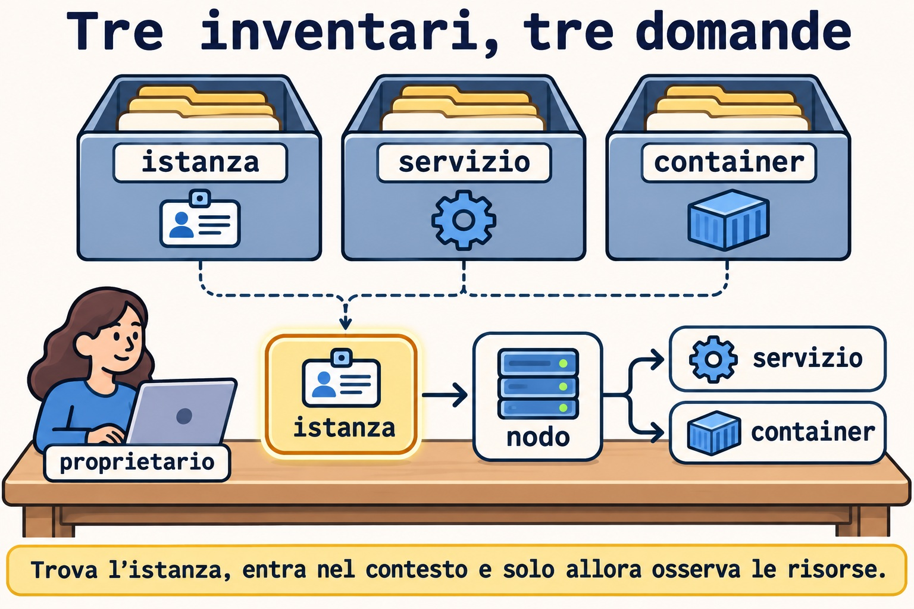

# Lezione 20.3 · Dentro un modulo

> **Il cuore di questa lezione:** collegare la Wiki al suo utente Unix, servizio, container, dati e log.

| Scheda | Piano di lavoro |
| --- | --- |
| Modulo | M20 · Dentro NethServer 8, lezione 3 di 7 |
| Prerequisiti | Wiki configurata nella 20.2 oppure snapshot m20a2-wiki |
| Laboratorio | VM 240 ns8-1; client 202 debian-lab; account student |
| Rete | Una scheda sulla rete di gestione, indirizzo statico reale, gateway e DNS esterni |

Usa la [guida del laboratorio M20](../GUIA_BANCADA_M20_IT.md). Raccoglie gli indirizzi modificabili, i nomi locali e l’accesso dal browser. Nessun comando di questo testo è stato eseguito sulle VM durante la preparazione.

## Prima di iniziare

Ti serve la VM 240 con Wiki configurata, amministratore locale student e inventario /root/m20-lab/operador.env con MODULE_ID/UUID. Usa la base m20a2-wiki, se questo snapshot esiste, oppure prepara una volta la 20.1 e la 20.2. Non è necessario lo stato di altri moduli.

L’accesso tramite nome privato e il confronto del certificato di bootstrap seguono la guida. Non sostituire la rotta della Wiki con un URL IP che seleziona un altro sito.

## 1 · Riscaldamento

1. Root vede automaticamente tutti i container rootless?
2. Un modulo può usare più di un container?
3. Il nome sulla scheda rivela l’unità systemd?

## 2 · Perché conta

Un processo può essere sano nell’utente sbagliato e un log vuoto può appartenere al filtro sbagliato. L’indagine richiede un indirizzo completo: nodo, account, servizio e istante.

### Ponte Windows

Aprire il gestore attività in un’altra sessione non dimostra che un programma sia scomparso. Anche i contesti rootless vanno scelti prima di interpretare un elenco vuoto.

## 3 · Modello mentale


*Il pannello coordina; l’istanza lavora nel contesto del suo proprietario.*

runagent prepara l’ambiente dell’istanza. L’utente Unix definisce i privilegi; systemd gestisce il servizio; Podman descrive i container e i loro montaggi. Uno di questi riferimenti non sostituisce gli altri.

## 4 · L'essenziale

| Domanda | Strumento |
| --- | --- |
| Quale istanza? | Pannello, UUID e runagent -l |
| Quale account? | runagent con id |
| Quale esecuzione? | systemctl --user e podman nel contesto reale |
| Quali dati? | Ispezione dei montaggi |
| Quale evento? | Journal filtrato e log del container |

### Rocky × Debian

L’indagine sul modulo avviene come root nella VM ns8-1. Il browser e i test client usano l’accesso della guida; non è necessario installare Podman su Debian per osservare il server.

### Decidi 1

Podman di root non elenca la Wiki. Cosa concludi?

A. Tutti i dati sono scomparsi.

B. Devi consultare il contesto reale dell’istanza.

C. Devi reinstallare immediatamente il cluster.

## 5 · Lab guidato

### Passo 1 · Individuare l’istanza e il proprietario

**Ipotesi:** La stessa etichetta può indicare un altro ID dopo un ripristino?

Sulla VM 240 accedi come student e usa sudo -i. Controlla l’inventario protetto prima di caricarlo; deve appartenere a root e avere modo 0600.

```bash
hostname -s
stat -c '%U:%G:%a %n' /root/m20-lab/operador.env
. /root/m20-lab/operador.env
runagent -l
redis-cli --raw HGET cluster/module_uuid "$MODULE_ID"
runagent -m "$MODULE_ID" id
```

**Output atteso:** ID, UUID, nodo e utente Unix corrispondono alla stessa Wiki.

**Verifica:** Se ci sono stati rimozione, Move o restore, riconcilia la mappa prima di continuare.

### Passo 2 · Individuare servizio e container

**Ipotesi:** Ogni unità attiva è il servizio web della Wiki?



*Trova l’istanza, entra nel contesto e solo allora osserva le risorse.*

```bash
MODULE_UID=$(runagent -m "$MODULE_ID" id -u)
runagent -m "$MODULE_ID" systemctl --user list-units --type=service --all --no-pager
runagent -m "$MODULE_ID" podman ps --all --format '{{.ID}} {{.Names}} {{.Status}}'
```

Compila i nomi osservati qui sotto. Scegli l’unità dell’applicazione, non soltanto l’unità dell’agente; confronta ExecStart e container prima di fissare la relazione.

```bash
SERVICE_UNIT=''   # unità .service reale osservata
CONTAINER_ID=''   # ID reale del container della Wiki
runagent -m "$MODULE_ID" systemctl --user cat "$SERVICE_UNIT"
runagent -m "$MODULE_ID" systemctl --user show "$SERVICE_UNIT" -p LoadState -p ActiveState -p SubState
runagent -m "$MODULE_ID" podman inspect --format '{{.Name}} {{.State.Status}}' "$CONTAINER_ID"
```

**Output atteso:** Distingui account, unità e container osservati.

**Verifica:** Non cambiare la shell dell’account di servizio e non aggiungere sudo dentro runagent.

### Passo 3 · Mappare la persistenza senza modificare

**Ipotesi:** Il livello del container ha lo stesso ciclo di vita di un volume?

```bash
runagent -m "$MODULE_ID" podman inspect --format '{{json .Mounts}}' "$CONTAINER_ID"
runagent -m "$MODULE_ID" podman volume ls
runagent -m "$MODULE_ID" podman info --format '{{.Store.GraphRoot}}'
runagent -m "$MODULE_ID" systemctl --user show "$SERVICE_UNIT" -p FragmentPath
```

Osserva origine, destinazione e modo di ogni montaggio. L’elenco non autorizza a modificare file interni, copiare un database in esecuzione o presumere che esista un backup. Il ripristino funzionale verrà praticato nella 20.6.

**Output atteso:** Mappa con esecuzione e dati persistenti separati.

**Verifica:** Confronta la documentazione del modulo prima di scegliere cosa conservare.

### Passo 4 · Creare una prova funzionale privata

**Ipotesi:** Una risposta HTTP generica dimostra il contenuto della Wiki?

Apri la Wiki tramite il nome privato usando l’accesso della guida, controlla il certificato di bootstrap e accedi come student. Crea la pagina privata m20:prova con il testo fittizio M20 prova inicial. Non modificare i permessi di altre pagine.

Esci e accedi nuovamente per controllare il contenuto. Una richiesta anonima può ricevere la pagina d’accesso; non dimostra la perdita della pagina privata. Non inserire password o cookie nei comandi del corso.

```bash
date --iso-8601=seconds
runagent -m "$MODULE_ID" systemctl --user is-active "$SERVICE_UNIT"
```

**Output atteso:** Contenuto riconosciuto in una sessione autenticata e servizio osservato.

**Verifica:** Annota istante e pagina senza acquisire credenziali.

### Passo 5 · Correlare i registri

**Ipotesi:** L’assenza di righe nel log dimostra che non ci sono state richieste?


*Correla macchina, proprietario, servizio e istante prima di spiegare l’errore.*

```bash
date --iso-8601=seconds
journalctl _UID="$MODULE_UID" _SYSTEMD_USER_UNIT="$SERVICE_UNIT" --since '-15 min' --no-pager -n 60
runagent -m "$MODULE_ID" podman logs --since 15m --tail 40 "$CONTAINER_ID"
runagent -m "$MODULE_ID" systemctl --user show "$SERVICE_UNIT" -p ActiveEnterTimestamp -p ExecMainStatus
timeout 10 api-server-logs logs -e module -n "$MODULE_ID"
```

La verifica amministrativa usa UID e unità reali senza dipendere da un journal separato per utente. Il timeout termina la consultazione continua dei log; il codice 124, in questo caso, indica il raggiungimento del limite di tempo.

Non tutte le applicazioni registrano gli accessi HTTP nel canale consultato. Confronta contesto, intervallo e log del pannello prima di concludere. Non inventare una riga d’accesso attesa.

**Output atteso:** Registri attribuiti al nodo, proprietario, servizio e intervallo corretti.

**Verifica:** L’assenza di righe vale soltanto per il filtro consultato.

### Passo 6 · Salvare una piccola mappa

**Ipotesi:** Un log integrale è sempre l’evidenza migliore da condividere?

```bash
m20_salvar_mapa() {
  if [ "$(hostname -s)" != ns8-1 ] || [ "$(id -u)" -ne 0 ] || [ -z "$SERVICE_UNIT" ] || [ -z "$CONTAINER_ID" ]; then
    printf '%s\n' 'Controlla il nodo e compila unità e container osservati.'
    return 1
  fi
  EVID="/root/m20-lab/evidencias-20-3-$(date +%Y%m%d-%H%M%S)"
  install -d -m 0700 "$EVID" || return 1
  printf 'MODULE_ID=%s\nMODULE_UUID=%s\nMODULE_UID=%s\nSERVICE_UNIT=%s\nCONTAINER_ID=%s\n' "$MODULE_ID" "$MODULE_UUID" "$MODULE_UID" "$SERVICE_UNIT" "$CONTAINER_ID" > "$EVID/mapa.txt"
  runagent -m "$MODULE_ID" podman inspect --format '{{json .Mounts}}' "$CONTAINER_ID" > "$EVID/montagens.json"
  journalctl _UID="$MODULE_UID" _SYSTEMD_USER_UNIT="$SERVICE_UNIT" --since '-15 min' --no-pager -n 60 > "$EVID/journal.txt"
}
m20_salvar_mapa
```

**Output atteso:** Mappa e selezione dell’evidenza in una cartella privata dell’esercizio.

**Verifica:** Rivedi i registri prima di condividerli; non esportare credenziali né l’intero ambiente.

### Decidi 2

Quale insieme permette di chiudere l’indagine?

A. Identità coerente, servizio osservato e contenuto privato riconosciuto.

B. Soltanto la scheda verde del pannello.

C. Soltanto un comando terminato senza stampare errori.

## 6 · Rompi e ripara

### Guasto 1 · Contesto sbagliato

**Sintomo:** Un elenco nel contesto di root non mostra la Wiki.

**Indagine:** Confronta con Podman eseguito tramite runagent nell’istanza reale.

**Causa:** Sono inventari di utenti diversi.

**Riparazione:** Torna al MODULE_ID osservato senza cambiare i permessi.

**Prevenzione:** Registra il proprietario insieme alla risorsa.

**Verifica:** L’istanza e i suoi container corrispondono al pannello.

### Guasto 2 · Unità non individuata

**Sintomo:** Un’unità digitata a memoria non viene trovata.

**Indagine:** Elenca le unità nel contesto reale e controlla ExecStart.

**Causa:** Nome della scheda e nome dell’unità non sono lo stesso riferimento.

**Riparazione:** Compila SERVICE_UNIT con l’unità osservata.

**Prevenzione:** Individua nuovamente l’unità dopo una modifica dell’istanza.

**Verifica:** LoadState e identità corrispondono all’oggetto scelto.

### Guasto 3 · Intervallo senza eventi

**Sintomo:** Una selezione del journal non mostra l’accesso appena provato.

**Indagine:** Controlla orologio, UID, unità, intervallo e canale del log.

**Causa:** L’evento può essere fuori dal filtro oppure non essere registrato in quel canale.

**Riparazione:** Correggi il filtro e confronta log del container e del pannello.

**Prevenzione:** Registra l’istante prima della prova funzionale.

**Verifica:** La conclusione descrive soltanto ciò che la fonte ha realmente mostrato.

## 7 · Trappole

- Non trasformare l’account di servizio in un account di accesso.
- Non modificare volumi, unità generate o Redis per fabbricare una prova.
- Servizio attivo e contenuto riconosciuto sono evidenze diverse.
- La pagina m20:prova resta privata; una schermata d’accesso anonima non significa perdita di dati.

## 8 · Quiz

1. Quale riscontro collega l’ID del pannello all’utente Unix?

2. Perché Podman di root può non mostrare il wiki?

3. Cosa distingue servizio e container?

4. Quale filtro evita di mescolare journal di utenti diversi?

5. Perché una mappa di ieri va riconciliata dopo uno spostamento?

## 9 · Promemoria

```bash
runagent -l
runagent -m "$MODULE_ID" id
runagent -m "$MODULE_ID" podman ps
journalctl _UID="$MODULE_UID" _SYSTEMD_USER_UNIT="$SERVICE_UNIT" --since '-15 min' --no-pager -n 60
```

## 10 · Checklist e chiusura

- [ ] ID e UUID collegati all’utente reale.
- [ ] Unità, container e montaggi individuati.
- [ ] Pagina privata riconosciuta dopo l’autenticazione.
- [ ] Log attribuiti al contesto e all’intervallo corretti.
- [ ] Evidenze riviste prima di condividerle.

**Reboot di verifica:** se riavvii la VM dedicata, carica nuovamente l’inventario e individua di nuovo unità e container. Controlla la pagina; non riutilizzare a memoria un vecchio ID di container.

## 11 · Nella vita reale

In un’istanza autorizzata disegna il collegamento fra pannello, utente, servizio, container e dati usando soltanto verifiche. Indica quale test ha confermato il contenuto e quale ha descritto soltanto lo stato.

## 12 · Approfondire quando vuoi

- [Contesto rootless e runagent](https://nethserver.github.io/ns8-core/modules/rootless_rootfull/)
- [Log e api-server-logs](https://nethserver.github.io/ns8-core/core/logs/)
- [Filesystem e directory dei moduli](https://nethserver.github.io/ns8-core/core/filesystem/)

## Soluzioni commentate

Riscaldamento: root non riunisce automaticamente gli inventari rootless; un’istanza può avere più container; l’unità va rilevata.

Decidi 1: B. L’assenza nel contesto di root non significa assenza nel contesto dell’istanza.

Decidi 2: A. Stato e contenuto devono indicare lo stesso oggetto.

Quiz 1: ID e UUID del pannello, nodo ospitante e `id` eseguito tramite `runagent` devono essere coerenti.

Quiz 2: storage e runtime rootless appartengono all’account dell’istanza.

Quiz 3: systemd gestisce il ciclo di vita; Podman identifica processi, immagine e mount di un container.

Quiz 4: usa l’UID reale insieme all’unità reale e all’intervallo; uno stesso nome può comparire in contesti diversi.

Quiz 5: nodo, UID, unità o container possono cambiare; rilevali di nuovo senza perdere UUID e contenuto funzionale.

[← Lezione 20.2](20.2-cluster-no-e-modulo.md) · [Indice delle lezioni](../01-aulas.md) · [Lezione 20.4 →](20.4-proxy-e-certificados.md)

