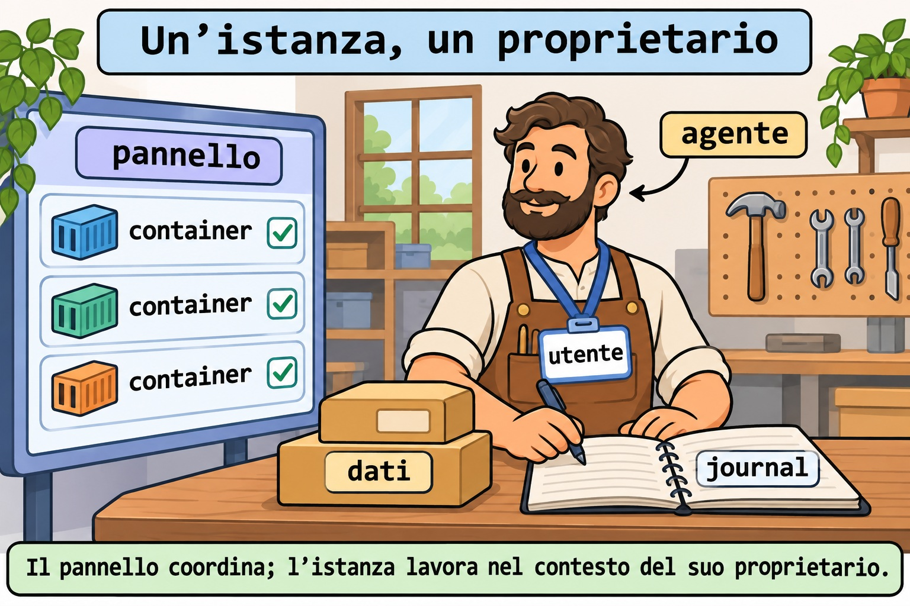
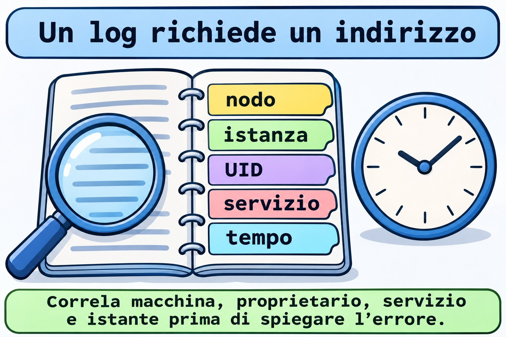

# Lezione 20.3 · Dentro un modulo

> **Il cuore di questa lezione:** trovare proprietario, servizio, container, dati e log della stessa istanza.

| Scheda | Piano di lavoro |
| --- | --- |
| Modulo | M20 · Dentro NethServer 8, lezione 3 di 7 |
| Quando | Settimana 28 |
| Alla fine | trovare proprietario, servizio, container, dati e log della stessa istanza. |
| Prerequisiti | 20.1–20.2; DokuWiki configurato; registro dell’operatore; browser autorizzato |
| Durata | 100–120 minuti |
| Snapshot | VM 240: `m20a3-inicio` e `m20a3-fim` |

La VM `240`, `ns8-1`, esegue Rocky Linux 9 e NS8. La gestione ha un indirizzo reale riservato; la seconda scheda ha `192.0.2.240/24` su `vmbr17`, senza gateway. Internet passa soltanto dalla gestione.

Controlla la [guida del laboratorio](../GUIA_BANCADA_M20_IT.md), i nomi e le rotte prima di iniziare. Il DNS M19 su `192.0.2.204` serve la rete isolata; non configurare il loopback come DNS del nodo.

I comandi amministrativi di questa lezione si eseguono in una shell root della VM indicata, aperta con `sudo -i`. L’utente root del nodo non è automaticamente il proprietario dei container dell’applicazione.

Il nome dell’istanza viene rilevato nell’installazione reale. Non sostituire mai una variabile con un nome di esempio soltanto perché ti sembra familiare. Non pubblicare il file di ambiente interno di un agente.

## 1 · Riscaldamento

1. Root del nodo vede automaticamente i container di ogni utente?

2. Un’istanza può raggruppare più container?

3. Il nome mostrato nel pannello basta per scegliere un’unità systemd?

## 2 · Perché conta

Un pannello può mostrare la stessa applicazione in più istanze. Esaminare il primo account Unix simile trasferisce l’ipotesi sull’oggetto sbagliato.

NS8 coordina le azioni; ogni modulo ha il proprio ambiente. La domanda utile non è soltanto se esiste un processo, ma a quale istanza e proprietario appartiene.

### Ponte Windows

Un account di servizio e un’applicazione visibile nella console amministrativa non sono la stessa cosa. Il contesto definisce credenziali, file e inventario di esecuzione.

## 3 · Modello mentale



*Il pannello coordina; l’istanza lavora nel contesto del suo proprietario.*

L’unità amministrativa è l’istanza. L’agente riceve azioni; l’utente Unix definisce privilegi e storage; il runtime mantiene i container.

Rootless non significa che nessun processo dell’applicazione usi UID zero dentro il container. Significa che il processo sull’host non riceve i privilegi di root del nodo.

Nelle versioni attuali, gli account rootless possono usare la shell di login `nologin`. È una protezione; `runagent` fornisce il contesto supportato senza trasformare l’account in un login umano.

## 4 · L'essenziale

| Domanda | Riscontro |
| --- | --- |
| Quale istanza? | Pannello, ID e UUID reali |
| Su quale nodo? | Inventario e hostname |
| Con quale proprietario? | runagent seguito da id |
| Quale servizio? | Inventario systemd nel contesto |
| Dove persistono i dati? | Mount e volumi ispezionati |

### Rocky × Debian

NS8 di questo laboratorio usa Rocky 9; Debian `202` è il client. Non copiare la directory di un modulo su un altro sistema aspettandoti di conservarne identità o integrazione.

### Decidi 1

Il pannello elenca il wiki, ma Podman di root non lo mostra. Qual è la prossima verifica?

A. Reinstallare il modulo.
B. Entrare nel contesto dell’istanza corretta.
C. Eliminare lo storage di root.

## 5 · Lab guidato

### Passo 1 · Riconciliare l’identità

**Ipotesi:** L’ID salvato è ancora l’istanza mostrata dal pannello?

```bash
test "$(id -u)" -eq 0 || exit 1
test "$(hostname -s)" = ns8-1 || exit 1
test -f /root/m20-lab/operador.env || exit 1
test ! -L /root/m20-lab/operador.env || exit 1
test "$(stat -c '%u:%g:%a' /root/m20-lab/operador.env)" = 0:0:600 || exit 1
cat /root/m20-lab/operador.env
. /root/m20-lab/operador.env
test "$NS8_IP" = 192.0.2.240 || exit 1
test "$WIKI_FQDN" = wiki.lab.test || exit 1
case "$MODULE_ID" in dokuwiki[0-9]*) ;; *) exit 1 ;; esac
runagent -l
runagent -l | grep -Fx -- "$MODULE_ID" || exit 1
```

Nel pannello apri i dettagli di DokuWiki e confronta istanza, UUID e nodo con il registro. La descrizione modificabile serve alla lettura umana; non sostituisce quegli identificatori.

```bash
install -d -m 0700 /root/m20-lab
EVID=$(mktemp -d /root/m20-lab/evidence-20-3.XXXXXX) || exit 1
date --iso-8601=seconds > "$EVID/time-before.txt"
hostnamectl hostname > "$EVID/hostname.txt"
runagent -l > "$EVID/modules.txt"
runagent -m "$MODULE_ID" id
```

**Output atteso:** Il contesto identifica l’account reale dell’istanza sul nodo previsto. Non ci sono UID o nomi numerici di esempio da copiare.

**Verifica:** Se il modulo è stato rimosso, ripristinato o spostato, aggiorna l’inventario tramite la procedura corrispondente prima di continuare.

### Passo 2 · Rilevare servizi e container

**Ipotesi:** Un nome di applicazione determina il nome di tutte le sue unità?


*Trova l’istanza, entra nel contesto e solo allora osserva le risorse.*

```bash
MODULE_UID=$(runagent -m "$MODULE_ID" id -u) || exit 1
[[ "$MODULE_UID" =~ ^[0-9]+$ ]] || exit 1
test "$MODULE_UID" -ne 0 || exit 1
runagent -m "$MODULE_ID" systemctl --user list-units --type=service --all --no-pager
runagent -m "$MODULE_ID" podman ps --all --format '{{.ID}} {{.Names}} {{.Status}}'
read -r -p 'Exact application service unit: ' SERVICE_UNIT
case "$SERVICE_UNIT" in *.service) ;; *) exit 1 ;; esac
test "$(runagent -m "$MODULE_ID" systemctl --user show "$SERVICE_UNIT" -p LoadState --value)" = loaded || exit 1
runagent -m "$MODULE_ID" systemctl --user cat "$SERVICE_UNIT"
runagent -m "$MODULE_ID" systemctl --user show "$SERVICE_UNIT" -p LoadState -p ActiveState -p SubState
read -r -p 'Exact application container ID: ' CONTAINER_ID
runagent -m "$MODULE_ID" podman container exists "$CONTAINER_ID" || exit 1
test "$(runagent -m "$MODULE_ID" podman inspect --format '{{.State.Status}}' "$CONTAINER_ID")" = running || exit 1
runagent -m "$MODULE_ID" podman inspect --format '{{.Name}} {{.State.Status}}' "$CONTAINER_ID"
```

**Output atteso:** Distingui agente, servizio dell’applicazione e container. Il container selezionato appartiene all’inventario di quell’account.

**Verifica:** Un’unità agente non va trattata come unità web soltanto perché entrambe sono attive. Metti in relazione ExecStart e container prima di registrare il servizio.

### Passo 3 · Mappare i dati senza modificarli

**Ipotesi:** Il layer scrivibile del container è la destinazione di backup che vuoi conservare?

```bash
runagent -m "$MODULE_ID" podman inspect --format '{{json .Mounts}}' "$CONTAINER_ID"
runagent -m "$MODULE_ID" podman volume ls
runagent -m "$MODULE_ID" podman info --format '{{.Store.GraphRoot}}'
runagent -m "$MODULE_ID" sh -c 'printf "HOME=%s\n" "$HOME"; pwd'
runagent -m "$MODULE_ID" systemctl --user show "$SERVICE_UNIT" -p FragmentPath
runagent -m "$MODULE_ID" podman inspect --format '{{json .Mounts}}' "$CONTAINER_ID" > "$EVID/mounts.json"
```

Leggi destinazione, origine e modalità di ogni mount. Un bind, un volume e il layer dell’immagine hanno cicli di vita diversi; l’elenco non autorizza a modificare le directory interne.

Non creare un backup copiando file di un database attivo. La lezione 20.6 userà il meccanismo dell’applicazione e dimostrerà il ripristino con contenuto noto.

**Output atteso:** La mappa distingue storage persistente ed esecuzione senza modificare nulla.

**Verifica:** Confronta la mappa con la documentazione della versione del modulo. Un volume esistente non dimostra che sia stato eseguito un backup.

### Passo 4 · Creare un riferimento funzionale

**Ipotesi:** Una pagina riconoscibile aiuta a distinguere il servizio da un altro sito?

Dalla postazione autorizzata con browser apri il wiki usando HTTPS e il nome `wiki.lab.test`. Fino alla 20.4 segui la verifica dell’impronta di bootstrap della 20.2; non inviare password tramite HTTP.

Accedi con l’account amministrativo del wiki creato tramite il flusso dell’applicazione. Crea la pagina `m20:prova` e salva soltanto il testo fittizio `M20 prova inicial`.

Esci e torna alla pagina tramite l’indirizzo documentato. Registra nel diario istante, titolo e contenuto osservato, senza cookie o immagini delle credenziali.

```bash
date --iso-8601=seconds > "$EVID/page-test-time.txt"
runagent -m "$MODULE_ID" podman ps --format '{{.ID}} {{.Names}} {{.Status}}' > "$EVID/containers-after-page.txt"
runagent -m "$MODULE_ID" systemctl --user is-active "$SERVICE_UNIT"
```

**Output atteso:** La pagina mostra il marcatore salvato e il servizio resta attivo.

**Verifica:** Se il browser ha ricevuto un’altra pagina, torna all’identità e alla rotta. Non attribuire allo storage una richiesta che non è arrivata all’applicazione corretta.

### Passo 5 · Correlare i log

**Ipotesi:** Un log vuoto significa assenza di problemi o query fuori contesto?



*Correla macchina, proprietario, servizio e istante prima di spiegare l’errore.*

```bash
date --iso-8601=seconds
journalctl _UID="$MODULE_UID" _SYSTEMD_USER_UNIT="$SERVICE_UNIT" --since '-15 min' --no-pager -n 60
runagent -m "$MODULE_ID" podman logs --since 15m --tail 40 "$CONTAINER_ID"
api-server-logs -h
journalctl _UID="$MODULE_UID" _SYSTEMD_USER_UNIT="$SERVICE_UNIT" --since '-15 min' --no-pager > "$EVID/service-journal.txt"
runagent -m "$MODULE_ID" systemctl --user show "$SERVICE_UNIT" -p ActiveEnterTimestamp -p ExecMainStatus
```

Il journal amministrativo con filtri espliciti evita di dipendere da un journal separato per utente su Rocky. Questo non cambia il proprietario del servizio e non giustifica l’esecuzione di Podman come root.

L’assenza di una richiesta HTTP nei log dell’applicazione può essere normale se il modulo non registra gli accessi in quel canale. Confronta servizio, log del container e consultazione dal pannello senza inventare una riga attesa.

**Output atteso:** I riscontri hanno proprietario e intervallo compatibili con la visita effettuata. La presenza di un errore viene osservata, mai inventata come output standard.

**Verifica:** Se il journal è vuoto, amplia l’intervallo di lettura e conferma unità e UID prima di riavviare qualsiasi processo.

### Passo 6 · Conservare la mappa riutilizzabile

**Ipotesi:** Il nome di un container resta uguale dopo qualsiasi aggiornamento?

```bash
printf 'MODULE_ID=%s\nMODULE_UID=%s\nSERVICE_UNIT=%s\nCONTAINER_ID=%s\n' "$MODULE_ID" "$MODULE_UID" "$SERVICE_UNIT" "$CONTAINER_ID" > "$EVID/map.txt"
chmod 0600 "$EVID/map.txt"
runagent -m "$MODULE_ID" systemctl --user is-active "$SERVICE_UNIT"
runagent -m "$MODULE_ID" podman inspect --format '{{.Name}} {{.State.Status}}' "$CONTAINER_ID"
date --iso-8601=seconds > "$EVID/time-after.txt"
```

Esporta il diario nella posizione esterna autorizzata. La mappa descrive quell’istante: dopo uno spostamento, ripristino o aggiornamento, rileva di nuovo container e unità.

**Output atteso:** Una persona riesce a ripetere la ricerca usando identità, macchina e periodo registrati.

**Verifica:** Conserva wiki e pagina. Non cancellare volumi, account o file generati per concludere questa lezione.

### Leggere il risultato senza saltare livelli

Un inventario utile consente di smentire una spiegazione. Per ogni osservazione scrivi anche ciò che ancora non dimostra.

| Osservazione | Dimostra | Non basta per |
| --- | --- | --- |
| Istanza nel pannello | Oggetto amministrativo identificato | Provare la pagina |
| UID non zero | Contesto rootless del processo host | Provare i permessi di ogni file |
| Unità loaded | Il gestore conosce quella unità | Concludere che il backend risponda |
| Container running | Il processo principale non è terminato | Provare il contenuto salvato |
| Volume presente | Lo storage ha un oggetto persistente | Dichiarare eseguito un backup |
| Riga nel journal | Un evento è stato registrato nel contesto letto | Attribuirlo a una richiesta diversa |

Il marcatore della pagina collega l’osservazione del browser all’applicazione. Non trasforma tutti i messaggi contemporanei del nodo in eventi di quella pagina.

Se due container appartengono alla stessa istanza, separa ruolo, servizio e mount. Un problema del servizio web può avere origine in una dipendenza senza richiedere di reinstallare entrambi.

Il comando seguente legge solo proprietà del servizio scelto e non cambia la configurazione. Confronta i tempi con il diario.

```bash
runagent -m "$MODULE_ID" systemctl --user show "$SERVICE_UNIT" -p Id -p LoadState -p ActiveState -p SubState -p ActiveEnterTimestamp
runagent -m "$MODULE_ID" podman inspect --format '{{.Id}} {{.ImageName}} {{.State.StartedAt}}' "$CONTAINER_ID"
```

Non usare un ID di container come identità permanente della funzione. L’immagine o il processo possono essere ricreati mentre la stessa istanza amministrativa conserva i dati.

Prima di chiudere il diario, annota una causa esclusa e l’evidenza che la esclude. Questo rende la diagnosi riutilizzabile da chi non era presente al test.

### Decidi 2

Il servizio è attivo e la pagina contiene altro contenuto. Cosa dimostra l’applicazione corretta?

A. L’identità della rotta e il marcatore salvato, correlati al nodo.
B. Una nuova reinstallazione.
C. Soltanto lo stato attivo.

## 6 · Rompi e ripara

I tre guasti di questa lezione sono query deliberatamente sbagliate. Allenano la diagnosi senza interrompere un agente o cancellare dati prima di avere imparato il backup.

### Guasto 1 · Inventario del proprietario sbagliato

**Sintomo:** Nella shell root consulta Podman senza `runagent` e prova a trovare il container selezionato.

**Indagine:** Confronta l’elenco con la stessa query nel contesto dell’istanza.

**Causa:** Gli inventari rootful e rootless sono separati; l’elenco può contenere altri servizi legittimi.

**Riparazione:** Usa il contesto verificato; non cercare di correggere l’elenco cancellando container.

**Prevenzione:** Registra sempre il proprietario prima del comando del runtime.

**Verifica:** Lo stesso container ricompare nell’inventario dell’istanza corretta.

### Guasto 2 · Servizio inventato

**Sintomo:** Consulta l’unità inesistente `m20-inexistente.service`.

**Indagine:** Confronta LoadState con l’unità reale che hai rilevato.

**Causa:** Il nome è stato indovinato, non rilevato nel contesto.

**Riparazione:** Torna alla variabile dell’unità reale; non creare un’unità per fare riuscire la query.

**Prevenzione:** Separa nome dell’applicazione, istanza e unità nel diario.

**Verifica:** L’unità reale è caricata e il suo stato è coerente con la richiesta funzionale.

### Guasto 3 · Intervallo temporale errato

**Sintomo:** Leggi soltanto l’ultimo secondo dopo essere rimasto senza fare richieste.

**Indagine:** Amplia fino all’intervallo registrato della visita alla pagina.

**Causa:** La query troppo stretta può escludere gli eventi; non dimostra che il logger sia terminato.

**Riparazione:** Usa l’orario reale e i filtri corretti prima di modificare il servizio.

**Prevenzione:** Annota l’istante prima e dopo ogni prova.

**Verifica:** Riesci a spiegare perché i due insiemi di risultati differiscono.

## 7 · Trappole

1. Leggere il file completo dell’ambiente può rivelare credenziali degli agenti.

2. Modificare un’unità o una configurazione generata può essere annullato dall’azione successiva.

3. Cambiare la shell nologin per diagnosticare aggira il meccanismo supportato.

4. Un modulo rootful richiede un altro modello di proprietario; non generalizzare il test rootless.

5. I dati del modulo non si riducono al layer scrivibile di un container.

6. Un aggiornamento può ricreare il container senza cambiare l’identità dell’istanza.

## 8 · Quiz

1. Quale riscontro collega l’ID del pannello all’utente Unix?

2. Perché Podman di root può non mostrare il wiki?

3. Cosa distingue servizio e container?

4. Quale filtro evita di mescolare journal di utenti diversi?

5. Perché una mappa di ieri va riconciliata dopo uno spostamento?

## 9 · Promemoria

```bash
runagent -l
runagent -m "$MODULE_ID" id
runagent -m "$MODULE_ID" podman ps
runagent -m "$MODULE_ID" systemctl --user list-units --type=service
journalctl _UID="$MODULE_UID" _SYSTEMD_USER_UNIT="$SERVICE_UNIT" --since '-10 min' --no-pager
```

**Flashcard:** indica macchina, contesto e riscontro prima di proporre una modifica.

```text
!explica Separe modulo, usuario Unix, unidade e conteiner no NS8.
!feynman Explique por que o inventario Podman do root nao descreve uma aplicacao rootless.
!quiz Proponha tres buscas de log com contexto errado e peca a correcao.
```

## 10 · Checklist e chiusura

- [ ] Nodo, istanza e UUID corrispondono al pannello.

- [ ] Proprietario e UID sono stati rilevati nel contesto corretto.

- [ ] Servizio e container sono stati rilevati, non indovinati.

- [ ] I volumi sono stati esaminati senza modificare lo storage interno.

- [ ] I log hanno macchina, UID, unità e intervallo temporale.

**Reboot di verifica:** concorda una finestra soltanto per la VM `240`. Esci dal modulo prima del reboot; conserva console e diario fuori dalla VM. Non ripristinare snapshot sopra lavoro successivo.

```bash
test "$(hostname -s)" = ns8-1 || exit 1
systemctl reboot
```

Dopo esserti riconnesso dalla gestione, ricarica il registro verificato e ripeti le prove funzionali. Il solo pannello attivo non dimostra che la pagina sia tornata.

**Ultimo esercizio:** registra orario, nodo osservato e contenuto della pagina dopo il reboot. Confronta con il riferimento precedente e lascia l’istanza funzionante per le prossime lezioni.

## 11 · Nella vita reale

In un ambiente reale, parti da inventario, finestra e riscontri di sola lettura. L’autorizzazione a diagnosticare non permette di riavviare moduli altrui o pubblicarne i registri.

La missione fuori dal laboratorio è soltanto di lettura: confronta la procedura con la documentazione della versione installata e annota ciò che dovresti verificare con il responsabile.

Non incollare token, cookie, variabili complete degli agenti o contenuti degli utenti in DeepTutor. Usa il marcatore fittizio e un riepilogo del riscontro.

## 12 · Approfondire quando vuoi

- [Contesti rootless e rootful](https://nethserver.github.io/ns8-core/modules/rootless_rootfull/)

- [Log NS8](https://nethserver.github.io/ns8-core/core/logs/)

- [File di core e moduli](https://nethserver.github.io/ns8-core/core/filesystem/)

La documentazione descrive i meccanismi; l’output osservato identifica la tua istanza. Confronta entrambi prima di adattare un comando di un’altra versione.

## Soluzioni commentate

Riscaldamento: root non riunisce automaticamente gli inventari rootless; un’istanza può avere più container; l’unità va rilevata.

Decidi 1: B. L’assenza nel contesto di root non significa assenza nel contesto dell’istanza.

Decidi 2: A. Stato e contenuto devono indicare lo stesso oggetto.

Quiz 1: ID e UUID del pannello, nodo ospitante e `id` eseguito tramite `runagent` devono essere coerenti.

Quiz 2: storage e runtime rootless appartengono all’account dell’istanza.

Quiz 3: systemd gestisce il ciclo di vita; Podman identifica processi, immagine e mount di un container.

Quiz 4: usa l’UID reale insieme all’unità reale e all’intervallo; uno stesso nome può comparire in contesti diversi.

Quiz 5: nodo, UID, unità o container possono cambiare; rilevali di nuovo senza perdere UUID e contenuto funzionale.

[← Lezione 20.2](20.2-cluster-no-e-modulo.md) · [Indice delle lezioni](../01-aulas.md) · [Lezione 20.4 →](20.4-proxy-e-certificados.md)
