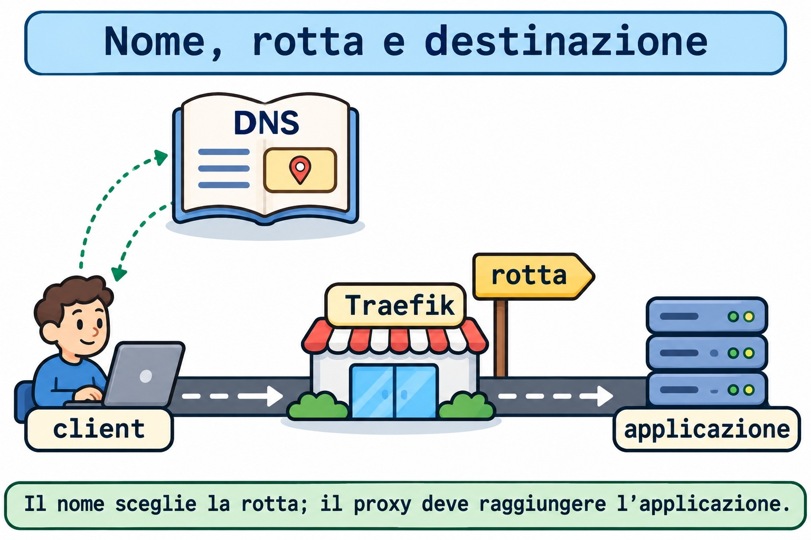
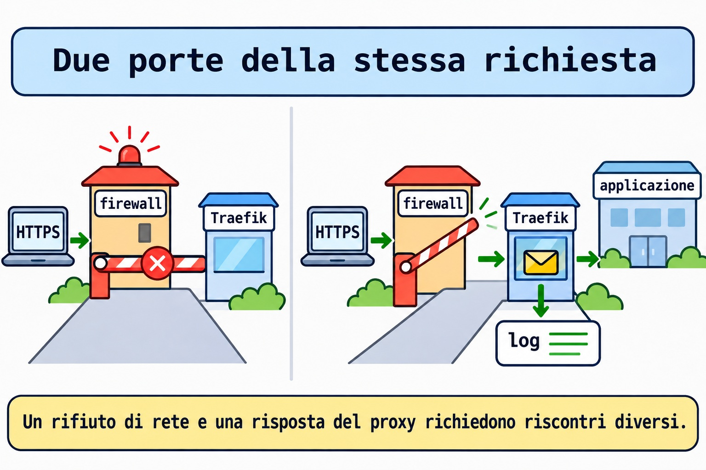

# Lezione 20.4 · Proxy e certificati

> **Il cuore di questa lezione:** verificare separatamente nome, identità TLS, rotta e applicazione.

| Scheda | Piano di lavoro |
| --- | --- |
| Modulo | M20 · NethServer 8 dall’interno, lezione 4 di 7 |
| Quando | Settimana 28 |
| Alla fine | emettere un’identità privata e verificare la risposta del nodo |
| Prerequisiti | Wiki della 20.2; VM 202 con student e sudo; guida M20 |
| Durata | 70–100 minuti |
| Snapshot | base m20a2-wiki; uscita m20a4-tls e m20a4-cliente202 |

## Prima di iniziare

Ti serve la VM 240 `ns8-1`, con cluster creato, DokuWiki installata e nome `wiki.lab.test` configurato nella 20.2. Usa lo stato `m20a2-wiki`, se è stato salvato, oppure esegui soltanto la preparazione della 20.1–20.2. La 20.3 non è obbligatoria.

Sulla 202 lavora come `student`. La [guida M20](../GUIA_BANCADA_M20_IT.md) prepara indirizzi reali, nomi privati e accesso diretto del browser autorizzato. La CA verrà creata in questa lezione sulla stessa 202. Non serve un altro modulo.

Sul nodo, `hostname -s` deve mostrare `ns8-1`; `ns8-1.lab.test` è il FQDN. I comandi root si eseguono nella VM dopo `sudo -i`, mai su Proxmox. Nessun laboratorio è stato eseguito durante questa revisione.

## 1 · Riscaldamento

1. Un nome risolto significa certificato corretto?
2. Un certificato valido mantiene attivo il backend?
3. Quale chiave permette di emettere altre identità?

## 2 · Perché conta

Il client deve raggiungere il nodo giusto e riconoscere l’identità attesa. Poi il proxy deve ancora trovare l’applicazione. Una risposta TLS corretta non dimostra gli altri passaggi.

### Ponte Windows

L’URL sceglie il nome verificato dal browser. Digitare l’IP cambia questa domanda; non equivale ad accedere al nome pubblicato.

## 3 · Modello mentale



*Il nome sceglie la rotta; il proxy deve raggiungere l’applicazione.*

Ogni nodo ha il proprio proxy Traefik. La rotta automatica del modulo associa il nome al backend locale. Configura il nome tramite l’applicazione; non modificare file generati.

## 4 · L'essenziale

| Livello | Verifica |
| --- | --- |
| Nome | nome privato associato all’IP reale di gestione |
| TLS | CA, SAN, validità e chiave corrispondente |
| Rotta | Host della richiesta e backend osservato |
| Applicazione | risposta nuova e contenuto atteso |

### Rocky × Debian

La 202 emette la CA privata del laboratorio. La 240 riceve soltanto la CA pubblica e il proprio certificato server. La chiave privata della CA non lascia mai la 202.

### Decidi 1

Il certificato copre il nome, ma la CA è sconosciuta. Che cosa corregge la verifica?

A. Disattivare la verifica per sempre.
B. Verificare la CA tramite un canale affidabile e fornirla al client.
C. Usare l’IP come nome per evitare SAN.

## 5 · Lab guidato

### Passo 1 · Verificare la rotta

**Ipotesi:** Il nome della Wiki è sul nodo che la esegue?

Nel pannello apri Settings → HTTP routes. Controlla nome, nodo e backend della rotta automatica della Wiki. Nel terminale root della 240 consulta senza modificare:

```bash
hostname -s
runagent -l
ss -ltnp '( sport = :80 or sport = :443 )'
```

**Output atteso:** Rotta di `wiki.lab.test` sul nodo 240, con istanza identificata.

**Verifica:** Conferma l’indirizzo reale di gestione nella guida. Il file hosts del sistema non fornisce DNS ai container.

### Passo 2 · Creare la CA sulla 202

**Ipotesi:** Che cosa deve restare privato sull’emittente?


*Fidarsi della CA non corregge un nome assente nel certificato.*

Sulla 202, come student, esegui una sola volta. La directory deve essere nuova. OpenSSL chiede la frase segreta della chiave CA; digitala nella richiesta del programma e custodiscila separatamente.

```bash
m20_criar_ca() {
  [ "$(hostname -s)" = debian-lab ] && [ "$(id -un)" = student ] || return 1
  [ ! -e "$HOME/m20-pki" ] || { printf '%s\n' 'La cartella della CA esiste già; controllala prima di continuare.'; return 1; }
  sudo apt install -y openssl curl || return 1
  umask 077
  install -d -m 0700 "$HOME/m20-pki" || return 1
  openssl genpkey -algorithm RSA -aes-256-cbc -pkeyopt rsa_keygen_bits:3072 -out "$HOME/m20-pki/ca.key" || return 1
  openssl req -new -x509 -sha256 -days 365 -key "$HOME/m20-pki/ca.key" -out "$HOME/m20-pki/ca.crt" -subj "/CN=CA M20" -addext "basicConstraints=critical,CA:TRUE" -addext "keyUsage=critical,keyCertSign,cRLSign" || return 1
  openssl x509 -in "$HOME/m20-pki/ca.crt" -noout -dates -fingerprint -sha256
}
m20_criar_ca
```

**Output atteso:** Chiave cifrata e certificato CA nella cartella 0700.

**Verifica:** Annota l’impronta digitale pubblica; non copiare la chiave CA per il caricamento.

### Passo 3 · Emettere e verificare il certificato del nodo

**Ipotesi:** Quali nomi devono comparire nel SAN?

Sempre sulla 202 usa `M20_ALVO=240` in questa lezione; la 20.7 riutilizza il blocco con `M20_ALVO=241`, senza ricreare la CA. Emetti una nuova chiave server. Resta senza password perché il proxy deve usarla senza intervento; la protezione è la directory privata e il modo 0600.

```bash
M20_ALVO=240
m20_emitir_no() {
  [ "$(hostname -s)" = debian-lab ] && [ "$(id -un)" = student ] || return 1
  case "$M20_ALVO" in
    240) CERT_HOST=ns8-1.lab.test ;;
    241) CERT_HOST=ns8-2.lab.test ;;
    *) return 1 ;;
  esac
  CERT_BASE="$HOME/m20-pki/node$M20_ALVO"
  [ ! -e "$CERT_BASE.key" ] && [ ! -e "$CERT_BASE.crt" ] || return 1
  umask 077
  openssl genpkey -algorithm RSA -pkeyopt rsa_keygen_bits:3072 -out "$CERT_BASE.key" || return 1
  openssl req -new -key "$CERT_BASE.key" -out "$CERT_BASE.csr" -subj "/CN=$CERT_HOST" || return 1
  cat > "$CERT_BASE.ext" <<EOF
basicConstraints=critical,CA:FALSE
keyUsage=critical,digitalSignature,keyEncipherment
extendedKeyUsage=serverAuth
subjectAltName=DNS:wiki.lab.test,DNS:$CERT_HOST
EOF
  openssl x509 -req -sha256 -days 90 -in "$CERT_BASE.csr" -CA "$HOME/m20-pki/ca.crt" -CAkey "$HOME/m20-pki/ca.key" -CAcreateserial -extfile "$CERT_BASE.ext" -out "$CERT_BASE.crt" || return 1
  chmod 0600 "$CERT_BASE.key"
  openssl verify -CAfile "$HOME/m20-pki/ca.crt" -verify_hostname wiki.lab.test "$CERT_BASE.crt" || return 1
  openssl verify -CAfile "$HOME/m20-pki/ca.crt" -verify_hostname "$CERT_HOST" "$CERT_BASE.crt"
}
m20_emitir_no
```

**Output atteso:** Catena ed entrambi i nomi sono validi nel certificato emesso.

**Verifica:** Nella 20.7 un altro nodo richiede un’altra chiave e un altro certificato; non copiare l’identità della 240.

### Passo 4 · Installare la fiducia e caricare i file

**Ipotesi:** Fidarsi della CA e installare la chiave server sono la stessa azione?

Sulla 202 compila `NS8_IP` con l’IP reale della guida. Verifica la chiave SSH del nodo tramite la console prima del primo SCP. Trasferisci soltanto la CA pubblica:

```bash
NS8_IP=""
m20_enviar_ca() {
  [ -n "$NS8_IP" ] || return 1
  scp "$HOME/m20-pki/ca.crt" "student@$NS8_IP:m20-ca.crt"
}
m20_enviar_ca
```

Sul nodo 240, dopo sudo -i, confronta l’impronta ricevuta con la lettura fatta sulla 202 tramite un canale indipendente. Esegui l’installazione soltanto dopo aver confermato l’uguaglianza.

```bash
openssl x509 -in /home/student/m20-ca.crt -noout -fingerprint -sha256
m20_confiar_ca() {
  [ "$(hostname -s)" = ns8-1 ] && [ "$(id -u)" -eq 0 ] || return 1
  [ ! -L /root/m20-lab ] || return 1
  [ ! -e /etc/pki/ca-trust/source/anchors/m20-lab-ca.crt ] || return 1
  install -d -o root -g root -m 0700 /root/m20-lab || return 1
  install -o root -g root -m 0644 /home/student/m20-ca.crt /root/m20-lab/ca.crt || return 1
  install -o root -g root -m 0644 /root/m20-lab/ca.crt /etc/pki/ca-trust/source/anchors/m20-lab-ca.crt || return 1
  update-ca-trust extract
}
m20_confiar_ca
```

Nel browser della 202, aperto dalla console locale secondo la guida, apri il pannello tramite IP con il bootstrap già verificato. In Settings → TLS certificates → Upload certificate scegli il nodo 240. Carica `node240.crt` come Certificate, `node240.key` come Private key e `ca.crt` come Chain file. Questi tre file provengono dalla cartella privata della 202; `ca.key` non viene mai inviato.

Nel Firefox della stessa 202 importa soltanto `ca.crt` tra le autorità di certificazione, dopo aver confrontato l’impronta digitale; abilita la fiducia per identificare siti. Dopo il caricamento riapri il pannello in `https://ns8-1.lab.test/cluster-admin`, con il file hosts della guida. Il certificato non ha SAN IP: continuare tramite IP non è una verifica valida del nome. La Wiki usa `https://wiki.lab.test/`.

**Output atteso:** Certificato Uploaded associato al nodo 240.

**Verifica:** Il caricamento richiede fiducia nella CA anche nel sistema del nodo. I certificati caricati non vengono replicati automaticamente.

### Passo 5 · Verificare la risposta dalla 202

**Ipotesi:** La destinazione forzata cambia il nome verificato nel certificato?



*Un rifiuto di rete e una risposta del proxy richiedono riscontri diversi.*

Sulla 202, come student, mantieni `NS8_IP` compilato. Il parametro `--resolve` usa l’IP reale mantenendo Host e SNI; non dipende da DNS privato all’interno di un container.

```bash
m20_testar_tls() {
  [ -n "$NS8_IP" ] || return 1
  openssl x509 -in "$HOME/m20-pki/node240.crt" -noout -dates -ext subjectAltName
  curl --retry 10 --retry-delay 1 --retry-all-errors --max-time 10 --fail --cacert "$HOME/m20-pki/ca.crt" --resolve "wiki.lab.test:443:$NS8_IP" https://wiki.lab.test/
}
m20_testar_tls
```

Controlla anche la pagina privata `m20:prova` tramite il browser con l’utente locale student della Wiki, se è stata creata; altrimenti crea una pagina fittizia e riconosci il contenuto. Non rendere pubblica l’intera Wiki per facilitare curl.

**Output atteso:** Catena e nome sono validi; l’utente autorizzato riconosce la pagina.

**Verifica:** La risposta HTTP può essere un login, secondo l’ACL. Non equivale al recupero del contenuto privato.

### Passo 6 · Registrare e salvare lo stato di base

**Ipotesi:** Il certificato Uploaded si rinnova da solo?

Annota emittente, SAN, validità, nodo e luogo di custodia. Uploaded richiede rinnovo manuale. Per nomi `.test` questa lezione non richiede un certificato pubblico; ACME richiede un dominio pubblico controllato e accesso alla verifica configurata.

Dopo la verifica salva tramite la guida `m20a4-tls` sulla 240 e `m20a4-cliente202` sulla 202. Se non esistono, le lezioni successive ricreano questo stato eseguendo 20.1, 20.2 e 20.4; non richiedono la 20.3 o la 20.5.

**Output atteso:** Base TLS documentata in entrambe le VM.

**Verifica:** Gli snapshot della 202 contengono materiale privato; limita l’accesso. Non ripristinare un solo nodo dopo aver formato un cluster di due nodi.

### Decidi 2

DNS e TLS sono corretti, ma il proxy mostra un guasto del backend. Quale evidenza cerchi dopo?

A. Cambiare il DNS di tutti i nodi.
B. Aumentare la validità del certificato.
C. Controllare destinazione della rotta e stato dell’istanza sul nodo che la ospita.

## 6 · Rompi e ripara

### Guasto 1 · IP al posto del nome

**Sintomo:** Sul client sostituisci soltanto il nome nell’URL con l’IP reale.

**Indagine:** Leggi l’errore TLS e il SAN del certificato.

**Causa:** Non è stato emesso un SAN per l’IP.

**Riparazione:** Torna al FQDN e mantieni --resolve con l’IP corretto.

**Prevenzione:** Registra nome e indirizzo in campi separati.

**Verifica:** Il comando originale verifica l’identità.

### Guasto 2 · CA non fornita

**Sintomo:** In una copia del comando rimuovi --cacert senza installare globalmente la CA.

**Indagine:** Confronta l’errore con la stessa connessione usando la CA corretta.

**Causa:** Il client non conosce la CA privata.

**Riparazione:** Fornisci il certificato pubblico verificato.

**Prevenzione:** Non sostituire mai la verifica ignorando gli errori TLS.

**Verifica:** Nome e catena passano nella stessa richiesta.

### Guasto 3 · Destinazione del test errata

**Sintomo:** Sulla 202 usa --resolve con 127.0.0.1 in una copia del test.

**Indagine:** Controlla quale macchina ha ricevuto il tentativo.

**Causa:** La richiesta è stata inviata al client stesso.

**Riparazione:** Ripristina soltanto l’IP reale nel comando.

**Prevenzione:** Identifica origine e destinazione prima di modificare il firewall.

**Verifica:** La richiesta corretta riceve la risposta del nodo.

## 7 · Trappole

1. hosts non diventa DNS dei container.
2. Uploaded non si rinnova automaticamente.
3. Il certificato appartiene al nodo, non al ruolo di leader.
4. La chiave CA non va nel modulo del server.

## 8 · Quiz

1. Perché TLS può essere valido mentre la Wiki è indisponibile?
2. Quale file privato non lascia l’emittente?
3. Che cosa deve esistere su un altro nodo prima di ricevere la Wiki?
4. Un nome .test può ricevere un certificato pubblico in questo laboratorio?
5. Che cosa distingue Uploaded da un certificato gestito tramite ACME?

## 9 · Promemoria

```bash
openssl x509 -in "$HOME/m20-pki/node240.crt" -noout -dates -ext subjectAltName
getent ahostsv4 wiki.lab.test
ss -ltnp '( sport = :80 or sport = :443 )'
```

**Flashcard:** nome, catena e applicazione sono verifiche separate.

## 10 · Checklist e chiusura

- [ ] CA e chiavi private in cartella 0700.
- [ ] Il certificato del nodo contiene entrambi i nomi.
- [ ] CA pubblica verificata prima dell’installazione.
- [ ] Caricamento e test HTTPS completati.
- [ ] Stato di base e validità registrati.

**Reboot di verifica:** in una finestra della VM 240 riavvia dal pannello o dalla console, attendi il ritorno e ripeti il test TLS dalla 202. Salva gli snapshot soltanto dopo questa verifica.

**Ultimo esercizio:** descrivi un guasto del nome e uno del backend senza proporre la stessa riparazione.

## 11 · Nella vita reale

Registra responsabile, scadenza del rinnovo e consumatori della CA. Un test corretto oggi non evita la scadenza domani.

## 12 · Approfondire quando vuoi

[TLS e caricamento in NS8](https://docs.nethserver.org/docs/administrator-manual/configuration/certificates) · [OpenSSL req](https://docs.openssl.org/3.0/man1/openssl-req/) · [curl --resolve](https://curl.se/docs/manpage.html)

!explica Separa nome, TLS, rotta e backend in NS8.
!feynman Spiega perché un certificato affidabile non avvia un’applicazione.
!quiz Crea un guasto del nome e uno della fiducia.

## Soluzioni commentate

Decidi 1: B. La fiducia deriva dalla CA pubblica verificata.
Decidi 2: C. Dopo TLS indaga rotta e backend.
Quiz 1: TLS verifica l’identità, non la disponibilità del backend.
Quiz 2: ca.key.
Quiz 3: fiducia nella CA, certificato proprio e rotta corretta.
Quiz 4: No; il laboratorio usa una CA privata.
Quiz 5: Uploaded richiede rinnovo manuale; ACME dipende da requisiti pubblici.

[← Lezione 20.3](20.3-modulo-por-dentro.md) · [Indice](../01-aulas.md) · [Lezione 20.5 →](20.5-dominios-de-usuario.md)
