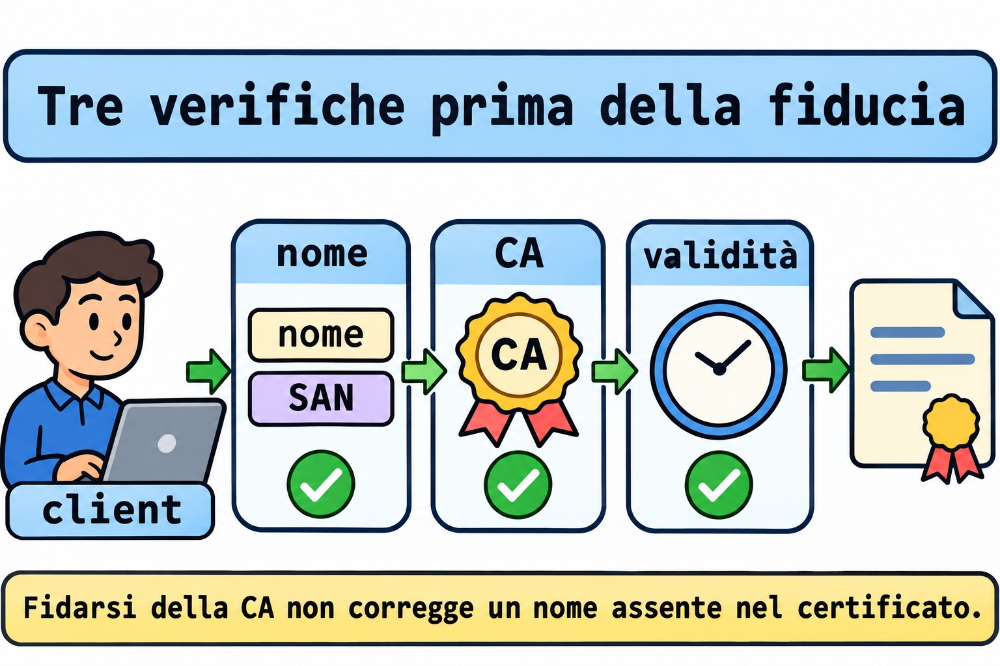

# Lezione 20.4 · Proxy e certificati

> **Il cuore di questa lezione:** separare risoluzione, rotta, identità TLS e raggiungibilità del backend.

| Scheda | Piano di lavoro |
| --- | --- |
| Modulo | M20 · Dentro NethServer 8, lezione 4 di 7 |
| Quando | Settimana 28 |
| Alla fine | separare risoluzione, rotta, identità TLS e raggiungibilità del backend. |
| Prerequisiti | 20.3; CA privata del M19 conservata sulla 204; accesso del browser tramite la guida |
| Durata | 100–120 minuti |
| Snapshot | VM 240: `m20a4-inicio` e `m20a4-fim` |

La VM `240`, `ns8-1`, esegue Rocky Linux 9 e NS8. La gestione ha un indirizzo reale riservato; la seconda scheda ha `192.0.2.240/24` su `vmbr17`, senza gateway. Internet passa soltanto dalla gestione.

Controlla la [guida del laboratorio](../GUIA_BANCADA_M20_IT.md), i nomi e le rotte prima di iniziare. Il DNS M19 su `192.0.2.204` serve la rete isolata; non configurare il loopback come DNS del nodo.

I comandi amministrativi di questa lezione si eseguono in una shell root della VM indicata, aperta con `sudo -i`. L’utente root del nodo non è automaticamente il proprietario dei container dell’applicazione.

Il nome dell’istanza viene rilevato nell’installazione reale. Non sostituire mai una variabile con un nome di esempio soltanto perché ti sembra familiare. Non pubblicare il file di ambiente interno di un agente.

## 1 · Riscaldamento

1. Un DNS corretto dimostra che il certificato contenga il nome?

2. Il leader riceve necessariamente tutto il traffico HTTP del cluster?

3. Un certificato caricato su un nodo viene replicato automaticamente sugli altri?

## 2 · Perché conta

Un’applicazione può funzionare tramite un percorso e fallire con il nome pubblicato. DNS, selezione della rotta e fiducia del client sono verifiche indipendenti.

Ogni nodo possiede il proprio Traefik. La rotta automatica dell’applicazione punta di solito a un backend locale; essere leader non trasforma il nodo nell’ingresso universale di ogni applicazione.

### Ponte Windows

Nel browser dell’operatore la guida può associare i nomi ai loopback di un tunnel SSH. Questo consegna soltanto la richiesta al nodo corretto; nome dell’URL e verifica del certificato restano integri.

Il DNS reale dei nodi e del client `202` continua a indicare gli indirizzi isolati. Non copiare i loopback della postazione nel DNS del laboratorio.

## 3 · Modello mentale


*Il nome sceglie la rotta; il proxy deve raggiungere l’applicazione.*

Il client risolve il nome e si collega alla destinazione. Traefik presenta un’identità TLS e sceglie una rotta compatibile con Host e, quando configurato, percorso.

Poi esiste un altro tratto verso l’applicazione. Un certificato valido nel primo tratto non mantiene attivo il backend e non crea una rotta assente.

Le rotte contrassegnate come automatiche appartengono all’applicazione. Modifica il nome tramite la configurazione supportata del modulo; non modificare i file generati di Traefik.

## 4 · L'essenziale

| Livello | Domanda |
| --- | --- |
| DNS | Il nome risolve verso il nodo atteso? |
| TCP | La porta accetta una connessione da questo client? |
| TLS | Nome, catena e validità corrispondono? |
| Rotta | Host e percorso corrispondono all’applicazione? |
| Backend | L’applicazione risponde tramite la destinazione della rotta? |

### Rocky × Debian

Nella VM NS8 Rocky la CA pubblica attendibile entra in `/etc/pki/ca-trust/source/anchors/`. Nel client Debian del laboratorio le prove usano esplicitamente `/etc/ssl/m19/ca.crt`; nessun client riceve la chiave privata della CA.

### Decidi 1

Il certificato copre il nome, ma la CA è sconosciuta. Cosa cambia correttamente la verifica?

A. Disattivare la verifica per sempre.
B. Verificare la CA tramite un canale fidato e fornirla al client.
C. Usare l’IP come nome per evitare il SAN.

## 5 · Lab guidato

### Passo 1 · Controllare nome, nodo e rotta

**Ipotesi:** Il nome del wiki indica il nodo su cui gira l’istanza?

```bash
test "$(id -u)" -eq 0 || exit 1
test "$(hostname -s)" = ns8-1 || exit 1
test -f /root/m20-lab/operador.env || exit 1
test ! -L /root/m20-lab/operador.env || exit 1
test "$(stat -c '%u:%g:%a' /root/m20-lab/operador.env)" = 0:0:600 || exit 1
cat /root/m20-lab/operador.env
. /root/m20-lab/operador.env
test "$NS8_IP" = 192.0.2.240 || exit 1
test "$WIKI_FQDN" = wiki.lab.test || exit 1
case "$MODULE_ID" in dokuwiki[0-9]*) ;; *) exit 1 ;; esac
runagent -l
runagent -l | grep -Fx -- "$MODULE_ID" || exit 1
```

```bash
dig @192.0.2.204 wiki.lab.test A +short
dig @192.0.2.204 ns8-1.lab.test A +short
getent ahostsv4 wiki.lab.test
ss -ltnp '( sport = :80 or sport = :443 )'
firewall-cmd --get-active-zones
firewall-cmd --list-all-zones
```

Nel pannello apri Settings, HTTP routes. Individua la rotta automatica del wiki, il nodo e la destinazione reale. Conserva questi valori nel diario; non scrivere una destinazione che non hai osservato.

Le restrizioni del firewall e della rotta sono livelli distinti. La pagina Firewall non mostra necessariamente tutte le rich rule; confronta anche la lettura dal terminale.

**Output atteso:** Il DNS del laboratorio restituisce `192.0.2.240`; la rotta del wiki appartiene al nodo che ospita l’istanza.

**Verifica:** La postazione con tunnel può risolvere verso loopback secondo la guida. Conferma la destinazione del forwarding prima di considerare quella risposta locale un errore DNS.

### Passo 2 · Emettere un’identità di laboratorio

**Ipotesi:** Quale chiave può essere inviata al nodo e quale deve restare sull’emittente?



*Fidarsi della CA non corregge un nome assente nel certificato.*

Ora lavora nella VM `204`, come root. La CA del M19 deve essere ancora valida e sotto il tuo controllo. Non sostituire una CA persa emettendone un’altra con lo stesso nome e fingendo continuità.

```bash
test "$(id -u)" -eq 0 || exit 1
test "$(hostname -s)" = srv-deb || exit 1
set -eu
test -f /etc/ssl/m19/ca.crt || exit 1
test -f /root/m19-ca/ca.key || exit 1
openssl x509 -in /etc/ssl/m19/ca.crt -noout -dates -fingerprint -sha256
read -r -p 'Target node: 240 or 241: ' CERT_NODE
case "$CERT_NODE" in
  240) CERT_HOST=ns8-1.lab.test ;;
  241) CERT_HOST=ns8-2.lab.test ;;
  *) exit 1 ;;
esac
umask 077
install -d -m 0700 /root/m20-pki
CERT_BASE="/root/m20-pki/node$CERT_NODE"
test ! -e "$CERT_BASE.key" && test ! -e "$CERT_BASE.crt" || exit 1
openssl genpkey -algorithm RSA -pkeyopt rsa_keygen_bits:3072 -out "$CERT_BASE.key"
openssl req -new -key "$CERT_BASE.key" -out "$CERT_BASE.csr" -subj "/CN=$CERT_HOST"
cat > "$CERT_BASE.ext" <<EOF
basicConstraints=critical,CA:FALSE
keyUsage=critical,digitalSignature,keyEncipherment
extendedKeyUsage=serverAuth
subjectAltName=DNS:wiki.lab.test,DNS:$CERT_HOST
EOF
openssl x509 -req -sha256 -days 90 -in "$CERT_BASE.csr" -CA /etc/ssl/m19/ca.crt -CAkey /root/m19-ca/ca.key -CAcreateserial -extfile "$CERT_BASE.ext" -out "$CERT_BASE.crt"
chmod 0600 "$CERT_BASE.key"
openssl verify -CAfile /etc/ssl/m19/ca.crt -verify_hostname wiki.lab.test "$CERT_BASE.crt"
openssl verify -CAfile /etc/ssl/m19/ca.crt -verify_hostname "$CERT_HOST" "$CERT_BASE.crt"
openssl x509 -in "$CERT_BASE.crt" -noout -dates -ext subjectAltName -fingerprint -sha256
```

In questa lezione scegli `240`. Nella 20.7 ripeti questo passo scegliendo `241` prima di spostare il wiki: sarà un’altra chiave, con il nome del secondo nodo. I certificati di Traefik non vengono replicati automaticamente.

**Output atteso:** Il certificato è nuovo, ha i SAN del wiki e del nodo scelto ed è firmato dalla CA già verificata. La password della CA viene digitata al prompt.

**Verifica:** Controlla il certificato emesso, non soltanto il CSR. I due file privati dei nodi devono essere diversi; la chiave della CA non lascia mai la `204`.

### Passo 3 · Trasferire soltanto il necessario

**Ipotesi:** Un file PEM chiamato certificato può contenere una chiave privata?

Sempre sulla `204`, prepara una cartella temporanea di trasferimento esclusiva dell’account `student`. Contiene la chiave del server scelto, non la chiave della CA. L’accesso alla postazione operatrice deve essere autenticato e protetto.

```bash
test ! -e /home/student/m20-tls || exit 1
install -d -o student -g student -m 0700 /home/student/m20-tls
install -o student -g student -m 0600 "$CERT_BASE.key" /home/student/m20-tls/server.key
install -o student -g student -m 0644 "$CERT_BASE.crt" /home/student/m20-tls/server.crt
install -o student -g student -m 0644 /etc/ssl/m19/ca.crt /home/student/m20-tls/ca.crt
openssl x509 -in /home/student/m20-tls/ca.crt -noout -fingerprint -sha256
openssl x509 -in /home/student/m20-tls/server.crt -noout -fingerprint -sha256
stat -c '%U:%G:%a %n' /home/student/m20-tls /home/student/m20-tls/server.key
```

Sulla postazione che esegue il browser della guida usa SCP o SFTP dell’account `student` della `204`, tramite la gestione autenticata, verso una nuova cartella privata. Copia soltanto `server.key`, `server.crt` e `ca.crt`; confronta le impronte con la lettura effettuata dalla console.

Sul nodo scelto trasferisci soltanto la CA pubblica in `/root/m20-lab/ca.crt`. Il file pubblico può arrivare tramite SCP dalla stessa cartella o tramite console; l’impronta deve coincidere prima di installarlo.

```bash
test "$(id -u)" -eq 0 || exit 1
read -r -p 'Target node: 240 or 241: ' CERT_NODE
case "$CERT_NODE:$(hostname -s)" in 240:ns8-1|241:ns8-2) ;; *) exit 1 ;; esac
openssl x509 -in /root/m20-lab/ca.crt -noout -fingerprint -sha256
read -r -p 'Expected CA SHA256, hex only: ' CA_EXPECTED
[[ "$CA_EXPECTED" =~ ^[0-9a-fA-F]{64}$ ]] || exit 1
CA_ACTUAL=$(openssl x509 -in /root/m20-lab/ca.crt -noout -fingerprint -sha256 | cut -d= -f2 | tr -d ':') || exit 1
test "$(printf '%s' "$CA_ACTUAL" | tr 'A-F' 'a-f')" = "$(printf '%s' "$CA_EXPECTED" | tr 'A-F' 'a-f')" || exit 1
test ! -e /etc/pki/ca-trust/source/anchors/m20-lab-ca.crt || exit 1
install -o root -g root -m 0644 /root/m20-lab/ca.crt /etc/pki/ca-trust/source/anchors/m20-lab-ca.crt
update-ca-trust extract
```

**Output atteso:** Soltanto la CA pubblica entra nel trust store del nodo. La chiave dell’applicazione resta in file privati destinati al caricamento autorizzato.

**Verifica:** La documentazione NS8 richiede fiducia nella CA privata anche sul sistema del nodo per accettare il caricamento. Non correggere un rifiuto di fiducia disattivando la verifica.

### Passo 4 · Importare sul nodo corretto

**Ipotesi:** Importare sul leader configura il certificato di tutti i nodi?

Sulla postazione operatrice apri il pannello tramite HTTPS con il bootstrap già verificato. Vai a Settings, TLS certificates e Upload certificate. Seleziona esplicitamente il nodo il cui hostname è nel certificato.

Scegli `server.crt` come Certificate e `server.key` come Private key; fornisci `ca.crt` come Chain file in questo lab senza CA intermedia. I file sono PEM e la chiave del server non ha password; è l’accesso al file che deve restare limitato.

Conferma Upload e attendi l’esito. Nell’elenco controlla nodo, nomi, tipo Uploaded e validità. Non eliminare il certificato precedente prima di dimostrare che la sostituzione funziona.

Il wiki usa il certificato caricato quando corrisponde all’hostname configurato. Controlla il certificato effettivamente presentato al client: l’elenco del pannello non dimostra quale identità sia arrivata alla connessione.

**Output atteso:** Il caricamento termina senza errori e l’identità del nodo corretto compare nell’elenco.

**Verifica:** Se la chiave non corrisponde, i nomi non coincidono o la CA non è attendibile, fermati e correggi il materiale. Non sostituire la chiave del server con la chiave privata della CA nel modulo.

### Passo 5 · Verificare dalla rete del client

**Ipotesi:** Una prova fatta soltanto sul nodo dimostra la fiducia del client?


*Un rifiuto di rete e una risposta del proxy richiedono riscontri diversi.*

I comandi seguenti si eseguono sulla VM `202`, come `student`. La CA pubblica è già in `/etc/ssl/m19/ca.crt` dal M19; controlla la sua impronta prima di usarla.

```bash
test "$(hostname -s)" = debian-lab || exit 1
test "$(id -un)" = student || exit 1
openssl x509 -in /etc/ssl/m19/ca.crt -noout -fingerprint -sha256
dig @192.0.2.204 wiki.lab.test A +short
openssl s_client -connect 192.0.2.240:443 -servername wiki.lab.test -verify_hostname wiki.lab.test -verify_return_error -CAfile /etc/ssl/m19/ca.crt </dev/null
curl --retry 10 --retry-delay 1 --retry-all-errors --max-time 10 --fail --cacert /etc/ssl/m19/ca.crt --resolve wiki.lab.test:443:192.0.2.240 https://wiki.lab.test/
curl --retry 10 --retry-delay 1 --retry-all-errors --max-time 10 --fail --cacert /etc/ssl/m19/ca.crt --resolve wiki.lab.test:443:192.0.2.240 'https://wiki.lab.test/doku.php?id=m20:prova'
```

La prima verifica TLS deve convalidare nome e catena. La risposta della pagina può richiedere il login, secondo l’ACL del wiki; in tal caso completa la prova del contenuto tramite browser autenticato e non mettere password o cookie negli argomenti.

Sulla postazione con browser importa soltanto la CA pubblica nell’archivio di fiducia appropriato, dopo averne verificato l’impronta. Riapri l’URL originale e controlla SAN, emittente e validità senza ignorare avvisi.

**Output atteso:** TLS viene convalidato e la pagina mostra `M20 prova inicial` all’utente autorizzato. La prova non dipende dalla disattivazione della verifica.

**Verifica:** Dopo lo spostamento nella 20.7 sostituisci la destinazione esplicita con l’indirizzo reale del nuovo nodo e conferma la nuova identità oltre al DNS.

Su Windows usa l’installazione del certificato pubblico per l’utente corrente nell’archivio delle autorità radice attendibili, dopo la verifica dell’impronta. Non selezionare file di chiave nel programma di importazione della CA. Se il browser usa un archivio proprio, applica il suo metodo documentato e verifica il risultato.

### Passo 6 · Distinguere emissione pubblica e privata

**Ipotesi:** Un nome che termina in lab.test può ricevere un certificato pubblico soltanto perché c’è Internet?

Per `lab.test` l’emissione pubblica non viene eseguita. La prova obbligatoria del laboratorio usa la CA privata; registra il ramo pubblico come non eseguito se non controlli un dominio pubblico e la relativa pubblicazione.

Nel ramo pubblico opzionale usa soltanto un nome reale sotto il tuo controllo. Controlla A e AAAA pubblici, NAT e firewall; il client ACME deve raggiungere il nodo corretto tramite la porta del challenge configurato.

Nella pagina TLS certificates, ACME settings, controlla nodo e Challenge type. Le installazioni attuali possono usare TLS-ALPN-01 su TCP 443; HTTP-01 usa TCP 80. Non aprire porte seguendo una ricetta che presuppone un altro challenge.

La modalità staging fornisce certificati di test di cui i client non si fidano per impostazione predefinita. Cambiare l’URL ACME non sostituisce immediatamente i certificati già emessi.

I certificati Uploaded non si rinnovano automaticamente. Annota responsabile e scadenza del rinnovo; Request e Automatic hanno meccanismi distinti e continuano a dipendere da DNS e accesso pubblico corretti.

**Output atteso:** Riesci a spiegare quale CA ha emesso l’identità attuale e come verrà rinnovata.

**Verifica:** Elimina le copie temporanee della chiave del server dalla cartella di trasferimento e dalla postazione dopo il caricamento confermato, conservando le copie di custodia autorizzate e la CA sull’emittente.

Sulla `204` controlla i nomi esatti prima di rimuovere soltanto lo staging. La cartella potrà essere ricreata nella 20.7 per il certificato del secondo nodo.

```bash
test "$(hostname -s)" = srv-deb || exit 1
stat -c '%U:%G:%a %n' /home/student/m20-tls
rm -- /home/student/m20-tls/server.key /home/student/m20-tls/server.crt /home/student/m20-tls/ca.crt
rmdir -- /home/student/m20-tls
```

### Decidi 2

DNS e TLS sono corretti, ma il proxy mostra un errore di backend. Quale riscontro viene dopo?

A. Cambiare il DNS di tutti i nodi.
B. Aumentare la validità del certificato.
C. Controllare destinazione della rotta e stato dell’istanza sul nodo ospitante.

## 6 · Rompi e ripara

Esegui soltanto le prove del client qui sotto. Non modificano DNS globale, firewall, rotta automatica o pannello amministrativo.

### Guasto 1 · Nome assente

**Sintomo:** Sulla VM 202 richiedi l’IP letterale con la CA corretta.

**Indagine:** Confronta il messaggio sul nome con la richiesta tramite FQDN e `--resolve`.

**Causa:** Il certificato copre i nomi DNS emessi, non un IP SAN che non hai incluso.

**Riparazione:** Torna al FQDN pubblicato e conserva SNI e Host.

**Prevenzione:** Registra nome e destinazione come campi separati.

**Verifica:** La connessione tramite nome viene convalidata senza saltare la verifica.

```bash
curl --max-time 5 --cacert /etc/ssl/m19/ca.crt https://192.0.2.240/
```

### Guasto 2 · Fiducia non fornita

**Sintomo:** Sul client che non si fida ancora globalmente della CA togli soltanto `--cacert` da una copia del comando.

**Indagine:** Leggi emittente, catena ed esito TLS; non confonderlo con un errore DNS.

**Causa:** L’identità è di una CA privata che quel contesto non conosce ancora.

**Riparazione:** Fornisci la CA pubblica verificata; non usare un’opzione per ignorare gli errori.

**Prevenzione:** Documenta dove è stata installata la fiducia e dove è esplicita per comando.

**Verifica:** Con la CA corretta nome e catena superano la stessa connessione.

### Guasto 3 · Nome verso la destinazione sbagliata

**Sintomo:** Usa una copia del comando con `--resolve wiki.lab.test:443:127.0.0.1` sul client 202.

**Indagine:** Confronta la destinazione forzata con la risposta A del DNS del laboratorio.

**Causa:** Il comando ha deviato la connessione sul client stesso; non dimostra una caduta di NS8.

**Riparazione:** Ripristina soltanto la destinazione del comando di prova senza cambiare il DNS globale.

**Prevenzione:** Identifica il punto di osservazione e il forwarding prima di aprire porte.

**Verifica:** Il comando corretto riceve la risposta del nodo atteso e il contenuto noto.

## 7 · Trappole

1. Una rotta automatica non va modificata in un file per resistere al pannello.

2. I certificati Uploaded richiedono un piano di rinnovo manuale.

3. I certificati sono locali al nodo; spostare il modulo non dimostra che la destinazione abbia l’identità necessaria.

4. Limitare cluster-admin può impedire gestione, ingresso dei nodi ed elezione. Non è il guasto scelto qui.

5. Cambiare ACME o rimuovere certificati può riavviare Traefik e interrompere connessioni.

6. NS8 apre le porte dei servizi gestiti; non sostituirne la politica con un flush del firewall.

## 8 · Quiz

1. Perché TLS può essere valido mentre il wiki resta indisponibile?

2. Quale file privato non lascia l’emittente?

3. Cosa deve esistere sul nodo 241 prima di ricevere il wiki?

4. Quale porta richiede ACME in questa installazione?

5. Cosa distingue un certificato Uploaded da uno richiesto tramite ACME?

## 9 · Promemoria

```bash
dig @192.0.2.204 wiki.lab.test A +short
ss -ltnp '( sport = :80 or sport = :443 )'
firewall-cmd --get-active-zones
openssl x509 -in /etc/ssl/m19/ca.crt -noout -fingerprint -sha256
curl --cacert /etc/ssl/m19/ca.crt --resolve wiki.lab.test:443:192.0.2.240 https://wiki.lab.test/
```

**Flashcard:** indica macchina, contesto e riscontro prima di proporre una modifica.

```text
!explica Separe DNS, rota HTTP, TLS e backend no NS8.
!feynman Explique por que um certificado confiavel pode acompanhar uma aplicacao indisponivel.
!quiz Crie tres falhas de nome, confianca ou rota e peca uma prova distinta.
```

## 10 · Checklist e chiusura

- [ ] Il nome risolve verso il nodo che ospita la rotta.

- [ ] Il certificato presentato contiene SAN e catena attesi.

- [ ] La CA pubblica è stata verificata prima di installarla.

- [ ] La rotta automatica non è stata sostituita da un file manuale.

- [ ] Chiave privata e copie di trasferimento sono sotto controllo.

**Reboot di verifica:** concorda una finestra soltanto per la VM `240`. Esci dal modulo prima del reboot; conserva console e diario fuori dalla VM. Non ripristinare snapshot sopra lavoro successivo.

```bash
test "$(hostname -s)" = ns8-1 || exit 1
systemctl reboot
```

Dopo esserti riconnesso dalla gestione, ricarica il registro verificato e ripeti le prove funzionali. Il solo pannello attivo non dimostra che la pagina sia tornata.

**Ultimo esercizio:** registra orario, nodo osservato e contenuto della pagina dopo il reboot. Confronta con il riferimento precedente e lascia l’istanza funzionante per le prossime lezioni.

## 11 · Nella vita reale

In un ambiente reale, parti da inventario, finestra e riscontri di sola lettura. L’autorizzazione a diagnosticare non permette di riavviare moduli altrui o pubblicarne i registri.

La missione fuori dal laboratorio è soltanto di lettura: confronta la procedura con la documentazione della versione installata e annota ciò che dovresti verificare con il responsabile.

Non incollare token, cookie, variabili complete degli agenti o contenuti degli utenti in DeepTutor. Usa il marcatore fittizio e un riepilogo del riscontro.

## 12 · Approfondire quando vuoi

- [Rotte HTTP NS8](https://docs.nethserver.org/docs/administrator-manual/configuration/proxy)

- [Certificati TLS NS8](https://docs.nethserver.org/docs/administrator-manual/configuration/certificates)

- [Firewall NS8](https://docs.nethserver.org/docs/administrator-manual/configuration/firewall)

- [Proxy e certificati, architettura](https://nethserver.github.io/ns8-core/core/proxy_certificates/)

La documentazione descrive i meccanismi; l’output osservato identifica la tua istanza. Confronta entrambi prima di adattare un comando di un’altra versione.

## Soluzioni commentate

Riscaldamento: DNS non dimostra il SAN; il leader non riceve tutto HTTP; i certificati non si replicano automaticamente.

Decidi 1: B. La fiducia va stabilita tramite il certificato pubblico della CA verificato da un altro canale.

Decidi 2: C. Un errore successivo alla verifica TLS richiede di esaminare rotta e backend.

Quiz 1: TLS identifica il primo estremo; servizio e destinazione della rotta possono ancora essere errati o indisponibili.

Quiz 2: la chiave privata della CA, conservata nella VM 204. La chiave privata del server va soltanto al nodo e nei trasferimenti autorizzati.

Quiz 3: CA pubblica attendibile e certificato/chiave propri per wiki e ns8-2, importati nel Traefik di quel nodo; poi occorre dimostrare DNS e contenuto.

Quiz 4: controlla Challenge type: TLS-ALPN-01 usa TCP 443; HTTP-01 usa TCP 80. Nome pubblico e raggiungibilità esterna sono ulteriori prerequisiti.

Quiz 5: Uploaded non si rinnova automaticamente; ACME può rinnovare finché nomi, raggiungibilità e configurazione restano corretti.

[← Lezione 20.3](20.3-modulo-por-dentro.md) · [Indice delle lezioni](../01-aulas.md) · [Lezione 20.5 →](20.5-dominios-de-usuario.md)
