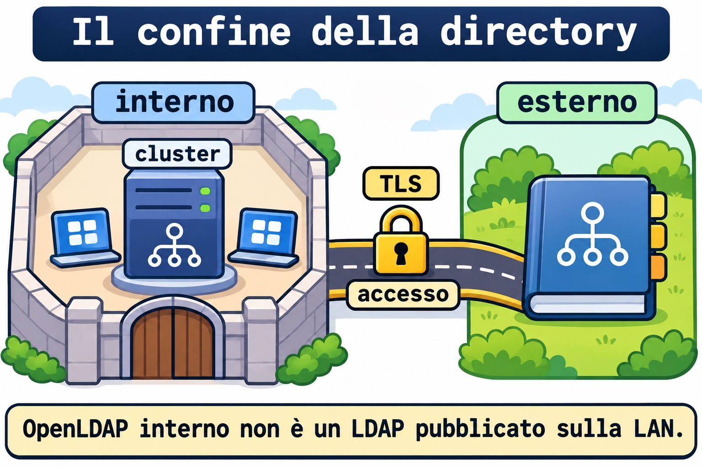

# Lezione 20.5 · Domini utente: identità con confini

> **Il cuore di questa lezione:** creare un dominio di prova e separare identità, autenticazione e permesso.

| Scheda | Piano di lavoro |
| --- | --- |
| Modulo | M20 · NethServer 8 dall’interno, lezione 5 di 7 |
| Quando | Settimana 28 |
| Alla fine | creare un dominio di prova e separare identità, autenticazione e permesso. |
| Prerequisiti | Lezioni precedenti del M20; M18 e M19 corretti; console e inventario del lab |
| Durata | 100–140 minuti, oltre a download e finestre operative |
| Snapshot | m20a5-inicio e m20a5-fim, soltanto sulle VM di questa lezione |

Il laboratorio principale è la VM `240`, hostname `ns8-1.lab.test`, Rocky Linux 9 con NS8. La VM `241`, `ns8-2.lab.test`, entra soltanto nella 20.7.

La gestione su `net0` usa un indirizzo reale riservato e accesso a Internet. La `net1` resta sul bridge isolato `vmbr17`, senza gateway; la rete di laboratorio non fornisce Internet.

Usa la [guida del laboratorio M20](../GUIA_BANCADA_M20_IT.md). Tutti i comandi NS8 indicati come root sono dentro il nodo, dopo `sudo -i`, e mai sull’host Proxmox.

Nessun laboratorio di questo materiale è stato eseguito durante la preparazione. Gli output descritti sono criteri che devi osservare e registrare, non risultati misurati.

## 1 · Riscaldamento

1. L’utente del pannello è automaticamente un utente della directory?

2. Una password accettata garantisce accesso a tutti i file?

3. Un servizio LDAP interno deve ascoltare sulla LAN?

Disegna tre caselle: identità, provider e applicazione. Collega l’applicazione al provider; non disegnare una copia della password in ogni casella.

## 2 · Perché conta

Una richiesta di assistenza sul login può nascere nella directory, nella connessione al provider o nella politica dell’applicazione. Cambiare la password prima di individuare il confine spesso nasconde la causa.

Questa lezione crea soltanto identità fittizie nel dominio di laboratorio `ldap20.test`. Nessun computer reale entra nel dominio e nessuna directory di produzione viene collegata.

### Ponte Windows

Pensa alla directory come a un registro centrale. L’ingresso dell’edificio conferma chi sei; la chiave della stanza dipende ancora dal ruolo e dalla politica di quella stanza.

L’account `admin` di Cluster Admin amministra NS8. L’account Unix `student` amministra la VM con sudo. Il nuovo utente `aluno20` appartiene alla directory: sono tre ambiti.

## 3 · Modello mentale


*Entrare nel dominio non autorizza tutte le applicazioni.*

Un dominio utente riunisce utenti, gruppi e autenticazione. Un account provider fornisce la directory; un’applicazione che la usa consulta il provider e applica le proprie regole.

Un cluster può ospitare più domini. Lo stesso nome breve può esistere in due domini diversi; registra sempre utente e dominio insieme.

La DokuWiki di questo laboratorio conserva il meccanismo di autenticazione configurato nella 20.2. Creare un dominio non modifica automaticamente il login di quell’applicazione.

## 4 · L'essenziale

| Scelta | Uso e limite |
| --- | --- |
| OpenLDAP interno | RFC2307; serve dentro il cluster |
| Samba AD interno | AD, Kerberos e DNS; requisiti propri |
| Directory esterna | Fonte di identità fuori dal cluster; accesso da tutti i nodi |
| Applicazione | Deve dichiarare e configurare il supporto al dominio scelto |

### Rocky × Debian

Il provider viene installato da NS8 nella VM Rocky. La VM Debian `202` è un client di verifica; installare pacchetti LDAP su quella VM non crea un dominio in NS8.

OpenLDAP interno non pubblica una porta LDAP per applicazioni esterne. Le query interne passano dall’infrastruttura del cluster; non aprire la porta 389 sulla LAN per imitare un LDAP generico.

Samba File Server richiede Active Directory. OpenLDAP non diventa AD perché hai creato un utente e un gruppo.

### Decidi 1 · Il login è arrivato alla directory?

Il portale accetta `aluno20`, ma un’applicazione non accetta quel nome.

A. Ricreare il provider. B. Pubblicare LDAP su Internet. C. Controllare il dominio collegato e il supporto dell’applicazione.

## 5 · Lab guidato

### Passo 1 · Controllare l’identità amministrativa

**Ipotesi:** Quale account e quale nodo possono creare il dominio?

```bash
test "$(id -u)" -eq 0 || exit 1
test "$(hostname -f)" = ns8-1.lab.test || exit 1
test -f /root/m20-lab/operador.env && test ! -L /root/m20-lab/operador.env || exit 1
test "$(stat -c '%U:%G:%a' /root/m20-lab/operador.env)" = root:root:600 || exit 1
. /root/m20-lab/operador.env
test -n "$MODULE_ID" && test -n "$MODULE_UUID" || exit 1
runagent -l
```

Nel pannello del leader apri `Domains and users`. Conferma che `ldap20.test` non esista ancora. Se esiste, fermati e individua il proprietario; non trasformare un dominio precedente in esercizio.

```bash
install -d -m 0700 /root/m20-lab/evidence-20-5
date --iso-8601=seconds > /root/m20-lab/evidence-20-5/start.txt
hostnamectl status
ip -br address
systemctl --failed --no-pager
```

**Output atteso:** Inventario coerente, pannello del leader disponibile e dominio nuovo.

**Verifica:** Crea lo snapshot iniziale in Proxmox con la procedura già studiata, dopo aver controllato VMID e nome.

### Passo 2 · Installare il provider interno

**Ipotesi:** Un nome di dominio implica un server DNS AD?


*Il provider risponde; ogni applicazione decide come usare l’identità.*

In `Domains and users` scegli `Create domain`, `Internal` e `OpenLDAP`. Installa il provider sulla VM `240`, identificata dal nodo reale nell’inventario.

Configura il dominio `ldap20.test`. Definisci l’account amministrativo della directory come `diradmin20` e una password esclusiva nel modulo; conserva la password fuori dalle evidenze e dal file dell’operatore.

Attendi il completamento dell’attività. Apri i dettagli del dominio e controlla implementazione, dominio e nodo; una notifica isolata di installazione non dimostra quel collegamento.

**Output atteso:** Un dominio RFC2307 con un provider sul nodo scelto.

**Verifica:** Il dominio è logico e interno. Non creare una zona AD e non modificare il resolver del nodo per farlo puntare al provider stesso.

### Passo 3 · Riconoscere il modulo reale

**Ipotesi:** Il primo provider avrà sempre lo stesso nome?

Nel terminale root del nodo scopri l’ID osservato; confrontalo con la scheda e l’attività di installazione. Non dedurre un suffisso dal numero della lezione.

```bash
runagent -l
read -r -p 'ID real do provider OpenLDAP desta aula: ' LDAP_ID
[[ "$LDAP_ID" =~ ^openldap[0-9]+$ ]] || exit 1
runagent -m "$LDAP_ID" podman ps
printf 'LDAP_ID=%q\n' "$LDAP_ID" > /root/m20-lab/provider.env
chmod 0600 /root/m20-lab/provider.env
runagent -m "$LDAP_ID" id
```

L’ultimo comando identifica il contesto reale; non è un invito a cambiare permessi. Registra se il modulo è rootless o rootful secondo l’ispezione e i metadati.

**Output atteso:** ID reale, contesto e container corrispondono al provider installato.

**Verifica:** Un’istanza non elencata o appartenente a un altro dominio interrompe il percorso finché non riconcili l’inventario.

### Passo 4 · Creare gruppo e utente fittizi

**Ipotesi:** Aggiungere al gruppo concede già tutti i permessi?

Nei dettagli di `ldap20.test` apri `User and groups`. Crea il gruppo `turma20`; poi crea `aluno20`, nome visualizzato `Aluno de laboratorio`, con password esclusiva e appartenenza al gruppo.

Non abilitare privilegi amministrativi per quell’utente. Non usare una password di `student`, del pannello o del backup. Non inserire dati personali negli attributi facoltativi.

Controlla l’elenco, apri i dettagli e conferma l’appartenenza al gruppo. La politica delle password del dominio fa parte dell’evidenza; non indebolirla per accettare una password dimostrativa.

**Output atteso:** Soltanto il gruppo e l’account dell’esercizio compaiono nel dominio selezionato.

**Verifica:** Controlla che l’account non abbia ottenuto il ruolo di amministratore del cluster.

### Passo 5 · Verificare l’autenticazione nel portale

**Ipotesi:** Quale test distingue una password errata da un’applicazione non collegata?

Apri una finestra privata e accedi a `https://ns8-1.lab.test/users-admin/ldap20.test/`. Il tunnel della guida deve inoltrare al nodo `240`; verifica nome e certificato della 20.4.

Entra come `aluno20` con la password corretta. Registra soltanto successo, dominio e istante. Esci, prova una password errata una volta e conferma il rifiuto; non ripetere fino a bloccare l’account.

Torna alla password corretta e conferma un nuovo accesso. Non confondere la sessione amministrativa già aperta in un’altra scheda con l’autenticazione dell’utente dell’esercizio.

**Output atteso:** Successo e rifiuto appartengono allo stesso dominio e all’account fittizio.

**Verifica:** Il portale dimostra l’autenticazione della directory; non dimostra l’autorizzazione dentro Mail, Samba o DokuWiki.

### Passo 6 · Mappare dipendenze e registrare i limiti

**Ipotesi:** Tutti i moduli usano lo stesso schema di directory?



*OpenLDAP interno non è un LDAP pubblicato sulla LAN.*

Nell’inventario separa account del pannello, account Unix del nodo, utente del dominio e utente locale dell’applicazione. Registra quali applicazioni siano realmente collegate a `ldap20.test`. Un elenco vuoto è valido in questo laboratorio.

Per un dominio esterno documenta prima della registrazione: server, base DN, bind DN, TLS, fiducia e raggiungibilità da tutti i nodi. Le credenziali si digitano nel modulo e non si copiano nei comandi.

Il ramo esterno si esegue soltanto quando esiste una directory di prova autorizzata con le sue credenziali. Senza quella risorsa registra il ramo come non eseguito; non collegare un dominio reale per comodità.

```bash
date --iso-8601=seconds
runagent -l
api-server-logs -h
```

**Output atteso:** La mappa delle identità e delle dipendenze accompagna il test positivo del portale.

**Verifica:** Non pubblicare password di bind o dump dell’ambiente dell’agente.

### Decidi 2 · Un client esterno richiede LDAP

A. Scegliere un’implementazione e un’architettura che supportino quel client. B. Disattivare il firewall del nodo. C. Aprire la porta 389 del provider interno.

## 6 · Rompi e ripara

### Guasto 1 · Dominio errato nell’indirizzo

**Sintomo:** Nella finestra privata modifica soltanto il nome del dominio nel percorso del portale in `ldap20-errado.test`.

**Indagine:** Confronta URL, dominio creato e nodo che ospita il provider.

**Causa:** Hai richiesto un dominio diverso; una password corretta non corregge il percorso.

**Riparazione:** Torna al percorso di `ldap20.test`, senza modificare la directory.

**Prevenzione:** Conserva l’indirizzo del portale nell’inventario, insieme al dominio.

**Verifica:** Lo stesso account torna ad autenticarsi nel percorso corretto.

### Guasto 2 · Account disabilitato

**Sintomo:** Nel pannello disabilita soltanto `aluno20`; esci dalla sessione privata e prova un nuovo accesso.

**Indagine:** Controlla lo stato dell’account nel dominio corretto e l’orario del nuovo tentativo.

**Causa:** Il rifiuto è una politica dell’account, non necessariamente una password errata.

**Riparazione:** Riabilita `aluno20` dallo stesso pannello e prova una nuova sessione.

**Prevenzione:** Usa la sospensione per bloccare l’accesso; non cancellare dati per simulare questo incidente.

**Verifica:** L’account abilitato si autentica; il tentativo errato continua a essere rifiutato.

### Guasto 3 · Gruppo rimosso

**Sintomo:** Rimuovi `aluno20` da `turma20`, mantenendo l’account abilitato.

**Indagine:** Controlla separatamente login nel portale e appartenenza al gruppo.

**Causa:** Autenticazione e appartenenza sono stati distinti. Il portale può continuare ad accettare la password.

**Riparazione:** Ripristina soltanto l’appartenenza rimossa e conferma l’elenco.

**Prevenzione:** Descrivi il permesso richiesto dall’applicazione prima di accusare la directory.

**Verifica:** Gruppo ripristinato e login valido risultano come due evidenze.

### Leggere gli eventi senza esporre l’ambiente

In una nuova sessione root recupera soltanto il file d’inventario locale validato. Non sostituire un ID osservato con un nome trovato in un esempio della documentazione.

```bash
test "$(id -u)" -eq 0 || exit 1
test "$(hostname -f)" = ns8-1.lab.test || exit 1
test -f /root/m20-lab/provider.env && test ! -L /root/m20-lab/provider.env || exit 1
test "$(stat -c '%U:%G:%a' /root/m20-lab/provider.env)" = root:root:600 || exit 1
. /root/m20-lab/provider.env
[[ "$LDAP_ID" =~ ^openldap[0-9]+$ ]] || exit 1
runagent -m "$LDAP_ID" podman ps
api-server-logs -h
if timeout 10 api-server-logs logs -e module -n "$LDAP_ID"; then
  :
else
  M20_LOG_RC=$?
  test "$M20_LOG_RC" -eq 124 || exit 1
fi
```

Il limite di dieci secondi termina un flusso continuo: il codice 124 di timeout è previsto in questo caso. Un altro errore non viene convertito in successo. Confronta l’ora dell’evento con il tentativo di autenticazione.

Non usare un dump di `env` per preparare un rapporto: il contesto dell’agente può contenere credenziali. Anche un log di autenticazione deve essere rivisto prima della condivisione.

### Ramo pianificato: Active Directory

Questo ramo non si esegue su OpenLDAP appena creato. Richiede una decisione architetturale e risorse separate, registrate prima dell’installazione.

Prima di scegliere Samba riserva dominio AD, nome del controller, nome NetBIOS e connettività richiesta dai client. I parametri strutturali non devono essere improvvisati dopo la creazione del dominio.

Nel pannello il percorso è la creazione di un dominio interno con Samba. L’opzione per offrire cartelle e autenticazione Windows modifica l’esposizione alla LAN e richiede i requisiti specifici del File Server.

Senza indirizzamento, DNS e client di prova pronti registra soltanto l’analisi del ramo. Non abilitare il servizio LAN per completare visivamente un passaggio.

Se esegui il ramo in un laboratorio autorizzato, verifica dal client risoluzione AD, autenticazione e permesso separatamente. Il nodo NS8 conserva il resolver previsto dalla guida.

### Ramo pianificato: dominio esterno

L’host esterno deve essere raggiungibile da ogni nodo che usa l’identità, non soltanto dalla postazione dell’operatore. Registra la prova per nodo prima del collegamento.

TLS attivo e certificato verificato sono decisioni distinte del modulo. Nome del server, CA fidata e porta devono corrispondere al servizio autorizzato.

Un errore di fiducia non si corregge pubblicando la password di bind o disattivando permanentemente la verifica. Risolvi nome, catena o connettività all’origine.

| Evidenza | Cosa distingue |
| --- | --- |
| Account nel portale | Directory e autenticazione |
| Gruppo nell’elenco | Appartenenza dell’identità |
| Collegamento dell’applicazione | Dominio realmente interrogato |
| Log con orario | Ordine degli eventi osservati |

Il rapporto finale deve dire quali rami siano stati eseguiti e quali siano rimasti condizionali. Una procedura documentata non è un test concluso.

## 7 · Trappole

1. Disabilitare un utente non equivale a cancellarne casella, cartella o dati applicativi.

2. Una replica deve trovarsi su un altro nodo per ridurre la perdita del nodo; due copie sullo stesso nodo condividono il guasto.

3. La replica AD non replica automaticamente il SysVol delle GPO.

4. Il DNS del nodo non deve essere sostituito dal DNS del Samba AD interno.

5. Collegare un dominio esterno non rende il suo elenco modificabile da NS8.

6. Una password valida può fallire perché l’applicazione ha scelto un altro dominio.

## 8 · Quiz

1. Quale oggetto conserva utenti e gruppi?

2. Quale prova della lezione verifica la password senza dipendere da un’altra applicazione?

3. Perché OpenLDAP interno non serve un client LDAP sulla LAN?

4. Un’applicazione Samba File Server accetta lo stesso requisito di OpenLDAP?

5. Rimuovere un account cancella i suoi dati in tutte le applicazioni?

## 9 · Promemoria

```bash
hostname -f
runagent -l
runagent -m "$LDAP_ID" podman ps
date --iso-8601=seconds
```

**Flashcard:** Dominio → identità; provider → servizio della directory.

**Flashcard:** Password accettata → autenticazione; accesso consentito → autorizzazione.

**Flashcard:** Utente del pannello, Unix e directory → ambiti diversi.

## 10 · Checklist e chiusura

- [ ] Dominio e provider osservati, senza suffisso ID indovinato.

- [ ] Account e gruppo fittizi, senza privilegi amministrativi.

- [ ] Portale positivo, password errata rifiutata e account riabilitato.

- [ ] Collegamenti applicativi separati dalla prova di autenticazione.

- [ ] Nessuna porta LDAP interna pubblicata sulla LAN.

- [ ] Password fuori dai file di evidenza.

**Reboot di verifica:** concorda la finestra della VM `240`, mantieni la console e riavvia dal guest. Poi ricarica l’inventario protetto e ripeti il portale in una finestra privata.

```bash
systemctl reboot
```

Dopo il ritorno il provider deve comparire sul nodo corretto. Non concludere da un pannello aperto in cache; esegui una nuova autenticazione.

**Ultimo esercizio:** spiega l’incidente del gruppo rimosso senza dire che la password si è rotta. Conserva provider e account fittizi per la revisione; non cancellare il dominio come pulizia.

## 11 · Nella vita reale

In una richiesta autorizzata registra utente completo, dominio, applicazione, istante e punto del rifiuto. Chiedi il risultato del test, mai la password della persona.

Mappa soltanto in lettura applicazioni e provider. Modifiche alla politica delle password o alla replica richiedono di valutare tutti i client, non soltanto l’applicazione del ticket.

## 12 · Approfondire quando vuoi

- [Domini, provider e portale](https://docs.nethserver.org/docs/administrator-manual/installation/user_domains)

- [Architettura del dominio per i moduli](https://nethserver.github.io/ns8-core/core/user_domains/)

- [Agenti e limiti di autorizzazione](https://nethserver.github.io/ns8-core/core/agents/)

!explica Por que senha aceita e permissão no serviço são provas diferentes?

!feynman Explique domínio, provider e aplicação com uma biblioteca.

!quiz Crie um caso em que o portal funciona, mas a aplicação usa outro domínio.

## Soluzioni commentate

Decidi 1: C. Il test positivo del portale localizza l’indagine nel collegamento o nella politica dell’applicazione; non giustifica ricreare il provider.

Decidi 2: A. L’esigenza del client deve guidare l’implementazione supportata, senza aprire porte assenti dal modello interno.

Quiz 1: Il dominio contiene il registro; il provider lo fornisce alle query.

Quiz 2: Il portale del dominio con l’account fittizio in una nuova sessione.

Quiz 3: Il provider interno è progettato per la rete del cluster e non espone LDAP esterno.

Quiz 4: No. Samba File Server dipende da AD; lo schema RFC2307 non offre lo stesso servizio.

Quiz 5: No. La rimozione dell’identità non cancella automaticamente i dati applicativi.

[← Lezione 20.4 · Proxy e certificati](20.4-proxy-e-certificados.md) · [Indice delle lezioni](../01-aulas.md) · [Lezione 20.6 · Backup e ripristino →](20.6-backup-e-restauracao.md)
