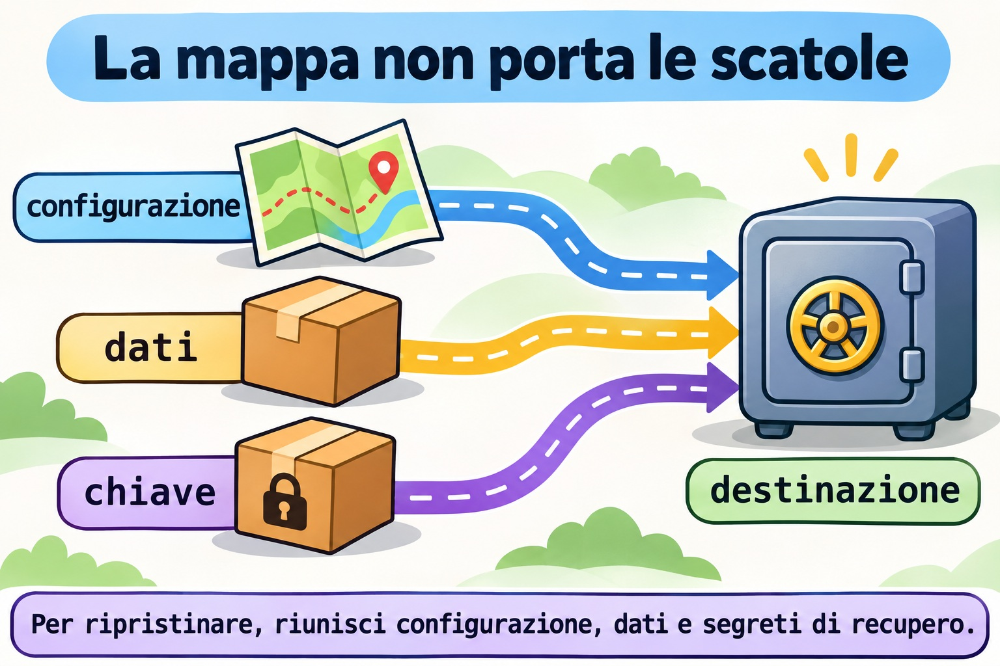
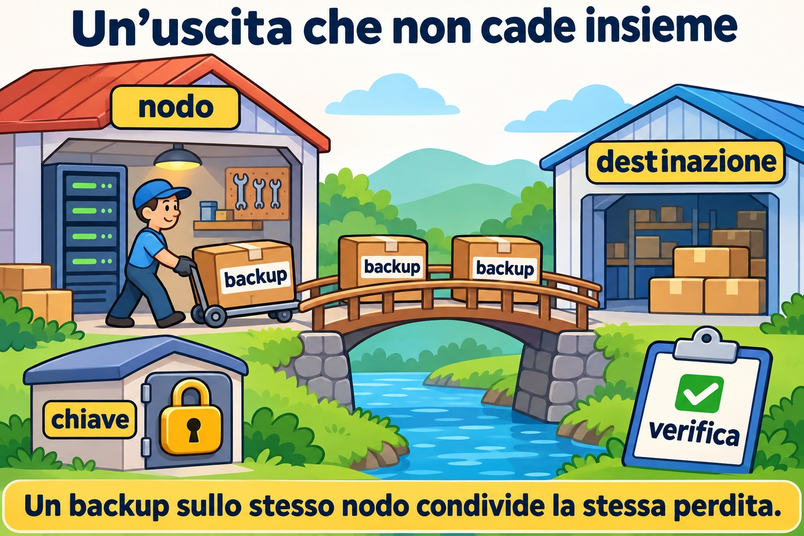

# Lezione 20.6 · Backup e ripristino: verificare il ritorno

> **Il cuore di questa lezione:** ripristinare la Wiki di prova con contenuto, identità e destinazione verificati.

| Scheda | Piano di lavoro |
| --- | --- |
| Modulo | M20 · NethServer 8 dall’interno, lezione 6 di 7 |
| Quando | Settimana 28 |
| Alla fine | ripristinare la Wiki di prova con contenuto, identità e destinazione verificati. |
| Prerequisiti | Lezioni precedenti del M20; M18 e M19 corretti; console e inventario del lab |
| Durata | 100–140 minuti, oltre a download e finestre operative |
| Snapshot | m20a6-inicio e m20a6-fim, soltanto sulle VM di questa lezione |

Il laboratorio principale è la VM `240`, hostname `ns8-1.lab.test`, Rocky Linux 9 con NS8. La VM `241`, `ns8-2.lab.test`, entra soltanto nella 20.7.

La gestione su `net0` usa un indirizzo reale riservato e accesso a Internet. La `net1` resta sul bridge isolato `vmbr17`, senza gateway; la rete di laboratorio non fornisce Internet.

Usa la [guida del laboratorio M20](../GUIA_BANCADA_M20_IT.md). Tutti i comandi NS8 indicati come root sono dentro il nodo, dopo `sudo -i`, e mai sull’host Proxmox.

Nessun laboratorio di questo materiale è stato eseguito durante la preparazione. Gli output descritti sono criteri che devi osservare e registrare, non risultati misurati.

## 1 · Riscaldamento

1. Un backup del cluster contiene tutti i file delle applicazioni?

2. Conoscere l’indirizzo del repository basta senza la chiave dei dati?

3. Uno stato verde dimostra che il testo corretto è tornato?

Elenca ciò che dovrebbe sopravvivere alla perdita della VM: dati, configurazione, segreti di recupero e un luogo dove leggere di nuovo tutto.

## 2 · Perché conta

La prova del backup non è la creazione di un file. È la capacità di ricostruire il servizio e riconoscere il contenuto corretto nell’istante scelto.

L’esercizio usa soltanto la DokuWiki fittizia della 20.2. Sostituire un’istanza può rimuoverne i dati attuali; non includere un’applicazione reale nella prova.

### Ponte Windows

Un elenco di stampanti non contiene i documenti stampati. Allo stesso modo la mappa del cluster non sostituisce i repository dei contenuti di ogni istanza.

## 3 · Modello mentale



*Per ripristinare, riunisci configurazione, dati e segreti di recupero.*

Il backup del cluster conserva le configurazioni di recupero, comprese destinazioni e chiavi dei dati. I dati delle applicazioni stanno in repository separati per tipo e UUID.

Un’attività collega destinazione, pianificazione e istanze. L’UUID identifica l’istanza; non scegliere una cartella soltanto perché il suo nome assomiglia all’ID breve del pannello.

La password che cifra il file del cluster e la chiave che apre i dati della destinazione hanno ruoli diversi. Il recupero richiede la custodia di entrambi fuori dal nodo perduto.

## 4 · L'essenziale

| Oggetto | Prova necessaria |
| --- | --- |
| Backup del cluster | File cifrato conservato fuori dal nodo e password custodita |
| Dati della Wiki | Snapshot dell’istanza e UUID identificati |
| Destinazione SMB | Scrittura validata, spazio e ACL coerenti |
| Ripristino | Contenuto corretto, nome, certificato e nodo verificati |

### Rocky × Debian

La VM NS8 è Rocky; la VM Debian `204` offre la destinazione SMB indipendente dal nodo. La VM Debian `202` verifica la risposta HTTPS come client.

Le tre VM possono usare lo stesso storage Ceph. La destinazione fuori dal nodo protegge questa prova dalla perdita dell’istanza o della VM, ma non dimostra il recupero dalla perdita di Ceph.

Per quel secondo rischio serve prima una copia completa cifrata del repository, del file del cluster e dei segreti su storage esterno a Ceph. Senza questa copia registra il limite.

### Decidi 1 · Lo stato è verde

A. Cancellare subito l’istanza. B. Copiare soltanto il file del cluster. C. Identificare snapshot, UUID e prova del contenuto prima di sostituire.

## 5 · Lab guidato

### Passo 1 · Creare un marcatore recuperabile

**Ipotesi:** Quale contenuto distinguerà il backup da una pagina appena creata?

```bash
test "$(id -u)" -eq 0 || exit 1
test "$(hostname -f)" = ns8-1.lab.test || exit 1
test -f /root/m20-lab/operador.env && test ! -L /root/m20-lab/operador.env || exit 1
test "$(stat -c '%U:%G:%a' /root/m20-lab/operador.env)" = root:root:600 || exit 1
. /root/m20-lab/operador.env
test -n "$MODULE_ID" && test -n "$MODULE_UUID" || exit 1
runagent -l
```

```bash
install -d -m 0700 /root/m20-lab/evidence-20-6
date --iso-8601=seconds > /root/m20-lab/evidence-20-6/start.txt
runagent -m "$MODULE_ID" podman ps
printf 'M20_BACKUP_%s\n' "$(cat /proc/sys/kernel/random/uuid)"
```

Copia il marcatore generato nel diario esterno. Nella Wiki, come amministratore dell’applicazione, crea soltanto la pagina `m20_restore` e inserisci quella sola riga.

Nella ACL della Wiki consenti la lettura anonima soltanto di quella pagina fittizia per il test HTTP. Non aprire il resto della Wiki. Controlla la pagina in una finestra privata.

Sulla VM `202`, come `student`, conserva il marcatore e la prima risposta. La CA pubblica è già stata verificata nella 20.4.

```bash
test "$(hostname -s)" = debian-lab || exit 1
install -d -m 0700 "$HOME/m20-lab"
read -r -p 'Marcador exato gerado no no: ' M20_MARKER
[[ "$M20_MARKER" =~ ^M20_BACKUP_[0-9a-f-]+$ ]] || exit 1
printf '%s\n' "$M20_MARKER" > "$HOME/m20-lab/wiki-marker.txt"
curl --retry 10 --retry-delay 1 --retry-all-errors --max-time 10 --fail --silent --show-error --cacert /etc/ssl/m19/ca.crt 'https://wiki.lab.test/doku.php?id=m20_restore' --output "$HOME/m20-lab/wiki-before.html" || exit 1
grep -F -- "$M20_MARKER" "$HOME/m20-lab/wiki-before.html" || exit 1
```

**Output atteso:** La pagina fittizia contiene il marcatore osservato e risponde con TLS valido.

**Verifica:** Il diario esterno identifica marcatore, orario, ID, UUID e nodo. Non usare soltanto un’immagine della pagina.

### Passo 2 · Controllare la destinazione fuori dal nodo

**Ipotesi:** La destinazione sopravvivrà alla rimozione di questa applicazione?



*Un backup sullo stesso nodo condivide la stessa perdita.*

Completa la sezione di backup SMB della guida del laboratorio. Prepara sulla VM `204` lo share `m20backup`, la directory `/srv/samba/m20-backup` e l’account esclusivo `backup20`.

Nel pannello NS8 apri `Backup and restore`, definisci la password di cifratura del backup del cluster e custodiscila fuori dalle VM. Aggiungi una destinazione di tipo condivisione Windows, tramite SMB.

Indica il server `192.0.2.204`, lo share `m20backup` e l’account `backup20`; digita la password nel modulo. Usa un percorso dedicato al cluster quando il modulo offre quel campo.

Per una nuova destinazione lascia generare la chiave dei dati. Custodisci la chiave di recupero tramite il meccanismo del pannello; non inserirla nel diario pubblico. Riutilizzare una destinazione esistente richiede la sua chiave originale.

**Output atteso:** Validazione della destinazione accettata e credenziali di recupero custodite.

**Verifica:** Non riutilizzare lo share `curso` del M19 o la password di un altro servizio. Il limite Ceph rimane esplicito.

### Passo 3 · Eseguire un backup identificato

**Ipotesi:** La pianificazione ha selezionato esattamente l’istanza fittizia?

Crea una pianificazione chiamata `m20-wiki-test`, includendo soltanto la DokuWiki di prova. Seleziona la destinazione preparata e una conservazione sufficiente a mantenere lo snapshot usato nella prova.

Usa `Run backup now`. Attendi la fine e apri i dettagli per applicazione: annota orario, risultato, istanza e destinazione. Un’attività di un altro modulo non conclude questa prova.

```bash
test "$(hostname -f)" = ns8-1.lab.test || exit 1
test "$(id -u)" -eq 0 || exit 1
runagent -m "$MODULE_ID" restic-wrapper --show
runagent restic-wrapper --help
date --iso-8601=seconds
```

Il comando d’inventario non sostituisce lo stato dell’attività. Usa ID e snapshot realmente mostrati dal pannello; non copiare UUID da esempi.

**Output atteso:** Lo snapshot della Wiki è identificabile nella destinazione e nella scheda di ripristino.

**Verifica:** Se il pannello non offre quello snapshot, non procedere con alcuna sostituzione.

### Passo 4 · Conservare la mappa del recupero

**Ipotesi:** I segreti sarebbero ancora disponibili senza accesso al nodo?

Scarica dal pannello il backup cifrato del cluster sul computer dell’operatore. Conserva la password separatamente. Il file non deve dipendere dalla home della VM `240`.

Controlla dimensione e hash del file sul computer che lo ha ricevuto. Questo verifica il trasferimento, non la completezza dei dati delle applicazioni.

Nel registro di recupero separa password del file del cluster, credenziale SMB e chiave dei dati. Il registro pubblico indica il luogo di custodia senza rivelare i valori.

Per dimostrare il recupero fuori da Ceph sospendi le pianificazioni e attendi la fine di tutte le attività prima della copia esterna completa del repository. Non copiare un insieme in modifica dichiarandolo coerente.

**Output atteso:** Mappa cifrata fuori dal nodo e segreti recuperabili tramite un canale separato.

**Verifica:** Se non esiste una copia dei dati fuori da Ceph, dichiara soltanto la portata del test di ripristino dell’istanza.

### Passo 5 · Ripristinare uno stato riconoscibile

**Ipotesi:** Il contenuto tornerà all’istante scelto?

Dopo il backup confermato modifica soltanto la pagina fittizia nel testo `M20_DEPOIS_DO_BACKUP`. Controlla che quel testo compaia e che il marcatore precedente non compaia più.

Apri `Restore`, scegli l’applicazione tramite tipo e UUID registrati e lo snapshot precedente alla modifica. Seleziona il nodo `240` e abilita `Replace existing app` soltanto dopo aver confrontato l’istanza esistente.

La sostituzione rimuove l’istanza precedente alla fine della procedura. Attendi l’intera attività; non installare manualmente una seconda Wiki per aggirare un errore di ripristino.

Controlla nome e certificato della rotta dopo l’operazione. I certificati pubblici ACME non fanno parte del backup dell’applicazione; in questo laboratorio il certificato personalizzato del nodo è già installato.

**Output atteso:** Una sola Wiki operativa torna allo stato dello snapshot scelto.

**Verifica:** Non accettare due copie indipendenti della stessa identità in cluster diversi.

### Passo 6 · Verificare contenuto, identità e nodo

**Ipotesi:** Quale evidenza concluderà il ripristino?


*Un’attività conclusa non sostituisce contenuto recuperato e identità verificata.*

Sul nodo `240` riscopri l’ID installato e controlla l’UUID. L’ID breve può essere diverso; il valore osservato deve corrispondere all’identità ripristinata.

```bash
runagent -l
read -r -p 'ID real da Wiki restaurada: ' NEW_MODULE
[[ "$NEW_MODULE" =~ ^dokuwiki[0-9]+$ ]] || exit 1
OBS_UUID=$(redis-cli --raw HGET cluster/module_uuid "$NEW_MODULE") || exit 1
test -n "$OBS_UUID" && test "$OBS_UUID" = "$MODULE_UUID" || exit 1
runagent -m "$NEW_MODULE" podman ps
runagent -m "$NEW_MODULE" podman volume ls
MODULE_ID=$NEW_MODULE
M20_NEXT=$(mktemp /root/m20-lab/operador.env.XXXXXX) || exit 1
sed "s/^MODULE_ID=.*/MODULE_ID=$NEW_MODULE/" /root/m20-lab/operador.env > "$M20_NEXT" || exit 1
test "$(grep -c '^MODULE_ID=' "$M20_NEXT")" -eq 1 || exit 1
grep -qx "MODULE_ID=$NEW_MODULE" "$M20_NEXT" || exit 1
chmod 0600 "$M20_NEXT"
mv -f "$M20_NEXT" /root/m20-lab/operador.env
```

Il candidato cambia soltanto l’ID breve, preservando tutti gli altri campi, compreso `VPN_CIDR`. L’UUID è già stato confrontato e il nodo di questo ripristino resta sulla 240.

Sulla VM `202` esegui una nuova richiesta senza riutilizzare l’HTML precedente.

```bash
M20_MARKER=$(cat "$HOME/m20-lab/wiki-marker.txt") || exit 1
curl --retry 10 --retry-delay 1 --retry-all-errors --max-time 10 --fail --silent --show-error --cacert /etc/ssl/m19/ca.crt 'https://wiki.lab.test/doku.php?id=m20_restore' --output "$HOME/m20-lab/wiki-restored.html" || exit 1
grep -F -- "$M20_MARKER" "$HOME/m20-lab/wiki-restored.html" || exit 1
if grep -F 'M20_DEPOIS_DO_BACKUP' "$HOME/m20-lab/wiki-restored.html"; then exit 1; fi
```

**Output atteso:** Marcatore originale presente, modifica successiva assente, UUID e nodo registrati.

**Verifica:** Copia le evidenze prive di segreti nel diario esterno e conserva lo snapshot del backup identificato per la 20.7.

### Decidi 2 · Ceph è diventato indisponibile

A. Esigere dati e mappa recuperabili fuori da quello storage. B. Usare soltanto lo snapshot della VM. C. Dichiarare indipendente lo share della VM 204.

## 6 · Rompi e ripara

### Guasto 1 · Destinazione non scrivibile

**Sintomo:** Nel modulo di una destinazione non ancora salvata inserisci una password SMB errata una volta.

**Indagine:** Controlla server, share, account e risultato della validazione senza mostrare la password.

**Causa:** La credenziale della destinazione ha fallito; non dimostra corruzione di Restic.

**Riparazione:** Correggi nel modulo la credenziale dell’account esclusivo. Non ricreare la destinazione con una nuova chiave sopra dati esistenti.

**Prevenzione:** Separa credenziale di trasporto e chiave di cifratura nell’inventario.

**Verifica:** Validazione accettata e nuovo backup concluso appartengono alla stessa destinazione.

### Guasto 2 · Snapshot errato

**Sintomo:** Nella selezione del ripristino scegli provvisoriamente uno snapshot precedente alla creazione del marcatore, senza confermare.

**Indagine:** Confronta orario del contenuto, orario del backup e UUID dell’applicazione.

**Causa:** Hai selezionato un altro istante; il sistema può ripristinarlo correttamente e può comunque mancare il testo atteso.

**Riparazione:** Seleziona lo snapshot verificato e soltanto allora procedi nella prova.

**Prevenzione:** Registra l’istante del marcatore insieme allo snapshot usato.

**Verifica:** La selezione finale corrisponde alla prova del contenuto annotata prima della modifica.

### Guasto 3 · Il nome punta altrove

**Sintomo:** Sulla VM 202 esegui una richiesta con nome di prova errato, mantenendo intatti server e dati.

**Indagine:** Confronta risoluzione, rotta HTTP e certificato prima di accusare il ripristino.

**Causa:** Il client non ha raggiunto l’identità ripristinata tramite il nome previsto.

**Riparazione:** Torna al nome `wiki.lab.test`; correggi soltanto la mappatura del laboratorio se diverge.

**Prevenzione:** Usa nome, TLS e marcatore insieme come criterio di conclusione.

**Verifica:** La richiesta corretta presenta certificato valido e il vecchio marcatore.

### Cosa non copiare dall’esempio

Non installare un Restic separato nel sistema per imitare il motore NS8. Il wrapper prepara contesto, credenziali e volumi per l’infrastruttura esistente.

Evita di elencare la configurazione completa di Rclone: può contenere credenziali anche quando volevi soltanto controllare una destinazione. Usa inventario e pannello senza esportare campi privati.

Le cartelle cifrate non devono essere riorganizzate manualmente. Tipo e UUID fanno parte del modo in cui il sistema trova il backup dell’istanza.

Una pianificazione sovrapposta a un’altra può ritardare il lavoro. Controlla le attività in corso prima di una copia esterna o della manutenzione della destinazione.

Il recupero di Traefik ha un ambito proprio: rotte personalizzate e certificati caricati sono diversi dai certificati ACME emessi dall’autorità pubblica.

Loki ripristinato può servire soltanto a cercare log precedenti, senza sostituire l’istanza attiva. Non applicare il comportamento osservato nella Wiki a tutti i componenti.

In Samba lo stato del dominio AD esistente partecipa alla decisione del ripristino. Leggi la nota specifica prima di ripristinare insieme identità e file.

Il diario di recupero deve contenere ora d’inizio, ora della prima risposta corretta e prove ancora mancanti. Non inventare una durata basandoti su esempi.

## 7 · Trappole

1. Non eseguire mai prune o forget nel repository per risolvere un elenco che non hai ancora compreso.

2. Cambiare la chiave di una destinazione esistente può rendere inaccessibili i backup precedenti.

3. Il file cifrato del cluster include segreti e richiede custodia riservata.

4. Una destinazione accettata da un nodo non dimostra accesso diretto da tutti gli altri.

5. Il backup dell’app non ripristina automaticamente un certificato ACME.

6. Uno snapshot della VM sullo stesso storage non sostituisce il piano esterno allo storage.

## 8 · Quiz

1. Il file del cluster sostituisce i dati della Wiki?

2. Perché il marcatore deve esistere prima del backup?

3. Quale identificatore distingue le istanze dello stesso tipo nella destinazione?

4. Cosa manca quando lo share è fuori dalla VM ma dentro lo stesso Ceph?

5. Quale prova conclude il test dopo uno stato di successo?

## 9 · Promemoria

```bash
runagent -l
runagent -m "$MODULE_ID" restic-wrapper --show
runagent restic-wrapper --help
runagent -m "$MODULE_ID" podman volume ls
date --iso-8601=seconds
```

**Flashcard:** Mappa del cluster → configurazione e accesso al recupero.

**Flashcard:** Repository per UUID → dati dell’istanza.

**Flashcard:** Ripristino concluso → contenuto, identità e posizione verificati.

## 10 · Checklist e chiusura

- [ ] Marcatore precedente e modifica successiva distinguibili.

- [ ] Destinazione SMB esclusiva con chiave custodita.

- [ ] Backup del cluster scaricato fuori dal nodo.

- [ ] Snapshot, UUID e destinazione annotati.

- [ ] Una sola istanza ripristinata, senza copia indipendente duplicata.

- [ ] Limite della perdita di Ceph descritto nel rapporto.

**Reboot di verifica:** nella finestra della VM 240 riavvia dal guest; poi controlla ID aggiornato, Wiki e lo stesso marcatore dalla VM 202.

```bash
systemctl reboot
```

Non ripristinare il vecchio snapshot della VM come pulizia: potresti annullare altri servizi o l’identità appena verificata.

**Ultimo esercizio:** descrivi cosa faresti perdendo la VM e, separatamente, perdendo Ceph. La seconda risposta deve citare una copia realmente esterna.

### Recupero del cluster: ramo condizionale

Il disastro di un cluster singolo richiede un NS8 nuovo, spazio libero sufficiente, file cifrato del cluster e relativi segreti. Non cancellare la VM 240 per simulare questo ramo durante il modulo.

Nella nuova installazione cambia la password iniziale, scegli `Restore cluster`, carica il file del backup e inserisci la password nel modulo. Seleziona le applicazioni e verifica dati e rotte dopo il completamento.

Questo ramo può essere segnato come eseguito soltanto in un laboratorio di recupero autorizzato con risorse proprie. Leggi la documentazione della versione e delle applicazioni prima di un disastro reale.

## 11 · Nella vita reale

Pianifica perdita massima dei dati e tempo di ritorno con il responsabile del servizio. Una politica di conservazione senza test di recupero non dice quanto tempo servirà al servizio per tornare.

In una revisione autorizzata inventaria in lettura destinazioni, pianificazioni, ultimo risultato e custodia. Non rivelare chiavi preparando il rapporto.

## 12 · Approfondire quando vuoi

- [Destinazioni e ripristino nel pannello](https://docs.nethserver.org/docs/administrator-manual/configuration/backup)

- [Architettura del backup e restic-wrapper](https://nethserver.github.io/ns8-core/core/backup_restore/)

- [Contratto di backup dei moduli](https://nethserver.github.io/ns8-core/modules/backup_restore/)

!explica Por que mapa, dados e segredos têm papéis diferentes numa restauração?

!feynman Explique o limite de um backup fora da VM, mas dentro do mesmo storage.

!quiz Crie um restore com status verde e conteúdo do snapshot errado.

## Soluzioni commentate

Decidi 1: C. Lo stato deve essere collegato all’istanza e all’istante prima di sostituire i dati attuali.

Decidi 2: A. La perdita dello storage richiede dati recuperabili fuori da esso; spostare il backup su un’altra VM dello stesso Ceph non basta.

Quiz 1: No. Fornisce la configurazione di recupero; i repository conservano i dati.

Quiz 2: Per collegare il contenuto allo snapshot scelto e distinguere una ricostruzione vuota.

Quiz 3: L’UUID dell’istanza, raggruppato sotto il tipo dell’applicazione.

Quiz 4: Una copia coerente e recuperabile fuori da Ceph, con mappa e segreti.

Quiz 5: Una nuova richiesta con TLS valido mostra il marcatore dello snapshot; ID/UUID e nodo corrispondono all’inventario.

[← Lezione 20.5 · Domini utente](20.5-dominios-de-usuario.md) · [Indice delle lezioni](../01-aulas.md) · [Lezione 20.7 · Aggiornare, spostare e guastare →](20.7-atualizar-mover-e-falhar.md)
