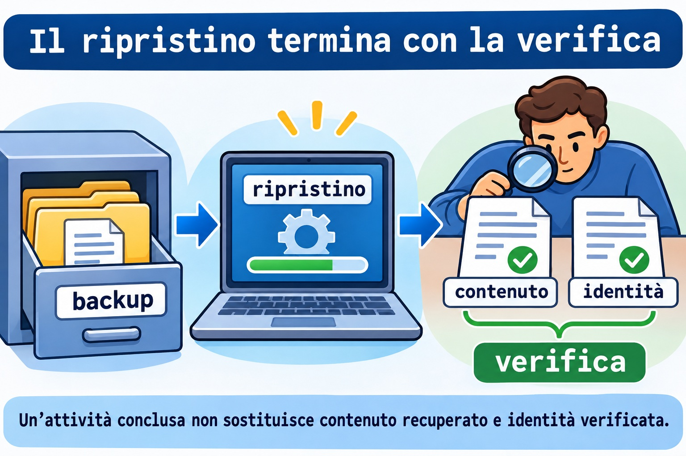

# Lezione 20.6 · Backup e ripristino: verificare il contenuto

> **Il cuore di questa lezione:** recuperare una pagina nota e verificare identità e posizione.

| Scheda | Piano di lavoro |
| --- | --- |
| Modulo | M20 · NethServer 8 dall’interno, lezione 6 di 7 |
| Quando | Settimana 28 |
| Alla fine | preparare una destinazione SMB e verificare un ripristino |
| Prerequisiti | Wiki e TLS della 20.4; student con sudo sulla 202 |
| Durata | 90–120 minuti |
| Snapshot | base m20a4-tls/m20a4-cliente202; uscita m20a6-backup su entrambe le VM |

## Prima di iniziare

La 240 richiede cluster, Wiki di prova e certificato della 20.4. Sulla 202 browser e CA sono disponibili nell’account student. Le basi sono `m20a4-tls` sulla 240 e `m20a4-cliente202` sulla 202, se sono state salvate. Altrimenti prepara 20.1, 20.2 e 20.4; la 20.5 non è necessaria.

Usa la [guida M20](../GUIA_BANCADA_M20_IT.md) per gli IP reali di gestione. La destinazione verrà creata ora sulla 202, senza un server precedente. Se esiste Samba personalizzato in questa VM, fermati e riconcilia il laboratorio; questo esercizio non sostituisce un’altra configurazione.

Soltanto la Wiki fittizia partecipa al ripristino. I comandi amministrativi NS8 si eseguono nella 240 come root; gli altri sulla 202 come student. Nessun laboratorio è stato eseguito durante questa revisione.

## 1 · Riscaldamento

1. Il file del cluster contiene tutte le pagine?
2. Una password SMB apre anche il contenuto cifrato del backup?
3. Lo stato di successo identifica il testo recuperato?

## 2 · Perché conta

Il backup termina quando riesci a recuperare il contenuto giusto. L’esercizio scrive un marcatore, esegue il backup, cambia la pagina e recupera lo stato precedente.

### Ponte Windows

La mappa indica dove sono le scatole e come aprirle; non ne contiene il contenuto. Il backup cifrato del cluster e i dati delle applicazioni hanno ruoli distinti.

## 3 · Modello mentale


*Per ripristinare, riunisci configurazione, dati e segreti di recupero.*

Una pianificazione collega destinazione, conservazione e istanze. Nella destinazione i dati sono raggruppati per tipo e UUID. L’ID breve del pannello può cambiare durante un ripristino; l’UUID identifica l’insieme recuperato.

## 4 · L'essenziale

| Parte | Che cosa conservare |
| --- | --- |
| File del cluster | copia cifrata e password in custodie separate |
| Repository | dati per istanza e chiave di cifratura originale |
| Trasporto SMB | server, share e credenziale propri |
| Prova | marcatore, snapshot, UUID e nodo |

### Rocky × Debian

La 240 esegue il backup; la 202 conserva la destinazione SMB fuori da quel nodo. Se entrambe usano Ceph, questa destinazione non protegge dalla perdita di Ceph.

### Decidi 1 · Lo stato è verde

A. Eliminare subito l’istanza. B. Copiare soltanto il file del cluster. C. Identificare snapshot, UUID e prova del contenuto prima di sostituire.

## 5 · Lab guidato

### Passo 1 · Creare una prova recuperabile

**Ipotesi:** Quale testo distingue il backup da una Wiki vuota?

Sulla 240, dopo sudo -i, leggi l’inventario creato nella 20.2. Verifica ID, UUID e nodo tramite i valori reali, senza copiare nomi di esempio.

```bash
m20_ver_wiki() {
  [ "$(hostname -s)" = ns8-1 ] && [ "$(id -u)" -eq 0 ] || return 1
  . /root/m20-lab/operador.env || return 1
  [ -n "$MODULE_ID" ] && [ -n "$MODULE_UUID" ] || return 1
  runagent -l
  redis-cli --raw HGET cluster/module_uuid "$MODULE_ID"
  runagent -m "$MODULE_ID" podman ps
}
m20_ver_wiki
```

Sulla 202, come student, genera il marcatore una volta. Se il file esiste già, conservalo per continuare lo stesso test.

```bash
m20_marcador() {
  [ "$(hostname -s)" = debian-lab ] && [ "$(id -un)" = student ] || return 1
  install -d -m 0700 "$HOME/m20-lab" || return 1
  if [ ! -e "$HOME/m20-lab/wiki-marker.txt" ]; then
    printf 'M20_BACKUP_%s\n' "$(cat /proc/sys/kernel/random/uuid)" > "$HOME/m20-lab/wiki-marker.txt" || return 1
  fi
  cat "$HOME/m20-lab/wiki-marker.txt"
}
m20_marcador
```

Nel browser della 202 accedi come student locale della Wiki. Crea la pagina `m20_restore` con il marcatore mostrato. Nell’ACL concedi lettura anonima soltanto a questa pagina fittizia; mantieni privato il resto. Verifica il marcatore in una finestra privata.

**Output atteso:** Pagina e diario identificano lo stesso marcatore, UUID e nodo.

**Verifica:** L’esistenza della pagina deve precedere il backup scelto.

### Passo 2 · Preparare Samba sulla 202

**Ipotesi:** La destinazione ha una configurazione precedente da preservare?


*Un backup sullo stesso nodo condivide la stessa perdita.*

Compila `CLIENT_IP` con l’IP reale della 202 e `NS8_IP` con quello della 240. Esegui sulla 202 come student. Il blocco accetta soltanto l’assenza di configurazione Samba o il file predefinito intatto del pacchetto; servizio attivo o configurazione modificata fanno fermare prima di qualsiasi sostituzione.

```bash
CLIENT_IP=""
NS8_IP=""
m20_preparar_smb() {
  [ "$(hostname -s)" = debian-lab ] && [ "$(id -un)" = student ] || return 1
  [ -n "$CLIENT_IP" ] && [ -n "$NS8_IP" ] && [ "$CLIENT_IP" != "$NS8_IP" ] || return 1
  ip -o -4 addr show | awk '{split($4,a,"/"); print a[1]}' | grep -Fx "$CLIENT_IP" || return 1
  if systemctl is-active --quiet smbd; then
    printf '%s\n' 'Samba è già attivo; controlla la configurazione esistente.'
    return 1
  fi
  if [ -e /etc/samba/smb.conf ]; then
    sudo cmp -s /etc/samba/smb.conf /usr/share/samba/smb.conf || { printf '%s\n' 'Configurazione Samba personalizzata; fermati e riconcilia il lab.'; return 1; }
  fi
  [ ! -e "$HOME/m20-samba" ] && [ ! -e "$HOME/m20-backup" ] || return 1
  sudo systemctl mask smbd.service nmbd.service || return 1
  sudo apt install -y samba smbclient || return 1
  umask 077
  install -d -m 0700 "$HOME/m20-samba" "$HOME/m20-backup" || return 1
  sudo cp -a /etc/samba/smb.conf "$HOME/m20-samba/smb.conf.original" || return 1
  cat > "$HOME/m20-samba/smb.conf.candidate" <<EOF
[global]
  workgroup = WORKGROUP
  server role = standalone server
  security = user
  map to guest = Never
  interfaces = lo $CLIENT_IP
  bind interfaces only = yes
  hosts allow = 127.0.0.1 $NS8_IP
  hosts deny = ALL
  disable netbios = yes
  smb ports = 445
  server min protocol = SMB2_02
[m20backup]
  path = /home/student/m20-backup
  valid users = student
  read only = no
  browseable = no
  guest ok = no
  create mask = 0600
  directory mask = 0700
EOF
  testparm -s "$HOME/m20-samba/smb.conf.candidate" || return 1
  sudo install -o root -g root -m 0644 "$HOME/m20-samba/smb.conf.candidate" /etc/samba/smb.conf || return 1
}
m20_preparar_smb
```

La maschera di un servizio non ancora installato può generare un avviso di unit assente; controlla la maschera prima di continuare. Il confronto verifica soltanto il modello di configurazione fornito dal pacchetto, non l’integrità del backup.

Soltanto dopo che il blocco termina senza errori, imposta una password SMB esclusiva per student nella richiesta del comando. L’account Unix esiste già; non cambiare la password di accesso.

```bash
sudo smbpasswd -a student
```

Dopo la conferma della password avvia il servizio e verifica scrittura, lettura e rimozione di un file fittizio. Anche smbclient chiede la password senza registrarla nella cronologia.

```bash
sudo systemctl unmask smbd.service
sudo systemctl enable --now smbd.service
printf 'M20_SMB\n' > "$HOME/m20-samba/prova.txt"
smbclient //127.0.0.1/m20backup -U student -c "put $HOME/m20-samba/prova.txt prova.txt; get prova.txt $HOME/m20-samba/retorno.txt; del prova.txt"
cmp "$HOME/m20-samba/prova.txt" "$HOME/m20-samba/retorno.txt"
sudo ss -ltnp '( sport = :445 )'
```

**Output atteso:** Share privato scrivibile da student, ascolto soltanto sugli indirizzi configurati.

**Verifica:** La 240 deve raggiungere TCP 445 della 202. Se una politica esistente blocca, autorizza soltanto questa origine nel laboratorio; non cancellare il firewall.

### Passo 3 · Registrare la destinazione ed eseguire il backup

**Ipotesi:** Lo snapshot appartiene alla Wiki che verrà sostituita?

Nel pannello NS8 apri `Backup and restore`. Imposta la password del file cifrato del cluster e custodiscila fuori dalle VM. In `Add destination` scegli `Windows file share`: server = IP reale della 202, share = `m20backup`, utente = `student`. Digita la password SMB soltanto nel modulo.

Per una destinazione vuota lascia generare la chiave di cifratura dei dati. Registra la sua custodia tramite il meccanismo del pannello; per riutilizzare una destinazione è obbligatoria la chiave originale.

Crea la pianificazione `m20-wiki-test` includendo soltanto la DokuWiki fittizia. Esegui `Run backup now`, attendi la fine dell’attività e annota destinazione, ora, UUID e snapshot disponibile nella scheda Restore.

**Output atteso:** Lo snapshot dell’istanza giusta compare per il ripristino.

**Verifica:** Convalida della destinazione e completamento del backup sono due prove. Senza uno snapshot identificabile non sostituire l’applicazione.

### Passo 4 · Conservare la mappa e cambiare la pagina

**Ipotesi:** Il backup del cluster sostituisce i dati dell’applicazione?

Scarica il backup cifrato del cluster tramite il browser della 202 e mantieni una copia fuori dalla 240. Conserva password del file, password SMB e chiave dei dati in custodie separate. Non includere questi valori nel diario delle evidenze.

Dopo il backup confermato sostituisci soltanto il contenuto di `m20_restore` con `M20_DEPOIS_DO_BACKUP`. Verifica con una nuova richiesta che il nuovo testo compaia e il vecchio marcatore sia scomparso.

**Output atteso:** Distingui i due stati prima di ripristinare.

**Verifica:** Annota l’ora del cambiamento per non scegliere per errore uno snapshot successivo.

### Passo 5 · Ripristinare la Wiki di prova

**Ipotesi:** La sostituzione rimuove dati attuali?

Nella scheda `Restore` seleziona tipo e UUID registrati e lo snapshot precedente al cambiamento. Scegli il nodo 240. Attiva `Replace existing app` soltanto dopo aver confermato che l’istanza esistente è la Wiki fittizia di questo esercizio.

Attendi l’attività completa. Il test sostituisce dati attuali con uno stato precedente; non installare manualmente un’altra Wiki per nascondere un guasto. Controlla rotta e certificato del nodo dopo l’operazione.

**Output atteso:** Una sola istanza torna allo snapshot scelto.

**Verifica:** TLS appartiene al proxy del nodo. Ripristinare la Wiki non distribuisce certificati a un altro nodo né sostituisce la CA della 202.

### Passo 6 · Verificare contenuto e identità

**Ipotesi:** Quale evidenza conclude il ripristino?



*Un’attività conclusa non sostituisce contenuto recuperato e identità verificata.*

Sulla 240 elenca nuovamente gli agenti. Compila `NEW_MODULE` con l’ID reale della Wiki ripristinata. La funzione confronta l’UUID e cambia soltanto l’ID breve nell’inventario, preservando gli altri campi.

```bash
runagent -l
NEW_MODULE=""
m20_registrar_restore() {
  [ "$(hostname -s)" = ns8-1 ] && [ "$(id -u)" -eq 0 ] || return 1
  [[ "$NEW_MODULE" =~ ^dokuwiki[0-9]+$ ]] || return 1
  . /root/m20-lab/operador.env || return 1
  OBS_UUID=$(redis-cli --raw HGET cluster/module_uuid "$NEW_MODULE") || return 1
  [ -n "$MODULE_UUID" ] && [ "$OBS_UUID" = "$MODULE_UUID" ] || return 1
  runagent -m "$NEW_MODULE" podman ps || return 1
  M20_NEXT=$(mktemp /root/m20-lab/operador.env.XXXXXX) || return 1
  sed "s/^MODULE_ID=.*/MODULE_ID=$NEW_MODULE/" /root/m20-lab/operador.env > "$M20_NEXT" || return 1
  [ "$(grep -c '^MODULE_ID=' "$M20_NEXT")" -eq 1 ] || return 1
  chmod 0600 "$M20_NEXT" || return 1
  mv -f "$M20_NEXT" /root/m20-lab/operador.env
}
m20_registrar_restore
```

Sulla 202 compila `NS8_IP` se hai aperto un altro terminale. Esegui la nuova richiesta tramite nome, con TLS valido; il file viene analizzato soltanto se curl termina con successo.

```bash
m20_provar_restore() {
  [ -n "$NS8_IP" ] || return 1
  M20_MARKER=$(cat "$HOME/m20-lab/wiki-marker.txt") || return 1
  [ -n "$M20_MARKER" ] || return 1
  curl --retry 10 --retry-delay 1 --retry-all-errors --max-time 10 --fail --silent --show-error --cacert "$HOME/m20-pki/ca.crt" --resolve "wiki.lab.test:443:$NS8_IP" 'https://wiki.lab.test/doku.php?id=m20_restore' --output "$HOME/m20-lab/wiki-restored.html" || return 1
  grep -F -- "$M20_MARKER" "$HOME/m20-lab/wiki-restored.html" || return 1
  if grep -F 'M20_DEPOIS_DO_BACKUP' "$HOME/m20-lab/wiki-restored.html"; then
    printf '%s\n' 'È ancora lo stato successivo al backup.'
    return 1
  fi
  printf '%s\n' 'Marcatore ripristinato; verifica UUID e nodo nel diario.'
}
m20_provar_restore
```

**Output atteso:** Vecchio marcatore presente, cambiamento successivo assente, UUID e nodo verificati.

**Verifica:** Registra soltanto risultati realmente osservati; lo stato dell’attività non sostituisce il contenuto.

### Decidi 2 · Ceph è diventato indisponibile

A. Richiedere dati e mappa recuperabili fuori da quello storage. B. Usare soltanto lo snapshot della VM. C. Dichiarare indipendente lo share della VM 202.

## 6 · Rompi e ripara

### Guasto 1 · Credenziale della destinazione errata

**Sintomo:** In un modulo non ancora salvato digita una password SMB errata una volta.

**Indagine:** Controlla IP, share, account e risultato della convalida.

**Causa:** L’autenticazione del trasporto è fallita.

**Riparazione:** Correggi la password nel modulo; mantieni la chiave dei dati esistente.

**Prevenzione:** Separa credenziale SMB e chiave di cifratura.

**Verifica:** La convalida corretta permette un nuovo backup identificabile.

### Guasto 2 · Punto nel tempo errato

**Sintomo:** Seleziona un altro snapshot nella schermata, senza confermare il ripristino.

**Indagine:** Confronta l’ora con la creazione del marcatore e il cambiamento successivo.

**Causa:** La selezione non corrisponde al contenuto atteso.

**Riparazione:** Torna allo snapshot verificato prima di confermare.

**Prevenzione:** Annota insieme marcatore e snapshot.

**Verifica:** La selezione finale rappresenta lo stato precedente al cambiamento.

### Guasto 3 · Richiesta alla destinazione errata

**Sintomo:** In una copia del test della 202 usa 127.0.0.1 in --resolve.

**Indagine:** Controlla destinazione forzata, nome e certificato.

**Causa:** La richiesta non è arrivata alla Wiki ripristinata.

**Riparazione:** Ripristina soltanto l’IP reale della 240 nel test.

**Prevenzione:** Associa il risultato al punto di osservazione.

**Verifica:** Nome, TLS e marcatore passano nella stessa richiesta.

## 7 · Trappole

1. Non usare prune/forget per correggere un elenco non compreso.
2. Non generare un’altra chiave su una destinazione che contiene dati.
3. Non copiare password nel diario.
4. Non eseguire due copie indipendenti dello stesso UUID in cluster diversi.
5. Non ripristinare vecchi snapshot della VM come pulizia dell’applicazione.

## 8 · Quiz

1. Il file del cluster sostituisce le pagine della Wiki?
2. Perché il marcatore precede il backup?
3. Quale identificatore distingue istanze dello stesso tipo?
4. Che cosa manca se entrambe le VM usano lo stesso storage?
5. Quale prova conclude il ripristino?

## 9 · Promemoria

```bash
runagent -l
runagent -m "$MODULE_ID" restic-wrapper --show
date --iso-8601=seconds
```

Il wrapper si consulta sul nodo, con l’ID attuale dell’istanza. Non installare un altro Restic per riprodurre il motore di NS8.

**Flashcard:** mappa, dati e segreti hanno funzioni distinte.

## 10 · Checklist e chiusura

- [ ] SMB preparato e candidato convalidato.
- [ ] Backup e snapshot identificati.
- [ ] Mappa del cluster fuori dalla 240.
- [ ] Vecchio marcatore recuperato; cambiamento successivo assente.
- [ ] UUID e nodo corrispondono al test.

**Reboot di verifica:** in una finestra della 240 riavvia dal pannello o dalla console. Poi ripeti la verifica dalla 202. Controlla anche che lo share resti disponibile dopo il riavvio della 202.

Salva `m20a6-backup` sulle VM 240 e 202 tramite la guida, dopo aver fermato le attività e verificato lo stato. È la base facoltativa della 20.7. Gli snapshot non sostituiscono il backup applicativo.

**Ultimo esercizio:** descrivi come recuperare soltanto la Wiki e come affronteresti la perdita dell’intera VM. Per un nuovo NS8, il ramo Restore cluster richiede file cifrato, password, chiave dei dati e destinazione raggiungibile; non eliminare la 240 per simulare quel ramo.

## 11 · Nella vita reale

Concorda conservazione e tempo di ritorno con il responsabile del servizio. Conserva una copia coerente dei dati e della mappa fuori dallo storage condiviso, con segreti recuperabili tramite un canale separato.

## 12 · Approfondire quando vuoi

[Backup e ripristino NS8](https://docs.nethserver.org/docs/administrator-manual/configuration/backup) · [Samba smb.conf](https://www.samba.org/samba/docs/current/man-html/smb.conf.5.html)

!explica Perché mappa e dati non sono lo stesso backup?
!feynman Spiega il ripristino come riconoscere una scatola dal contenuto.
!quiz Crea uno stato verde con lo snapshot sbagliato.

## Soluzioni commentate

Decidi 1: C. Identifica ciò che verrà recuperato prima di sostituire.
Decidi 2: A. Dati e mappa devono sopravvivere allo storage perduto.
Quiz 1: No; i dati si trovano nei repository.
Quiz 2: Per collegare il testo allo snapshot scelto.
Quiz 3: L’UUID.
Quiz 4: Una copia recuperabile fuori dallo storage condiviso.
Quiz 5: Nuova richiesta con TLS valido, marcatore recuperato e UUID/nodo corretti.

[← Lezione 20.5](20.5-dominios-de-usuario.md) · [Indice](../01-aulas.md) · [Lezione 20.7 →](20.7-atualizar-mover-e-falhar.md)
