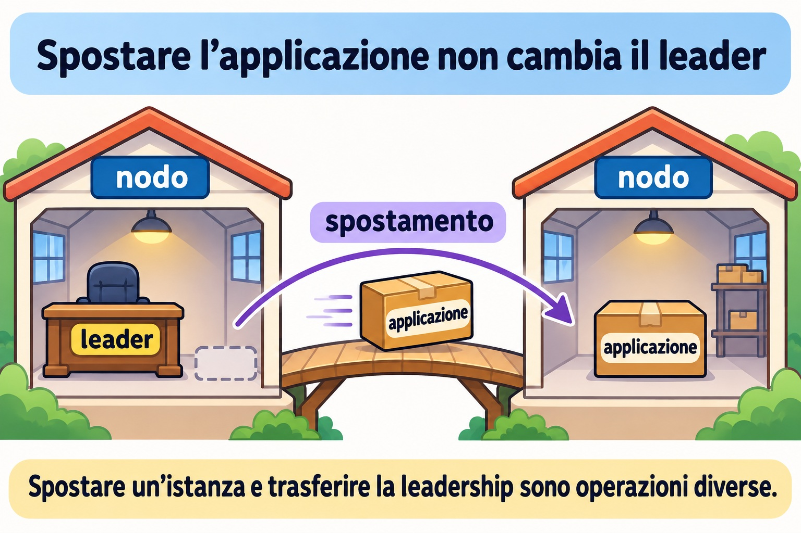

# Lezione 20.7 · Aggiornare, spostare e verificare un guasto

## Prima di iniziare

Ti occorre lo stato finale della 20.6: cluster con un nodo sulla `240`, Wiki con TLS di M20, CA sulla `202`, backup completato e pagina `m20_restore` con marcatore verificato. Prepara una volta gli snapshot `m20a6-backup` sulla 240 e sulla 202; se esistono già, verifica data e inventario prima del ripristino. Nessun servizio di M19 è necessario.

La `241` non deve ancora esistere come nodo NS8. Sarà una nuova installazione in questa lezione. Dopo il Join, non eseguire un rollback unilaterale di un nodo; lo snapshot iniziale è una base precedente all’espansione del cluster.

> **Il cuore di questa lezione:** spostare la Wiki tra nodi e recuperare un guasto controllato senza promettere HA automatica.

| Scheda | Piano di lavoro |
| --- | --- |
| Modulo | M20 · NethServer 8 dall’interno, lezione 7 di 7 |
| Quando | Settimana 29 |
| Alla fine | Spostare l’istanza e verificarne il ritorno dopo un guasto del worker |
| Prerequisiti | Stato della 20.6, console e inventario di gestione |
| Durata | 90–120 minuti, oltre ai download |
| Snapshot | `m20a6-backup`, prima del secondo nodo |

Usa la [guida del laboratorio](../GUIA_BANCADA_M20_IT.md): 201/202 esistenti, 240 NS8 e, soltanto ora, 241. I due nodi usano solo la rete di gestione, con IP reali riservati. Nessun comando di questa lezione è stato eseguito nelle VM durante la preparazione.

## 1 · Riscaldamento

1. Spostare un’applicazione promuove un altro leader?

2. Due nodi sullo stesso host fisico dimostrano tolleranza alla perdita di quell’host?

3. Spegnere un worker obbliga la Wiki a ricomparire sul leader?

## 2 · Perché conta

La manutenzione richiede backup, finestra, percorso di ritorno e una verifica del contenuto. Un’attività completata nel pannello non sostituisce la risposta dell’applicazione. Il guasto di questa lezione interessa soltanto la VM che esegue la Wiki, conservando il leader e la destinazione di backup sulla 202.

### Ponte Windows

Spostare una cartella su un’altra scrivania non cambia chi dirige. Due scrivanie nello stesso edificio non proteggono neppure dalla perdita dell’edificio.

## 3 · Modello mentale



*Spostare un’istanza e trasferire la leadership sono operazioni diverse.*

Il leader coordina il cluster. Il nodo esegue l’istanza e il suo proxy locale. Move trasferisce dati e posizione; la promozione del leader è un’altra operazione. Un guasto del worker non significa migrazione automatica dell’applicazione.

## 4 · L’essenziale

| Operazione | Evidenza necessaria |
| --- | --- |
| Aggiornare | Versione core compatibile e verifica funzionale dopo l’azione |
| Unire | Installazione pulita, nome risolto, TLS affidabile e VPN raggiungibile |
| Spostare | Destinazione, ID, UUID osservato, contenuto, nome e certificato |
| Recuperare | Lo stesso servizio torna a rispondere con il marcatore atteso |

### Rocky × Debian

I nodi NS8 usano Rocky Linux 9. La 202 Debian resta client, emittente della CA del lab e destinazione SMB. Non entra nel cluster.

### Decidi 1 · È disponibile un aggiornamento

A. Aggiornare i moduli core separatamente per tentativi. B. Installare una versione di test per facilitare. C. Leggere la modifica, verificare il backup e usare l’azione di aggiornamento core.

## 5 · Lab guidato

### Passo 1 · Registrare la verifica prima della modifica

**Ipotesi:** Quale dato distinguerà la pagina corretta da una pagina vuota?

Sulla 202, come `student`, ripeti le variabili reali della guida; verifica il marcatore salvato e la risposta attuale. Nessuna password compare nel comando: soltanto `m20_restore` ha lettura anonima di prova.

```bash
cat "$HOME/m20-lab/wiki-marker.txt"
curl --retry 10 --retry-delay 1 --retry-all-errors --max-time 10 --fail --cacert "$HOME/m20-pki/ca.crt" --resolve "wiki.lab.test:443:$NS8_IP" 'https://wiki.lab.test/doku.php?id=m20_restore' --output "$HOME/m20-lab/wiki-before-move.html" &&
grep -F -f "$HOME/m20-lab/wiki-marker.txt" "$HOME/m20-lab/wiki-before-move.html"
```

Sul leader 240, come root, carica il registro privato della 20.6 e annota l’identità precedente. Non copiare l’intero ambiente né il join code nelle evidenze.

```bash
. /root/m20-lab/operador.env
OLD_MODULE_ID=$MODULE_ID
OLD_MODULE_UUID=$MODULE_UUID
redis-cli --raw HGET cluster/module_node "$MODULE_ID"
redis-cli --raw HGET cluster/module_uuid "$MODULE_ID"
```

**Output atteso:** Pagina nota, marcatore presente e identità precedente registrata.

**Verifica:** Backup completato nella 20.6 e marcatore leggibile prima di ogni aggiornamento.

### Passo 2 · Aggiornare con ambito noto

**Ipotesi:** Core e applicazione sono lo stesso aggiornamento?

Nel pannello, leggi le note della versione ed esegui l’aggiornamento core supportato, se disponibile. Attendi il completamento e ripeti la verifica del Passo 1. Registra la versione core reale del leader; installa la 241 nella stessa versione. Se non ci sono aggiornamenti, registra la verifica senza inventare una modifica. Non usare versioni di test per forzare l’esercizio.

**Output atteso:** Controllo e applicazione funzionanti nella versione registrata.

**Verifica:** La risposta continua a contenere lo stesso marcatore; un’icona verde da sola non basta.

### Passo 3 · Installare la 241 da zero

**Ipotesi:** Perché un clone della 240 non è una scorciatoia sicura?

In Proxmox, verifica che il VMID `241` sia libero nel cluster. Crea una nuova VM `ns8-2`: 2 CPU, 4 GiB RAM, disco da 40 GiB su `vm-hdd`, q35, OVMF, CPU `x86-64-v2-AES`, SCSI VirtIO e soltanto `net0` su `vmbr0`. Usa la ISO Rocky 9 già verificata nella 20.1. Installa il sistema minimo, utente `student`, sudo, nome breve `ns8-2` e IP statico reale riservato in `NS8_2_IP`, con gateway e DNS esterni del lab.

Compila il secondo IP e ripeti il blocco dei nomi della guida su entrambi i nodi e sulla 202. Verifica `getent ahostsv4` per entrambi i FQDN. Installa NS8 come nella 20.1; il blocco seguente scarica un file da esaminare, senza eseguire direttamente una risposta remota.

```bash
m20_preparar_instalador() {
  if [ "$(id -u)" -ne 0 ] || [ "$(hostname -s)" != ns8-2 ]; then printf '%s\n' 'Fermati: usa root sulla 241.'; return 1; fi
  if [ -e /root/m20-install-241.sh ]; then printf '%s\n' 'Fermati: verifica il programma di installazione esistente prima di ripetere.'; return 1; fi
  dnf install -y curl less openssl || return 1
  curl --proto '=https' --tlsv1.2 --fail --location --output /root/m20-install-241.sh https://raw.githubusercontent.com/NethServer/ns8-core/ns8-stable/core/install.sh || return 1
  bash -n /root/m20-install-241.sh && sha256sum /root/m20-install-241.sh
}
m20_preparar_instalador &&
less /root/m20-install-241.sh
```

Verifica origine, contenuto e versione prima di eseguire `bash /root/m20-install-241.sh` e riavviare la 241. Lo SHA calcolato è un registro locale, non un’autenticazione indipendente. Fermati alla schermata iniziale del pannello: non creare un altro cluster.

**Output atteso:** NS8 nuovo sulla 241, raggiungibile tramite gestione, ancora fuori dal cluster.

**Verifica:** Stessa distribuzione e versione core del leader, orologio corretto e nomi locali coerenti.

### Passo 4 · Impostare la fiducia, unirsi e preparare il certificato

**Ipotesi:** Fidarsi del leader e presentare il certificato della Wiki sono la stessa azione?

Prima del Join, copia soltanto la CA pubblica dalla 202 alla 241 tramite SSH autenticato, dopo aver verificato la chiave SSH della destinazione nella console. La chiave privata della CA non lascia mai la 202. Sulla 202, come `student`:

```bash
scp "$HOME/m20-pki/ca.crt" "student@$NS8_2_IP:~/m20-ca.crt"
openssl x509 -in "$HOME/m20-pki/ca.crt" -noout -fingerprint -sha256
```

Sulla 241, come root, leggi prima l’impronta della copia ricevuta:

```bash
openssl x509 -in /home/student/m20-ca.crt -noout -fingerprint -sha256
```

Confrontala con l’impronta ottenuta sulla 202 tramite un canale indipendente. Se differisce, fermati. Soltanto dopo aver verificato l’uguaglianza, esegui il blocco seguente: installa l’ancora una sola volta e verifica il certificato del leader tramite nome prima del Join.

```bash
m20_confiar_ca() {
  if [ "$(id -u)" -ne 0 ] || [ "$(hostname -s)" != ns8-2 ]; then printf '%s\n' 'Fermati: usa root sulla 241.'; return 1; fi
  install -d -m 0700 /root/m20-lab
  install -m 0644 /home/student/m20-ca.crt /root/m20-lab/ca.crt
  install -m 0644 /root/m20-lab/ca.crt /etc/pki/ca-trust/source/anchors/m20-lab-ca.crt
  update-ca-trust
}
m20_confiar_ca
curl --fail --head https://ns8-1.lab.test/cluster-admin/
```

Sul leader, in Nodes, genera il join code. Nel pannello iniziale della 241, scegli Join cluster, verifica `ns8-2.lab.test` e incolla il codice nel modulo. Mantieni abilitata la convalida TLS. Non salvare il codice nell’inventario e non modificare il CIDR VPN del cluster. HTTPS 443 e VPN UDP 55820 devono essere raggiungibili tra i nodi.

Dopo il Join, emetti sulla 202 una nuova chiave e un nuovo certificato per la 241, con la procedura della 20.4: file `node241.key` e `node241.crt`, SAN `ns8-2.lab.test` e `wiki.lab.test`. Caricali sul nodo 241, dal browser della 202, insieme alla CA pubblica. Non ripetere l’installazione dell’ancora sulla 241. Verifica l’impronta del certificato presentato e la convalida tramite nome prima di Move.

Per emettere senza dipendere da un altro terminale, usa questo blocco sulla 202, come `student`, prima del caricamento descritto sopra:

```bash
m20_emitir_241() {
  if [ "$(hostname -s)" != debian-lab ] || [ "$(id -un)" != student ]; then printf '%s\n' 'Fermati: usa student sulla 202.'; return 1; fi
  if [ -e "$HOME/m20-pki/node241.key" ] || [ -e "$HOME/m20-pki/node241.crt" ]; then printf '%s\n' 'Fermati: verifica l’identità esistente della 241.'; return 1; fi
  umask 077
  openssl req -new -newkey rsa:3072 -nodes -keyout "$HOME/m20-pki/node241.key" -out "$HOME/m20-pki/node241.csr" -subj /CN=ns8-2.lab.test || return 1
  printf 'basicConstraints=critical,CA:FALSE\nkeyUsage=critical,digitalSignature,keyEncipherment\nextendedKeyUsage=serverAuth\nsubjectAltName=DNS:ns8-2.lab.test,DNS:wiki.lab.test\n' > "$HOME/m20-pki/node241.ext"
  openssl x509 -req -in "$HOME/m20-pki/node241.csr" -CA "$HOME/m20-pki/ca.crt" -CAkey "$HOME/m20-pki/ca.key" -CAcreateserial -days 90 -sha256 -extfile "$HOME/m20-pki/node241.ext" -out "$HOME/m20-pki/node241.crt" || return 1
  openssl verify -CAfile "$HOME/m20-pki/ca.crt" -verify_hostname ns8-2.lab.test "$HOME/m20-pki/node241.crt"
}
m20_emitir_241
```

Dopo il caricamento, la verifica si esegue sulla 202, come `student`:

```bash
curl --fail --head --cacert "$HOME/m20-pki/ca.crt" --resolve "ns8-2.lab.test:443:$NS8_2_IP" https://ns8-2.lab.test/cluster-admin/
```

**Output atteso:** Un leader esistente e un nuovo worker, con identità proprie e TLS verificato.

**Verifica:** Registra l’ID NS8 reale della 241 nel pannello; non è il VMID.

### Passo 5 · Spostare e verificare entrambi i lati

**Ipotesi:** Una risposta TLS valida garantisce che il contenuto sia arrivato?


*Conferma dove gira e cosa risponde dopo la modifica.*

Prima, permetti alla 241 di raggiungere la destinazione SMB. Sulla202, prepara un candidato dalla configurazione creata nella 20.6. Nel candidato, aggiungi soltanto l’IP reale della 241 all’unica riga globale `hosts allow`, che autorizza già la 240. Conserva la restrizione delle interfacce, la condivisione `m20backup`, il percorso e l’utente. Controlla il diff prima di installare.

```bash
cp -n /etc/samba/smb.conf "$HOME/m20-lab/smb-before-241.conf"
cp -n "$HOME/m20-lab/smb-before-241.conf" "$HOME/m20-lab/smb-241.conf"
chmod 0600 "$HOME/m20-lab/smb-before-241.conf" "$HOME/m20-lab/smb-241.conf"
```

Modifica il candidato nel tuo editor. Dopo aver verificato l’unica modifica di autorizzazione, applicalo come `student` sulla 202:

```bash
m20_aplicar_smb() {
  if [ "$(hostname -s)" != debian-lab ] || [ -z "$NS8_2_IP" ]; then printf '%s\n' 'Fermati: usa la 202 e compila l’IP della 241.'; return 1; fi
  cmp /etc/samba/smb.conf "$HOME/m20-lab/smb-before-241.conf" || return 1
  awk -v extra="$NS8_2_IP" 'BEGIN {global=1} /^[[:space:]]*\[/ {global=($0 ~ /^[[:space:]]*\[global\][[:space:]]*$/)} global && /^[[:space:]]*hosts allow[[:space:]]*=/ {print $0 " " extra; n++; next} {print} END {if(n!=1) exit 1}' "$HOME/m20-lab/smb-before-241.conf" > "$HOME/m20-lab/smb-241-expected.conf" || return 1
  cmp "$HOME/m20-lab/smb-241.conf" "$HOME/m20-lab/smb-241-expected.conf" || return 1
  sudo testparm -s "$HOME/m20-lab/smb-241.conf" || return 1
  sudo cp -an /etc/samba/smb.conf /etc/samba/smb.conf.before-m20-241
  sudo install -m 0644 -o root -g root "$HOME/m20-lab/smb-241.conf" /etc/samba/smb.conf || return 1
  sudo systemctl reload smbd.service
}
diff -u /etc/samba/smb.conf "$HOME/m20-lab/smb-241.conf"
m20_aplicar_smb
```

La sintassi valida non dimostra che sia cambiato soltanto l’IP: leggi il diff e non chiamare la funzione se ci sono altre modifiche. Nel pannello, verifica l’accesso del nodo 241 alla destinazione di backup esistente, senza creare un secondo account né esporre la porta SMB a Internet.

Nel menu dell’istanza corretta, scegli Move verso il nodo 241, verifica la capacità e segui l’attività. Attendi il completamento; non eseguire una copia parallela della stessa Wiki. Sulla241, come root, scopri l’ID attuale con `runagent -l` e verifica nel pannello ID/nodo di destinazione. Sul leader, compila l’ID scoperto, senza presumere che sia uguale a quello precedente:

```bash
NEW_MODULE_ID=''
redis-cli --raw HGET cluster/module_node "$NEW_MODULE_ID"
redis-cli --raw HGET cluster/module_uuid "$NEW_MODULE_ID"
```

Confronta UUID e contenuto con il registro precedente. Se l’UUID differisce, registra l’accaduto e interrompi la conclusione per indagare: non considerare la differenza una perdita accettabile d’identità. Un’etichetta uguale nel pannello non risolve questa divergenza.

Sulla202 e su entrambi i nodi, compila `WIKI_IP` con l’IP reale della 241 e ripeti soltanto il blocco dei nomi della guida. Mantieni `ns8-1.lab.test` sull’IP della 240 e `ns8-2.lab.test` sull’IP della 241. Chiudi la vecchia connessione del browser prima di verificare nuovamente tramite nome.

```bash
WIKI_IP=$NS8_2_IP
getent ahostsv4 wiki.lab.test
curl --retry 10 --retry-delay 1 --retry-all-errors --max-time 10 --fail --cacert "$HOME/m20-pki/ca.crt" --resolve "wiki.lab.test:443:$NS8_2_IP" 'https://wiki.lab.test/doku.php?id=m20_restore' --output "$HOME/m20-lab/wiki-after-move.html" &&
grep -F -f "$HOME/m20-lab/wiki-marker.txt" "$HOME/m20-lab/wiki-after-move.html"
curl --fail --cacert "$HOME/m20-pki/ca.crt" 'https://wiki.lab.test/doku.php?id=m20_restore' --output "$HOME/m20-lab/wiki-by-name.html" &&
grep -F -f "$HOME/m20-lab/wiki-marker.txt" "$HOME/m20-lab/wiki-by-name.html"
```

Il primo curl isola la destinazione conservando nome e TLS; il secondo verifica anche la risoluzione locale. Sulla240, aggiorna il registro privato con gli ID osservati, conservando il `NODE_ID` del leader e il `VPN_CIDR`:

```bash
m20_registrar_move() {
  if [ "$(id -u)" -ne 0 ] || [ "$(hostname -s)" != ns8-1 ] || [ -z "$NEW_MODULE_ID" ] || [ -z "$NS8_2_IP" ]; then printf '%s\n' 'Fermati: verifica il leader e l’ID scoperto.'; return 1; fi
  local uuid node
  uuid=$(redis-cli --raw HGET cluster/module_uuid "$NEW_MODULE_ID")
  node=$(redis-cli --raw HGET cluster/module_node "$NEW_MODULE_ID")
  if [ -z "$uuid" ] || [ -z "$node" ] || [ "$uuid" != "$OLD_MODULE_UUID" ]; then printf '%s\n' 'Fermati: identità diversa; indaga prima di registrare.'; return 1; fi
  cp -an /root/m20-lab/operador.env /root/m20-lab/operador.before-move.env
  umask 077
  printf 'MODULE_ID=%q\nMODULE_UUID=%q\nMODULE_NODE_ID=%q\nWIKI_IP=%q\nNS8_2_IP=%q\n' "$NEW_MODULE_ID" "$uuid" "$node" "$NS8_2_IP" "$NS8_2_IP" >> /root/m20-lab/operador.env
}
m20_registrar_move
```

**Output atteso:** Wiki sulla 241, certificato corretto e stesso marcatore, con identità riconciliata.

**Verifica:** Origine rimossa da Move, destinazione attiva e backup accessibile dal nuovo nodo.

### Passo 6 · Interrompere e recuperare il worker

**Ipotesi:** L’applicazione dovrebbe ricomparire da sola sul leader?


*Pianifica il recupero; non supporre una migrazione automatica dopo il guasto.*

In Proxmox, verifica la VM241 ed esegui un arresto normale con il pulsante Shutdown. È una prova di indisponibilità, non di corruzione da interruzione elettrica. Sulla202, annota l’orario e fai un tentativo con timeout breve:

```bash
date --iso-8601=seconds
curl --max-time 5 --fail --cacert "$HOME/m20-pki/ca.crt" --resolve "wiki.lab.test:443:$NS8_2_IP" 'https://wiki.lab.test/doku.php?id=m20_restore'
```

Registra il guasto osservato; verifica nel pannello della 240 che il leader sia ancora disponibile. Riaccendi soltanto la 241 tramite Proxmox. Attendi i suoi servizi e ripeti entrambe le verifiche del Passo5, con e senza `--resolve`, controllando il marcatore.

**Output atteso:** Indisponibilità mentre il worker è spento e ritorno funzionale dopo la riaccensione.

**Verifica:** Nodo, identità, certificato e contenuto corrispondono allo stato successivo a Move; non ripristinare lo snapshot di un nodo isolatamente.

### Decidi 2 · Anche il leader è fuori servizio

A. Applicare la procedura documentata di recupero del leader, verificando backup e ambito. B. Presumere che Move abbia promosso la 241. C. Ripristinare soltanto la 240 allo snapshot precedente al Join.

## 6 · Rompi e ripara

### Guasto 1 · Destinazione senza capacità

**Sintomo:** Il pannello rifiuta la preparazione di Move.

**Indagine:** Leggi spazio e requisiti osservati, senza cancellare dati per farli entrare.

**Causa:** La capacità della destinazione non soddisfa l’istanza.

**Riparazione:** Annulla lo spostamento e pianifica la capacità prima di riprovare.

**Prevenzione:** Verifica disco, memoria e backup prima della finestra.

**Verifica:** L’origine resta funzionante e nessuna copia parziale è stata pubblicata.

### Guasto 2 · Vecchio nome locale

**Sintomo:** La verifica con destinazione forzata riesce, ma quella tramite nome fallisce.

**Indagine:** Confronta getent sul client con l’IP reale della 241.

**Causa:** Il blocco M20 di hosts punta ancora la Wiki alla 240.

**Riparazione:** Aggiorna soltanto l’alias wiki nel blocco della guida e chiudi le vecchie connessioni.

**Prevenzione:** Includi client ed entrambi i nodi nell’elenco di aggiornamento dei nomi.

**Verifica:** Nome, certificato e marcatore superano la verifica senza destinazione forzata.

### Guasto 3 · Certificato della 241 assente

**Sintomo:** La connessione alla 241 presenta un certificato inatteso.

**Indagine:** Verifica SNI, SAN, impronta e nodo scelto nel caricamento.

**Causa:** La fiducia nella CA non ha installato automaticamente l’identità TLS nel proxy.

**Riparazione:** Carica il certificato e la chiave propri della 241 e verifica nuovamente prima di Move.

**Prevenzione:** Separa l’ancora prima del Join dal caricamento dopo il Join.

**Verifica:** Il client convalida la 241 tramite nome, senza ignorare errori TLS.

## 7 · Trappole

1. Due nodi che condividono host o Ceph non eliminano il guasto di quell’infrastruttura.

2. Hosts risolve nomi locali, non distribuisce DNS ai container.

3. Un certificato Uploaded richiede rinnovo pianificato e configurazione sul nodo di destinazione.

4. Non clonare un nodo NS8 né eseguire rollback unilaterale dopo il Join.

5. Move, backup e promozione del leader risolvono problemi diversi.

## 8 · Quiz

1. Qual è la differenza tra Move e promozione del leader?

2. Perché la VM 241 non deve nascere da un clone della 240?

3. Cosa isola il test con --resolve dopo Move?

4. Quale guasto fisico non copre questa prova?

5. Un worker online dimostra contenuto ripristinato?

## 9 · Promemoria

```bash
runagent -l
redis-cli --raw HGET cluster/module_uuid "$MODULE_ID"
redis-cli --raw HGET cluster/module_node "$MODULE_ID"
getent ahostsv4 wiki.lab.test
date --iso-8601=seconds
```

**Flashcard:** Il leader coordina; il nodo esegue; Move non promuove il leader.

```bash
!explica Diferencie Move, backup e promocao de lider no NS8.
!feynman Explique por que um certificado confiavel nao comprova o conteudo.
!quiz Proponha tres falhas apos um Move e uma prova distinta para cada uma.
```

## 10 · Checklist e chiusura

- [ ] Backup e marcatore verificati prima della modifica.

- [ ] 241 installata da zero, core compatibile e Join con TLS convalidato.

- [ ] ID, nodo e UUID riconciliati prima di aggiornare l’inventario.

- [ ] Nomi locali, certificato, contenuto e destinazione di backup verificati sulla 241.

- [ ] Worker spento e riacceso, con guasto e recupero registrati.

**Reboot di verifica:** Il ritorno della 241 verifica già l’avvio del worker. Non riavviare il leader come parte di questa prova.

**Ultimo esercizio:** Consegna una mappa prima/dopo con IP reali, nomi, ID, UUID, nodo e orario delle verifiche. Aggiungi dove si trovano backup e CA, senza password, chiavi private o join code.

M20 conclude il corso. Conserva rapporto, copie verificate e inventario mentre rivedi quanto appreso. Quando chiudi il laboratorio, spegni consapevolmente le VM di lab; non cancellare backup o CA come parte di un comando generico di pulizia.

## 11 · Nella vita reale

Una finestra termina quando controllo, dati e percorso del client sono stati verificati. L’attività di Move può terminare prima che il client usi la nuova posizione; è questa differenza che il tuo rapporto deve spiegare.

## 12 · Approfondire quando vuoi

- [Installazione e requisiti ufficiali](https://docs.nethserver.org/projects/ns8/en/latest/system_requirements.html)

- [Cluster, Join e leadership](https://docs.nethserver.org/projects/ns8/en/latest/cluster.html)

- [Applicazioni, Clone e Move](https://docs.nethserver.org/docs/administrator-manual/installation/modules)

- [Certificati per nodo](https://docs.nethserver.org/projects/ns8/en/latest/certificates.html)

## Soluzioni commentate

Decidi 1: C. Core ha componenti coordinati; l’aggiornamento è seguito da una nuova verifica funzionale.

Decidi 2: A. Recupero e promozione sono procedure esplicite; la prova del worker non ha verificato la perdita del leader.

Quiz 1: Move cambia la posizione dell’applicazione; la promozione cambia chi coordina il cluster.

Quiz 2: Il clone porterebbe identità e stato di un nodo esistente, invece di un’installazione pulita per il Join.

Quiz 3: Separa il percorso di rete verso la 241 dalla risoluzione locale comune, mantenendo nome e convalida TLS.

Quiz 4: Perdita dell’host fisico, dello storage Ceph o dell’infrastruttura condivisa.

Quiz 5: No. Deve rispondere tramite il nome corretto con TLS e contenuto atteso, nel nodo e UUID osservati.

[← Lezione 20.6 · Backup e ripristino](20.6-backup-e-restauracao.md) · [Indice delle lezioni](../01-aulas.md) · [Piano del corso concluso](../00-plano-do-curso.md)

