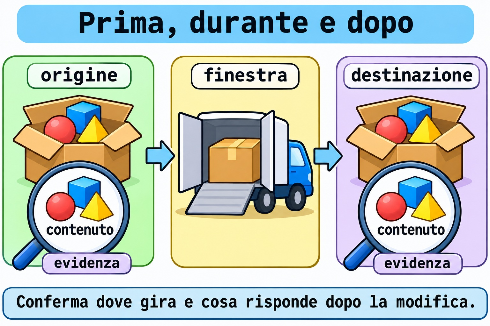

# Lezione 20.7 · Aggiornare, spostare e guastare con verifica

> **Il cuore di questa lezione:** spostare la Wiki tra nodi e recuperare un guasto controllato senza promettere HA automatica.

| Scheda | Piano di lavoro |
| --- | --- |
| Modulo | M20 · NethServer 8 dall’interno, lezione 7 di 7 |
| Quando | Settimana 29 |
| Alla fine | spostare la Wiki tra nodi e recuperare un guasto controllato senza promettere HA automatica. |
| Prerequisiti | Lezioni precedenti del M20; M18 e M19 corretti; console e inventario del lab |
| Durata | 100–140 minuti, oltre a download e finestre operative |
| Snapshot | m20a7-inicio e m20a7-fim, soltanto sulle VM di questa lezione |

Il laboratorio principale è la VM `240`, hostname `ns8-1.lab.test`, Rocky Linux 9 con NS8. La VM `241`, `ns8-2.lab.test`, entra soltanto nella 20.7.

La gestione su `net0` usa un indirizzo reale riservato e accesso a Internet. La `net1` resta sul bridge isolato `vmbr17`, senza gateway; la rete di laboratorio non fornisce Internet.

Usa la [guida del laboratorio M20](../GUIA_BANCADA_M20_IT.md). Tutti i comandi NS8 indicati come root sono dentro il nodo, dopo `sudo -i`, e mai sull’host Proxmox.

Nessun laboratorio di questo materiale è stato eseguito durante la preparazione. Gli output descritti sono criteri che devi osservare e registrare, non risultati misurati.

## 1 · Riscaldamento

1. Spostare un’applicazione promuove un altro leader?

2. Due nodi sullo stesso host fisico dimostrano tolleranza alla perdita di quell’host?

3. Spegnere un worker obbliga la Wiki a ricomparire sul leader?

Disegna chi coordina, dove sono i dati e quale macchina risponde all’URL. Aggiorna il disegno dopo ogni modifica.

## 2 · Perché conta

Una manutenzione prevedibile richiede stato precedente, finestra, percorso di ritorno e test funzionale. La schermata dell’attività conclusa è un’evidenza di controllo, non la risposta dell’applicazione.

La VM `241` sarà un worker nello stesso cluster. La prova interrompe soltanto quella VM, preservando leader, DNS e destinazione del backup.

### Ponte Windows

Trasferire una cartella di lavoro tra due scrivanie non trasferisce la direzione dell’ufficio. E due scrivanie nello stesso edificio non proteggono dalla perdita dell’edificio.

## 3 · Modello mentale


*Spostare un’istanza e trasferire la leadership sono operazioni diverse.*

Il leader riceve il controllo del cluster. Ogni nodo esegue le proprie applicazioni. Lo spostamento modifica la posizione dell’istanza; la promozione del leader è un’altra operazione con conseguenze proprie.

In questa lezione non esiste una promessa di migrazione automatica dell’applicazione dopo un guasto. Misuri l’indisponibilità, recuperi il worker e verifichi il contenuto nel luogo pianificato.

Il bridge `vmbr17` è locale all’host Proxmox. Le VM `240`, `241` e il laboratorio isolato devono stare sullo stesso nodo fisico per quel segmento; non migrare una VM su un altro host durante la prova.

## 4 · L'essenziale

| Operazione | Cosa controllare |
| --- | --- |
| Aggiornare il core | Versioni compatibili su tutti i nodi e controllo funzionale |
| Aggiungere un nodo | VM nuova, stesso sistema, nome e connettività corretti |
| Spostare un’istanza | Origine, destinazione, UUID, dati, DNS e TLS |
| Recuperare un guasto | Ambito osservato e ritorno del servizio verificato |

### Rocky × Debian

Entrambi i nodi NS8 usano Rocky Linux 9. La VM Debian `202` esegue il test client e la `204` continua a offrire DNS e backup; nessuna delle due entra come worker.

Non riutilizzare l’ID 241 se è occupato da una VM o da un CT. Un’identità già esistente richiede di riconciliare l’inventario, non di distruggerla.

### Decidi 1 · È disponibile un aggiornamento

A. Aggiornare moduli core separatamente per tentativi. B. Installare una versione di test per facilitare. C. Leggere la modifica, confermare il backup e usare l’azione di aggiornamento core.

## 5 · Lab guidato

### Passo 1 · Fissare lo stato precedente

**Ipotesi:** Quale risposta permetterà di rilevare una regressione?

```bash
test "$(id -u)" -eq 0 || exit 1
test "$(hostname -f)" = ns8-1.lab.test || exit 1
test -f /root/m20-lab/operador.env && test ! -L /root/m20-lab/operador.env || exit 1
test "$(stat -c '%U:%G:%a' /root/m20-lab/operador.env)" = root:root:600 || exit 1
. /root/m20-lab/operador.env
test -n "$MODULE_ID" && test -n "$MODULE_UUID" || exit 1
runagent -l
```

```bash
install -d -m 0700 /root/m20-lab/evidence-20-7
date --iso-8601=seconds > /root/m20-lab/evidence-20-7/start.txt
redis-cli --raw HGET cluster/module_uuid "$MODULE_ID"
redis-cli --raw HGET cluster/module_node "$MODULE_ID"
runagent -m "$MODULE_ID" podman ps
df -h / /home
```

Sulla VM 202 ripeti la richiesta della 20.6 e conferma il marcatore salvato. Nel pannello controlla l’ultimo backup ed esegui un nuovo backup se ci sono state modifiche successive.

Registra versioni del core e della Wiki, nodo attuale, UUID e posizione della copia di recupero. Crea snapshot iniziali soltanto dopo aver identificato ogni VM sull’host.

**Output atteso:** Inventario e contenuto precedenti sono riproducibili prima di modificare il cluster.

**Verifica:** Un backup senza snapshot identificabile o un marcatore assente impedisce i passaggi successivi di modifica.

### Passo 2 · Aggiornare con un ambito noto

**Ipotesi:** Aggiornare il core e aggiornare la Wiki sono la stessa attività?

In Software Center controlla versioni installate e note degli aggiornamenti proposti. Aggiorna il core tramite l’azione dedicata, che mantiene allineati i suoi componenti.

Poi tratta la Wiki tramite l’azione di aggiornamento dell’applicazione. DokuWiki di NethForge non deve essere considerata coperta automaticamente da una politica di abbonamento di un altro repository.

Se non viene offerto un aggiornamento registra versioni e assenza di pendenze. Non installare una versione di test per produrre una modifica artificiale.

Attendi un’attività alla volta e ripeti il test del marcatore dopo ciascuna. Gli aggiornamenti del sistema operativo seguono finestra e metodo supportati per l’installazione, non un comando improvvisato in parallelo.

**Output atteso:** Versioni e risultato funzionale registrati dopo le azioni realmente disponibili.

**Verifica:** Il leader deve essere aggiornato prima di unire un nuovo nodo con la stessa versione core.

### Passo 3 · Creare la VM 241 indipendente

**Ipotesi:** Un clone della VM 240 sarebbe un nuovo nodo con identità propria?

Torna sull’host Proxmox proprietario del laboratorio. Usa il diario ISO autenticato della 20.1 senza caricare automaticamente il file; controlla volume e SHA256 prima della creazione.

```bash
test "$(id -u)" -eq 0 || exit 1
pvesh get /cluster/resources --type vm --output-format json-pretty || exit 1
test "$(pvesh get /cluster/nextid --vmid 241)" = 241 || exit 1
test -f /root/m20-operador.env && test ! -L /root/m20-operador.env || exit 1
test "$(stat -c '%U:%G:%a' /root/m20-operador.env)" = root:root:600 || exit 1
cat /root/m20-operador.env
read -r -p 'ISO_VOLUME Rocky 9 autenticado no diario: ' ISO_VOLUME
read -r -p 'ISO_SHA256 autenticado no diario: ' ISO_SHA256
[[ "$ISO_SHA256" =~ ^[0-9a-fA-F]{64}$ ]] || exit 1
ISO_PATH=$(pvesm path "$ISO_VOLUME") || exit 1
test -f "$ISO_PATH" || exit 1
printf '%s  %s\n' "$ISO_SHA256" "$ISO_PATH" | sha256sum -c - || exit 1
M20_241_RECORD=$(mktemp /root/m20-241-created.XXXXXX.conf) || exit 1
qm create 241 --name ns8-2 --machine q35 --bios ovmf --cpu x86-64-v2-AES --cores 2 --memory 4096 --agent enabled=1 --scsihw virtio-scsi-single --scsi0 vm-hdd:40 --efidisk0 vm-hdd:1,efitype=4m,pre-enrolled-keys=1 --net0 virtio,bridge=vmbr0 --net1 virtio,bridge=vmbr17,link_down=1 --ide2 "$ISO_VOLUME",media=cdrom --boot order=ide2 || exit 1
qm config 241 > "$M20_241_RECORD" || exit 1
test -s "$M20_241_RECORD" || exit 1
printf 'Creation record: %s\n' "$M20_241_RECORD"
qm start 241 || exit 1
```

Installa Rocky Linux 9 minimo e indipendente, hostname `ns8-2.lab.test`, account `student` con sudo e console root d’emergenza. La gestione usa l’indirizzo reale riservato; non clonare identità, chiavi SSH o stato della 240.

Dopo aver verificato il nome, sull’host imposta il boot con `qm set 241 --boot order=scsi0`. Nel guest 241 segui la guida M20 per scheda isolata `.241`, DNS e accesso dell’operatore. Il blocco seguente installa soltanto NS8 sulla 241: non ripete le guardie della 240 né la creazione del cluster.

```bash
test "$(id -u)" -eq 0 || exit 1
test "$(hostname -f)" = ns8-2.lab.test || exit 1
test ! -e /root/m20-install || exit 1
install -d -m 0700 /root/m20-install
dnf install -y curl || exit 1
curl --fail --location --proto '=https' --tlsv1.2 --retry 10 --retry-delay 1 --retry-all-errors https://raw.githubusercontent.com/NethServer/ns8-core/ns8-stable/core/install.sh --output /root/m20-install/install.sh || exit 1
bash -n /root/m20-install/install.sh || exit 1
sha256sum /root/m20-install/install.sh > /root/m20-install/install.sha256
cat /root/m20-install/install.sh
read -r -p 'Digite INSTALAR-NS8-241 apos revisar o script: ' M20_OK
test "$M20_OK" = INSTALAR-NS8-241 || exit 1
bash /root/m20-install/install.sh || exit 1
systemctl reboot
```

L’hash locale registra il file ottenuto, ma non è una firma indipendente del distributore. La revisione del contenuto e la fiducia nella fonte HTTPS rimangono necessarie. Non salvare le credenziali iniziali nei rapporti.

**Output atteso:** VM nuova con sistema pulito, rete verificata e NS8 pronto per entrare.

**Verifica:** Non scegliere Create cluster sulla 241: i cluster indipendenti non si uniscono con quell’azione.

### Passo 4 · Entrare senza modificare la leadership

**Ipotesi:** Il nome corretto deve essere risolto anche da entrambi i nodi?

Sul leader controlla la versione core. Sulla 241 controlla la stessa versione installata, FQDN, orologio, risoluzione di entrambi i nodi e assenza di sovrapposizione della rete con la VPN del cluster registrata.

Sulla 241, come root, prepara la cartella prima di trasferire la CA pubblica. Se esiste già, controlla proprietario, permessi e assenza di collegamenti simbolici; una differenza interrompe la procedura.

```bash
test "$(id -u)" -eq 0 || exit 1
test "$(hostname -f)" = ns8-2.lab.test || exit 1
test ! -L /root/m20-lab || exit 1
if test -e /root/m20-lab; then
  test -d /root/m20-lab || exit 1
  test "$(stat -c '%U:%G:%a' /root/m20-lab)" = root:root:700 || exit 1
else
  install -d -o root -g root -m 0700 /root/m20-lab || exit 1
fi
```

Tramite il trasferimento autenticato della guida copia soltanto la CA pubblica già verificata della 204 in `/root/m20-lab/ca.crt` sulla 241. Esegui una sola volta il blocco di fiducia del Passo 3 della 20.4, scegliendo `241` e verificando l’impronta digitale nella console della 204. La connessione al leader deve verificarne il certificato tramite il nome; la chiave privata della CA rimane sulla 204.

Sul leader apri `Nodes` e `Add node to cluster`. Copia il join code soltanto nel modulo `Join cluster` della 241. Il codice è un segreto temporaneo: non va in schermate o evidenze.

Conferma l’attività e il nuovo worker nel pannello del leader. Registra il suo vero ID NS8; il VMID `241` non è quell’ID. Non cambiare la VPN scelta nel primo nodo.

```bash
test "$(id -u)" -eq 0 || exit 1
test "$(hostname -f)" = ns8-2.lab.test || exit 1
runagent -l
runagent -m node printenv NODE_ID
getent ahostsv4 ns8-1.lab.test
getent ahostsv4 ns8-2.lab.test
```

Già dentro il cluster esegui il Passo 2 della 20.4 scegliendo `241` per emettere chiave e certificato nuovi con SAN della 241 e della Wiki. Nel Passo 3 esegui soltanto lo staging e il trasferimento dei file alla postazione operatore: non ripetere il blocco di fiducia sul nodo, perché la CA è già stata installata prima del Join. Esegui il caricamento del Passo 4 nel Traefik del nodo 241 prima di spostare l’applicazione e la pulizia del Passo 6 dopo la verifica; i certificati caricati non sono replicati automaticamente.

**Output atteso:** Un leader esistente e un nuovo worker compaiono con identità distinte.

**Verifica:** Conferma che `ns8-2.lab.test` presenti il certificato atteso prima dello spostamento della Wiki.

### Passo 5 · Spostare e seguire entrambi i lati

**Ipotesi:** Dove sarà l’istanza dopo l’attività?



*Conferma dove gira e cosa risponde dopo la modifica.*

Nella scheda della Wiki fittizia confronta ID, UUID e nodo d’origine con il diario. Scegli `Move`, seleziona il worker corrispondente alla VM 241 e conferma la finestra.

Attendi l’intera attività. Poi segui la sezione della guida M20 che cambia l’A di `wiki.lab.test` da `.240` a `.241`, incrementa il seriale, valida BIND e aggiorna la mappatura del tunnel sul computer dell’operatore.

Aggiorna anche l’eventuale voce `wiki.lab.test` nel blocco M20 di `/etc/hosts` sulla VM 202 tramite la guida. Un file hosts rimasto sulla `.240` prevale sul DNS corretto; attendere il TTL non lo corregge.

Sulla VM 202 controlla risposta DNS autoritativa e TLS diretto alla nuova destinazione; poi prova tramite il nome senza forzare l’indirizzo, dopo la scadenza o l’aggiornamento della cache del client.

```bash
test "$(hostname -s)" = debian-lab || exit 1
dig @192.0.2.204 wiki.lab.test A +short
curl --retry 10 --retry-delay 1 --retry-all-errors --max-time 10 --fail --silent --show-error --cacert /etc/ssl/m19/ca.crt --resolve wiki.lab.test:443:192.0.2.241 'https://wiki.lab.test/doku.php?id=m20_restore' --output "$HOME/m20-lab/wiki-moved.html" || exit 1
M20_MARKER=$(cat "$HOME/m20-lab/wiki-marker.txt") || exit 1
grep -F -- "$M20_MARKER" "$HOME/m20-lab/wiki-moved.html" || exit 1
curl --max-time 10 --fail --cacert /etc/ssl/m19/ca.crt 'https://wiki.lab.test/doku.php?id=m20_restore'
```

Nel terminale root della 241 trova l’istanza reale e annotane l’ID. Sul leader le associazioni pubbliche di Redis permettono di controllare UUID e nodo in lettura. Non scrivere direttamente in quelle chiavi.

```bash
runagent -l
read -r -p 'ID real da Wiki apos Move: ' MOVED_ID
[[ "$MOVED_ID" =~ ^dokuwiki[0-9]+$ ]] || exit 1
runagent -m "$MOVED_ID" podman ps
runagent -m "$MOVED_ID" id
```

Torna ora nel terminale root del leader 240. Confronta UUID e associazione al nodo prima di registrare il nuovo ID. Il candidato preserva `NODE_ID` del leader e `VPN_CIDR`; soltanto `MODULE_NODE_ID` descrive la posizione della Wiki.

```bash
test "$(id -u)" -eq 0 || exit 1
test "$(hostname -f)" = ns8-1.lab.test || exit 1
test -f /root/m20-lab/operador.env && test ! -L /root/m20-lab/operador.env || exit 1
test "$(stat -c '%U:%G:%a' /root/m20-lab/operador.env)" = root:root:600 || exit 1
. /root/m20-lab/operador.env
read -r -p 'ID real da Wiki observado no worker: ' MOVED_ID
[[ "$MOVED_ID" =~ ^dokuwiki[0-9]+$ ]] || exit 1
read -r -p 'NODE_ID do worker observado no passo 4: ' TARGET_NODE_ID
[[ "$TARGET_NODE_ID" =~ ^[1-9][0-9]*$ ]] || exit 1
test "$(redis-cli --raw HGET cluster/module_uuid "$MOVED_ID")" = "$MODULE_UUID" || exit 1
MODULE_NODE_ID=$(redis-cli --raw HGET cluster/module_node "$MOVED_ID") || exit 1
test "$MODULE_NODE_ID" = "$TARGET_NODE_ID" || exit 1
M20_NEXT=$(mktemp /root/m20-lab/operador.env.XXXXXX) || exit 1
awk -v id="$MOVED_ID" -v node="$MODULE_NODE_ID" '/^MODULE_ID=/ {print "MODULE_ID=" id; next} /^MODULE_NODE_ID=/ {next} {print} END {print "MODULE_NODE_ID=" node}' /root/m20-lab/operador.env > "$M20_NEXT" || exit 1
test "$(grep -c '^MODULE_ID=' "$M20_NEXT")" -eq 1 || exit 1
chmod 0600 "$M20_NEXT"
mv -f "$M20_NEXT" /root/m20-lab/operador.env
```

**Output atteso:** L’applicazione risponde sulla 241, con marcatore e identità verificati.

**Verifica:** Il leader resta sulla 240. Registra il nuovo ID breve se l’operazione lo ha modificato; non trattare il cambio d’ID come perdita automatica dei dati.

### Passo 6 · Interrompere e recuperare soltanto il worker

**Ipotesi:** L’applicazione migra da sola quando il worker si spegne?


*Pianifica il recupero; non supporre una migrazione automatica dopo il guasto.*

Prima di spegnere conferma che la VM 241 sia stata creata in questa prova, non sia gestita da HA di Proxmox e non abbia ricevuto altri carichi. Sull’host leggi `qm config 241` e `ha-manager config`. Se esistono gestione automatica o lavoro aggiuntivo, fermati.

Nel guest 241, come root, esegui uno spegnimento controllato. Questo prova la perdita del worker, non la perdita fisica dell’host o di Ceph.

```bash
test "$(id -u)" -eq 0 || exit 1
test "$(hostname -f)" = ns8-2.lab.test || exit 1
systemctl poweroff
```

Sulla VM 202 una richiesta diretta alla 241 deve fallire entro il limite di tempo. Il pannello del leader resta accessibile. Registra l’assenza di un ritorno automatico della Wiki su un altro nodo.

```bash
if curl --connect-timeout 3 --max-time 5 --fail --cacert /etc/ssl/m19/ca.crt --resolve wiki.lab.test:443:192.0.2.241 'https://wiki.lab.test/doku.php?id=m20_restore'; then
  printf '%s\n' 'STOP: resposta inesperada durante desligamento' >&2
  exit 1
fi
```

Sul corretto host Proxmox controlla nome e stato prima di avviare esclusivamente la VM della prova.

```bash
test "$(qm config 241 | sed -n 's/^name: //p')" = ns8-2 || exit 1
test "$(qm status 241)" = 'status: stopped' || exit 1
qm start 241 || exit 1
```

**Output atteso:** Il worker ritorna e la Wiki torna a rispondere nello stesso luogo pianificato.

**Verifica:** Ripeti la prova completa del marcatore; non concludere soltanto perché il pannello chiama il nodo online.

### Decidi 2 · Anche il leader è offline

A. Recuperare il leader o seguire la procedura documentata di promozione con un piano esplicito. B. Scrivere manualmente il nuovo leader in Redis. C. Supporre che il pannello sia migrato da solo.

## 6 · Rompi e ripara

### Guasto 1 · Destinazione senza capacità

**Sintomo:** Prima di confermare Move individua nel pannello una destinazione senza spazio o requisito sufficiente; non confermare l’operazione.

**Indagine:** Confronta spazio, requisiti dell’applicazione e limiti dell’operazione.

**Causa:** Un nodo elencato nel cluster non è necessariamente una destinazione adatta.

**Riparazione:** Libera risorse secondo il piano o scegli soltanto la destinazione preparata per l’esercizio.

**Prevenzione:** Includi la capacità nell’inventario precedente alla finestra.

**Verifica:** La destinazione valida viene scelta prima di copiare dati.

### Guasto 2 · DNS precedente dopo Move

**Sintomo:** La richiesta per nome raggiunge l’indirizzo precedente; il test forzato verso la 241 funziona.

**Indagine:** Confronta query autoritativa, cache e mappatura del tunnel.

**Causa:** La posizione dell’applicazione è cambiata, ma il percorso del client è rimasto precedente.

**Riparazione:** Correggi A, seriale e mappa tramite la guida; attendi la cache o aggiornala in modo controllato.

**Prevenzione:** Tratta DNS e accesso dell’operatore come parte della finestra.

**Verifica:** La richiesta normale per nome, senza --resolve, restituisce il marcatore.

### Guasto 3 · Certificato della destinazione assente

**Sintomo:** Il server risponde sulla 241, ma presenta un certificato che non verifica la Wiki.

**Indagine:** Controlla SAN, nodo selezionato nel caricamento e fiducia della CA.

**Causa:** Il certificato caricato sulla 240 non è stato distribuito automaticamente.

**Riparazione:** Importa il certificato proprio della 241 tramite la procedura della 20.4, senza copiare la chiave della CA.

**Prevenzione:** Prepara TLS della destinazione prima di spostare il servizio.

**Verifica:** Nome, catena e marcatore superano la stessa nuova richiesta.

## 7 · Trappole

1. Non rimuovere un nodo per simulare una semplice interruzione: la rimozione ha effetti permanenti e non spegne automaticamente tutti i carichi.

2. Non usare Clone quando l’obiettivo è Move; devi terminare con una posizione definita.

3. Due nodi sullo stesso host continuano a dipendere dallo stesso host.

4. Una promozione del leader richiede nuova attenzione alla password del backup del cluster e ai log.

5. Non ripristinare snapshot indipendenti dei nodi come se fossero un ripristino coordinato del cluster.

## 8 · Quiz

1. Qual è la differenza tra Move e promozione del leader?

2. Perché la VM 241 non deve nascere da un clone della 240?

3. Cosa isola il test con --resolve dopo Move?

4. Quale guasto fisico non copre questa prova?

5. Un worker online dimostra contenuto ripristinato?

## 9 · Promemoria

```bash
runagent -l
redis-cli --raw HGET cluster/module_uuid "$MODULE_ID"
redis-cli --raw HGET cluster/module_node "$MODULE_ID"
runagent -m "$MODULE_ID" podman ps
date --iso-8601=seconds
```

**Flashcard:** Leader → controllo; nodo → esecuzione locale.

**Flashcard:** Move → dati e posizione; DNS/TLS → percorso e identità del client.

**Flashcard:** Nodo online → condizione necessaria, non prova funzionale completa.

## 10 · Checklist e chiusura

- [ ] Versioni e backup verificati prima della modifica.

- [ ] VM 241 nuova, stessa distribuzione e core compatibile.

- [ ] Certificato proprio importato nella destinazione.

- [ ] Wiki sul worker con UUID e marcatore verificati.

- [ ] DNS e mappa del tunnel puntano alla posizione attuale.

- [ ] Guasto limitato alla VM, recupero e limiti documentati.

**Reboot di verifica:** il passaggio 6 ha già spento e avviato il worker. Concludi la prova ripetendo una richiesta normale dalla VM 202, senza indirizzo forzato, e controllando il marcatore.

**Ultimo esercizio:** esegui la sfida seguente soltanto sulla Wiki fittizia. Conserva nodi 240 e 241, dominio di prova e destinazione del backup per M21.

### Sfida del modulo · Cancellare e recuperare l’istanza

Con la Wiki sana sulla 241 esegui un nuovo backup e identificane lo snapshot. Scarica il backup cifrato del cluster e conferma la custodia di chiave e password fuori dai nodi. Il limite di Ceph della 20.6 rimane.

Prima di rimuovere, sul leader confronta l’ID attuale e il relativo UUID con applicazione fittizia e snapshot. Se un valore diverge, fermati. Non usare un ID della documentazione.

```bash
test "$(hostname -f)" = ns8-1.lab.test || exit 1
test -f /root/m20-lab/operador.env && test ! -L /root/m20-lab/operador.env || exit 1
test "$(stat -c '%U:%G:%a' /root/m20-lab/operador.env)" = root:root:600 || exit 1
. /root/m20-lab/operador.env
read -r -p 'ID atual da Wiki ficticia: ' MODULE_ID
[[ "$MODULE_ID" =~ ^dokuwiki[0-9]+$ ]] || exit 1
read -r -p 'UUID original conferido no diario externo: ' EXPECTED_UUID
CURRENT_UUID=$(redis-cli --raw HGET cluster/module_uuid "$MODULE_ID") || exit 1
test -n "$CURRENT_UUID" && test "$CURRENT_UUID" = "$EXPECTED_UUID" || exit 1
redis-cli --raw HGET cluster/module_node "$MODULE_ID"
```

Nel pannello usa `Uninstall` soltanto su quella scheda verificata. L’azione rimuove l’istanza e i suoi dati attuali. Attendi l’attività e verifica l’indisponibilità; non cancellare volumi manualmente.

Tramite la scheda `Restore` scegli il backup della stessa identità, lo snapshot identificato e il nodo 241. Non creare al suo posto un’altra Wiki vuota. Attendi la fine e riscopri ID, UUID e nodo.

Sulla 241, `runagent -l` e l’inventario Podman dell’ID ripristinato devono mostrare dove il servizio è tornato. Sul leader controlla UUID e associazione del nodo. Sulla 202 verifica nome, TLS e marcatore tramite una nuova richiesta.

Dopo la prova aggiorna soltanto l’ID breve nel file dell’operatore tramite il candidato atomico della 20.6. `NODE_ID` continua a identificare il leader 240; `MODULE_NODE_ID` registra la posizione della Wiki. Conserva `VPN_CIDR` e tutti gli altri campi.

Sul leader controlla i valori reali dopo il ripristino e soltanto allora salva il nuovo ID.

```bash
read -r -p 'ID real da Wiki restaurada no worker: ' NEW_MODULE
[[ "$NEW_MODULE" =~ ^dokuwiki[0-9]+$ ]] || exit 1
test "$(redis-cli --raw HGET cluster/module_uuid "$NEW_MODULE")" = "$EXPECTED_UUID" || exit 1
test "$(redis-cli --raw HGET cluster/module_node "$NEW_MODULE")" = "$MODULE_NODE_ID" || exit 1
M20_NEXT=$(mktemp /root/m20-lab/operador.env.XXXXXX) || exit 1
sed "s/^MODULE_ID=.*/MODULE_ID=$NEW_MODULE/" /root/m20-lab/operador.env > "$M20_NEXT" || exit 1
test "$(grep -c '^MODULE_ID=' "$M20_NEXT")" -eq 1 || exit 1
grep -qx "MODULE_ID=$NEW_MODULE" "$M20_NEXT" || exit 1
chmod 0600 "$M20_NEXT"
mv -f "$M20_NEXT" /root/m20-lab/operador.env
```

Riporta nel diario la catena: snapshot scelto → istanza rimossa → istanza ripristinata → contenuto riconosciuto. Non pulire la destinazione del backup per lasciare vuota la schermata.

## 11 · Nella vita reale

In un ambiente autorizzato inventaria prima versioni, posizione e dipendenze. Una finestra deve dire chi decide di tornare indietro e quale evidenza consente di concludere.

L’esercizio sullo stesso host non misura la tolleranza ai guasti fisici. Se quello è l’obiettivo, progetta un’altra prova con nodi, rete, storage e backup in domini di guasto coerenti.

## 12 · Approfondire quando vuoi

- [Aggiungere e recuperare nodi](https://docs.nethserver.org/docs/administrator-manual/configuration/cluster)

- [Aggiornamenti del core e delle applicazioni](https://docs.nethserver.org/docs/administrator-manual/installation/software_center)

- [Applicazioni: Clone e Move](https://docs.nethserver.org/docs/administrator-manual/installation/modules)

- [Mappe pubbliche di identità e nodo](https://nethserver.github.io/ns8-core/core/database/)

!explica Por que mover uma aplicação não promove outro líder?

!feynman Explique o limite de dois nós virtuais no mesmo host físico.

!quiz Crie um incidente após Move em que os dados estão corretos, mas o DNS ficou antigo.

## Soluzioni commentate

Decidi 1: C. Il core ha componenti coordinati; l’aggiornamento è seguito da una nuova prova funzionale.

Decidi 2: A. Recupero e promozione sono procedure esplicite; il test del worker non ha verificato la perdita del leader.

Quiz 1: Move modifica la posizione dell’applicazione; la promozione cambia chi coordina il cluster.

Quiz 2: Il clone porterebbe identità e stato di un nodo esistente invece di un’installazione pulita per Join.

Quiz 3: Separa il percorso di rete verso la 241 dalla normale risoluzione DNS, mantenendo nome e verifica TLS.

Quiz 4: Perdita dell’host fisico, dello storage Ceph o dell’infrastruttura comune.

Quiz 5: No. Deve rispondere con il nome corretto, TLS e contenuto atteso, sul nodo e UUID osservati.

[← Lezione 20.6 · Backup e ripristino](20.6-backup-e-restauracao.md) · [Indice delle lezioni](../01-aulas.md) · [Piano del corso: M21 →](../00-plano-do-curso.md)
