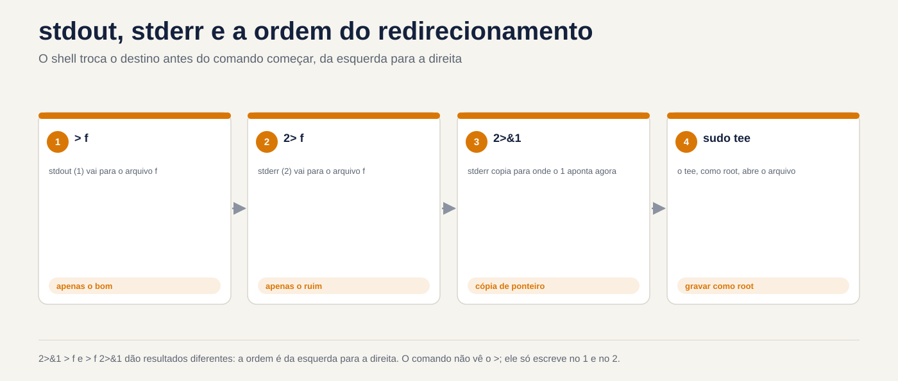

# Lezione 3.1 · Fluxos a fundo

Primeira lezione do Módulo 3 e da Fase 2. No Módulo 2 você montou usuários, grupos e uma pasta de equipe que funciona de verdade. Due volte, nell'Lezione 2.7 e nell'Lezione 2.8, un comando con `sudo` fallisce per un motivo che non era autorizzato: o `*` foi espanso dalla **seu** shell, prima di o `sudo` iniziare. Oggi capisci tutta questa famiglia di problemi. La shell monta i flussi di un comando (dalle onde in alto, per le onde escreve, dove os erros) **antes** di rodarlo e non si sa che questo escreve `sudo echo ... > /etc/arquivo`, perde gli errori di backup all'interno del pipe e chiude il file errato con un `xargs`. Nella lezione 1.6 hai visto `>`, `>>`, `2>` e `|`. Ora vediamo i dispositivi che l'amministratore usa tutto il giorno: `tee`, `xargs`, qui-doc, sostituzione del processo, `/dev/null` e o `pipefail`, che faz o pipe parar de esconder erro.

| File | Lezione 3.1 |
| --- | --- |
| Modulo | M3 · Testo e redattore, lezione 1 de 5 |
| Quando | Settimana 7 |
| Alla fine puoi | Prevedere il risultato di qualsiasi combinazione di `>`, `>>`, `2>`, `2>&1` e `&>`, compreso l'ordine; scrivere nel file root con `sudo tee`, senza cadere in `sudo echo >`; creare file di configurazione con here-doc, sapendo quando la shell espande le variabili e quando no; usa `xargs` con nomi che contengono spazi e con input vuoti, nessuna sorpresa; confrontare la notizia di due VM con `diff <( ) <( )`; creare una pipe di backup che fallisca quando dovrebbe, con `pipefail` e `PIPESTATUS`; spiegare perché uno script `#!/bin/sh` si comporta diversamente su Rocky e Debian |
| Articoli di prova | LE 3.2 (redirezionamento e pipe) · LPIC-1 103.4 (uso di flussi, tubi e reindirizzamento: `tee`, `xargs`) · RHCSA (uso di reindirizzamento di entrata e uscita: `>`, `>>`, `\|`, `2>` e afins) |
| Prerequisiti | Lezione 1.6 (reindirizzamento e tubi di base); Lezione 2.5 (`sudo`); lezione 2.7 e lezione 2.8 (`*` ampliato prima del `sudo` e `sudo sh -c`); le due VM accessibili e `ssh deb` funzionante |
| Tempo | Intorno alle 2:30 |
| Istantanee | m3a1-inicio e m3a1-fim nelle due VM |

## 1 · Riscaldamento

Tre domande, a colpo d'occhio. Scrivi le risposte; la chiave di risposta viene visualizzata alla fine.

1. Esegui `sudo echo "nameserver 1.1.1.1" > /etc/resolv.conf` e ricevi `Permission denied`. `sudo` è configurato e funzionante. Guess: why?
2. Uno script di backup fa `tar cf - /dados | gzip > /backup/dados.tar.gz` e termina con `echo "status: $?"`. `tar` fallisce a metà per mancanza di permesso. Indovina: lo stato mostra `0` o un altro numero?
3. `cmd > saida.txt 2>&1` e `cmd 2>&1 > saida.txt`. Indovina: mantengono entrambi gli errori nel file?

## 2 · Perché è importante

I flussi sembrano un argomento per principianti finché non diventano un incidente:

| Il cosiddetto | La risposta sbagliata | Cosa provoca |
| --- | --- | --- |
| "Devo aggiungere una riga a `/etc/hosts` tramite lo script" | `sudo echo "10.1.0.60 app" >> /etc/hosts` | `Permission denied`. In fretta qualcuno lo cambia in `chmod 666 /etc/hosts` e il file è aperto per qualsiasi account |
| "Il backup viene eseguito ogni notte e dice OK, ma il file è di 40 byte" | Fiducia `$?` alla fine del tubo | Months of empty backups. Lo stato è quello di `gzip`, che ha compresso con successo un nulla |
| "cron invia email ogni mattina, spegnilo" | Aggiungi `> /dev/null 2>&1` a tutto | L'e-mail si interrompe e con essa l'unico avvertimento che il lavoro non funziona da settimane |
| "Elimina il vecchio `.tmp` dalla cartella dei caricamenti" | `find /srv/uploads -name '*.tmp' \| xargs rm` | Il file `relatorio final.tmp` diventa `relatorio` e `final.tmp`; se c'è un `relatorio`, scompare al posto |
| "Lo script funziona su Rocky e dà errori di sintassi su Debian" | Riscrivere lo script in Debian | Due versioni della stessa sceneggiatura. Il problema era `#!/bin/sh`: in Debian, `sh` non è `bash` |

Chi lo risolve veramente sa **chi** apre ciascun file, **quando** e **con quale identità**. Questo è ciò che ti alleni oggi.

## 3 · Modello mentale

> Ogni processo nasce con tre canali numerati, i **descrittori di file**: `0` è l'input (stdin), `1` è l'output (stdout) e `2` è l'output dell'errore (stderr). Il reindirizzamento è **il passaggio della shell al punto in cui punta ciascun numero, prima dell'avvio del comando**, leggendo da sinistra a destra. Il comando non vede mai `>`: scrive solo su `1` e `2`, senza sapere se si tratta di screen, file o pipe.

```text
  Você digita:   sudo echo oi > /etc/teste.conf
                 └─────┬─────┘ └───────┬───────┘
                       │               └─ 1º: o SEU shell (rodrigo) abre /etc/teste.conf
                       │                       para escrita. Falha aqui: Permission denied.
                       └─ 2º: só depois o sudo rodaria, já como root. Nem chega a rodar.

  Você digita:   echo oi | sudo tee /etc/teste.conf > /dev/null
                 └──┬──┘   └──────────┬──────────┘   └────┬────┘
                    │                 │                   └─ o seu shell abre /dev/null (pode)
                    │                 └─ o tee, rodando como ROOT, abre /etc/teste.conf (pode)
                    └─ o echo escreve "oi" no pipe, que vira a entrada do tee

  A ordem do 2>&1 (o shell lê da esquerda para a direita):

  cmd > f 2>&1         1 → f            depois 2 → para onde o 1 aponta AGORA (f)
                       resultado:  1 → f    2 → f          tudo no arquivo

  cmd 2>&1 > f         2 → para onde o 1 aponta AGORA (tela)   depois 1 → f
                       resultado:  1 → f    2 → tela       erros na tela

  Um pipe:   tar cf - /dados  |  gzip  >  dados.tar.gz
             └─── processo ───┘  └── processo ──┘
                status 2 (falhou)   status 0  ──▶  $? = 0   (só o último conta)
                ${PIPESTATUS[@]} = "2 0"           com set -o pipefail: $? = 2
```

`2>&1` non significa "unire gli errori con l'output". Significa "fai `2` punto dove `1` punta **proprio adesso**". È una copia, non un collegamento: se `1` cambia in seguito, `2` non segue.


*La shell cambia la destinazione prima dell'avvio del comando, da sinistra a destra.*

## 4 · Concetto a strati

### Essenziale

**I reindirizzamenti, tutti in una volta.** Quelli che già conosci e quelli che ti sei perso:

| Tu scrivi | Cosa fa la shell |
| --- | --- |
| `cmd > f` | `1` passa a `f` cancellando il contenuto precedente |
| `cmd >> f` | `1` va alla fine di `f` |
| `cmd 2> f` | `2` va a `f` |
| `cmd > f 2>&1` | `1` e `2` vanno al `f`. Funziona con qualsiasi shell |
| `cmd &> f` | Lo stesso, in forma breve. Solo in `bash` |
| `cmd 2> /dev/null` | Elimina gli errori |
| `cmd < f` | `0` si legge da `f` |
| `cmd1 \| cmd2` | `1` di `cmd1` diventa `0` di `cmd2`. `2` continua a visualizzare la schermata |
| `cmd1 \|& cmd2` | `1` e `2` di `cmd1` vanno al tubo. Solo nel `bash`; è uguale a `2>&1 \|` |
| `echo erro >&2` | Scrivere in `2`. Ecco come uno script invia un messaggio di errore |

**O `/dev/null`.** Un dispositivo che accetta tutto e non memorizza nulla e che, una volta letto, termina immediatamente. Si usa per buttare via (`2> /dev/null`) e per dare un input vuoto ad un comando (`cmd < /dev/null`). Buttarlo via è una decisione: quello che va a `/dev/null` non ritorna.

**O `tee`.** Legge l'input e lo scrive in due posti: nell'output e nei file che gli dai. Il nome deriva dall'impianto idraulico: una T che divide il flusso.

```bash
dnf check-update | tee ~/atualizacoes.txt          # sullo schermo e nel file
journalctl -b -p err | tee -a ~/erros-boot.txt     # -a aggiunge invece di eliminare
```

In amministrazione, l'uso più importante di `tee` è un altro: **scrivere nel file root**. `tee` è colui che apre il file, e `tee` può eseguirlo con `sudo`:

```bash
echo "10.1.0.60 app" | sudo tee -a /etc/hosts > /dev/null
```

Alla fine `> /dev/null` rimuove dallo schermo solo la copia che `tee` scrive anche sull'uscita.

**O `xargs`.** Una pipe porta il **testo** all'**input** di un comando. Ma molti comandi non leggono l'input: vogliono **argomenti**. `rm`, `ls`, `chmod`, `ssh` ignorano ciò che arriva tramite `0`. `xargs` legge l'input e lo trasforma in argomenti:

```bash
echo "/etc/hostname /etc/os-release" | ls -l          # ls ignora la voce ed elenca la cartella corrente
echo "/etc/hostname /etc/os-release" | xargs ls -l    # xargs esegue: ls -l /etc/hostname /etc/os-release
```

**O qui-doc.** ​​​​Un blocco di testo che diventa l'input di un comando, scritto nel terminale o nello script stesso. È il modo pulito per creare un intero file di configurazione:

```bash
sudo tee /etc/motd > /dev/null <<'EOF'
Servidor de laboratório. Mudanças só com chamado aberto.
EOF
```

`<<'EOF'` dice: "l'input è tutto ciò che arriva fino a una riga che ha solo `EOF`". Il nome `EOF` è convenzione; può essere qualsiasi parola.

### Intermedio

**L'ordine è importante, sempre.** La shell applica i reindirizzamenti da sinistra a destra e ogni `N>&M` copia la destinazione **corrente** di `M`. Ecco perché:

```bash
ls /etc/hostname /naoexiste > f 2>&1     # tutto in f
ls /etc/hostname /naoexiste 2>&1 > f     # l'errore sullo schermo, l'elenco in f
ls /etc/hostname /naoexiste 2>&1 | wc -l # 2: nel tubo, il | è montato PRIMA dei reindirizzamenti
```

La terza riga inganna molte persone: `|` viene collegato per primo, quindi quando viene letto `2>&1`, `1` è già la pipe e i due vanno a `wc`.

**Le virgolette nel qui-doc decidono tutto.** Senza virgolette nella parola (`<<EOF`), la shell espande `$VARIAVEL`, `$(comando)` e `` `comando` `` **durante la creazione** del testo. Tra virgolette (`<<'EOF'`), il testo è esattamente come scritto. Per generare uno script, si vogliono quasi sempre le virgolette: le variabili devono essere lette quando lo **script** viene eseguito, non quando lo si crea.

```bash
cat <<EOF
criado em $(hostname) por $USER
EOF
# criado em rocky-lab por rodrigo

cat <<'EOF'
criado em $(hostname) por $USER
EOF
# criado em $(hostname) por $USER
```

Il `<<-EOF`, con un trattino, rimuove le **tabulazioni** dall'inizio di ogni riga, in modo da poter rientrare il blocco all'interno di un `if` in uno script. Rimangono solo tabulazioni: rimangono spazi.

**O qui-stringa.** `<<<` fornisce una singola stringa come input, senza `echo` e senza barra verticale:

```bash
tr a-z A-Z <<< "rocky-lab"      # ROCKY-LAB
read -r usuario uid <<< "ana 2001"
```

**O `xargs` e nomi con spazi.** Per impostazione predefinita, `xargs` separa l'input in **qualsiasi** spazio, tabulazione o interruzione di riga e interpreta anche virgolette e barre rovesciate. Un file chiamato `relatorio final.txt` accetta due argomenti e uno chiamato `conta d'agua.txt` fornisce `unmatched single quote`. La soluzione è separarlo con un carattere che non può esistere nel nome del file, il null (`\0`), su entrambi i lati:

```bash
find ~/lab31 -name '*.txt' -print0 | xargs -0 ls -l
```

Oppure fare a meno di `xargs`, con `-exec ... +` del `find` stesso, che crea la riga di comando senza passare attraverso il testo:

```bash
find ~/lab31 -name '*.txt' -exec ls -l {} +
```

**Opzioni di `xargs` che utilizzerete:**

| Opzione | Cosa fa | Esempio |
| --- | --- | --- |
| `-0` | Voce separata da null (coppia `find -print0`) | `find . -print0 \| xargs -0 ...` |
| `-r` | Non viene eseguito nulla se l'input è vuoto | `... \| xargs -r rm` |
| `-n N` | Numero massimo di N argomenti per esecuzione | `xargs -n 1 ping -c1` |
| `-I{}` | Una esecuzione per riga, sostituendo `{}` con | `xargs -I{} cp {} {}.bak` |
| `-t` | Mostra ogni comando prima di eseguire | `xargs -t chmod 640` |
| `-P N` | Fino a N esecuzioni contemporaneamente | `xargs -P 4 -n 1 ...` |

`-r` merita attenzione: `xargs` di GNU, che è quello per entrambe le VM, esegue il comando **una volta, senza argomenti**, quando l'input è vuoto. Un `ls -l` senza argomenti elenca la cartella corrente; a `chown -R ana` senza discutere si limita a lamentarsi. Ma un report che dovrebbe essere vuoto appare pieno di cose che non hanno nulla a che fare con esso.

**Sostituzione del processo.** `<(comando)` esegue il comando e fornisce il suo output **come se fosse un file**. È per i comandi che accettano solo nomi di file, come `diff`, che confronta due file:

```bash
diff <(ssh deb 'cat /etc/os-release') /etc/os-release
echo <(true)          # /dev/fd/63: "file" è un descrittore aperto da bash
```

Senza questo, salveresti due output in file temporanei, li confronteresti e li cancelleresti. Viene da `bash`: `sh` di Debian non capisce.

**La pipe nasconde errori.** Lo stato di una pipe è quello del comando **last**. In un `dump | gzip > arquivo`, se `dump` muore nel mezzo, `gzip` comprime quello che è arrivato, finisce con `0`, e tutto il tubo dice che ha funzionato. Due strumenti `bash`:

```bash
false | true; echo "$?"                   # 0
false | true; echo "${PIPESTATUS[@]}"     # 1 0: lo stato di ciascun comando, in ordine
set -o pipefail
false | true; echo "$?"                   # 1: la pipe fallisce se qualsiasi comando fallisce
```

`PIPESTATUS` viene sovrascritto dal comando **successivo**, incluso un `echo`: leggilo immediatamente o copialo in un'altra variabile. `set -o pipefail` è valido per la shell da cui l'hai chiamato, fino al termine; in uno script, inseriscilo all'inizio.

### Windows Bridge

| Su Windows (cmd o PowerShell) | Su Linux | La differenza che conta |
| --- | --- | --- |
| `dir > lista.txt 2>&1` (cmd) | `ls > lista.txt 2>&1` | Lo stesso, compreso l'ordine. cmd imparato da Unix |
| `> NUL` | `> /dev/null` | In Linux è un vero e proprio file di dispositivo, con proprietario e modalità |
| `Tee-Object -FilePath f` | `tee f` | `tee` accetta più file e `-a` |
| `ForEach-Object { ... }` con l'oggetto nel tubo | `xargs` | PowerShell passa **oggetti** nella pipe; Linux passa **testo** e `xargs` deve sapere dove finisce un elemento e inizia il successivo |
| `@" ... "@` e `@' ... '@` (stringa qui) | `<<EOF` e `<<'EOF'` (qui-doc) | La stessa idea delle virgolette: le virgolette doppie espandono le variabili, le virgolette singole no |
| `Compare-Object (cmd1) (cmd2)` | `diff <(cmd1) <(cmd2)` | Su Linux, l'output diventa un "file" `/dev/fd/N` |
| `$LASTEXITCODE` e `$?` | `$?` e `${PIPESTATUS[@]}` | In PowerShell viene visualizzato un errore al centro della pipe; nel `bash`, senza `pipefail`, scompare |
| "Esegui come amministratore" sull'intero terminale | `sudo` in un comando oppure `sudo tee` in un file | In Linux, l'elevazione avviene per processo: il `>` della tua shell resta tu |

### Avanzato

**`sudo` e la shell, la regola generale.** La tua shell fa quattro cose prima che `sudo` esista: espande `*` e `?` (Lezione 2.7), espande `$VARIAVEL` e `$(comando)`, apre reindirizzamenti e collega pipe. Tutto questo accade **come te**. I tre output, a seconda dei casi:

| Vuoi | Utilizzare |
| --- | --- |
| Scrivi o aggiungi a un file root | `... \| sudo tee [-a] arquivo > /dev/null` |
| Una riga con reindirizzamenti, `*` o pipe, tutto come root | `sudo sh -c 'cmd1 \| cmd2 > /etc/arquivo'` |
| Un intero blocco di configurazione | `sudo tee arquivo > /dev/null <<'EOF'` ... `EOF` |
| Leggere un file da root in una pipe | `sudo cat arquivo \| grep ...`; `grep` non necessita di root |

**Il `noclobber`.** Con `set -o noclobber`, `>` rifiuta di cancellare un file già esistente (`cannot overwrite existing file`). Quando vuoi veramente sovrascrivere, usa `>|`. È una buona rete di sicurezza per la shell interattiva di chi amministra il server.

**Reindirizza l'intero script.** Il `exec` senza comandi modifica i descrittori della **propria** shell, finché non termina. La prima riga in basso, all'inizio di uno script, invia tutto ciò che scrive, output ed errore, allo schermo e ad un log contemporaneamente:

```bash
exec > >(tee -a /var/log/meu-script.log) 2>&1
exec 2>> /var/log/meu-script.err             # oppure: solo gli errori, per un file
```

**`sh` non è `bash` ovunque.** In Rocky, `/bin/sh` è lo stesso `bash`, in esecuzione in modalità compatibilità POSIX: quasi tutto, da `bash` continua a funzionare. In Debian, `/bin/sh` è `dash`, una shell più piccola e veloce che comprende solo lo standard POSIX. In uno script `#!/bin/sh` su Debian o in uno script `sh -c '...'`:

| `bash` Risorsa | Nel `dash` |
| --- | --- |
| `<( )` | `Syntax error: "(" unexpected` |
| `&> f` | Leggi come `&` (eseguito in background) seguito da `> f`. Il comando va in fondo e l'output **non** viene reindirizzato. Nessun messaggio di errore |
| `\|&` | Errore di sintassi |
| `<<<` | Errore di sintassi |
| `PIPESTATUS` | Non esiste: arriva vuoto |
| `set -o pipefail` | Dipende dalla versione di `dash`: è entrato nello standard POSIX solo nel 2024. In un `#!/bin/sh`, non contare su di esso |

La soluzione non è evitare `bash`: è scrivere `#!/bin/bash` quando lo script usa `bash`, ed eseguirlo con `bash script.sh`, mai con `sh script.sh`.

**La pipe denominata.** Un `mkfifo /tmp/canal` crea un file di tipo `p`, che funziona come una pipe con un nome: un processo scrive, un altro legge e non viene scritto nulla sul disco. Questo è ciò che `<( )` fa sotto, in modo anonimo.

### Ciò che rientra nel test

**Linux Essentials e LPIC-1 (103.4):**

- I numeri `0`, `1` e `2` e i nomi stdin, stdout e stderr.
- La differenza tra `>` e `>>` e tra `2>&1` prima e dopo `>`.
- Il `tee`, con e senza `-a`, e a cosa serve in una pipe.
- Il `xargs`: cosa fa, il `-0` con `find -print0`, il `-n` e `-I`.
- Qui-doc (`<<`) e qui-string (`<<<`).
- Domande di "quale comando scrive l'output sullo schermo e in un file contemporaneamente" (`tee`) e "quale comando trasforma l'output di uno in argomenti di un altro" (`xargs`).

**RHCSA:**

- Usa il reindirizzamento per **consegna** risultato: "salva l'elenco dei file di tale utente in `/root/arquivos`", "scrivi le righe contenenti X in `/root/linhas`". Lo script di correzione legge il file: se hai inviato l'errore o hai dimenticato `>`, perdi il problema.
- Crea file di configurazione root senza editor, con `sudo tee` o here-doc.

## 5 · Rocky × Debian

| Cosa | laboratorio-roccioso | debian-lab | Come controllare |
| --- | --- | --- | --- |
| `/bin/sh` | `bash` (modalità POSIX) | `dash` | `readlink -f /bin/sh` |
| `rodrigo` shell di accesso | `bash` | `bash` | `getent passwd rodrigo` |
| `<( )`, `&>`, `PIPESTATUS` in un `sh -c` | Funzionano | Errore di sintassi o comportamento errato senza preavviso | `sh -c 'diff <(echo a) <(echo b)'` |
| `tee`, `xargs`, `find` | GNU (coreutils e findutils) | GNU (coreutils e findutils) | `xargs --version \| head -1` |
| `xargs` con voce vuota | Esegui il comando una volta | Esegui il comando una volta | `true \| xargs echo ok` |
| Il testo registra in `/var/log` | `rsyslog` installati: `/var/log/messages` e `/var/log/secure` | Debian 12 non include `rsyslog`: i log sono solo nel journal | `ls /var/log/messages /var/log/secure /var/log/syslog /var/log/auth.log` |
| Leggere il giornale di sistema come `rodrigo` | Per gruppo `wheel` | Solo con `sudo` oppure nel gruppo `adm` | `journalctl -n 3`, senza `sudo` |

La riga di log avrà importanza in tutto il Modulo 3: alla stessa domanda ("chi ha sbagliato la password in SSH?") si risponde con un file in Rocky e con `journalctl` in Debian. Una pipe ben assemblata funziona allo stesso modo in entrambi, purché si sappia cosa c'è al suo input.

## 6 · Laboratorio guidato

Sei `rodrigo`, in rocky-lab, e raggiungi debian-lab attraverso `ssh deb`. Gli esperimenti si trovano in `~/lab31`, su entrambe le VM; Solo il passo 2 modifica il file di sistema, `/etc/lab31.conf`, e rimane fino alla fine del modulo, da controllare dopo il riavvio. Il passaggio 7 è la sfida della lezione.


*2>&1 > f e > f 2>&1 fornisce risultati diversi: l'ordine è da sinistra a destra.*


### Passaggio 0 · Istantanea, percorso e quale `sh` è quale

In Proxmox, acquisire l'istantanea `m3a1-inicio` delle due VM. In rocky-lab:

```bash
eval "$(ssh-agent -s)"; ssh-add
ssh -o BatchMode=yes deb hostname
readlink -f /bin/sh; ssh deb 'readlink -f /bin/sh'
mkdir -p ~/lab31; ssh deb 'mkdir -p ~/lab31'
cd ~/lab31
```

```text
debian-lab
/usr/bin/bash
/usr/bin/dash
```

Salva le ultime due righe: in rocky-lab, `sh` è `bash`; in Debian-Lab è `dash`. Il passo 6 mostra cosa cambia.

### Passo 1 · L'ordine di `2>&1`

Un file che esiste e uno che non esiste, per avere output **e** errore nello stesso comando:

```bash
ls /etc/hostname /naoexiste > a.txt 2>&1
```

Non appare nulla sullo schermo: entrambe le righe vanno a `a.txt`. Ora, con `2>&1` prima:

**Decidi 1 · Esegui `ls /etc/hostname /naoexiste 2>&1 > b.txt`. Cosa appare sullo schermo e cosa c'è in `b.txt`?**

- **A)** Niente sullo schermo; `b.txt` ha le due righe
- **B)** L'errore sullo schermo; `b.txt` ha solo `/etc/hostname`
- **C)** Le due righe sullo schermo; `b.txt` è vuoto
- **D)** Niente sullo schermo; `b.txt` ha solo l'errore

Scegliere la lettera prima di guardare la tabella.

```bash
ls /etc/hostname /naoexiste 2>&1 > b.txt
echo "--- a.txt"; cat a.txt; echo "--- b.txt"; cat b.txt
```

| Se hai selezionato | Risultato | Perché |
| --- | --- | --- |
| A | ❌ Sbagliato | Sarebbe il risultato del primo comando. Qui, la shell legge prima `2>&1`, quando `1` punta ancora allo schermo, e copia quella destinazione su `2`. Solo allora `> b.txt` cambia `1`. |
| B| ✅ Giusto | `ls: cannot access '/naoexiste': No such file or directory` sullo schermo e `b.txt` solo con `/etc/hostname`. Il `2` ha avuto il vecchio destino del `1`. |
| C| ❌ Sbagliato | È stato applicato `> b.txt`: l'output normale è andato al file. Solo l'errore è stato tralasciato. |
| D | ❌ Sbagliato | Invertire i ruoli. `2>&1` non "scambia" `1` con `2`; copia la destinazione da `1` a `2`. |

**Per risolvere:** leggi i reindirizzamenti da sinistra a destra e tratta `2>&1` come "`2` va dove `1` è **ora**". Vuoi tutto nel fascicolo? Il file per primo: `> f 2>&1`.

### Passo 2 · Il `sudo` che non raggiunge il `>`

Vuoi creare un file di configurazione del sistema a una riga:

```bash
sudo echo "lab31=ok" > /etc/lab31.conf
```

```text
-bash: /etc/lab31.conf: Permission denied
```

Il `sudo` è configurato e la password non è stata nemmeno chiesta.

**Decidi 2 · Perché il `Permission denied`?**

- **A)** `echo` è un comando interno della shell, e `sudo` non esegue comandi interni
- **B)** La tua shell apre `/etc/lab31.conf`, come `rodrigo`, prima dell'avvio di `sudo`
- **C)** SELinux protegge `/etc` e blocca `echo`
- **D)** Manca `-i`: con `sudo -i` funziona

Scegli la lettera prima di guardare la tabella.

```bash
ls -l /etc/lab31.conf
ssh deb 'sudo echo "lab31=ok" > /etc/lab31.conf'
```

| Se hai selezionato | Risultato | Perché |
| --- | --- | --- |
| A | ❌ Sbagliato | `sudo` cerca un **programma** e trova `/usr/bin/echo`. Funzionerebbe come root, se mai funzionasse. Il file non è stato nemmeno creato e l'errore proveniva da `-bash` e non da `echo`. |
| B| ✅ Giusto | Il reindirizzamento avviene dalla shell. `bash` di `rodrigo` tenta di aprire `/etc/lab31.conf` in scrittura, fallisce e si arrende prima di chiamare `sudo`. È la stessa famiglia di `*` della lezione 2.7: tutto ciò che la shell fa prima del comando, lo fa come te. |
| C| ❌ Sbagliato | debian-lab non ha SELinux e dà lo stesso errore, come ha appena mostrato `ssh deb`. Anche un blocco SELinux non verrebbe visualizzato come errore `bash`. |
| D | ⚠️ Funziona, ma | Con `sudo -i` si apre una shell root e lì funziona `>`. Ma è un'intera shell di root scrivere una riga, in un terminale dove anche l'errore di battitura successivo viene eseguito come root. E in uno script non funziona: `sudo -i` aspetta che tu digiti. |

**Per risolvere:** `Permission denied` proveniente da `-bash:` in un comando con `sudo` significa che è stata la **shell** a fallire, non il comando. Cerca un `>`, un `*` o un `$( )` nella riga.

I tre modi giusti, uno alla volta:

```bash
echo "lab31=ok" | sudo tee /etc/lab31.conf
echo "criado=$(date +%F)" | sudo tee -a /etc/lab31.conf > /dev/null
sudo sh -c 'echo "via=sh-c" >> /etc/lab31.conf'
cat /etc/lab31.conf
stat -c '%A %U:%G %n' /etc/lab31.conf
```

Il primo `tee` mostra `lab31=ok` sullo schermo, perché copia anche nell'output. La seconda non mostra nulla: `> /dev/null` ha buttato via la copia. Alla fine, il file ha tre righe ed è `-rw-r--r-- root:root`, creato da `tee`, come root.

In debian-lab, in blocco, con here-doc. Inserisci la VM, perché `sudo` chiederà una password e ha bisogno del terminale:

```bash
ssh deb
sudo tee /etc/lab31.conf > /dev/null <<'EOF'
lab31=ok
via=here-doc
EOF
cat /etc/lab31.conf
exit
```

### Passo 3 · L'here-doc che ha bloccato il valore sbagliato

Vuoi un piccolo script, che dice su quale macchina è in esecuzione, da copiare su entrambe le VM. In rocky-lab:

```bash
cat > ~/lab31/info.sh <<EOF
#!/bin/bash
echo "máquina: $(hostname)"
echo "usuário: $USER"
EOF
chmod +x ~/lab31/info.sh
ssh deb 'cat > ~/lab31/info.sh; chmod +x ~/lab31/info.sh' < ~/lab31/info.sh
```

L'ultima riga copia lo script in debian-lab senza `scp`: `<` consegna il file locale come input a `ssh` e `cat` dall'altro lato lo scrive.

**Decidi 3 · Esegui `ssh deb '~/lab31/info.sh'`. Qual è la prima riga dell'output?**

- **A)** `máquina: debian-lab`
- **B)** `máquina: rocky-lab`
- **C)** `máquina: $(hostname)`
- **D)** Un errore da `bash`, perché il file proviene da un'altra macchina

Scegliere la lettera prima di guardare la tabella.

```bash
ssh deb '~/lab31/info.sh'
cat ~/lab31/info.sh
```

| Se hai selezionato | Risultato | Perché |
| --- | --- | --- |
| A | ❌ Sbagliato | Sarebbe giusto che lo script contenesse `$(hostname)` al suo interno. `cat` dimostra che non è così: la riga è `echo "máquina: rocky-lab"`. |
| B| ✅ Giusto | Senza virgolette in `EOF`, la shell si è espansa `$(hostname)` e `$USER` **durante la creazione del file**, in Rocky-Lab. La sceneggiatura è nata con valori congelati. In Debian-Lab ripete solo ciò che ha ricevuto. |
| C| ❌ Sbagliato | Sarebbe il testo del file con `<<'EOF'`. Anche così, quando **esegui**, lo script mostrerebbe il nome corretto, perché poi `bash` dello script si espande. |
| D | ❌ Sbagliato | Uno script è testo: è valido su qualsiasi macchina con l'interprete di prima riga. Debian ha `/bin/bash`. |

**Per risolvere:** il qui-doc che genera script o configurazione con variabili per **successivo** richiede virgolette: `<<'EOF'`. Senza virgolette, solo quando vuoi veramente il valore di **now**, come una data di creazione.

Correggilo, copialo di nuovo ed eseguili entrambi:

```bash
cat > ~/lab31/info.sh <<'EOF'
#!/bin/bash
echo "máquina: $(hostname)"
echo "usuário: $USER"
EOF
ssh deb 'cat > ~/lab31/info.sh' < ~/lab31/info.sh
~/lab31/info.sh; ssh deb '~/lab31/info.sh'
```

Ora ogni VM dice il proprio nome. Non è stato necessario ripetere `chmod +x`: `>` riscrive il contenuto e la modalità file rimane.

### Passo 4 · `xargs` e il nome con spazio

Due file, uno dei quali con uno spazio nel nome, come accade in qualsiasi cartella che riceve file da persone:

```bash
mkdir -p ~/lab31/xa
touch ~/lab31/xa/notas.txt "$HOME/lab31/xa/relatorio final.txt"
ls ~/lab31/xa
```

Vuoi il `ls -l` di tutti i `.txt` in questa cartella, trovato da `find`.

**Decidi 4 · Esegui `find ~/lab31/xa -name '*.txt' | xargs ls -l`. Cosa succede?**

- **A)** `ls -l` mostra entrambi i file
- **B)** `ls -l` mostra `notas.txt` e restituisce due errori, uno per `relatorio` e uno per `final.txt`
- **C)** `xargs` rifiuta l'ingresso per spazio
- **D)** `ls -l` mostra solo `relatorio final.txt`

Scegliere la lettera prima di consultare tabella.

```bash
find ~/lab31/xa -name '*.txt' | xargs ls -l
```

| Se hai selezionato | Risultato | Perché |
| --- | --- | --- |
| A | ❌ Sbagliato | Sarebbe vero se i `xargs` fossero separati solo dalla riga. Separa con **qualsiasi** spazio e il nome diventa due argomenti. |
| B| ✅ Giusto | `ls: cannot access '/home/rodrigo/lab31/xa/relatorio': No such file or directory` e `ls: cannot access 'final.txt': ...`. Con `ls` è solo un errore sullo schermo. Con `rm` se nella cartella ci fosse un file `relatorio` questo verrebbe cancellato nel posto giusto. |
| C| ❌ Sbagliato | `xargs` si lamenta solo delle virgolette non accoppiate (un nome come `conta d'agua.txt`). Spazio che accetta e separa, senza preavviso. |
| D | ❌ Sbagliato | Il nome con lo spazio è esattamente ciò che si perde. |

**Da risolvere:** `find | xargs` senza `-print0` e `-0` è un bug che prevede il nome con spazio. Utilizzare la coppia, o `-exec ... +` di `find`.

Entrambe le correzioni:

```bash
find ~/lab31/xa -name '*.txt' -print0 | xargs -0 ls -l
find ~/lab31/xa -name '*.txt' -exec ls -l {} +
```

Entrambe mostrano entrambi i file. `-print0` termina ogni nome con un byte nullo e `-0` separa `xargs` da solo. `-exec ... +` assembla direttamente la riga di comando, senza girare il testo in mezzo.

### Passo 5 · La pipe che giace

Un backup in una riga, come appare in molti script cron: `tar` pacchetti, `gzip` comprime. Uno dei percorsi non esiste, come una directory che qualcuno ha rinominato:

```bash
tar cf - /etc/hostname /etc/naoexiste | gzip > ~/lab31/bkp.tar.gz
echo "status: $?"
```

`tar` segnala sullo schermo: `tar: /etc/naoexiste: Cannot stat: No such file or directory` e `tar: Exiting with failure status due to previous errors`.

**Decidere 5 · Che numero mostra `echo`?**

- **A)** `0`
- **B)** `2`, lo stato di `tar`
- **C)** `1`
- **D)** `141`, perché il tubo è stato interrotto

Scegliere la lettera prima di guardare la tabella.

```bash
tar cf - /etc/hostname /etc/naoexiste | gzip > ~/lab31/bkp.tar.gz; echo "${PIPESTATUS[@]}"
```

| Se hai selezionato | Risultato | Perché |
| --- | --- | --- |
| A | ✅ Giusto | Lo stato di una pipe è quello del comando **ultimo**, e `gzip` ha compresso ciò che ha ricevuto senza problemi. `PIPESTATUS` mostra la verità: `2 0`. In un cron, `&& echo OK` successivo direbbe OK ogni giorno. |
| B| ❌ Sbagliato | `2` esiste, ma è nascosto in `PIPESTATUS`. Senza `pipefail` la pipe non lo inoltra. |
| C| ❌ Sbagliato | Nessuno dei due comandi terminava con `1`. `tar` di GNU usa `2` per errore fatale e `1` per "un file è cambiato mentre lo stavo leggendo". |
| D | ❌ Sbagliato | `141` (128 + 13, il segnale `SIGPIPE`) appare quando il comando di **destra** chiude anticipatamente la pipe, come un `head`, e quello di sinistra muore durante la scrittura. Qui `gzip` leggi tutto. |

**Per correggere:** in una pipe, `$?` è lo stato dell'ultimo comando. Per backup, distribuzione e tutto ciò che decide che "ha funzionato", attiva `pipefail` o seleziona `PIPESTATUS`.

Attiva `pipefail` in questa shell e ripeti:

```bash
set -o pipefail
tar cf - /etc/hostname /etc/naoexiste | gzip > ~/lab31/bkp.tar.gz; echo "status: $?"
tar tzf ~/lab31/bkp.tar.gz
```

Ora lo stato è `2`. `tar tzf` mostra che `etc/hostname` è nell'archivio: il backup non è vuoto, è **incompleto**, il che è peggio, perché sembra buono. `pipefail` rimane in questa shell finché non si esce o si esegue `set +o pipefail`; Lasciarlo acceso per il passaggio 7.

### Passo 6 · Due VM, una `diff` e una `sh` da Debian

Confronta l'identificazione delle due VM, senza file temporaneo:

```bash
diff <(grep -E '^(ID|VERSION_ID)=' /etc/os-release | sort) \
     <(ssh deb "grep -E '^(ID|VERSION_ID)=' /etc/os-release | sort")
```

```text
1,2c1,2
< ID="rocky"
< VERSION_ID="9.6"
---
> ID=debian
> VERSION_ID="12"
```

Il numero di versione di Rocky potrebbe essere diverso. `<` riporta le righe del primo "file", e `>` quelle del secondo. A `diff` furono dati due nomi, `/dev/fd/63` e `/dev/fd/62`, e non ho mai saputo che fossero commando. Il `| sort` su entrambi i lati è tale che l'ordine delle righe non diventi una differenza.

Ora, la stessa risorsa all'interno di un `sh -c`, come accade in uno script `#!/bin/sh` o in una riga cron:

**Decidere 6 · Eseguire `sh -c 'diff <(echo a) <(echo b)'` in rocky-lab e debian-lab. Cosa succede?**

- **A)** Funziona in entrambi: `diff` mostra `a` e `b`
- **B)** Dà un errore in entrambi: `<( )` funziona solo nel terminale
- **C)** Funziona in rocky-lab e dà un errore di sintassi in debian-lab
- **D)** Funziona in debian-lab e dà un errore in rocky-lab

Scegli la lettera prima di guardare la tabella.

```bash
sh -c 'diff <(echo a) <(echo b)'
ssh deb "sh -c 'diff <(echo a) <(echo b)'"
```

| Se hai selezionato | Risultato | Perché |
| --- | --- | --- |
| A | ❌ Sbagliato | Sarebbe vero se `sh` fosse in entrambi lo stesso programma. Il passaggio 0 ha dimostrato che non lo è. |
| B| ❌ Sbagliato | `<( )` proviene da `bash`, interattivo o meno. Uno script `#!/bin/bash` utilizza a piacimento. |
| C| ✅ Giusto | In Rocky-Lab, `sh` è `bash` in modalità POSIX, che accetta `<( )`. In Debian-Lab, `dash` risponde a `sh: 1: Syntax error: "(" unexpected`. Stesso script, due distribuzioni, due risultati. |
| D | ❌ Sbagliato | Invertire le VM. Il `sh` più limitato è quello di Debian. |

**Per risolvere:** lo script che utilizza la risorsa `bash` inizia con `#!/bin/bash` e viene eseguito con `bash script.sh`. "Funziona su Rocky" non prova nulla su Debian, perché `sh` di Rocky è `bash`.

Il caso peggiore di `dash` non dà errori. Vedi `&>`:

```bash
ssh deb "sh -c 'ls /naoexiste &> /dev/null; echo fim'"
```

L'errore `ls` appare sullo schermo e talvolta **dopo** `fim`. `dash` leggi `ls /naoexiste &` (esegui in background) e `> /dev/null` (un reindirizzamento da solo, senza comando). `ls` è andato fino in fondo, senza alcun reindirizzamento. In uno script cron, questo è l'output che pensavi fosse disattivato e un comando che non è terminato quando pensavi. La modalità portatile è `> /dev/null 2>&1`.

### Passo 7 · Sfida in lezione: il report delle due VM

L'attività, come si otterrebbe in un ticket: "Voglio un report delle due VM, in un file, con il nome della macchina, il `uptime` e l'uso del disco di root. Errori in un file separato. Voglio vederlo sullo schermo mentre è in esecuzione. E se qualche parte fallisce, il comando deve terminare con un errore, affinché il monitoraggio possa rilevarlo it."

Provalo tu stesso prima di leggere la soluzione. I pezzi: un gruppo di comandi `{ ...; }`, `ssh deb`, `2>`, `tee` e `pipefail`.

La soluzione:

```bash
set -o pipefail
{ hostname; uptime; df -h /; ssh deb 'hostname; uptime; df -h /'; } 2> ~/lab31/erros.txt | tee ~/lab31/relatorio.txt
echo "status: $?"
wc -l ~/lab31/relatorio.txt ~/lab31/erros.txt
```

`{ ...; }` riunisce i comandi in un unico blocco, con un'uscita e uno stato. Il `2>` del gruppo rimanda gli errori di tutti al `erros.txt`. `tee` mostra e registra. Lo stato è `0` e `erros.txt` ha righe `0`.

Ora simula l'errore: debian-lab inattivo. Sostituisci `deb` con `deb-x`, un nome che non esiste:

```bash
{ hostname; uptime; df -h /; ssh deb-x 'hostname; uptime; df -h /'; } 2> ~/lab31/erros.txt | tee ~/lab31/relatorio.txt
```

**Decidi 7 · Con `pipefail` attivato, quale stato mostra `echo "status: $?"` subito dopo?**

- **A)** `0`, perché `tee` ha scritto il file
- **B)** `255`, lo stato di `ssh`
- **C)** `1`, perché uno dei comandi falliti
- **D)** `2`, perché si è verificato un errore nell'output dell'errore

Scegliere la lettera prima di guardare la tabella.

```bash
echo "status: $?"
cat ~/lab31/erros.txt
```

| Se hai selezionato | Risultato | Perché |
| --- | --- | --- |
| A | ❌ Sbagliato | Sarebbe il risultato **senza** `pipefail`: l'ultimo comando nella pipe è `tee`, che è finito bene. Con `pipefail` vale l'ultimo stato diverso da zero del tubo. |
| B| ✅ Giusto | `ssh` utilizza `255` per il proprio errore (`Could not resolve hostname deb-x`, in `erros.txt`). Il gruppo termina con lo stato del suo ultimo comando, `ssh`; `pipefail` va oltre. Il monitoraggio vede `255` e sa che si trattava della connessione, non del comando remoto. |
| C| ❌ Sbagliato | `pipefail` non riassume in `1`: va oltre il numero effettivo, che dice **cosa** non è riuscito. |
| D | ❌ Sbagliato | La scrittura in `2` non modifica alcuno stato. Lo stato è il numero con cui termina ciascun processo. |

**Da risolvere:** lo stato di un gruppo `{ }` è quello dell'**ultimo** comando al suo interno. Se `ssh deb-x` fosse all'inizio del gruppo e `df` alla fine, il gruppo finirebbe con `0`, anche con `pipefail`. Per un report che deve fallire in qualsiasi momento, eseguirlo in uno script con `set -e -o pipefail`, che ritorna in dettaglio nel modulo script.

Riporta il report allo stato buono, eseguendo nuovamente la riga con `deb`.

## 7 · Interrompi e correggi

### Interruzione A · Il backup che diceva OK

Lo scenario: uno script di backup della configurazione viene eseguito ogni giorno in cron e scrive sempre `OK` nel registro. Nessuno ha mai avuto bisogno di ripristinare. Assembla lo script così com'è in produzione, in rocky-lab:

```bash
cat > ~/lab31/backup.sh <<'EOF'
#!/bin/bash
destino=~/lab31/etc-$(date +%F).tar.gz
tar cf - /etc/lab31.conf /etc/hostname /etc/naoexiste 2>/dev/null | gzip > "$destino" && echo "OK: $destino"
EOF
chmod +x ~/lab31/backup.sh
~/lab31/backup.sh
```

**Observe.** L'output è `OK: /home/rodrigo/lab31/etc-2026-11-03.tar.gz` (con la data odierna), senza alcun avviso. `/etc/naoexiste` è nell'elenco e `pipefail` è connesso al tuo terminale dal Passo 5.

**Diagnostique.** Esegui la pipe manualmente, con `PIPESTATUS`, e guarda cosa è andato nel file:

```bash
tar cf - /etc/lab31.conf /etc/hostname /etc/naoexiste 2>/dev/null | gzip > /dev/null; echo "${PIPESTATUS[@]}"
tar tzf ~/lab31/etc-$(date +%F).tar.gz
```

```text
2 0
etc/lab31.conf
etc/hostname
```

Ci sono due problemi sovrapposti. `2>/dev/null` ha buttato via l'unico messaggio che diceva cosa mancava. E `&&` ha guardato lo stato del tubo, che è quello di `gzip`. `pipefail` nel tuo terminale non ha aiutato: lo script viene eseguito in **un altro** `bash`, che viene fornito con le opzioni predefinite.

**Decidi · La correzione.** Cosa fai?

- **A)** Esegui `set -o pipefail` nel terminale prima di chiamare lo script
- **B)** Inserisci `set -o pipefail` all'inizio dello script, modifica `2>/dev/null` con un registro degli errori e gestisci il status
- **C)** Sostituisci `&&` con `;`, in modo che `echo` funzioni sempre
- **D)** Sostituisci la pipe con `tar czf "$destino" ...`, che si comprime

Scegli la lettera prima di guardare la tabella.

| Se hai selezionato | Risultato | Perché |
| --- | --- | --- |
| A | ❌ Sbagliato | Hai appena visto: il terminale era già `pipefail` e lo script diceva OK. Le opzioni in `set` non passano a un nuovo processo e cron non ha nemmeno il suo terminale. |
| B| ✅ Giusto | `pipefail` all'interno dello script provoca il fallimento della pipe quando `tar` fallisce e il registro degli errori memorizza il motivo. Lo script ora esce con lo stato corretto, visualizzato da cron e monitoraggio. |
| C| ❌ Sbagliato | C'è di peggio: `OK` appare anche quando `gzip` fallisce. |
| D | ⚠️ Funziona, ma | Senza tubo, `$?` è quello di `tar` e `&&` inizia a funzionare. Risolvi questo script. Ma `2>/dev/null` continua a nascondere **quale** file mancava, e l'abitudine di pipe senza `pipefail` ritorna nello script successivo, con `mysqldump \| gzip` o `pg_dump \| ssh`. |

**Per correggere:** in uno script, `pipefail` risiede **all'interno** dello script. E un `2>/dev/null` in un backup è una decisione di non sapere perché non è riuscito.

**Risolvilo.**

```bash
cat > ~/lab31/backup.sh <<'EOF'
#!/bin/bash
set -o pipefail
destino=~/lab31/etc-$(date +%F).tar.gz
tar cf - /etc/lab31.conf /etc/hostname /etc/naoexiste 2>> ~/lab31/backup.err | gzip > "$destino"
status=$?
if [ "$status" -ne 0 ]; then
    echo "FALHOU: status $status, veja ~/lab31/backup.err" >&2
    exit "$status"
fi
echo "OK: $destino"
EOF
~/lab31/backup.sh; echo "saiu com $?"
tail -n 2 ~/lab31/backup.err
```

Ora lo script dice `FALHOU: status 2`, esce con `2` e `backup.err` mostra `Cannot stat` di `/etc/naoexiste`. Togliere `/etc/naoexiste` dalla riga `tar` (con `nano` o ricreando il file) ed eseguirlo di nuovo: `OK` e `saiu com 0`. `chmod +x` non aveva bisogno di essere ripetuto.

### Interruzione B · La segnalazione che ha trovato ciò che non esiste

Lo scenario: prima di una pulizia, qualcuno chiede "quanto spazio occupa `.bak` nella cartella dei caricamenti". Un collega risponde con una riga, partendo dalla cartella personale:

```bash
cd ~
find ~/lab31/xa -name '*.bak' -print0 | xargs -0 du -sch
```

**Nota.** La risposta viene fornita con una dimensione e l'ultima riga dice `total`:

```text
1.2M	.
1.2M	total
```

Il numero dipende da cosa c'è nella tua cartella personale. Il collega stava già programmando la pulizia.

**Diagnostique.** Quanti `.bak` ci sono e quale comando ha effettivamente eseguito `xargs`?

```bash
find ~/lab31/xa -name '*.bak' | wc -l
find ~/lab31/xa -name '*.bak' -print0 | xargs -0 -t du -sch
```

`find` trova i file `0`. `-t` mostra la riga eseguita da `xargs`: `du -sch`, senza argomenti. Senza argomenti, `du` misura la cartella corrente, `.` la prima riga. GNU `xargs` esegue il comando una volta, anche con input vuoto.

**Decidi B · La correzione.** Cosa usi?

- **A)** `xargs -0 -r du -sch`
- **B)** `xargs -0 -n 1 du -sch`
- **C)** `xargs -0 du -sch 2>/dev/null`
- **D)** `find ~/lab31/xa -name '*.bak' -exec du -sch {} +`

Scegli la lettera prima di guardare tabella.

| Se hai selezionato | Risultato | Perché |
| --- | --- | --- |
| A | ✅ Giusto | `-r` (`--no-run-if-empty`) fa sì che `xargs` non esegua nulla quando l'input è vuoto. Senza `.bak` la risposta è vuota, il che è vero. |
| B| ❌ Sbagliato | `-n 1` modifica il numero di argomenti inseriti in ogni esecuzione, non ciò che accade senza. Con l'input vuoto, eseguire da solo lo stesso `du -sch`. |
| C| ❌ Sbagliato | Non c'era nessun errore da nascondere. `du` ha misurato con successo la cartella sbagliata. |
| D | ✅ Giusto | `-exec ... +` di `find` viene eseguito solo quando è presente almeno un file. Senza `xargs`, senza problemi. |

**Per risolvere:** in tutto `| xargs`, chiedere "cosa succede se l'input è vuoto?". La risposta sicura è `-r` o `find -exec ... +`.

**Fix.**

```bash
find ~/lab31/xa -name '*.bak' -print0 | xargs -0 -r du -sch
touch ~/lab31/xa/velho.bak
find ~/lab31/xa -name '*.bak' -print0 | xargs -0 -r du -sch
```

La prima riga non mostra nulla. Dopo `touch`, il secondo mostra `velho.bak` e `total`, entrambi con `0`.

### La lezione

Le due interruzioni hanno la stessa causa: un pezzo di linea ha fatto qualcosa che non si vedeva. `gzip` ha risposto al `tar`; `xargs` ha eseguito un comando che non hai scritto tu. Gli strumenti da vedere e applicare a qualunque linea sono pochi: `${PIPESTATUS[@]}` mostra lo stato di ogni comando della pipe; `xargs -t` mostra il comando che monta; `bash -x script.sh` mostra ogni riga dello script dopo le espansioni; e `readlink -f /bin/sh` indica quale shell interpreterà un `#!/bin/sh`. Prima di fidarsi di una linea che decide qualcosa, guarda cosa ha ricevuto ogni pezzo e cosa ha restituito.

## 8 · Insidie

| Digiti o vedi | Cosa succede | Quello giusto |
| --- | --- | --- |
| `sudo echo x > /etc/arquivo` | `-bash: ... Permission denied`: `>` proviene dalla tua shell | `echo x \| sudo tee /etc/arquivo > /dev/null` |
| `sudo echo x >> /etc/hosts` | Lo stesso con `>>` | `echo x \| sudo tee -a /etc/hosts > /dev/null` |
| `echo x \| sudo tee /etc/hosts` volendo aggiungere | Senza `-a`, `tee` **cancella** `/etc/hosts` e lascia solo la nuova riga | `sudo tee -a`. Controlla il file prima e dopo |
| `cmd 2>&1 > f` | Gli errori vanno sullo schermo, non in `f` | `cmd > f 2>&1` |
| `cmd > f > g` | Solo `g` riceve l'uscita; `f` viene creato vuoto | `cmd \| tee f > g` |
| `sort f > f` | `>` cancella `f` **prima** `sort` legge: il file è vuoto | `sort f > f.novo && mv f.novo f`, oppure `sort -o f f` |
| `tar ... \| gzip > b.tgz && echo OK` | `OK` anche in caso di fallimento di `tar` | `set -o pipefail` nello script e verificare lo stato |
| `PIPESTATUS` letto dopo un `echo` | Mostra lo stato di `echo` | Leggere sulla stessa riga della pipe, oppure salvare: `st=("${PIPESTATUS[@]}")` |
| `find ... \| xargs rm` | Il nome con spazio diventa due argomenti | `find ... -print0 \| xargs -0 -r rm`, oppure `find ... -delete` |
| `... \| xargs comando` con voce vuota | Il comando viene eseguito una volta, senza argomenti | `xargs -r` |
| `cat <<EOF` generazione di uno script | `$VAR` e `$( )` ora sono ampliati sul vostro computer | `<<'EOF'` |
| `<<-EOF` con il blocco rientrato da spazi | Gli spazi rimangono e il `EOF` rientrato non chiude il blocco | Rientra con tabulazione o non rientra |
| `#!/bin/sh` con `<( )`, `&>` o `[[ ]]` | Funziona a Rocky; in Debian, errore o comportamento sbagliato senza preavviso | `#!/bin/bash` ed eseguire con `bash script.sh` |
| `> /dev/null 2>&1` in ogni riga cron | Il lavoro fallisce silenziosamente per mesi | Silenzia solo l'output normale: `> /dev/null` e lascia che gli errori arrivino via email o log |
| `sudo cmd *` in una cartella che non leggi | `*` non si espande (lezione 2.7) | `sudo sh -c 'cmd /pasta/*'` |

## 9 · Quiz

Dieci domande, senza consultazione. Scrivi la lettera o rispondi a ciascuna e poi apri la chiave di risposta.

**1.** Dove vanno a finire i risultati e gli errori in `cmd > f 2>&1`? E in `cmd 2>&1 > f`?

**2.** Sei `rodrigo`, con `sudo`. Quale riga scrive `vm.swappiness=10` in `/etc/sysctl.d/99-lab.conf`?

- **A)** `sudo echo "vm.swappiness=10" > /etc/sysctl.d/99-lab.conf`
- **B)** `echo "vm.swappiness=10" | sudo tee /etc/sysctl.d/99-lab.conf`
- **C)** `sudo "echo vm.swappiness=10 > /etc/sysctl.d/99-lab.conf"`
- **D)** `echo "vm.swappiness=10" > sudo /etc/sysctl.d/99-lab.conf`

**3.** Cosa mostra `false | true; echo $?`? E dopo `set -o pipefail`?

**4.** Quale opzione in `find` è abbinata a `xargs -0`?

- **A)** `-print0`
- **B)** `-0`
- **C)** `-null`
- **D)** `-exec`

**5.** Cosa scrive nel file ciascun blocco seguente, se il tuo `HOME` è `/home/rodrigo`?

```bash
cat > a.txt <<EOF
pasta: $HOME
EOF
cat > b.txt <<'EOF'
pasta: $HOME
EOF
```

**6.** `sudo grep ana /etc/shadow > /root/ana.txt` dà `Permission denied`. Quale parte della riga non funziona e come si scrive la riga giusta?

**7.** Perché `find /srv/uploads -name '*.tmp' | xargs rm` è pericoloso e qual è la versione sicura?

**8.** Uno script `#!/bin/sh` ha la riga `rsync -a /dados /backup &> /dev/null`. In Debian-lab, cosa succede?

- **A)** Funziona come Rocky: tutto va a `/dev/null`
- **B)** `rsync` viene eseguito in background e l'output e gli errori non vengono reindirizzati
- **C)** Lo script si interrompe con un errore di sintassi
- **D)** Solo gli errori vanno a `/dev/null`

**9.** Quale comando visualizza il output di `dnf check-update` sullo schermo e, allo stesso tempo, aggiunge questo output alla fine di `~/historico.txt`?

**10.** *Devi trovare tutti i file di proprietà dell'utente `ana` e salvare l'elenco in `/root/ana-files`. Il file deve contenere solo i percorsi dei file. Quale comando ottiene questo risultato?*

- **A)** *`find / -user ana > /root/ana-files 2>&1`*
- **B)** *`find / -user ana 2>/dev/null > /root/ana-files`*
- **C)** *`find / -user ana | tee /root/ana-files`*
- **D)** *`find / -user ana >> /root/ana-files 2>/dev/null`*

## 10 · Flashcard e colla

### Per saperlo a memoria

- `0` è l'input, `1` è l'output, `2` sono gli errori. Il comando scrive solo su numeri; chi decide dove vanno è la shell.
- La shell assembla i reindirizzamenti da sinistra a destra, **prima** di eseguire il comando, e con la **sua** identità.
- `2>&1` copia la destinazione corrente da `1` a `2`. Tutto nel file: `> f 2>&1`, in quest'ordine.
- La pipe è attivata prima dei reindirizzamenti: in `cmd 2>&1 | outro` gli errori entrano nella pipe.
- `sudo` non raggiunge `>`. Per il file root: `| sudo tee` (con `-a` da aggiungere), oppure `sudo sh -c '...'`.
- `tee` scrive sull'output **e** sui file. Senza `-a`, eliminare prima il file.
- `xargs` trasforma l'input in argomenti. Separa in qualsiasi spazio; con i nomi dei file, usa `find -print0 | xargs -0`.
- `xargs` esegue il comando una volta con input vuoto. `-r` impedisce.
- `<<EOF` amplia ora `$VAR` e `$( )`. `<<'EOF'` scrive il testo così com'è.
- `<( )` fornisce l'output di un comando come file (`/dev/fd/N`). Viene da `bash`.
- Lo stato di una pipe è quello dell'ultimo comando. `PIPESTATUS` mostra tutto; `set -o pipefail` fa fallire la pipe se una delle due fallisce.
- Le opzioni di `set` sono valide per la shell corrente. Un nuovo script inizia senza di essi.
- In Rocky, `sh` è `bash`. In Debian è `dash`: senza `<( )`, senza `&>`, senza `PIPESTATUS`.

### Consultare

| Domanda | Comando |
| --- | --- |
| Output ed errori nello stesso file | `cmd > f 2>&1` (o `cmd &> f`, solo `bash`) |
| Output in un file, errori in un altro | `cmd > saida.txt 2> erros.txt` |
| Butta via solo gli errori | `cmd 2> /dev/null` |
| Errori anche attraverso la pipe | `cmd 2>&1 \| outro`, oppure `cmd \|& outro` |
| Messaggio di errore in uno script | `echo "falhou" >&2` |
| Visualizza sullo schermo e registra | `cmd \| tee f`; aggiungere: `cmd \| tee -a f` |
| Scrivi il file root | `echo linha \| sudo tee /etc/f > /dev/null` |
| Aggiungi al file root | `echo linha \| sudo tee -a /etc/f > /dev/null` |
| Blocco di configurazione root | `sudo tee /etc/f > /dev/null <<'EOF'` ... `EOF` |
| Intera riga come root | `sudo sh -c 'cmd1 \| cmd2 > /etc/f'` |
| L'input diventa argomenti | `... \| xargs cmd` |
| Nomi con spazio | `find ... -print0 \| xargs -0 -r cmd` |
| Senza `xargs` | `find ... -exec cmd {} +` |
| Una corsa per riga | `... \| xargs -I{} cmd {}` |
| Guarda cosa mette insieme `xargs` | `xargs -t` |
| Confronta l'output di due comandi | `diff <(cmd1) <(cmd2)` |
| Confronta una VM con un'altra | `diff <(cmd) <(ssh deb 'cmd')` |
| Copiare un file tramite `ssh`, senza `scp` | `ssh deb 'cat > destino' < origem` |
| Una stringa come input | `cmd <<< "texto"` |
| Stato di ciascun comando pipe | `echo "${PIPESTATUS[@]}"`, subito dopo il tubo |
| Tubo che fallisce davvero | `set -o pipefail` (all'inizio dello script) |
| Proteggi i file `>` | `set -o noclobber`; vigore: `>\|` |
| Qual è il `sh` di questa macchina | `readlink -f /bin/sh` |
| Visualizza ogni riga di uno script espanso | `bash -x script.sh` |

### Flashcard

| Davanti | Verso |
| --- | --- |
| `0`, `1` e `2` | stdin, stdout, stderr |
| `cmd > f 2>&1` | Risultati ed errori in `f` |
| `cmd 2>&1 > f` | Uscita in `f`, errori sullo schermo |
| `cmd 2>&1 \| wc -l` | Conta le righe di output **e** di errore |
| `sudo echo x > /etc/f` | `Permission denied` di `-bash`: `>` proviene dalla tua shell |
| `echo x \| sudo tee /etc/f` | Registra come root e mostra `x` sullo schermo |
| `tee` senza `-a` in un file esistente | Elimina il contenuto precedente |
| `> /dev/null` alla fine di `sudo tee` | Rimuovere la copia del `tee` |
| `xargs` senza `-0` con `relatorio final.txt` | Due argomenti: `relatorio` e `final.txt` |
| `xargs` con input vuoto (GNU) | Eseguire il comando una volta, senza argomenti |
| `xargs -r` | Non viene eseguito nulla se l'input è vuoto |
| `xargs -I{}` | Una esecuzione per riga, `{}` sostituito dalla riga |
| `find -print0 \| xargs -0` | Nomi separati da null: lo spazio non si divide |
| `<<EOF` con `$(hostname)` all'interno | Scrive il nome della macchina **da adesso** |
| `<<'EOF'` con `$(hostname)` all'interno | Scrive il testo `$(hostname)` |
| `<<-EOF` | Rimuovere le tabulazioni dall'inizio delle righe |
| `<<<` | Here-string: una stringa come input |
| `<(cmd)` | Emettere `cmd` come file `/dev/fd/N` |
| `false \| true; echo $?` | `0` |
| Lo stesso con `pipefail` | `1` |
| `PIPESTATUS` dopo un `echo` | Ora è lo status di `echo` |
| Stato `141` | `SIGPIPE`: il lettore del tubo si è chiuso prima (`head`) |
| `255` stato del `ssh` | Errore nello stesso `ssh`, come collegamento o nome |
| `sort f > f` | `f` vuoto: `>` si cancella prima che `sort` legga |
| `/bin/sh` su Debian | `dash` |
| `&> f` in un `#!/bin/sh` in Debian | Il comando va in background, senza reindirizzamento |
| `set -o pipefail` nel terminale e uno script | Lo script non eredita: si avvia senza |

## 11 · Checklist output

- [ ] Prevedo, prima dell'esecuzione, dove andranno a finire l'output e gli errori in qualsiasi combinazione di `>`, `>>`, `2>`, `2>&1` e `|`, anche con l'ordine modificato.
- [ ] Spiego perché `sudo echo > /etc/f` fallisce, quindi lo salvo e lo aggiungo al file root con `sudo tee`, con qui-doc e con `sudo sh -c`.
- [ ] Scelgo tra `<<EOF` e `<<'EOF'` per il momento in cui vanno lette le variabili.
- [ ] Utilizzo `xargs` con nomi che hanno spazi e con input vuoto senza sorpresa, e so quando `find -exec ... +` risolve meglio.
- [ ] Confronto l'output delle due VM con `diff <( ) <( )`.
- [ ] Mostro, con `PIPESTATUS`, una pipe che nasconde gli errori, e la faccio fallire con `pipefail`, all'interno di uno script.
- [ ] Spiego perché uno script `#!/bin/sh` funziona su Rocky e fallisce su Debian, e come scriverlo in modo che non dipenda da esso.

**Ultimo esercizio, senza guardare.** Tutto in debian-lab: inserisci `ssh deb` e funziona lì. Senza aprire questa lezione:

1. Con **un** comando, senza aprire la shell root, crea `/etc/lab31-aviso.txt` con tre righe: `Aviso de manutenção`, `Responsável: $USER` (il testo `$USER`, letteralmente, non il suo nome) e `Voltamos em 1 hora`.
2. Aggiungere una quarta riga, `Atualizado em` seguita dalla data odierna, già ampliata, senza cancellare le altre.
3. Esegui `ls /etc/hostname /etc/naoexiste /root` con output in `~/lab31/saida.txt` ed errori in `~/lab31/erros.txt`. Dire, prima di verificare con `wc -l`, quante righe avrà ciascun file.
4. Creare tre file con spazio nel nome in `~/lab31/ex` e mostrare `ls -l` dei tre con `find` e `xargs`. Quindi, con la stessa riga cercando `*.bak`, dimostrare che non è elencato nulla.
5. Fai terminare `tar cf - ~/lab31 /naoexiste | gzip > /tmp/lab31.tgz` con uno stato diverso da zero e mostra lo stato di ciascun comando pipe sulla stessa riga.

Apri il modello solo dopo o dopo tre tentativi.

**Riavvio e conferenza.** L'obiettivo della Fase 2: ogni lab termina con un riavvio e si controlla cosa è sopravvissuto. Riavviare entrambe le VM:

```bash
ssh -t deb 'sudo reboot'
sudo reboot
```

Dopo essere tornati, a Rocky-Lab, con una nuova shell:

```bash
eval "$(ssh-agent -s)"; ssh-add
cat /etc/lab31.conf; ssh deb 'cat /etc/lab31.conf'
set -o | grep pipefail
~/lab31/backup.sh; echo "saiu com $?"
```

I due `/etc/lab31.conf` sono ancora presenti, con le righe del passaggio 2: file is disk, and disk survivals. `set -o` mostra `pipefail off`: l'opzione proveniva dalla shell morta al riavvio. E `backup.sh` ha ancora ragione, perché il suo `pipefail` è **dentro** la sceneggiatura. È la differenza insegnata da Quebra A, confermata.

**Istantanee di chiusura.** Sono nelle due VM: `/etc/lab31.conf` e la cartella `~/lab31`, che le lezioni successive del modulo non utilizzano, ma non interferiscono. Non è cambiato nulla del Modulo 2: `/srv/equipe` continua in `3770 root:equipe`. Dai un'occhiata:

```bash
sudo find /srv/equipe -maxdepth 0 -printf '%M %m %u:%g %p\n'
ssh -t deb "sudo find /srv/equipe -maxdepth 0 -printf '%M %m %u:%g %p\n'"
```

Sul nodo Proxmox:

```bash
qm snapshot 201 m3a1-fim
qm snapshot 202 m3a1-fim
```

## 12 · Nella vita reale

**Missione della settimana, sola lettura.** Tre real server che gestisci. In ognuno, senza cambiare nulla:

1. `readlink -f /bin/sh`: quale `sh` utilizza questa macchina? Annotare accanto al nome del server.
2. Script locali scritti per `sh` che utilizzano la funzionalità `bash`: `grep -lZ '^#!/bin/sh' /usr/local/bin/* /usr/local/sbin/* /etc/cron.daily/* 2>/dev/null | xargs -0 -r grep -nE '&>|<\(|\[\[|PIPESTATUS'`. Su un server Debian o Ubuntu, ogni riga che appare è uno script che fa qualcosa di diverso da quello che sembra.
3. I lavori cron che mettono a tacere tutto: `sudo sh -c 'cat /etc/crontab /etc/cron.d/* /var/spool/cron/* /var/spool/cron/crontabs/* 2>/dev/null' | grep -n '2>&1'`. `sudo sh -c` è perché solo root legge le cartelle crontab e `*` deve essere espanso da lui (lezione 2.7). Per ogni riga: se questo lavoro fallisce oggi, chi lo sa, e come?
4. Gli script di backup con pipe e senza `pipefail`: `sudo sh -c 'grep -rlE "\| *(gzip|xz|zstd|ssh)" /usr/local/bin /usr/local/sbin /etc/cron.* /root 2>/dev/null' | xargs -r sudo grep -L pipefail`. `grep -L` elenca i file che **non** contengono la parola. Ogni nome che esce è un candidato "backup che dice OK".
5. I log di autenticazione: `ls -l /var/log/secure /var/log/auth.log /var/log/messages /var/log/syslog 2>/dev/null` e `systemctl is-active rsyslog`. Questo server ha registri di testo o solo nel diario? Ne avrai bisogno nella sfida del modulo.
6. Impostazione predefinita del team: nella procedura, nella wiki o nel repository di script del tuo team, cerca `sudo echo`, `> /dev/null 2>&1` e `| xargs` senza `-0`. Annota dove sono; non risolverlo ancora.
7. `grep -n 'noclobber\|pipefail' /etc/bashrc /etc/bash.bashrc ~/.bashrc 2>/dev/null`: qualche server protegge già la shell interattiva da `>` accidentali?

**Per il giornale.** Una riga per server: `nome · sh = bash ou dash · scripts sh com bashismo · jobs de cron silenciados · backups com pipe sem pipefail · log de autenticação em texto ou só journal`. Accanto a ogni ritrovamento, la riparazione che **effettueresti** e chi dovrebbe approvarla. Non aggiustare nulla questa settimana: la missione è vedere.

**Sfida della settimana.** Scrivi l'"intestazione standard" dello script del tuo team, fino a dieci righe: `#!/bin/bash`, `set -o pipefail`, dove vanno gli errori (un log con una data nel nome, ad esempio), come lo script scrive il file root (`sudo tee`, mai `sudo echo >`) e come termina con lo stato corretto. Nel prossimo script qualcuno chiede, iniziate con quello.

**Domani, senza guardare.** Prima di aprire il terminale, rispondete a mente aperta: dove vanno a finire gli errori in `cmd 2>&1 > f`? Perché `sudo echo x > /etc/f` fallisce e quali sono i tre modi giusti? Cosa cambia tra `<<EOF` e `<<'EOF'`? Cosa impedisce il `xargs -r` e cosa impedisce il `-0`? Perché un backup in pipe dice OK quando fallisce e dove va `pipefail`? Quindi, in una delle VM, esegui `false | true; echo "${PIPESTATUS[@]}"` e `sh -c 'echo <(true)'` e spiega ogni risultato ad alta voce, dicendo in quale VM ti trovi.

## 13 · Con DeepTutor

Usa DeepTutor sulla tua rete locale dopo il laboratorio, non al suo posto. I comandi iniziano con `!`:

- `!quiz Aula 3.1`: dieci nuove domande sul reindirizzamento, `tee`, `xargs`, qui-doc e `pipefail`.
- `!explica 2>&1`: perché l'ordine è importante, con descrittori di disegno prima e dopo ogni reindirizzamento.
- `!feynman sudo tee`: spieghi perché `sudo echo >` fallisce e `sudo tee` funziona, e indica dove è stato lasciato vacante.
- `!quebra pipe de backup`: descrive un backup che "dice OK" e fornisce i risultati di `PIPESTATUS`, `bash -x` e `tar tzf`, uno alla volta, finché non trovi dove scompare l'errore.
- `!simulado LPIC-1 103.4`: domande in stile esame, con `tee`, `xargs` e l'ordine dei reindirizzamenti.
- `!cartoes Aula 3.1`: le flashcard della sezione 10, in ordine di revisione.
- `!erro`: incolla il messaggio di un reindirizzamento non riuscito, script `xargs` o `sh` e ti indicherà la probabile causa e cosa esaminare.
- `!revisao Aula 3.1`: cosa rivedere prima della lezione 3.2, cosa hai sbagliato finora.

## Foglio di risposta commentato

### Riscaldamento

1. `>` proviene dalla tua shell. `bash` di `rodrigo` tenta di aprire `/etc/resolv.conf` per scrivere **prima** di chiamare `sudo` e `rodrigo` non può scrivere lì. `sudo` non funziona nemmeno. Quello corretto è `echo "nameserver 1.1.1.1" | sudo tee /etc/resolv.conf > /dev/null`. È il passaggio 2.
2. `0`. Lo stato di una pipe è quello dell'ultimo comando e `gzip` ha compresso senza errori ciò che `tar` ha inviato prima di fallire. Il `2` del `tar` compare solo nel `${PIPESTATUS[@]}`, oppure nel `$?` con il `set -o pipefail`. È il passaggio 5 e l'interruzione A.
3. No. Il primo tiene tutto nel fascicolo. Il secondo lascia errori sullo schermo: `2>&1` è stato letto quando `1` puntava ancora allo schermo, `> saida.txt` ha modificato `1` solo successivamente. È il passaggio 1.

### Quiz

1. In `cmd > f 2>&1` i risultati e gli errori vanno a `f`. In `cmd 2>&1 > f` l'output va a `f` e gli errori vanno sullo schermo, perché `2` ha copiato il target da `1` prima che `1` cambiasse.
2. **B.** `tee` viene eseguito come root e apre il file. A fallisce in `>`, che proviene dalla tua shell. C fa sì che `sudo` cerchi un programma chiamato, letteralmente, `echo vm.swappiness=10 > /etc/sysctl.d/99-lab.conf`, e risponda `command not found`. D crea, nella cartella corrente, un file chiamato `sudo`, con all'interno il testo `vm.swappiness=10 /etc/sysctl.d/99-lab.conf`.
3. `0` senza `pipefail`, perché vale l'ultimo `true`. `1` con `pipefail`, perché vale l'ultimo stato diverso da zero della tubazione, quello di `false`.
4. **A.** `-print0` termina ogni nome con un byte nullo, che è il separatore previsto da `xargs -0`. B e C non esistono in `find`. D è l'alternativa a `xargs`, non la sua coppia.
5. `a.txt` diventa `pasta: /home/rodrigo`: senza virgolette la shell è espansa `$HOME`. `b.txt` rimane `pasta: $HOME`, il testo esatto.
6. `> /root/ana.txt` fallito, aperto dalla tua shell, come `rodrigo`, prima di `sudo`. `grep` non è nemmeno partito. Le versioni giuste: `sudo grep ana /etc/shadow | sudo tee /root/ana.txt > /dev/null` o `sudo sh -c 'grep ana /etc/shadow > /root/ana.txt'`.
7. `xargs` separa i nomi in qualsiasi spazio: `relatorio final.tmp` diventa `relatorio` e `final.tmp`, e un file chiamato `relatorio` in quella cartella verrebbe eliminato nel posto giusto. E un nome tra virgolette singole fa sì che `xargs` si interrompa con un errore al centro dell'elenco. Le versioni sicure: `find /srv/uploads -type f -name '*.tmp' -print0 | xargs -0 -r rm --`, o, più semplicemente, `find /srv/uploads -type f -name '*.tmp' -delete`.
8. **B.** `dash` legge `rsync -a /dados /backup &` (sullo sfondo) e poi solo `> /dev/null`. `rsync` viene eseguito in background, con l'output e gli errori sullo schermo o nell'e-mail cron, e lo script continua senza attendere che finisca. La A è ciò che accade con `bash`, in Rocky. C non avviene: per `dash` vale la riga. La D descriverebbe `2> /dev/null`.
9. `dnf check-update | tee -a ~/historico.txt`. Senza `-a`, `tee` cancellerebbe la cronologia a ogni esecuzione.
10. Tabella seguente.

| Se hai selezionato | Risultato | Perché |
| --- | --- | --- |
| A | ❌ Sbagliato | `2>&1` invia gli errori allo stesso file. Anche come root `find /` si lamenta delle voci di `/proc` che scompaiono durante la ricerca e queste righe entrano in `/root/ana-files`. Lo script di correzione legge il file e trova le righe che non sono percorsi. |
| B| ✅ Giusto | Gli errori vanno a `/dev/null`, la lista va al file e `>` avvia il file da zero. Se l'attività dice "solo file normali", aggiungi `-type f`: senza di essa compaiono anche le cartelle e, se Ana ha un processo in esecuzione, le voci da `/proc`. |
| C| ⚠️ Funziona, ma | Il file esce correttamente, perché la pipe accetta solo output normale. Ma gli errori riempiono lo schermo e `tee` duplica l'intero elenco nel terminale. Passa la correzione; Non è quello che faresti su un server. |
| D | ⚠️ Funziona, ma | La prima volta il risultato è lo stesso di B. Ma `>>` aggiunge: se avevi già eseguito una prova in precedenza, l'elenco viene duplicato e lo script di correzione potrebbe rifiutarsi. Nel test utilizzare `>`. |

### Ultimo esercizio

In debian-lab:

```bash
sudo tee /etc/lab31-aviso.txt > /dev/null <<'EOF'
Aviso de manutenção
Responsável: $USER
Voltamos em 1 hora
EOF
echo "Atualizado em $(date +%F)" | sudo tee -a /etc/lab31-aviso.txt > /dev/null
cat /etc/lab31-aviso.txt
```

Le virgolette in `'EOF'` mantengono `$USER` come testo. Nella quarta riga la data deve essere ampliata, in modo che provenga da un `echo` tra virgolette doppie, e `-a` impedisce che `tee` cancelli le prime tre. Se `$USER` risultasse `rodrigo`, nel `EOF` mancavano le virgolette; se il file avesse una sola riga, mancava `-a`.

```bash
ls /etc/hostname /etc/naoexiste /root > ~/lab31/saida.txt 2> ~/lab31/erros.txt
wc -l ~/lab31/saida.txt ~/lab31/erros.txt
```

Il `saida.txt` con la riga `1` (`/etc/hostname`) e il `erros.txt` con `2`: il `cannot access '/etc/naoexiste'` e il `cannot open directory '/root': Permission denied`, perché il `/root` di Debian è `700`.

```bash
mkdir -p ~/lab31/ex
touch ~/lab31/ex/"plano a.txt" ~/lab31/ex/"plano b.txt" ~/lab31/ex/"plano c.txt"
find ~/lab31/ex -name '*.txt' -print0 | xargs -0 -r ls -l
find ~/lab31/ex -name '*.bak' -print0 | xargs -0 -r ls -l
```

La prima riga di `find` mostra i tre file; il secondo non mostra nulla. Senza `-r`, il secondo elencherebbe la cartella attuale. È valido anche `find ~/lab31/ex -name '*.txt' -exec ls -l {} +`.

```bash
set -o pipefail
tar cf - ~/lab31 /naoexiste | gzip > /tmp/lab31.tgz; echo "status: $? · cada um: ${PIPESTATUS[*]}"
```

L'uscita è `status: 2 · cada um: 2 0`. `$?` e `PIPESTATUS` vengono letti sulla stessa riga, prima che qualsiasi altro comando li sovrascriva. Senza `set -o pipefail`, la stessa riga si leggerebbe `status: 0 · cada um: 2 0`.

---

<!-- navegacao -->
[← lezione 2.8 · Directory e file speciali](2.8-diretorios-e-arquivos-especiais.md) · [Indice delle lezioni](../01-aulas.md) · [lezione 3.2 · Filtri di testo →](3.2-filtros-de-texto.md)
