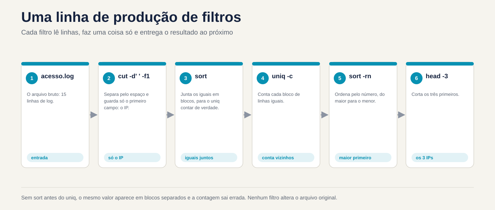

# Lezione 3.2 · Filtri di testo

Nella lezione 3.1 hai imparato come collegare i comandi: chi legge da dove, chi scrive dove e come effettivamente una pipe si guasta. Oggi impari **cosa mettere nel mezzo del tubo**. Un server parla in testo: log, `/etc/passwd`, l'output di `ps`, `ss`, `du`. La domanda sul ticket non è quasi mai "mostra il registro". Si tratta di "chi ha sbagliato più password", "quale cartella ha riempito il disco", "quanti 500 errori dalle otto in punto". La risposta è una fila di filtri: `cut` taglia colonne, `sort` ordina, `uniq` conta, `tr` scambia e cancella caratteri, `paste` unisce, `nl` numeri, `split` divide, `od` mostra i byte che non vedi e `sha256sum` dimostra che due file sono uguali. Alla fine della lezione, un log diventa un report con uno script di dieci righe, lo stesso su entrambe le VM.

| File | lezione 3.2 |
| --- | --- |
| Modulo | M3 · Testo ed editor, lezione 2 di 5 |
| Quando | Settimana 7 |
| Alla fine puoi | Taglia colonne con `cut`, comprese le uscite con più spazi; ordinare per numero, per dimensione leggibile e per colonna specifica con `sort -t -k`; contare le occorrenze con `sort \| uniq -c \| sort -rn`; pulire e cambiare i caratteri con `tr` e sapere quando non è più utile; unire righe e colonne con `paste`; numero con `nl`; dividere e riassemblare i file con `split` e `cat` e dimostrare l'integrità con `sha256sum`; trovare un Windows `\r` con `od`; leggere i registri ruotati con `zcat`; trasformare un registro in un report |
| Articoli di prova | LE 3.2 (cercare ed estrarre dati da file) · LPIC-1 103.2 (elaborare flussi di testo utilizzando filtri: `cut`, `sort`, `uniq`, `tr`, `paste`, `nl`, `split`, `od`, `wc`, `head`, `tail`, `zcat`, `md5sum`, `sha256sum`) · RHCSA (indiretto: estrazione e consegna risultati da archiviare) |
| Prerequisiti | lezione 1.5 (`head`, `tail`, `wc`, `grep` base); lezione 3.1 (tubi, qui-doc, `pipefail`, `ssh deb`) |
| Tempo | Intorno alle 2:30 |
| Istantanee | m3a2-start e m3a2-end in entrambe le VM |

## 1 · Riscaldamento

Tre domande, appena mi vengono in mente. Scrivi le risposte; la chiave di risposta controlla alla fine.

1. Un file contiene le righe `b`, `a`, `b`, `a`, in questo ordine. Indovina: quante righe mancano dopo `uniq`?
2. Hai un elenco di taglie: `512M`, `1.2G`, `40K`. Indovina: `sort -n` mette `1.2G` alla fine?
3. Un collega invia uno script creato nel Blocco note. Giri e ricevi `/bin/bash^M: bad interpreter`. Indovina: cos'è questo `^M`?

## 2 · Perché è importante

I filtri sembrano una cosa di prova fino alla prima alba di un incidente:

| Il cosiddetto | La risposta sbagliata | Cosa provoca |
| --- | --- | --- |
| "Chi sta attaccando l'accesso al sito web?" | Aprire il registro in `less` e scorrere | Venti minuti per scoprire cosa mostra un `sort \| uniq -c \| sort -rn \| head` in un secondo. Nel frattempo l'attacco continua |
| "Quale cartella ha riempito il disco?" | `du -sh * \| sort -rn \| head -1` | Mostra `512M` come il più grande e `3.5G` viene tralasciato. Qualcuno ha eliminato la cartella sbagliata |
| "Conta quanti IP diversi hanno avuto accesso oggi" | `cut ... \| uniq \| wc -l` | `uniq` unisce solo le linee **vicine**. Il numero esce gonfiato e il rapporto arriva al cliente in questo modo |
| "Il foglio di calcolo dell'utente proviene da Windows, crea gli account" | Leggi il CSV direttamente in un loop | Ogni nome termina con un `\r` invisibile: `useradd` crea `ana\r` e nessuno può entrare come `ana` |
| "Il file da 2 GB è arrivato corrotto al fornitore" | Invia ancora e ancora | Senza `sha256sum` su entrambi i lati, nessuno sa se il problema è l'upload, il disco o il file sorgente |
| "Abbiamo bisogno dei registri della scorsa settimana" | `grep` in `/var/log/messages` | I giorni precedenti vengono ruotati, a volte in `.gz`. `grep` non si legge compresso; `zgrep` e `zcat` leggere |

Chi risolve velocemente non conosce più i comandi. Sai come assemblare la riga giusta: taglia, ordina, conta, in quest'ordine.

## 3 · Modello mentale

> Un filtro è un comando che **legge le righe nell'input, fa una cosa con esse e scrive le righe nell'output**. Nessun filtro modifica il file originale. Assembli il report come una linea di produzione: ogni filtro riceve ciò che ha consegnato il precedente e il successivo vede solo ciò che rimane.

```text
  A pergunta: "quais IPs mais acessaram?"

  acesso.log ─▶ cut -d' ' -f1 ─▶ sort ─▶ uniq -c ─▶ sort -rn ─▶ head -3
  (15 linhas)   (só o IP)        (iguais   (conta os   (maior      (os 3
                                 ficam     vizinhos)   número      primeiros)
                                 juntos)               primeiro)

  O que passa em cada etapa:

  10.1.0.20      10.1.0.20      10.1.0.20       4 10.1.0.20     5 192.168.5.7
  10.1.0.31      10.1.0.20      10.1.0.20       2 10.1.0.31     4 10.1.0.20
  10.1.0.20  ─▶  10.1.0.20  ─▶  ...         ─▶  1 10.1.0.45 ─▶  3 203.0.113.9
  192.168.5.7    10.1.0.20      10.1.0.31       5 192.168.5.7   2 10.1.0.31
  ...            10.1.0.31      ...             3 203.0.113.9   1 10.1.0.45

  Por que o sort vem ANTES do uniq:

  sem sort:  a b b a  ─▶ uniq -c ─▶  1 a   2 b   1 a     (o "a" aparece duas vezes)
  com sort:  a a b b  ─▶ uniq -c ─▶  2 a   2 b           (agora conta de verdade)
```

Tre domande per ciascun filtro, prima di utilizzarlo: **cos'è una colonna** (un separatore fisso? qualche spazio?), **cosa è uguale** ad esso (byte per byte? secondo la lingua?), e **cos'è un carattere** (un byte? una lettera con un accento?). Quasi tutti i risultati errati nella lezione provengono da una di queste tre risposte.



*Ogni filtro legge le righe, fa una cosa e fornisce il risultato a quella successiva.*

## 4 · Concetto a più livelli

### Essenziale

**Il file di laboratorio.** Tutti gli esempi utilizzano lo stesso registro di accesso da un server Web, creato nel passaggio 0. Una riga, con ciascun campo separato da **uno** spazio:

```text
192.168.5.7 - - [03/Nov/2026:08:02:30 +0100] "POST /login HTTP/1.1" 401 128
     1      2 3          4            5         6     7       8      9   10
```

Campo 1 è l'IP, 7 è il percorso richiesto, 9 è lo stato HTTP e 10 è la dimensione della risposta in byte.

**Il `cut` taglia.** Per campo, con un separatore di **un** carattere, o per posizione:

```bash
cut -d' ' -f1 acesso.log           # solo l'IP
cut -d' ' -f7,9 acesso.log         # il percorso e lo stato
cut -d: -f1,3 /etc/passwd          # nome e UID
cut -c1-3 acesso.log               # i primi tre caratteri di ogni riga
cut -d: -f1 --complement /etc/passwd   # tutto tranne il campo 1 (GNU)
```

Sem `-d`, il separatore è la tabulazione. `-f` accetta elenchi (`1,3`) e brani (`2-4`, `5-`).

**`sort` ordina.** Per impostazione predefinita, per testo, secondo la lingua del sistema:

| Opzione | Cosa fa | Esempio |
| --- | --- | --- |
| `-n` | Per numero | `sort -n numeros.txt` |
| `-r` | Inverti | `sort -rn` (prima il più grande) |
| `-h` | Per dimensione leggibile: `K`, `M`, `G` | `du -sh * \| sort -h` |
| `-u` | Solo uno per ogni riga è uguale a | `sort -u nomes.txt` |
| `-t X` | Il separatore di campo è `X` | `sort -t:` |
| `-k N,N` | Ordina per campo N, solo | `sort -t: -k3,3n /etc/passwd` |
| `-o f` | Scrive in `f`, anche se è il file di input | `sort -o lista.txt lista.txt` |

**`uniq` unisce le linee uguali vicine.** E solo vicine: per questo motivo viene quasi sempre dopo `sort`.

| Opzione | Che cosa significa |
| --- | --- |
| (nessuno) | Uno per ogni gruppo di linee uguali di fila |
| `-c` | Contare quanti erano in ciascun gruppo |
| `-d` | Solo quelli che si ripetono |
| `-u` | Solo quelli che compaiono una volta |

La frase che scriverai per tutta la vita: `sort | uniq -c | sort -rn | head`. Taglia prima, con `cut`, e lei risponde "quello che appare di più".

** `wc`, `head` e `tail` rivisti.** `wc -l` conta le righe; `head -n 3` e `tail -n 3` prendono il primo e l'ultimo. Un nuovo dettaglio: `tail -n +2` inizia **alla riga 2**, cioè salta l'intestazione di un CSV.

**`tr` scambia caratteri.** Legge solo l'input: non accetta nomi di file.

```bash
tr a-z A-Z < arquivo           # minuscolo in maiuscolo
tr -d '\r' < win.txt > unix.txt    # elimina \r da Windows
tr -s ' ' < saida.txt          # unisce gli spazi ripetuti in uno solo
tr ':' '\n' <<< "$PATH"        # una directory PATH per riga
```

### Intermedio

**`cut` e i vari spazi.** `cut -d' '` considera **ogni** spazio un separatore. Due colonne separate da tre spazi hanno, per lui, due campi vuoti al centro. L'output di `ps`, `ls -l`, `df` e `/var/log/secure` di Rocky allinea le colonne con spazi ripetuti. La soluzione è unire gli spazi prima di:

```bash
ps aux | cut -d' ' -f2            # quasi tutto vuoto
ps aux | tr -s ' ' | cut -d' ' -f2   # il PID di ciascun processo
```

Il registro `rsyslog` ha una trappola del calendario: il giorno è allineato con uno spazio, `Nov  3` nei giorni da 1 a 9 e `Nov 10` dal 10. Un `cut -d' ' -f5` che funziona il 12 ottiene il campo sbagliato il 3. `tr -s ' '` lo risolve in entrambi i casi.

**O `sort` per colonna.** L'infinito `-k` (`-k3`) ordina **dal campo 3 alla fine della riga**; `-k3,3` ordina solo tramite il campo 3. Il tipo va con la chiave:

```bash
sort -t: -k3,3n /etc/passwd            # tramite UID, ad esempio il numero
sort -k1,1nr -k2,2n relatorio.txt      # per campo 1, prima il più grande; pareggio, sul campo 2
```

Senza `-n`, `1000` viene prima di `2`, perché il carattere `1` viene prima di `2`. Ordinare i numeri come testo è l'errore più comune in `sort`.

**La lingua cambia l'ordine.** `sort` confronta in base alla variabile `LC_COLLATE` (o `LANG`). Nel sistema `en_US.UTF-8` le lettere maiuscole e minuscole sono mescolate (`a A b B`) e la punteggiatura quasi non conta. Nella lingua `C`, l'ordine è byte order: tutto maiuscolo prima del minuscolo. Per un risultato che non dipende dal server ed è più veloce in un file di grandi dimensioni:

```bash
LC_ALL=C sort arquivo
```

**Il `paste` unisce.** Colonne di file diversi, una accanto all'altra, o tutte le righe di un file in uno:

```bash
paste nomes.txt uids.txt          # riga 1 con riga 1, separati da tabulazioni
paste -d: nomes.txt uids.txt      # lo stesso, separato da ":"
cut -d: -f1 /etc/passwd | paste -sd,      # tutti gli utenti in una riga, con una virgola
cut -d' ' -f10 acesso.log | paste -sd+    # 512+1024+2048+...: un resoconto pronto
```

L'ultima riga diventa una somma con l'aritmetica del `bash`: `echo $(( $(cut -d' ' -f10 acesso.log | paste -sd+) ))`.

**I numeri `nl`.** Come `cat -n`, ma per impostazione predefinita salta le righe vuote. `nl -ba` li numera tutti. Utilizzato per parlare di un file di configurazione: "guarda la riga 42".

**I registri ruotati.** `logrotate` rinomina il vecchio registro (`messages-20261026`) e, a seconda della configurazione, lo compatta (`.gz`). I filtri non leggono compressi, ma esistono versioni che leggono:

| Da leggere | Compresso con | Utilizzare |
| --- | --- | --- |
| `.gz` | `gzip` | `zcat`, `zless`, `zgrep` |
| `.bz2` | `bzip2` | `bzcat` |
| `.xz` | `xz` | `xzcat` |

```bash
zcat /var/log/messages-*.gz | grep -c sshd
```

### Windows Bridge

| Su Windows | Su Linux | La differenza che conta |
| --- | --- | --- |
| Apri il CSV in Excel e filtra | `cut`, `sort`, `uniq` | Su Linux, il filtro viene eseguito sul server, senza copiare il file, e diventa uno script |
| `Sort-Object` | `sort` | PowerShell ordina gli **oggetti** in base alla proprietà; `sort` ordina **testo**, e tu dici quale colonna e se è un numero |
| `Group-Object` | `sort \| uniq -c` | `uniq` unisce solo i vicini: `sort` prima è obbligatorio |
| `Select-Object -First 5` | `head -n 5` | Idem |
| `Get-FileHash` | `sha256sum` | Lo stesso SHA-256. L'hash di un file è lo stesso su Windows e Linux, **se i byte sono gli stessi** |
| Fine riga `CRLF` (`\r\n`) | Fine riga `LF` (`\n`) | `\r` rimane in Linux, invisibile, alla fine di ogni riga. È l'origine della metà del messaggio "lo script non funziona" |
| Il blocco note mostra gli accenti | `od -c` mostra i byte | In Linux **vedi** cosa c'è nel file, incluso cosa nasconde lo schermo |

### Avanzato

**`tr` non capisce l'accento.** `tr` di GNU funziona con **byte**. In UTF-8, `ç` e `ã` sono due byte ciascuno e nessuno dei due è in `a-z`. Pertanto `tr a-z A-Z <<< "ação"` restituisce `AçãO`. Per cambiare maiuscole e minuscole nel testo accentato, in una lingua UTF-8:

```bash
palavra="ação"; echo "${palavra^^}"      # AZIONE, in bash
sed 's/.*/\U&/' <<< "ação"               # AZIONE, in GNU sed
```

**`od` mostra l'invisibile.** `od -c` stampa ogni byte come carattere; `-An` rimuove la colonna dalla posizione; `-tx1` viene visualizzato in esadecimale. Ecco come scopri `\r` in Windows, una tabulazione al posto degli spazi, o uno strano carattere incollato da una pagina web:

```bash
printf 'ok\r\n' | od -c
# 0000000   o   k  \r  \n
printf 'ação' | od -An -tx1
#  61 c3 a7 c3 a3 6f
```

Il `cat -A` fa la stessa cosa, in modo più breve: mostra `^M` per il `\r`, `^I` per la tabulazione e `$` alla fine di ogni riga.

**Il `split` divide; `cat` torna indietro.** Per inviare un file di grandi dimensioni su un canale che ha un limite di dimensione o per elaborare un registro enorme in blocchi:

```bash
split -b 10M -d backup.tar.gz backup.part.     # backup.parte.00, .01, .02...
split -l 1000 lista.txt lista.                 # 1000 righe per pezzo: list.aa, list.ab...
cat backup.part.* > backup-remontado.tar.gz
```

`-d` utilizza numeri nel suffisso. `cat backup.part.*` si riassembla nell'ordine corretto perché la shell espande `*` in ordine alfabetico e `00` viene prima di `01`.

**L'hash dimostra.** `sha256sum` calcola un'impronta digitale di 64 caratteri esadecimali. Un byte diverso modifica l'intero hash. `-c` controlla un elenco di hash precedentemente registrato:

```bash
sha256sum backup.tar.gz > backup.sha256        # scrive "nome hash"
sha256sum -c backup.sha256                     # backup.tar.gz: OK
```

`md5sum` e `sha1sum` funzionano allo stesso modo, ma sono interrotti per sicurezza: qualcuno può creare due file diversi con lo stesso hash. Servono ancora per rilevare la corruzione accidentale; per dimostrare che nessuno ha toccato il file, utilizzare `sha256sum` o `sha512sum`. Questo è ciò che pubblicano le distribuzioni accanto a ciascuna ISO.

**Il `join`, da sapere.** Il `join` unisce due file **ordinati** per colonna comune, come un database `JOIN`: `join -t: <(sort -t: -k1,1 a) <(sort -t: -k1,1 b)`. Raramente rientra nel test e quasi mai su base giornaliera, perché `awk` della lezione 3.4 fa lo stesso con maggiore controllo.

### Cosa rientra nel test

**Linux Essentials e LPIC-1 (103.2):**

- Cosa fa ciascun filtro, in una frase, e l'opzione principale di ciascuno: `cut -d -f`, `sort -n -r -k -t -u`, `uniq -c -d -u`, `tr -d -s`, `paste -s -d`, `nl -ba`, `split -l -b`, `od -c`, `wc -l -w -c`.
- Quel `uniq` necessita di input ordinato.
- Quel `tr` legge solo l'input standard.
- `head -n` e `tail -n`, inclusi `tail -n +N` e `tail -f`.
- `zcat`, `bzcat` e `xzcat` leggere compressi senza decompressione.
- `md5sum`, `sha256sum` e `sha512sum`, e il `-c`.

**RHCSA:**

- Non c'è dubbio "usa `cut`", ma c'è "salva in `/root/x` le righe che...", "salva l'elenco ordinato di...". I filtri sono il modo in cui assembli la risposta e la consegni in un file, con `>` dalla lezione 3.1.

## 5 · Rocky × Debian

| Cosa | laboratorio-roccioso | debian-lab | Come controllare |
| --- | --- | --- | --- |
| `cut`, `sort`, `uniq`, `tr`, `paste`, `nl`, `split`, `od`, `sha256sum` | Coreutil GNU 8.32 | Coreutil GNU 9.1 | `sort --version \| head -1` |
| `sort` lingua predefinita | Quale impostazione è impostata | Quale impostazione è impostata | `locale`; se le due VM differiscono, differisce anche l'ordine di `sort` |
| `awk` | `gawk` | `mawk` | `readlink -f "$(command -v awk)"`. Materie della lezione 3.4 |
| Formato di `/var/log/secure` e `/var/log/messages` | `rsyslog`, formato tradizionale: `Nov  3 08:02:30`, con il giorno allineato per spazio | Non esistono: solo il giornale | `sudo head -n 2 /var/log/secure` |
| Formato diario breve | `Nov 03 08:02:30`, con zero | `Nov 03 08:02:30`, con zero | `journalctl -n 2` |
| Registri ruotati | Con data nel nome (`messages-20261026`) | Con numero (`.1`, `.2.gz`) | `ls /var/log/ \| head` |
| `dos2unix` | Non viene installato | Non viene installato | `command -v dos2unix` |
| `bc` (calcolatrice) | Potrebbe non essere installato | Potrebbe non essere installato | `command -v bc`. La lezione usa `$(( ))`, che viene da `bash` |

La differenza più fuorviante è quella del log: la stessa domanda, con lo stesso `cut`, dà il risultato giusto un giorno e quello sbagliato quello dopo, in Rocky. In Debian il formato journal non presenta questo problema, ma il log non è nemmeno un file. Il passo 4 mostra entrambi i casi.

## 6 · Laboratorio guidato

Sei `rodrigo`, in rocky-lab e raggiungi debian-lab tramite `ssh deb`. Tutto avviene in `~/lab32`, su entrambe le VM; Nessun passaggio tocca il file di sistema e i registri effettivi vengono solo letti. Il passaggio 7 è la sfida della lezione e il report che genera deve essere controllato dopo il riavvio.


*Senza ordinamento prima di uniq, lo stesso valore appare in blocchi separati e il conteggio è sbagliato.*


### Passaggio 0 · Istantanea, percorso e registro del laboratorio

In Proxmox, acquisire l'istantanea `m3a2-inicio` delle due VM. In rocky-lab:

```bash
eval "$(ssh-agent -s)"; ssh-add
ssh -o BatchMode=yes deb hostname
mkdir -p ~/lab32; ssh deb 'mkdir -p ~/lab32'
cd ~/lab32
locale | grep -E '^(LANG|LC_COLLATE)='; ssh deb "locale | grep -E '^(LANG|LC_COLLATE)='"
```

Nota la lingua delle due VM: se sono diverse, `sort` potrebbe anche essere ordinato in modo diverso. Ora il registro del laboratorio, con un qui-doc tra virgolette, così la shell non cambia nulla:

```bash
cat > acesso.log <<'EOF'
10.1.0.20 - - [03/Nov/2026:08:00:01 +0100] "GET / HTTP/1.1" 200 5120
10.1.0.31 - - [03/Nov/2026:08:00:15 +0100] "GET /docs HTTP/1.1" 200 2048
10.1.0.20 - - [03/Nov/2026:08:01:02 +0100] "GET /docs HTTP/1.1" 200 2048
192.168.5.7 - - [03/Nov/2026:08:02:30 +0100] "POST /login HTTP/1.1" 401 128
192.168.5.7 - - [03/Nov/2026:08:02:31 +0100] "POST /login HTTP/1.1" 401 128
203.0.113.9 - - [03/Nov/2026:08:03:10 +0100] "GET /admin HTTP/1.1" 403 256
192.168.5.7 - - [03/Nov/2026:08:03:12 +0100] "POST /login HTTP/1.1" 401 128
10.1.0.45 - - [03/Nov/2026:08:04:00 +0100] "GET /relatorio.pdf HTTP/1.1" 200 1048576
203.0.113.9 - - [03/Nov/2026:08:04:20 +0100] "GET /wp-login.php HTTP/1.1" 404 512
10.1.0.20 - - [03/Nov/2026:08:05:05 +0100] "GET /api/status HTTP/1.1" 500 64
192.168.5.7 - - [03/Nov/2026:08:05:40 +0100] "POST /login HTTP/1.1" 401 128
10.1.0.31 - - [03/Nov/2026:08:06:00 +0100] "GET /api/status HTTP/1.1" 500 64
203.0.113.9 - - [03/Nov/2026:08:06:30 +0100] "GET /.env HTTP/1.1" 404 512
192.168.5.7 - - [03/Nov/2026:08:07:01 +0100] "POST /login HTTP/1.1" 200 4096
10.1.0.20 - - [03/Nov/2026:08:07:30 +0100] "GET / HTTP/1.1" 200 5120
EOF
wc -l acesso.log
```

```text
15 acesso.log
```

Leggi il file una volta, con calma. Un IP che prova più volte `/login` e riceve `401`, un altro che cerca `/wp-login.php` e `/.env` su un sito che non è nemmeno WordPress: è esattamente quello che vedi su un server esposto su internet.

### Passo 1 · Il `uniq` che non conta

Il capo chiede: "a quanti IP diversi hanno avuto accesso?". Innanzitutto, solo l'IP di ciascuna riga: 

```bash
cut -d' ' -f1 acesso.log
```

Quindici righe, un IP per riga. Adesso il tentativo veloce:

**Decidi 1 · Esegui `cut -d' ' -f1 acesso.log | uniq | wc -l`. Che numero esce?**

- **A)** 5
- **B)** 14
- **C)** 15
- **D)** 1

Scegli la lettera prima di guardare la tabella.

```bash
cut -d' ' -f1 acesso.log | uniq | wc -l
cut -d' ' -f1 acesso.log | sort -u | wc -l
```

| Se hai selezionato | Risultato | Perché |
| --- | --- | --- |
| A | ❌ Sbagliato | È la risposta giusta alla domanda, ma non è ciò che fornisce questo comando. Il cinque esce dal secondo comando, con `sort -u`. |
| B| ✅ Giusto | `uniq` unisce solo righe **vicine** identiche. Nel log solo le righe 4 e 5 hanno lo stesso IP una sotto l'altra. Le altre ripetizioni sono sparse e ognuna conta di nuovo. |
| C| ❌ Sbagliato | `uniq` combinava qualcosa, sì: le due righe seguite da `192.168.5.7`. |
| D | ❌ Sbagliato | `uniq` non riduce tutto ad una riga. Confronta ogni riga solo con quella precedente. |

**Da risolvere:** `uniq` senza `sort` prima è un bug che sembra funzionare. In un registro di test ordinato in modo casuale, fornisce il numero giusto; nel registro di produzione, n. Per contare diversi: `sort -u | wc -l`. Per contare quante volte appare ciascuna: `sort | uniq -c`.

Ora la frase di tutta la vita, con il risultato del Modello Mentale:

```bash
cut -d' ' -f1 acesso.log | sort | uniq -c | sort -rn | head -n 3
```

```text
      5 192.168.5.7
      4 10.1.0.20
      3 203.0.113.9
```

Lo stesso scheletro, cambiando colonna, risponde ad un'altra domanda. Il campo 9 è lo stato:

```bash
cut -d' ' -f9 acesso.log | sort | uniq -c | sort -rn
```

```text
      6 200
      4 401
      2 500
      2 404
      1 403
```

L'ordine tra `500` e `404`, che sono pari a 2, può variare: `sort -rn` guarda solo il numero. Per risolvere la parità in modo fisso, pronuncia la seconda chiave: `sort -k1,1nr -k2,2n`.

### Passo 2 · Numero ordinato come testo

Qual è stata la risposta più grande, in byte? Il campo 10 è la dimensione.

**Decidi 2 · Esegui `cut -d' ' -f10 acesso.log | sort -r | head -n 1`. Cosa appare?**

- **A)** `1048576`
- **B)** `64`
- **C)** `5120`
- **D)** Errore: `sort` non ordina i numeri senza `-n`

Scegliere la lettera prima di guardare la tabella.

```bash
cut -d' ' -f10 acesso.log | sort -r | head -n 1
cut -d' ' -f10 acesso.log | sort -rn | head -n 1
```

| Se hai selezionato | Risultato | Perché |
| --- | --- | --- |
| A | ❌ Sbagliato | Questo è il risultato del secondo comando, con `-n`. |
| B| ✅ Giusto | Senza `-n`, `sort` confronta carattere per carattere, come in un dizionario. `6` di `64` viene dopo `5` di `5120` e `1` di `1048576`, quindi, da dietro in avanti, `64` viene prima. |
| C| ❌ Sbagliato | `5120` perde rispetto a `64` nel primo carattere: `5` precede `6`. |
| D | ❌ Sbagliato | `sort` ordina qualsiasi testo. Non ti avvisa che hai dimenticato `-n`; consegna semplicemente l'ordine sbagliato. |

**Da correggere:** colonna numerica, `sort -n`, sempre. E l'errore non avvisa: un report con l'ordine sbagliato sembra un report normale.

Stesso problema, con dimensioni leggibili. Leggi: quale cartella `/var/log` occupa più spazio?

```bash
sudo du -sh /var/log/* 2>/dev/null | sort -rn | head -n 3
sudo du -sh /var/log/* 2>/dev/null | sort -rh | head -n 3
```

`-n` legge solo il numero e ignora la lettera: `900K` batte `12M`. `-h` comprende `K`, `M` e `G`. Esegui il secondo su entrambe le VM; è la risposta alla chiamata "quale cartella ha riempito il disco".

### Passo 3 · La colonna di destra e l'intestazione

HR inviano un foglio di calcolo:

```bash
cat > usuarios.csv <<'EOF'
nome;uid;depto
ana;2001;suporte
bruno;2002;redes
carla;150;suporte
davi;10010;redes
EOF
```

Si desidera l'elenco per UID, senza intestazione. `tail -n +2` inizia alla riga 2:

**Decidi 3 · Esegui `tail -n +2 usuarios.csv | sort -t';' -k2 | cut -d';' -f1`. In che ordine compaiono i nomi?**

- **A)** carla, ana, bruno, davi
- **B)** davi, carla, ana, bruno
- **C)** ana, bruno, carla, davi
- **D)** bruno, davi, ana, carla

Scegli la lettera prima di guardare tabella.

```bash
tail -n +2 usuarios.csv | sort -t';' -k2 | cut -d';' -f1 | paste -sd,
tail -n +2 usuarios.csv | sort -t';' -k2,2n | cut -d';' -f1 | paste -sd,
```

| Se hai selezionato | Risultato | Perché |
| --- | --- | --- |
| A | ❌ Sbagliato | Si tratta dell'ordine in base all'UID come numero, che nella chiave appare solo con `n`: `-k2,2n`. |
| B| ✅ Giusto | Senza `n` l'UID è testo: `10010` sta prima di `150`, che sta prima di `2001`, perché `1` sta prima di `2`, e dopo `1`, `0` sta prima di `5`. |
| C| ❌ Sbagliato | Sarebbe l'ordine originale del foglio di calcolo. `sort` ha cambiato l'ordine, ma non come volevi. |
| D | ❌ Sbagliato | Sarebbe l'ordine nel campo 3, il dipartimento, con `-k3`. `-k2` inizia nel campo 2. |

**Da correggere:** la chiave `sort` è composta da tre parti e tutte e tre contano: **dove inizia** (`-k2`), **dove finisce** (`,2`) e **come si confronta** (`n`). Scrivere sempre `-k2,2n`, mai solo `-k2`.

Due chiavi, per un report per reparto e, al suo interno, per UID:

```bash
tail -n +2 usuarios.csv | sort -t';' -k3,3 -k2,2n
```

```text
bruno;2002;redes
davi;10010;redes
carla;150;suporte
ana;2001;suporte
```

Lo stesso vale per i file di sistema. I tre utenti con l'UID più alto, su entrambe le VM:

```bash
sort -t: -k3,3n /etc/passwd | tail -n 3 | cut -d: -f1,3
ssh deb 'sort -t: -k3,3n /etc/passwd | tail -n 3 | cut -d: -f1,3'
```

In entrambi, l'ultimo è solitamente `nobody`, con UID 65534. Subito prima arrivano gli utenti del laboratorio, come `ana`, con 2001. Se appare un altro nome in mezzo, è un account creato da qualche pacchetto: scopri quale con `getent passwd nome`.

### Passo 4 · Il vero log, con troppi spazi

Un campione nel formato `rsyslog` di Rocky, con una riga dal giorno 3 e un altro del giorno 12:

```bash
cat > secure.amostra <<'EOF'
Nov  3 08:02:30 rocky-lab sshd[1201]: Failed password for root from 203.0.113.9 port 51022 ssh2
Nov 12 09:15:02 rocky-lab sshd[1388]: Failed password for root from 198.51.100.4 port 40110 ssh2
EOF
```

Contando a occhio, il nome della macchina è la quarta colonna.

**Decidi 4 · Esegui `cut -d' ' -f4 secure.amostra`. Cosa esce?**

- **A)** `rocky-lab` su entrambe le righe
- **B)** `08:02:30` sulla prima, `rocky-lab` sulla seconda
- **C)** Una riga vuota sulla prima, `rocky-lab` sulla seconda
- **D)** Errore: `cut` non accetta righe di dimensioni diverse

Scegliere la lettera prima di guardare tabella.

```bash
cut -d' ' -f4 secure.amostra
tr -s ' ' < secure.amostra | cut -d' ' -f4
```

| Se hai selezionato | Risultato | Perché |
| --- | --- | --- |
| A | ❌ Sbagliato | È il risultato del secondo comando, dopo `tr -s ' '`. |
| B| ✅ Giusto | Il giorno 3 ci sono due spazi tra `Nov` e `3`. Per `cut` tra loro c'è un campo vuoto: `Nov`, vuoto, `3`, `08:02:30`. Il campo 4 è l'ora. Il giorno 12, il campo 4 è il nome della macchina. |
| C| ❌ Sbagliato | Il campo vuoto è 2, non 4. |
| D | ❌ Sbagliato | `cut` elabora ogni riga da sola e non si lamenta mai dei campi: se il campo non esiste, la riga esce vuota. |

**Per risolvere:** uno script con `cut -d' '` nell'output allineato funziona nei giorni da 10 a 31 e si interrompe nei giorni da 1 a 9. Se le colonne sono allineate allo spazio, unisci gli spazi prima: `tr -s ' ' | cut -d' '`.

Ora i registri effettivi, di sola lettura. In Rocky, il programma che ha scritto le ultime righe di `/var/log/secure`:

```bash
sudo tail -n 20 /var/log/secure | tr -s ' ' | cut -d' ' -f5 | cut -d'[' -f1 | tr -d ':' | sort | uniq -c
```

In Debian non c'è `/var/log/secure`. L'equivalente esce dal diario. Il formato breve di `journalctl` scrive il giorno con due cifre, `Nov 03`, quindi il campo non balla:

```bash
ssh deb "sudo journalctl -n 20 -o short --no-pager | tr -s ' ' | cut -d' ' -f5 | cut -d'[' -f1 | tr -d ':' | sort | uniq -c"
```

Il `sudo` in `ssh deb` può richiedere una password. Se richiesto, esegui lo stesso comando all'interno di una sessione `ssh deb`. La prima riga di `journalctl` talvolta è un'intestazione (`-- Boot ...`) o non ha lo stesso numero di campi e appare nel conteggio come un nome strano. Nella Lezione 3.3, `grep` risolve questo problema scegliendo solo le linee giuste.

E i tronchi ruotavano. A Rocky, i giorni precedenti sono in file con una data nel nome:

```bash
ls /var/log/messages* /var/log/secure* 2>/dev/null
sudo cat /var/log/secure-* 2>/dev/null | wc -l
```

Se qualcuno termina in `.gz`, sostituire `cat` con `zcat`. `cat` di un file compresso mostra spazzatura binaria e `wc -l` dice spazzatura.

### Passo 5 · Il `\r` che nessuno vede

Il foglio di calcolo HR è arrivato di nuovo, questa volta salvato in Windows. `printf` imita ciò che registra il Blocco note:

```bash
printf 'ana\r\nbruno\r\n' > win.txt
cat win.txt
```

```text
ana
bruno
```

Sullo schermo tutto è normale.

**Decidi 5 · Esegui `grep -c '^ana$' win.txt`. Che numero esce?**

- **A)** `1`
- **B)** `0`
- **C)** `2`
- **D)** Errore: `grep` non legge il file di Windows

Scegliere la lettera prima di guardare la tabella.

```bash
grep -c '^ana$' win.txt
od -c win.txt
cat -A win.txt
```

```text
0
0000000   a   n   a  \r  \n   b   r   u   n   o  \r  \n
0000014
ana^M$
bruno^M$
```

| Se hai selezionato | Risultato | Perché |
| --- | --- | --- |
| A | ❌ Sbagliato | Il risultato sarebbe in un file Linux. Qui la riga è `ana\r`: dopo `a` c'è `\r`, non la fine della riga. `$` non corrisponde. |
| B| ✅ Giusto | `od -c` mostra `\r` prima di ogni `\n`. `cat -A` mostra lo stesso di `^M`. Il terminale si nasconde: `\r` riporta solo il cursore all'inizio della riga. |
| C| ❌ Sbagliato | `bruno` non inizia nemmeno con `ana`. `-c` conta le righe che corrispondono e nessuna corrispondenza. |
| D | ❌ Sbagliato | Per `grep` un file è un file. Ha letto tutto; Semplicemente non hai trovato quello che avevi chiesto. |

**Per risolvere:** quando un testo "uguale" non corrisponde, guardare i byte prima di sospettare il comando: `od -c` o `cat -A`. `^M` è uguale a `bad interpreter` di Riscaldamento.

La correzione e la prova:

```bash
tr -d '\r' < win.txt > unix.txt
grep -c '^ana$' unix.txt
wc -c win.txt unix.txt
```

```text
1
12 win.txt
10 unix.txt
22 total
```

Due byte in meno: un `\r` per riga. `tr` legge solo lo standard input; quindi `<`. Ora il limite di `tr`:

```bash
tr a-z A-Z <<< "configuração"
p="configuração"; echo "${p^^}"
```

```text
CONFIGURAçãO
CONFIGURAÇÃO
```

`tr` non ha toccato né `ç` né `ã`: ciascuno è di due byte in UTF-8, fuori `a-z`. `${p^^}` di `bash` comprende le lettere. Controllare i byte con `printf 'ç' | od -An -tx1`: ne appaiono due, `c3 a7`.

### Passo 6 · Dividere, unire e provare

Il log arriva a un fornitore attraverso un canale che accetta solo file di piccole dimensioni. Prima di tutto l'impronta digitale:

```bash
sha256sum acesso.log | tee acesso.sha256
```

**Decidi 6 · Esegui `split -l 4 acesso.log parte.`. Quanti file vengono visualizzati e di quante righe è l'ultimo?**

- **A)** 3 fascicoli; l'ultimo con 3 righe
- **B)** 4 file; l'ultimo di 3 righe
- **C)** 4 file di 4 righe ciascuno; l'ultimo completato con righe vuote
- **D)** 5 file; l'ultimo con 1 riga

Scegli la lettera prima di guardare la tabella.

```bash
split -l 4 acesso.log parte.
wc -l parte.*
```

```text
   4 parte.aa
   4 parte.ab
   4 parte.ac
   3 parte.ad
  15 total
```

| Se hai selezionato | Risultato | Perché |
| --- | --- | --- |
| A | ❌ Sbagliato | Tre file di 4 righe ne contengono 12. Ne rimangono 3, che vanno in un quarto file. |
| B| ✅ Giusto | 15 righe, 4 per file: `aa`, `ab` e `ac` con 4, e `ad` con le restanti 3. |
| C| ❌ Sbagliato | `split` non inventa mai contenuti. Se venisse inventato, il file riassemblato sarebbe diverso dall’originale e l’hash fallirebbe. |
| D | ❌ Sbagliato | Sarebbe con `-l 3` e un registro di 13 righe. Fai i conti: 4 × 3 = 12 e 15 − 12 = 3. |

**Per risolvere:** `split` taglia e `cat` incolla, senza modificare alcun byte. Ciò che dimostra che nessun byte è cambiato è l'hash, mai la dimensione o l'occhio.

Riassemblaggio e prova:

```bash
cat parte.* > remontado.log
sha256sum acesso.log remontado.log
cmp acesso.log remontado.log && echo "iguais"
rm parte.* remontado.log
```

I due hash sono uguali e `cmp`, che confronta byte con byte, non stampa nulla e restituisce successo. Adesso invialo per davvero, all'altra VM, con la prova dall'altra parte:

```bash
scp acesso.log acesso.sha256 deb:lab32/
ssh deb 'cd ~/lab32 && sha256sum -c acesso.sha256'
```

```text
acesso.log: OK
```

È la stessa cosa che fai con un ISO scaricato: il sito pubblica `.sha256` e `sha256sum -c` lo controlla.

Infine, `paste` e `nl`, che sono inclusi nel report del passo 7:

```bash
cut -d' ' -f10 acesso.log | paste -sd+
echo $(( $(cut -d' ' -f10 acesso.log | paste -sd+) ))
cut -d' ' -f7 acesso.log | sort -u | nl
```

Il primo comando scrive l'account (`5120+2048+...`); il secondo calcola: **1068928** byte. Il terzo numera i diversi percorsi richiesti. Per modificare riga per riga, `paste` unisce due colonne di file diversi:

```bash
cut -d' ' -f1 acesso.log > ips.txt
cut -d' ' -f9 acesso.log > status.txt
paste -d' ' ips.txt status.txt | head -n 3
```

### Passo 7 · Sfida: il registro diventa un report

La chiamata: "invia un riepilogo del registro degli accessi ogni giorno". Scrivi `~/lab32/relatorio.sh` in rocky-lab:

```bash
cat > relatorio.sh <<'EOF'
#!/bin/bash
# relatorio.sh: resumo de um log de acesso no formato do lab
set -u
log=${1:?uso: relatorio.sh arquivo.log}
[ -r "$log" ] || { echo "não consigo ler $log" >&2; exit 1; }

echo "Relatório de $log em $(hostname), $(date '+%F %T')"
echo "Requisições: $(wc -l < "$log")"
echo "IPs diferentes: $(cut -d' ' -f1 "$log" | sort -u | wc -l)"
echo "Top 3 IPs:"
cut -d' ' -f1 "$log" | sort | uniq -c | sort -k1,1nr -k2,2 | head -n 3
echo "Por status:"
cut -d' ' -f9 "$log" | sort | uniq -c | sort -k2,2n
echo "Bytes enviados: $(( $(cut -d' ' -f10 "$log" | paste -sd+) ))"
echo "IPs com 401: $(cut -d' ' -f1,9 "$log" | grep ' 401$' | cut -d' ' -f1 | sort -u | paste -sd,)"
EOF
chmod +x relatorio.sh
./relatorio.sh acesso.log | tee "relatorio-$(hostname).txt"
```

```text
Relatório de acesso.log em rocky-lab, 2026-11-...
Requisições: 15
IPs diferentes: 5
Top 3 IPs:
      5 192.168.5.7
      4 10.1.0.20
      3 203.0.113.9
Por status:
      6 200
      4 401
      1 403
      2 404
      2 500
Bytes enviados: 1068928
IPs com 401: 192.168.5.7
```

Senza `pipefail` apposta: `head` chiude il tubo dopo tre righe, e in un grande log il `sort` prima di ricevere un `SIGPIPE`. Con `pipefail`, questa conclusione normale conterebbe come fallimento.

Ora Debian. `relatorio.sh` va con esso, e in Debian lo chiami `sh`, senza pensare:

```bash
scp relatorio.sh deb:lab32/
```

**Decidi 7 · In debian-lab, dove `sh` è `dash`, esegui `sh relatorio.sh acesso.log`. Cosa succede?**

- **A)** Il report esce uguale a quello di Rocky, solo con un nome macchina diverso
- **B)** Errore in `$(( ))`: `dash` non conta
- **C)** Errore in `${1:?...}`: `dash` non conosce questo modulo
- **D)** `dash` legge `#!/bin/bash` e chiama `bash` solo

Scegli la lettera prima di guardare la tabella.

```bash
ssh deb 'cd ~/lab32 && sh relatorio.sh acesso.log | tee "relatorio-$(hostname).txt"'
```

| Se hai selezionato | Risultato | Perché |
| --- | --- | --- |
| A | ✅ Giusto | Tutto nello script è POSIX: `$(( ))`, `${1:?}`, `[ -r ]`, `$( )`. E i filtri sono programmi esterni, gli stessi per entrambe le shell. Il `dash` funziona senza lamentele. |
| B| ❌ Sbagliato | `$(( ))` è POSIX e `dash` tiene conto dei numeri interi. Ciò che non ha sono gli extra del `bash`, come il solo `(( ))` o il `let`. |
| C| ❌ Sbagliato | `${var:?mensagem}` è POSIX e funziona in qualsiasi `sh`. |
| D | ❌ Sbagliato | Quando scrivi `sh script`, decide `sh`. `#!` è valido solo se lo script viene eseguito direttamente, come `./relatorio.sh`. Per `dash` la prima riga è un commento. |

**Da correggere:** `#!` si applica a `./script`, mai a `sh script`. Ha funzionato qui perché lo script non utilizza nulla da `bash`. Con un `${p^^}` dal passaggio 5 o un `<<<`, lo stesso comando si interromperebbe su Debian e funzionerebbe su Rocky.

Confronta i due report, ad eccezione della prima riga, che ha nome e ora della macchina:

```bash
diff <(tail -n +2 relatorio-rocky-lab.txt) <(ssh deb 'tail -n +2 ~/lab32/relatorio-debian-lab.txt') && echo "mesmo resultado"
```

```text
mesmo resultado
```

Lo stesso registro, lo stesso script e due sistemi diversi forniscono lo stesso report. Se l'ordine degli IP cambiasse da una VM all'altra, la colpa sarebbe del linguaggio (Passaggio 0) e la correzione sarebbe `LC_ALL=C` all'inizio dello script.

**Bonus, sola lettura.** Lo stesso scheletro, in un file reale: quanti utenti utilizzano ciascuna shell, su entrambe le VM.

```bash
cut -d: -f7 /etc/passwd | sort | uniq -c | sort -rn
ssh deb 'cut -d: -f7 /etc/passwd | sort | uniq -c | sort -rn'
```

Rocky utilizza `/sbin/nologin` per gli account di servizio; a Debian, `/usr/sbin/nologin`. È la stessa idea con un percorso diverso e il rapporto lo mostra in una riga.

## 7 · Interrompi e correggi

### Interrompi A · L'elenco che si è cancellato da solo

Lo scenario: un server ha un elenco di IP rilasciati per il pannello di amministrazione. Ogni notte uno script pulisce l'elenco, rimuovendo le ripetizioni, e il firewall legge il risultato. Un giorno nessuno entra più nel pannello. Assembla l'elenco così com'era, in rocky-lab:

```bash
cat > ~/lab32/liberados.txt <<'EOF'
10.1.0.20
10.1.0.31
10.1.0.20
192.168.1.10
10.1.0.31
EOF
sha256sum ~/lab32/liberados.txt
```

E la riga che lo script esegue ogni notte:

```bash
sort -u ~/lab32/liberados.txt > ~/lab32/liberados.txt
```

**Nota.** Nessun messaggio di errore e lo stato è `0`. Ma:

```bash
wc -l ~/lab32/liberados.txt; echo "status: $?"
```

```text
0 /home/rodrigo/lab32/liberados.txt
status: 0
```

L'elenco è vuoto. In un firewall che consente solo quelli presenti nell'elenco, questo è "nessuno entra".

**Diagnostique.** Ricorda la lezione 3.1: la persona che apre il file `>` è la shell, **prima** dell'avvio del comando. E `>` si apre troncando. Vedi l'ordine con `bash -x`, che mostra la riga dopo le espansioni:

```bash
printf 'b\na\nb\n' > ~/lab32/teste.txt
bash -xc 'sort -u ~/lab32/teste.txt > ~/lab32/teste.txt'; wc -c ~/lab32/teste.txt
```

```text
+ sort -u /home/rodrigo/lab32/teste.txt
0 /home/rodrigo/lab32/teste.txt
```

`bash -x` mostra `sort` senza `>`: la redirezione non è un argomento per `sort`, è una preparazione che fa la shell prima di chiamarla. Quando è stato letto `sort` il file aveva già zero byte. Ha letto un file vuoto, non ha ordinato nulla e non ha scritto nulla.

**Decidere A · La correzione.** In che modo lo script dovrebbe ripulire l'elenco?

- **A)** `sort -u -o ~/lab32/liberados.txt ~/lab32/liberados.txt`
- **B)** `sort -u ~/lab32/liberados.txt >> ~/lab32/liberados.txt`
- **C)** `cat ~/lab32/liberados.txt | sort -u > ~/lab32/liberados.txt`
- **D)** `sort -u ~/lab32/liberados.txt > /tmp/lista && mv /tmp/lista ~/lab32/liberados.txt`

Scegliere una lettera prima di guardare tabella.

| Se hai selezionato | Risultato | Perché |
| --- | --- | --- |
| A | ✅ Giusto | `-o` proviene da `sort`, non dalla shell. `sort` legge prima l'intero input e apre solo il file di output alla fine, quindi accetta lo stesso file su entrambi i lati. Il file rimane lo stesso, con lo stesso proprietario e le stesse autorizzazioni. |
| B| ❌ Sbagliato | `>>` non tronca, quindi non viene cancellato nulla, ma l'elenco ordinato va alla **fine** dell'originale. L'archivio cresce ogni notte e le ripetizioni sono ancora lì. |
| C| ❌ Sbagliato | Il peggiore dei quattro, perché a volte funziona. `cat` e `>` partono insieme e decide chi arriva primo. In un file piccolo vince quasi sempre `>` e l'elenco scompare; A volte no e il test passa. |
| D | ⚠️ Funziona, ma | Il contenuto viene fuori bene. Ma `mv` scambia il file con un altro, creato da `rodrigo` con permessi predefiniti: se la lista era `root:firewall 640`, non lo è più. E un `/tmp/lista` corretto entra in collisione con un altro script che utilizza lo stesso nome. Se hai bisogno di questo percorso, usa `mktemp` e controlla proprietario e modalità. |

**Per risolvere:** `cmd arquivo > arquivo` cancella il file prima dell'avvio di `cmd`, con qualsiasi comando. Per i filtri che scrivono sul file stesso, utilizzare l'opzione del programma (`sort -o`, `sed -i`), mai `>`.

**Fix.**

```bash
cat > ~/lab32/liberados.txt <<'EOF'
10.1.0.20
10.1.0.31
10.1.0.20
192.168.1.10
10.1.0.31
EOF
sort -u -o ~/lab32/liberados.txt ~/lab32/liberados.txt
cat ~/lab32/liberados.txt
rm ~/lab32/teste.txt
```

```text
10.1.0.20
10.1.0.31
192.168.1.10
```

Tre IP, senza ripetizione. Nella vita reale non esiste un `cat > ... <<'EOF'` per ricreare la lista: o c'era un backup, o uno snapshot, oppure qualcuno si ricorda gli IP. Ecco perché `sha256sum` prima dello spostamento: non ripristina il file, ma dimostra, in seguito, se ciò che hai ripristinato è uguale a quello che c'era.

### Break B · L'elenco dei blocchi che non blocca nulla

Lo scenario: il team di sicurezza ha inviato, da un computer Windows, l'elenco degli IP che hanno attaccato altri client. La domanda è: qualcuno di essi è apparso nel nostro registro? `printf` imita il file in arrivo:

```bash
printf '203.0.113.9\r\n198.51.100.4\r\n' > ~/lab32/bloqueio.txt
cd ~/lab32
cat bloqueio.txt
grep -c -F -w -f bloqueio.txt acesso.log
```

`grep -f` legge i pattern da un file, uno per riga; `-F` li tratta come testo fisso, senza regex; `-w` richiede la parola intera, quindi `203.0.113.9` non corrisponde a `203.0.113.90`. Dettagli della lezione 3.3 `grep`.

**Osservare.** `cat` mostra entrambi gli IP, puliti. `grep -c` risponde `0`. Il rapporto alla sicurezza direbbe "nessun IP dall'elenco ha avuto accesso al server". Ma:

```bash
grep -c 203.0.113.9 acesso.log
```

```text
3
```

Tre accessi, digitando l'IP a mano.

**Diagnostique.** Lo stesso IP corrisponde quando lo digiti e non corrisponde quando proviene dal file. La differenza sta nel file:

```bash
od -c bloqueio.txt | head -n 2
cat -A bloqueio.txt
```

```text
0000000   2   0   3   .   0   .   1   1   3   .   9  \r  \n   1   9   8
0000020   .   5   1   .   1   0   0   .   4  \r  \n
203.0.113.9^M$
198.51.100.4^M$
```

Il valore predefinito è `203.0.113.9\r`. Nel `acesso.log` dopo l'IP c'è uno spazio e non un `\r`. Nessuna riga corrispondente.

**Decidi B · La correzione.** Cosa fai con `bloqueio.txt`?

- **A)** `tr -d '\r' < bloqueio.txt > bloqueio.unix` e usa `bloqueio.unix` in `grep`
- **B)** Aggiungi `-i` a `grep`, per ignorare la differenza
- **C)** Installa il pacchetto `dos2unix` sul server ed esegui `dos2unix bloqueio.txt`
- **D)** `tr -d '\n' < bloqueio.txt > bloqueio.unix`

Scegliere la lettera prima di guardare la tabella.

| Se hai selezionato | Risultato | Perché |
| --- | --- | --- |
| A | ✅ Giusto | Basta rimuovere `\r` e lasciare un IP per riga. Strumento già esistente in entrambe le VM e l'originale rimane intatto per il confronto. |
| B| ❌ Sbagliato | `-i` non fa distinzione tra maiuscole e minuscole. `\r` non è una lettera; è ancora lì e il risultato rimane `0`. |
| C| ⚠️ Funziona, ma | `dos2unix` fa questo e altro ancora e sta benissimo sulla tua workstation. Su un client server, installare un pacchetto per rimuovere un carattere è una modifica che richiede autorizzazione e `tr` lo risolve già. Inoltre, altera il file originale. |
| D | ❌ Sbagliato | Cancella `\n` e lascia `\r`: i due IP diventano una riga, `203.0.113.9\r198.51.100.4\r`. Adesso nemmeno la prima IP si sposa da sola. |

**Per risolvere:** ogni file proveniente da Windows, dal Web o da un'e-mail passa attraverso un `cat -A | head` prima di diventare input di uno script. Una risposta `0` potrebbe essere il file, non il mondo.

**Correggilo.**

```bash
tr -d '\r' < bloqueio.txt > bloqueio.unix
grep -c -F -w -f bloqueio.unix acesso.log
grep -F -w -f bloqueio.unix acesso.log | cut -d' ' -f1,7,9 | sort | uniq -c
```

```text
3
      1 203.0.113.9 /.env 404
      1 203.0.113.9 /admin 403
      1 203.0.113.9 /wp-login.php 404
```

Il `203.0.113.9` è stato qui tre volte alla ricerca del dashboard e del file delle password. `198.51.100.4` non è apparso. Ora il rapporto alla sicurezza dice la verità.

### La lezione

Entrambe le pause hanno dato una risposta silenziosa e sbagliata: stato `0`, nessun messaggio e un file vuoto o un conteggio zero. Il filtro testo non ti avvisa quando l'input è sbagliato; elabora ciò che ha ricevuto. Gli strumenti che dimostrano la verità sono pochi: `wc -l` e `sha256sum` **prima e dopo** il tocco di un file; `od -c` o `cat -A` quando un testo "uguale" non corrisponde; ed esiste un test con un valore che **conosci**, come il `grep -c 203.0.113.9` a portata di mano. Prima di consegnare uno zero, dimostra che lo zero è reale.

## 8 · Insidie

| Digiti o vedi | Cosa succede | Quello giusto |
| --- | --- | --- |
| `cut ... \| uniq -c` | Conta solo le ripetizioni vicine; lo stesso valore appare più volte | `cut ... \| sort \| uniq -c` |
| `sort \| uniq -c \| sort -r` | In un referto con conteggi di dimensioni diverse (`9` e `10`), l'ordine è sbagliato | `sort -rn` |
| `du -sh * \| sort -n` | `900K` è sopra `12M`: `-n` ignora la lettera | `sort -h` |
| `sort -t: -k3 /etc/passwd` | Ordina dal campo 3 alla fine della riga, come testo: `1000` prima di `2` | `sort -t: -k3,3n` |
| `cut -d' ' -f5` nell'uscita allineata (`ps`, `/var/log/secure`) | Ottieni la colonna giusta in alcuni giorni e quella sbagliata in altri | `tr -s ' ' \| cut -d' ' -f5` |
| `cut -d', ' -f1` | `cut: the delimiter must be a single character` | `cut -d, -f1` e poi `tr -d ' '` oppure `awk` dalla lezione 3.4 |
| `sort -u lista > lista` | L'elenco diventa vuoto | `sort -u -o lista lista` |
| `tr a-z A-Z arquivo` | `tr: extra operand 'arquivo'`: `tr` legge solo l'ingresso | `tr a-z A-Z < arquivo` |
| `tr a-z A-Z` nel testo accentato | `CONFIGURAçãO` | `${var^^}` in `bash` oppure `sed 's/.*/\U&/'` |
| Script o elenco proveniente da Windows | `bad interpreter: ^M`, `grep` non sposato, utente `ana\r` | `cat -A arquivo \| head` prima; `tr -d '\r'` correggere |
| `grep padrão log.2.gz` | Cerca in byte compressi e non trova nulla | `zgrep padrão log.2.gz` o `zcat log.2.gz \| grep padrão` |
| Controlla copia per formato (`ls -l`) | File della stessa dimensione con byte diversi passano | `sha256sum` su entrambi i lati oppure `sha256sum -c` |
| `md5sum` per dimostrare che un file non è stato modificato | Rileva la corruzione ma non la manomissione: MD5 è rotto | `sha256sum` |

## 9 · Quiz

Dieci domande, senza consultazione. Scrivi la lettera o la risposta a ciascuna e solo dopo apri la chiave di risposta.

**1.** Qual è la differenza tra `sort | uniq`, `sort -u` e `sort | uniq -c`?

**2.** Quale riga mostra le tre shell più utilizzate in `/etc/passwd`, con il conteggio dalla più utilizzata alla meno utilizzata?

- **A)** `cut -d: -f7 /etc/passwd | uniq -c | sort -rn | head -n 3`
- **B)** `cut -d: -f7 /etc/passwd | sort | uniq -c | sort -rn | head -n 3`
- **C)** `sort -t: -k7 /etc/passwd | uniq -c | head -n 3`
- **D)** `cut -f7 /etc/passwd | sort | uniq -c | sort -r | head -n 3`

**3.** In un file separato da `;`, qual è la differenza tra `sort -t';' -k2` e `sort -t';' -k2,2n`?

**4.** Quale comando rimuove `\r` da un file proveniente da Windows?

- **A)** `tr -d '\r' win.txt > unix.txt`
- **B)** `tr -d '\r' < win.txt > unix.txt`
- **C)** `cut -d'\r' -f1 win.txt > unix.txt`
- **D)** `tr '\r' < win.txt > unix.txt`

**5.** Cosa mostra `cut -d: -f1,7 /etc/passwd`? E `cut -c1-8 /etc/passwd`?

**6.** Esegui `du -sh /var/* | sort -n` e la cartella `12G` appare prima della cartella `900M`. Perché e qual è la soluzione?

**7.** Quale comando mostra le ultime righe di `/var/log/messages-20261026.gz` senza decomprimere il file su disco?

- **A)** `tail /var/log/messages-20261026.gz`
- **B)** `zcat /var/log/messages-20261026.gz | tail`
- **C)** `gunzip /var/log/messages-20261026.gz | tail`
- **D)** `tar xzf /var/log/messages-20261026.gz | tail`

**8.** `split -b 100M -d backup.tar backup.` crea quali nomi di file? Come rimontare e dimostrare che il risultato è identico all'originale?

**9.** Cosa mostra `printf 'a\nb\nc\n' | paste -sd,`? E `printf 'a\nb\nc\n' | nl`?

**10.** *Devi salvare in `/root/bash-users` un elenco ordinato contenente solo i nomi utente la cui shell di login è `/bin/bash`. Quale comando ottiene questo risultato?*

- ***A)*** *`grep '/bin/bash$' /etc/passwd | cut -d: -f1 | sort > /root/bash-users`*
- ***B)*** *`cut -d: -f1 /etc/passwd | grep bash | sort > /root/bash-users`*
- ***C)*** *`sort /etc/passwd | cut -f1 | grep /bin/bash > /root/bash-users`*
- ***D)*** *`grep bash /etc/passwd | sort | cut -d: -f7 > /root/bash-users`*

## 10 · Flashcard e colla

### Per scoprire cor

- Il filtro legge le righe, fa una cosa e scrive righe. Nessun filtro modifica il file di input.
- `cut -d X -f N`: il separatore è **un** carattere e ogni sua occorrenza separa un campo, anche ripetuto. Senza `-d`, il separatore è la tab.
- Colonne allineate con spazi: `tr -s ' '` prima di `cut`.
- `uniq` unisce solo righe **vicine** identiche. Sempre `sort` prima.
- "Ciò che appare di più": `sort | uniq -c | sort -rn | head`.
- `sort` senza opzione ordina il testo in base alla lingua. Numero: `-n`. Grandezza leggibile: `-h`. Colonna: `-t X -k N,N`, con il tipo nella chiave (`-k3,3n`).
- `LC_ALL=C sort`: ordine per byte, uguale su qualsiasi server e più veloce.
- `sort -o f f` può; `sort f > f` cancella `f`.
- `tr` legge solo l'input standard, scambia **byte** e non capisce l'accento. `-d` cancella, `-s` unisce ripetizioni.
- `paste a b` unisce colonne; `paste -sd,` unisce tutte le righe in una sola.
- `nl` numeri senza contare le righe vuote; `nl -ba` conta tutto.
- `split -l N` o `-b N` taglia; `cat partes.* > inteiro` torna indietro; `sha256sum` lo dimostra.
- `od -c` e `cat -A` mostrano ciò che lo schermo nasconde: `\r` (`^M`), tabulazioni (`^I`), fine riga (`$`).
- File Windows: ogni riga termina con `\r\n`. `\r` rimane in Linux.
- Log ruotati compressi: `zcat`, `zgrep`, `zless` (`.gz`); `bzcat` (`.bz2`); `xzcat` (`.xz`).
- `sha256sum` per dimostrare l'integrità. `md5sum` e `sha1sum` vengono utilizzati solo in caso di errori accidentali.

### Per consultazione

| Domanda | Comando |
| --- | --- |
| Una colonna di un file con | `cut -d: -f1 /etc/passwd` |
| Colonne multiple | `cut -d: -f1,3,7` o `-f2-4` |
| Tutto tranne una colonna | `cut -d: -f2 --complement` |
| Colonna di output allineata | `ps aux \| tr -s ' ' \| cut -d' ' -f2` |
| Quanti diversi | `cut ... \| sort -u \| wc -l` |
| Quante volte ciascuno | `cut ... \| sort \| uniq -c \| sort -rn` |
| Solo quelli ripetuti | `sort \| uniq -d` |
| Solo quelli che compaiono una volta | `sort \| uniq -u` |
| Ordina per numero, partendo dal più grande | `sort -rn` |
| Ordina le taglie `du` | `du -sh * \| sort -h` |
| Ordina per colonna | `sort -t: -k3,3n /etc/passwd` |
| Due chiavi | `sort -t';' -k3,3 -k2,2n` |
| Stesso ordine su qualsiasi server | `LC_ALL=C sort` |
| Ordina il tuo file | `sort -o f f` |
| Salta intestazione | `tail -n +2 arquivo.csv` |
| Lettere maiuscole (senza accento) | `tr a-z A-Z < f` |
| Lettere maiuscole con accento | `echo "${var^^}"` |
| Rimuovere `\r` da Windows | `tr -d '\r' < win.txt > unix.txt` |
| Unisci spazi ripetuti | `tr -s ' '` |
| Un articolo per riga | `tr ':' '\n' <<< "$PATH"` |
| Tutte le righe in una | `paste -sd,` |
| Aggiungi una colonna | `echo $(( $(cut ... \| paste -sd+) ))` |
| Due colonne affiancate | `paste -d' ' a.txt b.txt` |
| Linee numeriche | `nl -ba f` o `cat -n f` |
| Visualizza byte | `od -c f`; in esadecimale: `od -An -tx1 f` |
| Visualizza caratteri invisibili | `cat -A f` |
| Tagliato per linee | `split -l 1000 f pedaco.` |
| Ritaglia per dimensione, suffisso numerico | `split -b 100M -d f pedaco.` |
| Riassemblare | `cat pedaco.* > f` |
| Registra e controlla un hash | `sha256sum f > f.sha256`; `sha256sum -c f.sha256` |
| Confronta due file byte per byte | `cmp a b` |
| Leggi il registro compresso | `zcat log.gz \| ...`, `zgrep padrão log.gz` |

### Flashcard

| Davanti | Verso |
| --- | --- |
| `uniq` in `b a b a` | Quattro righe: nessuna è uguale al vicino |
| `sort \| uniq` | Come `sort -u` |
| `uniq -c` | Anteporre a ciascuna riga il numero di volte in cui è stata ripetuta in sequenza |
| `uniq -d` / `uniq -u` | Solo quelli ripetuti / solo quelli unici |
| `sort` di `64`, `512`, `1048576` senza `-n` | `1048576`, `512`, `64` |
| `sort -h` | Comprende `K`, `M`, `G` |
| `-k3` e `-k3,3` | Dal campo 3 alla fine / solo campo 3 |
| `sort -t: -k3,3n` | `/etc/passwd` tramite UID, come numero |
| `sort f > f` | `f` vuoto |
| `cut -d' ' -f4` in `Nov  3 08:02:30 host` | `08:02:30`: il doppio spazio crea un campo vuoto |
| `cut` senza `-d` | Separati dalla scheda |
| `cut -d', '` | Errore: il separatore deve essere un carattere |
| `tr a-z A-Z arquivo` | `extra operand`: `tr` legge solo l'ingresso |
| `tr a-z A-Z <<< ação` | `AçãO` |
| `tr -s ' '` | Diversi spazi consecutivi diventano |
| `tr -d '\r'` | Converte un file Windows |
| `^M` in `cat -A` | A `\r` |
| `od -c` | I byte, come caratteri |
| `paste -sd+` | `1+2+3`: un resoconto pronto |
| `nl` e `nl -ba` | Numeri senza spazi vuoti / con spazi vuoti |
| `tail -n +2` | Dalla riga 2 alla fine |
| `split -l 4` in un file di 15 righe | 4 file: `aa`, `ab`, `ac` con 4, `ad` con 3 |
| `split -d` | Suffissi numerici: `00`, `01`, ... |
| `sha256sum -c lista` | Controllare i file nell'elenco: `OK` o `FAILED` |
| `zcat` | `cat` di `.gz`, senza decomprimere su disco |
| `LC_ALL=C` | Ordina per byte: maiuscolo prima del minuscolo |

## 11 · Checklist output

- [ ] Taglio le colonne con `cut`, per separatore e per posizione, e correggo gli output allineati con `tr -s ' '`.
- [ ] Rispondo "quanti sono diversi" e "quali appaiono di più" con `sort`, `uniq` e `wc`, e spiego perché `sort` viene prima `uniq`.
- [ ] Ordino per numero, per dimensione leggibile e per colonna specifica, con la chiave completa (`-k N,N` e tipo).
- [ ] Scrivo sul file stesso senza cancellarlo, con `sort -o`.
- [ ] Trovo un `\r` di Windows con `od -c` o `cat -A`, e lo provo con `tr -d '\r'`.
- [ ] Divido e rimonto un file con `split` e `cat`, e ne verifico l'integrità con `sha256sum` su entrambi i lati.
- [ ] Trasformo un log in un report con uno script che funziona allo stesso modo su Rocky e su Debian.

**Ultimo esercizio, senza guardare.** Tutto in debian-lab: inserisci `ssh deb` e lavora in `~/lab32`. Senza aprire questa lezione:

1. Mostra i tre utenti con l'UID più alto, nel formato `nome=uid`, uno per riga.
2. Registrare in `~/lab32/shells.txt` quanti utenti utilizzano ciascuna shell, dal più utilizzato al meno utilizzato.
3. Crea `~/lab32/win2.txt` con due righe, `suporte` e `redes`, con fine riga Windows. Dimostra `\r` con un comando, correggilo con un altro e dimostra la correzione con un `grep -c` che contiene la riga esatta `redes`.
4. Dividere il `~/lab32/acesso.log` in spezzoni di massimo 8 righe, rimontarlo in un nuovo file, dimostrare con `sha256sum` che è uguale all'originale e cancellare i spezzoni.
5. Con una sola riga, mostra i byte totali inviati solo nelle risposte con stato `200`.

Apri il modello solo dopo o dopo tre tentativi.

**Riavvia e conferenza.** Riavvia entrambe le VM:

```bash
ssh -t deb 'sudo reboot'
sudo reboot
```

Dopo essere tornati, a rocky-lab:

```bash
eval "$(ssh-agent -s)"; ssh-add
cd ~/lab32
sha256sum -c acesso.sha256; ssh deb 'cd ~/lab32 && sha256sum -c acesso.sha256'
./relatorio.sh acesso.log | tail -n +2 | diff - <(tail -n +2 relatorio-rocky-lab.txt) && echo "Rocky: igual"
ssh deb 'cd ~/lab32 && sh relatorio.sh acesso.log | tail -n +2 | diff - <(tail -n +2 relatorio-debian-lab.txt) && echo "Debian: igual"'
cat liberados.txt
```

I due `acesso.log: OK`, i due report uguali a quello registrato prima del riavvio e l'elenco Quebra A con i tre IP. Niente di tutto ciò dipendeva dalla memoria: sono tutti file e programmi, e i file sopravvivono. Notare la riga Debian: `<( )` funziona lì perché la persona che interpreta il comando `ssh` è la shell di login `rodrigo`, `bash`. Solo `relatorio.sh` viene eseguito in `dash`, perché lo hai chiamato con `sh`.

**Chiusura snapshot.** Sono nelle due VM: la cartella `~/lab32`, con il log, lo script e i report; La lezione 3.3 utilizza nuovamente `acesso.log`. I file della lezione 3.1 sono ancora lì, e `/srv/equipe` è ancora in `3770 root:equipe`:

```bash
sudo find /srv/equipe -maxdepth 0 -printf '%M %m %u:%g %p\n'
ssh -t deb "sudo find /srv/equipe -maxdepth 0 -printf '%M %m %u:%g %p\n'"
```

Nel nodo Proxmox:

```bash
qm snapshot 201 m3a2-fim
qm snapshot 202 m3a2-fim
```

## 12 · Nella vita reale

**Missione della settimana, sola lettura.** Tre real server che gestisci. In ognuno, senza cambiare nulla:

1. Se il server ha un sito web: i dieci IP che hanno avuto più accessi, nel registro accessi del server web (`/var/log/nginx/access.log`, `/var/log/httpd/access_log` o `/var/log/apache2/access.log`): `sudo cut -d' ' -f1 ARQUIVO | sort | uniq -c | sort -rn | head`. Qualcuno di loro viene dall'esterno della tua rete e appare molto più degli altri?
2. Nello stesso registro, la distribuzione dello stato: `sudo cut -d' ' -f9 ARQUIVO | sort | uniq -c | sort -rn`. Quanti `404`, `401`, `403` e `500`, rispetto a `200`? Verificare innanzitutto, con `sudo head -n 2 ARQUIVO`, se il formato ha lo status nel campo 9.
3. Dov'è lo spazio: `sudo du -xsh /var/* 2>/dev/null | sort -rh | head -n 5`. `-x` non passa ad altri filesystem montati. Prendere nota delle tre cartelle più grandi e delle relative dimensioni.
4. Conti reali: `cut -d: -f7 /etc/passwd | sort | uniq -c | sort -rn`. Quanti conti hanno `bash` o `sh`? Sai a chi appartiene ciascuno? L'elenco esce con `grep -E '(ba)?sh$' /etc/passwd | cut -d: -f1`.
5. File di fine riga di Windows dove non dovrebbero esserci: `sudo grep -rlI $'\r' /usr/local/bin /usr/local/sbin /etc/cron.d 2>/dev/null`. `-I` salta i file binari. Ogni nome che esce è un copione che potrebbe fallire senza che nessuno lo sappia.
6. I registri ruotati: `ls /var/log/*.gz /var/log/*/*.gz 2>/dev/null | wc -l` e `grep -E '^\s*(compress|rotate|daily|weekly)' /etc/logrotate.conf`. I vecchi log sono compressi? Quante settimane vengono mantenute? Se un incidente viene scoperto tra un mese, ne sarà ancora disponibile un registro?
7. La lingua: `locale | grep -E '^(LANG|LC_ALL|LC_COLLATE)='`. Se i tuoi server sono in lingue diverse, uno script con `sort` può dare risultati diversi in ciascuna di esse.

**Per il giornale.** Una riga per server: `nome · top 3 IPs do site · % de 4xx e 5xx · 3 maiores pastas do /var · contas com shell · scripts com \r · logs guardados por quanto tempo · idioma`. Accanto a ogni scoperta strana, cosa **faresti** e chi dovrebbe approvarla. Non aggiustare nulla questa settimana: la missione è vedere.

**Sfida della settimana.** Adatta `relatorio.sh` al log reale di uno dei tuoi server web, senza cambiare nulla sul server: esegui lo script dalla tua cartella home, leggendo il log con `sudo cat ARQUIVO | ./relatorio.sh /dev/stdin`, o copia un estratto con `sudo tail -n 5000 ARQUIVO > ~/amostra.log`. Verifica, riga per riga, se ogni campo (`-f1`, `-f9`, `-f10`) corrisponde a quanto registra il formato del tuo server. Se non corrisponde, è il tipo di problema che la lezione 3.4 risolve con `awk`.

**Domani, senza guardare.** Prima di aprire il terminale, rispondi a mente aperta: perché `uniq` ha bisogno prima di `sort`? Qual è la differenza tra `sort -k3` e `sort -k3,3n`? Perché `cut -d' '` fallisce nell'output allineato e qual è la soluzione? Cosa non sa fare il `tr` con il `ção`? Come si dimostra che un file arrivato è uguale a quello partito? Quindi, in una delle VM, esegui `printf 'x\r\n' | od -c` e `printf '10\n9\n' | sort` e spiega ogni risultato ad alta voce, dicendo in quale VM ti trovi.

## 13 · Con DeepTutor

Usa DeepTutor sulla tua rete locale dopo il laboratorio, non al suo posto. I comandi iniziano con `!`:

- `!quiz Aula 3.2`: dieci nuove domande su `cut`, `sort`, `uniq`, `tr`, `paste`, `split` e hash.
- `!explica sort -k`: la chiave di ordinamento a tratti, con esempi di `-k2`, `-k2,2` e `-k2,2n` nello stesso file.
- `!feynman uniq`: spieghi perché `uniq` necessita di `sort` e indica dove è stato lasciato vacante.
- `!quebra relatório de log`: descrive un report che fornisce un numero sbagliato e fornisce i risultati di `od -c`, `cat -A` e `wc -l`, uno alla volta, finché non si trova la causa.
- `!simulado LPIC-1 103.2`: domande stile esame, con filtri, opzioni e risultati da prevedere.
- `!cartoes Aula 3.2`: le flashcard della sezione 10, in ordine di revisione.
- `!erro`: incolla la riga di filtri che ha dato il risultato strano, con un frammento dell'input, e indica la probabile causa e cosa guardare.
- `!revisao Aula 3.2`: cosa rivedere prima della lezione 3.3, cosa hai sbagliato finora.

## Foglio di risposta commentato

### Riscaldamento

1. Quattro. `uniq` confronta ogni riga solo con la precedente, e in `b a b a` nessuna è uguale alla vicina. Con `sort` prima la voce diventa `a a b b` e ne rimangono due. È il passaggio 1.
2. No: `1.2G` va all'**inizio**. `-n` legge solo il numero e si ferma alla lettera: `1.2`, `40`, `512`. `-h` capisce le lettere e mette alla fine `1.2G`. È il passaggio 2.
3. È il `\r` alla fine della riga di Windows. Il file ha `#!/bin/bash\r` nella prima riga e il sistema cerca un programma chiamato `bash\r`, che non esiste. `cat -A script | head -n 1` mostra `^M`; `tr -d '\r' < script > script.unix` lo risolve. È il passaggio 5.

### Quiz

1. `sort | uniq` e `sort -u` danno lo stesso risultato: una riga per ogni valore. `sort | uniq -c` mostra ciascun valore una volta **con un conteggio** di quante volte è apparso.
2. **B.** A dimentica `sort` e `uniq` unisce solo i vicini. C conta intere righe da `/etc/passwd`, che non vengono mai ripetute. D usa `cut -f7` senza `-d:`, poi taglia la tabulazione, che non esiste nel file, e restituisce le righe intere; e `sort -r` senza `-n` ordina il conteggio come testo.
3. `-k2` ordina dal campo 2 alla fine della riga, come testo. `-k2,2n` ordina solo per campo 2, come numero. Negli UID `150` e `2001` il primo mette `150` dopo `10010`; il secondo lo mette in ordine numerico.
4. **B.** A fornisce `tr: extra operand`, perché `tr` non accetta nomi di file. C dà `the delimiter must be a single character`: tra virgolette singole, `\r` sono due caratteri per `cut`. D dà `missing operand`: senza `-d`, `tr` necessita di due set.
5. Il primo mostra il nome e la shell di ogni utente, come `rodrigo:/bin/bash`. La seconda riporta i primi otto caratteri di ogni riga, senza guardare i campi: `rodrigo:` e `root:x:0`.
6. `-n` legge solo il numero: `12` è più piccolo di `900` e la lettera viene ignorata. La soluzione è `sort -h`, che comprende `K`, `M` e `G`. Con `sort -rh` il più grande viene prima.
7. **B.** A mostra spazzatura binaria: `tail` non decomprime. C decomprime il file **sul disco**, scambia `.gz` per l'intero file e non scrive nulla sull'output. La D sta per i file `.tar`; un semplice `.gz` dà un errore.
8. `backup.00`, `backup.01`, `backup.02` e così via, ciascuno 100 MB, meno l'ultimo. Per rimontare: `cat backup.?? > backup2.tar` (o `backup.*`, che la scocca si espande in ordine). Per dimostrare: `sha256sum backup.tar backup2.tar`, con entrambi gli hash uguali; oppure, sull'altro lato di un trasferibile, `sha256sum -c` con `.sha256` inciso prima del taglio.
9. `a,b,c`. `nl` mostra ogni riga con un numero allineato a destra e una tabulazione: `      1	a `, `      2	b `, `      3	c `.
10. Tabella seguente.

| Se hai selezionato | Risultato | Perché |
| --- | --- | --- |
| A | ✅ Giusto | `grep` sceglie le righe che **finiscono** in `/bin/bash`, `cut` mantiene il nome, `sort` ordina e `>` registra solo il risultato. `$` ti impedisce di ottenere una shell come `/bin/bash-restrito`. |
| B| ❌ Sbagliato | `cut` ha buttato via la conchiglia prima di `grep`. `grep bash` cerca `bash` nel **nome** dell'utente e il file esce vuoto o con nomi errati. |
| C| ❌ Sbagliato | `cut -f1` senza `-d:` Tab separa e restituisce l'intera riga. Il file esce con le righe complete del `/etc/passwd`, non i nomi. |
| D | ❌ Sbagliato | Il campo 7 è la shell: il file ha `/bin/bash` ripetuto, senza alcun nome. E l'ordinamento prima del taglio viene effettuato per l'intera riga, non per ciò che verrà registrato. |

### Ultimo esercizio

In Debian-lab, in `~/lab32`:

```bash
sort -t: -k3,3n /etc/passwd | tail -n 3 | cut -d: -f1,3 | tr : =
cut -d: -f7 /etc/passwd | sort | uniq -c | sort -rn > ~/lab32/shells.txt
cat ~/lab32/shells.txt
```

Il primo comando mostra, ad esempio, `ana=2001`, `bruno=2002` e `nobody=65534`, in base agli UID della tua VM. Senza `n` nella tonalità, l'ordine sarebbe testo e `nobody` potrebbe non essere nemmeno tra i tre. `tr : =` cambia il separatore alla fine, dopo `cut`.

```bash
printf 'suporte\r\nredes\r\n' > ~/lab32/win2.txt
cat -A ~/lab32/win2.txt
tr -d '\r' < ~/lab32/win2.txt > ~/lab32/win2.unix
grep -c '^redes$' ~/lab32/win2.txt ~/lab32/win2.unix
```

`cat -A` mostra `suporte^M$` e `redes^M$`. `grep -c` mostra `0` per `win2.txt` e `1` per `win2.unix`. `od -c` è valido anche per la dimostrazione.

```bash
cd ~/lab32
split -l 8 acesso.log ped.
cat ped.* > junto.log
sha256sum acesso.log junto.log
rm ped.* junto.log
```

Due pezzi: `ped.aa` con 8 righe e `ped.ab` con 7. Entrambi gli hash sono uguali. Se hai utilizzato `sha256sum -c acesso.sha256` dopo aver rinominato `junto.log`, si applica anche.

```bash
echo $(( $(cut -d' ' -f9,10 ~/lab32/acesso.log | grep '^200 ' | cut -d' ' -f2 | paste -sd+) ))
```

Il risultato è **1067008**: le sei risposte `200` (`5120`, `2048`, `2048`, `1048576`, `4096` e `5120`). `cut -f9,10` lascia solo lo stato e la dimensione, `grep '^200 '` sceglie le righe che iniziano con `200` seguite da spazio e la seconda `cut` prende la dimensione. Senza lo spazio in `grep`, una dimensione che inizia con `200` potrebbe essere fuorviante; senza `^` andrebbe inserita qualsiasi riga con ` 200  ` al centro.

---

<!-- navegacao -->
[← lezione 3.1 · Flussi approfonditi](3.1-fluxos-a-fundo.md) · [Indice lezione](../01-aulas.md) · [lezione 3.3 · Regex e grep →](3.3-regex-e-grep.md)
