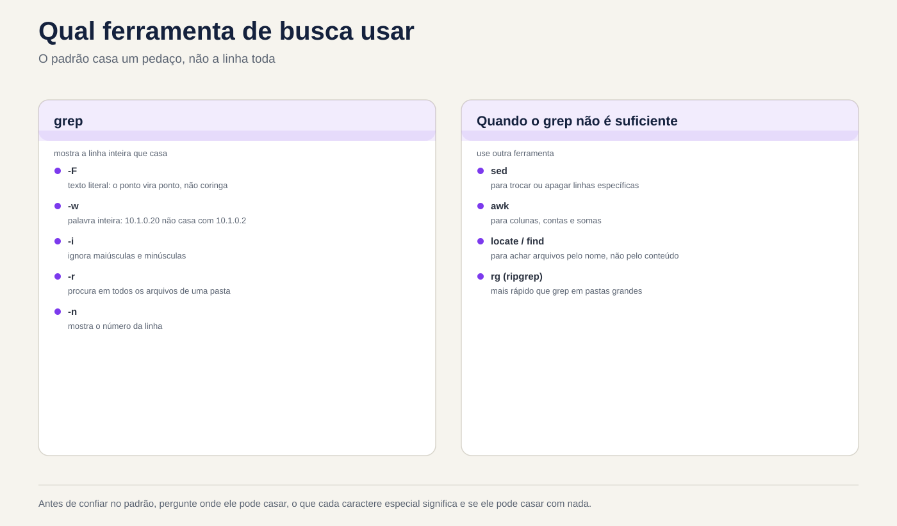

# Lezione 3.3 · Regex e grep

Nella lezione 3.2 hai tagliato, ordinato e contato le colonne. Ma quasi ogni vera domanda inizia prima: **quali linee** contano. "I tentativi di password errati", "le righe che non sono commenti", "gli accessi che provenivano da questo IP e non da uno simile". La persona che sceglie le righe è `grep`, e il linguaggio che usa per descrivere ciò che sta cercando è l'espressione regolare, regex. Oggi imparerai entrambi in modo approfondito: il punto che corrisponde a qualsiasi cosa, gli ancoraggi, le lezioni, la ripetizione, la differenza tra regex di base ed estesa e le opzioni `grep` che separano una ricerca da un report affidabile. Alla fine, uno script mostra cosa `sshd` delle due VM effettivamente utilizza e da quale file proviene ciascun valore.

| File | lezione 3.3 |
| --- | --- |
| Modulo | M3 · Testo ed editor, lezione 3 di 5 |
| Quando | Settimana 7 |
| Alla fine puoi | Scrivi espressioni regolari con ancore, lezioni, ripetizioni e gruppi, in BRE ed ERE; sapere quando il punto, l'asterisco e la parentesi fanno ciò che non volevi; cercare il testo fisso con `grep -F` e le parole intere con `-w`; utilizzare un elenco di modelli con `-f` senza cadere nella riga vuota; estrarre solo la sezione che corrisponde a `-o`; rimuovere commenti e righe vuote da un file di configurazione; cercare alberi di directory con `-r`; leggere l'exit status del `grep` e distinguere “non l'ho trovato” da “non sono riuscito a leggerlo”; filtrare il log SSH su entrambe le VM, nel file e nel journal |
| Articoli di prova | LE 3.2 (cercare ed estrarre dati da file) · LPIC-1 103.7 (cercare in file di testo utilizzando espressioni regolari: `grep`, `egrep`, `fgrep`, regex di base ed estese) · RHCSA (utilizzare `grep` ed espressioni regolari per analizzare il testo) |
| Prerequisiti | lezione 1.5 (base `grep`); lezione 3.1 (pipe, quote, exit status); lezione 3.2 (`cut`, `sort`, `uniq`, `~/lab32/acesso.log`) |
| Tempo | Intorno alle 2:30 |
| Istantanee | m3a3-start e m3a3-end su entrambe le VM |

## 1 · Riscaldamento

Tre domande, fuori dalla mia testa. Scrivi le risposte; la chiave di risposta viene visualizzata alla fine.

1. Cercate IP `10.1.0.2` in un protocollo con `grep 10.1.0.2 acesso.log`. Indovina: appaiono solo le righe per questo IP?
2. Un file di configurazione ha commenti con `#` all'inizio della riga. Indovina: `grep -v '^#'` lascia solo le righe che contano?
3. Uno script fa `if ps aux | grep -q backup; then echo "já está rodando"; fi`. Indovina: cosa dice quando non è in esecuzione alcun backup?

## 2 · Perché è importante

`grep` è il comando che tutti pensano di sapere già come usare. Proprio per questo tace:

| Il cosiddetto | La risposta sbagliata | Cosa provoca |
| --- | --- | --- |
| "Blocca IP `10.1.0.2`, sta attaccando" | `grep 10.1.0.2 acesso.log` verificare | Compaiono anche le righe `10.1.0.20`, `10.1.0.21` e `10.1.0.254`. Il rapporto incolpa macchine innocenti e il firewall blocca il file server |
| "Qual è la configurazione SSH effettiva?" | `grep -v '^#' /etc/ssh/sshd_config` | Rimangono righe vuote e commenti rientrati, i file di `/etc/ssh/sshd_config.d/` scompaiono. Giuri che la password è disattivata e è attiva |
| "Fammi sapere se qualcuno sbaglia la password" | `grep -q 'Failed' log 2>/dev/null` in un `if` | In Debian il file non esiste nemmeno; senza autorizzazione fallisce anche il `grep`. Lo script dice "tutto a posto" per sempre |
| "Il backup si avvia solo se non ce n'è nessun altro in esecuzione" | `ps aux \| grep -q backup` | `grep` si trova nell'elenco dei processi. Il backup non si riavvia mai e nessuno lo vede perché non è presente alcun errore |
| "Cerca chiunque abbia avuto accesso a un IP da questo elenco" | `grep -f lista.txt log` | L'elenco termina con una riga vuota e la riga vuota corrisponde a tutto. Il rapporto dice che tutti sono sulla lista |
| "Trova dove è configurato `PermitRootLogin` sul server" | Apri file per file nell'editor | Un `grep -rn PermitRootLogin /etc/ssh/` risponde in un secondo, con il numero del file e della riga |

Regex è un linguaggio piccolo con poche regole. Chi conosce le regole scrive lo schema che corrisponde a ciò che si deve fare, e solo con quello.

## 3 · Modello mentale

> `grep` legge una riga alla volta e chiede: **c'è qualche parte di questa riga che corrisponde allo schema?** Se c'è, la riga esce tutta intera. Non è necessario che il modello corrisponda all'intera linea, ma solo a una parte di essa, ovunque. Quasi ogni spavento con `grep` deriva dal dimenticare questo: il modello corrisponde dove non stavi guardando.

```text
  Padrão: 10.1.0.2          Linha: 10.1.0.20 - - [03/Nov/2026...] "GET / ..." 200 5120

  1 0 . 1 . 0 . 2
  │ │ │ │ │ │ │ │
  1 0 . 1 . 0 . 2 0 - - [03/Nov...      O trecho existe: a linha sai.
                  ↑                     O "0" que sobra não importa.

  O ponto casa com QUALQUER caractere:

  1 0 . 1 . 0 . 2
  │ │ │ │ │ │ │ │
  1 0 a 1 b 0 c 2 0                     Também casa.

  Como dizer exatamente o que você quer:

  -F '10.1.0.2'          o ponto vira ponto: texto fixo, sem regex
  -w                     o trecho tem que ser uma palavra inteira: "10.1.0.20" não serve
  '^10\.1\.0\.2 '        regex: no começo da linha, pontos de verdade, e um espaço depois
```

Tre domande per ogni modello, prima di eseguire: **dove può corrispondere** (all'inizio, alla fine, ovunque?), **cosa significa ogni carattere speciale qui** (il punto è un punto o è "qualsiasi"?), e **può non corrispondere a nulla** (un `*` o una riga vuota corrisponde a ogni riga)? E una regola pratica: prima di fidarsi di un modello, testarlo con una riga che **dovrebbe** corrispondere e un'altra che **non dovrebbe**.


*Il modello corrisponde a un pezzo della linea; grep stampa l'intera riga.*

## 4 · Concetto a strati

### Essenziale

**`grep` sceglie le righe.** Le opzioni che utilizzerai ogni giorno:

| Opzione | Cosa fa | Esempio |
| --- | --- | --- |
| `-i` | Ignora maiuscole e minuscole | `grep -i 'error' app.log` |
| `-v` | Inverte: mostra le righe che **non** corrispondono | `grep -v '^#' arquivo` |
| `-c` | Conta le righe che corrispondono, invece di mostrare | `grep -c 'Failed' secure` |
| `-n` | Mostra il numero di riga | `grep -n 'Port' sshd_config` |
| `-w` | Basta casa tutta la parola | `grep -w 'root' /etc/passwd` |
| `-x` | Corrisponde solo all'intera riga | `grep -x 'ana' nomes.txt` |
| `-o` | Mostra solo la sezione corrispondente, una per riga | `grep -o 'from [0-9.]*' secure` |
| `-l` | Mostra solo il nome dei file che contengono una riga | `grep -l 'PermitRootLogin' /etc/ssh/*` |
| `-r` | Cerca tutti i file in una directory | `grep -rn 'PermitRootLogin' /etc/ssh/` |
| `-E` | Regex esteso (ERE) | `grep -E '401\|403'` |
| `-F` | Testo corretto, nessuna regex | `grep -F '10.1.0.2'` |
| `-q` | Non mostra nulla; solo lo stato di uscita | `if grep -q ...; then` |

Inserire sempre il modello tra **virgolette singole**. Senza virgolette, la shell della lezione 3.1 lo modifica per primo: un `*` diventa un nome di file, uno spazio separa il modello in due argomenti.

**Caratteri speciali.** Nelle espressioni regolari, quasi ogni carattere corrisponde a se stesso. Coloro che non si sposano:

| Carattere | Significa | Esempio | Casa con |
| --- | --- | --- | --- |
| `.` | Qualsiasi carattere, esattamente uno | `l.g` | `log`, `lag`, `l g`, `l.g` |
| `^` | Inizio riga | `^Port` | `Port 22`, non `#Port 22` |
| `$` | Fine della riga | `bash$` | `/bin/bash`, non `/bin/bash-old` |
| `[abc]` | Un personaggio tra quelli elencati | `[Pp]ort` | `Port`, `port` |
| `[a-z]` | Un personaggio della gamma | `[0-9]` | una cifra |
| `[^abc]` | Un carattere che **non** è presente nell'elenco | `[^#]` | tutt'altro che `#` |
| `*` | Il precedente, **zero** o più volte | `ab*c` | `ac`, `abc`, `abbbc` |
| `\` | Togli il potere speciale degli altri | `\.` | solo un punto |

La coppia di ancoraggi indica dove il modello può corrispondere: `^root` solo all'inizio, `nologin$` solo alla fine, `^$` è una riga vuota e `^root$` è una riga che è solo `root`.

**Regex di base ed estesa.** `grep` senza un'opzione utilizza la regex **basic** (BRE). `grep -E` utilizza l'**esteso** (ERE), che aggiunge cinque operatori:

| Presso ERE (`grep -E`) | Significa | Esempio |
| --- | --- | --- |
| `+` | Il precedente, **una** o più volte | `[0-9]+` |
| `?` | Il precedente, zero o una volta | `https?` |
| `{n,m}` | Il precedente, da `n` a `m` volte | `[0-9]{1,3}` |
| `\|` | Oppure | `401\|403` |
| `( )` | Gruppi | `(ab)+`, `(GET\|POST) /login` |

In BRE, questi cinque caratteri sono **comuni**: `grep '(401|403)'` cerca letteralmente una parentesi, `401`, una barra verticale, `403` e un'altra parentesi. È la confusione numero uno nella lezione e il Passo 3 mostra.

**Lo stato di uscita.** `grep` termina con `0` se ha trovato almeno una riga, `1` se non ne ha trovata nessuna e `2` se ha dato un errore: file che non esiste, autorizzazione negata, regex non valida. In un `if`, `1` e `2` rientrano entrambi nel `else`.

### Intermedio

**Testo fisso e parola intera.** Un IP, un nome file puntato, un percorso: questi sono testo, non regex. `-F` disattiva tutti i caratteri speciali e di conseguenza è più veloce. `-w` richiede che il passaggio sia circondato da qualcosa di diverso da una lettera, cifra o `_`, o dall'inizio e dalla fine della riga:

```bash
grep -F '10.1.0.2' acesso.log      # il punto è un punto, ma 10.1.0.20 corrisponde ancora
grep -Fw '10.1.0.2' acesso.log     # solo 10.1.0.2, come parola
grep -w 'root' /etc/passwd         # root, non rootkit o chroot
```

Per `-w`, il punto **separa** le parole: `10.1.0.2` sono parole di quattro cifre con punti tra di loro, e `-w` esamina ciò che viene prima del primo `1` e dopo l'ultimo `2`.

**lezioni con nome.** All'interno della parentesi, `[[:digit:]]`, `[[:alpha:]]`, `[[:space:]]`, `[[:upper:]]`, `[[:lower:]]` e `[[:alnum:]]` funzionano in qualsiasi lingua. `[[:space:]]` corrisponde allo spazio **e** alle tabulazioni, che è quello che desideri quasi sempre:

```bash
grep -Ev '^[[:space:]]*(#|$)' /etc/ssh/sshd_config    # rimuovere i commenti, con o senza rientro, e le righe vuote
```

Leggi questo schema in parti, perché lo utilizzerai per tutta la vita: `^` inizio, `[[:space:]]*` zero o più spazi o tabulazioni, e poi `#` (un commento) **o** `$` (la fine, cioè la riga aveva solo spazi). `-v` inverte: resta quello che vale.

**Estrai con `-o`.** `-o` stampa solo la parte corrispondente. È il ponte tra `grep` ed i filtri della lezione 3.2:

```bash
grep -oE 'from [0-9.]+' /var/log/secure | cut -d' ' -f2 | sort | uniq -c | sort -rn
```

**Lista di pattern.** `-f arquivo` legge un pattern per riga; `-e` aggiunge uno schema alla riga di comando stessa e può essere ripetuto. Entrambi vengono utilizzati per elenchi di IP, utenti o parole:

```bash
grep -Fwf bloqueio.txt acesso.log      # testo fisso, parola intera, modelli di file
grep -e 'Failed' -e 'Invalid' secure   # uguale a grep -E 'Fallito|Non valido'
```

**Contesto.** `-A 2` mostra 2 righe dopo ciascuna riga corrispondente, `-B 2` prima e `-C 2` su entrambi i lati. In un log, l'errore raramente è solo sulla riga: la causa è due righe prima. `-m N` si ferma dopo `N` righe trovate.

**Cerca nelle directory.** `-r` scende attraverso le directory, senza seguire collegamenti simbolici lungo il percorso; Segue `-R`. Con `--include='*.conf'` limiti i file; con `-l` mostra solo i nomi; con `-h` nascondere il nome di ogni riga; con `-H` forza il nome anche con un solo file:

```bash
grep -rn 'PermitRootLogin' /etc/ssh/
grep -rl --include='*.conf' 'Listen' /etc/
```

Le virgolette in `'*.conf'` contano: senza di esse la shell scambia `*.conf` con i file `.conf` della cartella in cui ti trovi.

**`egrep` e `fgrep`.** Questi sono i vecchi nomi di `grep -E` e `grep -F`. Rientrano ancora nel test LPIC, ma la documentazione GNU li considera obsoleti e il più recente `grep` ti avvisa quando li usi. Scrivi `grep -E` e `grep -F`.

### Windows Bridge

| Su Windows | Su Linux | La differenza che conta |
| --- | --- | --- |
| `findstr` | `grep` | `findstr` ha una regex limitata, senza `+`, `?`, `{}` né `\|`. `grep -E` ha l'espressione regolare completa |
| `Select-String -Pattern` | `grep -E` | `Select-String` **ignora le lettere maiuscole per impostazione predefinita**; `grep` differenzia. Su Linux, `-i` quando si desidera ignorare |
| `Select-String -SimpleMatch` | `grep -F` | Testo corretto, nessuna regex |
| `Select-String -NotMatch` | `grep -v` | Idem |
| `Select-String -Context 2` | `grep -C 2` | Idem |
| `Get-ChildItem -Recurse \| Select-String` | `grep -r` | Un'opzione, invece di una pipe |
| PowerShell `-match` | `[[ $x =~ regex ]]` in `bash` | Entrambi usano espressioni regolari estese; in `bash` la regex è **senza virgolette** a destra |
| .NET Regex (`\d`, `\s`, `.*?`) | `grep -P` | `\d` e `.*?` non esistono in BRE o ERE. In `grep -E`, `\d` è solo un `d`. Utilizza `[0-9]` o `-P` |

### Avanzato

**La regex è golosa.** `*` e `+` prendono lo snippet **più lungo** possibile. Con `-o` appare:

```bash
echo 'a="1" b="2"' | grep -o '".*"'       # "1" b="2" (dal primo " all'ultimo ")
echo 'a="1" b="2"' | grep -o '"[^"]*"'    # "1" e "2" (tutto tranne le virgolette)
```

Il trucco `[^"]*` funziona con qualsiasi delimitatore: `[^ ]*` è "fino al prossimo spazio", `[^]]*` è "fino al prossimo `]`". `grep -P` (Perl regex) ha la versione pigra, `".*?"`, ma `[^"]*` funziona in qualsiasi `grep`, in `sed` e in `awk`.

**Retrovisor.** Un gruppo `( )` mantiene ciò che corrisponde e `\1` ripete lo stesso testo in seguito. Trova parole ripetute, un errore di battitura comune nei documenti:

```bash
grep -E '\b([a-z]+) \1\b' texto.txt      # "de de", "o o"
```

`\b` è il bordo della parola, la stessa idea di `-w` all'interno del modello. Rearview e `\b` sono estensioni GNU: funzionano su `grep` di entrambe le VM, ma non su tutti gli Unix.

**La lingua cambia il significato di un carattere.** In una lingua UTF-8, `.` corrisponde a `ç`, ovvero due byte. Con `LC_ALL=C` ogni byte è un carattere e `^.$` non corrisponde ad una riga che sia solo `ç`. Anche brani come `[a-z]` dipendono dalla lingua dei sistemi più vecchi; `[[:lower:]]` è sempre sicuro. E `LC_ALL=C grep -F` su un log multi-gigabyte è molto più veloce, perché non ha bisogno di decodificare UTF-8.

**L'espressione regolare all'esterno di `grep`.** La stessa lingua appare in molti posti, ognuno con un sapore diverso:

| Dove | Sapore | Esempio |
| --- | --- | --- |
| `grep`, `sed` | BRE per impostazione predefinita; ERE con `-E` | `sed -E 's/[0-9]+/N/'` |
| `awk` | ERE | `awk '/Failed/'` |
| `[[ =~ ]]` in `bash` | ERE | `[[ $ip =~ ^[0-9.]+$ ]]` |
| `vim` | BRE, con i suoi extra | `/\<root\>` |
| `journalctl -g` | PCRE2 (stile Perl) | `journalctl -u ssh -g 'Failed password'` |
| `find -regex` | Casa **per tutto il percorso** | `find /etc -regex '.*\.conf'` |

`sed` e `awk` appartengono alla lezione 3.4; `vim`, a 3,5. Ciò che impari oggi è valido in tutti e tre.

**La regex non è un parser.** Un IP con `([0-9]{1,3}\.){3}[0-9]{1,3}` corrisponde anche a `999.999.999.999`. Per trovare gli IP in un log basta questo: il log non inventa gli IP. **convalidare** l'input di un utente in uno script non è sufficiente. La regola generale: la regex serve per trovare; per convalidare, utilizzare lo strumento che comprende il formato.

### Cosa è testato

**Linux Essentials e LPIC-1 (103.7):**

- Il significato di `.`, `^`, `$`, `*`, `[ ]`, `[^ ]`, `\` in BRE; da `+`, `?`, `{ }`, `|`, `( )` in ERE; e che, in BRE, questi ultimi sono letterali.
- `grep -E` equivale a `egrep`; `grep -F` equivale a `fgrep`.
- Le opzioni `-i`, `-v`, `-c`, `-n`, `-l`, `-r`, `-w`, `-x`, `-o`, `-e`, `-f`.
- Prevedere l'output di un `grep` con regex in un piccolo file: è il formato preferito per domande.
- `sed` con regex di base appare nello stesso elemento (lezione 3.4).

**RHCSA:**

- "Trova tutte le righe in un file che contengono una parola e salva in `/root/arquivo`, nell'ordine originale": un `grep` con `>` e nient'altro. Non ordinare, non cambiare il formato.
- "Trova i file di `/etc` che contengono una parola": `grep -rl`.
- Nel test, il risultato viene controllato da uno script. Una riga in più o in meno è la domanda sbagliata.

## 5 · Rocky × Debian

| Cosa | laboratorio-roccioso | debian-lab | Come controllare |
| --- | --- | --- | --- |
| Versione `grep` | GNU grep 3.6 | GNU grep 3.8 | `grep --version \| head -1` |
| `egrep` e `fgrep` | Funzionano senza preavviso | Funzionano, ma avvertono: `egrep: warning: egrep is obsolescent` | `egrep x /dev/null` |
| Barra rovesciata senza significato (`\-`, ` \  `) | Accetta in silenzio | Avvertire: `warning: stray \ before -` | `grep '\-' /dev/null` |
| `grep` colorato | Sì: un alias in `/etc/profile.d/colorgrep.sh` | No, per impostazione predefinita: l'alias è commentato in `~/.bashrc` | `type grep` |
| Registro SSH | `/var/log/secure`, solo per `root` | Solo nella rivista | `sudo ls -l /var/log/secure` |
| Unità SSH in systemd | `sshd.service` | `ssh.service` | `systemctl status sshd` o `ssh` |
| Configurazione SSH | `/etc/ssh/sshd_config` con `Include` di `/etc/ssh/sshd_config.d/*.conf`; Rocky porta già `50-redhat.conf` | Lo stesso `Include`; la cartella è solitamente vuota | `sudo ls /etc/ssh/sshd_config.d/` |
| `grep -P` | Disponibile | Disponibile | `grep -P '\d' <<< 1` |

La differenza più evidente sul lavoro è quella del log SSH: lo stesso script di alert, che legge `/var/log/secure`, non trova nulla in Debian e non si lamenta. Quebra A risolve questo problema.

## 6 · Laboratorio guidato

Sei `rodrigo`, in rocky-lab e raggiungi debian-lab tramite `ssh deb`. Tutto avviene in `~/lab33`, su entrambe le VM. I file di sistema e i log effettivi vengono **solamente letti**: nessun passaggio modifica la configurazione SSH. Il passaggio 7 è la sfida della lezione.


*Prima di fidarsi del pattern, chiedere dove può corrispondere, cosa significa ciascun carattere speciale e se non può corrispondere a nulla.*


### Passaggio 0 · Istantanea, cartella e file di laboratorio

In Proxmox, acquisire l'istantanea `m3a3-inicio` di entrambe le VM. In rocky-lab:

```bash
eval "$(ssh-agent -s)"; ssh-add
ssh -o BatchMode=yes deb hostname
mkdir -p ~/lab33; ssh deb 'mkdir -p ~/lab33'
cd ~/lab33
cp ~/lab32/acesso.log .
grep --version | head -1; ssh deb 'grep --version | head -1'
```

Se `~/lab32/acesso.log` non esiste più, ricrealo con il qui-doc del Passaggio 0 della lezione 3.2. Ora un pezzo di log SSH in formato Rocky. Gli IP provengono da blocchi riservati alla documentazione, quindi non appartengono a nessuno:

```bash
cat > ssh.amostra <<'EOF'
Nov  3 08:10:01 rocky-lab sshd[2101]: Failed password for root from 203.0.113.9 port 51022 ssh2
Nov  3 08:10:04 rocky-lab sshd[2101]: Failed password for root from 203.0.113.9 port 51022 ssh2
Nov  3 08:11:20 rocky-lab sshd[2140]: Failed password for invalid user admin from 198.51.100.4 port 40110 ssh2
Nov  3 08:11:22 rocky-lab sshd[2140]: Failed password for invalid user admin from 198.51.100.4 port 40110 ssh2
Nov  3 08:12:00 rocky-lab sshd[2177]: Accepted publickey for rodrigo from 10.1.0.20 port 50001 ssh2: ED25519 SHA256:k3Yd9
Nov  3 08:13:15 rocky-lab sshd[2190]: Failed password for invalid user oracle from 203.0.113.9 port 51200 ssh2
Nov  3 08:14:02 rocky-lab sshd[2201]: Invalid user test from 192.0.2.66 port 33000
Nov  3 08:14:05 rocky-lab sshd[2201]: Failed password for invalid user test from 192.0.2.66 port 33000 ssh2
Nov  3 08:15:30 rocky-lab sshd[2230]: Failed password for rodrigo from 10.1.0.31 port 50110 ssh2
Nov  3 08:15:40 rocky-lab sshd[2230]: Accepted password for rodrigo from 10.1.0.31 port 50110 ssh2
Nov  3 08:16:00 rocky-lab sudo[2250]: rodrigo : TTY=pts/0 ; PWD=/home/rodrigo ; USER=root ; COMMAND=/usr/bin/tail -n 20 /var/log/secure
Nov  3 08:17:12 rocky-lab sshd[2266]: Connection closed by authenticating user root 203.0.113.9 port 51300 [preauth]
EOF
```

E un file di configurazione in stile `sshd_config`, con le trappole apposta. Questo va con `printf`, e non con here-doc, perché la riga 9 inizia con un **tab**, e un tab incollato nel terminale può trasformarsi in spazi:

```bash
printf '# Exemplo no estilo do sshd_config\nPort 22\n\n#PermitRootLogin prohibit-password\nPermitRootLogin no\n    # MaxSessions 10\nPasswordAuthentication yes\n   \n\t#ListenAddress 0.0.0.0\nMaxAuthTries 3\n#PasswordAuthentication no\n' > conf.amostra
cat -A conf.amostra
wc -l acesso.log ssh.amostra conf.amostra
```

```text
# Exemplo no estilo do sshd_config$
Port 22$
$
#PermitRootLogin prohibit-password$
PermitRootLogin no$
    # MaxSessions 10$
PasswordAuthentication yes$
   $
^I#ListenAddress 0.0.0.0$
MaxAuthTries 3$
#PasswordAuthentication no$
  15 acesso.log
  12 ssh.amostra
  11 conf.amostra
  38 total
```

`cat -A`, dalla lezione 3.2, mostra `$` alla fine di ogni riga e `^I` al posto del tab. Nota la riga 6 (commento con spazi rientrati), la riga 8 (solo spazi) e la riga 9 (commento con rientro di tabulazione). Copiare i tre file in Debian:

```bash
scp acesso.log ssh.amostra conf.amostra deb:lab33/
ssh deb 'cd ~/lab33 && wc -l acesso.log ssh.amostra conf.amostra && cat -A conf.amostra | sed -n 9p'
```

L'ultima riga di Debian deve mostrare `^I#ListenAddress 0.0.0.0$`. Se mostra spazi, la copia non è il problema: ripeti `printf`.

### Passo 1 · Il punto che corrisponde a qualsiasi cosa

Il firewall avverte che `10.1.0.2` sta facendo qualcosa di strano. Puoi verificarlo nel registro:

**Decidi 1 · Esegui `grep -c 10.1.0.2 acesso.log`. Che numero esce?**

- **A)** 0
- **B)** 4
- **C)** 15
- **D)** Un errore, perché il modello ha punti e non è racchiuso tra virgolette

Scegliere la lettera prima di guardare la tabella.

```bash
grep -c 10.1.0.2 acesso.log
grep 10.1.0.2 acesso.log | cut -d' ' -f1 | sort | uniq -c
```

```text
4
      4 10.1.0.20
```

| Se hai selezionato | Risultato | Perché |
| --- | --- | --- |
| A | ❌ Sbagliato | E' il numero che **volevi**: `10.1.0.2` non appare nel log. Ma `grep` cerca uno snippet e `10.1.0.2` è uno snippet di `10.1.0.20`. |
| B| ✅ Giusto | Le quattro righe del `10.1.0.20` contengono la sezione `10.1.0.2`, seguita da un `0` che il `grep` non ha chiesto di prendere visione. Il rapporto darebbe la colpa alla macchina sbagliata. |
| C| ❌ Sbagliato | Il punto corrisponde a qualsiasi carattere, ma le cifre nel modello sono comunque obbligatorie. Solo quattro righe hanno `10`, qualcosa, `1`, qualcosa, `0`, qualcosa e `2` in sequenza. |
| D | ❌ Sbagliato | Il punto non è speciale per la shell, ma solo per la regex. Senza spazi, `*`, `?` o `$`, il modello passa intatto. Le virgolette singole rimangono la giusta abitudine. |

**Per risolvere:** il modello corrisponde a **un pezzo** della linea. Per `grep`, "contiene" non è "è".

Questi sono due problemi insieme. Il primo è quello della tabella: la sezione in mezzo ad un'altra. Il secondo è il punto, che corrisponde a qualsiasi carattere:

```bash
echo '10a1b0c2' | grep 10.1.0.2
```

```text
10a1b0c2
```

Ora i tre strumenti del Modello Mentale, uno alla volta:

```bash
grep -cF '10.1.0.2' acesso.log        # 4: il punto ora è un punto, ma 10.1.0.20 continua a corrispondere
grep -cw '10.1.0.2' acesso.log        # 0: parola intera; dopo il 2 c'è uno 0, non un vantaggio
grep -cFw '10.1.0.2' acesso.log       # 0: testo fisso E parola intera, giusto per IP
grep -cw '10\.1\.0\.20' acesso.log    # 4: lo stesso, in regex, con i punti sfuggiti
```

Per un IP, un nome utente o un percorso, la combinazione quotidiana è `grep -Fw`. La regex con `\.` è per quando hai bisogno di una vera regex attorno all'IP.

### Passo 2 · Ancoraggi e configurazione che conta

Domanda classica: "cosa è attivo in questo file di configurazione?". La risposta che tutti danno per prima è rimuovere le righe che iniziano con `#`.

**Decidi 2 · Quante righe rimangono con `grep -v '^#' conf.amostra`?**

- **A)** 4
- **B)** 8
- **C)** 6
- **D)** 11

Scegli la lettera prima di guardare la tabella.

```bash
grep -vn '^#' conf.amostra | cat -A
```

```text
2:Port 22$
3:$
5:PermitRootLogin no$
6:    # MaxSessions 10$
7:PasswordAuthentication yes$
8:   $
9:^I#ListenAddress 0.0.0.0$
10:MaxAuthTries 3$
```

| Se hai selezionato | Risultato | Perché |
| --- | --- | --- |
| A | ❌ Sbagliato | Quattro è il numero delle politiche attive. Ma `^#` rimuove solo le righe il cui **primo carattere** è `#` e non tutto ciò che è un commento inizia così. |
| B| ✅ Giusto | Le linee 1, 4 e 11 partono. Rimangono la riga vuota, la riga degli spazi e i due commenti rientrati: alla riga 6 il primo carattere è uno spazio; in 9, tab. |
| C| ❌ Sbagliato | Sei sarebbe anche quello di rimuovere le righe vuote o anche i commenti rientrati. `^#` non fa nessuna delle due cose. |
| D | ❌ Sbagliato | Undici è l'intero file. `-v` ha funzionato: ha rimosso le tre righe il cui primo carattere è `#`. |

**Da risolvere:** l'ancora `^` dice "all'inizio della riga", e l'inizio è il primo carattere, anche se è uno spazio. Un commento rientrato, comune nei blocchi `Match` e nei file modificati manualmente, passa attraverso `^#`.

La versione che utilizzerai per tutta la vita, dalla sezione 4:

```bash
grep -Ev '^[[:space:]]*(#|$)' conf.amostra
```

```text
Port 22
PermitRootLogin no
PasswordAuthentication yes
MaxAuthTries 3
```

Nota la differenza tra "riga vuota" e "riga vuota":

```bash
grep -c '^$' conf.amostra                # 1: solo la riga 3, che non ha nulla
grep -c '^[[:space:]]*$' conf.amostra    # 2: riga 3 e riga 8, che ha solo spazi
```

Ora nel file reale. In Rocky, `sshd_config` è leggibile solo da `root`; in Debian, tutti leggono:

```bash
ls -l /etc/ssh/sshd_config; ssh deb 'ls -l /etc/ssh/sshd_config'
sudo grep -Ev '^[[:space:]]*(#|$)' /etc/ssh/sshd_config
ssh deb "grep -Ev '^[[:space:]]*(#|$)' /etc/ssh/sshd_config"
```

Notare le virgolette nel comando Debian: il default ha virgolette singole all'interno, quindi l'intero comando va tra virgolette doppie, e `$` all'interno di `(#|$)` non è seguito da un nome, quindi la shell locale non lo modifica. La prima riga attiva, su entrambe le VM, è `Include /etc/ssh/sshd_config.d/*.conf`. Salvalo per il passo 7.

### Passo 3 · Regex di base ed esteso

Il capo vuole l'autenticazione e le righe di errore di pagina inesistenti, i codici `401` e `404`. Scrivi la "o" che conosci da ogni linguaggio di programmazione:

**Decidi 3 · Esegui `grep -c ' (401|404) ' acesso.log`. Che numero esce?**

- **A)** 6
- **B)** 0
- **C)** 4
- **D)** Un errore di sintassi, a causa delle parentesi

Scegliere la lettera prima di guardare la tabella.

```bash
grep -c ' (401|404) ' acesso.log
grep -cE ' (401|404) ' acesso.log
grep -E ' (401|404) ' acesso.log | cut -d' ' -f1,9 | sort | uniq -c
```

```text
0
6
      4 192.168.5.7 401
      2 203.0.113.9 404
```

| Se hai selezionato | Risultato | Perché |
| --- | --- | --- |
| A | ❌ Sbagliato | Sei è ciò che viene fuori con `-E`. Senza di essa, `grep` utilizza l'espressione regolare di base, dove le parentesi e la barra sono caratteri comuni. |
| B| ✅ Giusto | In BRE, il modello cerca letteralmente `(401\|404)` tra due spazi. Nessuna linea ha questo. E `grep` non avverte: zero è una risposta valida. |
| C| ❌ Sbagliato | Quattro sarebbero semplicemente `401`. `grep` non sceglie una delle alternative; alla BRE non vede nemmeno alternative. |
| D | ❌ Sbagliato | Le parentesi sono racchiuse tra virgolette singole: la shell non le vede, e per BRE sono caratteri normali. Non c'è nessun errore, c'è zero. |

**Per correggere:** senza `-E`, i caratteri `+ ? { } | ( )` sono testo. Un `grep` che dovrebbe trovare e non trova nulla è l'errore peggiore possibile: il rapporto dice "nessun attacco".

Tre modi per scrivere la stessa cosa:

```bash
grep -cE ' (401|404) ' acesso.log       # 6: ERE, il più leggibile
grep -c ' \(401\|404\) ' acesso.log     # 6: GNU BRE, con barre; funziona, ma nessuno lo legge
grep -c ' 40[14] ' acesso.log           # 6: classe; un carattere compreso tra 1 e 4
grep -c ' 40[134] ' acesso.log          # 7: Entra 403 da /admin
```

I `\|` e `\(` in BRE sono estensioni GNU; in un `grep` di un altro Unix non funzionano. La regola pratica: se ti servono `|`, `+`, `?` o `{}`, usa `-E`.

### Passaggio 4 · lezioni, ripetizione e l'asterisco che non corrisponde a nulla

Domanda: quali righe di `conf.amostra` hanno un numero?

**Decidi 4 · Esegui `grep -c '[0-9]*' conf.amostra`. Che numero esce?**

- **A)** 11
- **B)** 4
- **C)** 0
- **D)** Un errore, perché `*` da solo diventa un nome di file

Scegliere la lettera prima di guardare la tabella.

```bash
grep -c '[0-9]*' conf.amostra
grep -c '[0-9]' conf.amostra
grep -cE '[0-9]+' conf.amostra
grep -n '[0-9]' conf.amostra
```

```text
11
4
4
2:Port 22
6:    # MaxSessions 10
9:	#ListenAddress 0.0.0.0
10:MaxAuthTries 3
```

| Se hai selezionato | Risultato | Perché |
| --- | --- | --- |
| A | ✅ Giusto | `*` accetta **zero** ripetizioni. Ogni riga ha, da qualche parte, zero cifre di seguito, anche la riga vuota. Lo schema non corrisponde a nulla e nulla è ovunque. |
| B| ❌ Sbagliato | Quattro è la risposta alla domanda, e viene fuori con `'[0-9]'` o `-E '[0-9]+'`. Con `*` il modello non necessita di cifre. |
| C| ❌ Sbagliato | Sposare niente è sposarsi. `grep` non richiede il dimensionamento della sezione. |
| D | ❌ Sbagliato | Il valore predefinito è tra virgolette singole: la shell non scambia `*` con nomi di file. Senza virgolette, quindi sì, il risultato dipenderebbe dalla cartella. |

**Per risolvere:** un modello che può corrispondere al vuoto corrisponde a ogni riga. Prima di eseguire, chiedi: "accetta zero caratteri?". Se accettato, c'è un bug. `*` non viene quasi mai da solo: ​​`ab*c`, `.*`, `[^"]*`, sempre tra le cose che richiedono qualcosa.

Ora la vera utilità: togliere solo la sezione. Con `-o` ogni pezzo abbinato esce su una riga:

```bash
grep -oE '([0-9]{1,3}\.){3}[0-9]{1,3}' ssh.amostra | sort -u
```

```text
10.1.0.20
10.1.0.31
192.0.2.66
198.51.100.4
203.0.113.9
```

Leggi lo schema in parti: `[0-9]{1,3}` sono da una a tre cifre, `\.` un punto di verità, il gruppo `( ){3}` ripete queste due tre volte e alla fine un altro numero. I numeri di porta non vengono inseriti perché non hanno punti; nemmeno `SHA256:k3Yd9`.

### Passo 5 · Il log SSH

Ora passiamo alle vere domande. Quanti tentativi di password non riusciti?

```bash
grep -c 'Failed password' ssh.amostra
```

```text
7
```

Vuoi separare l'utente da ciascun tentativo e scrivere uno schema più preciso:

**Decidi 5 · Quante righe corrispondono a `grep -c 'Failed password for [a-z]* from' ssh.amostra`?**

- **A)** 7
- **B)** 3
- **C)** 4
- **D)** 0

Scegli il testo prima di guardare il tabella.

```bash
grep -c 'Failed password for [a-z]* from' ssh.amostra
grep 'Failed password for [a-z]* from' ssh.amostra | cut -d' ' -f10-12
```

```text
3
root from 203.0.113.9
root from 203.0.113.9
rodrigo from 10.1.0.31
```

| Se hai selezionato | Risultato | Perché |
| --- | --- | --- |
| A | ❌ Sbagliato | Sette è il numero totale di fallimenti. Ma quattro di loro dicono `for invalid user admin from` e `[a-z]*` non corrisponde allo spazio. |
| B| ✅ Giusto | Corrispondono solo le righe dove, tra ` for  ` e `  from ` ci sono solo lettere minuscole: `root`, `root` e `rodrigo`. I quattro tentativi con utente inesistente, i più pericolosi, sono scomparsi dal verbale. |
| C| ❌ Sbagliato | Quattro sono proprio quelli che **non** si sposano: quelli del `invalid user`. |
| D | ❌ Sbagliato | `[a-z]*` corrisponde a `root` e `rodrigo`. Lo schema non è sbagliato per queste linee; È sbagliato per gli altri. |

**Per risolvere:** un modello troppo preciso nasconde le linee senza preavviso. Dopo aver scritto un filtro, confronta il conteggio con quello del filtro ampio (`Failed password`): se il numero è caduto, scopri quali righe sono uscite e perché.

Lo standard che copre entrambi i formati utilizza `?` di ERE, "il gruppo, zero o una volta":

```bash
grep -cE 'Failed password for (invalid user )?[a-z]+ from' ssh.amostra
```

```text
7
```

Ora la domanda che ti arriva ogni lunedì via email: **quali IP hanno sbagliato di più la password?** È il ponte tra `grep -o` e lezione 3.2:

```bash
grep 'Failed password' ssh.amostra | grep -oE 'from [0-9.]+' | cut -d' ' -f2 | sort | uniq -c | sort -rn
```

```text
      3 203.0.113.9
      2 198.51.100.4
      1 192.0.2.66
      1 10.1.0.31
```

Il `from` nello standard è l'ancora di contesto: l'IP che conta è quello che viene dopo `from`, e non un qualsiasi numero sulla riga. E quali utenti inesistenti hanno provato ad accedere?

```bash
grep -oE 'invalid user [a-z]+' ssh.amostra | cut -d' ' -f3 | sort | uniq -c
grep -oiE 'invalid user [a-z]+' ssh.amostra | cut -d' ' -f3 | sort | uniq -c
```

```text
      2 admin
      1 oracle
      1 test
      2 admin
      1 oracle
      2 test
```

`test` appare due volte con `-i`, perché la riga 7 dice `Invalid user`, con la lettera maiuscola. Quale sia quello giusto dipende dalla domanda: il primo conta i tentativi di password con un utente inesistente; il secondo conta tutte le menzioni.

**I log reali, di sola lettura.** Presso Rocky, il log è in archivio, solo per `root`. In Debian, solo nel journal, e l'unità si chiama `ssh`:

```bash
sudo grep -c 'Failed password' /var/log/secure
sudo grep 'Failed password' /var/log/secure | grep -oE 'from [0-9.]+' | cut -d' ' -f2 | sort | uniq -c | sort -rn | head
ssh -t deb "sudo journalctl -u ssh -o short --no-pager | grep -c 'Failed password'"
ssh -t deb "sudo journalctl -u ssh --no-pager -g 'Failed password' | tail -n 3"
```

In un laboratorio che comunica solo con la rete locale, è normale dare zero. Per vedere veramente una linea, commetti un errore di proposito. Da Rocky, provare ad accedere a Debian con un utente che non esiste e digitare qualcosa nella password, due volte, quindi `Ctrl+C`:

```bash
ssh -o PubkeyAuthentication=no -o PreferredAuthentications=password nao-existe@10.1.0.52
ssh -t deb "sudo journalctl -u ssh --since '-5min' --no-pager | grep -E 'Invalid user|Failed password'"
```

Se l'SSH di Debian risponde `Permission denied (publickey)` senza chiedere una password, l'autenticazione della password viene disattivata e non verrà visualizzata alcuna riga `Failed password`. Non è un difetto: il passo 7 mostra come confermarlo senza tirare a indovinare.

Il diario può intervallare righe che iniziano con ` --  ` (il segno di un riavvio, ad esempio). In un report filtrare con `grep -v '^-- '`. E `journalctl -g` filtra già da solo, con regex in stile Perl, senza pipe.

**Dove è configurato?** In rocky-lab:

```bash
sudo grep -rn 'PermitRootLogin' /etc/ssh/
sudo grep -rn --include='*.conf' 'PermitRootLogin' /etc/ssh/
grep -rn 'PermitRootLogin' /etc/ssh/; echo "status: $?"
```

Il primo mostra ogni file e riga in cui appare la parola, commentata o meno. Il secondo nasconde sé stesso `sshd_config`, perché il suo nome non termina in `.conf`: `--include` filtra **tutti** i file, compreso quello principale. Il terzo, senza `sudo`, mostra `Permission denied` per i file che solo `root` legge e termina con lo stato `2`, anche se ha trovato qualcosa in un altro file. Salva questo `2` per l'interruzione A.

### Passo 6 · Elenco di modelli e riga vuota

Nella lezione 3.2 è stata fatta la promessa: confrontare un registro con un elenco di IP bloccati. L'elenco è arrivato via email, incollato da un foglio di calcolo, ed è stato salvato così:

```bash
printf '203.0.113.9\n198.51.100.4\n\n' > bloqueio.txt
cat -A bloqueio.txt
```

```text
203.0.113.9$
198.51.100.4$
$
```

Tre righe, l'ultima vuota. Succede ogni volta che qualcuno preme Invio dopo l'ultimo elemento.

**Decidi 6 · Quante righe di `acesso.log` corrispondono a `grep -cFf bloqueio.txt acesso.log`?**

- **A)** 3
- **B)** 15
- **C)** 0
- **D)** 4

Scegli la lettera prima di guardare la tabella.

```bash
grep -cFf bloqueio.txt acesso.log
grep -cFwf bloqueio.txt acesso.log
grep -cFwf <(grep . bloqueio.txt) acesso.log
grep -Fwf <(grep . bloqueio.txt) acesso.log | cut -d' ' -f1 | uniq -c
```

```text
15
15
3
      3 203.0.113.9
```

| Se hai selezionato | Risultato | Perché |
| --- | --- | --- |
| A | ❌ Sbagliato | Tre è la risposta giusta alla domanda e si lascia con una tabula rasa. Con la riga vuota, il file ha tre modelli e uno di questi è vuoto. |
| B| ✅ Giusto | Ogni riga di `bloqueio.txt` è un modello e il modello vuoto corrisponde a ogni riga, come `*` del passaggio 4. Il rapporto direbbe che i 15 risultati provenivano da IP bloccati. Nemmeno `-w` salva. |
| C| ❌ Sbagliato | `198.51.100.4` non appare in `acesso.log`, ma `203.0.113.9` appare tre volte. E la riga vuota corrisponde a tutto. |
| D | ❌ Sbagliato | Non ci sono quattro righe di elenco IP in `acesso.log`: `203.0.113.9` appare tre volte e `198.51.100.4` nessuna. E la riga vuota corrisponde a tutto. |

**Per risolvere:** prima di utilizzare un file come elenco di pattern, cancellalo. `grep .` lascia solo le righe che contengono almeno un carattere e `<( )` della lezione 3.1 fornisce il risultato a `-f` come se fosse un file. Contare prima: `grep -c . bloqueio.txt` dà 2; `grep -c '' bloqueio.txt` dà 3.

E `-F` conta tanto quanto la riga vuota. Un elenco con `10.1.0.2`, senza `-F` e senza `-w`, corrisponde a `10.1.0.20`, come nel passaggio 1:

```bash
printf '203.0.113.9\n10.1.0.2\n' > b2.txt
grep -cf b2.txt acesso.log       # 7: il 3 dal 203.0.113.9 e il 4 dal 10.1.0.20
grep -cFwf b2.txt acesso.log     # 3: solo 203.0.113.9
```

Lo stesso elenco, nel registro SSH. Due modi di contare e non vanno d'accordo:

```bash
grep -Fwf <(grep . bloqueio.txt) ssh.amostra | grep -oE 'from [0-9.]+' | sort | uniq -c
grep -oFwf <(grep . bloqueio.txt) ssh.amostra | sort | uniq -c
```

```text
      2 from 198.51.100.4
      3 from 203.0.113.9
      2 198.51.100.4
      4 203.0.113.9
```

La differenza è la riga 12: `Connection closed by authenticating user root 203.0.113.9 port 51300`. Non ha `from`. La prima forma conta i “tentativi con `from`”; la seconda, con `-o` direttamente nella lista, conta le "righe in cui compare l'IP". Sono entrambi adatti a domande diverse e sei tu che devi sapere a quale domanda stai rispondendo.

### Passo 7 · Sfida: cosa utilizza effettivamente `sshd`

La chiamata: "l'accesso tramite password è disattivato sui server?". Hai già visto che `grep` mostra cosa è **scritto** nei file e che possono esserci più file. Ma è `sshd` che decide, e ha una regola che sorprende quasi tutti. Innanzitutto, la regola, in un file di prova nella tua cartella. L'here-doc va **senza virgolette** in `EOF`, apposta, affinché la shell scambi `$HOME` con il percorso reale, perché `sshd` non capisce le variabili:

```bash
mkdir -p ~/lab33/teste.d
cat > ~/lab33/sshd_teste <<EOF
Include $HOME/lab33/teste.d/*.conf
PasswordAuthentication no
PermitRootLogin no
EOF
printf 'PasswordAuthentication yes\n' > ~/lab33/teste.d/50-cloud.conf
cat ~/lab33/sshd_teste
grep -rn 'PasswordAuthentication' ~/lab33/sshd_teste ~/lab33/teste.d/
```

`cat` mostra `Include /home/rodrigo/lab33/teste.d/*.conf`, con il percorso già cambiato. `grep` mostra le due righe, una con la scritta `no` e l'altra con la scritta `yes`. Quale vale?

**Decidi 7 · Esegui `sudo sshd -T -f ~/lab33/sshd_teste | grep -i '^passwordauthentication'`. Cosa risulta?**

- **A)** `passwordauthentication no`, perché è la riga nel file principale
- **B)** `passwordauthentication yes`
- **C)** Un errore, perché la stessa opzione appare due volte
- **D)** Le due righe, `yes` e `no`

Scegliere la lettera prima di guardare la tabella.

```bash
sudo sshd -T -f ~/lab33/sshd_teste | grep -iE '^(passwordauthentication|permitrootlogin) ' | sort
```

```text
passwordauthentication yes
permitrootlogin no
```

Eseguire su entrambe VM (copia `sshd_teste` e la cartella `teste.d` con `scp -r` e ripeti `cat > sshd_teste` in Debian, in `$HOME` lì). Se in Rocky `sshd -T` si lamenta di non poter leggere un file nella sua cartella, la causa probabile è SELinux, oggetto di un modulo futuro: fai il Decide in Debian e segui.

| Se hai selezionato | Risultato | Perché |
| --- | --- | --- |
| A | ❌ Sbagliato | Questo è ciò che quasi tutti presumono: "regole del file principale". In `sshd`, la **prima** riga letta è quella in carica, e `Include` in alto viene letta per prima. |
| B| ✅ Giusto | Per ogni opzione, `sshd` utilizza il primo valore che trova. `Include` porta `yes` prima di `no` e `no` viene ignorato. Questo è il motivo per cui `Include` è sopra `sshd_config` in entrambe le distribuzioni: i file `sshd_config.d/` battono quello principale. |
| C| ❌ Sbagliato | La ripetizione di un'opzione non è un errore di sintassi; `sshd -T` lamenta solo un'opzione inesistente o un valore non valido. Ecco perché il problema scompare. |
| D | ❌ Sbagliato | `sshd -T` mostra la configurazione **risolta**: una riga per opzione, con il valore che ha vinto, in minuscolo. |

**Da correggere:** `grep` nei file riporta i candidati; `sshd -T` mostra il vincitore. Un `PasswordAuthentication no` in `sshd_config` non ha valore se un file in `sshd_config.d/` dice `yes` e alcuni programmi di installazione e immagini cloud inseriscono tale file lì. Nella vita reale, controlla sempre entrambi.

La stessa idea si applica a quasi tutti i servizi che hanno un file di configurazione: `nginx -T`, `postconf -n` in Postfix, `testparm -s` in Samba, `named-checkconf -p` in BIND. Tutti stampano la configurazione così come è stata intesa dal programma.

Ora lo script della sfida. Mostra, per le opzioni che contano in un audit SSH, dove è scritta ciascuna e il valore utilizzato da `sshd`:

```bash
cat > ~/lab33/sshd-efetivo.sh <<'EOF'
#!/bin/sh
# sshd-efetivo.sh: onde as opções do SSH estão escritas e o que o sshd usa de fato
set -u
opcoes='port|permitrootlogin|passwordauthentication|pubkeyauthentication|maxauthtries|x11forwarding'

echo "== $(hostname): linhas ativas nos arquivos =="
sudo grep -rHnEv '^[[:space:]]*(#|$)' /etc/ssh/sshd_config /etc/ssh/sshd_config.d/ \
    | grep -iE ":[0-9]+:[[:space:]]*($opcoes)[[:space:]]"

echo "== $(hostname): o que o sshd usa (sshd -T) =="
if ! efetivo=$(sudo sshd -T 2>&1); then
    echo "ERRO: o sshd -T falhou; a configuração tem erro:" >&2
    printf '%s\n' "$efetivo" >&2
    exit 2
fi
printf '%s\n' "$efetivo" | grep -E "^($opcoes) " | sort
EOF
chmod +x ~/lab33/sshd-efetivo.sh
~/lab33/sshd-efetivo.sh
```

Leggi le due righe di `grep` dallo script. Il primo è il filtro del passaggio 2, su più cartelle, con `-H` (il nome del file) e `-n` (la riga): ogni riga risulta come `arquivo:número:texto`. Il secondo lascia solo le opzioni nell'elenco, e il `:[0-9]+:` all'inizio del modello salta il nome e il numero del file, in modo che il `^` dell'opzione inizi nel testo. `-i` è necessario perché il file contiene `PermitRootLogin` e `sshd -T`, `permitrootlogin`.

Lo script inizia con `#!/bin/sh` e non utilizza nulla che provenga solo da `bash`. Esegui su Debian con `sh`, che è `dash`:

```bash
scp ~/lab33/sshd-efetivo.sh deb:lab33/
ssh -t deb 'sh ~/lab33/sshd-efetivo.sh'
```

Confronta le due VM. Per ogni opzione nella seconda parte, la domanda è: **appare nella prima parte?** In caso contrario, il valore è quello predefinito di OpenSSH e sai che nessuno l'ha scritto. Se compare in più file, conta ciò che dice `sshd -T` e la prima lettura ne spiega il motivo. A Rocky cercate `50-redhat.conf`: ha, tra le altre, la linea `X11Forwarding`. Se nel programma di installazione di Rocky lasci che `root` inserisca la password, potrebbe esserci anche un `01-permitrootlogin.conf`.

**Bonus.** Conta, per VM, quante righe attive ci sono in ciascun file di configurazione SSH:

```bash
sudo grep -rcEv '^[[:space:]]*(#|$)' /etc/ssh/sshd_config /etc/ssh/sshd_config.d/
ssh -t deb "sudo grep -rcEv '^[[:space:]]*(#|\$)' /etc/ssh/sshd_config /etc/ssh/sshd_config.d/"
```

Nel secondo comando, `\$` protegge `$` tra virgolette doppie, per ogni evenienza. `-c` con `-r` fornisce un numero per file, nel formato `arquivo:contagem`.

## 7 · Interrompi e correggi

### Interrompi A · L'avviso che non si attiva mai

Lo scenario: uno script di monitoraggio viene eseguito ogni ora e avvisa se qualcuno ha sbagliato la password SSH. È stato scritto in Rocky, testato con un file di esempio e copiato su tutti i server. Sono mesi che dice "tutto chiaro". Assemblare lo script, in rocky-lab:

```bash
cd ~/lab33
cat > alerta.sh <<'EOF'
#!/bin/bash
# alerta.sh: avisa se houve senha errada no SSH
log=${1:-/var/log/secure}
if grep -q 'Failed password' "$log" 2>/dev/null; then
    echo "ALERTA: tentativas de senha errada em $log"
else
    echo "tudo limpo"
fi
EOF
chmod +x alerta.sh
./alerta.sh ~/lab33/ssh.amostra
```

```text
ALERTA: tentativas de senha errada em /home/rodrigo/lab33/ssh.amostra
```

Il test è stato superato. Ora come funziona effettivamente, senza argomenti, con l'utente di monitoraggio, che non è `root`:

```bash
./alerta.sh
scp alerta.sh deb:lab33/
ssh deb 'lab33/alerta.sh'
```

**Observe.** Le due VM rispondono `tudo limpo`. Su Debian, tu stesso hai sbagliato la password nel passaggio 5 e la riga è nel journal. In Rocky non puoi nemmeno saperlo, perché lo script non legge mai il registro.

**Diagnose.** Rimuovi `2>/dev/null` e controlla lo stato:

```bash
grep -q 'Failed password' /var/log/secure; echo "status: $?"
ssh deb 'grep -q "Failed password" /var/log/secure; echo "status: $?"'
```

```text
grep: /var/log/secure: Permission denied
status: 2
grep: /var/log/secure: No such file or directory
status: 2
```

Status `2`: `grep` **impossibile** eseguire la ricerca. A Rocky, previo permesso; in Debian, perché il file non esiste nemmeno. Ma il `if` chiede solo "zero o non zero", e il `2` rientra nel `else`, insieme al `1`, che è "Ho cercato e non l'ho trovato". `2>/dev/null` ha nascosto l'unico indizio.

**Decidi A · La correzione.** Cosa cambi nello script?

- **A)** Esegui `grep -q` da solo e tratta lo stato con `case $? in 0) ... ;; 1) ... ;; *) ... ;; esac`
- **B)** Rimuovi `2>/dev/null`
- **C)** Sostituisci `2>/dev/null` con l'opzione `-s` di `grep`
- **D)** Prima `grep`, verificare con `[ -r "$log" ]` se il file è leggibile

Scegliere la lettera prima di guardare la tabella.

| Se hai selezionato | Risultato | Perché |
| --- | --- | --- |
| A | ✅ Giusto | Separare i tre casi che già il `grep` informa: ho trovato, non ho trovato, non ho potuto. Il "Non potevo" diventa un errore, con il proprio messaggio e stato, e il monitoraggio inizia a vedere il problema. |
| B| ⚠️ Funziona, ma | Inizia a comparire il messaggio di errore, il che aiuta chi lo esegue manualmente. Ma lo script continua a dire `tudo limpo` subito dopo, e in `cron` il messaggio arriva a un'e-mail che nessuno legge. Lo stato `2` continua a scendere in `else`. |
| C| ❌ Sbagliato | `-s` è esattamente ciò che già fa `2>/dev/null`: nasconde i messaggi da file inesistenti o illeggibili. Scambia sei con una mezza dozzina. |
| D | ⚠️ Funziona, ma | Prendiamo i due casi di oggi, permesso e fascicolo inesistente. Ma ci sono altri errori che `[ -r ]` non vede (il percorso è una cartella, il disco dà un errore di lettura), e tutto questo `grep` sa già dirlo. La lettura dello stato è più semplice e completa. |

**Per risolvere:** in `if grep`, "Non sono riuscito a leggerlo" diventa "Non sono riuscito a trovarlo". Ogni volta che `grep` decide qualcosa, tratta lo stato `2` separatamente e non inserire mai il suo errore in `/dev/null` senza trattarlo.

**Risolvilo.**

```bash
cat > alerta.sh <<'EOF'
#!/bin/bash
# alerta.sh: avisa se houve senha errada no SSH
# status: 0 = rodou (com ou sem alerta), 2 = não conseguiu ler o log
log=${1:-/var/log/secure}
grep -q 'Failed password' "$log"
case $? in
    0) echo "ALERTA: tentativas de senha errada em $log" ;;
    1) echo "tudo limpo em $log" ;;
    *) echo "ERRO: não consegui ler $log" >&2; exit 2 ;;
esac
EOF
./alerta.sh ~/lab33/ssh.amostra
./alerta.sh; echo "status: $?"
sudo ./alerta.sh
scp alerta.sh deb:lab33/; ssh deb 'lab33/alerta.sh; echo "status: $?"'
```

```text
ALERTA: tentativas de senha errada em /home/rodrigo/lab33/ssh.amostra
grep: /var/log/secure: Permission denied
ERRO: não consegui ler /var/log/secure
status: 2
...
grep: /var/log/secure: No such file or directory
ERRO: não consegui ler /var/log/secure
status: 2
```

Con `sudo`, in Rocky, lo script legge il registro e dice cosa c'è dentro. In Debian, l'errore ora è onesto: il file non esiste, perché nel journal è presente il registro SSH. Lo script giusto per Debian si legge da un'altra fonte:

```bash
ssh -t deb "sudo journalctl -u ssh --since today --no-pager | grep -c 'Failed password'"
```

Un altro trucco in Debian: `journalctl` senza `sudo` e senza che l'utente sia nel gruppo `adm` o `systemd-journal`, **non fallisce**. Mostra solo il diario dell'utente, avvisa con `Hint:` e termina con lo stato `0`. `grep` non trova nulla e risponde `1` "tutto a posto". Lo stesso errore silenzioso, in un altro modo. Lo script di monitoraggio dei log viene eseguito come `root` o con un gruppo di lettura e tu controlli quale, con `id`, prima di fidarti del risultato.

### Break B · Il backup che non si avvia mai

Lo scenario: un backup richiede ore e `cron` lo richiama ogni ora. Per evitare di eseguirne due contemporaneamente, qualcuno ha firmato un assegno all'inizio. Da allora, i backup si sono interrotti. Imposta il controllo, in rocky-lab:

```bash
cat > ~/lab33/checa.sh <<'EOF'
#!/bin/bash
# checa.sh: só começa o backup se não houver outro rodando
if ps aux | grep -q 'backup-noturno'; then
    echo "já existe um backup-noturno rodando; saindo"
    exit 0
fi
echo "começando o backup-noturno"
EOF
chmod +x ~/lab33/checa.sh
pgrep -a backup-noturno; echo "pgrep: $?"
~/lab33/checa.sh
```

**Observe.** `pgrep` non trova alcun `backup-noturno` e termina con `1`. Anche così, la sceneggiatura dice `já existe um backup-noturno rodando; saindo`. Eseguilo ancora qualche volta: quasi sempre la stessa risposta.

**Diagnostique.** Esegui il pezzo da `if` senza `-q`, per vedere cosa ha trovato `grep`:

```bash
ps aux | grep 'backup-noturno'
```

```text
rodrigo     3412  0.0  0.1 221680  2304 pts/0    S+   10:20   0:00 grep --color=auto backup-noturno
```

`grep` l'ha trovato **lui stesso**. `ps` e `grep` della pipe iniziano insieme, e quando `ps` elenca i processi, `grep backup-noturno` è già nell'elenco, con la parola in comando. All'interno dello script non c'è alcun alias di colore e la riga mostra solo `grep backup-noturno`, ma l'effetto è lo stesso. Il "quasi sempre" è una gara tra i due: a volte `ps` finisce prima che appaia `grep`, e il test passa per fortuna.

Ora un vero backup in esecuzione, per testare le correzioni. Una copia di `sleep` con un altro nome fa il lavoro:

```bash
cp /usr/bin/sleep ~/lab33/backup-noturno
~/lab33/backup-noturno 300 &
pgrep -a backup-noturno
```

**Decidi B · La correzione.** Come dovrebbe lo script chiedere se il backup è in esecuzione?

- **A)** `pgrep -x backup-noturno > /dev/null`
- **B)** `ps aux | grep -v grep | grep -q backup-noturno`
- **C)** `ps aux | grep -q '[b]ackup-noturno'`
- **D)** `ps aux | grep -c backup-noturno`

Scegliere la lettera prima di guardare tabella.

| Se hai selezionato | Risultato | Perché |
| --- | --- | --- |
| A | ✅ Giusto | `pgrep` cerca nei nomi dei processi, non nel testo che genera, e non viene mai trovato. `-x` richiede il nome esatto: un `vim backup-noturno.conf` non conta. Lo stato risponde direttamente: `0` funzionante, `1` no. |
| B| ⚠️ Funziona, ma | Togliere la riga `grep`, ma anche qualunque altra che contenga `grep` nel testo. E corrisponde a qualsiasi riga che menzioni il nome: un `tail -f /var/log/backup-noturno.log` aperto da qualcuno impedisce il backup. |
| C| ⚠️ Funziona, ma | Il trucco classico: `[b]` corrisponde a `b`, quindi il modello trova `backup-noturno`; ma sulla riga `grep` il testo è `[b]ackup-noturno`, che il modello non corrisponde. Funziona, nessuno lo capisce in prima lettura, e il problema con `tail -f` continua. |
| D | ❌ Sbagliato | `-c` conta e la riga stessa di `grep` viene conteggiata. Senza backup in esecuzione la risposta è `1` e non `0`. E in un `if`, `grep -c` termina con lo status `0` ogni volta che conta qualcosa. |

**Per risolvere:** cercare un processo con `ps | grep` significa cercare in un testo che include `grep` stesso. Per i processi, utilizzare `pgrep`: `-x` per il nome esatto, `-f` per cercare l'intera riga di comando, `-u` per un utente.

**Fix.**

```bash
cat > ~/lab33/checa.sh <<'EOF'
#!/bin/bash
# checa.sh: só começa o backup se não houver outro rodando
if pgrep -x backup-noturno > /dev/null; then
    echo "já existe um backup-noturno rodando; saindo"
    exit 0
fi
echo "começando o backup-noturno"
EOF
~/lab33/checa.sh
pkill -x backup-noturno; sleep 1
~/lab33/checa.sh
rm ~/lab33/backup-noturno
```

```text
já existe um backup-noturno rodando; saindo
começando o backup-noturno
```

Con il processo in esecuzione, il controllo lo vede; senza di esso, inizia il backup. Copia `checa.sh` su Debian e osserva lo stesso comportamento. Un dettaglio di `-x`: il nome confrontato da `pgrep` è il nome breve del processo, che il kernel taglia a 15 caratteri. Un programma chiamato `backup-noturno-completo` appare come `backup-noturno-` e `pgrep -x backup-noturno-completo` non lo trova. In questi casi, `pgrep -f`, con uno schema ancorato al percorso del programma.

### La lezione

Le due pause sono `grep` rispondendo, con tutta correttezza, a una domanda diversa da quella che hai posto. Nella pausa A la domanda era "c'è stato un errore?", e `grep` ha risposto "Non sono riuscito a leggerlo", che `if` ha tradotto con "no". Nella pausa B, la domanda era "il backup è in esecuzione?", e `grep` ha risposto "la parola appare nell'elenco dei processi" e appare nello stesso `grep`. Gli strumenti sono i soliti: l'**exit status** con i tre valori, `0`, `1` e `2`, trattati separatamente; un test con il caso che **dovrebbe** essere no, e non solo con il caso che dovrebbe essere sì; e, per i processi, lo strumento creato per questo. Nella vita reale, il controllo dei backup va ancora oltre: `flock -n /run/lock/backup.lock comando` ne garantisce uno solo alla volta, senza alcuna gara, e per un servizio systemd la domanda giusta è `systemctl is-active --quiet nome`.

## 8 · Insidie

| Digiti o vedi | Cosa succede | Quello giusto |
| --- | --- | --- |
| `grep 10.1.0.2 log` | Ospita anche `10.1.0.20`, `10.1.0.21` e `10a1b0c2` | `grep -Fw '10.1.0.2' log` |
| `grep -v '^#' arquivo.conf` | Sono rimaste righe vuote e commenti rientrati | `grep -Ev '^[[:space:]]*(#\|$)' arquivo.conf` |
| `grep '(GET\|POST) /login'` | Zero righe, nessun errore: in BRE, parentesi e barra sono testo | `grep -E '(GET\|POST) /login'` |
| `grep '[0-9]*'` | Corrisponde a ogni riga, perché `*` accetta zero | `grep '[0-9]'` o `grep -E '[0-9]+'` |
| `grep -E '\d+'` | `\d` non esiste in ERE: cercare la lettera `d` | `grep -E '[0-9]+'`, oppure `grep -P '\d+'` |
| `grep -o '".*"'` | Va dal primo all'**ultimo** `"` della riga | `grep -o '"[^"]*"'` |
| `grep -f lista.txt` con riga vuota alla fine | Corrisponde a tutte le righe del file | `grep -Fwf <(grep . lista.txt)` |
| `grep padrão *.log` senza virgolette nel modello | La shell può scambiare un `*` o `?` dal modello con i nomi dei file | Modello sempre tra virgolette singole |
| `grep -r --include=*.conf` senza virgolette | La shell scambia `*.conf` con i file nella cartella corrente | `--include='*.conf'`, e ricorda che nasconde i file senza `.conf`, come `sshd_config` |
| `if grep -q ... 2>/dev/null` | L'errore di lettura diventa "Non l'ho trovato" | `grep -q ...; case $? in 0) ;; 1) ;; *) erro ;; esac` |
| `ps aux \| grep nome` | `grep` si ritrova | `pgrep -x nome`, oppure `pgrep -a nome` per vedere |
| `grep -v padrão` "prendere" righe da un file | Viene visualizzato sullo schermo, il file rimane lo stesso | `grep -v padrão arq > arq.novo`, verificare e solo dopo modificare |
| `grep PasswordAuthentication sshd_config` per rispondere "la password è attiva?" | Mostra ciò che è scritto, non ciò che vale | `sudo sshd -T \| grep -i passwordauthentication` |
| `egrep` e `fgrep` nella nuova scrittura | Avviso di deprecazione in Debian `grep` 3.8 | `grep -E` e `grep -F` |

## 9 · Quiz

Dieci domande, senza consultazione. Scrivere la lettera o rispondere a ciascuna e solo dopo aprire la chiave di risposta.

**1.** Cosa conta `grep -c 'a*' arquivo.txt` e perché?

**2.** Quale comando mostra solo le righe attive di `/etc/ssh/sshd_config`, senza commenti (con o senza rientro) e senza righe vuote?

- **A)** `grep -v '^#' /etc/ssh/sshd_config`
- **B)** `grep -Ev '^[[:space:]]*(#|$)' /etc/ssh/sshd_config`
- **C)** `grep -v '#' /etc/ssh/sshd_config`
- **D)** `grep '^[^#]' /etc/ssh/sshd_config`

**3.** Nelle espressioni regolari di base, cosa significano `+`, `?` e `|`? Scrivi "401 o 403 tra spazi" in ERE e in BRE con class.

**4.** Quale comando mostra le righe di `/etc/group` che contengono l'intera parola `wheel`, ignorando le maiuscole?

- **A)** `grep -iw wheel /etc/group`
- **B)** `grep -i '^wheel$' /etc/group`
- **C)** `grep -wv wheel /etc/group`
- **D)** `grep -x wheel /etc/group`

**5.** Quali sono i tre stati di uscita del `grep` e cosa significa ciascuno? Cosa mostra `grep -q root /nao/existe; echo $?`?

**6.** Cosa mostra `echo 'id="7" nome="ana"' | grep -o '".*"'`? Come mostrare `"7"` e `"ana"`, ciascuno su una riga?

**7.** Hai `lista.txt`, un IP per riga, con una riga vuota alla fine. Quale comando conta correttamente le righe di `acesso.log` con uno di questi IP?

- **A)** `grep -cf lista.txt acesso.log`
- **B)** `grep -cFwf lista.txt acesso.log`
- **C)** `grep -cFwf <(grep . lista.txt) acesso.log`
- **D)** `grep -cvf lista.txt acesso.log`

**8.** Perché `ps aux | grep sshd` mostra una riga in più rispetto al numero di processi `sshd`? Quale comando risponde senza questo problema?

**9.** `sshd_config` dice `PasswordAuthentication no`. `sshd_config.d/50-cloud.conf` dice `PasswordAuthentication yes`. `Include` è sopra `sshd_config`. Quale valore utilizza `sshd` e quale comando conferma?

**10.** *Quale comando elenca i nomi di tutti i file in `/etc` che contengono la stringa `PermitRootLogin`?*

- ***A)*** *`grep -l PermitRootLogin /etc`*
- ***B)*** *`grep -rl PermitRootLogin /etc`*
- ***C)*** *`find /etc -name PermitRootLogin`*
- ***D)*** *`grep -rc PermitRootLogin /etc`*

## 10 · Flashcard e colla

### Da conoscere a memoria

- `grep` mostra l'intera riga quando **una sezione** di essa corrisponde allo schema. "Contiene" non è "è".
- Modello sempre racchiuso tra virgolette singole.
- `.` qualsiasi carattere · `^` inizio · `$` fine · `[abc]` uno dall'elenco · `[^abc]` uno fuori elenco · `*` quello precedente zero o più volte · `\` toglie il potere speciale.
- In ERE (`grep -E`): `+` uno o più · `?` zero o uno · `{n,m}` da n a m · `|` oppure · `( )` gruppo. In BRE, questi cinque sono testo.
- Un modello che accetta il vuoto (`x*`, una riga vuota in `-f`) corrisponde a ogni riga.
- IP, nome, percorso: `grep -Fw`. Regex solo quando è necessario regex.
- Righe di configurazione attive: `grep -Ev '^[[:space:]]*(#|$)'`.
- `[[:space:]]` è spazio **e** tab.
- `-o` mostra solo l'estratto; è il ponte verso `cut`, `sort` e `uniq -c`.
- La regex è golosa: `".*"` va fino all'ultimo `"`. Utilizza `"[^"]*"`.
- Stato `grep`: `0` trovato, `1` non trovato, `2` non riuscito a trovarlo. Trattare `2` separatamente.
- `ps | grep nome` trova `grep` stesso. Usa `pgrep -x nome`.
- `--include='*.conf'` tra virgolette, e nasconde anche i file senza `.conf`.
- Il `grep` nei file mostra ciò che è scritto; `sshd -T` mostra quanto vale. In `sshd` vince il primo valore letto.
- `egrep` e `fgrep` sono obsoleti: `grep -E` e `grep -F`.

### Consultare

| Domanda | Comando |
| --- | --- |
| Righe con testo | `grep 'texto' arquivo` |
| Ignorando le maiuscole | `grep -i 'texto' arquivo` |
| Righe senza testo | `grep -v 'texto' arquivo` |
| Quante righe | `grep -c 'texto' arquivo` |
| Con numero di riga | `grep -n 'texto' arquivo` |
| Parola intera | `grep -w 'root' /etc/passwd` |
| Intera riga uguale | `grep -x 'ana' nomes.txt` |
| Testo corretto, nessuna regex | `grep -F '10.1.0.2' log` |
| IP esatto | `grep -Fw '10.1.0.2' log` |
| Varie alternative | `grep -E 'Failed\|Invalid'` o `grep -e Failed -e Invalid` |
| Elenco modelli | `grep -Fwf <(grep . lista.txt) log` |
| Proprio la parte che si è sposata | `grep -oE 'from [0-9.]+' secure` |
| IP da un registro | `grep -oE '([0-9]{1,3}\.){3}[0-9]{1,3}' log \| sort -u` |
| Righe attive di un `.conf` | `grep -Ev '^[[:space:]]*(#\|$)' arquivo` |
| Righe vuote | `grep -c '^[[:space:]]*$' arquivo` |
| In tutti i file in una cartella | `grep -rn 'texto' /etc/ssh/` |
| Solo i nomi dei file | `grep -rl 'texto' /etc` |
| File che **non** hanno | `grep -rL 'texto' /etc/cron.d` |
| Un solo tipo di file | `grep -rn --include='*.conf' 'texto' /etc` |
| Contesto intorno | `grep -C 2 'erro' log` (o `-A`, `-B`) |
| Fermarsi dopo N | `grep -m 5 'erro' log` |
| Proprio lo stato, in un `if` | `grep -q ...; case $? in 0) ;; 1) ;; *) ;; esac` |
| Parole ripetute | `grep -E '\b([a-z]+) \1\b' texto` |
| Perl Regex | `grep -P '\d+'`, `grep -oP '".*?"'` |
| Accedi al file, Rocky | `sudo grep 'Failed password' /var/log/secure` |
| Accedere al diario, Debian | `sudo journalctl -u ssh --no-pager -g 'Failed password'` |
| IP principali con password errata | `... \| grep 'Failed password' \| grep -oE 'from [0-9.]+' \| cut -d' ' -f2 \| sort \| uniq -c \| sort -rn \| head` |
| Configurazione utilizzata da SSH | `sudo sshd -T \| grep -i passwordauthentication` |
| Processo in esecuzione | `pgrep -x nome`; vedere: `pgrep -a nome` |
| Ricerca rapida nel registro di grandi dimensioni | `LC_ALL=C grep -F 'texto' log` |

### Flashcard

| Davanti | Verso |
| --- | --- |
| `grep 10.1.0.2` nel registro con `10.1.0.20` | Home: lo schema è allungato e il punto è "qualsiasi" |
| `grep -F` | Testo corretto: nessun carattere è speciale |
| `grep -w` | Parola intera: prima e dopo, qualcosa che non sia una lettera, un numero o `_` |
| `grep -x` | L'intera riga deve corrispondere a |
| `^#` e `     # x ` | Non corrisponde: il primo carattere è lo spazio |
| `[[:space:]]` | Spazio e tabulazione |
| `grep ' (401\|404) '` senza `-E` | Zero: in BRE, parentesi e barra sono testo |
| `grep -c '[0-9]*'` | Ogni riga: `*` accetta zero |
| `[0-9]{1,3}` | Da una a tre cifre (ERE) |
| `(invalid user )?` | Il gruppo, zero o una volta |
| `".*"` in `a="1" b="2"` | `"1" b="2"`: la regex è golosa |
| `"[^"]*"` | Dal `"` al successivo `"` |
| `\1` | Ripeti il ​​testo che il gruppo 1 si è sposato |
| `\d` in `grep -E` | La lettera `d`. Cifra: `[0-9]` oppure `grep -P` |
| `-f lista` con riga vuota | Casa con tutto |
| `grep .` | Solo le righe con almeno un carattere |
| `2` stato del `grep` | Non riuscito: file inesistente, nessuna autorizzazione, regex non valida |
| `grep -s` | Nasconde i messaggi da un file inesistente o illeggibile |
| `ps aux \| grep x` | Mostra anche `grep x` |
| `pgrep -x` | Nome esatto del processo, fino a 15 caratteri |
| `--include='*.conf'` in `/etc/ssh` | Nasconde `sshd_config` |
| `sshd -T` | La configurazione risolveva, in minuscolo, una riga per opzione |
| Due righe della stessa opzione in `sshd` | Vale la prima lettura |
| `/var/log/secure` | Registro di autenticazione Rocky, solo da `root`. In Debian non esiste |
| `journalctl -g` | Filtra il journal con regex, senza pipe |

## 11 · Checklist di output

- [ ] Spiego perché `grep 10.1.0.2` trova `10.1.0.20` e cerco un IP esatto con `grep -Fw`.
- [ ] Scrivo pattern con ancore, lezioni e ripetizioni e so quando un pattern corrisponde al void.
- [ ] Utilizzo ERE con `-E` fino a `+`, `?`, `{}`, `|` e `( )`, e riconosco quando un pattern ERE è stato eseguito senza `-E`.
- [ ] Rimuovo commenti e righe vuote da qualsiasi file di configurazione con un singolo `grep`.
- [ ] Estraggo IP e utenti da un log SSH con `-o`, e conto su `sort | uniq -c`, in Rocky e Debian.
- [ ] Utilizzo elenchi di pattern con `-Fwf`, pulendo prima la riga vuota, e tratto i tre stati di `grep` in uno script.
- [ ] Controllo cosa `sshd` usa effettivamente con `sshd -T`, e cerco processi con `pgrep`, non con `ps | grep`.

**Ultimo esercizio, senza guardare.** Tutto in debian-lab: inserisci `ssh deb` e lavora su `~/lab33`. Senza aprire questa lezione:

1. Mostra solo le righe attive di `/etc/ssh/ssh_config`, il file SSH **client**, senza commenti e senza righe vuote.
2. Dal `conf.amostra`, mostrare i nomi delle direttive che appaiono **commentate** (con o senza rientro), solo il nome, uno per riga, senza ripetizioni. La frase `Exemplo` della prima riga non conta.
3. Con `sudo` mostrare gli IP che oggi hanno tentato di entrare con un utente inesistente, per giornale, con il conteggio, dal più alto al più basso.
4. Scrivere `~/lab33/tem-usuario.sh`: riceve un nome e, opzionalmente, un file (il default è `/etc/passwd`), e dice `existe`, `não existe` o `erro`, con stato `0`, `1` e `2`. Prova con `root`, con `nao-existe` e con `root /nao/existe`.
5. Mostra il PID e la riga di comando di ciascun processo `sshd`, senza che il tuo comando appaia nella risposta.

Apri il modello solo dopo o dopo tre tentativi.

**Riavvia e conferenza.** Prima di riavviare, registra la risposta alla verifica su entrambe le VM, per confrontarla in seguito:

```bash
cd ~/lab33
./sshd-efetivo.sh > efetivo-rocky-lab.txt 2>&1
ssh -t deb 'cd ~/lab33 && sh sshd-efetivo.sh > efetivo-debian-lab.txt 2>&1'
ssh -t deb 'sudo reboot'
sudo reboot
```

Dopo il ritorno, in rocky-lab:

```bash
eval "$(ssh-agent -s)"; ssh-add
cd ~/lab33
./sshd-efetivo.sh 2>&1 | diff - efetivo-rocky-lab.txt && echo "Rocky: igual"
ssh -t deb 'cd ~/lab33 && sh sshd-efetivo.sh 2>&1 | diff - efetivo-debian-lab.txt && echo "Debian: igual"'
./alerta.sh ssh.amostra; ./alerta.sh; echo "status: $?"
./checa.sh
```

Entrambe le configurazioni sono identiche a quelle registrate prima, perché `sshd` legge il stessi file ad ogni avvio. `alerta.sh` con i tre comportamenti corretti e `checa.sh` dicendo `começando o backup-noturno`, perché dopo il riavvio non viene eseguito alcun backup. Se `diff` mostra qualche differenza in `sshd -T`, leggi attentamente: qualcosa ha cambiato un file SSH, e questa è esattamente la domanda a cui lo script esiste per rispondere.

**Istantanee di chiusura.** Sono nelle due VM: la cartella `~/lab33`, con gli esempi, gli script e le risposte alle sfide; La lezione 3.4 utilizza `ssh.amostra` e `acesso.log`. I file delle lezioni precedenti sono ancora lì e `/srv/equipe` è ancora in `3770 root:equipe`:

```bash
sudo find /srv/equipe -maxdepth 0 -printf '%M %m %u:%g %p\n'
ssh -t deb "sudo find /srv/equipe -maxdepth 0 -printf '%M %m %u:%g %p\n'"
```

Nel nodo Proxmox:

```bash
qm snapshot 201 m3a3-fim
qm snapshot 202 m3a3-fim
```

## 12 · Nella vita reale

**Missione della settimana, sola lettura.** Tre real server che gestisci. In ognuno, senza cambiare nulla:

1. La configurazione SSH applicabile: `sudo sshd -T | grep -E '^(port|permitrootlogin|passwordauthentication|pubkeyauthentication|maxauthtries|x11forwarding) ' | sort`. Qualche server accetta password o `root` direttamente su Internet? Confrontare con quanto scritto: `sudo grep -rHnEv '^[[:space:]]*(#|$)' /etc/ssh/sshd_config /etc/ssh/sshd_config.d/`.
2. Password errate in SSH da ieri. Su un server con un file: `sudo grep 'Failed password' /var/log/secure` (o `/var/log/auth.log`). In un giornale: `sudo journalctl -u ssh --since yesterday --no-pager -g 'Failed password'` (l'unità può essere `sshd`). Quante righe?
3. I dieci IP che hanno commesso più errori: la pipeline dal passaggio 5 all'origine del punto 2. Qualcuno di loro proviene dalla tua stessa rete? Un IP interno che sbaglia la password può spesso essere uno script con una vecchia password.
4. Ho provato utenti inesistenti: `... | grep -oiE 'invalid user [^ ]+' | cut -d' ' -f3 | sort | uniq -c | sort -rn | head`. I nomi raccontano la storia: `admin`, `oracle`, `test` e `postgres` sono robot; il nome di un ex dipendente è un'altra conversazione.
5. Errori di sistema dell'ultima ora, con contesto: `sudo journalctl -p err --since '-1h' --no-pager | tail -n 20`. Se ne viene ripetuto uno, `grep -c` su di esso per vedere quante volte.
6. Gli script che cercano l'elaborazione nel modo sbagliato: `sudo grep -rnE 'ps (aux|-ef) *\| *grep' /usr/local/bin /usr/local/sbin /etc/cron.d /etc/cron.daily 2>/dev/null`. Ogni riga è un candidato per Break B.
7. Gli script che nascondono l'errore `grep`: `sudo grep -rnE 'grep [^|]*-q[^|]*2> */dev/null' /usr/local/bin /usr/local/sbin /etc/cron.d 2>/dev/null`. Ogni riga è candidata per Break A.

**Per il giornale.** Una riga per server: `nome · senha e root no SSH (valor do sshd -T) · falhas de senha desde ontem · top 3 IPs · IPs internos entre eles · usuários inexistentes mais tentados · scripts com ps|grep · scripts com grep -q 2>/dev/null`. Accanto a ogni risultato, cosa **vorresti** fare e chi dovrebbe approvarlo. Non aggiustare nulla questa settimana: la missione è vedere.

**Sfida della settimana.** Esegui `sshd-efetivo.sh` su tutti i server Linux che gestisci, uno alla volta, e scrivi l'output di ciascuno in `~/auditoria-ssh/NOME.txt` sulla tua workstation. Poi, con `grep` nei file registrati, rispondi: quali accettano le password? (`grep -l '^passwordauthentication yes' ~/auditoria-ssh/*.txt`) In quali rientra il `root`? In che valore **non** vale quello che c'è nel `sshd_config` principale? Quest'ultima domanda è quella che nessuno si pone ed è quella che rimane.

**Domani, senza guardare.** Prima di aprire il terminale, rispondi a mente aperta: perché non basta `grep 10.1.0.2` per trovare un IP, e cosa basta? Perché `grep -v '^#'` non lascia solo le linee attive? Cosa cambia tra `grep '(a|b)'` e `grep -E '(a|b)'`? Cosa corrisponde a `[0-9]*` su una riga senza cifre? Quali sono i tre stati nel `grep` e perché il `if` li confonde? Quindi, in una delle VM, esegui `echo abc | grep -c 'x*'` e `ps aux | grep -c sshd; pgrep -c sshd` e spiega ogni risultato ad alta voce, dicendo in quale VM ti trovi.

## 13 · Con DeepTutor

Usa DeepTutor sulla tua rete locale dopo il laboratorio, non al suo posto. I comandi iniziano con `!`:

- `!quiz Aula 3.3`: dieci nuove domande sulle regex di base ed estese, opzioni `grep` e stato di uscita.
- `!explica regex gulosa`: perché `".*"` va all'ultimo `"`, con `[^"]*` e `-P` accanto.
- `!feynman BRE e ERE`: spieghi la differenza e indica dove è stata lasciata vacante.
- `!quebra grep que não acha`: descrive un `grep` che risponde a zero o risponde a tutto e fornisce, uno alla volta, i risultati di `cat -A`, `echo $?` e `grep -c` fino a trovare la causa.
- `!simulado LPIC-1 103.7`: domande in stile esame, con schemi e piccoli file per prevedere il risultato.
- `!cartoes Aula 3.3`: la sezione 10 flashcard, in ordine di revisione.
- `!erro`: incolla `grep` che ha dato un risultato strano, con due o tre righe di input, e ti dice la probabile causa e cosa testare.
- `!revisao Aula 3.3`: cosa rivedere prima della lezione 3.4, cosa hai sbagliato finora.

## Foglio di risposte commentato

### Riscaldamento

1. No. Appaiono anche le righe da `10.1.0.20`, `10.1.0.21` e qualsiasi altro IP che **inizia** con `10.1.0.2`, perché `grep` cerca una sezione. E il punto corrisponde a qualsiasi carattere. Quello corretto è `grep -Fw '10.1.0.2'`. È il passaggio 1.
2. No. Rimangono righe vuote e commenti rientrati, il cui primo carattere è uno spazio o una tabulazione. Quello corretto è `grep -Ev '^[[:space:]]*(#|$)'`. È il passaggio 2.
3. Quasi ogni volta dice "già in esecuzione", perché `grep backup` appare nella lista di `ps` e si ritrova. Quello corretto è `pgrep -x`. È la pausa B.

### Quiz

1. Tutte le righe nel file. `a*` accetta zero `a` e zero `a` esiste su qualsiasi riga, anche vuota.
2. **B.** A lascia righe vuote e commenti rientrati. C rimuove anche le righe con `#` al centro, come un valore che contiene `#`, ed è troppo rigido. D rimuove le righe vuote e quelle che iniziano con `#`, ma mantiene i commenti con rientro e le righe con soli spazi, perché lo spazio è un `[^#]`.
3. In BRE, `+`, `?` e `|` sono caratteri comuni. In ERE: `grep -E ' (401|403) '`. Con lezione, che funziona in entrambi: `grep ' 40[13] '`.
4. **A.** B corrisponde solo a una riga che è esattamente `wheel` e le righe in `/etc/group` sono `wheel:x:10:rodrigo`. C mostra le righe **senza** la parola. D richiede l'intera riga uguale a `wheel`, come B, e fa ancora distinzione tra maiuscole e minuscole.
5. `0` trovata almeno una riga; `1` non ne ha trovati; Errore `2` (file inesistente, nessun permesso, regex non valida). Il comando mostra `grep: /nao/existe: No such file or directory` e poi `2`.
6. Mostra `"7" nome="ana"`, dal primo all'ultimo `"`, perché `.*` è goloso. Per ciascuno su una riga: `grep -o '"[^"]*"'`.
7. **C.** A e B corrispondono a tutte le righe a causa della riga vuota e A tratta comunque i punti come "qualsiasi carattere". D mostra l'ordine opposto e con la riga vuota nell'elenco non rimane alcuna riga.
8. Perché `grep sshd` è in esecuzione anche quando `ps` elenca i processi e la sua riga contiene `sshd`. `pgrep -a sshd` mostra solo i processi `sshd`; o `pgrep -c sshd` conta.
9. `yes`. `Include` in alto viene letto per primo, mentre in `sshd` conta il primo valore ottenuto da ciascuna opzione. Confermare con `sudo sshd -T | grep -i passwordauthentication`.
10. Tabella seguente.

| Se hai selezionato | Risultato | Perché |
| --- | --- | --- |
| A | ❌ Sbagliato | Senza `-r`, `grep` non entra nelle directory: risponde a `grep: /etc: Is a directory` e non cerca nulla. |
| B| ✅ Giusto | `-r` attraversa tutte le sottodirectory di `/etc` e `-l` mostra solo il nome di ciascun file che contiene almeno una riga di testo. |
| C| ❌ Sbagliato | `find -name` cerca i file **nominati** `PermitRootLogin`, non i file contenenti il ​​testo. |
| D | ❌ Sbagliato | `-c` con `-r` mostra **tutti** i file, ciascuno con il conteggio, compresi quelli con `0`. L'elenco richiesto riporta solo i nomi dei soggetti contenuti. |

### Ultimo esercizio

In Debian-lab, in `~/lab33`:

```bash
grep -Ev '^[[:space:]]*(#|$)' /etc/ssh/ssh_config
grep -E '^[[:space:]]*#' conf.amostra | grep -oE '[A-Z][a-z]+[A-Z][A-Za-z]*' | sort -u
```

Il primo mostra `Include`, `Host *` e le righe rientrate sottostanti, come `SendEnv` e `HashKnownHosts`, a seconda della versione. Il secondo mostra `ListenAddress`, `MaxSessions`, `PasswordAuthentication` e `PermitRootLogin`. Il primo `grep` sceglie le righe commentate, con o senza rientro; la seconda elimina solo le parole con due lettere maiuscole, il formato dei nomi delle direttive, e quindi viene tralasciato il `Exemplo`. Un'altra soluzione che hai scritto è valida, se fornisce gli stessi quattro.

```bash
sudo journalctl -u ssh --since today --no-pager | grep 'Invalid user' | grep -oE 'from [0-9.]+' | cut -d' ' -f2 | sort | uniq -c | sort -rn
```

Se hai sbagliato la password al passaggio 5, viene visualizzato `10.1.0.51`, l'IP Rocky-Lab. La riga `Invalid user` viene scritta anche con la password disattivata in SSH, perché esce prima dell'autenticazione.

```bash
cat > ~/lab33/tem-usuario.sh <<'EOF'
#!/bin/bash
# tem-usuario.sh NOME [ARQUIVO]: existe (0), não existe (1) ou erro (2)
arq=${2:-/etc/passwd}
grep -q "^$1:" "$arq"
case $? in
    0) echo "existe" ;;
    1) echo "não existe"; exit 1 ;;
    *) echo "erro: não consegui ler $arq" >&2; exit 2 ;;
esac
EOF
chmod +x ~/lab33/tem-usuario.sh
cd ~/lab33
./tem-usuario.sh root; echo $?
./tem-usuario.sh nao-existe; echo $?
./tem-usuario.sh root /nao/existe; echo $?
```

`existe` e `0`; `não existe` e `1`; il messaggio dei `grep`, `erro` e `2`. `^` e `:` nello standard garantiscono il nome intero, all'inizio della riga: senza di essi, `tem-usuario.sh oot` direbbe `existe`, a causa di `root`.

```bash
pgrep -a sshd
```

Una riga per processo `sshd`, con il PID e la riga di comando: almeno il processo principale e una per sessione aperta, compresa la tua. Nessun `grep` nella risposta, perché non c'è `grep`.

---

<!-- navegacao -->
[← lezione 3.2 · Filtri di testo](3.2-filtros-de-texto.md) · [Indice delle lezioni](../01-aulas.md) · [lezione 3.4 · sed e awk →](3.4-sed-e-awk.md)
