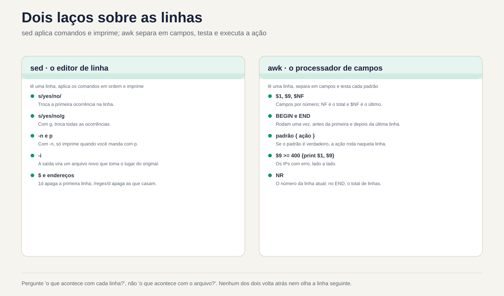
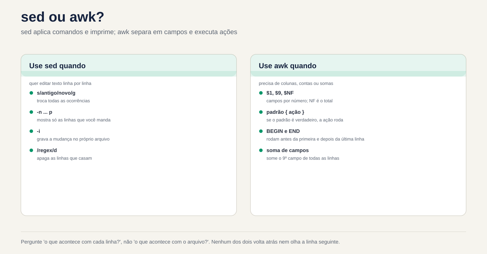

# Lezione 3.4 · sed e awk

Nella lezione 3.3 hai scelto le righe con `grep`. Oggi fai le altre due cose che ogni amministratore fa con il testo: **cambia** righe e **calcola** con le colonne. `sed` scambia, cancella e inserisce righe, sullo schermo o all'interno del file. `awk` separa ogni riga in campi, filtra per valore, somma, conteggio e formato. Entrambi sono piccoli, sono su ogni macchina Linux e sono esattamente ciò che utilizza uno script di produzione quando deve modificare un file di configurazione o prendere un numero da un registro. Alla fine, completerai la sfida del Modulo 3: i dieci IP che hanno creato più password sbagliate in SSH, su una riga di comando, su entrambe le VM.

| File | lezione 3.4 |
| --- | --- |
| Modulo | M3 · Testo ed editor, lezione 4 di 5 |
| Quando | Settimana 8 |
| Alla fine puoi | Mostra, cancella e scambia righe con `sed`, per numero, per intervallo e per regex; utilizzare i gruppi, `&` e un altro delimitatore in `s///`; modificare un file sul posto con `sed -i` senza perdere nulla, con copia e controllo; separare i campi con `awk`, con il separatore standard e con `-F`; filtra per valore, aggiungi, conta con i vettori e formatta con `printf`; incrociare due file con `NR == FNR`; passare variabili di shell a `awk` senza combattere con le virgolette; sapere quando uno script `awk` di Rocky (gawk) non viene eseguito allo stesso modo su Debian (mawk); elenca gli IP che hanno avuto il maggior numero di password sbagliate in SSH, nei file e nel journal |
| Articoli di prova | LPIC-1 103.2 (il `sed` tra i filtri di testo) · LPIC-1 103.7 (il `sed` con le espressioni regolari) · `awk` non è nell'elenco ufficiale LPIC-1 o RHCSA, ma è in quasi tutti gli script di produzione |
| Prerequisiti | lezione 3.1 (virgolette, tubi, `<( )`); lezione 3.2 (`cut`, `sort`, `uniq -c`, `~/lab32/acesso.log`); lezione 3.3 (BRE ed ERE, `~/lab33` con campioni) |
| Tempo | Intorno alle 2:30 |
| Istantanee | m3a4-start e m3a4-end su entrambe le VM |

## 1 · Riscaldamento

Tre domande, appena mi vengono in mente. Scrivi le risposte; la chiave di risposta controlla alla fine.

1. Si esegue `sed 's/yes/no/' app.conf` e sullo schermo viene visualizzato il file con la modifica apportata. Indovina: `app.conf` è cambiato?
2. In un registro SSH la data è `Nov  3` con due spazi perché il giorno ha una sola cifra. Indovina: cosa mostra `cut -d' ' -f2` in questa riga? E `awk '{print $2}'`?
3. Uno script `awk` funziona su Rocky. Copi lo stesso file su Debian, eseguilo e non dà alcun errore. Intuizione: potrebbe uscire un risultato diverso?

## 2 · Perché è importante

Quasi tutti i disastri con `sed` e `awk` si verificano in un'unica riga, senza messaggio di errore:

| Il cosiddetto | La risposta sbagliata | Cosa provoca |
| --- | --- | --- |
| "Cambia il server della banca dati da `10.1.0.40` a `10.1.0.41` in `app.conf`" | `sed 's/10.1.0.40/10.1.0.41/' app.conf` | Lo schermo mostra la modifica, ma il file rimane lo stesso: senza `-i`, `sed` scrive solo in uscita. E il punto regex corrisponderebbe comunque a `10a1b0c40` |
| "Rimuovi il commento `PermitRootLogin` di `sshd_config`" | `sed -i 's/^#//' /etc/ssh/sshd_config` | Elimina il commento da **tutte** le righe che iniziano con `#`, comprese le frasi esplicative. `sshd` non accetta la configurazione e non sale al successivo riavvio. Se eri connesso tramite SSH, è stata l'ultima volta |
| "Disattiva la password in SSH e mostra cosa è cambiato" | `sed -n -i 's/yes/no/p' arquivo` | `-n` con `-i` scrive nel file **solo** le righe stampate. Il file di configurazione diventa una singola riga. Se eseguito di nuovo, diventa un file vuoto |
| "Quanti byte sono stati scaricati da ciascun IP oggi?" | `cut` per eliminare le colonne e la somma in un foglio di calcolo | Mezz'ora di copia e incolla. Un `awk '{b[$1] += $10} END {...}'` risponde in un secondo e riprende domani |
| "Elimina il giorno di ogni riga nel registro SSH" | `cut -d' ' -f2` | Funziona dal giorno 10 al 31 e restituisce una riga vuota dal giorno 1 al 9 perché i giorni a una cifra hanno due spazi. Lo script supera il test e fallisce nella prima settimana del mese |
| "Il report funziona su Rocky; su Debian esce vuoto" | Copia lo stesso script da `awk` in entrambi | Rocky ha `gawk`; Debian, `mawk`. Una funzionalità solo di `gawk` potrebbe semplicemente non funzionare in `mawk`, senza alcun errore |

`sed` e `awk` non sono difficili. Sono **letterali**: fanno esattamente ciò che è scritto, su tutta la riga, su ogni riga. Chi lo conosce lo prova prima sullo schermo e solo dopo lo scrive nel file.

## 3 · Modello mentale

> `sed` e `awk` sono **un cappio sulle righe**. `sed` legge una riga, applica i comandi, in ordine, e stampa il risultato. `awk` legge una riga, la separa in campi, testa ogni modello ed esegue l'azione di coloro che hanno abbinato. Nessuno dei due torna indietro o guarda la riga successiva (a meno che tu non lo chieda). Pensa sempre a "cosa succede a **ogni** riga?", non a "cosa succede al file?".

```text
  sed 's/yes/no/' app.conf

  ┌─────────────┐   lê uma linha    ┌──────────────────┐   aplica s/yes/no/   ┌──────────────┐
  │ app.conf    │ ────────────────► │ espaço de padrão │ ───────────────────► │ imprime      │
  │ (só leitura)│                   │ "Password... yes"│   (só a 1ª vez,      │ na saída     │
  └─────────────┘                   └──────────────────┘    sem o g)          └──────────────┘
                     e repete para a próxima linha. Com -n, só imprime quando você manda (p).
                     Com -i, a "saída" é um arquivo novo que, no fim, toma o lugar do original.

  awk '$9 >= 400 {print $1, $9}' acesso.log

  linha: 192.168.5.7 - - [03/Nov/2026:08:02:30 +0100] "POST /login HTTP/1.1" 401 128
         └── $1 ───┘ $2 $3 └──────── $4 ────────┘ └$5─┘ └─$6─┘ └─$7─┘ └─ $8 ──┘ $9  $10
                                                                                NF = 10, $NF = $10

  BEGIN { ... }              roda uma vez, antes da primeira linha
  padrão { ação }            para cada linha: se o padrão é verdadeiro, roda a ação
  END { ... }                roda uma vez, depois da última linha (NR = total de linhas)
```

Due conseguenze pratiche. Primo: `sed` senza `-i` **mai** cambia il file, quindi puoi provare a piacimento. Secondo: `awk` separa i campi con **qualsiasi sequenza** di spazi e tabulazioni e ignora gli spazi all'inizio della riga. Ecco perché non scatta su `Nov  3` e `cut -d' '` scatta.



*Chiedi cosa succede a ciascuna riga, non al file.*

## 4 · Layered Concept

### Essential

**O `sed`, l'editor dello stream.** Il nome deriva da *stream redattore*. Riceve testo da un file o da una pipe e scrive il risultato nell'output. La forma per quasi tutti gli usi è:

```bash
sed [opções] 'endereço comando' arquivo
```

L'**indirizzo** indica su quali linee agisce il comando; senza indirizzo, agisce su tutti. Il **comando** indica cosa fare:

| Comando | Fare | Esempio |
| --- | --- | --- |
| `p` | Stampa la riga (di nuovo, se non hai usato `-n`) | `sed -n '3p' arq` mostra solo la riga 3 |
| `d` | Elimina la riga di output | `sed '1d' arq` mostra tutto tranne la riga 1 |
| `s/regex/troca/` | Cambia la prima sezione che corrisponde a | `sed 's/yes/no/' arq` |
| `s/regex/troca/g` | Scambia tutte le parti che corrispondono, nella riga | `sed 's/:/ /g' arq` |
| `q` | Smetti di leggere | `sed '5q' arq` è un `head -n 5` |

| Indirizzo | Quali linee | Esempio |
| --- | --- | --- |
| `N` | Numero di riga N | `sed -n '3p'` |
| `$` | L'ultimo | `sed -n '$p'` è un `tail -n 1` |
| `N,M` | Da N a M | `sed -n '2,4p'` |
| `/regex/` | Quelli che corrispondono alla regex | `sed -n '/401/p'` è un `grep 401` |
| `/a/,/b/` | Dal primo che sposa `a` al successivo che sposa `b` | `sed -n '/^Port/,/^Password/p'` |
| `endereço!` | Quelli che **non sono** dall'indirizzo | `sed '/^#/!d'` lascia semplicemente i commenti |

E le tre opzioni che usi ogni giorno:

| Opzione | Fare |
| --- | --- |
| `-n` | Non stampa nulla da solo; solo quello che invii con `p` |
| `-E` | Regex estesa, come `grep -E` della lezione 3.3: `+`, `?`, `{}`, `\|` e `( )` senza barra |
| `-i` | Scrive il risultato nel file stesso. `-i.bak` ne memorizza invece una copia con il suffisso `.bak` |

**O `awk`, il linguaggio delle colonne.** `awk` legge ogni riga, la separa in campi ed esegue un programmino. Il formato è:

```bash
awk 'padrão { ação }' arquivo
```

Nessun modello, l'azione si svolge su tutta la riga. Senza azione, la riga corrispondente viene stampata interamente. I nomi che devi sapere:

| Nome | È | Esempio |
| --- | --- | --- |
| `$0` | Tutta la linea | `awk '{print $0}'` è un `cat` |
| `$1`, `$2`... | Il primo, il secondo campo... | `awk '{print $1}'` |
| `NF` | Quanti campi ha la riga | `$NF` è l'ultimo campo; `$(NF-1)`, il penultimo |
| `NR` | Il numero di riga corrente (alla fine, il totale) | `awk 'NR == 3'` è `sed -n '3p'` |
| `-F` | Il separatore di campo | `awk -F: '{print $1}' /etc/passwd` |
| `BEGIN`, `END` | Prima della prima riga, dopo l'ultima | `awk 'END {print NR}'` è un `wc -l` |

I modelli sono confronti (`$9 >= 400`, `$1 == "10.1.0.20"`), regex (`/Failed password/`, `$7 ~ /^\/api/`) o entrambi con `&&`, `||` e `!`. Le variabili non hanno bisogno di essere dichiarate: iniziano con zero o con testo vuoto. Per questo motivo conta `{n++}` e `{soma += $10}` aggiunge.

**Le virgolette.** Il programma per `awk` e `sed` è **sempre** racchiuso tra virgolette semplici. `$1` di `awk` è il primo campo; il `$1` della shell è il primo argomento dello script. Tra virgolette doppie, la shell scambia il suo `$1` prima che il `awk` veda.

### Intermedio

**Il `s///` all'interno.**

| Parte | Fare | Esempio e risultato |
| --- | --- | --- |
| `&` | L'intera sezione che si è sposata | `echo 'Port 22' \| sed 's/[0-9][0-9]*/[&]/'` mostra `Port [22]` |
| `\(...\)` e `\1` | Gruppo in BRE e riferimento ad esso | `sed 's/^\([^ ]*\) .*/\1/'` lascia solo la prima parola |
| `(...)` e `\1` con `-E` | Lo stesso, presso ERE | `sed -E 's/^([^ ]+) .*/\1/'` |
| `g` | Tutte le occorrenze della riga | `s/\//_/g` |
| Un numero | Solo l'ennesima occorrenza | `s/\//_/2` cambia solo la seconda battuta |
| `I` (GNU) | Ignora le lettere maiuscole | `s/passwordauthentication/PA/I` |
| `p` con `-n` | Stampa solo le righe in cui è stata apportata una modifica | `sed -n 's/^Port /porta: /p'` |
| Un altro delimitatore | Qualsiasi carattere immediatamente dopo `s` diventa | `s\|/home/rodrigo\|~\|` invece di `s/\/home\/rodrigo/~/` |

Il delimitatore è la prima cosa che salva un `sed` con percorsi. Con una sbarra ogni `/` del sentiero necessita di `\/`, ed il comando diventa una staccionata in legno. Con `|`, `#` o `,` è leggibile.

**Più comandi.** Separare con `;` oppure utilizzare più `-e`. I comandi vengono eseguiti **in ordine**, sulla stessa riga:

```bash
sed '/^[[:space:]]*#/d; /^[[:space:]]*$/d' conf.amostra
sed -e 's/yes/no/' -e '/^#/d' conf.amostra
```

Il primo è `grep -Ev '^[[:space:]]*(#|$)'` della lezione 3.3, scritto in `sed`. L'ordine conta: se la prima modifica trasformasse una riga in un commento, la seconda la vedrebbe già commentata.

**Inserisci, aggiungi, modifica l'intera riga.** In GNU sed, in una sola riga:

| Comando | Fare | Esempio |
| --- | --- | --- |
| `i texto` | Inserisci una riga **prima** | `sed '1i # gerado pelo lab' arq` |
| `a texto` | Aggiungi una riga **dopo** | `sed '/^Port/a # porta padrão' arq` |
| `c texto` | Cambia l'intera riga | `sed '/^MaxAuthTries/c MaxAuthTries 4' arq` |
| `y/abc/xyz/` | Scambia carattere per carattere, come `tr` | `sed 'y/abc/ABC/'` |
| `l` | Mostra la linea con quelli invisibili, come `cat -A` | `sed -n '9l' conf.amostra` mostra `\t#ListenAddress 0.0.0.0$` |

**Il `awk` che calcola.**

| Vuoi | Programma |
| --- | --- |
| Conta le righe che corrispondono a | `'$9 >= 400 {n++} END {print n+0}'` |
| Aggiungi una colonna | `'{soma += $10} END {print soma}'` |
| Contare per valore (`sort \| uniq -c` di `awk`) | `'{c[$9]++} END {for (s in c) print s, c[s]}'` |
| Aggiungi per valore | `'{b[$1] += $10} END {for (ip in b) print b[ip], ip}'` |
| Formato | `printf "%-15s %10d\n", ip, b[ip]`: testo allineato a sinistra in 15 posizioni, testo allineato a destra in 10 |
| Ricevi un valore dalla shell | `awk -v lim="$LIMITE" '$10 > lim'` |
| Regex in un campo | `'$7 ~ /^\/api/'` e `'$6 !~ /GET/'` |
| Funzioni di testo | `length($1)`, `substr($4, 2, 11)`, `tolower($0)`, `split($4, p, ":")` |
| Cambio in campo | `sub(/regex/, "troca", $7)` scambia il primo; `gsub` cambia tutto |
| Passa alla riga successiva | `next` |

`c[$9]++` è un **vettore associativo**: l'indice è il testo stesso, `"200"`, `"401"`, `"10.1.0.20"`. Questo è ciò che rende il `awk` così utile per la segnalazione. Un avvertimento: `for (x in v)` scorre gli indici in un ordine **non garantito** e che cambia tra `gawk` e `mawk`. Ogni volta che l'ordine è importante, invia l'output a `sort`.

**Il separatore di output.** In `print $1, $2`, la virgola diventa `OFS`, che vale uno spazio. Con `-v OFS=';'` diventa punto e virgola. Ma solo `print`, ovvero `print $0`, mostra la riga così come è stata inserita. Per ricomporre l'intera riga con il nuovo `OFS` modificare un campo: `{$1 = $1; print}`.

### Ponte Windows

| Su Windows | Su Linux | Attenzione |
| --- | --- | --- |
| `(Get-Content app.conf) -replace '^PasswordAuthentication yes$', 'PasswordAuthentication no'` | `sed 's/^PasswordAuthentication yes$/PasswordAuthentication no/' app.conf` | PowerShell `-replace` ignora le lettere maiuscole per impostazione predefinita; `sed`, n. L'equivalente esatto è `-creplace` |
| `(Get-Content app.conf) -replace 'a', 'b' \| Set-Content app.conf` | `sed -i 's/a/b/' app.conf` | Le parentesi fanno sì che PowerShell legga l'intero file prima di scriverlo. Senza di essi `Set-Content` tenta di scrivere sul file ancora aperto in lettura e restituisce un errore. `sed -i` risolve questo problema scrivendo in un file temporaneo |
| `$1`, `$2` in `-replace` | `\1`, `\2` in `sed` | Stessa idea di gruppo, sintassi diversa. In Notepad++ è anche `\1` |
| `Get-Content acesso.log \| ForEach-Object { ($_ -split '\s+')[0] }` | `awk '{print $1}' acesso.log` | PowerShell conta da zero; `awk`, dà un |
| `Import-Csv -Delimiter ':' -Header nome,x,uid ...` | `awk -F: '{print $1, $3}'` | `Import-Csv` comprende le virgolette in CSV; `awk -F,` non capisce |
| `Group-Object` e `Sort-Object Count -Descending` | `awk '{c[$1]++} END {...}' \| sort -rn` |  |
| `Measure-Object -Property Bytes -Sum` | `awk '{s += $10} END {print s}'` |  |

### Avanzato

**`sed -i` crea un nuovo file.** Scrive il risultato in un file temporaneo, nella stessa cartella, e alla fine scambia l'originale con esso. GNU sed copia i permessi, ma il file è **un altro**, con un numero di inode diverso. Ciò ha tre conseguenze reali:

- Un **link simbolico** modificato con `sed -i` diventa un file comune e il file a cui puntava rimane intatto. Per seguire il collegamento: `sed -i --follow-symlinks`.
- Un **hard link** (lezione 2.8) non è più condiviso: l'altro nome continua a rimandare al vecchio contenuto.
- Un **registro in fase di scrittura** non deve essere modificato con `sed -i`. Il programma continua a scrivere sul vecchio inode, senza più nome, e le nuove righe vanno perse, occupando spazio su disco fino al riavvio del programma.

**`-i.bak` e il `-ie` che è fuorviante.** Il suffisso della copia è **incollato** in `-i`. Ecco perché `sed -ie 's/...//' arq` non è "`-i` e `-e`": è `-i` con il suffisso `e` e accanto c'è un file `arqe`. Su macOS e BSD, `-i` richiede sempre il suffisso (`sed -i '' ...`). In uno script che deve essere eseguito in entrambi, è preferibile scrivere in un nuovo file e scambiarlo con `mv`.

**Lo spazio di riserva.** `sed` ha un secondo spazio, lo *spazio di attesa*, con i comandi `h`, `H`, `g`, `G` e `x`. Con esso puoi scrivere trucchi come `sed -n '1!G;h;$p'`, che inverte il file come `tac`. Saper riconoscere; per scrivere cose del genere, usa `awk`, che è leggibile.

**Separatori con regex.** `-F` di `awk` accetta regex: `-F'[ :]+'` separa con qualsiasi sequenza di spazi e due punti. Ma `-F,` non capisce veramente il CSV: un campo `"Rossi, Ana"` diventa due. Per CSV con virgolette, `gawk` ha `FPAT` e esistono strumenti propri, come `csvtool`.

**Numero o testo.** Un campo che assomiglia a un numero viene confrontato come numero: `$9 >= 400` funziona. Ma `"80%"` non sembra un numero. `+0` forza la conversione e si ferma al primo carattere non numerico: `$5+0` di `80%` è `80`. `df` si legge così: `df -P | awk 'NR > 1 && $5+0 >= 80 {print $6, $5}'`.

**Due file.** `NR` conta insieme le righe di tutti i file; `FNR`, solo quelli del file corrente. Mentre i due sono uguali, `awk` legge il **primo** file. È il modo classico di caricare una lista e usarla nella seconda, `join` promesso nella Lezione 3.2:

```bash
awk 'NR == FNR {bloq[$1]; next} $1 in bloq' bloqueio.txt acesso.log
```

**gawk e mawk.** `gawk` ha estensioni che `mawk` non ha: `gensub()`, `asort()`, `asorti()`, `IGNORECASE`, `PROCINFO["sorted_in"]`, `FPAT`, il bordo della parola `-i inplace` e `\y`. Una funzione che non esiste dà immediatamente un errore. Una **variabile** speciale che non esiste, come `IGNORECASE`, diventa una variabile comune e lo script viene eseguito in modo silenzioso, con un altro risultato. In Rocky, `gawk --posix` disattiva le estensioni e `gawk --lint` ti avvisa su quali hai utilizzato: entrambi testano la portabilità prima che lo script arrivi in ​​Debian.

**`awk` esegue anche comandi.** `system("...")` e `"comando" | getline` eseguono cose nella shell. In uno script `awk` che non hai scritto, cerca questi due prima di eseguirlo con `sudo`.

### Ciò che rientra in test

- **LPIC-1 103.2 e 103.7.** `sed` appare in entrambi gli elenchi. Cadono: `s///` con e senza `g`, `-n` con `p`, `d` con indirizzo, `-i`, `-E`, gruppi con `\1` e prevedono l'uscita di un piccolo `sed`. Una domanda tipica: "quale comando scambia **tutte** le occorrenze di `a` con `b` su ogni riga?" La risposta è `g`.
- ** `awk`.** Nell'elenco degli obiettivi di LPIC-1 versione 5.0 e RHCSA, `awk` non appare per nome. Può apparire come alternativa in una domanda a scelta multipla. Controlla la versione corrente di entrambi gli elenchi sui siti Web LPI e Red Hat. Sul lavoro, a differenza del test, è indispensabile.
- **RHCSA.** Il test è pratico e qualsiasi strumento che funzioni è valido. Un `sed -i` ben fatto in un file di configurazione fa risparmiare tempo; una cattiva azione costa la prova. L'abitudine di testare prima senza `-i` vale punti.

`vim`, con il suo `:s/regex/troca/g`, è di lezione 3.5 e utilizza la stessa regex di oggi.

## 5 · Rocky × Debian

| Articolo | laboratorio-roccioso (Rocky 9) | debian-lab (Debian 13) | Come controllare |
| --- | --- | --- | --- |
| `sed` | GNU sed 4.8 | GNU sed 4.9 | `sed --version \| head -1` |
| `awk` | `gawk` 5.1 | `mawk` 1.3.4 | `readlink -f "$(command -v awk)"` |
| Versione `awk` | `awk --version` o `awk -W version` | `awk -W version` | `-W version` funziona su entrambi |
| `gawk` Estensioni | Funzionano | `gensub()` dà errore; `IGNORECASE` viene ignorato, silenzioso | `gawk --lint -f script.awk` a Rocky |
| Prova portabilità | `gawk --posix -f script.awk` | `mawk -f script.awk` | Eseguirli entrambi e confrontare l'output con `diff` |
| `gawk` disponibile | Prossimamente | Solo se qualcuno ha installato (`apt install gawk`) | `command -v gawk` |
| Password errata per accedere a SSH | `/var/log/secure`, registrato da rsyslog, con rotazione settimanale | Solo nella rivista, unità `ssh` | `ls -l /var/log/secure*`; `journalctl -u ssh -n 3` |
| Diario | Volatile, a meno che non sia stato modificato nella lezione 2.3 | Permanente | `ls -ld /var/log/journal` |
| Nome del processo nel registro | `sshd[PID]` | Potrebbe sembrare `sshd-session[PID]`, perché OpenSSH 10 ha separato il processo dalla sessione | `journalctl -u ssh -n 5 -o short` |
| `sed -i` nel collegamento simbolico | Interrompere il collegamento | Interrompere il collegamento | `ls -l` prima e dopo |

La riga che attira maggiormente l'attenzione è `awk`. Entrambi sono veri `awk`, seguono POSIX ed eseguono il 95% dei programmi allo stesso modo. È nell'altro 5% che uno script copiato da un server all'altro dà un risultato diverso senza preavviso. Nella pausa B vedi accadere questo.

Anche A del processo. Un `grep 'sshd\['` trova le righe di Rocky e potrebbe non trovarne alcuna in Debian 13. Ecco perché il lab filtra in base all'**unità** (`journalctl -u ssh`) e al **testo** (`Failed password`), e mai in base al nome del processo.

## 6 · Laboratorio guidato

Sei `rodrigo`, in rocky-lab e raggiungi debian-lab tramite `ssh deb`. Tutto avviene in `~/lab34`, su entrambe le VM. `sed -i` viene utilizzato solo nelle **copie** all'interno della cartella del laboratorio. I file di sistema e i registri effettivi vengono **solamente letti**. Il passaggio 7 è la sfida del Modulo 3.


*Chiedi cosa succede a ciascuna riga, non cosa succede al file.*


### Passaggio 0 · Istantanea, cartella e file di laboratorio

In Proxmox, acquisisci l'istantanea `m3a4-inicio` delle due VM. In rocky-lab:

```bash
eval "$(ssh-agent -s)"; ssh-add
ssh -o BatchMode=yes deb hostname
mkdir -p ~/lab34; ssh deb 'mkdir -p ~/lab34'
cd ~/lab34
cp ~/lab33/acesso.log ~/lab33/ssh.amostra ~/lab33/conf.amostra ~/lab33/bloqueio.txt .
wc -l acesso.log ssh.amostra conf.amostra bloqueio.txt
```

```text
  15 acesso.log
  12 ssh.amostra
  11 conf.amostra
   3 bloqueio.txt
  41 total
```

Se ne mancano alcuni, ricreali con il passaggio 0 della Lezione 3.3 (`acesso.log` proviene dalla Lezione 3.2). `bloqueio.txt` ha `203.0.113.9`, `198.51.100.4` e una riga vuota alla fine, apposta. Ora le versioni, su entrambe le VM:

```bash
sed --version | head -1; readlink -f "$(command -v awk)"; awk -W version 2>/dev/null | head -1
ssh deb 'sed --version | head -1; readlink -f "$(command -v awk)"; awk -W version 2>/dev/null | head -1'
```

In Rocky dovresti vedere GNU sed 4.8 e `awk` che punta a `gawk`, versione 5.1. Su Debian, GNU sed 4.9 e `awk` puntano a `mawk`, versione 1.3.4. Annota cosa è venuto fuori: il Break B dipende da questo. Copia i file su Debian:

```bash
scp acesso.log ssh.amostra conf.amostra bloqueio.txt deb:lab34/
ssh deb 'cd ~/lab34 && wc -l acesso.log ssh.amostra conf.amostra bloqueio.txt'
```

### Passo 1 · Mostrare ed eliminare

Prima di tutto, il `sed` come `head`, `tail` e `grep`:

```bash
sed -n '3p' acesso.log
sed -n '$p' acesso.log
sed -n '2,4p' acesso.log | cut -d' ' -f1
```

```text
10.1.0.20 - - [03/Nov/2026:08:01:02 +0100] "GET /docs HTTP/1.1" 200 2048
10.1.0.20 - - [03/Nov/2026:08:07:30 +0100] "GET / HTTP/1.1" 200 5120
10.1.0.31
10.1.0.20
192.168.5.7
```

Ora vuoi vedere i tentativi di accesso falliti, le righe con `401`. E dimentica `-n`.

**Decidi 1 · Quante righe mostra `sed '/401/p' acesso.log | wc -l`?**

- **A)** 4
- **B)** 15
- **C)** 19
- **D)** 11

Scegli la lettera prima di guardare la tabella.

```bash
sed '/401/p' acesso.log | wc -l
sed -n '/401/p' acesso.log | wc -l
```

```text
19
4
```

| Se hai selezionato | Risultato | Perché |
| --- | --- | --- |
| A | ❌ Sbagliato | È il risultato **con** `-n`. Senza di essa, `sed` stampa ogni riga alla fine del ciclo e `p` stampa quelle che corrispondono nuovamente. |
| B| ❌ Sbagliato | Sarebbe vero se il `p` non facesse nulla. Cosa fa: stampa la riga **ancora una volta**. |
| C| ✅ Giusto | Le 15 righe, una volta ciascuna, più le 4 con `401` ripetute: 15 + 4 = 19. |
| D | ❌ Sbagliato | Queste sarebbero le righe **senza** `401` (15 − 4). Questo è `sed '/401/d'`. |

**Da risolvere:** `p` va quasi sempre con `-n`. Senza `-n`, `p` duplica le righe.

`d` fa il contrario: rimuove la riga dall'output. Questo è `grep -Ev '^[[:space:]]*(#|$)'` della lezione 3.3, in `sed`:

```bash
sed '/^[[:space:]]*#/d; /^[[:space:]]*$/d' conf.amostra
```

```text
Port 22
PermitRootLogin no
PasswordAuthentication yes
MaxAuthTries 3
```

I due comandi vengono eseguiti in ordine sulla stessa riga. Una riga eliminata dalla prima non raggiunge la seconda: `d` termina immediatamente il ciclo di quella riga.

### Passo 2 · Lo scambio: `s`, `g` e il delimitatore

Vuoi scambiare le barre di un percorso con caratteri di sottolineatura, per diventare un nome di file.

**Decidi 2 · Cosa mostra `echo 'GET /a/b/c HTTP/1.1' | sed 's/\//_/'`?**

- **A)** `GET _a_b_c HTTP_1.1`
- **B)** `GET _a/b/c HTTP/1.1`
- **C)** `GET /a/b/c HTTP/1.1`, nessun cambiamento
- **D)** Errore a causa della barra all'interno del motivo

Scegliere la lettera prima di guardare la tabella.

```bash
echo 'GET /a/b/c HTTP/1.1' | sed 's/\//_/'
echo 'GET /a/b/c HTTP/1.1' | sed 's/\//_/g'
echo 'GET /a/b/c HTTP/1.1' | sed 's|/|_|g'
echo 'GET /a/b/c HTTP/1.1' | sed 's|/|_|2'
```

```text
GET _a/b/c HTTP/1.1
GET _a_b_c HTTP_1.1
GET _a_b_c HTTP_1.1
GET /a_b/c HTTP/1.1
```

| Se hai selezionato | Risultato | Perché |
| --- | --- | --- |
| A | ❌ Sbagliato | Questo è il risultato con `g`. Senza di esso, `s` scambia solo la **prima** occorrenza di ciascuna riga. |
| B| ✅ Giusto | `\/` è una barra letterale. La prima battuta della riga diventa `_`, il resto rimane com'era. |
| C| ❌ Sbagliato | Si è sposato ed è cambiato. `s` non cambia nulla solo quando la regex non corrisponde a nessun punto della riga. |
| D | ❌ Sbagliato | Con `\` la barra non è più delimitatrice. Senza `\`, allora: `s///_/` dà `unknown option to 's'`. |

**Da correggere:** senza `g`, solo la prima occorrenza di ogni riga. Con i percorsi, modificare il delimitatore: `s|/|_|g` viene letto per primo.

Il numero al posto di `g` sceglie **quale** occorrenza: `2` ha modificato solo la seconda barra. Due usi che ripeterai spesso: `p` con `-n`, che mostra solo le linee scambiate, e `I`, che ignora le lettere maiuscole.

```bash
sed -n 's/^Port /porta: /p' conf.amostra
sed -n 's/passwordauthentication/PA/Ip' conf.amostra
```

```text
porta: 22
PA yes
#PA no
```

### Passo 3 · Gruppi, `&` e la golosa regex

Da `acesso.log`, vuoi solo l'IP e il codice di stato. Con `-E`, le parentesi trattengono lo snippet, mentre `\1` e `\2` lo restituiscono:

```bash
sed -E 's/^([^ ]+) .*" ([0-9]{3}) .*/\1 \2/' acesso.log | head -4
```

```text
10.1.0.20 200
10.1.0.31 200
10.1.0.20 200
192.168.5.7 401
```

`[^ ]+` è "uno o più caratteri diversi dallo spazio": l'intero IP e nient'altro. ` .*"  ` inghiotte tutto fino all'ultima virgoletta seguita da uno spazio, mentre `([0-9]{3})` prende le tre cifre che seguono immediatamente. Per inviare un registro a un fornitore senza esporre le macchine, reimpostare l'ultimo ottetto:

```bash
sed -E 's/^([0-9]+\.[0-9]+\.[0-9]+)\.[0-9]+/\1.0/' acesso.log | cut -d' ' -f1 | sort -u
echo 'Port 22' | sed 's/[0-9][0-9]*/[&]/'
```

```text
10.1.0.0
192.168.5.0
203.0.113.0
Port [22]
```

Il `&` è l'intera sezione che corrisponde, senza bisogno di un gruppo. Ora l'errore che tutti commettono una volta. Vuoi rimuovere le virgolette dai valori di una riga di configurazione:

**Decidi 3 · Cosa mostra `echo 'id="7" nome="ana"' | sed 's/"\(.*\)"/\1/'`?**

- **A)** `id=7 nome=ana`
- **B)** `id=7" nome="ana`
- **C)** `id="7" nome=ana`
- **D)** `7`

Scegli la lettera prima di guardare la tabella.

```bash
echo 'id="7" nome="ana"' | sed 's/"\(.*\)"/\1/'
echo 'id="7" nome="ana"' | sed 's/"\([^"]*\)"/\1/g'
```

```text
id=7" nome="ana
id=7 nome=ana
```

| Se hai selezionato | Risultato | Perché |
| --- | --- | --- |
| A | ❌ Sbagliato | E' quello che volevi. A tale scopo il gruppo non può incrociare le virgolette: `[^"]*`, con `g`. |
| B| ✅ Giusto | `.*` è **greedy**: corrisponde alla sezione più lunga possibile. Si va dalle prime virgolette della riga all'**ultima**, e solo queste due scompaiono. |
| C| ❌ Sbagliato | Sarebbe una regex che inizia a corrispondere alla fine. La regex inizia dal primo punto possibile nella riga, la prima virgoletta. |
| D | ❌ Sbagliato | `s` cambia solo la parte corrispondente. Resta `id=`, prima della prima virgoletta. |

**Per risolvere:** `.*` si spinge il più lontano possibile. Per fermarti al delimitatore successivo, usa "tutto tranne questo": `[^"]*`, `[^ ]*`, `[^:]*`.

### Passaggio 4 · `sed -i` senza paura

Ora `sed` scriverà nel file. Lavora su una copia. Lo script sicuro prevede tre passaggi: vedere la differenza sullo schermo, registrare con copia, controllare.

```bash
cp conf.amostra app.conf
sed 's/^PasswordAuthentication yes/PasswordAuthentication no/' app.conf | diff app.conf -; echo "diff saiu com $?"
```

```text
7c7
< PasswordAuthentication yes
---
> PasswordAuthentication no
diff saiu com 1
```

`-` dice a `diff` di leggere l'input dalla pipe. L'output mostra esattamente una riga modificata, 7. `1` di `diff` significa "sono diversi" e non è un errore. Se l'output avesse mostrato venti righe, avresti scoperto il problema **prima** che rovinasse il file. Adesso salvatelo, con una copia, e controllate:

```bash
ls -i app.conf
sed -i.bak 's/^PasswordAuthentication yes/PasswordAuthentication no/' app.conf
ls -i app.conf; ls app.conf*
diff app.conf.bak app.conf
```

Il numero dell'inode cambia: `sed -i` ha scritto un nuovo file e con esso ha sostituito quello vecchio. `app.conf.bak` è l'originale e `diff` mostra le stesse righe dell'anteprima. Ora un collegamento simbolico, per vedere cosa succede:

```bash
ln -s app.conf link.conf; ls -l link.conf
sed -i 's/^Port 22/Port 2222/' link.conf
ls -l link.conf app.conf; grep -H '^Port' link.conf app.conf
```

Prima, `ls -l` mostra `link.conf -> app.conf`. Quindi `link.conf` è un file comune, senza freccia, con `Port 2222`. `app.conf` prosegue con `Port 22`. Su un server in cui `/etc/algo.conf` è un collegamento a un file gestito, questo scambio passa inosservato finché qualcuno non modifica effettivamente il file e non cambia nulla. Con `sed -i --follow-symlinks`, `sed` modifica il file a cui punta il collegamento. Cancella e ricomincia dall'originale:

```bash
rm link.conf; cp conf.amostra app.conf; rm -f app.conf.bak
```

Il tuo collega invia un comando con "le opzioni insieme, che è più veloce":

**Decidi 4 · Cosa succede a `sed -ie 's/^PasswordAuthentication yes/PasswordAuthentication no/' app.conf`?**

- **A)** `app.conf` viene modificato e nient'altro
- **B)** `app.conf` viene modificato e appare un `app.confe` con il contenuto old
- **C)** Errore: non valido opzione
- **D)** Non cambia nulla, perché `e` esegue lo scambio come comando di shell

Scegli la lettera prima di guardare la tabella.

```bash
sed -ie 's/^PasswordAuthentication yes/PasswordAuthentication no/' app.conf
ls app.conf*
grep -c '^PasswordAuthentication no' app.conf app.confe
```

```text
app.conf  app.confe
app.conf:1
app.confe:0
```

| Se hai selezionato | Risultato | Perché |
| --- | --- | --- |
| A | ❌ Sbagliato | Questo sarebbe il caso del `sed -i -e`, con le opzioni separate. Insieme, `e` diventa qualcos'altro. |
| B| ✅ Giusto | Il suffisso della copia viene incollato in `-i`. `-ie` è "`-i` con suffisso `e`". Lo scambio è stato effettuato e la copia si chiama `app.confe`. |
| C| ❌ Sbagliato | La sintassi è valida, motivo per cui inganna: nessun avvertimento. |
| D | ❌ Sbagliato | `e` come **flag** di `s` (alla fine, `s/.../.../e`) esegue comandi in GNU sed. Come opzione incollata in `-i`, è solo un suffisso. |

**Per risolvere:** scrivere `-i.bak` o `-i -e`, mai `-ie`. Un `ls` dopo `sed -i` mostra copie con nomi strani.

Pulire il resto: `rm app.confe`.

### Passo 5 · Campi con `awk`

Ora le colonne. `awk` separa ogni riga con spazi e numera i pezzi:

```bash
awk '{print $1, $9}' acesso.log | head -3
awk 'END {print NR}' acesso.log
head -1 ssh.amostra | awk '{print $2, $NF, NF}'
head -1 ssh.amostra | cut -d' ' -f2 | cat -A
```

```text
10.1.0.20 200
10.1.0.31 200
10.1.0.20 200
15
3 ssh2 14
$
```

`Nov  3` ha due spazi. Per `cut -d' '`, questo è un campo **vuoto** tra di loro, e `-f2` risulta vuoto, come mostra `cat -A`. Per `awk` ogni sequenza di spazi è un unico separatore: `$2` è `3`. `NF` dice che la riga ha 14 campi e `$NF` è l'ultimo, `ssh2`.

Racchiudi il programma tra virgolette doppie, "per varietà":

**Decidi 5 · Cosa mostra `awk "{print $1}" acesso.log | head -1`?**

- **A)** `10.1.0.20`
- **B)** L'intera riga
- **C)** Un errore di sintassi in `awk`
- **D)** Una riga vuota

Scegliere la lettera prima di guardare la tabella.

```bash
awk "{print $1}" acesso.log | head -1
echo "{print $1}"
```

```text
10.1.0.20 - - [03/Nov/2026:08:00:01 +0100] "GET / HTTP/1.1" 200 5120
{print }
```

| Se hai selezionato | Risultato | Perché |
| --- | --- | --- |
| A | ❌ Sbagliato | Sarebbe con virgolette singole. Tra virgolette doppie, la shell scambia `$1` prima che `awk` lo veda. |
| B| ✅ Giusto | Nel terminale, il `$1` della shell è vuoto. `awk` riceve `{print }` e `print` senza nulla stampa l'intera riga. |
| C| ❌ Sbagliato | `{print }` è un programma valido. Ecco perché l'errore è insidioso: niente ti avvisa. |
| D | ❌ Sbagliato | `print` senza argomenti non viene stampato vuoto; stampa `$0`. All'interno di uno script che accetta argomenti, `$1` sarebbe il primo argomento e il risultato cambierebbe nuovamente. |

**Da risolvere:** il programma `awk` è sempre racchiuso tra virgolette singole. Il valore della shell entra attraverso `-v`.

`-F` modifica il separatore. In `/etc/passwd` sono i due punti. Gli utenti People hanno UID a partire da 1000:

```bash
awk -F: '$3 >= 1000 {print $1, $3}' /etc/passwd
awk -F: '$3 >= 1000 && $3 < 65534 {print $1, $3}' /etc/passwd
```

Il primo elenca anche `nobody`, con UID 65534, che è un account di sistema, in entrambe le distribuzioni. Il secondo lascia solo le persone. In Rocky, `rodrigo` e gli utenti creati nel Modulo 2 dovrebbero uscire.

### Passo 6 · Filtra, aggiungi e conta

Un modello senza azione stampa la riga. Un confronto è uno schema:

```bash
awk '$9 >= 400' acesso.log | wc -l
awk '$9 >= 400 {print $1, $9, $7}' acesso.log | head -3
awk '$7 ~ /^\/api/ {print $1, $7, $9}' acesso.log
awk '$6 !~ /GET/' acesso.log | wc -l
```

```text
9
192.168.5.7 401 /login
192.168.5.7 401 /login
203.0.113.9 403 /admin
10.1.0.20 /api/status 500
10.1.0.31 /api/status 500
5
```

Ora cosa `cut` non fa: matematica. La somma dei byte, byte per IP e richieste per stato:

```bash
awk '{s += $10} END {print s}' acesso.log
awk '{b[$1] += $10} END {for (ip in b) printf "%-15s %10d\n", ip, b[ip]}' acesso.log | sort -k2,2nr
awk '{c[$9]++} END {for (s in c) print s, c[s]}' acesso.log | sort
```

```text
1068928
10.1.0.45          1048576
10.1.0.20            12352
192.168.5.7           4608
10.1.0.31             2112
203.0.113.9           1280
200 6
401 4
403 1
404 2
500 2
```

O `b[$1] += $10` somma i byte in un vettore il cui indice è l'IP. `printf` allinea e `sort -k2,2nr` ordina in base al secondo campo, ad esempio il numero, dal più grande al più piccolo. `sort` alla fine è obbligatorio: `for (ip in b)` non promette alcun ordine e `mawk` di Debian restituisce un ordine diverso da `gawk`. Esegui lo stesso su Debian e confronta.

Un valore shell inserisce `-v`:

```bash
LIMITE=1000
awk -v lim="$LIMITE" '$10 > lim {print $1, $10}' acesso.log | wc -l
```

```text
6
```

Lo script di avviso conta i 999 errori, che non esistono, e invia il numero via email:

**Decide 6 · Cosa mostra `awk '$9 == 999 {n++} END {print n}' acesso.log`?**

- **A)** `0`
- **B)** Una riga vuota
- **C)** Niente: nessuna riga corrispondente, quindi `END` non viene eseguito
- **D)** Un errore, perché `n` non è mai stato definito

Scegliere la lettera prima di guardare la tabella.

```bash
awk '$9 == 999 {n++} END {print n}' acesso.log | cat -A
awk '$9 == 999 {n++} END {print n+0}' acesso.log
```

```text
$
0
```

| Se hai selezionato | Risultato | Perché |
| --- | --- | --- |
| A | ❌ Sbagliato | Questo è ciò che mostra `n+0`. Senza il conteggio, la variabile mai toccata è testo vuoto. |
| B| ✅ Giusto | Il `n++` non è mai stato eseguito. `n` è vuoto, `print` stampa vuoto e l'interruzione di riga: `cat -A` mostra solo `$`. |
| C| ❌ Sbagliato | `END` viene sempre eseguito dopo l'ultima riga, indipendentemente dal fatto che qualcosa corrisponda o meno. |
| D | ❌ Sbagliato | In `awk` non è necessario dichiarare le variabili. Esiste, vale zero o vuota a seconda dell'uso. |

**Per correggere:** in un `END` che stampa un conteggio, scrivere `n+0`. L'e-mail con "0 errori" è diversa dall'e-mail con "errori".

Infine, due file. `bloqueio.txt` ha la lista degli IP bloccati nel firewall. Quali richieste di log provengono da loro?

```bash
awk 'NR == FNR {bloq[$1]; next} $1 in bloq' bloqueio.txt acesso.log
```

```text
203.0.113.9 - - [03/Nov/2026:08:03:10 +0100] "GET /admin HTTP/1.1" 403 256
203.0.113.9 - - [03/Nov/2026:08:04:20 +0100] "GET /wp-login.php HTTP/1.1" 404 512
203.0.113.9 - - [03/Nov/2026:08:06:30 +0100] "GET /.env HTTP/1.1" 404 512
```

Mentre `NR == FNR`, `awk` si trova nel primo file: memorizza ogni IP come indice vettoriale e salta alla riga successiva con `next`. Nel secondo file, `$1 in bloq` è vero per gli IP nell'elenco. La riga vuota in `bloqueio.txt` diventa un indice vuoto, che nessuna riga nel log ha e non è d'intralcio. È `join` della lezione 3.2, senza bisogno di ordinare nulla prima.

### Passo 7 · Sfida del modulo: i dieci IP che hanno sbagliato di più la password

La domanda è quella di ogni incidente che inizia con: "chi sta cercando di entrare in SSH?". Prima nel campione, dove conosci la risposta. Le righe della password errata hanno due formati:

```text
... Failed password for root from 203.0.113.9 port 51022 ssh2
... Failed password for invalid user admin from 198.51.100.4 port 40110 ssh2
```

**Decidere 7 · Quale espressione in `awk` prende l'IP in entrambi i formati?**

- **A)** `$11`
- **B)** `$13`
- **C)** `$(NF-3)`
- **D)** `$NF-3`

Scegliere la lettera prima di guardare la tabella.

```bash
awk '/Failed password/ {print $11}' ssh.amostra | sort | uniq -c | sort -rn
awk '/Failed password/ {print $(NF-3)}' ssh.amostra | sort | uniq -c | sort -rn | head -10
awk '/Failed password/ {print $NF-3}' ssh.amostra | head -1
```

```text
      2 admin
      2 203.0.113.9
      1 test
      1 oracle
      1 10.1.0.31
      3 203.0.113.9
      2 198.51.100.4
      1 192.0.2.66
      1 10.1.0.31
-3
```

| Se hai selezionato | Risultato | Perché |
| --- | --- | --- |
| A | ❌ Sbagliato | Funziona sulla linea normale. In `invalid user` ci sono altre due parole e `$11` diventa il nome dell'utente: `admin`, `oracle` e `test` appaiono come se fossero IP. |
| B| ❌ Sbagliato | È il contrario: premi `invalid user` e, nella linea normale, prendi la porta. |
| C| ✅ Giusto | Contando dalla fine il formato è lo stesso: IP, `port`, numero, `ssh2`. L'IP è sempre il quarto dal retro. |
| D | ❌ Sbagliato | Senza parentesi è `($NF) - 3`: il testo `ssh2` vale 0 come numero, esce `-3`. |

**Per risolvere:** quando l'inizio della riga varia e la fine no, contare dalla fine: `$NF`, `$(NF-1)`, `$(NF-3)`.

Le legature di valore (`2 admin` e `2 203.0.113.9`) possono uscire in un altro ordine, a seconda della lingua configurata nella VM; i numeri non cambiano Quando il formato può variare maggiormente, ad esempio con un nome utente che contiene uno spazio, cerca la parola invece di contare:

```bash
awk '/Failed password/ {for (i = 1; i <= NF; i++) if ($i == "from") print $(i+1)}' ssh.amostra | sort | uniq -c | sort -rn
```

Il risultato è lo stesso. Entrambe le forme accettano anche IPv6, cosa che `grep -oE 'from [0-9.]+'` della lezione 3.3 taglia nel primo `:`.

Ora il vero log. In Rocky, `/var/log/secure` e le rotazioni della settimana:

```bash
sudo cat /var/log/secure-* /var/log/secure 2>/dev/null | awk '/Failed password/ {print $(NF-3)}' | sort | uniq -c | sort -rn | head -10
```

In Debian, solo il diario, unità `ssh`. `-o cat` rimuove la data e il nome del processo, ma la fine della riga è la stessa:

```bash
ssh -t deb "sudo journalctl -u ssh --no-pager -o cat | awk '/Failed password/ {print \$(NF-3)}' | sort | uniq -c | sort -rn | head -10"
```

Notice `\$(NF-3)`. L'intero comando è racchiuso tra virgolette doppie e la shell **locale** vedrebbe `$(NF-3)` come sostituzione del comando: proverebbe ad eseguire un programma chiamato `NF-3`, darebbe un errore e `awk` riceverebbe ` print  ` senza nulla. La sbarra protegge `$`. La fuga manuale a ogni comando non si ridimensiona. Il modo professionale è uno script, con il programma `awk` tra virgolette singole, che viene eseguito allo stesso modo su entrambe le VM:

```bash
cat > top10.sh <<'EOF'
#!/bin/bash
# top10.sh: os 10 IPs com mais senhas erradas no SSH (Rocky: arquivo; Debian: journal)
{ sudo cat /var/log/secure 2>/dev/null || sudo journalctl -u ssh -u sshd --no-pager -o cat; } |
  awk '/Failed password/ {print $(NF-3)}' | sort | uniq -c | sort -rn | head -10
EOF
chmod +x top10.sh
./top10.sh
scp top10.sh deb:lab34/
ssh -t deb 'bash ~/lab34/top10.sh'
```

Il `'EOF'` tra virgolette impedisce alla shell di modificare il contenuto dell'here-doc (Lezione 3.1). `||` utilizza il giornale quando il file non esiste. `-t` fornisce un terminale a `ssh` affinché `sudo` chieda la password. Lo script conta **solo** le righe `Failed password`. Le righe PAM `authentication failure` descrivono lo stesso tentativo e contarli entrambi raddoppierebbe il numero.

Se l'output è vuoto, il tuo laboratorio non è stato affatto attaccato, il che è positivo. Per vedere lo script funzionare, sbagliate di proposito la password: da rocky-lab, eseguite `ssh -o PubkeyAuthentication=no naoexiste@10.1.0.52` e digitate qualcosa per tre volte. Esegui nuovamente `ssh -t deb 'bash ~/lab34/top10.sh'`: l'IP di Rocky-Lab appare con 3.

Se hai reso permanente il diario di Rocky nella lezione 2.3, avrà anche queste righe: `sudo journalctl -u sshd --no-pager -o cat | awk ...` dà lo stesso risultato del file. Se il diario è ancora volatile, contiene solo ciò che è accaduto dopo l'ultimo avvio e `/var/log/secure` è la fonte corretta.

## 7 · Interruzione e correzione

### Interruzione A · Lo script che cancella la configurazione

Lo scenario: un collega ha scritto uno script per disattivare l'accesso tramite password sui server. Voleva che lo script "mostrasse la riga che era cambiata", quindi ha utilizzato `-n` e `p`. Poiché voleva metterlo agli atti, ha aggiunto `-i`. Assembla lo script, in rocky-lab, su una copia:

```bash
cd ~/lab34
cat > desliga-senha.sh <<'EOF'
#!/bin/bash
# desliga-senha.sh: desliga o login por senha e mostra a linha que mudou
arq=${1:-app.conf}
sed -n -i 's/^PasswordAuthentication yes/PasswordAuthentication no/p' "$arq"
echo "feito em $arq"
EOF
chmod +x desliga-senha.sh
cp conf.amostra app.conf
./desliga-senha.sh app.conf
```

```text
feito em app.conf
```

**Osserva.** Lo script non mostrava alcuna riga, solo `feito`. Non c'è stato alcun errore e lo stato è `0`.

**Decide 8 · Cosa ha `app.conf` adesso?**

- **A)** Le 11 righe, con la modifica apportata
- **B)** Una sola riga: `PasswordAuthentication no`
- **C)** Niente: il file è vuoto
- **D)** Le 11 righe, senza modifiche, perché `-n` registrazione impedita

Scegliere la lettera prima di guardare la tabella.

```bash
wc -l app.conf; cat app.conf
./desliga-senha.sh app.conf
wc -c app.conf
```

```text
1 app.conf
PasswordAuthentication no
feito em app.conf
0 app.conf
```

| Se hai selezionato | Risultato | Perché |
| --- | --- | --- |
| A | ❌ Sbagliato | Questo voleva il collega. Ma, con `-i`, l'"output" di `sed` è il nuovo file, e `-n` dice di non scrivere altro che ciò che stampa `p`. |
| B| ✅ Giusto | È stata stampata solo la riga modificata, ed è stata stampata **all'interno** del file. Ecco perché lo schermo era vuoto: la riga che doveva apparire andava a `app.conf`. |
| C| ⚠️ Non ancora | Questo è ciò che accade la **seconda** volta. Non c'è più `yes` da scambiare, `p` non stampa nulla e il file rimane con 0 byte. |
| D | ❌ Sbagliato | `-n` non impedisce la registrazione. Decide **cosa** viene registrato. |

**Per risolvere:** con `-i`, tutto ciò che `sed` stamperebbe va nel file. `-n` insieme a `-i` ha senso solo se si desidera che il file contenga **solo** le righe di `p`.

**Diagnostique.** Su un real server, questo script lascia `sshd_config` con una riga. `sshd` aumenta con i valori predefiniti, che possono anche funzionare, e nessuno se ne accorge finché qualcuno non cerca `AllowGroups` o `Port` che c'erano. La seconda esecuzione, per `cron` o per errore, lascia il file vuoto. E non c'è copia.

**Fix.** Lo script giusto scrive con una copia, senza `-n`, e mostra la differenza confrontando il prima con il dopo:

```bash
cat > desliga-senha.sh <<'EOF'
#!/bin/bash
# desliga-senha.sh: desliga o login por senha, com cópia e conferência
arq=${1:-app.conf}
sed -i.bak 's/^PasswordAuthentication yes/PasswordAuthentication no/' "$arq" || exit 2
if cmp -s "$arq.bak" "$arq"; then
    echo "nada a mudar em $arq"
else
    diff "$arq.bak" "$arq" || true
fi
EOF
cp conf.amostra app.conf
./desliga-senha.sh app.conf
./desliga-senha.sh app.conf
wc -l app.conf
```

```text
7c7
< PasswordAuthentication yes
---
> PasswordAuthentication no
nada a mudar em app.conf
11 app.conf
```

Il `cmp -s` non mostra nulla e risponde solo per lo stato: `0` se i file sono uguali. Ora lo script può essere eseguito dieci volte e il risultato è lo stesso, e ogni esecuzione ti dice cosa ha fatto. Un dettaglio: la seconda esecuzione sovrascrive `.bak` con il file già scambiato. Su un server, un suffisso con data, come `-i".$(date +%F-%H%M%S).bak"`, memorizza tutte le versioni.

### Break B · Il report che scompare in Debian

Lo scenario: un report conta, per IP, gli accessi falliti sul modulo del sito web. Chiunque l'abbia scritto, a Rocky, sapeva che alcuni client inviano `post` in minuscolo e usavano `IGNORECASE` per evitare di dipendere da quello. Il rapporto è arrivato a tutti i server. In Debian si dice sempre che non si è verificato alcun errore. Mount, in Rocky-Lab:

```bash
cat > relatorio.awk <<'EOF'
# relatorio.awk: logins que falharam no formulário, por IP
BEGIN { IGNORECASE = 1 }
/post \/login/ && $9 == 401 { falhas[$1]++ }
END { for (ip in falhas) printf "%-15s %d\n", ip, falhas[ip] }
EOF
awk -f relatorio.awk acesso.log
scp relatorio.awk deb:lab34/
ssh deb 'cd ~/lab34 && awk -f relatorio.awk acesso.log; echo "status: $?"'
```

```text
192.168.5.7     4
status: 0
```

**Nota.** In Rocky, i quattro fallimenti di `192.168.5.7`. Su Debian, niente, con stato `0`. Nessun avviso.

**Diagnose.** In Rocky, chiedi a `gawk` di comportarsi come un POSIX `awk` e di indicare ciò che non è standard:

```bash
gawk --posix -f relatorio.awk acesso.log; echo "status: $?"
gawk --lint -f relatorio.awk acesso.log
```

`--posix` riproduce Debian: nessuna riga, stato `0`. La prima riga di `--lint` dice che `` `IGNORECASE' is a gawk extension ``. In `mawk` e in `gawk --posix`, `IGNORECASE` è qualsiasi variabile creata e impostata su 1 senza alcun effetto. La regex `/post \/login/` continua a fare distinzione tra maiuscole e minuscole, il log ha `POST` e non c'è nessuna corrispondenza. `--lint` può anche lamentarsi di `falhas[$1]++` in un elemento ancora vuoto; questo avvertimento è innocuo, perché un elemento vuoto vale zero nella somma.

Confronta con una funzione che ha solo `gawk`: `gawk --posix 'BEGIN {print gensub(/a/, "b", "g", "aaa")}'` termina con ``fatal: function `gensub' not defined`` e ha lo stato `2`. La funzione mancante genera un errore elevato. La variabile speciale mancante non genera alcun errore.

**Decidi 9 · Quale correzione fa sì che il report funzioni allo stesso modo su entrambe le VM?**

- **A)** Installa `gawk` su Debian
- **B)** Cambia il valore predefinito in `tolower($0) ~ /post \/login/ && $9 == 401`
- **C)** Esegui su Debian con `awk -v IGNORECASE=1 -f relatorio.awk`
- **D)** Inserisci `#!/usr/bin/gawk -f` nella prima riga del script

Scegli la lettera prima di guardare la tabella.

```bash
sed -i.bak 's/^BEGIN.*//; s|^/post|tolower($0) ~ /post|' relatorio.awk
cat relatorio.awk
gawk --posix -f relatorio.awk acesso.log
scp relatorio.awk deb:lab34/; ssh deb 'cd ~/lab34 && awk -f relatorio.awk acesso.log'
```

```text
# relatorio.awk: logins que falharam no formulário, por IP

tolower($0) ~ /post \/login/ && $9 == 401 { falhas[$1]++ }
END { for (ip in falhas) printf "%-15s %d\n", ip, falhas[ip] }
192.168.5.7     4
192.168.5.7     4
```

| Se hai selezionato | Risultato | Perché |
| --- | --- | --- |
| A | ⚠️ Funziona, a caro prezzo | Si risolve su questo server, ma lo script rimane interrotto su ogni server dove nessuno ha installato `gawk`. E ora il `awk` di ogni Debian dipende da cosa è stato installato su di essa. |
| B| ✅ Giusto | `tolower()` è POSIX ed esiste in entrambi. La linea diventa minuscola solo per confronto; `$1` e il resto non cambiano. |
| C| ❌ Sbagliato | `-v` crea solo la variabile prima. In `mawk` rimane una variabile comune, senza alcun effetto sulla regex. |
| D | ⚠️ Funziona, a caro prezzo | Chiarisce che lo script necessita di `gawk` e restituisce un errore onesto (`No such file`) dove non esiste. È una buona scelta quando **hai bisogno** di un'estensione; ecco, non ce n'è bisogno. |

**Per risolvere:** uno script `awk` che verrà eseguito su più di una distribuzione passa prima attraverso `gawk --posix` e `gawk --lint`. Se hai bisogno di un'estensione, dichiara `gawk` nella prima riga.

### La lezione

Le due rotture sono lo stesso errore fondamentale: confidare che "ha funzionato senza errori" significa "ha fatto quello che volevo". `sed -n -i` ha fatto esattamente quello che dice: ha registrato solo le righe stampate. `IGNORECASE` in `mawk` anche: creata una variabile. Gli strumenti sono quelli di oggi: **anteprima** sullo schermo, con `diff`, prima di ogni `-i`; **copia** con `-i.bak`; **conferenza** quindi, con `cmp` o `diff`; e, per `awk` che viaggia, la prova con `--posix` e `--lint`. Nella vita reale, in un vero `sshd_config`, ci sono ancora due strati. Prima di ricaricare, `sudo sshd -t` controlla la sintassi e non cambia nulla. E, invece di modificare il file principale con `sed`, crea il tuo file in `/etc/ssh/sshd_config.d/`, con un nome che viene prima degli altri, come `00-senha.conf`: in `sshd` vale la prima definizione (Lezione 3.3), il file del pacchetto rimane intatto, e annullare è cancellare un file. Mantieni aperta una sessione SSH mentre provi quella nuova.

## 8 · Insidie

| Digiti o vedi | Cosa succede | Quello giusto |
| --- | --- | --- |
| `sed 's/a/b/' arq` e il file "non è cambiato" | Senza `-i`, `sed` scrive solo | Anteprima con `\| diff arq -`; poi `sed -i.bak` |
| `sed -n -i 's/.../.../p' arq` | Il file contiene solo le righe modificate; la seconda volta, vuoto | Mai `-n` con `-i`; mostrare la modifica con `diff arq.bak arq` |
| `sed -ie '...' arq` | Crea una copia denominata `arqe` | `sed -i.bak '...'` o `sed -i -e '...'` |
| `sed -i` in un collegamento simbolico | Il collegamento diventa un file comune; il file originale non cambia | `sed -i --follow-symlinks` oppure modificare la destinazione (`readlink -f`) |
| `sed -i` in un log in fase di scrittura | Il programma continua a scrivere sul vecchio file senza nome | Non modificare il registro live; filtrare in un altro file |
| `sed 's/\/home\/rodrigo/~/'` | Funziona, ma nessuno lo legge | `sed 's\|/home/rodrigo\|~\|'` |
| `sed 's/10.1.0.40/10.1.0.41/'` | Il punto corrisponde a qualsiasi carattere | `sed 's/10\.1\.0\.40/10.1.0.41/'` |
| `sed 's/"\(.*\)"/\1/'` | `.*` va all'ultima virgoletta | `sed 's/"\([^"]*\)"/\1/g'` |
| `sed '/401/p'` senza `-n` | Le righe con `401` escono due volte | `sed -n '/401/p'` |
| `cut -d' ' -f2` nel registro con `Nov  3` | Campo vuoto nei giorni da 1 a 9 | `awk '{print $2}'` |
| `awk "{print $1}"` | La shell scambia `$1`; `awk` stampa l'intera riga | virgolette singole; valori della shell di `-v` |
| `awk '{print $NF-3}'` | Fai i conti: ultimo campo meno 3 | `$(NF-3)` |
| `END {print n}` senza riga contata | Stampa una riga vuota | `END {print n+0}` |
| `for (k in v)` per un rapporto ordinato | L'ordine non è garantito e cambia tra `gawk` e `mawk` | `... \| sort` |
| `IGNORECASE`, `gensub`, `asort` script per varie distribuzioni | In Debian, `mawk` ignora silenziosamente o restituisce un errore | `tolower()`, `sub`/`gsub`; prova con `gawk --posix` e `--lint` |
| `awk -F,` in CSV con `"Rossi, Ana"` | Il campo con la virgola diventa due | `gawk` con `FPAT` o uno strumento CSV |
| `ssh deb "awk '{print $(NF-3)}'"` | La shell locale tenta di eseguire il comando `NF-3` | Scrittura con virgolette singole all'interno, oppure `\$` |

## 9 · Quiz

Dieci domande, senza consultazione. Scrivi la lettera o la risposta a ciascuna e solo dopo apri la chiave di risposta.

**1.** Cosa cambia nel file `app.conf` dopo `sed 's/yes/no/g' app.conf`? E dopo `sed -i 's/yes/no/' app.conf`, su una riga che contiene `yes` due volte?

**2.** Quale comando mostra solo dalla riga 5 a 10 del file `log.txt`?

- **A)** `sed '5,10p' log.txt`
- **B)** `sed -n '5,10p' log.txt`
- **C)** `sed -n '5p;10p' log.txt`
- **D)** `sed '5,10d' log.txt`

**3.** Scrivere un `sed` che sostituisca, alla fine di ogni riga, `.log` con `.log.old`, utilizzando `&`.

**4.** Cosa mostra `echo '2026-11-03' | sed -E 's/([0-9]{4})-([0-9]{2})-([0-9]{2})/\3\/\2\/\1/'`? Riscrivi con un altro delimitatore, senza le barre rovesciate nello scambio.

**5.** Esegui `sed -ie 's/80/8080/' site.conf`. Quali file ci sono poi nella cartella e cosa c'è in ognuno di essi?

**6.** Quale comando mostra il nome e la directory home (campi 1 e 6) degli utenti con shell `/bin/bash` in `/etc/passwd`?

- **A)** `awk '{print $1, $6}' /etc/passwd`
- **B)** `awk -F: '$7 == "/bin/bash" {print $1, $6}' /etc/passwd`
- **C)** `cut -d: -f1,6 /etc/passwd | grep bash`
- **D)** `awk -F: '/bash/ {print $1 $6}' /etc/passwd`

**7.** Scrivere un `awk` che mostri la media dei byte (campo 10) di `acesso.log`. Cosa mostra il tuo programma in un file vuoto?

**8.** Cos'è `NR == FNR` e a cosa serve in un `awk` con due file?

**9.** Uno script per `awk` con `IGNORECASE = 1` funziona in Rocky e non trova nulla in Debian, senza errori. Perché? Come avresti scoperto questo nella stessa Rocky?

**10.** *Quale comando sostituisce ogni occorrenza di `http://` con `https://` in `site.conf`, modificando il file sul posto e mantenendo una copia di backup?*

- ***A)*** *`sed 's/http:\/\//https:\/\//g' site.conf > site.conf`*
- ***B)*** *`sed -i.orig 's|http://|https://|g' site.conf`*
- ***C)*** *`sed -n -i 's|http://|https://|gp' site.conf`*
- ***D)*** *`sed -i 's|http://|https://|' site.conf`*

## 10 · Flashcard e colla

### Da sapere a memoria

- `sed` e `awk` sono un loop sulle righe: ciò che scrivi accade con **ogni** riga.
- Senza `-i`, `sed` non cambia mai il file. Prova a piacere.
- `p` va con `-n`. `-n` non va mai con `-i`.
- `s/a/b/` scambia la prima occorrenza della riga; `s/a/b/g`, tutti; `s/a/b/2`, solo la seconda.
- `&` è la parte corrispondente; `\1` è il primo gruppo. Con `-E`, i gruppi sono `( )` senza barra.
- Percorso nel modello: cambia delimitatore, `s|/a/b|/c/d|`.
- `.*` è goloso. Per fermarsi al delimitatore: `[^"]*`, `[^ ]*`.
- Lo script per `-i`: anteprima con `| diff arq -`, registrazione con `-i.bak`, conferenza con `diff arq.bak arq`.
- `-ie` è `-i` con suffisso `e`. Scrivere `-i.bak` o `-i -e`.
- `sed -i` crea un nuovo file: il collegamento simbolico diventa un file comune; utilizzare `--follow-symlinks`.
- In `awk`: `$0` la riga, `$1` il primo campo, `NF` quanti campi, `$NF` l'ultimo, `NR` il numero della riga.
- `awk` separa con eventuale sequenza di spazi; `cut -d' '`, per ogni spazio.
- Il programma `awk` è racchiuso tra virgolette singole. Il valore della shell entra con `-v`.
- `$(NF-3)` è il quarto campo dalla fine; `$NF-3` è un conteggio.
- `END {print n+0}` mostra `0` quando non è stato contato nulla.
- `for (k in v)` non ha ordine: termina con `sort`.
- `NR == FNR` è "Sono ancora sul primo file."
- Rocky: `gawk`. Debian: `mawk`. Script che viaggia attraverso `gawk --posix` e `gawk --lint`.

### Consultare

| Domanda | Comando |
| --- | --- |
| Una riga per numero | `sed -n '3p' arq` |
| Una gamma di linee | `sed -n '5,10p' arq` |
| Dalla riga che corrisponde ad A a quella che corrisponde a B | `sed -n '/A/,/B/p' arq` |
| Elimina commenti e righe vuote | `sed '/^[[:space:]]*#/d; /^[[:space:]]*$/d' arq` |
| Scambia tutte le occorrenze | `sed 's/velho/novo/g' arq` |
| Cambia solo sulle righe con "x" | `sed '/x/s/velho/novo/' arq` |
| Mostra solo le righe modificate | `sed -n 's/velho/novo/p' arq` |
| Anteprima di uno scambio | `sed 's/velho/novo/' arq \| diff arq -` |
| Modifica sul posto, con copia | `sed -i.bak 's/velho/novo/' arq` |
| Inserisci prima, aggiungi dopo, cambia riga | `sed '/x/i texto'`, `sed '/x/a texto'`, `sed '/x/c texto'` |
| Visualizza schede e fine riga | `sed -n 'l' arq` |
| Alcuni campi | `awk '{print $1, $9}' arq` |
| Altra scheda | `awk -F: '{print $1, $7}' /etc/passwd` |
| Righe per valore campo | `awk '$9 >= 400' arq` |
| Regex in un campo | `awk '$7 ~ /^\/api/' arq` |
| Aggiungi una colonna | `awk '{s += $10} END {print s+0}' arq` |
| Conta per valore | `awk '{c[$9]++} END {for (k in c) print k, c[k]}' arq \| sort` |
| Aggiungi per valore | `awk '{b[$1] += $10} END {for (k in b) print b[k], k}' arq \| sort -rn` |
| Colonne allineate | `printf "%-15s %10d\n", $1, $10` |
| Righe del file 2 il cui campo 1 è nell'elenco | `awk 'NR == FNR {l[$1]; next} $1 in l' lista arq` |
| Disco superiore all'80% | `df -P \| awk 'NR > 1 && $5+0 >= 80 {print $6, $5}'` |
| Quale `awk` è questo | `readlink -f "$(command -v awk)"` |
| I 10 IP con le password più sbagliate | `awk '/Failed password/ {print $(NF-3)}' \| sort \| uniq -c \| sort -rn \| head -10` |

### Flashcard

| Davanti | Verso |
| --- | --- |
| `sed 's/a/b/' arq` ha cambiato il file? | No: senza `-i` solo l'uscita |
| `sed '/x/p'` senza `-n` | Le righe con `x` escono due volte |
| `s/\//_/` in `/a/b` | `_a/b`: solo il primo |
| `s\|/\|_\|2` | Modificare solo la seconda occorrenza |
| `&` in cambio | L'intera sezione che ha sposato |
| `\1` | Il primo gruppo: `\( \)` in BRE, `( )` con `-E` |
| `s/"\(.*\)"/\1/` in `a="1" b="2"` | `a=1" b="2`: `.*` è andato all'ultima virgoletta |
| `sed -ie` | Copia con suffisso `e`: `arqe` |
| `sed -n -i '...p'` | Il file contiene solo le righe stampate |
| `sed -i` in un collegamento simbolico | Il collegamento diventa un file comune |
| `sed -i` e l'inode | Modifica: è un nuovo file |
| `y/abc/ABC/` | Scambia carattere per carattere, come `tr` |
| `$NF` e `$(NF-1)` | L'ultimo e penultimo campo |
| `NR` e `FNR` | Linea in totale; riga nel file corrente |
| `awk "{print $1}"` nel terminale | Tutta la riga: la granata si è mangiata il `$1` |
| `$NF-3` | Ultimo campo meno 3, come il numero |
| `END {print n}` senza contare nulla | Riga vuota; utilizzare `n+0` |
| Solo `-v OFS=';'` e `print` | La linea esce come è entrata; utilizzare `$1 = $1` per rimontare |
| `$5+0` di `80%` | `80` |
| `IGNORECASE` in `mawk` | Variabile comune, nessun effetto, nessun errore |
| `gensub` in `mawk` | Errore: la funzione non esiste |
| `gawk --posix` e `gawk --lint` | Testa, in Rocky, se lo script viene eseguito in `mawk` |

## 11 · Checklist di output

- [ ] Mostro, cancello e scambio righe con `sed`, per numero, intervallo e regex, e spiego perché `p` senza `-n` duplicati.
- [ ] Utilizzo `g`, numero, `I`, `&`, gruppi con `\1` e un altro delimitatore in `s///`, ed evito l'avida regex con `[^x]*`.
- [ ] Modifico un file sul posto con anteprima, `-i.bak` e conferenza, e spiego `-ie`, `-n -i` e il collegamento simbolico.
- [ ] Separo i campi con `awk`, con e senza `-F` e spiega perché non scatta su spazi ripetuti.
- [ ] Filtra per valore, somma, vettore di conteggio e formato con `printf`, terminando con `sort` quando l'ordine è importante.
- [ ] Incrocio due file con `NR == FNR` e passa i valori della shell con `-v`.
- [ ] Provo uno script `awk` con `gawk --posix` e `--lint` prima di portarlo a Debian.
- [ ] Elenco i 10 IP con il maggior numero di password errate in SSH, con un unico script, su entrambe le VM.

**Ultimo esercizio, senza guardare.** Tutto in debian-lab: inserire `ssh deb` e lavorare in `~/lab34`. C'è `awk` e `mawk`. Senza aprire questa lezione:

1. Da `/etc/passwd`, mostrare il nome e la shell degli utenti la cui shell **non** termina in `nologin` o `false`, in due colonne allineate.
2. In un unico `sed`, senza toccare `conf.amostra`, generare `ativo.conf`: senza commenti (con o senza rientro), senza righe vuote e con `MaxAuthTries 3` sostituito da `MaxAuthTries 4`.
3. Da `acesso.log`, mostrare per ogni codice di stato il numero di richieste e di byte totali, ordinati per codice.
4. Da `ssh.amostra`, mostrare ogni tentativo di utente nelle righe `Failed password`, contrassegnate come `existente` o `inexistente`, con il conteggio.
5. Copia da `/etc/ssh/sshd_config` a `~/lab34/sshd.copia`. Nella copia sostituire la riga `#MaxAuthTries 6` con `MaxAuthTries 3`, con una copia di backup, e mostrare la differenza. Il file vero e proprio non viene toccato.

Apri il modello solo dopo o dopo tre tentativi.

**Riavvia e conferenza.** Prima di riavviare, registra le risposte che non possono cambiare, in entrambe le VM:

```bash
cd ~/lab34
awk -f relatorio.awk acesso.log > rel-antes.txt
ssh deb 'cd ~/lab34 && awk -f relatorio.awk acesso.log > rel-antes.txt'
ssh -t deb 'sudo reboot'
sudo reboot
```

Dopo il ritorno, in rocky-lab:

```bash
eval "$(ssh-agent -s)"; ssh-add
cd ~/lab34
awk -f relatorio.awk acesso.log | diff - rel-antes.txt && echo "Rocky: igual"
ssh deb 'cd ~/lab34 && awk -f relatorio.awk acesso.log | diff - rel-antes.txt && echo "Debian: igual"'
cp conf.amostra app.conf; ./desliga-senha.sh app.conf; ./desliga-senha.sh app.conf
./top10.sh
ssh -t deb 'bash ~/lab34/top10.sh'
```

Entrambi i report sono gli stessi, su entrambe le VM. `desliga-senha.sh` che mostra la differenza la prima volta e `nada a mudar` la seconda. E `top10.sh` con gli stessi IP di prima. In Debian il journal è permanente e i tentativi di eseguire lo Step 7 sono ancora presenti. In Rocky, la sceneggiatura recita `/var/log/secure`, che sopravvive al riavvio. Se il diario di Rocky è ancora volatile, un `sudo journalctl -u sshd -g 'Failed password' --no-pager` ora non mostra i tentativi di preavvio. Questo è il motivo per cui lo script preferisce il file.

**Istantanee di chiusura.** Sono nelle due VM: la cartella `~/lab34`, con gli esempi, la `top10.sh`, la `desliga-senha.sh` e la `relatorio.awk` fissa. La lezione 3.5 utilizza `conf.amostra` e `acesso.log` in `vim`. I file delle lezioni precedenti sono ancora lì, e `/srv/equipe` è ancora in `3770 root:equipe`:

```bash
sudo find /srv/equipe -maxdepth 0 -printf '%M %m %u:%g %p\n'
ssh -t deb "sudo find /srv/equipe -maxdepth 0 -printf '%M %m %u:%g %p\n'"
```

Nel nodo Proxmox:

```bash
qm snapshot 201 m3a4-fim
qm snapshot 202 m3a4-fim
```

## 12 · Nella vita reale

**Missione della settimana, sola lettura.** Tre real server che gestisci. In ognuno, senza cambiare nulla. Il `sed` di questa missione non richiede mai `-i`:

1. Quale `awk` e quale `sed` ha ciascun server: `readlink -f "$(command -v awk)"; awk -W version 2>/dev/null | head -1; sed --version | head -1`. Nota dove si trova `gawk` e dove si trova `mawk`.
2. I dieci IP che più spesso sbagliavano la password in SSH, con il tuo script, senza copiarla sul server: `ssh -t servidor 'bash -s' < ~/lab34/top10.sh`. Se il server utilizza `/var/log/auth.log`, modificare il percorso in una copia dello script. Ci sono IP della tua rete?
3. Dischi superiori all'80%: `df -P | awk 'NR > 1 && $5+0 >= 80 {print $6, $5}'`. Nessuna delle due righe è la risposta migliore.
4. Utenti che possono accedere con la shell: `awk -F: '$7 !~ /(nologin|false)$/ {print $1, $3, $7}' /etc/passwd`. Qualche nome che non riconosci?
5. Su un server web, gli IP che hanno scaricato di più: `sudo awk '{b[$1] += $10} END {for (ip in b) print b[ip], ip}' /var/log/httpd/access_log | sort -rn | head` (in Debian, `/var/log/apache2/access.log` o `/var/log/nginx/access.log`). Verificare innanzitutto, con `head -1`, che il campo 10 sia effettivamente il bytes.
6. Script che utilizzano `sed -i` senza copiare: `sudo grep -rnE 'sed .*-[a-zA-Z]*i' /usr/local/bin /usr/local/sbin /etc/cron.d /etc/cron.daily 2>/dev/null`. Su ogni riga cercare insieme il `-n`, il `-ie` e il `.bak` mancante. Ciascuno è un candidato per la pausa A.
7. Sui server Debian, script `awk` che dipendono da `gawk`: `sudo grep -rnlE 'IGNORECASE|gensub|asorti?|PROCINFO|FPAT' /usr/local/bin /usr/local/sbin /etc/cron.d 2>/dev/null`. Ogni file è candidato per Break B.

**Per il journal.** Una riga per server: `nome · awk (gawk ou mawk) · sed · top 3 IPs com senha errada · IPs internos entre eles · discos acima de 80% · usuários com shell que você não reconhece · scripts com sed -i perigoso · scripts que dependem do gawk`. Accanto a ogni risultato, cosa **vorresti** fare e chi dovrebbe approvarlo. Non correggere nulla questa settimana: la missione è vedere.

**Sfida della settimana.** Scrivi, nella tua postazione, un `relatorio-ssh.awk` che riceva l'output del giornale o `/var/log/secure` e mostri, in una tabella allineata con `printf`, gli IP, il numero totale di password errate, quanti utenti diversi ciascun IP ha provato e se ne esiste qualcuno. Testare con `gawk --posix` e `--lint` prima di eseguirlo sui server Debian. Un IP che prova molti utenti diversi è un robot; uno che tenta sempre lo stesso utente esistente è un'altra storia e merita una conversazione con il proprietario dell'account.

**Domani, senza guardare.** Prima di aprire il terminale, rispondi a mente aperta: perché `sed 's/a/b/' arq` non cambia il file? Cosa succede al `sed -n -i '...p'`, la prima e la seconda volta? Cos'è `e` in `sed -ie`? Perché `awk` interpreta correttamente `$2` di `Nov  3` e `cut -d' '` sbaglia? Cos'è il `$(NF-3)` e perché non il `$NF-3`? Perché uno script con `IGNORECASE` scompare in Debian senza errori? Quindi, in una delle VM, esegui `echo 'a/b/c' | sed 's|/|-|2'` e `printf 'x\n' | awk '$1 == "y" {n++} END {print n; print n+0}' | cat -A` e spiega ciascun risultato ad alta voce, dicendo in quale VM ti trovi.

## 13 · Con DeepTutor

Usa DeepTutor sulla tua rete locale dopo il laboratorio, non al suo posto. I comandi iniziano con `!`:

- `!quiz Aula 3.4`: dieci nuove domande su `sed`, `awk`, `-i` e le differenze tra `gawk` e `mawk`.
- `!explica sed -i`: il file temporaneo, il nuovo inode, il collegamento simbolico e `-i.bak`, passo passo passo.
- `!feynman padrão e ação no awk`: spieghi come `awk` legge ogni riga e indica dove era rimasto vuoto.
- `!quebra sed que apaga`: descrive un `sed -i` che ha danneggiato un file e fornisce, uno alla volta, i risultati di `wc -l`, `ls -li` e `diff` fino a trovare la causa.
- `!simulado LPIC-1 103.2`: domande stile esame, con piccoli `sed` per prevedere il risultato.
- `!cartoes Aula 3.4`: le flashcard della sezione 10, in ripasso ordine.
- `!erro`: incolla il `sed` o `awk` che ha dato il risultato strano, con due o tre righe di input, e indica la probabile causa e quale test.
- `!revisao Aula 3.4`: cosa rivedere prima della lezione 3.5, cosa hai sbagliato finora.

## Foglio di risposte commentato

### Warm-up

1. No. Senza `-i`, `sed` legge il file e scrive il risultato sull'uscita; il file rimane lo stesso. È il passaggio 4.
2. `cut -d' ' -f2` presenta una riga vuota: tra i due spazi c'è un campo vuoto. `awk '{print $2}'` mostra `3`, perché tratta qualsiasi sequenza di spazi come un unico separatore. È il passaggio 5.
3. SÌ. Rocky ha `gawk` e Debian ha `mawk`. Una variabile speciale in `gawk`, come `IGNORECASE`, diventa una variabile comune in `mawk` e lo script viene eseguito senza errori con un altro risultato. È la pausa B.

### Quiz

1. Dopo la prima, nel file non cambia nulla: lo schermo mostra tutte le occorrenze modificate, ma senza `-i`, `sed` non registra. Dopo la seconda, il file cambia, ma solo la **prima** occorrenza di ogni riga: la riga con due `yes` ha `no` e `yes`, perché manca `g`.
2. **B.**

| Opzione | Risultato | Perché |
| --- | --- | --- |
| A | ❌ Sbagliato | Senza `-n` mostrare il file intero e ripetere le righe da 5 a 10. |
| B| ✅ Giusto | `-n` interrompe la stampa automatica e `p` stampa solo l'intervallo. |
| C| ❌ Sbagliato | Mostra solo la riga 5 e la riga 10, non ciò che c'è tra di loro. |
| D | ❌ Sbagliato | Mostra tutto **tranne** le righe da 5 a 10. |

3. `sed 's/\.log$/&.old/' arquivo`. `\.` è un punto reale, `$` rimane alla fine della riga e `&` restituisce il `.log` corrispondente, seguito da `.old`. `a.log` diventa `a.log.old`; `b.log.x` non cambia, perché il suo `.log` non è alla fine.
4. Mostra `03/11/2026`. Con `#` come delimitatore, le barre di scambio non necessitano di `\`: `sed -E 's#([0-9]{4})-([0-9]{2})-([0-9]{2})#\3/\2/\1#'`.
5. Due file: `site.conf`, modificato, e `site.confe`, con il contenuto originale. `-ie` è `-i` con suffisso `e`. E, senza `g`, solo il primo `80` di ogni riga è diventato `8080`: una riga `x 80 80` è diventata `x 8080 80`.
6. **B.**

| Opzione | Risultato | Perché |
| --- | --- | --- |
| A | ❌ Sbagliato | Senza `-F:`, `awk` separa con spazi. Quasi ogni riga in `/etc/passwd` è un singolo campo e `$6` risulta vuoto. |
| B| ✅ Giusto | Separa con i due punti, confronta la shell, campo 7, con il testo esatto e mostra i campi 1 e 6. |
| C| ❌ Sbagliato | `cut` ha già rimosso il campo dalla shell. `grep bash` troverà solo le persone che hanno `bash` nel loro nome o nella directory personale. |
| D | ❌ Sbagliato | Trova `bash` in qualsiasi punto della riga e `$1 $6` senza virgola incolla i due campi, senza spazi. |

7. `awk '{s += $10} END {if (NR > 0) print s/NR; else print "sem dados"}' acesso.log` mostra `71261.9`. Senza `if`, in un file vuoto, `gawk` si ferma con `division by zero attempted` e lo stato `2`; `mawk` potrebbe stampare qualcosa come `nan` invece di fermarsi. Con `if` dicono entrambi `sem dados`.
8. `NR` conta le righe di tutti i file; `FNR`, solo quelli del file corrente. I due sono uguali solo finché `awk` legge il primo file. Con `NR == FNR {lista[$1]; next}` si salva il primo file in un vettore, nel secondo si utilizza `$1 in lista` per filtrare. È `join` senza ordinare.
9. `IGNORECASE` è un'estensione di `gawk`. In `mawk` è una variabile qualsiasi, senza effetto; la regex continua a fare distinzione tra maiuscole e minuscole e non corrisponde a `POST`. Niente va storto. In Rocky, `gawk --posix -f script.awk` riproduce il risultato vuoto e `gawk --lint -f script.awk` avverte che `IGNORECASE` è l'estensione.
10. **B.**

| Opzione | Risultato | Perché |
| --- | --- | --- |
| A | ❌ Sbagliato | Il `>` della shell svuota `site.conf` **prima** che `sed` venga letto. Ti rimane un file vuoto. |
| B| ✅ Giusto | Modifica sul posto, salva l'originale in `site.conf.orig`, sostituisci tutte le occorrenze con `g` e `\|` come delimitatore evita l'escape delle barre. |
| C| ❌ Sbagliato | Con `-n` e `-i` il file ha solo lo scambio di righe. |
| D | ❌ Sbagliato | Senza copiare e senza `g`: cambia solo la prima occorrenza di ogni riga. |

### Ultimo esercizio

In debian-lab, in `~/lab34`:

```bash
awk -F: '$7 !~ /(nologin|false)$/ {printf "%-12s %s\n", $1, $7}' /etc/passwd
```

`root` e `rodrigo` compaiono con `/bin/bash`, gli utenti creati con la shell, e `sync`, con `/bin/sync`, un vecchio account di sistema che esegue solo il comando `sync`. In Debian, `nologin` è in `/usr/sbin/nologin` e la regex con `$` prende entrambi i percorsi.

```bash
sed -e '/^[[:space:]]*#/d' -e '/^[[:space:]]*$/d' -e 's/^MaxAuthTries 3$/MaxAuthTries 4/' conf.amostra > ativo.conf
cat ativo.conf
```

```text
Port 22
PermitRootLogin no
PasswordAuthentication yes
MaxAuthTries 4
```

Il reindirizzamento va a **un altro** file; `conf.amostra` non cambia. L'ordine di `-e` non cambia qui il risultato, perché la riga in `MaxAuthTries` non è un commento.

```bash
awk '{n[$9]++; b[$9] += $10} END {for (s in n) print s, n[s], b[s]}' acesso.log | sort
```

```text
200 6 1067008
401 4 512
403 1 256
404 2 1024
500 2 128
```

La somma dei byte dà lo stesso `1068928` del passo 6. Due vettori con lo stesso indice, e `sort` alla fine, perché `mawk` restituisce gli indici in un altro ordine.

```bash
awk '/Failed password/ {print ($9 == "invalid" ? "inexistente: " $11 : "existente: " $9)}' ssh.amostra | sort | uniq -c
```

```text
      1 existente: rodrigo
      2 existente: root
      2 inexistente: admin
      1 inexistente: oracle
      1 inexistente: test
```

Il `? :` sceglie tra due valori: se il campo 9 è `invalid`, l'utente è in 11; altrimenti è in 9. Qualsiasi soluzione che dia le stesse cinque righe è valida, ad esempio con `if` e `else`.

```bash
cp /etc/ssh/sshd_config ~/lab34/sshd.copia
sed 's/^#MaxAuthTries 6$/MaxAuthTries 3/' sshd.copia | diff sshd.copia -
sed -i.bak 's/^#MaxAuthTries 6$/MaxAuthTries 3/' sshd.copia
diff sshd.copia.bak sshd.copia
```

L'anteprima e il `diff` finale mostrano la stessa riga, con `< #MaxAuthTries 6` e `> MaxAuthTries 3`. Se non mostrano nulla, la riga nella tua Debian è scritta in un altro modo: `grep -n MaxAuthTries sshd.copia` mostra come e modifichi l'impostazione predefinita. `/etc/ssh/sshd_config` non è stato toccato: verificare con `diff /etc/ssh/sshd_config sshd.copia.bak`, che non dovrebbe mostrare nulla.

---

<!-- navegacao -->
[← lezione 3.3 · Regex e grep](3.3-regex-e-grep.md) · [Indice lezione](../01-aulas.md) · [lezione 3.5 · Ho visto e sono venuto per davvero →](3.5-vi-e-vim-de-verdade.md)
