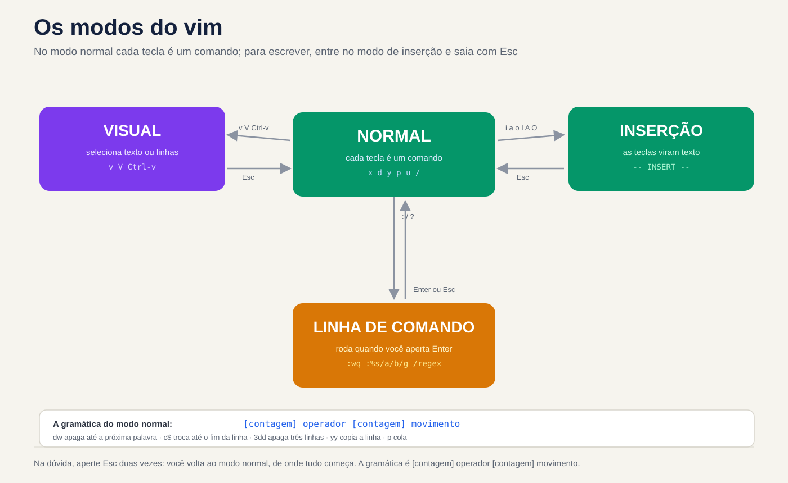
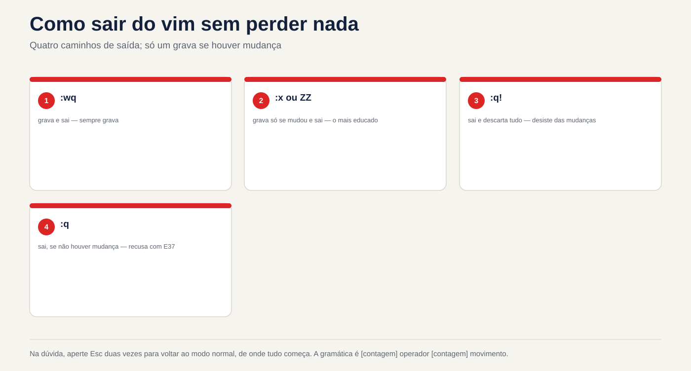

# Lezione 3.5 · Ho visto e sono venuto davvero

Nelle lezioni 3.3 e 3.4 hai modificato i file con i comandi: `grep` ha scelto le righe, `sed` ha scambiato, `awk` ha calcolato. Oggi si modificano i file **a mano**, nell'editor che esiste in tutti i Linux, anche sul server appena installato, nel contenitore senza pacchetti e in modalità di emergenza, quando il disco non è montato e non c'è rete. Questo editor è `vi`, ed è quasi sempre `vim`, in alcune versioni. Non deve piacerti. Devi entrare, cambiare ciò che devi cambiare, uscire senza rovinare nulla e sapere cosa fare quando la sessione finisce a metà. Il resto è velocità, e la velocità deriva dalla stessa espressione regolare delle ultime due lezioni.

| File | lezione 3.5 |
| --- | --- |
| Modulo | M3 · Testo ed editor, lezione 5 di 5 |
| Quando | Settimana 8 |
| Alla fine puoi | Apri, salva ed esci da `vi` senza perdere nulla, con `:w`, `:q!`, `:wq`, `:x` e `ZZ`; passare dalla modalità normale, di inserimento, da riga di comando a quella visiva senza perdersi; camminare per parola, riga e numero di riga senza frecce; cancella, copia, incolla, annulla e ripeti con operatore, sposta, conta e `.`; cercare con `/` e `?` e scambiare con `:s` e `:%s`, con gruppi, `&` e un altro delimitatore; eliminare e filtrare le righe con `:g`, `:v` e `:%!`; vedi tabulazioni, spazi e Finestre `^M` con `:set list` e `:set ff`; recuperare un'edizione perduta tramite file `.swp`; modificare i file di sistema con `sudoedit` e `visudo`, senza `sudo vim`; sapere quale `vi` viene installato da ciascuna distribuzione e perché a volte Debian "non annulla" |
| Articoli di prova | LPIC-1 103.8 (modifica di base di file con `vi` e la variabile `EDITOR`) · RHCSA (crea e modifica file di testo; nel test `vi` è l'editor sempre presente) |
| Prerequisiti | lezione 2.3 (giornale e registri); lezione 3.3 (BRE ed ERE, lezioni come `[[:space:]]`); lezione 3.4 (`s///`, gruppi, `&`, `~/lab34` con `conf.amostra` e `acesso.log`) |
| Tempo | Intorno alle 2:30 |
| Istantanee | m3a5-start e m3a5-end su entrambe le VM |

## 1 · Riscaldamento

Tre domande, fuori dalla mia testa. Scrivi le risposte; la chiave di risposta viene visualizzata alla fine.

1. Apri un file in `vi` e digita subito `Port 2222`. Sullo schermo appaiono cose che non hai digitato e il cursore salta da qualche altra parte. Indovina: cosa è successo?
2. Si apre un file e `vim` mostra `E325: ATTENTION` e parla di un file `.swp`. Indovina: cosa significa ed è pericoloso premere semplicemente Invio?
3. Il cursore è sulla riga 1 di `conf.amostra` e si digita `:s/yes/no/`. Indovina: la riga 7, `PasswordAuthentication yes`, cambia?

## 2 · Perché è importante

`vi` raramente rovina un file da solo. Ciò che lo rovina è la fretta di uscirne:

| Il cosiddetto | La risposta sbagliata | Cosa provoca |
| --- | --- | --- |
| "Il server si è bloccato in modalità emergenza a causa di `/etc/fstab`" | Cerca `nano` | Nella modalità emergenza di Rocky, e in molte immagini minimali, c'è solo `vi`. Coloro che non sanno come usarlo reinstallano il server, o aspettano qualcuno che lo faccia |
| "Inserisci l'utente `operador` in `sudoers`" | `sudo vi /etc/sudoers` e salva | Un errore di battitura passa dritto perché `vi` non controlla nulla. `sudo` la prossima volta si lamenta e talvolta smette di lavorare per tutti. `visudo` controlli prima della registrazione |
| "Non posso uscire da `vi`, chiudo il terminale" | Chiudi la finestra o interrompi il processo | La modifica va perduta e resta un `.arquivo.swp`. La prossima persona che aprirà il file, forse tu domani, riceve un `E325` e non sa cosa rispondere |
| "Scambia tutti i `yes` con `no` nel file" | `:s/yes/no/` | Cambia solo sulla riga del cursore e solo alla prima occorrenza. `%` e `g` fanno la differenza, come in `sed` |
| "Modifica il file root, senza togliergli il permesso" | `sudo vim /etc/algo.conf` oppure `chmod 666` per poter salvare | `sudo vim` esegue l'intero editor come root, con i suoi plugin e `:!` apre una shell di root. `chmod` lascia il file aperto a qualsiasi utente. `sudoedit` modifica una copia come utente e la riscrive come root |
| "Lo script è arrivato da un collega che usa Windows e non lo esegue" | Riscrivi la sceneggiatura | Il file ha `\r\n` alla fine di ogni riga. `vim` mostra `[dos]` quando viene aperto e un `:set ff=unix` lo risolve in due secondi |

`vi` è strano per un motivo: le lettere sono **comandi**, a meno che non dici che stai per scrivere del testo. Una volta capito questo, il resto è vocabolario.

## 3 · Modello mentale

> `vi` ha **modalità**. Nella modalità **normal**, ovvero quella in cui si accede, ogni tasto è un comando: `x` cancella, `d` inizia una "cancella", `w` sposta una parola. Per scrivere il testo, si entra nella modalità **inserimento** (con `i`, `a` o `o`) e si esce con `Esc`. I comandi con `:`, `/` e `?` aprono una **riga di comando** nel piè di pagina, che viene eseguita quando si preme Invio. In caso di dubbio, premere due volte `Esc`: si ritorna alla modalità normale, da dove tutto ha inizio.

```text
                       i  a  o  I  A  O
                    ┌──────────────────────►┌───────────────┐
                    │                       │   INSERÇÃO    │  as teclas viram texto
  vim arquivo ─►┌───┴─────────┐◄────────────┤  -- INSERT -- │
                │   NORMAL    │     Esc     └───────────────┘
                │ teclas são  │
                │  comandos   │   :  /  ?   ┌───────────────┐
                │             ├────────────►│ LINHA DE      │  :wq  :%s/a/b/g  /regex
                │             │◄────────────┤ COMANDO       │  roda com Enter
                └───┬─────────┘ Enter ou Esc└───────────────┘
                    │  ▲
          v  V  ^v  │  │ Esc, ou um operador (d y c > <)
                    ▼  │
                ┌──────┴────────┐
                │    VISUAL     │  seleciona caracteres (v), linhas (V) ou um bloco (Ctrl-v)
                └───────────────┘

  A gramática do modo normal:   [contagem] operador [contagem] movimento

        d        w          apaga até a próxima palavra
        c        $          troca até o fim da linha
      3 d        d          apaga 3 linhas (operador repetido = a linha inteira)
        y        G          copia daqui até a última linha
        .                   repete a última mudança, onde o cursor estiver
```

Due conseguenze pratiche. Primo: un comando in modalità normale è una **frase**, verbo e oggetto. Non si memorizzano `dw`, `dd`, `d$`, `cw`, `c$`, `yy`, `y$` come quattordici scorciatoie; memorizzare tre verbi (`d`, `c`, `y`) e alcuni movimenti, e combinarli. Secondo: `.` ripete l'intera frase. Una modifica che funziona una volta diventa `n` e `.`, `n` e `.`, quante volte vuoi, controllandole tutte.



*In modalità normale, ogni tasto è un comando; per scrivere, accedere alla modalità di inserimento.*

## 4 · Concetto a strati

### Essenziale

**Apri ed esci.** Tutto inizia e finisce in modalità normale. Se non sai dove si trova, `Esc`.

| Digiti | Fare |
| --- | --- |
| `vim arq` | Apri il file. Se non esiste, aprilo vuoto e crealo durante il salvataggio |
| `vim +7 arq` | Apre sulla linea 7 |
| `vim +/Password arq` | Si apre sulla prima riga che corrisponde alla regex |
| `view arq` o `vim -R arq` | Si apre solo per la lettura. È il modo di guardare un file di produzione senza paura |
| `:w` | Scrive e continua nel file |
| `:q` | Esci se non ci sono modifiche da salvare. Se esiste, rifiutare con `E37` |
| `:q!` | Esci e **annulla** le modifiche |
| `:wq` | Registra ed esci. Registra anche senza modifiche e la data del file cambia |
| `:x` o `ZZ` | Registra solo se è presente una modifica ed esce |
| `ZQ` | Come `:q!` |
| `:w novo.conf` | Salva una copia con un altro nome; il buffer rimane legato al |
| originale `:e!` | Restituisce il file così com'è sul disco, eliminando ciò che è stato modificato dall'ultimo `:w` |

**Accedi alla modalità di inserimento.** La lettera sceglie **dove** va il testo:

| Chiave | Dove |
| --- | --- |
| `i` | Prima del cursore |
| `a` | Dopo il cursore |
| `I` | All'inizio della riga, dopo gli spazi |
| `A` | Alla fine della riga |
| `o` | Su una nuova riga, sotto |
| `O` | Su una nuova riga, sopra |

**Floor.** Senza frecce, che potrebbe non funzionare in un terminale non valido, e con conteggio, che le frecce non hanno:

| Chiave | Vai a |
| --- | --- |
| `h` `j` `k` `l` | Sinistra, giù, su, destra |
| `w` `b` `e` | Inizio della parola successiva, inizio di questa o della precedente, fine della parola |
| `0` `^` `$` | Inizio riga, primo carattere diverso dallo spazio, fine riga |
| `gg` `G` | Prima riga, ultima riga |
| `7G` o `:7` | Linea 7 |
| `Ctrl-f` `Ctrl-b` | Una schermata avanti, una schermata indietro |
| `%` | La parentesi, parentesi graffa o graffa che chiude (o apre) ciò che si trova sotto il cursore |

**Elimina, copia, incolla, annulla.**

| Chiave | Fare |
| --- | --- |
| `x` | Cancella il carattere sotto il cursore |
| `r` seguito da | Cambia il carattere sotto il cursore in questo tasto e continua in modalità normale |
| `dd` | Cancella la linea. `3dd` cancella tre |
| `dw`, `d$` o `D` | Cancella fino alla parola successiva, fino alla fine della riga |
| `cw`, `c$` o `C` | Elimina ed entra nella modalità di inserimento: "scambia" |
| `yy` | Copia la riga (`y` deriva da *yank*). `5yy` copia cinque |
| `p` `P` | Incolla dopo, prima. Una riga copiata viene incollata sotto o sopra |
| `u` | Annulla |
| `Ctrl-r` | Ripeti |
| `.` | Ripetere l'ultima modifica |
| `J` | Aggiungi la linea di basso a questa |

Il `dd` non solo cancella: salva la linea. Ecco perché `ddp` scambia la riga corrente con quella sottostante, e `dd`, pavimento, `p` è il "copia e incolla" di `vi`.

**Cerca.**

| Chiave | Fare |
| --- | --- |
| `/regex` | Ricerca in avanti a partire dal cursore |
| `?regex` | Ricerca all'indietro |
| `n` `N` | Evento successivo, nella stessa direzione o nella direzione opposta |
| `*` `#` | Cerca la parola sotto il cursore, avanti o indietro |

La ricerca utilizza regex, lo stesso delle lezioni precedenti, con il sapore di `vim`, che vedi in Intermedio.

### Intermedio

**Operatore e movimento.** Qualsiasi operatore corrisponde a qualsiasi movimento:

| Frase | Fare |
| --- | --- |
| `dw` | Cancella fino all'inizio della parola successiva |
| `d$` | Cancella fino alla fine della riga |
| `dG` | Cancella da qui fino alla fine del file |
| `dgg` | Cancella da qui all'inizio |
| `d/Port` | Cancella da qui alla riga successiva con `Port`, senza |
| `c0` | Passare dall'inizio della riga al cursore |
| `yG` | Copia da qui alla fine |
| `>>` e `<<` | Aumenta e diminuisce il rientro della riga; `>G` fino alla fine |
| `gUw` e `guw` | Scrivi la parola in maiuscolo, minuscola |

Una "parola" per `w` è una sequenza di lettere, numeri e `_`, **o** una sequenza di altri simboli. Ecco perché `dw` invece di `#PermitRootLogin` cancella solo `#`: `#` è una parola e `PermitRootLogin` un'altra. Il `W` maiuscolo utilizza solo gli spazi come separatore, mentre `dW` cancellerebbe l'intero `#PermitRootLogin`.

**Scambia con `:s`.** È il `s///` di `sed`, all'interno dell'editor. Senza intervallo, agisce sulla riga del cursore:

| Comando | Agisci a |
| --- | --- |
| `:s/yes/no/` | Prima occorrenza sulla riga del cursore |
| `:s/yes/no/g` | Tutto sulla riga del cursore |
| `:%s/yes/no/g` | Tutto, nell'intero fascicolo. `%` è "dalla prima all'ultima riga" |
| `:5,10s/^/#/` | Dalla riga 5 alla 10: commento su sei |
| `:.,$s/a/b/` | Dalla riga del cursore (`.`) fino alla fine (`$`) |
| `:'<,'>s/a/b/` | Sulle linee selezionate in modalità visiva. `vim` scrive `'<,'>` da solo quando si preme `:` con una selezione |
| `:%s/a/b/gc` | Tutti, chiedendo uno per uno: `y` scambia, `n` salta, `a` scambia tutti quelli mancanti, `q` per |
| `:%s/a/b/ge` | Tutti, senza commettere errori se non ne trovi nessuno. Utile nelle macro e negli script |

Gruppi, `&` e altri delimitatori funzionano come in `sed`: `:%s/^\(PasswordAuthentication\) yes$/\1 no/`, `:%s/^MaxAuthTries/# &/`, `:%s#/login#/entrar#g`.

**L'espressione regolare di `vim`.** Per impostazione predefinita, `vim` funziona come il BRE di `sed` e `grep` senza `-E`: `+`, `?`, `|`, parentesi graffe e parentesi sono **letterali**, tranne che con una barra. E ha le sue scorciatoie:

| Nel `vim` | Voglio dire | Nell'ERE del `grep -E` |
| --- | --- | --- |
| `\+` `\?` `\=` | Uno o più, zero o uno, zero o uno | `+` `?` `?` |
| `\{2,4}` | Da due a quattro volte | `{2,4}` |
| `\(` `\)` `\\|` | Gruppo e alternativa | `(` `)` `\|` |
| `\s` `\S` | Spazio o tabulazione e viceversa | `[[:space:]]`, `[^[:space:]]` |
| `\d` `\w` | Cifra, carattere di parola | `[0-9]`, `[[:alnum:]_]` |
| `\<` `\>` | Inizio e fine della parola | `\b` |
| `\v` all'inizio | *Molto magico*: da ora in poi `+ ? \| ( ) { }` senza barra, come in ERE |  |
| `\c` ovunque | Ignora le lettere maiuscole in questa ricerca | `grep -i` |

Quindi, `:%s/[0-9]+/N/g` cerca "una cifra seguita da un `+`", e non trova nulla in `acesso.log`. Quello che volevi è `:%s/[0-9]\+/N/g` o `:%s/\v[0-9]+/N/g`.

**Elimina e filtra le righe con `:g` e `:v`.** `:g/regex/comando` esegue il comando su ogni riga che corrisponde; `:v`, che **non** corrisponde. I due più utilizzati:

```text
:g/^\s*#/d         apaga os comentários, com ou sem recuo (o sed '/^[[:space:]]*#/d')
:g/^\s*$/d         apaga as linhas vazias ou só com espaços
:v/401/d           deixa só as linhas com 401 (o grep 401, dentro do editor)
:g/Failed/p        só mostra, sem mudar nada (o p é de print)
```

**`vim` parla con la shell.**

| Comando | Fare |
| --- | --- |
| `:!comando` | Esegui un comando e torna indietro. `:!ls -l %` elenca il file aperto; `%` è il suo nome |
| `:r arquivo` | Inserisce il contenuto di un altro file sotto il cursore |
| `:r !comando` | Inserisce l'**output** di un comando: `:r !ip -br a` |
| `:%!comando` | Passare l'intero file attraverso il comando e scambiare il risultato: `:%!sort -u` |
| `:5,10!sort` | Lo stesso, solo sulle righe da 5 a 10 |
| `:w !comando` | Invia il buffer al comando **senza salvare** il file: `:w !wc -l` |

`:%!` rende l'editor un banco di filtri: tutto quello che hai imparato nelle lezioni da 3.2 a 3.4 gira all'interno di `vim`, con `u` da annullare se va storto.

**Configure.** `:set` sono validi fino all'uscita; al `~/.vimrc` si applicano sempre:

| Opzione | Fare |
| --- | --- |
| `:set nu` e `:set nonu` | Mostra e nasconde i numeri di riga |
| `:set list` | Mostra la scheda come `^I` e la fine della riga come `$`, come `cat -A` |
| `:set hlsearch` e `:noh` | Evidenzia le ricerche; `:noh` cancella l'evidenziazione fino al successivo |
| `:set ignorecase smartcase` | Cerca senza distinzione tra maiuscole e minuscole, a meno che non si digiti |
| `:set ff?` | Mostra il formato delle righe: `unix` (`\n`) oppure `dos` (`\r\n`) |
| `:set paste` | Incolla il testo senza che `vim` rientri ogni riga da sola. `:set nopaste` poi |
| `:set opção?` | Mostra il valore di qualsiasi opzione |

### Bridge Windows

| Su Windows | Nel `vim` | Attenzione |
| --- | --- | --- |
| CTRL+S | `:w` | Nel terminale, Ctrl+S può **congelare** lo schermo (è il vecchio controllo di flusso). Se congelato, Ctrl+Q sblocca |
| Ctrl+Z (annulla) | `u` | Nel terminale, Ctrl+Z **sospende** `vim` e restituisce la shell. Non ha chiuso: gli ritorna `fg`. Se lo dimentichi ed esci da SSH, ti rimane un `.swp` |
| Ctrl+F (trova) | `/texto` | La ricerca di `vim` è regex: `.` corrisponde a qualsiasi carattere, come nella lezione 3.3 |
| Ctrl+H (sostituisci) in Blocco note++ | `:%s/de/para/gc` | In Notepad++, la modalità "Espressione regolare" utilizza `\1` come `vim` |
| Notepad++ "Modifica > Conversione di fine riga > Unix (LF)" | `:set ff=unix` e `:w` | Il vecchio Blocco note sempre salvato in `\r\n`. Il Blocco note corrente mantiene il formato del file, ma in `\r\n` |
| viene visualizzato un **nuovo** file. Apri Blocco note "come amministratore" | `sudoedit arq` | Su Windows, l'intero editor diventa amministratore. Su Linux, `sudoedit` lascia l'editor al tuo utente e viene eseguita solo la registrazione come root |
| `notepad arq` in PowerShell | `$EDITOR arq` | Su Linux, ogni programma che apre un editor (`crontab -e`, `visudo`, `git commit`, `systemctl edit`) esamina le variabili `VISUAL` e `EDITOR` |

### Advanced

**Il file di scambio (`.swp`).** Mentre si modifica `conf.amostra`, `vim` scrive le modifiche, ogni pochi secondi, in un file nascosto a lato, `.conf.amostra.swp`. Se la sessione va in crash (chiusura SSH, `kill -9`, chiusura del server), i cambiamenti ci sono. La prossima volta che qualcuno apre il file, `vim` mostra `E325: ATTENTION` e offre:

| Opzione | Fare | Quando |
| --- | --- | --- |
| `(O)pen Read-Only` | Si apre in sola lettura | Guardare prima di decidere |
| `(E)dit anyway` | Aprire il file su disco e ignorare `.swp` | Quasi mai. Se qualcun altro sta modificando, uno sovrascrive l'altro |
| `(R)ecover` | Recupera le modifiche da `.swp` | La sessione si è bloccata e desideri ciò che avevi fatto |
| `(D)elete it` | Cancellare `.swp` | Ti sei già ripreso, o sai che non vuoi quello che c'è dentro. Viene visualizzato solo se il processo proprietario non è più in esecuzione |
| `(Q)uit` e `(A)bort` | Arrendersi | Per andare a chiedere chi sta modificando |

Se il messaggio dice `process ID: 12345 (STILL RUNNING)`, un'altra sessione ha il file aperto **adesso**: è un collega, oppure sei tu in un altro terminale. Non modificarlo. Dopo il ripristino, il vecchio `.swp` **è ancora lì**, e `E325` ritorna nell'apertura successiva finché non lo elimini. `vim -r`, senza file, elenca i `.swp` trovati.

**Modifica file di sistema: `sudoedit`, `visudo` e azienda.**

| Archivio | Utilizzare | Perché |
| --- | --- | --- |
| Qualsiasi file di configurazione | `sudoedit arq` (come `sudo -e arq`) | Copia il file nel tuo file temporaneo, apri il **tuo** editor con **tuo** `~/.vimrc` e alla fine salvalo di nuovo come root. Né il plugin né `:!` vengono eseguiti come root |
| `/etc/sudoers` e `/etc/sudoers.d/*` | `sudo visudo` e `sudo visudo -f /etc/sudoers.d/arq` | Blocca il file, modifica una copia e registra solo se la sintassi è corretta. In caso contrario chiedere al `What now?`: `e` torna in editing, `x` esce senza registrare, `Q` registra con l'errore (mai) |
| `/etc/passwd` e `/etc/group` | `sudo vipw` e `sudo vigr` | Bloccano il file in modo che non vada perso anche un `useradd`. `vipw -s` e `vigr -s` modificano `shadow` e `gshadow` |
| La tabella cron | `crontab -e` | Controllare la sintassi all'uscita e ricaricare |
| Un servizio systemd | `sudo systemctl edit nome` | Crea il file *override* nel posto giusto e ricarica systemd (è lezione 4.x) |
| Controlla senza modificare | `sudo visudo -c` | Leggi `sudoers` e tutti quelli compresi e di' se sono corretti. Non apre l'editor |

Se sei già in `vim`, hai modificato un file root e non puoi salvare, c'è l'uscita di emergenza: `:w !sudo tee % > /dev/null`. `:w !` invia il buffer a `sudo tee` che scrive il file come root; `> /dev/null` nasconde la copia che `tee` mostrerebbe. `vim` poi ti avverte che il file è stato spostato al di fuori di esso: premi `L` per ricaricare. Funziona, ma è una patch. L'abitudine è di aprire dall'inizio con `sudoedit`.

**`VISUAL`, `EDITOR` e l'editor standard.** I programmi cercano in questo ordine: `SUDO_EDITOR` (solo `sudoedit`), `VISUAL`, `EDITOR` e infine uno standard di distribuzione. A Rocky, l'impostazione predefinita è `vi`. In Debian è `/usr/bin/editor`, che il sistema delle alternative punta a `nano`. Per impostarlo, in `~/.bashrc`: `export VISUAL=vim EDITOR=vim`.

**Modalità visiva e blocco.** `v` seleziona i caratteri, `V` le linee, `Ctrl-v` un rettangolo. Con una selezione un operatore agisce su di essa: `d`, `y`, `>`, `:` (per un `:s` proprio lì). Nei `vim`, `Ctrl-v` completi, scendi alcune righe, i commenti `I#` e `Esc` tutti insieme. Nelle versioni minime il blocco non può avere `I`; `:5,10s/^/#/` funziona in entrambi.

**Registri.** Ogni `d`, `c` e `y` va in un registro. `"` è l'impostazione predefinita; `"0` conserva l'ultima copia (`y`), che poi `dd` non cancella; I `"a` fino ai `"z` sono tuoi. `"ayy` copia la riga per registrare `a`, `"ap` incolla. `:reg` li mostra tutti. Questo risolve il classico problema: hai copiato una riga, ne hai cancellata un'altra per fare spazio e `p` hai incollato quella cancellata. Incollare con `"0p`.

**Modelines.** Un file può avere, nella prima o nell'ultima riga, un commento come `# vim: set ts=4 sw=4:`, e `vim` applica le opzioni all'apertura. Ci sono già state violazioni della sicurezza lungo questo percorso. Ecco perché diverse distribuzioni disattivano la funzione per root, e chi modifica i file di altri può mettere `set nomodeline` in `~/.vimrc`.

### Cosa rientra nel test

- **LPIC-1 103.8.** L'obiettivo richiede: navigare con `vi`, comprendere e utilizzare le modalità, inserire, modificare, eliminare, copiare e cercare testo, conoscere Emacs, `nano` e `vim` e configurare l'editor predefinito (`EDITOR`). L'elenco dei termini comprende `vi`, `/`, `?`, `h`, `j`, `k`, `l`, `i`, `o`, `a`, `d`, `p`, `y`, `dd`, `yy`, `ZZ`, `:w!`, `:q!` e `EDITOR`. Domande tipiche: "quale comando salva ed esce?" (`ZZ` e `:wq`, e talvolta `:x`), "quale esce senza salvare?" (`:q!`), "che copia una riga?" (`yy`), "che apre una riga sottostante ed entra nell'inserimento?" (`o`). Controlla l'elenco aggiornato sul sito web LPI.
- **RHCSA.** Il test è pratico e molti file possono essere modificati solo con `vi` (o `nano`, se installato). I punti che costano di più: uscire accidentalmente senza salvare, lasciare un `.swp` che interrompe la modifica successiva e salvare un file con un errore di sintassi che manda in crash un servizio. `visudo` e `sudoedit` valgono più della velocità.

## 5 · Rocky × Debian

| Articolo | laboratorio-roccioso (Rocky 9) | debian-lab (Debian 13) | Come controllare |
| --- | --- | --- | --- |
| Cos'è `vi` | `/usr/bin/vi`, dal pacchetto `vim-minimal` | `/usr/bin/vi` → `/etc/alternatives/vi` → `/usr/bin/vim.tiny`, dal pacchetto `vim-tiny` | `readlink -f "$(command -v vi)"` |
| Il `vim` completo | Pacchetto `vim-enhanced`, che non sempre è installato | Pacchetto `vim`, che non è installato | `command -v vim` |
| Versione | 8.2 | 9.1 | `vi --version \| head -2` |
| Dopo aver installato la versione completa | `vi` resta `vim-minimal`; il pacchetto solitamente contiene un `/etc/profile.d/vim.sh` con `alias vi=vim` per gli utenti comuni, ma non per root | `vi` ora punta a `vim.basic` perché ha la priorità più alta tra le alternative | `type vi`; `update-alternatives --display vi` |
| Modalità compatibile con il vecchio `vi` | No, nell'uso normale | `vim.tiny` si legge `/etc/vim/vimrc.tiny`, che collega `compatible`, a meno che tu non abbia un `~/.vimrc` | `:set compatible?` all'interno dell'editor |
| Editor predefinito (`EDITOR` vuoto) | `vi` | `/usr/bin/editor`, che rimanda a `nano` | `update-alternatives --display editor` (Debian) |
| `visudo` e `sudoedit` senza `EDITOR` | Aprire `vi` | Aprire `nano` | Corri a vedere |
| `crontab -e` la prima volta | Aprire `vi` | Chiede quale editor si desidera (`select-editor`) e salva la scelta in `~/.selected_editor` | Esegui come nuovo utente |
| `vimtutor` | Viene fornito con `vim-enhanced` | Viene fornito con il pacchetto `vim` | `command -v vimtutor` |
| `syntax on` in `~/.vimrc` | Errore in `vim-minimal` | Errore in `vim.tiny` | Proteggi con `if has('syntax')` |

La linea che attacca di più è la modalità compatibile. Lo stesso `vi`, nella stessa schermata, annulla una sola volta, e le frecce in modalità inserimento scrivono lettere. Non è un difetto: è `vim` che imita di proposito il `vi` degli anni '80. Nell'Interruzione B puoi vedere questo problema e risolverlo con una riga.

L'altra proviene dall'editor standard. In Debian, `sudo visudo` apre `nano` e chiunque abbia addestrato solo `vi` si perde dall'altra parte. Sapere come uscire da entrambi: in `nano`, Ctrl+O salva e Ctrl+X esce.

## 6 · Laboratorio guidato

Sei `rodrigo`, in rocky-lab, e raggiungi debian-lab tramite `ssh deb`. Tutto avviene in `~/lab35`, su entrambe le VM, su **copie**. La regola del laboratorio: prima di ogni passaggio, `cp conf.orig treino.conf`; quindi `diff conf.orig treino.conf` ti mostra esattamente cosa hanno fatto le tue chiavi. `diff` è il tuo giudice, non la tua memoria. L'unico file root è quello del passaggio 8, creato appositamente per il laboratorio, in `/srv/lab35`. Nessun file di sistema è aperto in scrittura.


*In caso di dubbi, premere due volte Esc per tornare alla modalità normale, da dove tutto inizia.*


Nei blocchi sottostanti, i tasti premuti all'interno di `vim` compaiono in un commento dopo il comando che apre l'editor. `Esc` è il tasto Esc, `Enter` è il tasto Invio, e lo spazio tra i tasti è solo di lettura: non premere la barra spaziatrice.

### Passo 0 · Istantanea, cartella e quale `vi` hai

In Proxmox, scatta l'istantanea `m3a5-inicio` delle due VM. Presso Rocky-Lab:

```bash
eval "$(ssh-agent -s)"; ssh-add
mkdir -p ~/lab35; ssh deb 'mkdir -p ~/lab35'
cd ~/lab35
cp ~/lab34/conf.amostra conf.orig
cp ~/lab34/acesso.log .
wc -l conf.orig acesso.log
scp conf.orig acesso.log deb:lab35/
```

```text
 11 conf.orig
 15 acesso.log
 26 total
```

Se ne mancano, ricreateli con il Passo 0 della Lezione 3.3. Ora scopri quale `vi` ha ciascuna VM. Esegui il blocco in rocky-lab e, cambiando `rpm -qf` in `dpkg -S`, in debian-lab:

```bash
type vi vim
readlink -f "$(command -v vi)"
rpm -qf "$(readlink -f "$(command -v vi)")"
vi --version | head -2
echo "VISUAL=$VISUAL EDITOR=$EDITOR"
```

In Rocky dovresti vedere qualcosa come `vi is /usr/bin/vi`, il pacchetto `vim-minimal`, `VIM - Vi IMproved 8.2` e, nella seconda riga, una versione *Small* o *Huge*, a seconda della build. Forse `vim` non esiste nemmeno. In Debian, `readlink` termina con `/usr/bin/vim.tiny`, `dpkg -S` dice `vim-tiny`, la versione è 9.1 e la seconda riga dice *Tiny version*. Entrambe le variabili sono vuote. Su Debian, controlla anche l'editor predefinito:

```bash
ssh deb 'update-alternatives --display editor | head -3; update-alternatives --display vi | head -3'
```

Ora installa il `vim` completo su entrambi, e controlla di nuovo:

```bash
sudo dnf install -y vim-enhanced
ssh -t deb 'sudo apt install -y vim'
bash -lc 'type vi vim'
ssh deb 'readlink -f "$(command -v vi)"; readlink -f /usr/bin/editor'
```

Su Rocky, `vi` rimane `vim-minimal`; in una nuova shell di login, `type vi` potrebbe mostrare `vi is aliased to 'vim'`, che deriva da `/etc/profile.d/vim.sh`. In Debian, `vi` ora termina con `/usr/bin/vim.basic` e `editor` continua con `nano`. `vim.tiny` non è scomparso: rimane installato e Quebra B lo utilizza. Annota cosa è uscito in ogni VM.

### Passo 1 · Entra ed esci senza fare confusione

```bash
cd ~/lab35
cp conf.orig treino.conf
vim treino.conf          # in vim: dd e poi :q Invio
```

Hai cancellato la prima riga e hai chiesto di uscire.

**Decidi 1 · Cosa fa `vim` con `:q`?**

- **A)** Esci e la riga 1 scompare dal file
- **B)** Rifiuta e avverte che c'è un modifica non registrata
- **C)** Salva la modifica ed esce, come `:wq`
- **D)** Chiede se si desidera salvare, come Blocco note

Scegliere la lettera prima di guardare la tabella.

```bash
# ainda no vim, depois do :q
:q!
cmp conf.orig treino.conf && echo igual
```

```text
E37: No write since last change (add ! to override)
igual
```

| Se hai selezionato | Risultato | Perché |
| --- | --- | --- |
| A | ❌ Sbagliato | `:q` non butta mai via un cambiamento. Per questo c'è `!` |
| B| ✅ Giusto | `E37` è la serratura di sicurezza. `:q!` lo scarta e `cmp` conferma che il file è uguale all'originale |
| C| ❌ Sbagliato | Salvare e uscire è `:wq`, `:x` o `ZZ`. `:q` esce solo |
| D | ❌ Sbagliato | `vim` non apre le finestre delle domande. Lui rifiuta e dice quale comando forze |

**Per risolvere:** `!` alla fine di un comando `vim` significa "Lo so, fallo comunque". `:q!` esce senza registrare; `:w!` sovrascrive un avvertimento. In caso di dubbi su cosa è cambiato, esci con `:q!` e ricomincia: una copia integra vale più di dieci minuti di `u`.

Controlla gli altri modi per uscire, sempre con una copia pulita:

```bash
cp conf.orig treino.conf; stat -c %y treino.conf
vim treino.conf          # in vim: :x Invio (non è cambiato nulla)
stat -c %y treino.conf
vim treino.conf          # in vim: :wq Invio (non è cambiato nulla)
stat -c %y treino.conf
```

Dopo `:x`, la data è la stessa. Dopo `:wq` la data cambia, anche senza alcuna variazione del testo. In un file controllato da un servizio o da un backup incrementale, questa differenza conta. `ZZ` è `:x` in due chiavi.

### Passo 2 · Scambiare una parola

Vuoi scambiare `yes` con `no` nella riga 7, `PasswordAuthentication yes`, con la modalità normale, senza `:s`. La riga 7 inizia da `P`.

**Decidere 2 · Quale sequenza lascia la riga 7 come `PasswordAuthentication no`?**

- **A)** `7G` `w` `cw` `no` `Esc`
- **B)** `7G` `$` `cw` `no` `Esc`
- **C)** `7G` `cw` `no` `Esc`
- **D)** `7G` `w` `r` `no` `Esc`

Scegli prima la lettera per guardare la tabella.

Fai la tua in `vim`, con `:wq` alla fine, e guarda `diff`. Quindi controllali tutti e quattro contemporaneamente. Il `vim -Es` gestisce il `vim` senza schermo, come un `sed`; `normal!` preme per voi i tasti:

```bash
for k in '7Gwcwno' '7G$cwno' '7Gcwno' '7Gwrno'; do
  cp conf.orig t.conf
  vim -u NONE -N -i NONE -n -Es -c "exe \"normal! ${k}\<Esc>\"" -c wq t.conf
  printf '%-9s -> ' "$k"; sed -n 7p t.conf
done
```

```text
7Gwcwno   -> PasswordAuthentication no
7G$cwno   -> PasswordAuthentication yeno
7Gcwno    -> no yes
7Gwrno    -> PasswordAuthentication nes
```

| Se hai selezionato | Risultato | Perché |
| --- | --- | --- |
| A | ✅ Giusto | `7G` va alla riga 7, `w` salta all'inizio di `yes` e `cw` scambia l'intera parola con qualunque cosa venga digitata |
| B| ❌ Sbagliato | `$` va all'**ultimo carattere**, `s`. `cw` cambia solo il cursore alla fine della parola, che è `s`. Rimangono `ye` e il risultato è `yeno` |
| C| ❌ Sbagliato | Senza `w` il cursore si trova su `P` e la parola sostituita è `PasswordAuthentication` |
| D | ⚠️ Peggio di quanto sembri | `r` cambia **un** carattere: `y` diventa `n`. Il seguente `o` non è testo, è il comando "apri riga sotto". Ti rimane `nes` alla riga 7 e una nuova riga vuota, a 8 |

**Per correggere:** il movimento decide dove inizia e finisce la frase. Prima di un `cw` o un `dw` guardate dove si trova il cursore. E diffidare di una lettera "extra" dopo un comando: in modalità normale, è anche un comando.

### Passo 3 · Elimina, copia, incolla, ripeti

Ricomincia. La riga 4 è `#PermitRootLogin prohibit-password` e vuoi prendere `#`:

```bash
cp conf.orig treino.conf
vim treino.conf          # in vim: 4G dw :wq Invio
diff conf.orig treino.conf
```

**Decidi 3 · Che aspetto ha la riga 4?**

- **A)** `PermitRootLogin prohibit-password`
- **B)** `  prohibit-password `
- **C)** `prohibit-password`
- **D)** Vuoto

Scegli la lettera prima di guardare tabella.

```text
4c4
< #PermitRootLogin prohibit-password
---
> PermitRootLogin prohibit-password
```

| Se hai selezionato | Risultato | Perché |
| --- | --- | --- |
| A | ✅ Giusto | Per `w`, `#` è solo una parola, perché è un simbolo seguito da lettere. `dw` cancella solo |
| B| ❌ Sbagliato | Sarebbe `dW`, che utilizza solo lo spazio come separatore e cancella `#PermitRootLogin` |
| C| ❌ Sbagliato | Sarebbe `dW` più spazio, o `2dw` |
| D | ❌ Sbagliato | Sarebbe `D` o `d$`, dal cursore alla fine della riga |

**Da correggere:** `w` è una parola nel senso del programmatore (lettere, numeri e `_`, o un blocco di simboli); `W` è una parola che significa “fino allo spazio”. Per rimuovere il commento da una riga, la più breve è `x` su `#`.

Ora la ricerca con ripetizione. Vuoi cancellare le righe che iniziano con `#`, una per una, controllandole singolarmente:

```bash
cp conf.orig treino.conf
vim treino.conf          # in vim: gg /^# Inserisci gg n . :wqInvio
diff conf.orig treino.conf
```

**Decidi 4 · Quali righe dell'originale sono scomparse?**

- **A)** A 1 e 4
- **B)** A 4 e 11
- **C)** A 1, 4 e 11
- **D)** A 4, 6, 9 e 11

Scegli la lettera prima di guardare la tabella.

```text
4d3
< #PermitRootLogin prohibit-password
11d9
< #PasswordAuthentication no
```

| Se hai selezionato | Risultato | Perché |
| --- | --- | --- |
| A | ❌ Sbagliato | La riga 1 corrisponde a `^#`, ma la ricerca inizia **dopo** il cursore. Con il cursore all'inizio della riga 1, la prima occorrenza trovata è la riga 4 |
| B| ✅ Giusto | `/^#` ne ha trovati 4, `dd` l'ha cancellato, `n` ha trovato il successivo, il vecchio 11, e `.` ha ripetuto `dd` |
| C| ❌ Sbagliato | Sarebbe necessario iniziare la ricerca dal basso verso l'alto, oppure con il cursore alla fine del file (`G` prima di `/`) |
| D | ❌ Sbagliato | Le righe 6 e 9 hanno `#`, ma dopo gli spazi e una tabulazione. `^#` richiede `#` nella prima colonna |

**Da correggere:** `n` e `.` sono la coppia dell'edizione verificata: `n` mostra la successiva, guarda, e `.` la applica, oppure un altro `n` la salta. E la ricerca inizia dopo il cursore: per includere la riga 1, iniziare con `G`, perché la ricerca gira intorno alla fine del file.

Il resto del vocabolario, uno alla volta, sempre con una copia pulita e `diff`:

```bash
cp conf.orig treino.conf
vim treino.conf          # in vim: 4G 3dd u :wq Invio (elimina 3, annulla)
diff conf.orig treino.conf && echo nada mudou
cp conf.orig treino.conf
vim treino.conf          # in vim: 10G yy p :wq Invio (duplica la riga 10)
diff conf.orig treino.conf
cp conf.orig treino.conf
vim treino.conf          # in vim: 2G dd p :wq Invio (scambia 2 con 3)
diff conf.orig treino.conf
```

```text
nada mudou
10a11
> MaxAuthTries 3
2d1
< Port 22
3a3
> Port 22
```

Prova anche, senza salvare: `u` più volte e `Ctrl-r` da rifare; `A # era 6` e `Esc` alla riga 10, per commentare alla fine; `o` alla riga 2, per aprire una nuova riga sotto `Port 22`. Esci con `:q!`.

### Passaggio 4 · Scambia con `:s` e `:%s`

```bash
cp conf.orig treino.conf
vim treino.conf          # in vim: :s/si/no/ Invio
```

Il cursore è sulla riga 1, dove si apre `vim`.

**Decidi 5 · Cosa succede?**

- **A)** La riga 7 diventa `PasswordAuthentication no`
- **B)** Tutti i `yes` nel file diventano `no`
- **C)** Un errore e non cambia nulla
- **D)** `vim` aggiunge `no` alla riga 1

Scegliere la lettera prima di guardare la tabella.

```text
E486: Pattern not found: yes
```

| Se hai selezionato | Risultato | Perché |
| --- | --- | --- |
| A | ❌ Sbagliato | Senza spazi vuoti, `:s` guarda solo la riga del cursore. La riga 7 non viene nemmeno letta |
| B| ❌ Sbagliato | Questo è `:%s/yes/no/g`. Mancano `%` e `g` |
| C| ✅ Giusto | La riga 1 non ha `yes`. `E486` avverte e il file rimane lo stesso |
| D | ❌ Sbagliato | `:s` cambia solo ciò che corrisponde. Senza matrimonio non c'è scambio |

**Da correggere:** `:s` è `sed` di una sola riga. Per l'intero fascicolo, `%`; per tutte le occorrenze della riga, `g`. Leggi `:%s/a/b/g` come "su tutte le righe, sostituisci tutti i `a` con `b`".

Esatto, e con gli strumenti della lezione 3.4. Eseguine uno alla volta, all'interno dello stesso `vim`, e guarda la schermata cambiare:

```bash
vim treino.conf
# :%s/^\(PasswordAuthentication\) yes$/\1 no/ Enter       grupo e \1
# :%s/^MaxAuthTries/# &/ Enter                            o & é o que casou
# :5,7s/^/#/ Enter                                        comenta as linhas 5 a 7
# u u                                                     desfaz as duas últimas
# :%s/yes/no/gc Enter                                     pergunta uma por uma: y, n, q
# :wq Enter
diff conf.orig treino.conf
```

```text
7c7
< PasswordAuthentication yes
---
> PasswordAuthentication no
```

`u` annulla un intero `:s` in una volta, anche se ha cambiato un centinaio di righe. Pertanto, in `vim`, un `:%s` sbagliato costa una chiave. In `sed -i` ti costa il backup che potresti non aver effettuato.

Ora `acesso.log`. Vuoi nascondere i numeri di log da inviare a un fornitore e scrivere la regex come in ERE:

```bash
cp acesso.log anon.log
vim anon.log             # in vim: :%s/[0-9]+/N/g Invio
```

**Decidi 6 · Cosa succede?**

- **A)** Ogni sequenza di cifre diventa un `N`
- **B)** Ogni cifra diventa un `N`
- **C)** Un errore e non cambia nulla
- **D)** Solo la prima riga modifiche

Scegli la lettera prima di guardare la tabella.

```text
E486: Pattern not found: [0-9]+
```

```bash
# ainda no vim
:%s/[0-9]\+/N/g
:1,2p
:q!
```

```text
N.N.N.N - - [N/Nov/N:N:N:N +N] "GET / HTTP/N.N" N N
N.N.N.N - - [N/Nov/N:N:N:N +N] "GET /docs HTTP/N.N" N N
```

| Se hai selezionato | Risultato | Perché |
| --- | --- | --- |
| A | ❌ Sbagliato | È quello che volevi e quello che `sed -E` farebbe. In `vim`, senza barra, `+` è un carattere comune |
| B| ❌ Sbagliato | Sarebbe `:%s/[0-9]/N/g`, senza `+` |
| C| ✅ Giusto | `vim` ha cercato "una cifra seguita da un `+`" e non c'è `+` nel registro |
| D | ❌ Sbagliato | Con `%`, `:s` esamina tutte le righe. Semplicemente non ha trovato nulla |

**Da correggere:** la regex di `vim` è BRE: `\+`, `\?`, `\|`, `\(`, `\{`. Se pensi all'ERE, inizia con `\v`: `:%s/\v[0-9]+/N/g`. E un `E486` in un `:%s` è un buon segno: non è cambiato nulla e puoi riprovare.

Un delimitatore diverso, per non sfuggire alle barre nel percorso:

```bash
cp acesso.log anon.log
vim anon.log             # in vim: :%s#/login#/entrar#g Invio :wq Invio
grep -c entrar anon.log
```

```text
5
```

### Passo 5 · Filtra le righe: `:g`, `:v` e `:%!`

Vuoi conservare solo i tentativi di accesso falliti, le righe con `401`, da inviare alla tua sicurezza collega.

```bash
cp acesso.log falhas.log
vim falhas.log           # in vim: :v/401/d Invio
```

**Decidi 7 · Quante righe rimangono nel buffer?**

- **A)** 11
- **B)** 4
- **C)** 15
- **D)** 5

Scegli la lettera prima di guardare la tabella.

```bash
# ainda no vim
:%p
:wq
wc -l falhas.log
```

```text
192.168.5.7 - - [03/Nov/2026:08:02:30 +0100] "POST /login HTTP/1.1" 401 128
192.168.5.7 - - [03/Nov/2026:08:02:31 +0100] "POST /login HTTP/1.1" 401 128
192.168.5.7 - - [03/Nov/2026:08:03:12 +0100] "POST /login HTTP/1.1" 401 128
192.168.5.7 - - [03/Nov/2026:08:05:40 +0100] "POST /login HTTP/1.1" 401 128
4 falhas.log
```

| Se hai selezionato | Risultato | Perché |
| --- | --- | --- |
| A | ❌ Sbagliato | Sarebbe `:g/401/d`, che cancella le righe **con** `401`. `:v` è l'opposto di `:g` |
| B| ✅ Giusto | `:v/401/d` cancella ogni riga che **non** ha `401`. Rimangono i quattro fallimenti di `192.168.5.7` |
| C| ❌ Sbagliato | `:v` non è di sola lettura: con `d` cancella |
| D | ❌ Sbagliato | 5 è il numero di righe in `192.168.5.7`. Uno di questi, alle 08:07, è un accesso riuscito (`200`) |

**Da correggere:** `:g/re/d` è `grep -v` e `:v/re/d` è `grep`, entrambi all'interno dell'editor. `:g/re/p` mostra e basta.

Ora puliamo il file di configurazione e il banco filtri:

```bash
cp conf.orig limpo.conf
vim limpo.conf
# :g/^\s*#/d Enter            comentários, com ou sem recuo
# :g/^\s*$/d Enter            linhas vazias ou só com espaços
# :wq Enter
cat limpo.conf
cp acesso.log ips.txt
vim ips.txt
# :%!cut -d' ' -f1 | sort | uniq -c | sort -rn Enter
# :r !date Enter              a data, abaixo do cursor
# :wq Enter
cat ips.txt
```

```text
Port 22
PermitRootLogin no
PasswordAuthentication yes
MaxAuthTries 3
      5 192.168.5.7
Mon Nov  3 10:15:00 CET 2026
      4 10.1.0.20
      3 203.0.113.9
      2 10.1.0.31
      1 10.1.0.45
```

La data è stata inserita sotto la riga 1 perché il cursore era lì dopo `:%!`. L'ora e la lingua in `date` sono quelle della tua VM. `limpo.conf` è lo stesso risultato di `grep -Ev '^[[:space:]]*(#|$)'` della lezione 3.3, ma fatto all'interno del file, con `u` a portata di mano.

### Passo 6 · Vedi l'invisibile e configura il tuo `vim`

```bash
vim conf.orig            # in vim: :set list Inserisci :set nu Inserisci :set ff? Entra
```

On line 8 vedi tre spazi e un `$`; al n. 9, un `^I` prima del `#`; il piè di pagina dice `fileformat=unix`. È `cat -A` della lezione 3.3, all'interno dell'editor. Uscire con `:q`. Ora il tuo `~/.vimrc`, su entrambe le VM:

```bash
cat > ~/.vimrc <<'EOF'
" ~/.vimrc mínimo, que funciona do vim.tiny ao vim completo
set nocompatible
set number
set hlsearch incsearch
set ignorecase smartcase
set backspace=indent,eol,start
set nomodeline
if has('syntax')
  syntax on
endif
EOF
scp ~/.vimrc deb:
vim -u ~/.vimrc -Es -c 'set compatible? number? ignorecase?' -c q 2>&1
```

```text
nocompatible  number  ignorecase
```

Il `if has('syntax')` evita l'errore `E319` nelle build minime, che non hanno colori. `set nomodeline` ti protegge quando apri i file di altre persone. `backspace` fa sì che il Backspace venga cancellato oltre il punto in cui sei entrato nella modalità di inserimento, cosa che il vecchio `vi` non fa. Per root, questo file non è valido, né è necessario: ​​con `sudoedit`, sei tu a eseguire l'editor.

### Passo 7 · La sessione che si è bloccata: `.swp`

Fallo in Rocky-Lab. Modificherai un file, simulerai un crash e lo riprenderai.

```bash
cp conf.orig swap.conf
vim swap.conf
# G o MaxStartups 10:30:60 Esc        uma linha nova no fim
# espere 5 segundos sem apertar nada
# Ctrl-z                              suspende o vim e volta ao shell
ls -a | grep swp
kill -9 %1
jobs
```

```text
.swap.conf.swp
[1]+  Killed                  vim swap.conf
```

`kill -9` ucciso `vim` senza dargli la possibilità di registrare: è come un SSH che si blocca o una VM che si spegne. `swap.conf` sul disco non ha la nuova riga; `.swap.conf.swp` lo fa. I 5 secondi servivano affinché `vim` registrasse `.swp`, cosa che fa dopo essersi fermato per 4 secondi (opzione `updatetime`). Riapri:

```bash
vim swap.conf
```

```text
E325: ATTENTION
Found a swap file by the name ".swap.conf.swp"
          owned by: rodrigo   dated: ...
         file name: ~rodrigo/lab35/swap.conf
          modified: YES
         user name: rodrigo   host name: rocky-lab
        process ID: 4321
While opening file "swap.conf"
...
[O]pen Read-Only, (E)dit anyway, (R)ecover, (D)elete it, (Q)uit, (A)bort:
```

`process ID` non dice `(STILL RUNNING)`: nessuno ha il file aperto. Premere `R`. `vim` ripristina, ti dice di controllare e dice che potresti voler eliminare `.swp`. Premi Invio, verifica con `G` che sia ritornata la riga `MaxStartups` e salva con `:wq`.

**Decidi 8 · Cosa succede se riapri `swap.conf`?**

- **A)** Si apre normalmente: `:wq` ha cancellato `.swp`
- **B)** `E325` ricompare
- **C)** Il file si apre senza la riga `MaxStartups`, perché il ripristino è valido solo fino a exit
- **D)** `vim` rifiuta di aprirsi, perché `.swp` è più recente del file

Scegliere la lettera prima di guardare la tabella.

```bash
vim swap.conf            # Ancora E325: premere Q
ls -a | grep swp
tail -1 swap.conf
rm .swap.conf.swp
vim swap.conf            # si apre normalmente: :q Invio
```

```text
.swap.conf.swp
MaxStartups 10:30:60
```

| Se hai selezionato | Risultato | Perché |
| --- | --- | --- |
| A | ❌ Sbagliato | `vim` ha recuperato **leggendo** il vecchio `.swp`, ma non lo ha cancellato. `:wq` cancella solo `.swp` dalla sessione corrente |
| B| ✅ Giusto | Il `.swp` della sessione morta è ancora presente e il `vim` avvisa nuovamente. Ora `(D)elete it` si risolve, oppure `rm` dal file |
| C| ❌ Sbagliato | `:wq` ha scritto il testo recuperato nel file. `tail -1` mostra la riga |
| D | ❌ Sbagliato | `vim` non si rifiuta mai di aprirsi a causa di un `.swp`: chiede |

**Per risolvere:** il recupero avviene tre volte: `R`, controllare e `:wq`, quindi cancellare `.swp` (con `D` nel successivo `E325`, oppure `rm`). Se `E325` dice `STILL RUNNING`, non è per il recupero o la cancellazione: qualcuno lo sta modificando adesso.

### Passo 8 · Il file root: `sudoedit`, non `sudo vim`

Crea un file root, solo per il laboratorio:

```bash
sudo install -d -m 755 /srv/lab35
sudo cp ~/lab35/conf.orig /srv/lab35/app.conf
ls -ld /srv/lab35; ls -l /srv/lab35/app.conf
vim /srv/lab35/app.conf
# o rodapé mostra [readonly]
# 7G w cw no Esc        o vim avisa: W10: Warning: Changing a readonly file
# :w Enter
```

```text
E45: 'readonly' option is set (add ! to override)
```

Pensi: "`!` forza". E prova.

**Decidi 9 · Cosa succede a `:w!`?**

- **A)** Scrive, perché `!` ignora tutto
- **B)** Un errore: `vim` non può aprire il file in scrittura
- **C)** `vim` chiede la password di `sudo` e scrive
- **D)** Scrive una copia a `~/app.conf`

Scegliere la lettera prima di guardare la tabella.

```text
"/srv/lab35/app.conf" E212: Can't open file for writing
```

| Se hai selezionato | Risultato | Perché |
| --- | --- | --- |
| A | ❌ Sbagliato | `!` sovrascrive un **avviso** in `vim` (l'opzione `readonly`), non un'autorizzazione di sistema. Chi lo nega è il kernel |
| B| ✅ Giusto | `E212` è il kernel che dice no. Il file appartiene a root con `644` e la cartella appartiene a root con `755` |
| C| ❌ Sbagliato | `vim` non parla solo con `sudo`. Esiste la patch Advanced `:w !sudo tee %`, ma dovresti chiedere |
| D | ❌ Sbagliato | `vim` non modifica i file senza che tu lo dica. `:w ~/app.conf` farebbe così |

**Per risolvere:** `E45` è un avviso `vim` e `!` passa. `E212` è il sistema che nega e `!` non passa. Un dettaglio che colpisce: se la **cartella** fosse tua, `:w!` sarebbe in grado di eliminare e ricreare il file e diventerebbe tuo. Ecco perché il laboratorio utilizza `/srv/lab35`, da root.

Esci con `:q!` e fallo nel modo giusto:

```bash
EDITOR=vim sudoedit /srv/lab35/app.conf
# o sudo pede a sua senha; no vim: 7G w cw no Esc :wq Enter
ls -l /srv/lab35/app.conf
grep -n '^PasswordAuthentication' /srv/lab35/app.conf
sudo visudo -c
```

```text
-rw-r--r--. 1 root root 215 Nov  3 10:30 /srv/lab35/app.conf
7:PasswordAuthentication no
/etc/sudoers: parsed OK
/etc/sudoers.d/...: parsed OK
```

Il file rimane root, con gli stessi permessi, e `vim` è stato eseguito con il tuo utente e il tuo `~/.vimrc`: sono comparsi i numeri di riga. In debian-lab, fare lo stesso **senza** il `EDITOR=vim` davanti: `ssh -t deb 'sudo install -d -m 755 /srv/lab35; sudo cp ~/lab35/conf.orig /srv/lab35/app.conf; sudoedit /srv/lab35/app.conf'`. Aprire `nano`, come avverte la tabella del §5. Esci con Ctrl+X. In modo che il tuo `vim` sia sempre valido, in entrambe le VM:

```bash
echo 'export VISUAL=vim EDITOR=vim' >> ~/.bashrc
ssh deb "echo 'export VISUAL=vim EDITOR=vim' >> ~/.bashrc"
```

Il `sudo visudo -c` non ha cambiato nulla: ha solo letto il `sudoers` e ha detto che è giusto. È il comando da eseguire dopo qualsiasi modifica in `/etc/sudoers.d/` e prima di chiudere la sessione root.

## 7 · Interrompi e correggi

### Interruzione A · Lo script proveniente da Windows

Lo scenario: un collega ha scritto uno script di backup nel Blocco note di Windows, lo ha inviato tramite e-mail e tu lo hai incollato sul server. Simula su entrambe le VM. `printf` con `\r\n` fa quello che fa Blocco note:

```bash
cd ~/lab35
printf '#!/bin/bash\r\necho "backup ok"\r\n' > backup.sh
chmod +x backup.sh
./backup.sh
```

```text
-bash: ./backup.sh: /bin/bash^M: bad interpreter: No such file or directory
```

**Nota.** `/bin/bash` esiste, lo script ha il permesso di esecuzione e l'errore dice che l'interprete non esiste. C'è un `^M` attaccato al nome.

**Decidi 10 · Qual è la causa?**

- **A)** Manca `chmod +x`
- **B)** `bash` di questa VM è su un altro percorso
- **C)** Le righe finiscono con `\r\n` e `\r` è diventato parte del nome dell'interprete
- **D)** Lo script deve essere eseguito con `bash backup.sh`

Scegli la lettera prima di guardare la tabella.

**Diagnostique.**

```bash
cat -A backup.sh
file backup.sh
vim backup.sh            # guarda il piè di pagina; in vim: :imposta ff? Invio :q Invio
```

```text
#!/bin/bash^M$
echo "backup ok"^M$
backup.sh: Bourne-Again shell script, ASCII text executable, with CRLF line terminators
"backup.sh" [dos] 2L, 31B
  fileformat=dos
```

| Se hai selezionato | Risultato | Perché |
| --- | --- | --- |
| A | ❌ Sbagliato | Senza `x` l'errore sarebbe `Permission denied`. `chmod` è stato fatto |
| B| ❌ Sbagliato | Il kernel ha cercato un file chiamato `/bin/bash` seguito da un `\r`, che non esiste. `bash` è dove è sempre stato |
| C| ✅ Giusto | `cat -A` mostra `^M` prima di ogni `$`, `file` dice `CRLF` e `vim` mostra `[dos]` all'apertura di |
| D | ⚠️ Nasconde il problema | `bash backup.sh` ignora la prima riga e viene eseguito. Questo script funziona anche perché `\r` alla fine di `echo` non appare. Ma un `cd /dados` diventa `cd $'/dados\r'` e il backup viene eseguito nella cartella sbagliata |

**Per risolvere:** `bad interpreter` con `^M` è sempre la fine della riga in Windows. `[dos]` in fondo a `vim` ti avvisa prima di eseguire qualsiasi cosa.

**Fix.**

```bash
vim backup.sh            # in vim: :set ff=unix Invio :wq Invio
file backup.sh
./backup.sh
```

```text
backup.sh: Bourne-Again shell script, ASCII text executable
backup ok
```

`:set ff=unix` non cambia il testo: cambia il modo in cui `vim` registra la fine delle righe. Al di fuori dell'editor, la stessa correzione è `sed -i 's/\r$//' backup.sh`, o `dos2unix`, se installata. Un caso fuorviante: se solo **alcune** righe hanno `\r\n`, `vim` si apre come `unix` e mostra `^M` alla fine. Allora il `:set ff=unix` non è sufficiente, e il `:%s/\r$//` è corretto. Test:

```bash
printf '#!/bin/bash\necho um\r\necho dois\n' > misto.sh
vim misto.sh             # in vim: :imposta ff? Invio vedi ^M alla riga 2 :%s/\r$// Invio :wq Invio
cat -A misto.sh
```

```text
#!/bin/bash$
echo um$
echo dois$
```

### Interrompe B · `vi` di Debian che non si annulla

Lo scenario: in una Debian appena installata, come root, senza `~/.vimrc`, `vi` è `vim.tiny` e si legge `/etc/vim/vimrc.tiny`. Simulare in debian-lab, senza toccare root, forzare questo file con `-u`:

```bash
ssh deb
cd ~/lab35
printf 'linha um\nlinha dois\nlinha tres\n' > quebra.txt
grep -v '^"' /etc/vim/vimrc.tiny
vim.tiny -u /etc/vim/vimrc.tiny quebra.txt
# no vim: :set compatible? Enter
```

```text
set runtimepath=...
set compatible
  compatible
```

**Osservare.** Ora, con il cursore sulla riga 2: `dd`, poi `u`, poi di nuovo `u`.

**Decidere 11 · Come appare il file sullo schermo?**

- **A)** Le tre righe, come all'inizio: la seconda `u` non ha nulla da annulla
- **B)** Solo la riga uno e la riga tre: la seconda `u` ha cancellato di nuovo la riga
- **C)** Un errore, `Already at oldest change`, e le tre righe
- **D)** Altre due righe: ciascuna `u` ha incollato la riga cancellata

Scegli il testo prima di guardare la tabella.

```text
linha um
linha tres
```

| Se hai selezionato | Risultato | Perché |
| --- | --- | --- |
| A | ❌ Sbagliato | Questo è ciò che fa `vim` in modalità normale, con `nocompatible`: più livelli di annullamento |
| B| ✅ Giusto | Nella modalità `compatible`, `vim` imita l'originale `vi`, che ha **un** livello di annullamento. Il secondo `u` annulla l'annullamento |
| C| ❌ Sbagliato | Questo messaggio proviene da `vim` con `nocompatible`, quando hai già annullato tutto |
| D | ❌ Sbagliato | `u` non si attacca mai. Incolla è `p` |

**Per correggere:** se `u` "restituisce" la modifica appena annullata, sei in modalità `compatible`. Non è un difetto, è `vi` degli anni '80 apposta.

**Diagnostique.** Sempre in `vim.tiny`, premere `i` e una freccia su. Invece di salire, appare una nuova riga con un `A`: la freccia dice `Esc O A`, e in modalità `compatible` `vim` si legge come "esci dall'inserimento, apri una riga sopra, scrivi A". Controlla cosa hai:

```bash
# ainda no vim.tiny
:version
:set compatible? esckeys?
:q!
```

```text
VIM - Vi IMproved 9.1 ...
Tiny version without GUI.  Features included (+) or not (-):
...
  compatible
noesckeys
```

**Risolto.** Immediatamente `:set nocompatible`, `u` e le frecce funzionano di nuovo. Per sempre, basta che ci sia un `~/.vimrc`: quando `vim` ne trova uno, spegne `compatible` da solo, e il tuo ha ancora `set nocompatible` sulla prima riga, dal passaggio 6. Controllalo, ora senza `-u`:

```bash
vim.tiny -Es -c 'set compatible?' -c q quebra.txt
exit
```

```text
nocompatible
```

E per root? Non creare un `~/.vimrc` per root su ogni server. Modifica i file di sistema con `sudoedit`, che esegue **tuo** editor con **tuo** `~/.vimrc`, e il problema non si presenta nemmeno.

### La lezione

Le due interruzioni hanno la stessa radice: il file e l'editor caricano cose che lo schermo non mostra. Windows `\r` non appare in `cat` e la modalità `compatible` non appare da nessuna parte finché `u` non si comporta in modo strano. Gli strumenti sono quelli di oggi: il piè di pagina del `vim` all'apertura (`[dos]`, `[readonly]`, `E325`), `:set opção?` per chiedere al curatore cosa sta facendo, `cat -A` e `file` per vedere il file così com'è, e `diff` contro una copia per sapere cosa sono cambiate le sue chiavi. Nella vita reale, c'è un ulteriore livello: prima di pasticciare con un file di configurazione di produzione, `cp -a arq arq.$(date +%F)`; quindi test della sintassi del servizio (`sshd -t`, `nginx -t`, `visudo -c`, `named-checkconf`) prima di ricaricare. L'editore non sa cosa sia un `sshd_config` valido. Il servizio lo sa.

## 8 · Insidie

| Digiti o vedi | Cosa succede | Quello giusto |
| --- | --- | --- |
| Inserisci il testo non appena apri il file | Le lettere diventano comandi: `i` inserisce l'inserimento al centro, `d` lo cancella, `G` salta | `Esc`, `:q!` e ricominciare. Scrivere prima `i`, `a` oppure `o` |
| `:q` con modifica | `E37`, e si prosegue nel file | `:wq` per salvare, `:q!` per eliminare |
| Ctrl+Z per annullare | `vim` sospende e si ritorna alla shell. Se esci da SSH, ti rimane `.swp` | `fg` ritorna a `vim`. Annullare è `u` |
| Ctrl+S per salvare | Il terminale si blocca | Ctrl+Q sblocca. Il salvataggio è `:w` |
| `:s/a/b/` in attesa di modificare l'intero file | Modifica solo la prima occorrenza della riga del cursore | `:%s/a/b/g` |
| `:%s/[0-9]+/N/g` | `E486`: `+` è letterale | `:%s/[0-9]\+/N/g` o `:%s/\v[0-9]+/N/g` |
| `$` e poi `cw` per cambiare l'ultima parola | Cambia solo l'ultimo carattere | `$`, `b` e `cw` oppure `w` fino all'inizio della parola |
| `r` seguito da più lettere | Solo il primo scambio; gli altri diventano comandi | `cw` per parola, `R` per sovrascrivere più caratteri |
| `E325` e Invio senza leggere | Aperto su un'edizione perduta o sull'edizione di un collega | Leggi `process ID`. Morto: `R`, controllare, `:wq`, cancellare `.swp`. `STILL RUNNING`: `Q` e vai a chiedere |
| `sudo vim /etc/arq.conf` | L'intero editor, con plugin e `:!`, viene eseguito come root | `sudoedit /etc/arq.conf` |
| `sudo vi /etc/sudoers` | Un errore di sintassi scrive senza preavviso e può mandare in crash `sudo` | `sudo visudo` o `sudo visudo -f /etc/sudoers.d/arq` |
| `:w!` in un file root | `E212`, perché `!` non bypassa il kernel | `:q!` e `sudoedit`; in caso di emergenza, `:w !sudo tee % > /dev/null` |
| `bad interpreter` con `^M` | Lo script ha la fine della riga Windows | `:set ff=unix` e `:wq` oppure `sed -i 's/\r$//'` |
| Incolla un blocco e ogni riga viene ulteriormente rientrata | `vim` rientra ciascuna riga "digitata" da sola | `:set paste` prima, `:set nopaste` dopo |
| `u` alterna Annulla e Ripeti | `vim` è nella modalità `compatible` | `:set nocompatible` e un `~/.vimrc` |
| `syntax on` in `~/.vimrc` dà `E319` | La build minima non ha colori | `if has('syntax')` intorno |
| Su Debian, `visudo` apre `nano` | L'editor predefinito è `nano` | `EDITOR=vim` o `export VISUAL=vim EDITOR=vim` in `~/.bashrc` |

## 9 · Quiz

Dieci domande, senza consultazione. Scrivi la lettera o la risposta per ognuno e solo dopo apri la chiave di risposta.

**1.** Sei in modalità inserimento, stai scrivendo. Quali tasti, in ordine, scrivono il file ed escono `vim`? Fornire due risposte diverse.

**2.** Quale comando esce da `vi` **senza** salvare le modifiche?

- **A)** `:wq`
- **B)** `ZZ`
- **C)** `:q!`
- **D)** `:x`

**3.** Con il cursore su una riga, qual è la differenza tra `o`, `O`, `A` e `I`?

**4.** Cosa fanno, in ordine, i tasti `5G` `yy` `G` `p`? E `3dd` seguito da `.`?

**5.** Vuoi sostituire `http://` con `https://` in tutte le righe di `site.conf`, all'interno di `vim`, senza scrivere barre rovesciate. Scrivi il comando.

**6.** Quale comando, all'interno di `vim`, cancella tutte le righe che **non** contengono `ERROR`?

- **A)** `:g/ERROR/d`
- **B)** `:v/ERROR/d`
- **C)** `:%s/ERROR//g`
- **D)** `:g!/ERROR/p`

**7.** Ao aprire un file, `vim` mostra `E325: ATTENTION` e `process ID: 2210 (STILL RUNNING)`. Cosa significa e quale opzione scegli?

**8.** Perché `sudoedit /etc/ssh/sshd_config` è migliore di `sudo vim /etc/ssh/sshd_config`? Fornire due ragioni.

**9.** In Debian, `crontab -e` e `sudo visudo` aprono `nano`, mentre in Rocky aprono `vi`. Perché? Come si fa ad aprire entrambi `vim` su entrambe le VM?

**10.** *Quale variabile controllano programmi come `crontab -e` e `visudo` per decidere quale editor di testo aprire e quale comando `vi` salva il file ed esce in un unico passaggio, scrivendo solo se ci sono modifiche?*

- ***A)*** *`$SHELL` e `:wq!`*
- ***B)*** *`$EDITOR` e `ZZ`*
- ***C)*** *`$TERM` e `:x!`*
- ***D)*** *`$EDITOR` e `ZQ`*

## 10 · Flashcard e colla

### Per scoprirlo cor

- `vim` si apre in modalità **normale**, dove ogni tasto è un comando. Scrivere `i`, `a` o `o`. Per tornare, `Esc`. In caso di dubbio, `Esc` due volte.
- Esci: `:wq` salva ed esce, `:x` e `ZZ` salvano solo se è cambiato, `:q!` e `ZQ` scartano. Solo `:q` rifiuta se c'è un cambiamento (`E37`).
- Un comando è una frase: `[contagem] operador movimento`. `d` cancella, `c` scambia, `y` copia; `w`, `$`, `G` dicono quanto lontano. L'operatore ripetuto è la riga: `dd`, `cc`, `yy`.
- `u` annulla, `Ctrl-r` ripristina, `.` ripete l'ultima modifica. `n` e `.` insieme sono il cambio controllato.
- `:s` agisce sulla riga del cursore; `:%s`, in archivio; `g` alla fine, in tutte le occorrenze del verso; `c`, chiedendo.
- La regex per `vim` è BRE: `\+`, `\?`, `\|`, `\(`. Con `\v` all'inizio diventa ERE.
- `:g/re/d` cancella le righe che corrispondono; `:v/re/d`, coloro che non si sposano. `:%!cmd` passa il file tramite il comando.
- `[dos]` nel piè di pagina è la fine della riga di Windows: `:set ff=unix` e `:wq`.
- `E325` è un `.swp`: leggi `process ID`. Morto: `R`, controllare, `:wq`, cancellare `.swp`. `STILL RUNNING`: non toccare.
- File root: `sudoedit`. `sudoers`: `visudo`. Mai `sudo vim`.
- `E45` è un avvertimento, `!` passa. `E212` è il sistema che nega, e `!` non passa.

### Consultare

| Domanda | Comando |
| --- | --- |
| Aperto sulla linea 7 | `vim +7 arq` |
| Apre sulla prima riga che corrisponde a | `vim +/regex arq` |
| Guarda, nessun rischio | `view arq` o `vim -R arq` |
| Salva con un altro nome | `:w novo.conf` |
| Ritorna al file su disco | `:e!` |
| Vai alla riga N | `NG` o `:N` |
| Cambia la parola sotto il cursore | `cw` (con il cursore all'inizio) |
| Scambia l'intera riga | `cc` |
| Duplica la riga | `yyp` |
| Scambia due righe | `ddp` |
| Commento alle righe da 5 a 10 | `:5,10s/^/#/` |
| Modificare l'intero file, chiedendo | `:%s/de/para/gc` |
| Modificare un percorso con barre | `:%s#/velho#/novo#g` |
| Elimina commenti e righe vuote | `:g/^\s*#/d` e `:g/^\s*$/d` |
| Conserva solo le righe che corrispondono a | `:v/regex/d` |
| Ordina e acquisisci ripetizioni | `:%!sort -u` |
| Inserisci l'output di un comando | `:r !comando` |
| Vedi tabula e fine riga | `:set list` (e `:set nolist`) |
| Visualizza e modifica la fine della riga | `:set ff?` e `:set ff=unix` |
| Collare automatico senza rinculo | `:set paste`, incolla, `:set nopaste` |
| Recupera un problema perduto | Apri e `R` in `E325` oppure `vim -r arq` |
| Elenco `.swp` | `vim -r` e `find ~ -name '.*.sw?'` |
| Modifica file radice | `sudoedit arq` (`EDITOR=vim sudoedit arq` tra cui scegliere) |
| Modifica `sudoers` | `sudo visudo` e `sudo visudo -f /etc/sudoers.d/arq` |
| Controllare `sudoers` senza modificare | `sudo visudo -c` |
| Salva come root, già all'interno di `vim` | `:w !sudo tee % > /dev/null` e `L` nell'avviso |
| Quale `vi` ho | `readlink -f "$(command -v vi)"` e `vi --version \| head -2` |
| Pin il mio editore | `export VISUAL=vim EDITOR=vim` in `~/.bashrc` |
| Allenati da solo | `vimtutor pt` |

### Flashcard

| Davanti | Verso |
| --- | --- |
| `:q` con modifica non registrata | `E37` e si prosegue nel file |
| `:wq` × `:x` | `:wq` registra sempre; `:x` (e `ZZ`), solo |
| `ZQ` | Come `:q!` |
| `o` × `O` | Nuova riga sotto × nuova riga sopra |
| `A` × `I` | Inserire alla fine × all'inizio della riga |
| `dw` su `#Port` | Basta cancellare `#` |
| `dW` su `#Port 22` | Cancellare ` #Port  ` |
| `$` e `cw` su `yes` | Basta cambiare `s`: `ye` rimane |
| `r` e `no` | Scambia un carattere con `n`; `o` apre una nuova riga |
| `3dd` e `.` | Cancella 3 righe e altre 3 |
| `ddp` | Scambia la riga corrente con quella sottostante |
| `/^#` con il cursore sulla riga 1 | Inizia la ricerca **dopo** il cursore |
| `:s/yes/no/` alla riga 1 | Solo la riga 1. Senza `yes`, `E486` |
| `:%s/[0-9]+/N/g` | `E486`: `+` è letterale. Utilizzare `\+` o `\v` |
| `:g/401/d` × `:v/401/d` | Cancella righe con `401` × cancella righe senza `401` |
| `:%!sort` | Scambia il file con l'output di `sort`; `u` annulla |
| `[dos]` nel piè di pagina | Fine riga `\r\n`: `:set ff=unix` |
| `bad interpreter: /bin/bash^M` | Script di fine riga di Windows |
| `E325` con `STILL RUNNING` | Un'altra sessione è in corso di editing: `Q` |
| Dopo `R` e `:wq` | Il vecchio `.swp` continua: eliminare |
| `E45` × `E212` | Avvertimento `vim` (`!` superato) × autorizzazione del sistema (`!` non superato) |
| `sudoedit` | Modificane una copia con il tuo nome utente e salvala come root |
| `u` che rifa quello che annulli | Modalità `compatible`: `:set nocompatible` |
| `vi` su Debian senza il pacchetto `vim` | `vim.tiny`, che si legge `vimrc.tiny` con `set compatible` |
| Editor standard Debian | `/usr/bin/editor`, che punta a `nano` |

## 11 · Checklist di uscita

- [ ] Inserisco, salvo ed esco da `vim` in cinque modi e spiego la differenza tra `:wq`, `:x` e `:q!`.
- [ ] Vado per parola, riga e numero e inserisco inserendo al posto giusto con `i`, `a`, `o`, `I`, `A` e `O`.
- [ ] Cancello, cambio, copio, incollo, annullo e ripeto con operatore, spostamento, conteggio e `.` e controllo con `diff` rispetto a una copia.
- [ ] Cerco con `/` e `n` e spiego perché la ricerca inizia dopo il cursore.
- [ ] Scambio con `:s` e `:%s`, con intervallo, `g`, `c`, gruppi, `&`, `\v` e altri delimitatori.
- [ ] Filtro le righe con `:g`, `:v` e `:%!` e inserisco l'output di un comando con `:r !`.
- [ ] Vedo e correggo la fine della riga di Windows, all'interno e all'esterno di `vim`.
- [ ] I recover an edit lost by `.swp` and delete `.swp` later.
- [ ] I edit root files with `sudoedit` and `sudoers` with `visudo`, and I explain why not `sudo vim`.
- [ ] I tell you which `vi` each distribution has, and fix the mode `compatible` with a `~/.vimrc`.

**Last exercise, without looking.** All in debian-lab: inserire `ssh deb` e lavorare su `~/lab35`, con `vim`. Senza aprire questa lezione:

1. In a copy of `conf.orig` called `ex1.conf`, **only with normal mode** (without `:s`): uncomment line 4, replace `3` of `MaxAuthTries` with `4`, and delete the last line. Mostra `diff`.
2. In un esemplare denominato `ex2.conf`, con **solo uno** `:%s` e `&`, commentare con ` #  ` le righe che iniziano con `Port` o con `MaxAuthTries`.
3. In una copia di `acesso.log` chiamata `ex3.log` lasciare solo le richieste `POST` e sostituire l'IP all'inizio di ogni riga con `IP`. Quante righe rimangono?
4. Utilizzando `vim`, creare un `deploy.sh` con una riga, `echo deploy`, scritto con fine riga Windows. Mostra con `file`. Quindi correggilo e mostralo di nuovo.
5. Con `sudoedit` e `vim` aggiungere `MaxStartups 10:30:60` alla fine di `/srv/lab35/app.conf`. Show that the file remains root and that `sudoers` is correct.

Only open the Template after that, or after three attempts.

**Reboot and conference.** Before restarting, in both VMs, save what cannot be changed:

```bash
cd ~/lab35
md5sum *.conf *.log *.txt > soma-antes.txt
ssh deb 'cd ~/lab35 && md5sum *.conf *.log *.txt > soma-antes.txt'
ssh -t deb 'sudo reboot'
sudo reboot
```

After returning, in rocky-lab:

```bash
eval "$(ssh-agent -s)"; ssh-add
cd ~/lab35
md5sum -c --quiet soma-antes.txt && echo "Rocky: igual"
ssh deb 'cd ~/lab35 && md5sum -c --quiet soma-antes.txt && echo "Debian: igual"'
find ~/lab35 -name '.*.sw?'
ssh deb "find ~/lab35 -name '.*.sw?'"
ls -l /srv/lab35/app.conf; ssh deb 'ls -l /srv/lab35/app.conf'
bash -lc 'echo "VISUAL=$VISUAL EDITOR=$EDITOR"'
ssh deb 'bash -lc "echo VISUAL=\$VISUAL EDITOR=\$EDITOR"'
```

The same files in both VMs. I due `find` senza alcuna riga: nessun `.swp` dimenticato. Il `app.conf` della radice, in entrambi. E le due variabili con `vim`. If `find` finds a `.swp`, some edit was left open or dropped: open the file and treat `E325`, as in Step 7.

**Closing snapshots.** They are in the two VMs: the `~/lab35` folder, `~/.vimrc`, the complete `vim` installed, the `export VISUAL=vim EDITOR=vim` line in `~/.bashrc` and `/srv/lab35`. Le cartelle delle lezioni precedenti sono ancora lì e `/srv/equipe` continua in `3770 root:equipe`. Nel nodo Proxmox:

```bash
qm snapshot 201 m3a5-fim
qm snapshot 202 m3a5-fim
```

Con questo si chiude il Modulo 3. Leggi, filtri, scambi e modifichi testi con `grep`, `sed`, `awk` e `vim`. Il Modulo 4 inizia con la Lezione 4.1, Come si connette Linux: firmware, GRUB, kernel e systemd. È qui che `vi` diventa uno strumento di salvataggio, in modalità emergenza, quando un `/etc/fstab` sbagliato non lascia funzionare il sistema e l'unico editor che esiste è quello che hai formato oggi.

## 12 · Nella vita reale

**Missione della settimana, sola lettura.** Tre server reali che gestisci. In ognuno, senza cambiare nulla. Nessun file aperto in scrittura: usare `view` o `vim -R`, ed uscire con `:q`.

1. Quale `vi` ha ogni server: `readlink -f "$(command -v vi)"; vi --version | head -2; type vi`. Notare dove `vim-minimal`, `vim.tiny`, completare `vim` o qualcos'altro è (`busybox vi`, su un elettrodomestico).
2. Quale editor verrà aperto dai comandi di sistema: `echo "VISUAL=$VISUAL EDITOR=$EDITOR"` e in Debian, `update-alternatives --display editor | head -3`. Se un collega esegue `sudo visudo` lì, finisce su `vi` o `nano`?
3. `.swp` file dimenticati nelle cartelle di configurazione: `sudo find /etc /root /home -name '.*.sw?' -mtime +1 2>/dev/null`. Ognuna è un'edizione caduta o una sessione ancora aperta. Non cancellare nulla: annotare il file, il proprietario e la data (`ls -l`).
4. Script di fine riga di Windows: `sudo grep -rlI $'\r$' /usr/local/bin /usr/local/sbin /etc/cron.d 2>/dev/null`. Per ciascuno, `file` e la prima riga con `head -1 | cat -A`. Qualcuno è su `cron` e non l'ha mai eseguito?
5. Chi può modificare `sudoers`: `sudo ls -l /etc/sudoers.d/` e `sudo visudo -c`. Tutto `parsed OK`? Qualsiasi file con autorizzazione diversa da `440` (o `0440`)?
6. Uno sguardo ad un grande file di configurazione con `view`, praticando una navigazione sicura: `view +/^Port /etc/ssh/sshd_config`, poi `n`, `gg`, `G`, `:set nu`, `:g/^[^#]/p` (le righe non di commento) e `:q`.

**Per il journal.** Una riga per server: `nome · qual vi · editor padrão · .swp esquecidos (arquivo, dono, data) · scripts com CRLF · sudoers parsed OK? · arquivos do sudoers.d com permissão errada`. Accanto a ogni risultato, cosa **vorresti** fare e chi dovrebbe approvarlo. Non correggere nulla questa settimana: la missione è vedere.

**Sfida della settimana.** Alla tua stazione, esegui l'intero `vimtutor pt`, cronometrato, una volta al giorno per cinque giorni. Annota l'ora ogni giorno nel tuo diario. Poi, in un file di esercizi, ripeti senza guardare le cinque frasi di oggi che ti costano di più, finché non vengono fuori tutte al primo tentativo. L'obiettivo non è essere veloci in `vim`: è non riaprire mai più un file di produzione per paura di lasciarlo.

**Domani, senza guardare.** Prima di aprire il terminale, rispondi a mente aperta: perché `:q` a volte si rifiuta? Qual è la differenza tra `:wq` e `:x`? Cosa fanno i `cw`, `dw`, `dd`, `yyp` e `ddp`? Perché `:s/yes/no/` non ha modificato la riga 7? Perché `[0-9]+` non corrisponde a `vim`? Cosa rispondi a un `E325` con `STILL RUNNING` e a uno senza? Perché `sudoedit` e non `sudo vim`? Quindi, in una delle VM, esegui `vim -u NONE -N -Es -c 'exe "normal! 7G\$cwno\<Esc>"' -c '7p' -c 'q!' ~/lab35/conf.orig` e spiega il risultato ad alta voce, dicendo in quale VM ti trovi.

## 13 · Con DeepTutor

Usa DeepTutor sulla tua rete locale dopo il laboratorio, non al suo posto. I comandi iniziano con `!`:

- `!quiz Aula 3.5`: dieci nuove domande sulle modalità, frasi in modalità normale, `:s`, `:g` e `.swp`.
- `!explica E325`: il file di swap, quando viene scritto, cosa fa ciascuna opzione e quando eliminare, passo dopo passo.
- `!feynman operador e movimento no vim`: spieghi la grammatica in modo normale e indica dove è stata lasciata vacante.
- `!quebra vim`: descrive una modifica andata storta (un `.swp`, un `E212`, un `[dos]`, un `u` strano) e fornisce, uno alla volta, i messaggi e gli output di `cat -A`, `file` e `ls -l` finché non trovi l'unica causa.
- `!simulado LPIC-1 103.8`: domande stile esame, con sequenze di tasti per prevedere il risultato.
- `!cartoes Aula 3.5`: le flashcard della sezione 10, in ordine di revisione.
- `!erro`: incolla il messaggio di `vim` (il `E` e il numero) e la sequenza di tasti, e ti dice la probabile causa e quale test.
- `!revisao Módulo 3`: cosa rivedere prima del Modulo 4, cosa hai sbagliato nelle lezioni da 3.1 a 3.5.

## Risposta commentata sheet

### Warm up

1. Eri in modalità normale e ogni lettera è diventata un comando. `P` ha incollato qualcosa, `o` ha aperto una nuova riga e l'ha inserita, e il resto (`rt 2222`) è diventato testo sulla nuova riga. L'output: `Esc`, `:q!` e ricominciare, con `i` prima della scrittura. È §3 e Passaggio 1.
2. Esiste un file di scambio, `.swp`, di un'edizione eliminata o ancora aperta. Premere Invio senza leggere è pericoloso: potresti aprire il vecchio file sopra una modifica che potrebbe essere recuperata, oppure modificarla contemporaneamente ad un collega. Read `process ID` first. This is Step 7.
3. No. Senza interruzione `:s` guarda solo la riga del cursore 1, che non ha `yes`: `vim` risponde a `E486` e non cambia nulla. Per l'intero fascicolo, `:%s/yes/no/`. È il passaggio 4.

### Quiz

1. `Esc` e `:wq` con Invio, oppure `Esc` e `ZZ`, oppure `Esc` e `:x` con Invio. `Esc` innanzitutto, perché in modalità inserimento `:` e `Z` sarebbero testo.
2. **C.**

| Opzione | Risultato | Perché |
| --- | --- | --- |
| A | ❌ Sbagliato | Registra ed esci. |
| B| ❌ Sbagliato | Salva, se c'è una modifica, ed esci. |
| C| ✅ Giusto | Esci e scarta tutto ciò che non è stato registrato. |
| D | ❌ Sbagliato | È uguale a `ZZ`: registra se c'è un cambiamento. |

3. `o` apre una nuova riga **sotto** ed entra nell'inserimento; o `O`, **above**. `A` inserisce l'inserimento alla **fine** della riga; `I`, all'**inizio**, dopo gli spazi di rientro.
4. `5G` va alla riga 5, `yy` copia la riga, `G` va all'ultima e `p` la incolla sotto: la riga 5 ricompare alla fine del file. `3dd` cancella tre righe dal cursore e `.` ripete l'intera frase: ne cancella altre tre.
5. `:%s#http://#https://#g`. `%` per l'intero file, `#` come delimitatore per evitare barre di escape e `g` per più occorrenze sulla stessa riga. Qualsiasi altro carattere funge da delimitatore, come `|` o `,`.
6. **B.**

| Opzione | Risultato | Perché |
| --- | --- | --- |
| A | ❌ Sbagliato | Cancella le righe che **contengono** `ERROR`. E' il contrario. |
| B| ✅ Giusto | `:v` esegue il comando sulle righe che **non** corrispondono. Rimangono solo quelli del `ERROR`. |
| C| ❌ Sbagliato | Cancella la parola `ERROR` dalle righe e non cancella nessuna riga. |
| D | ❌ Sbagliato | `:g!` è uguale a `:v`, ma con `p` **mostra** solo le righe, senza cancellare. |

7. Un altro `vim`, processo 2210, ha ora il file aperto: un collega, oppure te stesso in un altro terminale o in una sessione `tmux`. Scegli `Q` (o `O`, per dare un'occhiata) e scopri chi è, con `ps -o user,tty,etime,cmd -p 2210`. Non utilizzare `R`, `E` o cancellare `.swp`: uno dei due perderebbe l'opera. `(D)elete it` non compare nemmeno in questo caso.
8. Primo: l'editor viene eseguito con **tuo** utente, quindi i plugin `:!` e `:r !` non vengono eseguiti come root e `vim` utilizza **tuo** `~/.vimrc`. Secondo: `sudoedit` modifica una copia temporanea e riscrive solo alla fine, mantenendo il proprietario e i permessi del file; se l'editore cade, l'originale resta intatto. Vale anche la pena: il registro `sudo` registra `sudoedit` e il file, e non "ha eseguito vim come root".
9. Senza `VISUAL` e senza `EDITOR`, ogni distribuzione utilizza il proprio standard: in Rocky, `vi`; in Debian, `/usr/bin/editor`, che il sistema delle alternative punta a `nano`, e `crontab -e` chiede ancora la prima volta, con `select-editor`. Per aprire `vim`, inserire `export VISUAL=vim EDITOR=vim` in `~/.bashrc` su entrambe le VM. `visudo` rispetta queste variabili dell'utente che ha chiamato `sudo`. In Debian è anche possibile modificare l'impostazione predefinita del sistema con `sudo update-alternatives --config editor`, ma questo cambia per tutti gli utenti.
10. **B.**

| Opzione | Risultato | Perché |
| --- | --- | --- |
| A | ❌ Sbagliato | `$SHELL` è la shell dell'utente e `:wq!` scrive sempre, anche senza modifiche. |
| B| ✅ Giusto | `EDITOR` (insieme a `VISUAL`) sceglie l'editor, `ZZ` registra solo se c'è un cambiamento ed esce. |
| C| ❌ Sbagliato | `$TERM` è il tipo di terminale. `:x!` esiste, ma la variabile è sbagliata. |
| D | ❌ Sbagliato | La variabile è corretta, ma `ZQ` esce **senza** salvare. |

### Ultimo esercizio

```bash
cp conf.orig ex1.conf
vim ex1.conf             # in vim: 4G x 10G $r4G dd :wq Invio
diff conf.orig ex1.conf
```

```text
4c4
< #PermitRootLogin prohibit-password
---
> PermitRootLogin prohibit-password
10,11c10
< MaxAuthTries 3
< #PasswordAuthentication no
---
> MaxAuthTries 4
```

`x` rimuove il commento da `#`, `$` va a `3`, `r4` cambia un carattere e `G` e `dd` cancellano l'ultima riga. Sono valide altre sequenze, come `4Gdw` al posto di `4Gx`, purché `diff` sia questa.

```bash
cp conf.orig ex2.conf
vim ex2.conf             # in vim: :%s/\v^(Port|MaxAuthTries)/# &/ Invio :wq Invio
diff conf.orig ex2.conf
```

```text
2c2
< Port 22
---
> # Port 22
10c10
< MaxAuthTries 3
---
> # MaxAuthTries 3
```

Senza `\v` lo stesso scambio è `:%s/^\(Port\|MaxAuthTries\)/# &/`. `&` restituisce ciò che corrisponde, quindi non è necessario ripetere le parole.

```bash
cp acesso.log ex3.log
vim ex3.log              # in vim: :v/POST/d Invio :%s/^\S\+/IP/ Invio :wq Invio
cat ex3.log
```

```text
IP - - [03/Nov/2026:08:02:30 +0100] "POST /login HTTP/1.1" 401 128
IP - - [03/Nov/2026:08:02:31 +0100] "POST /login HTTP/1.1" 401 128
IP - - [03/Nov/2026:08:03:12 +0100] "POST /login HTTP/1.1" 401 128
IP - - [03/Nov/2026:08:05:40 +0100] "POST /login HTTP/1.1" 401 128
IP - - [03/Nov/2026:08:07:01 +0100] "POST /login HTTP/1.1" 200 4096
```

Rimangono cinque righe: i quattro errori e il login riuscito. Il `\S\+` è "uno o più caratteri diversi dallo spazio", l'intero IP. Con `\v`, `:%s/\v^\S+/IP/`.

```bash
vim deploy.sh            # in vim: i echo deploy Esc :set ff=dos Invio :wq Invio
file deploy.sh
vim deploy.sh            # il piè di pagina mostra [DOS]; in vim: :set ff=unix Invio :wq Invio
file deploy.sh
```

```text
deploy.sh: ASCII text, with CRLF line terminators
deploy.sh: ASCII text
```

Se hai dato `chmod +x` e metti un `#!/bin/bash` nella prima riga, `file` dice `Bourne-Again shell script` entrambe le volte e `with CRLF` solo la prima.

```bash
EDITOR=vim sudoedit /srv/lab35/app.conf      # in vim: Go o MaxStartups 10:30:60 Esc :wq Invio
ls -l /srv/lab35/app.conf
tail -1 /srv/lab35/app.conf
sudo visudo -c
```

`ls -l` mostra `root root` e `-rw-r--r--`, come prima; `tail -1`, la nuova riga; e `visudo -c`, `parsed OK` in ciascun file. Se avete già messo `export VISUAL=vim EDITOR=vim` nel `~/.bashrc` di Debian, `EDITOR=vim` davanti non è nemmeno necessario. Senza di esso, apri `nano`, e l'esercizio è valido anche: Ctrl+O salva, Ctrl+X esce.

---

<!-- navegacao -->
[← lezione 3.4 · sed e awk](3.4-sed-e-awk.md) · [Indice lezione](../01-aulas.md) · [lezione 4.1 · Come si connette Linux →](4.1-como-o-linux-liga.md)
