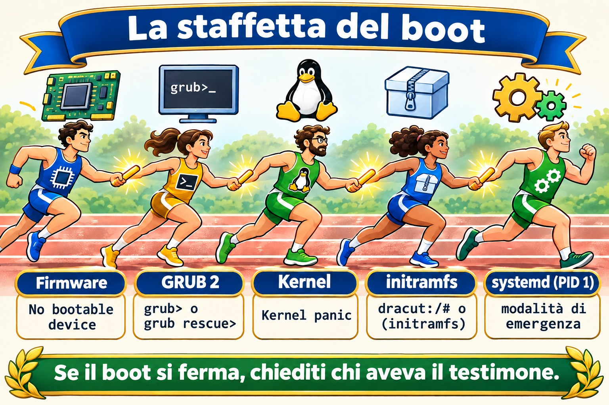
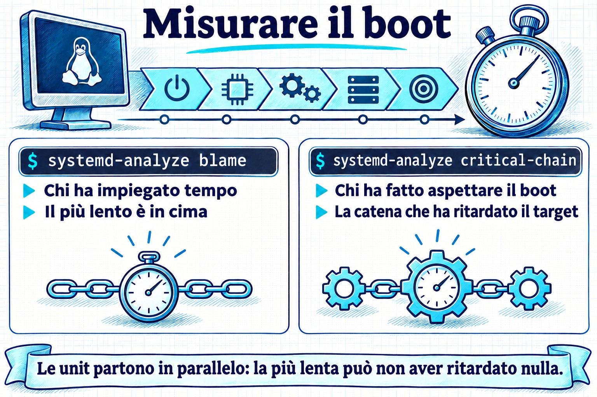

# Lezione 4.1 · Come si avvia Linux

Finora hai acceso le VM e ci sei entrato. Oggi guardi cosa succede nel mezzo: tra la pressione del pulsante e la comparsa del `login:`, cinque programmi si passano il controllo uno con l'altro. Quando un server non torna dopo un reboot, la prima domanda è sempre in quale di queste cinque fasi si è fermato, e ogni fase ha una faccia diversa sullo schermo. Chi sa leggere quella faccia ripara il server; chi non sa, lo reinstalla.

> **Formato nucleo.** Da questa lezione in poi, ogni lezione porta l'essenziale: quello che devi sapere senza internet, in un'emergenza, e quello che fai a mano. I dettagli che non sono entrati sono elencati nella sezione 12, da tirare fuori con DeepTutor quando ti servono.

| Scheda | Lezione 4.1 |
| --- | --- |
| Modulo | M4 · Boot e systemd, lezione 1 di 4 |
| Quando | Settimana 8 |
| Alla fine sei in grado di | Dire le cinque fasi del boot e cosa ognuna consegna alla successiva; scoprire se la macchina usa UEFI o BIOS; trovare il kernel e l'initramfs in `/boot` e la riga di comando del kernel in `/proc/cmdline`; confermare che il PID 1 è `systemd` e qual è il target predefinito; leggere il boot attuale e quello precedente con `journalctl -b`; trovare cosa ha rallentato il boot con `systemd-analyze` |
| Prerequisiti | Lezione 2.3 (processi e `journalctl`); Lezione 3.5 (`vim` e `sudoedit`) |
| Durata | Circa 1h30 |
| Snapshot | m4a1-inicio e m4a1-fim su entrambe le VM |

## 1 · Riscaldamento

Tre domande, a mente. Scrivi le risposte; le soluzioni le controllano alla fine.

1. La macchina si accende: compare il logo del produttore, poi un menu con un elenco di kernel, poi testo che scorre, poi il `login:`. Indovina: chi mostra il menu, e chi mostra il testo che scorre?
2. SSH accetta già la tua connessione, ma `systemd-analyze` risponde che il boot non è ancora finito. Indovina: come può essere?
3. Indovina: qual è il numero del processo di `systemd`, e perché proprio quello?

## 2 · Perché conta

| La richiesta | La risposta sbagliata | Cosa provoca |
| --- | --- | --- |
| "Il server non è tornato dopo il reboot" | Ripristinare il backup | Senza sapere in quale fase si è fermato, non sai cosa riparare, e puoi ripristinare un backup con lo stesso problema. Lo schermo dice la fase: `grub>`, `Kernel panic`, `dracut:/#` o `Give root password for maintenance` sono quattro problemi diversi |
| "Ci mette tanto a partire dopo l'aggiornamento" | Aspettare e lamentarsi | `systemd-analyze blame` mostra in due secondi quale servizio ha trattenuto il boot |
| "Si è riavviato da solo di notte" | Guardare `journalctl`, che mostra solo il boot attuale | Il motivo è nel boot precedente, con `journalctl -b -1`. Se il journal non è persistente, il motivo è sparito con il reboot, e non lo saprai mai |
| "Ho aggiornato il kernel e non parte più" | Reinstallare | GRUB conserva i kernel precedenti. Scegliere quello precedente nel menu rimette il server in linea oggi; la causa la indaghi con calma, nella Lezione 4.4 |

## 3 · Modello mentale

> Il boot è una **staffetta** con cinque corridori. Ognuno fa una cosa sola e passa il testimone: il **firmware** trova il disco e carica GRUB; **GRUB** mette in memoria il kernel e l'initramfs e consegna la riga di comando; il **kernel** accende l'hardware ed esegue l'initramfs; l'**initramfs** trova e monta il disco vero e chiama `systemd`; **systemd** avvia i servizi fino al target predefinito. Se il boot si è fermato, la domanda è sempre la stessa: **chi aveva il testimone?**

| Fase | Dove vive | Cosa consegna | Se si ferma qui, vedi |
| --- | --- | --- | --- |
| 1 · Firmware (UEFI o BIOS) | Sulla scheda madre, o nella configurazione della VM | GRUB caricato dal disco | Solo il logo, oppure `No bootable device` |
| 2 · GRUB 2 | `/boot/efi` (UEFI) e `/boot` | Kernel e initramfs in memoria, più la riga di comando | Il prompt `grub>` o `grub rescue>` |
| 3 · Kernel | `/boot/vmlinuz-VERSÃO` | Hardware acceso, initramfs in esecuzione | `Kernel panic` |
| 4 · initramfs | `/boot/initramfs-VERSÃO.img` (Rocky) o `/boot/initrd.img-VERSÃO` (Debian) | Il disco root montato, e `systemd` chiamato | Una shell `dracut:/#` (Rocky) o `(initramfs)` (Debian), dopo aver aspettato il disco |
| 5 · systemd, il PID 1 | `/usr/lib/systemd/systemd` | I servizi e il target predefinito | La modalità di emergenza: `Give root password for maintenance` |

Tieni a mente la tabella. È la mappa di ogni emergenza di boot per il resto del corso.



*Cinque corridori si passano il testimone; se il boot si è fermato, chiedi chi lo aveva.*

## 4 · L'essenziale

### UEFI o BIOS

Il firmware è il primo programma a girare. Il **BIOS**, il vecchio, legge il primo settore del disco ed esegue quello che trova. L'**UEFI**, l'attuale, tiene un elenco di voci di boot nella memoria della scheda (la NVRAM) e apre un file `.efi` in una piccola partizione, in FAT, chiamata **ESP**, che Linux monta in `/boot/efi`. In una VM di Proxmox, dipende dalla VM: OVMF è UEFI, SeaBIOS è BIOS.

Per sapere qual è, senza riavviare: se esiste `/sys/firmware/efi`, il sistema è partito in UEFI.

### GRUB 2

GRUB mostra il menu, carica il kernel e l'initramfs scelti e passa la **riga di comando del kernel**. Il suo file, `grub.cfg`, è **generato**: non lo modifichi a mano, perché il prossimo aggiornamento del kernel lo riscrive. Su Rocky, ogni kernel ha una voce in `/boot/loader/entries/` e lo strumento è `grubby`; su Debian, modifichi `/etc/default/grub` ed esegui `update-grub`. Entrambe le cose restano per la Lezione 4.4.

### Kernel e riga di comando

Il kernel è un file, `/boot/vmlinuz-VERSÃO`, e la versione in esecuzione è quella di `uname -r`. La riga di comando passata da GRUB è in `/proc/cmdline`. Le voci che vedrai sempre:

- `root=`: dov'è il disco root, per UUID o per nome di volume LVM.
- `ro`: il kernel monta la root in sola lettura, e `systemd` la rimonta in scrittura dopo i controlli.
- `quiet` e, su Rocky, `rhgb`: nascondono il testo del boot. Toglierli nel menu di GRUB è il primo passo per vedere dove si blocca il boot.

### initramfs

Il kernel deve leggere il disco per trovare `/`, ma il driver del disco, LVM o la cifratura sono **sul disco stesso**. L'initramfs risolve il problema: è un mini-sistema che GRUB mette in memoria insieme al kernel, con solo ciò che serve per trovare e montare la root vera. Quando ci riesce, passa il controllo a `/sbin/init` della root, che è `systemd`. Rocky genera l'initramfs con `dracut`, e Debian con `update-initramfs`; entrambi partono da soli a ogni kernel nuovo.

Se l'initramfs non ha il driver giusto, o non trova il disco di `root=`, finisci nella sua shell dopo un'attesa, oppure in un `Kernel panic` che parla di `unable to mount root fs`.

### systemd, il PID 1

`systemd` è il primo processo che il kernel avvia nella root vera, quindi riceve il numero **1**. Tutti gli altri processi discendono da lui, e se muore, il kernel va in panic. Avvia le **unit** (servizi, mount, socket) in parallelo, rispettando le dipendenze, fino al **target predefinito**: un gruppo di unit con un nome, come `multi-user.target` per un server, o `graphical.target` con l'interfaccia grafica.

Prima di `systemd`, lo standard era **SysVinit**, con livelli numerati, i runlevel. La documentazione vecchia usa ancora la corrispondenza:

| Runlevel | Target | A cosa serve |
| --- | --- | --- |
| 0 | `poweroff.target` | Spegnere |
| 1 | `rescue.target` | Manutenzione, un solo utente |
| 3 | `multi-user.target` | Server: rete e servizi, senza interfaccia grafica |
| 5 | `graphical.target` | Il 3 più l'interfaccia grafica |
| 6 | `reboot.target` | Riavviare |

### Leggere il boot

- `journalctl -b`: tutto del boot attuale. `-b -1` è il precedente, `-b -2` quello prima ancora, e `--list-boots` elenca quelli che il journal ha conservato.
- `journalctl -b -p err`: solo gli errori del boot attuale.
- `journalctl -k`, oppure `sudo dmesg`: solo i messaggi del kernel, dove compaiono disco, rete e hardware.
- Il journal conserva i boot precedenti solo se è **persistente**, scritto in `/var/log/journal`. Se quella cartella non esiste, resta in `/run/log/journal`, in memoria, e sparisce a ogni reboot.

### Misurare il boot

- `systemd-analyze`: quanto tempo ha richiesto ogni fase.
- `systemd-analyze blame`: quanto ha richiesto ogni unit, dalla più lenta alla più veloce. Attenzione: le unit girano in parallelo, quindi la più lenta non sempre ha rallentato il boot.
- `systemd-analyze critical-chain`: la catena di unit che **ha davvero** ritardato il target predefinito. Comincia da qui.
- `systemctl is-system-running`: `running` (tutto a posto), `degraded` (qualche unit è fallita: guarda con `systemctl --failed`) o `starting` (il boot non è ancora finito).

### Rocky × Debian

|  | Rocky | Debian |
| --- | --- | --- |
| Configurazione di GRUB | `/boot/grub2/grub.cfg` e `/boot/loader/entries/` | `/boot/grub/grub.cfg` |
| Cambiare GRUB | `grubby` | `/etc/default/grub` e `update-grub` |
| initramfs | `/boot/initramfs-VERSÃO.img`, generato da `dracut`; il contenuto, con `lsinitrd` | `/boot/initrd.img-VERSÃO`, generato da `update-initramfs`; il contenuto, con `lsinitramfs` |
| Shell dell'initramfs | `dracut:/#` | `(initramfs)` |
| Log in testo oltre al journal | `/var/log/messages`, se `rsyslog` è installato | Nessuno, di default: Debian 12 non installa più `rsyslog` |
| `dmesg` senza `sudo` | Di solito funziona | Rifiuta: `Operation not permitted` |

Controlla le ultime due righe sulle tue VM, nel lab. Dipende da cosa è stato installato.

## 5 · Lab guidato

Fai ogni passo su entrambe le VM. I comandi sono gli stessi, tranne dove il passo dice Rocky o Debian. Oggi leggi soltanto: niente di ciò che esegui fino al Passo 4 cambia il sistema.

### Passo 0 · Snapshot e cartella

Sul nodo Proxmox:

```bash
qm snapshot 201 m4a1-inicio
qm snapshot 202 m4a1-inicio
```

Su entrambe le VM:

```bash
mkdir -p ~/lab41 && cd ~/lab41
```

### Passo 1 · Firmware e GRUB

```bash
[ -d /sys/firmware/efi ] && echo UEFI || echo BIOS
findmnt /boot/efi
ls /boot
```

Se è risultato UEFI, guarda le voci di boot della scheda, e quale è stata usata adesso (`BootCurrent`):

```bash
sudo efibootmgr -v
```

Se è risultato BIOS, `findmnt` non mostra nulla e `efibootmgr` risponde `EFI variables are not supported on this system`. Entrambe le risposte sono giuste: la tua VM usa SeaBIOS.

Su Rocky, guarda le voci del menu, una per ogni kernel installato:

```bash
sudo ls /boot/loader/entries/
```

### Passo 2 · Kernel, riga di comando e initramfs

**Decidi 1.** Prima di eseguire il prossimo comando, scegli: il `root=` della riga di comando mostrerà

- a) un nome come `/dev/sda2`
- b) un `UUID=...` o un nome di volume come `/dev/mapper/...`
- c) niente: il `root=` non compare

```bash
uname -r
cat /proc/cmdline
```

| Se hai scelto | Risultato | Perché |
| --- | --- | --- |
| a | Sbagliato, ed è un bene | Il nome `sda` dipende dall'ordine in cui il kernel ha trovato i dischi. Cambia l'ordine, o aggiungi un disco, e `sda2` diventa un altro. Oggi nessuno installa così |
| b | Giusto | L'UUID è scritto nel file system e non cambia. Nemmeno il nome del volume LVM. Rocky di default usa LVM (`/dev/mapper/rl-root`); Debian, di solito, l'UUID |
| c | Sbagliato | Senza `root=`, l'initramfs non sa quale disco montare. È la prima cosa da controllare quando il boot finisce nella shell dell'initramfs |

**Da ricordare:** `root=` usa sempre un nome che non cambia tra un boot e l'altro.

Ora l'initramfs del kernel in esecuzione, e cosa c'è dentro:

```bash
# Rocky
ls -lh /boot/initramfs-$(uname -r).img
sudo lsinitrd | head -30

# Debian
ls -lh /boot/initrd.img-$(uname -r)
lsinitramfs /boot/initrd.img-$(uname -r) | head -30
```

Nota la dimensione, decine di MB, e il contenuto: un `bin`, un `lib` con i moduli del disco e, su Rocky, i moduli di LVM. È un sistema piccolo, fatto solo per trovare il disco vero.

### Passo 3 · PID 1 e target predefinito

**Decidi 2.** Scegli: `/sbin/init`, che l'initramfs chiama alla fine, è

- a) un programma a sé, chiamato `init`
- b) un link a `systemd`
- c) un file che non esiste più

```bash
ls -l /sbin/init
ps -p 1 -o pid,comm,args
systemctl get-default
systemctl is-system-running
systemctl --failed
```

| Se hai scelto | Risultato | Perché |
| --- | --- | --- |
| a | Sbagliato | Era così in SysVinit. Oggi il nome è rimasto solo per compatibilità |
| b | Giusto | `ls -l` mostra la freccia: `init -> ../lib/systemd/systemd`. Su Rocky `/sbin` è già un link a `/usr/sbin`, quindi puoi vedere due salti |
| c | Sbagliato | Il kernel e l'initramfs cercano ancora `/sbin/init` per nome. Senza di lui, il boot si ferma con `Kernel panic`: `No working init found` |

**Da ricordare:** il PID 1 è `systemd`, e `/sbin/init` è solo il vecchio nome che punta a lui.

Su un server, `get-default` deve rispondere `multi-user.target`. Se `is-system-running` dice `degraded`, `--failed` mostra quale unit è fallita: annotalo nel Diario, perché è il primo problema vero che la VM ti sta mostrando.

### Passo 4 · Leggere il boot e conservare i prossimi

```bash
journalctl --list-boots
ls -d /var/log/journal
```

Se `--list-boots` mostra una sola riga, quella del boot `0`, e `ls` dice che `/var/log/journal` non esiste, il journal è in memoria. Rendilo persistente:

```bash
sudo mkdir -p /var/log/journal
sudo systemctl restart systemd-journald
ls /var/log/journal
```

Compare una cartella con un nome lungo, il machine-id: da ora in poi, il journal scrive su disco. La forma esplicita è mettere `Storage=persistent` nella sezione `[Journal]` di `/etc/systemd/journald.conf` e riavviare `systemd-journald`.

Ora leggi il boot attuale:

```bash
journalctl -b -p err
journalctl -k | head -20
dmesg | head -5
sudo dmesg | head -5
```

`-p err` di solito porta qualche errore senza importanza in una VM, come un sensore o un dispositivo che l'hypervisor non ha. Leggere e sapere cos'è normale sulla tua macchina è ciò che ti farà accorgere dell'anormale. Annota nella tabella Rocky × Debian della sezione 4 se `dmesg` senza `sudo` ha funzionato su ciascuna, e se esiste `/var/log/messages`.

### Passo 5 · Misurare il boot e riavviare

```bash
systemd-analyze
systemd-analyze blame | head -10
systemd-analyze critical-chain
```

Confronta la cima di `blame` con la catena di `critical-chain`. Spesso sono unit diverse: `blame` dice chi ci ha messo di più, e `critical-chain` dice chi ha fatto aspettare il boot.

Ora riavvia e controlla che il boot precedente sia stato conservato:

```bash
sudo systemctl reboot
```

Dopo essere rientrato:

```bash
journalctl --list-boots
journalctl -b -1 -n 20
```

L'elenco ha adesso almeno due righe, e `-b -1 -n 20` mostra le ultime 20 righe del boot precedente: lo spegnimento che hai chiesto. È esattamente ciò che leggerai il giorno in cui un server si riavvierà da solo.

## 6 · Rompi e ripara

**Il guasto:** un servizio che trattiene il boot per 40 secondi. Crea il file:


*Confronta la cima di blame con la catena di critical-chain: chi ha impiegato di più non è sempre chi ha fatto aspettare.*


```bash
sudoedit /etc/systemd/system/lento.service
```

```ini
[Unit]
Description=Servico lento de proposito (Aula 4.1)

[Service]
Type=oneshot
ExecStart=/bin/sleep 40

[Install]
WantedBy=multi-user.target
```

Attiva e riavvia:

```bash
sudo systemctl daemon-reload
sudo systemctl enable lento.service
sudo systemctl reboot
```

**La diagnosi.** Entra via SSH appena la VM accetta, senza aspettare, ed esegui:

```bash
systemctl is-system-running
systemd-analyze
systemctl list-jobs
```

Il primo risponde `starting`; il secondo dice che il boot non è ancora finito; il terzo mostra `lento.service` in esecuzione e `multi-user.target` che lo aspetta. Aspetta i 40 secondi ed esegui di nuovo:

```bash
systemctl is-system-running
systemd-analyze blame | head -3
systemd-analyze critical-chain
```

`lento.service` è in cima a `blame`, con 40 secondi, e nella catena di `critical-chain`, subito prima di `multi-user.target`.

**La riparazione:**

```bash
sudo systemctl disable lento.service
sudo rm /etc/systemd/system/lento.service
sudo systemctl daemon-reload
sudo systemctl reboot
```

Dopo il reboot, `systemd-analyze` torna al tempo di prima, e `systemctl status lento.service` risponde che la unit non esiste.

**La lezione.** SSH ti ha accettato prima della fine del boot, perché `sshd` non dipende da `lento.service`: `systemd` avvia le unit in parallelo. Quindi "riesco già a entrare" non vuol dire "il boot è finito". Lo dice `is-system-running`. E il percorso di diagnosi è sempre lo stesso: `is-system-running` per sapere se è finito, `critical-chain` per sapere chi ha trattenuto, `blame` per vedere quanto.

## 7 · Trappole

- **Modificare `grub.cfg` a mano.** Funziona fino al prossimo aggiornamento del kernel, che riscrive il file. Le modifiche a GRUB si fanno con `grubby` oppure `/etc/default/grub` e `update-grub`, nella Lezione 4.4.
- **Contare su `journalctl -b -1` senza journal persistente.** La risposta è che quel boot non esiste, e il motivo del reboot è sparito. Controlla `--list-boots` su ogni server nuovo che ricevi.
- **Leggere `blame` come se fosse una coda.** Le unit girano in parallelo. La più lenta può non aver ritardato nulla. Chi ha ritardato è in `critical-chain`.
- **Credere che SSH che accetta sia la fine del boot.** È quello che ha mostrato il guasto. `is-system-running` risponde davvero.
- **Dimenticare `daemon-reload`.** Dopo aver creato o cambiato un file di unit, `systemd` usa ancora la versione vecchia e avvisa con `Run 'systemctl daemon-reload' to reload units`. Leggi gli avvisi.
- **Eseguire `efibootmgr` su una macchina BIOS e credere che si sia rotto.** Il messaggio `EFI variables are not supported` vuol dire solo che la macchina non è UEFI.
- **Cancellare i vecchi kernel per liberare `/boot`.** Il kernel precedente è la tua via d'uscita quando quello nuovo non parte. I gestori di pacchetti ne conservano già alcuni di proposito; lascia che se ne occupino loro.

## 8 · Quiz

Rispondi senza guardare le sezioni sopra. Le Soluzioni commentate sono alla fine.

1. Metti in ordine: kernel, `systemd`, firmware, initramfs, GRUB.
2. Dopo un minuto fermo, il boot finisce in un prompt `dracut:/#`. Quale fase è fallita, e qual è il primo sospettato?
3. Un server si è riavviato di notte. Esegui `journalctl -b -1` e la risposta è che quel boot non esiste. Cosa dice questo del server, e cosa fai per la prossima volta?
4. In cima a `systemd-analyze blame` c'è un `exemplo.service` con 12 secondi, ma non compare in `systemd-analyze critical-chain`. Ha ritardato il boot?
5. A quali target corrispondono i runlevel 3 e 5? Con quale comando vedi il target predefinito?
6. *Which file shows the kernel command line that the running system was booted with? a) `/etc/default/grub` b) `/proc/cmdline` c) `/boot/grub2/grub.cfg` d) `/etc/fstab`*

## 9 · Promemoria

### Da sapere a memoria

La staffetta, con il segnale di ogni fase quando si ferma:

1. **Firmware** (UEFI o BIOS): `No bootable device`
2. **GRUB**: `grub>` o `grub rescue>`
3. **Kernel**: `Kernel panic`
4. **initramfs**: `dracut:/#` o `(initramfs)`
5. **systemd**: `Give root password for maintenance`

E i comandi che usi senza consultare:

```bash
cat /proc/cmdline              # ciò che GRUB ha passato al kernel
systemctl get-default          # il target predefinito
systemctl is-system-running    # running, degraded o starting
systemctl --failed             # chi è fallito
journalctl -b -p err           # errori del boot attuale
journalctl -b -1               # il boot precedente
journalctl --list-boots        # quanti boot ha conservato il journal
systemd-analyze critical-chain # chi ha trattenuto il boot
```

### Da consultare

| Per | Rocky | Debian |
| --- | --- | --- |
| Vedere se è UEFI | `[ -d /sys/firmware/efi ]` | Lo stesso |
| Voci di boot della scheda (UEFI) | `sudo efibootmgr -v` | Lo stesso |
| Voci del menu di GRUB | `/boot/loader/entries/` | `/boot/grub/grub.cfg` (solo lettura) |
| Contenuto dell'initramfs | `sudo lsinitrd` | `lsinitramfs /boot/initrd.img-$(uname -r)` |
| Messaggi del kernel | `journalctl -k` o `dmesg` | `journalctl -k` o `sudo dmesg` |
| Journal persistente | `mkdir -p /var/log/journal` e riavviare `systemd-journald` | Lo stesso |
| Tempo di ogni unit | `systemd-analyze blame` | Lo stesso |

### Flashcard

- A cosa serve l'initramfs? → Trovare e montare il disco root, con i driver che il kernel non ha ancora, e chiamare `systemd`.
- Dov'è la riga di comando usata nel boot attuale? → `/proc/cmdline`.
- Qual è il PID di `systemd`, e perché? → 1: è il primo processo che il kernel avvia nella root vera.
- `degraded` in `is-system-running` cosa vuol dire? → È partito, ma qualche unit è fallita: guarda con `systemctl --failed`.
- `blame` o `critical-chain` per sapere chi ha ritardato? → `critical-chain`.
- Perché a volte il journal non ha il boot precedente? → È in `/run/log/journal`, in memoria, perché `/var/log/journal` non esiste.
- Runlevel 3 e 5? → `multi-user.target` e `graphical.target`.

## 10 · Checklist di uscita

- [ ] Dico le cinque fasi in ordine e cosa ognuna consegna alla successiva.
- [ ] So se ogni VM è partita in UEFI o BIOS, e come l'ho scoperto.
- [ ] Ho trovato il kernel e l'initramfs in `/boot` e ho letto il `root=` in `/proc/cmdline`.
- [ ] Ho mostrato che il PID 1 è `systemd` e che il target predefinito è `multi-user.target`.
- [ ] Il journal di entrambe le VM è persistente, e `--list-boots` mostra più di un boot.
- [ ] Ho trovato `lento.service` con `is-system-running`, `critical-chain` e `blame`, e l'ho rimosso.
- [ ] Ho compilato le due righe della tabella Rocky × Debian che dipendevano dalle mie VM.

**Ultimo esercizio, senza guardare.** Su un foglio, scrivi le cinque fasi e, accanto a ognuna, un comando o un file che dimostra che è girata nel boot attuale. Poi controlla sulle VM.

**Reboot e verifica.** Riavvia entrambe le VM e controlla:

```bash
journalctl --list-boots | tail -3
systemctl status lento.service
systemctl is-system-running
```

Un boot in più nell'elenco; la unit `lento.service` non esiste; il sistema `running`, oppure `degraded` con lo stesso motivo che hai annotato nel Passo 3.

**Snapshot di fine,** sul nodo Proxmox:

```bash
qm snapshot 201 m4a1-fim
qm snapshot 202 m4a1-fim
```

## 11 · Nella vita reale

**Missione, sola lettura.** Su un server Linux reale di cui rispondi tu, esegui solo comandi di lettura:

```bash
[ -d /sys/firmware/efi ] && echo UEFI || echo BIOS
systemd-analyze
journalctl --list-boots | tail -5
systemctl --failed
```

Non cambiare nulla. Se il journal non è persistente, o se ci sono unit che falliscono, annota e porta nella tua lista di miglioramenti, per decidere con calma e con una finestra di manutenzione.

**Diario.** Annota: cosa ha risposto ogni VM a `is-system-running`; il tempo di boot di ciascuna; cosa ha mostrato il server reale; e una frase con parole tue sulla differenza tra `blame` e `critical-chain`.

**Domani, senza guardare:**

1. Qual è la fase che monta il disco root?
2. Quale comando mostra il boot precedente?
3. SSH è entrato. Il boot è finito?

## 12 · Approfondire quando vuoi

Sono rimasti fuori, di proposito. Tirali fuori quando ti servono, o quando la curiosità bussa:

- **Secure Boot**: lo `shim` e le chiavi che permettono al firmware di fidarsi di GRUB e del kernel.
- **MBR e GPT**: come BIOS e UEFI trovano il bootloader sul disco, e cos'è la partizione BIOS boot.
- **Rigenerare l'initramfs**: `dracut -f` e `update-initramfs -u`, e quando serve.
- **Parametri del kernel per l'emergenza**: `systemd.unit=`, `rd.break` e `init=`. Entrano nella Lezione 4.4.
- **SysVinit e Upstart**: gli script in `/etc/init.d` e i runlevel. Vale la pena riconoscerli su un server vecchio.
- **Il boot in grafico**: `systemd-analyze plot > boot.svg`.
- **Limiti del journal**: `SystemMaxUse=` in `journald.conf`, perché il journal non riempia il disco.

Con DeepTutor:

- `!explica initramfs: por que ele existe e o que tem dentro`
- `!feynman as cinco etapas do boot` (tu spieghi, lui corregge)
- `!quiz 4.1, 5 perguntas`

## Soluzioni commentate

### Riscaldamento

1. Il menu è di **GRUB**. Il testo che scorre viene dal **kernel** e poi da **systemd**. Il logo prima di tutto è del firmware.
2. `systemd` avvia le unit in parallelo. `sshd` è già in linea mentre un'altra unit trattiene ancora il target predefinito. È stato esattamente il guasto della sezione 6.
3. **1**: è il primo processo che il kernel avvia nella root vera. Gli altri discendono da lui.

### Quiz

1. Firmware, GRUB, kernel, initramfs, `systemd`. GRUB carica il kernel e l'initramfs insieme, ma il kernel gira per primo ed è lui a eseguire l'initramfs.
2. L'**initramfs**: non ha trovato il disco root. Il primo sospettato è il `root=` della riga di comando che punta a un UUID o a un volume che non esiste, per esempio dopo un disco sostituito o un volume rinominato. Il secondo è un driver che manca nell'initramfs.
3. Il journal di quel server non è persistente, e il motivo del reboot è andato perso. Per la prossima volta: creare `/var/log/journal` e riavviare `systemd-journald`, oppure `Storage=persistent` in `journald.conf`. Se c'è `/var/log/messages`, potrebbe avere qualche indizio.
4. Probabilmente no. Ci ha messo tempo, ma in parallelo, e il target predefinito non lo ha aspettato. Chi ha ritardato il boot è chi sta in `critical-chain`.
5. 3 è `multi-user.target`, e 5 è `graphical.target`. Il comando è `systemctl get-default`.
6. **b)**. `/etc/default/grub` e `grub.cfg` dicono cosa *verrà* usato al prossimo boot, e qualcuno potrebbe aver cambiato dopo. `/proc/cmdline` mostra cosa *è stato* usato nel boot attuale. `/etc/fstab` non c'entra nulla con la riga di comando.

---

<!-- navegacao -->
[← Lezione 3.5 · vi e vim sul serio](3.5-vi-e-vim-de-verdade.md) · [Indice delle lezioni](../01-aulas.md) · [Lezione 4.2 · systemd: servizi e unit →](4.2-systemd-servicos-e-units.md)
