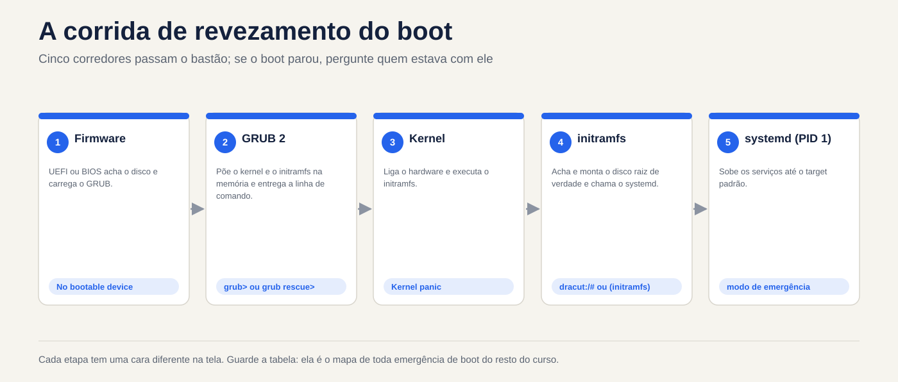
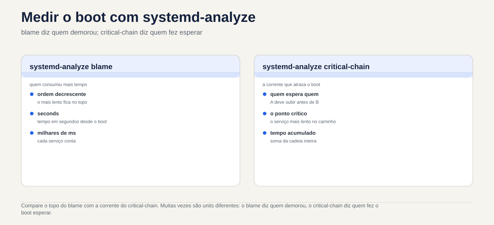

# Lezione 4.1 · Come si accende Linux

Finora hai acceso le VM e le hai inserite. Oggi guardate cosa succede nel frattempo: tra la pressione del pulsante e la comparsa di `login:` cinque programmi si passano il controllo l'uno all'altro. Quando un server non ritorna dopo un riavvio, la prima domanda è sempre in quale di questi cinque passaggi si è fermato e ogni passaggio ha un volto diverso sullo schermo. Chi sa leggere questa faccia può aggiustare il server; Se non lo sai, reinstallalo.

> **Formato base.** Da questa lezione in poi, ogni lezione porta a portata di mano gli elementi essenziali: cosa devi sapere senza Internet, in caso di emergenza, e cosa richiede il test. I dettagli che non sono stati inclusi sono elencati nella sezione 12, affinché tu possa visualizzarli in DeepTutor quando ne hai bisogno.

| File | lezione 4.1 |
| --- | --- |
| Modulo | M4 · Boot e systemd, lezione 1 di 4 |
| Quando | Settimana 8 |
| Alla fine puoi | Indica le cinque fasi dell'avvio e ciò che ciascuna di esse offre a quella successiva; scoprire se la macchina utilizza UEFI o BIOS; trovare il kernel e initramfs in `/boot` e la riga di comando del kernel in `/proc/cmdline`; confermare che il PID 1 è `systemd` e qual è il target predefinito; leggere l'avvio attuale e precedente con `journalctl -b`; trovare cosa ha ritardato l'avvio con `systemd-analyze` |
| Articoli di prova | LPIC-1 101.2 (sequenza di avvio, initramfs, `dmesg` e `journalctl`, nozione di SysVinit) · RHCSA (riavvio e arresto; salvataggio del journal tra un riavvio e l'altro) |
| Prerequisiti | lezione 2.3 (processi e `journalctl`); lezione 3.5 (`vim` e `sudoedit`) |
| Tempo | Intorno all'1:30 |
| Istantanee | m4a1-start e m4a1-end in entrambe le VM |

## 1 · Riscaldamento

Tre domande, appena mi vengono in mente. Scrivi le risposte; la chiave di risposta viene visualizzata alla fine.

1. La macchina si accende: appare il logo del produttore, poi un menu con l'elenco dei kernel, poi del testo scorrevole, poi `login:`. Indovina: chi mostra il menu e chi mostra il testo scorrevole?
2. SSH accetta già la vostra connessione, ma `systemd-analyze` risponde che l'avvio non è ancora terminato. Indovina: come potrebbe essere?
3. Indovina: qual è il numero del processo `systemd` e perché è giusto?

## 2 · Perché è importante

| Il cosiddetto | La risposta sbagliata | Cosa succede |
| --- | --- | --- |
| "Il server non è tornato dopo il riavvio" | Ripristina il backup | Senza sapere in quale passaggio si è fermato, non sai cosa risolvere e puoi ripristinare un backup con lo stesso problema. Lo schermo dice il passo: `grub>`, `Kernel panic`, `dracut:/#` o `Give root password for maintenance` sono quattro problemi diversi |
| "È stato lento risalire dopo l'aggiornamento" | Aspetta e lamentati | `systemd-analyze blame` mostra in due secondi quale servizio ha effettuato l'avvio |
| "È ripartito da solo all'alba" | Guarda `journalctl`, che mostra solo l'avvio corrente | Il motivo è nell'avvio precedente, con `journalctl -b -1`. Se il diario non è persistente, il motivo scompare al riavvio e non lo saprai mai |
| "Ho aggiornato il kernel e non si avvia più" | Reinstallare | GRUB memorizza i kernel precedenti. Scegliendo quello precedente dal menu si mette il server attivo oggi; investighi con calma sulla causa, nella lezione 4.4 |

## 3 · Modello mentale

> Lo stivale è una **staffetta** con cinque corridori. Ognuno fa una cosa e si passa il testimone: il **firmware** trova il disco e carica GRUB; **GRUB** mette in memoria il kernel e initramfs e fornisce la riga di comando; il **kernel** accende l'hardware ed esegue initramfs; **initramfs** trova e monta il disco reale e chiama `systemd`; **systemd** aumenta i servizi al target predefinito. Se il boot si fermava, la domanda era sempre la stessa: **chi aveva il testimone?**

| Passo | Dove vivi | Cosa offre | Se ti fermi qui, vedrai |
| --- | --- | --- | --- |
| 1 · Firmware (UEFI o BIOS) | Sulla scheda madre o nella configurazione della VM | GRUB caricato dal disco | Solo il logo, ovvero `No bootable device` |
| 2 · GRUB2 | `/boot/efi` (UEFI) e `/boot` | Kernel e initramfs in memoria, più la riga di comando | Il prompt `grub>` o `grub rescue>` |
| 3 · Kernel | `/boot/vmlinuz-VERSÃO` | Hardware acceso, initramfs in esecuzione | `Kernel panic` |
| 4 · initramfs | `/boot/initramfs-VERSÃO.img` (Rocky) o `/boot/initrd.img-VERSÃO` (Debian) | Il disco root è montato e `systemd` si chiama | Una shell `dracut:/#` (Rocky) o `(initramfs)` (Debian), dopo aver aspettato il disco |
| 5 · systemd, PID 1 | `/usr/lib/systemd/systemd` | Servizi e target standard | Modalità emergenza: `Give root password for maintenance` |

Salvare la tabella. È la mappa di ogni emergenza di avvio per il resto del percorso.



*Cinque corridori si passano il testimone; Se l'avvio si interrompe, chiedere chi lo ha eseguito.*

## 4 · Elementi essenziali

### UEFI o BIOS

Il firmware è il primo programma da eseguire. Il **BIOS**, quello vecchio, legge il primo settore del disco ed esegue tutto ciò che c'è. **UEFI**, quello attuale, memorizza un elenco di voci di avvio nella memoria della scheda (NVRAM) e apre un file `.efi` in una piccola partizione, in FAT, chiamata **ESP**, che Linux monta in `/boot/efi`. In una VM Proxmox, dipende dalla VM: OVMF è UEFI, SeaBIOS è BIOS.

Per scoprire qual è, senza riavviare: se c'è `/sys/firmware/efi`, il sistema è andato via UEFI.

### GRUB 2

GRUB mostra il menu, carica il kernel scelto e initramfs e passa la **riga di comando del kernel**. Il suo file, `grub.cfg`, viene **generato**: non lo si modifica manualmente, perché il successivo aggiornamento del kernel lo riscrive. In Rocky ogni kernel ha una voce in `/boot/loader/entries/` e lo strumento è `grubby`; in Debian si cambia `/etc/default/grub` ed si esegue `update-grub`. Entrambe le cose riguardano la lezione 4.4.

### Kernel e la riga di comando

Il kernel è un file, `/boot/vmlinuz-VERSÃO`, e la versione in esecuzione è `uname -r`. La riga di comando passata da GRUB è in `/proc/cmdline`. Gli elementi che vedrai sempre:

- `root=`: dove si trova il disco root, per UUID o per nome del volume LVM.
- `ro`: il kernel monta il root per sola lettura e `systemd` lo rimonta per la scrittura dopo il controllo.
- `quiet` e, in Rocky, `rhgb`: nasconde il testo di avvio. Rimuoverli dal menu GRUB è il primo passo per vedere dove si blocca l'avvio.

### initramfs

Il kernel deve leggere il disco per trovare `/`, ma il driver del disco, LVM o la crittografia sono **sul disco stesso**. initramfs risolve questo: è un mini-sistema che GRUB mette in memoria insieme al kernel, con proprio quello che serve per trovare e montare la vera root. Quando riesce, passa il controllo a `/sbin/init` della radice, che è `systemd`. Rocky genera initramfs con `dracut` e Debian con `update-initramfs`; i due funzionano da soli con ogni nuovo kernel.

Se initramfs non ha il driver giusto, o non trova il disco `root=`, dopo l'attesa si finisce nella sua shell, o in un `Kernel panic` che parla di `unable to mount root fs`.

### systemd, il PID 1

Il `systemd` è il primo processo che il kernel avvia nella radice di true, quindi riceve il numero **1**. Tutti gli altri processi discendono da esso e, se muore, il kernel va nel panico. Scala le **unità** (servizi, assiemi, socket) in parallelo, rispettando le dipendenze, fino a raggiungere il **obiettivo standard**: un gruppo di unità con un nome, come `multi-user.target` per il server, o `graphical.target` con interfaccia grafica.

Prima di `systemd`, lo standard era **SysVinit**, con livelli numerati, i runlevel. Il test richiede anche la corrispondenza:

| Livello di esecuzione | Obiettivo | A cosa serve |
| --- | --- | --- |
| 0| `poweroff.target` | Disconnetti |
| 1| `rescue.target` | Manutenzione, un solo utente |
| 3| `multi-user.target` | Server: rete e servizi, senza interfaccia grafica |
| 5| `graphical.target` | Il 3 più l'interfaccia grafica |
| 6| `reboot.target` | Riavvia |

### Leggi boot

- `journalctl -b`: tutto dall'avvio corrente. `-b -1` è quello precedente, `-b -2` quello precedente e `--list-boots` elenca quelli salvati dal journal.
- `journalctl -b -p err`: solo errori dell'avvio corrente.
- `journalctl -k`, oppure `sudo dmesg`: solo messaggi del kernel, dove compaiono disco, rete e hardware.
- Il journal memorizza solo gli avviamenti precedenti se è **persistente**, registrato in `/var/log/journal`. Se questa cartella non esiste, rimane in `/run/log/journal`, in memoria, e scompare ad ogni riavvio.

### Misurare il boot

- `systemd-analyze`: quanto tempo ha impiegato ciascuna fase.
- `systemd-analyze blame`: quanto ha impiegato ciascuna unità, dal più lento al più veloce. Attenzione: le unità funzionano in parallelo, quindi quella più lenta non sempre ritarda l'avvio.
- `systemd-analyze critical-chain`: la catena di unità che **di fatto** ha ritardato il target predefinito. Inizia qui.
- `systemctl is-system-running`: `running` (tutto ok), `degraded` (qualche unità guasta: vedere `systemctl --failed`) o `starting` (l'avvio non è ancora terminato).

### Rocky × Debian

|  | Roccioso | Debian |
| --- | --- | --- |
| Configurazione GRUB | `/boot/grub2/grub.cfg` e `/boot/loader/entries/` | `/boot/grub/grub.cfg` |
| Cambia GRUB | `grubby` | `/etc/default/grub` e `update-grub` |
| initramfs | `/boot/initramfs-VERSÃO.img`, generato da `dracut`; il contenuto, con `lsinitrd` | `/boot/initrd.img-VERSÃO`, generato da `update-initramfs`; il contenuto, con `lsinitramfs` |
| shell initramfs | `dracut:/#` | `(initramfs)` |
| Accedi al testo oltre il diario | `/var/log/messages`, se è installato `rsyslog` | Nessuno per impostazione predefinita: Debian 12 non installa più `rsyslog` |
| `dmesg` senza `sudo` | Di solito funziona | Rifiuto: `Operation not permitted` |

Controlla le ultime due righe nelle tue VM, in laboratorio. Dipende da cosa è stato installato.

### Cosa è incluso nel test

In LPIC-1 101.2: l'ordine dei passaggi; a cosa serve initramfs; `dmesg` e `journalctl` per leggere il boot; la corrispondenza tra runlevel e target. In RHCSA: riavviare e arrestare con `systemctl reboot` e `systemctl poweroff` e lasciare il journal persistente per salvare gli avvii precedenti.

## 5 · Laboratorio guidato

Eseguire ogni passaggio su entrambe le VM. I comandi sono gli stessi, tranne dove il passaggio dice Rocky o Debian. Oggi hai appena letto: niente di ciò che esegui finché il passo 4 non cambia il sistema.

### Passo 0 · Istantanea e cartella

Sul nodo Proxmox:

```bash
qm snapshot 201 m4a1-inicio
qm snapshot 202 m4a1-inicio
```

Su entrambe le VM:

```bash
mkdir -p ~/lab41 && cd ~/lab41
```

### Passo 1 · Firmware e GRUB

```bash
[ -d /sys/firmware/efi ] && echo UEFI || echo BIOS
findmnt /boot/efi
ls /boot
```

Se era UEFI, guarda le voci di avvio della scheda e quale è stato utilizzato ora (`BootCurrent`):

```bash
sudo efibootmgr -v
```

Se avete dato il BIOS, `findmnt` non mostra nulla e `efibootmgr` risponde `EFI variables are not supported on this system`. Entrambe le risposte sono giuste: la tua VM utilizza SeaBIOS.

In Rocky, consulta le voci del menu, una per kernel installato:

```bash
sudo ls /boot/loader/entries/
```

### Passaggio 2 · Kernel, riga di comando e initramfs

**Decidere 1.** Prima di eseguire il comando successivo, verificare: `root=` sulla riga di comando mostrerà

- a) un nome come `/dev/sda2`
- b) un `UUID=...` o un nome di volume come `/dev/mapper/...`
- c) niente: `root=` non appare

```bash
uname -r
cat /proc/cmdline
```

| Se hai selezionato | Risultato | Perché |
| --- | --- | --- |
| a | È stato sbagliato, e questo è un bene | Il nome `sda` deriva dall'ordine in cui il kernel ha trovato i dischi. Cambiare l'ordine, o aggiungere un disco, e `sda2` diventa un altro. Nessuno lo installa così oggi |
| b | Capito bene | L'UUID viene scritto nel file system e non cambia. Nemmeno il nome del volume LVM. Lo standard Rocky utilizza LVM (`/dev/mapper/rl-root`); a Debian, in generale, UUID |
| c| Sbagliato | Senza `root=`, initramfs non sa quale disco montare. È la prima cosa da controllare quando l'avvio si blocca nella shell initramfs |

**Da risolvere:** `root=` usa sempre un nome che non cambia tra un avvio e l'altro.

Ora l'initramfs del kernel in esecuzione e cosa c'è al suo interno:

```bash
# Rocky
ls -lh /boot/initramfs-$(uname -r).img
sudo lsinitrd | head -30

# Debian
ls -lh /boot/initrd.img-$(uname -r)
lsinitramfs /boot/initrd.img-$(uname -r) | head -30
```

Notate la dimensione, decine di MB, e il contenuto: un `bin`, un `lib` con disco di moduli e, in Rocky, i moduli LVM. È un piccolo sistema, fatto solo per trovare il disco reale.

### Passo 3 · PID 1 e target predefinito

**Decidi 2.** Controlla: `/sbin/init`, che initramfs chiama alla fine, è

- a) il suo programma, chiamato `init`
- b) un collegamento al `systemd`
- c) un file che non è più esiste

```bash
ls -l /sbin/init
ps -p 1 -o pid,comm,args
systemctl get-default
systemctl is-system-running
systemctl --failed
```

| Se hai selezionato | Risultato | Perché |
| --- | --- | --- |
| a | Sbagliato | Era così in SysVinit. Oggi il nome era solo per compatibilità |
| b | Capito bene | `ls -l` mostra la freccia: `init -> ../lib/systemd/systemd`. In Rocky, `/sbin` è già un collegamento a `/usr/sbin`, quindi puoi vedere due salti |
| c| Sbagliato | Il kernel e initramfs cercano ancora `/sbin/init` per nome. Senza di esso, l'avvio si interrompe con `Kernel panic`: `No working init found` |

**Da correggere:** PID 1 è `systemd` e `/sbin/init` è solo il vecchio nome che punta ad esso.

Su un server, `get-default` dovrebbe rispondere a `multi-user.target`. Se `is-system-running` dice `degraded`, `--failed` mostra quale unità è guasta: scrivilo nel Diario, perché è il primo vero problema che la VM ti mostra.

### Passo 4 · Leggi il boot e salva i successivi

```bash
journalctl --list-boots
ls -d /var/log/journal
```

Se `--list-boots` mostra solo una riga, il boot `0`, e `ls` dice che `/var/log/journal` non esiste, il diario è in memoria. Lascialo persistente:

```bash
sudo mkdir -p /var/log/journal
sudo systemctl restart systemd-journald
ls /var/log/journal
```

Appare una cartella con un nome lungo, l'id della macchina: da ora in poi, il journal scrive su disco. Il modo esplicito, accettato anche da RHCSA, è inserire `Storage=persistent` nella sezione `[Journal]` di `/etc/systemd/journald.conf` e riavviare `systemd-journald`.

Ora leggi l'avvio corrente:

```bash
journalctl -b -p err
journalctl -k | head -20
dmesg | head -5
sudo dmesg | head -5
```

`-p err` di solito porta alcuni errori non importanti in una VM, come un sensore o un dispositivo che l'hypervisor non ha. Leggere e sapere cosa è normale sulla tua macchina è ciò che ti farà notare cosa è anormale. Notare nella tabella Rocky × Debian nella sezione 4 se `dmesg` senza `sudo` ha funzionato in ognuno di essi e se c'è `/var/log/messages`.

### Passo 5 · Misurare avvio e riavvio

```bash
systemd-analyze
systemd-analyze blame | head -10
systemd-analyze critical-chain
```

Confrontare la parte superiore di `blame` con l'attuale di `critical-chain`. Spesso si tratta di unità diverse: `blame` dice chi ha preso il tempo e `critical-chain` dice chi ha fatto attendere l'avvio.

Ora riavvia e controlla che l'avvio precedente sia stato salvato:

```bash
sudo systemctl reboot
```

Dopo aver inserito nuovamente:

```bash
journalctl --list-boots
journalctl -b -1 -n 20
```

L'elenco ora ha almeno due righe e `-b -1 -n 20` mostra le ultime 20 righe dell'avvio precedente: lo spegnimento richiesto. È esattamente ciò che leggerai il giorno in cui un server si riavvia da solo.

## 6 · Interrompi e ripara

**L'interruzione:** un servizio che mantiene l'avvio per 40 secondi. Creare il file:


*Confronta il capo della colpa con l'attuale catena critica: chi si è preso il tempo non è sempre quello che ti ha fatto aspettare.*


```bash
sudoedit /etc/systemd/system/lento.service
```

```ini
[Unit]
Description=Servico lento de proposito (Aula 4.1)

[Service]
Type=oneshot
ExecStart=/bin/sleep 40

[Install]
WantedBy=multi-user.target
```

Attiva e riavvia:

```bash
sudo systemctl daemon-reload
sudo systemctl enable lento.service
sudo systemctl reboot
```

**La diagnosi.** Entra via SSH non appena la VM accetta, senza aspettare, ed esegui:

```bash
systemctl is-system-running
systemd-analyze
systemctl list-jobs
```

Il primo risponde `starting`; la seconda dice che il boot non è ancora terminato; il terzo mostra `lento.service` in esecuzione e `multi-user.target` in attesa. Attendi 40 secondi ed esegui di nuovo:

```bash
systemctl is-system-running
systemd-analyze blame | head -3
systemd-analyze critical-chain
```

`lento.service` è sopra `blame`, con 40 secondi, e nella catena di `critical-chain`, appena prima di `multi-user.target`.

**La correzione:**

```bash
sudo systemctl disable lento.service
sudo rm /etc/systemd/system/lento.service
sudo systemctl daemon-reload
sudo systemctl reboot
```

Dopo il riavvio, `systemd-analyze` ritorna al tempo precedente e `systemctl status lento.service` risponde che l'unità non esiste.

**La lezione.** SSH ti ha accettato prima del completamento dell'avvio, perché `sshd` non dipende da `lento.service`: `systemd` carica le unità in parallelo. Quindi "ora posso accedere" non significa "l'avvio è terminato". È `is-system-running` che lo dice. E il percorso diagnostico è sempre lo stesso: `is-system-running` per sapere se è finito, `critical-chain` per sapere chi lo ha tenuto, `blame` per vedere quanto.

## 7 · Insidie

- **Modifica `grub.cfg` a mano.** Funziona fino al successivo aggiornamento del kernel, che riscrive il file. Le modifiche in GRUB sono con `grubby` o `/etc/default/grub` e `update-grub`, nella lezione 4.4.
- **Affidarsi a `journalctl -b -1` senza journal persistente.** La risposta è che l'avvio non esiste e il motivo del riavvio è scomparso. Controlla `--list-boots` su ogni nuovo server che ricevi.
- **Leggi `blame` come se fosse una coda.** Le unità funzionano in parallelo. Il più lento potrebbe non aver ritardato nulla. Chi era in ritardo è in `critical-chain`.
- **Pensare che l'accettazione SSH sia la fine dell'avvio.** Questo è ciò che ha mostrato la pausa. `is-system-running` risponde effettivamente.
- **Dimentica `daemon-reload`.** Dopo aver creato o modificato un file unit, `systemd` utilizza ancora la vecchia versione e richiede `Run 'systemctl daemon-reload' to reload units`. Leggi gli avvisi.
- **Esegui `efibootmgr` su una macchina con BIOS e pensi che sia rotto.** Il messaggio `EFI variables are not supported` significa semplicemente che la macchina non è UEFI.
- **Elimina i vecchi kernel per liberare `/boot`.** Il kernel precedente è la tua via d'uscita quando quello nuovo non viene disponibile. I gestori dei pacchetti ne memorizzano già alcuni di proposito; lascia che se ne occupino loro.

## 8 · Quiz

Rispondi senza guardare le sezioni precedenti. La chiave di risposta commentata si trova alla fine.

1. Metti in ordine: kernel, `systemd`, firmware, initramfs, GRUB.
2. Dopo un minuto di arresto, l'avvio passa al prompt `dracut:/#`. Quale passo è fallito e chi è il principale sospettato?
3. Un server riavviato nelle prime ore del mattino. Esegui `journalctl -b -1` e la risposta è che questo avvio non esiste. Cosa dice questo sul server e cosa farai la prossima volta?
4. La parte superiore di `systemd-analyze blame` è un `exemplo.service` di 12 secondi, ma non appare in `systemd-analyze critical-chain`. Ha ritardato l'avvio?
5. A quali target corrispondono i runlevel 3 e 5? Con quale comando vedi il target predefinito?
6. *Quale file mostra la riga di comando del kernel con cui è stato avviato il sistema in esecuzione? a) `/etc/default/grub` b) `/proc/cmdline` c) `/boot/grub2/grub.cfg` d) `/etc/fstab`*

## 9 · Cola

### Da conoscere a memoria

La staffetta, con il cartello di ogni tappa quando si ferma:

1. **Firmware** (UEFI o BIOS): `No bootable device`
2. **GRUB**: `grub>` o `grub rescue>`
3. **Kernel**: `Kernel panic`
4. **initramfs**: `dracut:/#` o `(initramfs)`
5. **systemd**: `Give root password for maintenance`

E i comandi che usi senza interrogare:

```bash
cat /proc/cmdline              # cosa GRUB ha passato al kernel
systemctl get-default          # l'obiettivo predefinito
systemctl is-system-running    # in funzione, degradato o avviato
systemctl --failed             # che hanno fallito
journalctl -b -p err           # errori di avvio correnti
journalctl -b -1               # l'avvio precedente
journalctl --list-boots        # quanti stivali conservava il diario
systemd-analyze critical-chain # che teneva lo stivale
```

### Per interrogare

| A | Roccioso | Debian |
| --- | --- | --- |
| Verifica se è UEFI | `[ -d /sys/firmware/efi ]` | Lo stesso |
| Voci di avvio della scheda (UEFI) | `sudo efibootmgr -v` | Lo stesso |
| Voci del menu GRUB | `/boot/loader/entries/` | `/boot/grub/grub.cfg` (sola lettura) |
| contenuto initramfs | `sudo lsinitrd` | `lsinitramfs /boot/initrd.img-$(uname -r)` |
| Messaggi del kernel | `journalctl -k` o `dmesg` | `journalctl -k` o `sudo dmesg` |
| Diario persistente | `mkdir -p /var/log/journal` e riavviare `systemd-journald` | Lo stesso |
| Tempo per ogni unità | `systemd-analyze blame` | Lo stesso |

### Flashcards

- A cosa serve initramfs? → Trova e monta il disco di root, con i driver che il kernel non ha ancora, e chiama `systemd`.
- Dov'è la riga di comando utilizzata nell'avvio corrente? → `/proc/cmdline`.
- Qual è il PID di `systemd` e perché? → 1: è il primo processo che il kernel avvia nella root vera e propria.
- `degraded` in `is-system-running` intendi? → Si è attivato, ma qualche unità è guasta: vedere `systemctl --failed`.
- `blame` o `critical-chain` per sapere chi è in ritardo? → `critical-chain`.
- Perché a volte il giornale non ha l'avvio precedente? → È in `/run/log/journal`, in memoria, perché `/var/log/journal` non esiste.
- Runlevel 3 e 5? → `multi-user.target` e `graphical.target`.

## 10 · Uscire dalla lista di controllo

- [ ] Dico i cinque passaggi in ordine e cosa ciascuno di essi fornisce al successivo.
- [ ] So se ogni VM è stata caricata tramite UEFI o BIOS e come l'ho scoperto.
- [ ] Ho trovato il kernel e initramfs in `/boot` e ho letto `root=` in `/proc/cmdline`.
- [ ] Ho mostrato che il PID 1 è `systemd` e che il target predefinito è `multi-user.target`.
- [ ] Il journal delle due VM è persistente e `--list-boots` mostra più di un avvio.
- [ ] Ho trovato `lento.service` con `is-system-running`, `critical-chain` e `blame` e l'ho rimosso.
- [ ] Ho compilato entrambe le righe della tabella Rocky × Debian che dipendevano dalle mie VM.

**Ultimo esercizio, senza guardare.** Su un foglio di carta, scrivi i cinque passaggi e, accanto a ciascuno, un comando o un file che dimostri che è stato eseguito all'avvio corrente. Quindi controlla le VM.

**Riavvio e conferenza.** Riavvia le due VM e controlla:

```bash
journalctl --list-boots | tail -3
systemctl status lento.service
systemctl is-system-running
```

Un altro avvio nell'elenco; l'unità `lento.service` non esiste; il sistema `running` o `degraded` con lo stesso motivo annotato nel passaggio 3.

**Termina snapshot,** sul nodo Proxmox:

```bash
qm snapshot 201 m4a1-fim
qm snapshot 202 m4a1-fim
```

## 11 · Nella vita reale

**Missione, sola lettura.** Su un server Linux reale a cui rispondi, esegui comandi di sola lettura:

```bash
[ -d /sys/firmware/efi ] && echo UEFI || echo BIOS
systemd-analyze
journalctl --list-boots | tail -5
systemctl --failed
```

Non modificare nulla su di esso. Se il diario non è persistente, o se ci sono unità guaste, annotalo e portalo nella tua lista di miglioramenti, per decidere con calma e con una finestra di manutenzione.

**Diario.** Nota: cosa ha risposto ciascuna VM in `is-system-running`; il tempo di avvio di ciascuno; cosa ha mostrato il server reale; e una frase con le tue parole sulla differenza tra `blame` e `critical-chain`.

**Domani, senza guardare:**

1. Qual è il passaggio che monta il disco root?
2. Quale comando mostra l'avvio precedente?
3. SSH è presente. L'avvio è terminato?

## 12 · Approfondisci quando vuoi

Sono stati lasciati fuori di proposito. Usalo quando ne hai bisogno o quando ti colpisce la curiosità:

- **Secure Boot**: `shim` e le chiavi che consentono al firmware di fidarsi di GRUB e del kernel.
- **MBR e GPT**: come il BIOS e UEFI trovano il caricatore sul disco e qual è la partizione di avvio del BIOS.
- **Generare nuovamente l'initramfs**: `dracut -f` e `update-initramfs -u`, e quando necessario.
- **Parametri del kernel per emergenza**: `systemd.unit=`, `rd.break` e `init=`. Entra nella lezione 4.4.
- **SysVinit e Upstart**: gli script in `/etc/init.d` e i runlevel. LPIC ti chiede di riconoscere.
- **Avvio grafico**: `systemd-analyze plot > boot.svg`.
- **Limiti giornale**: `SystemMaxUse=` in `journald.conf`, quindi il giornale non riempie il disco.

In DeepTutor:

- `!explica initramfs: por que ele existe e o que tem dentro`
- `!feynman as cinco etapas do boot` (spiega, corregge)
- `!quiz LPIC 101.2, 5 perguntas`

## Risposta commentata

### Riscaldamento

1. Il menu è di **GRUB**. Il testo scorrevole proviene da **kernel** e poi da **systemd**. Il logo soprattutto proviene dal firmware.
2. `systemd` solleva le unità in parallelo. `sshd` è già in volo mentre un'altra unità tiene ancora il bersaglio standard. Si è trattato esattamente della violazione dell'articolo 6.
3. **1**: è il primo processo che il kernel avvia nella root reale. Gli altri discendono da lui.

### Quiz

1. Firmware, GRUB, kernel, initramfs, `systemd`. GRUB carica insieme il kernel e initramfs, ma il kernel viene eseguito per primo ed esegue initramfs.
2. **initramfs**: non ha trovato il disco di root. Il primo sospetto è la riga di comando `root=` che punta a un UUID o a un volume che non esiste, ad esempio dopo uno scambio di disco o un volume rinominato. Il secondo è un driver mancante in initramfs.
3. Il journal di questo server non è persistente e il motivo del riavvio è andato perso. La prossima volta: crea `/var/log/journal` e riavvia `systemd-journald`, oppure `Storage=persistent` in `journald.conf`. Se c'è `/var/log/messages`, potrebbe avere qualche indizio.
4. Probabilmente no. Ci è voluto un po', ma in parallelo, e il target predefinito non l'ha aspettato. Chi ha ritardato l'avvio è quello in `critical-chain`.
5. 3 è `multi-user.target` e 5 è `graphical.target`. Il comando è `systemctl get-default`.
6. **B)**. `/etc/default/grub` e `grub.cfg` indicano cosa *verrà* utilizzato al prossimo avvio e qualcuno potrebbe averlo modificato in seguito. `/proc/cmdline` mostra cosa *è stato* utilizzato nell'avvio corrente. `/etc/fstab` non ha nulla a che fare con la riga di comando.

---

<!-- navegacao -->
[← lezione 3.5 · Ho visto e sono venuto davvero](3.5-vi-e-vim-de-verdade.md) · [Indice delle lezioni](../01-aulas.md) · [lezione 4.2 · systemd: servizi e unità →](4.2-systemd-servicos-e-units.md)
