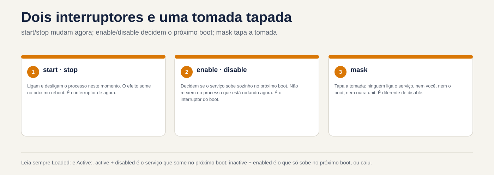
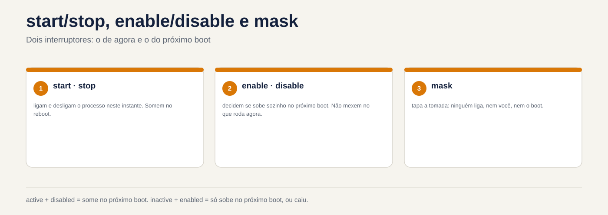

# Lezione 4.2 · systemd: servizi e unità

Nella 4.1 hai visto `systemd` raggiungere la fine dell'avvio. Oggi lo controlli: accendilo, spegnilo, impostalo per l'avvio, impediscigli di avviarsi e modifica il comportamento di un servizio senza toccare il file del pacchetto. Quasi tutte le chiamate al server passano da qui: "il servizio si è interrotto", "non è tornato dopo il riavvio", "devo modificare un parametro". Su Windows questo è `services.msc`; in Linux ci sono una mezza dozzina di comandi e due directory.

> **Formato core.** Essenziale per un'emergenza senza Internet e per il test a portata di mano. Il resto è elencato nella sezione 12, per l'inserimento in DeepTutor.

| File | lezione 4.2 |
| --- | --- |
| Modulo | M4 · Boot e systemd, lezione 2 di 4 |
| Quando | Settimana 8 |
| Alla fine puoi | Leggi `systemctl status` e separa lo stato attuale dallo stato all'avvio; avviare, arrestare, riavviare e ricaricare i servizi; abilitare, disabilitare e mascherare; scrivere un semplice file unitario; modificare un servizio con `systemctl edit` senza toccare il file del pacchetto; trovare la causa di un servizio che non rientra nei `status` e `journalctl -u` |
| Articoli di prova | LPIC-1 101.3 (`systemctl`, unità e destinazioni) · RHCSA (avvio, arresto e controllo dei servizi; configurazione dei servizi da caricare all'avvio) |
| Prerequisiti | lezione 4.1; lezione 3.5 (`vim` e `sudoedit`) |
| Tempo | Intorno all'1:30 |
| Istantanee | m4a2-start e m4a2-end in entrambe le VM |

## 1 · Riscaldamento

Tre domande, appena mi vengono in mente. La chiave di risposta viene visualizzata alla fine.

1. Indovina: qual è la differenza tra **interrompere** un servizio e **disabilitare** un servizio?
2. Hai modificato una riga nel file del servizio SSH, in `/usr/lib/systemd/system/`. La settimana successiva, dopo un aggiornamento, la modifica è scomparsa. Indovina: perché?
3. Hai interrotto e disabilitato un servizio e poche ore dopo è di nuovo in esecuzione. Indovina: chi ha chiamato?

## 2 · Perché è importante

| Il cosiddetto | La risposta sbagliata | Cosa succede |
| --- | --- | --- |
| "Ho riavviato il server e il servizio non si è attivato" | Ricomincia e chiudi il ticket | È stato avviato ma mai **abilitato**. Al riavvio successivo, la chiamata restituisce |
| "Ho modificato la configurazione del servizio e un aggiornamento è stato annullato" | Cambia di nuovo nello stesso posto | Il file in `/usr/lib/systemd/system` proviene dal pacchetto e il pacchetto lo riscrive. La modifica va in override, in `/etc`, con `systemctl edit` |
| "L'ho disabilitato ed è tornato da solo" | Disabilita nuovamente | Un'altra unità estrae questo servizio come dipendenza oppure un socket lo riattiva. Per vietare effettivamente, `mask` |
| "Funziona, ma non funziona" | Riavviare fino al successo | Il motivo è scritto: `systemctl status` mostra le ultime righe, e `journalctl -u` mostra tutto |

## 3 · Modello mentale

> Ogni servizio ha **due commutatori indipendenti**. Il primo è **da adesso**: `start` e `stop` attivano e disattivano il processo in questo momento e l'effetto scompare al riavvio. Il secondo è **boot**: `enable` e `disable` decidono se il servizio si attiverà da solo al prossimo avvio e non modificano il processo adesso. E c'è una terza cosa, che non è un interruttore: **`mask`** copre il socket, e nessuno accende il servizio, né tu, né il boot, né un'altra unità.

`systemctl status` mostra i due interruttori su linee separate:

```
● relogio.service - Relogio de teste (Aula 4.2)
     Loaded: loaded (/etc/systemd/system/relogio.service; enabled; preset: disabled)
     Active: active (running) since ...
```

| Linea | Cambia | Valori che vedrai |
| --- | --- | --- |
| `Loaded:` | Quello di avvio e da dove proviene il file | `enabled`, `disabled`, `static` (non c'è modo di attivarlo; un'altra unità lo tira), `masked` |
| `Active:` | Cosa è adesso | `active (running)`, `active (exited)` (corso e finito bene), `inactive (dead)`, `failed`, `activating` |

Leggi sempre entrambi. `active` con `disabled` è il servizio che scompare al prossimo riavvio. `inactive` con `enabled` è il servizio che verrà attivato solo al prossimo avvio o che è caduto.



*avvia/interrompi cambia ora; abilitare/disabilitare decidere il prossimo avvio; la maschera copre il socket.*

## 4 · Gli elementi essenziali

### Units

`systemd` si occupa delle **unità** e il suffisso del nome ne indica il tipo. Quelli che usi tutti i giorni:

- `.service`: un programma, come `sshd.service`.
- `.target`: un gruppo di unità con un nome, come `multi-user.target`.
- `.socket`: una porta o socket che attiva un servizio all'arrivo di una connessione.
- `.timer`: una pianificazione che attiva un servizio, come cron.
- `.mount`: un assieme; `systemd` ne genera uno per ogni riga di `/etc/fstab`.

Se non si scrive il suffisso, `systemctl` presuppone `.service`: `systemctl status sshd` è uguale a `systemctl status sshd.service`.

### Dove risiedono i file

| Elenco | Da chi viene | Priorità |
| --- | --- | --- |
| `/etc/systemd/system/` | Distinti saluti dall'amministratore | Tutti vincono |
| `/run/systemd/system/` | Generato in fase di esecuzione; scompare al riavvio | Media |
| `/usr/lib/systemd/system/` | Dal pacchetto. In Debian 12 appare anche come `/lib/systemd/system/`, che è lo stesso posto | La più bassa |

Regola pratica: **non modificare mai `/usr/lib`**. Quello che è tuo va in `/etc`. Un file con lo stesso nome in `/etc` sostituisce quello presente nell'intero pacchetto; una cartella `NOME.service.d/` in `/etc` con file `.conf` cambia solo le righe che scrivi e il resto continua a provenire dal pacchetto. Questo è un **override**, o drop-in.

### I comandi

```bash
systemctl status NOME          # i due interruttori e le ultime righe del log
sudo systemctl start NOME      # chiama adesso
sudo systemctl stop NOME       # riattacca adesso
sudo systemctl restart NOME    # si spegne e si riaccende: il processo è nuovo
sudo systemctl reload NOME     # rilegge la configurazione senza eliminarla, se il servizio lo sa
sudo systemctl enable NOME     # vai su per avviare
sudo systemctl disable NOME    # non viene visualizzato all'avvio
sudo systemctl enable --now NOME   # entrambe le cose contemporaneamente
sudo systemctl disable --now NOME  # il contrario
sudo systemctl mask NOME       # a nessuno importa
sudo systemctl unmask NOME     # togliti la maschera
systemctl is-active NOME       # solo quello per ora, buono per gli script
systemctl is-enabled NOME      # solo quello di avvio
sudo systemctl daemon-reload   # dopo aver creato o modificato un file unit
```

E per osservare l'intero sistema:

```bash
systemctl list-units --type=service              # quelli caricati adesso
systemctl list-unit-files --type=service         # tutto, con lo stato di avvio
systemctl --failed                               # quelli che hanno fallito
systemctl cat NOME                               # il file e le sostituzioni, insieme
systemd-delta                                    # tutto ciò che /etc cambia in relazione ai pacchetti
journalctl -u NOME                               # il registro solo per questo servizio
```

### Ciò che `enable` fa effettivamente

`enable` non accende nulla. Legge la sezione `[Install]` del file, ad esempio `WantedBy=multi-user.target`, e crea un collegamento in `/etc/systemd/system/multi-user.target.wants/`. All'avvio, `multi-user.target` carica tutto in quella cartella. `disable` cancella il collegamento. E `mask` crea un collegamento dal nome del servizio a `/dev/null`, in `/etc/systemd/system/`: poiché `/etc` conquista tutti, il servizio diventa un file vuoto, che non può essere avviato.

Un'unità senza sezione `[Install]` appare come `static`: non può essere attivata, perché sale solo quando un'altra unità fa schifo.

### Anatomia di un file di unità

```ini
[Unit]
Description=O que aparece no status
After=network-online.target    # ordine: inizia solo dopo questo
Wants=network-online.target    # dipendenza: trascina questo con te

[Service]
Type=simple                    # il processo ExecStart è il servizio
ExecStart=/usr/local/bin/programa --opcao
Restart=on-failure             # se cadi per errore, rialzati
User=nobody                    # funziona come questo utente

[Install]
WantedBy=multi-user.target     # dove abilita crea il collegamento
```

Il punto più confuso: **`After=` è solo ordine, e `Wants=` è solo dipendenza.** `After=` senza `Wants=` dice "se salgono due, salirò dopo", ma non fa salire l'altro. `Wants=` senza `After=` tira l'altro, ma salgono entrambi contemporaneamente. Li vuoi quasi sempre entrambi insieme. `Requires=` è un `Wants=` più forte: se l'altro fallisce, anche questo si ferma.

### Sostituisci con `systemctl edit`

```bash
sudo systemctl edit NOME
```

Aprire un editor con un file vuoto, che diventa `/etc/systemd/system/NOME.service.d/override.conf`. Scrivi solo quello che cambia, con l'intestazione della sezione, e quando salvi `systemctl` fai già `daemon-reload`. Manca solo `restart`. `systemctl cat NOME` mostra uno dopo l'altro il file del pacchetto e l'override. Per annullare tutto in un pacchetto di servizi, `sudo systemctl revert NOME`.

Due regole:

- Righe che possono apparire più volte, come `ExecStart=`, **somma**. Per modificare `ExecStart`, reimpostarlo prima su una riga `ExecStart=` vuota, quindi scrivere quella nuova. È l'interruzione della sezione 6.
- L'editor è la variabile `SYSTEMD_EDITOR`, o `EDITOR`. In Debian di solito si apre `nano`: Ctrl+O, Invio e Ctrl+X salva ed esci. Per utilizzare `vim`: `sudo SYSTEMD_EDITOR=vim systemctl edit NOME`.

### Rocky × Debian

|  | Roccioso | Debian |
| --- | --- | --- |
| File del pacchetto | `/usr/lib/systemd/system/` | `/lib/systemd/system/`, uguale a `/usr/lib/systemd/system/` |
| Nome servizio SSH | `sshd` | `ssh` |
| Nuovo servizio appena installato | Resta fermo e disabilitato: fai `enable --now` | In generale, si avvia già ed è abilitato nell'installazione |
| `systemctl edit` Redattore | Di solito è `vi` | Di solito è `nano` |

La terza riga attira molte persone: su Rocky, a `dnf install` non interessa affatto. Nel test RHCSA, un servizio installato e non abilitato è un punto perso nel riavvio eseguito dal broker.

### Cosa è incluso nel test

Nel RHCSA: avviare, arrestare e controllare i servizi e lasciarli abilitati all'avvio. Il correttore riavvia la macchina prima della correzione, quindi tutto ciò che hai appena avviato, senza abilitare, conta come non fatto. In LPIC-1 101.3: i comandi `systemctl`, cosa sono un'unità e un target e dove si trovano i file.

## 5 · Laboratorio guidato

Eseguire ogni passaggio su entrambe le VM. Dove cambia il nome, il passo mostra entrambi.

### Passo 0 · Istantanea e cartella

Sul nodo Proxmox:

```bash
qm snapshot 201 m4a2-inicio
qm snapshot 202 m4a2-inicio
```

Sulle due VM:

```bash
mkdir -p ~/lab42 && cd ~/lab42
```

### Passo 1 · Leggere un servizio già esistente

```bash
# Rocky
systemctl status sshd
# Debian
systemctl status ssh
```

Trova le due righe nella sezione 3: `Loaded:`, con il file e `enabled`, e `Active:`, con `running`. Dopo:

```bash
# troque sshd por ssh na Debian
systemctl is-active sshd
systemctl is-enabled sshd
systemctl cat sshd
systemctl list-unit-files --type=service --state=enabled
systemd-delta
```

`cat` mostra da dove proviene il file, sulla prima riga, con un `#`. `systemd-delta` elenca ciò che `/etc` già cambia nei pacchetti: in una nuova VM l'elenco è breve. Salva il suo output, perché alla fine del lab mostrerà cosa hai modificato.

### Passaggio 2 · Crea un servizio

```bash
sudoedit /etc/systemd/system/relogio.service
```

```ini
[Unit]
Description=Relogio de teste (Aula 4.2)

[Service]
Type=simple
Environment=MSG=tique
ExecStart=/bin/bash -c 'while true; do echo $MSG; sleep 10; done'

[Install]
WantedBy=multi-user.target
```

```bash
sudo systemctl daemon-reload
systemctl status relogio
sudo systemctl start relogio
systemctl status relogio
journalctl -u relogio -f
```

Il primo `status` mostra `inactive (dead)` e `disabled`. Dopo `start`, `active (running)`, ancora `disabled`. `journalctl -f` mostra un `tique` ogni 10 secondi. Esci con Ctrl+C: chiude `journalctl`, non il servizio.

**Decidi 1.** `relogio` è in esecuzione ed è `disabled`. Verifica: dopo il riavvio, sarà

- a) in esecuzione
- b) arrestato
- c) mascherato

```bash
sudo systemctl reboot
```

Dopo aver effettuato nuovamente l'accesso:

```bash
systemctl status relogio
```

| Se hai selezionato | Risultato | Perché |
| --- | --- | --- |
| a | Sbagliato | `start` ora sposta solo l'interruttore. Nessuno gli ha chiesto di salire sullo stivale |
| b | Capito bene | `inactive (dead)`, `disabled`. Si chiama prima riga della sezione 2 |
| c| Sbagliato | Il mascheramento avviene solo se qualcuno lo richiede con `mask` |

**Per risolvere:** `start` è valido fino al riavvio; `enable` è valido dal prossimo avvio. Nel test e nella vita, esegui entrambe le operazioni: `enable --now`.

### Passaggio 3 · Abilita, vedi il collegamento e maschera

```bash
sudo systemctl enable --now relogio
ls -l /etc/systemd/system/multi-user.target.wants/ | grep relogio
systemctl list-dependencies --reverse relogio
```

`enable` ha risposto a `Created symlink ...` e `ls` mostra il collegamento al tuo file. `list-dependencies --reverse` mostra chi tira `relogio`: `multi-user.target`.

**Decidi 2.** Seleziona: `sudo systemctl mask relogio` volontà

- a) maschera e `start` inizia a rifiutare
- b) dà errore
- c) cancella il file `relogio.service`

```bash
sudo systemctl mask relogio
```

| Se hai selezionato | Risultato | Perché |
| --- | --- | --- |
| a | Sbagliato | Sarebbe così con un servizio a pacchetto |
| b | Capito bene | Qualcosa come `Failed to mask unit: File /etc/systemd/system/relogio.service already exists`. `mask` crea un collegamento con il nome del servizio **in `/etc`**, e il tuo file è già lì con quel nome |
| c| Sbagliato | `systemctl` non elimina mai il file da mascherare |

**Per risolvere:** `mask` è per i servizi a pacchetto, quelli che risiedono in `/usr/lib`. Per il tuo servizio, in `/etc`, è sufficiente disabilitare e arrestare.

Ora maschera un servizio di pacchetto che esiste in entrambe le distribuzioni e che è sempre disattivato: `debug-shell.service`.

> **Non avviare `debug-shell`.** Apre una shell di root, senza password, nel terminale 9 della console. Esiste per eseguire il debug del boot e per questo motivo è un buon candidato per essere mascherato.

```bash
sudo systemctl mask debug-shell
ls -l /etc/systemd/system/debug-shell.service
systemctl is-enabled debug-shell
sudo systemctl start debug-shell
sudo systemctl unmask debug-shell
systemctl is-enabled debug-shell
```

`ls` mostra il collegamento a `/dev/null`, `is-enabled` risponde a `masked` e `start` rifiuta con `Unit debug-shell.service is masked`. Dopo il `unmask` si ritorna al `disabled`. Questo è ciò che ha fatto `mask`, ed è per questo che `start` ha rifiutato senza mai eseguire il servizio.

### Passo 4 · Modificare il servizio con un override

```bash
sudo systemctl edit relogio
```

Nell'editor, scrivere solo questo, nello spazio indicato dai commenti del file:

```ini
[Service]
Environment=MSG=taque
```

Salva ed esci. Quindi:

```bash
ls /etc/systemd/system/relogio.service.d/
systemctl cat relogio
sudo systemctl restart relogio
journalctl -u relogio -n 5
systemd-delta
```

`cat` mostra entrambi i file, l'originale e `override.conf`. Dopo `restart` il log comincia a dire `taque`: la seconda riga `Environment=MSG=` batte la prima. E `systemd-delta` ora elenca il suo override, contrassegnato come `[EXTENDED]`.

## 6 · Break and fix

**The break:** cambia il comando di servizio in override, nel modo che sembra ovvio.


*attivo + disabilitato scompare all'avvio successivo; inattivo + abilitato va solo lassù, o lasciato cadere.*


```bash
sudo systemctl edit relogio
```

Lascia l'override in questo modo:

```ini
[Service]
Environment=MSG=taque
ExecStart=/bin/bash -c 'while true; do echo novo; sleep 5; done'
```

```bash
sudo systemctl restart relogio
```

**La diagnosi.** `restart` rifiuta, con qualcosa come `Unit relogio.service has a bad unit file setting`. Cercare il motivo:

```bash
systemctl status relogio
journalctl -u relogio -n 20
```

Il motivo è scritto: `Service has more than one ExecStart= setting, which is only allowed for Type=oneshot services. Refusing.` Il `ExecStart` dell'override **aggiunto** a quello nel file originale, e un servizio `simple` ne accetta solo uno.

**La correzione.** Aprire nuovamente l'override e reimpostare il `ExecStart` prima di scrivere quello nuovo:

```ini
[Service]
Environment=MSG=taque
ExecStart=
ExecStart=/bin/bash -c 'while true; do echo novo; sleep 5; done'
```

```bash
sudo systemctl restart relogio
journalctl -u relogio -n 5
```

Ora `novo` appare ogni 5 secondi.

**La lezione.** Quando un servizio non va su, non indovinare: `systemctl status` e `journalctl -u` quasi sempre spiegano la causa. E in un override, le righe che possono essere ripetute si sommano; per modificarne uno, è necessario prima reimpostarlo.

## 7 · Trappole

- **`start` senza `enable`.** Funziona fino al prossimo riavvio. In RHCSA, il broker riavvia la macchina prima di applicare la patch.
- **Modifica il file in `/usr/lib/systemd/system/`.** Il successivo aggiornamento del pacchetto lo annulla. Usa `systemctl edit`.
- **Dimentica `daemon-reload` dopo aver modificato manualmente un file di unità.** `systemd` continua a utilizzare la vecchia versione e avvisa. `systemctl edit` si ricarica già.
- **Cambia `ExecStart=` in un override senza prima reimpostarlo.** Questa è un'interruzione nella sezione 6.
- **`After=` pensando che attiri l'altro servizio.** `After=` è solo ordine; La persona che tira è `Wants=` o `Requires=`.
- **`disable` pensa che fosse vietato.** Un'altra unità, o una presa, possono comunque collegare il servizio. Per disabilitarlo, `mask`.
- **Riavvia SSH remoto con una configurazione interrotta.** Le sessioni aperte sopravvivono, ma non se ne aggiunge nessuna nuova. Prima di `restart`, prova con `sudo sshd -t`, che non risponde affatto quando tutto va bene.
- **`sshd` in Debian.** Lì il servizio è `ssh`.

## 8 · Quiz

Rispondi senza guardare le sezioni precedenti.

1. `systemctl status` mostra `Loaded: ... disabled` e `Active: active (running)`. Cosa succede al prossimo riavvio e con quale comando risolvi il problema?
2. Quale file crea `enable` e dove per un servizio con `WantedBy=multi-user.target`?
3. È necessario un servizio pacchetto da eseguire come un altro utente. Dove e come apportare la modifica in modo che sopravviva agli aggiornamenti?
4. Qual è la differenza tra `disable` e `mask`?
5. Un servizio ha `After=postgresql.service`, ma PostgreSQL non si avvia con esso. Perché?
6. *Quale singolo comando fa avviare un servizio all'avvio e lo avvia anche immediatamente?*

## 9 · Cola

### Da conoscere a memoria

```bash
systemctl status NOME
sudo systemctl enable --now NOME
sudo systemctl disable --now NOME
sudo systemctl restart NOME
sudo systemctl mask NOME
sudo systemctl edit NOME
sudo systemctl daemon-reload
journalctl -u NOME
systemctl --failed
```

E le tre idee: due interruttori (ora e avvio) e una maschera; `/etc` batte `/usr/lib`; in caso di override, la riga ripetibile viene reimpostata per prima.

### Per consultare

| A | Comando |
| --- | --- |
| Visualizza il file e sovrascrive insieme | `systemctl cat NOME` |
| Vedi tutto `/etc` modifiche nei pacchetti | `systemd-delta` |
| Annulla le sostituzioni da un servizio di pacchetto | `sudo systemctl revert NOME` |
| Elenco servizi abilitati | `systemctl list-unit-files --type=service --state=enabled` |
| Guarda chi tira un servizio | `systemctl list-dependencies --reverse NOME` |
| Copiare l'intero file in `/etc` e modificare | `sudo systemctl edit --full NOME` |
| Testare la configurazione SSH prima di riavviare | `sudo sshd -t` |

### Flashcards

- `start` e `enable`: quale è valida all'avvio? → `enable`.
- Dove va il tuo? → `/etc/systemd/system/`.
- Cosa crea `mask`? → Un collegamento dal nome del servizio a `/dev/null`, in `/etc/systemd/system/`.
- `static` vuoi dire? → Senza sezione `[Install]`: non è possibile abilitarla, un'altra unità la tira.
- `After=` tira l'altro servizio? → No, definisce solo l'ordine.
- Come modificare `ExecStart` in un override? → `ExecStart=` vuoto, poi quello nuovo.
- Il servizio non va: dov'è il motivo? → `systemctl status` e `journalctl -u`.

## 10 · Checklist di uscita

- [ ] Ho letto `status` e dico adesso lo stato e lo stato del boot.
- [ ] Ho creato `relogio.service`, ho visto che `start` non sopravvive al riavvio e l'ho abilitato con `enable --now`.
- [ ] Ho visto il collegamento in `multi-user.target.wants` e ho capito perché `mask` di `relogio` ha dato un errore.
- [ ] Ho mascherato e smascherato `debug-shell` senza avviarlo.
- [ ] Ho cambiato servizio con `systemctl edit` e ho visto l'override in `systemctl cat` e in `systemd-delta`.
- [ ] Ho trovato la causa dell'interruzione in `status` e `journalctl -u` e l'ho risolto reimpostando `ExecStart`.

**Ultimo esercizio, senza guardare.** Senza consultare la lezione, creare su entrambe le VM un servizio `eco.service` che scriva `eco` nel log ogni 30 secondi, abilitarlo e accenderlo con un solo comando, verificare con `journalctl -u eco`. Quindi modificare il messaggio in `ola` con un override.

**Cleanup.** Rimuovere i due servizi di test:

```bash
sudo systemctl disable --now relogio eco
sudo rm -r /etc/systemd/system/relogio.service.d /etc/systemd/system/eco.service.d
sudo rm /etc/systemd/system/relogio.service /etc/systemd/system/eco.service
sudo systemctl daemon-reload
```

**Riavvia e conferenza.** Riavviare entrambe le VM e verificare:

```bash
systemctl status relogio
systemctl is-enabled debug-shell
systemd-delta
systemctl is-system-running
```

`relogio` non esiste più; `debug-shell` è `disabled`, non `masked`; `systemd-delta` ritorna alla lista del Passo 1; il sistema è `running`, o `degraded` con lo stesso motivo che avevi già notato in 4.1.

**Istantanea della fine,** sul nodo Proxmox:

```bash
qm snapshot 201 m4a2-fim
qm snapshot 202 m4a2-fim
```

## 11 · Nella vita reale

**Missione, sola lettura.** Su un vero server Linux a cui rispondi, esegui semplicemente:

```bash
systemctl --failed
systemctl list-unit-files --type=service --state=enabled
systemd-delta
```

Non cambiare nulla. `systemd-delta` è il più rivelatore: mostra tutto ciò che qualcuno ha cambiato nei servizi di quel server, comprese cose che nessuno ha documentato. Annota ciò che non sapevi esistesse.

**Diario.** Annota: quanti servizi abilitati ha il real server; cosa ha mostrato `systemd-delta`; e, secondo le tue parole, la differenza tra `disable` e `mask`.

**Domani, senza guardare:**

1. Quale comando abilita e accende contemporaneamente?
2. Dov'è il file creato da `systemctl edit`?
3. Perché un override con `ExecStart=` può interrompere il servizio?

## 12 · Approfondisci quando vuoi

- **Gli altri `Type=`**: `forking`, `oneshot` con `RemainAfterExit=`, `notify`, e quando ognuno ha ragione.
- **`Restart=` e i limiti**: `RestartSec=`, `StartLimitBurst=`, e perché un servizio che cade in un loop finisce arrestato.
- **Socket e timer**: come un `.socket` attiva un servizio e `.timer` come alternativa a cron. I timer ritornano nel modulo di pianificazione.
- **Unità modello**: il `@` in nomi come `getty@tty1.service`.
- **Unità utente**: `systemctl --user`, senza root.
- **Preimpostazioni**: `systemctl preset` e perché Rocky lascia i nuovi servizi disattivati.
- **Rafforzare un servizio**: `ProtectSystem=`, `PrivateTmp=` e `systemd-analyze security`.

In DeepTutor:

- `!explica a diferença entre Wants, Requires e After`
- `!feynman o que o systemctl enable faz no disco`
- `!quiz RHCSA serviços systemd, 5 perguntas`

## Foglio risposte commentato

### Riscaldamento

1. **Stop** si disattiva adesso e al prossimo avvio il servizio potrebbe ritornare. **Disabilitare** rimuove il servizio dall'avvio, ma non disattiva ciò che è in esecuzione. Questi sono i due interruttori.
2. `/usr/lib/systemd/system/` proviene dalla confezione. L'aggiornamento ha portato il nuovo file e ha sovrascritto il tuo. La modifica va in override nel `/etc`, con `systemctl edit`.
3. Un'altra unità che dipende da lui, oppure un `.socket` che lo sveglia quando arriva una connessione. `disable` rimuove solo il collegamento di avvio. Per vietare effettivamente, `mask`.

### Quiz

1. Non sale al prossimo avvio. `sudo systemctl enable NOME`; oppure, se è stato interrotto, `enable --now`.
2. Un collegamento in `/etc/systemd/system/multi-user.target.wants/`, con il nome del servizio, che punta al file unit.
3. In override: `sudo systemctl edit NOME`, con `[Service]` e `User=OUTRO` e poi `restart`. Il file va a `/etc/systemd/system/NOME.service.d/override.conf`, che l'aggiornamento non tocca.
4. `disable` toglie il servizio dal bagagliaio, ma tu, un'altra unità o una presa potete comunque attivarlo. `mask` indirizza il servizio a `/dev/null` e nessuno può attivarlo fino a `unmask`.
5. `After=` definisce solo l'ordine: se salgono entrambi, dopo va questo. Per portare PostgreSQL con sé, è necessario `Wants=postgresql.service` o `Requires=postgresql.service` oppure abilitare PostgreSQL.
6. `systemctl enable --now NOME`.

---

<!-- navegacao -->
[← Lezione 4.1 · Come si accende Linux](4.1-como-o-linux-liga.md) · [Indice lezione](../01-aulas.md) · [Lezione 4.3 · Obiettivi, spegnimento e riavvio →](4.3-targets-desligar-e-reiniciar.md)
