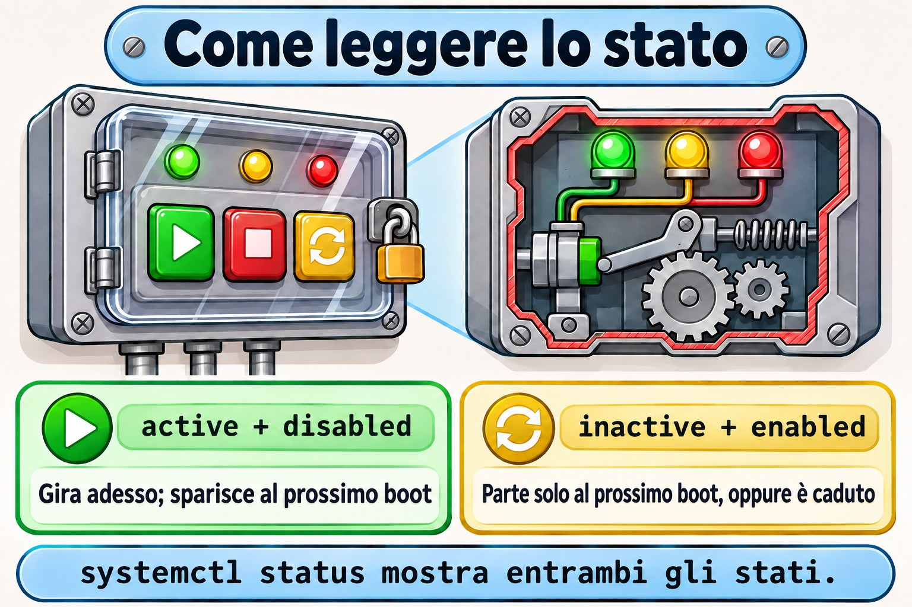

# Lezione 4.2 · systemd: servizi e unit

Nella 4.1 hai visto `systemd` arrivare alla fine del boot. Oggi sei tu a comandare lui: lo accendi, lo spegni, lo fai partire al boot, gli vieti di partire, e cambi il comportamento di un servizio senza toccare il file del pacchetto. Quasi ogni richiesta su un server passa da qui: "il servizio è caduto", "non è tornato dopo il reboot", "devo cambiare un parametro". In Windows questo è `services.msc`; in Linux sono una mezza dozzina di comandi e due directory.

> **Formato nucleo.** L'essenziale per un'emergenza senza internet, a mano. Il resto è elencato nella sezione 12, da tirare fuori con DeepTutor.

| Scheda | Lezione 4.2 |
| --- | --- |
| Modulo | M4 · Boot e systemd, lezione 2 di 4 |
| Quando | Settimana 8 |
| Alla fine sei in grado di | Leggere `systemctl status` e separare lo stato di adesso dallo stato al boot; avviare, fermare, riavviare e ricaricare servizi; abilitare, disabilitare e mascherare; scrivere un semplice file di unit; cambiare un servizio con `systemctl edit` senza toccare il file del pacchetto; trovare la causa di un servizio che non parte con `status` e `journalctl -u` |
| Prerequisiti | Lezione 4.1; Lezione 3.5 (`vim` e `sudoedit`) |
| Durata | Circa 1h30 |
| Snapshot | m4a2-inicio e m4a2-fim su entrambe le VM |

## 1 · Riscaldamento

Tre domande, a mente. Le soluzioni le controllano alla fine.

1. Indovina: qual è la differenza tra **fermare** un servizio e **disabilitare** un servizio?
2. Hai cambiato una riga nel file del servizio SSH, in `/usr/lib/systemd/system/`. La settimana dopo, a seguito di un aggiornamento, la modifica è sparita. Indovina: perché?
3. Hai fermato e disabilitato un servizio, e qualche ora dopo è di nuovo in esecuzione. Indovina: chi l'ha acceso?

## 2 · Perché conta

| La richiesta | La risposta sbagliata | Cosa provoca |
| --- | --- | --- |
| "Ho riavviato il server e il servizio non è partito" | Avviarlo di nuovo e chiudere la richiesta | È stato avviato, ma non è mai stato **abilitato**. Al prossimo reboot, la richiesta torna |
| "Ho cambiato la configurazione del servizio e un aggiornamento l'ha annullata" | Cambiare di nuovo nello stesso posto | Il file in `/usr/lib/systemd/system` è del pacchetto, e il pacchetto lo riscrive. La modifica va in un override, in `/etc`, con `systemctl edit` |
| "L'ho disabilitato ed è tornato da solo" | Disabilitare di nuovo | Un'altra unit tira dentro quel servizio come dipendenza, oppure un socket lo risveglia. Per vietarlo davvero, `mask` |
| "Sta girando, ma non funziona" | Riavviare finché non va | Il motivo è scritto: `systemctl status` mostra le ultime righe, e `journalctl -u` le mostra tutte |

## 3 · Modello mentale

> Ogni servizio ha **due interruttori indipendenti**. Il primo è quello **di adesso**: `start` e `stop` accendono e spengono il processo in questo momento, e l'effetto sparisce al reboot. Il secondo è quello **del boot**: `enable` e `disable` decidono se il servizio parte da solo al prossimo boot, e non toccano il processo di adesso. E c'è una terza cosa, che non è un interruttore: il **`mask`** stacca la spina, e nessuno accende il servizio, né tu, né il boot, né un'altra unit.

`systemctl status` mostra i due interruttori in righe separate:

```
● relogio.service - Relogio de teste (Aula 4.2)
     Loaded: loaded (/etc/systemd/system/relogio.service; enabled; preset: disabled)
     Active: active (running) since ...
```

| Riga | Interruttore | Valori che vedrai |
| --- | --- | --- |
| `Loaded:` | Quello del boot, e da dove viene il file | `enabled`, `disabled`, `static` (non si può abilitare; un'altra unit lo tira dentro), `masked` |
| `Active:` | Quello di adesso | `active (running)`, `active (exited)` (è girato ed è finito bene), `inactive (dead)`, `failed`, `activating` |

Leggi sempre entrambe. `active` con `disabled` è il servizio che sparisce al prossimo reboot. `inactive` con `enabled` è il servizio che partirà solo al prossimo boot, oppure che è caduto.


*start/stop cambiano adesso; enable/disable decidono il prossimo boot; mask stacca la spina.*

## 4 · L'essenziale

### Unit

`systemd` gestisce le **unit**, e il suffisso del nome dice il tipo. Quelle che usi ogni giorno:

- `.service`: un programma, come `sshd.service`.
- `.target`: un gruppo di unit con un nome, come `multi-user.target`.
- `.socket`: una porta o un socket che risveglia un servizio quando arriva una connessione.
- `.timer`: una pianificazione che risveglia un servizio, come cron.
- `.mount`: un mount; `systemd` ne genera uno per ogni riga di `/etc/fstab`.

Se non scrivi il suffisso, `systemctl` presume `.service`: `systemctl status sshd` è lo stesso di `systemctl status sshd.service`.

### Dove vivono i file

| Directory | Di chi è | Priorità |
| --- | --- | --- |
| `/etc/systemd/system/` | Tuo, dell'amministratore | Vince su tutti |
| `/run/systemd/system/` | Generato a runtime; sparisce al reboot | Media |
| `/usr/lib/systemd/system/` | Del pacchetto. Su Debian 12 compare anche come `/lib/systemd/system/`, che è lo stesso posto | La più bassa |

La regola pratica: **non modifichi mai `/usr/lib`**. Ciò che è tuo va in `/etc`. Un file con lo stesso nome in `/etc` sostituisce per intero quello del pacchetto; una cartella `NOME.service.d/` in `/etc` con file `.conf` cambia solo le righe che scrivi, e il resto continua a venire dal pacchetto. Questo è un **override**, o drop-in.

### I comandi

```bash
systemctl status NOME          # i due interruttori e le ultime righe del log
sudo systemctl start NOME      # accende adesso
sudo systemctl stop NOME       # spegne adesso
sudo systemctl restart NOME    # spegne e accende: il processo è nuovo
sudo systemctl reload NOME     # rilegge la configurazione senza abbattere, se il servizio lo sa fare
sudo systemctl enable NOME     # parte al boot
sudo systemctl disable NOME    # non parte al boot
sudo systemctl enable --now NOME   # le due cose insieme
sudo systemctl disable --now NOME  # il contrario
sudo systemctl mask NOME       # nessuno lo accende
sudo systemctl unmask NOME     # toglie il mask
systemctl is-active NOME       # solo quello di adesso, utile per gli script
systemctl is-enabled NOME      # solo quello del boot
sudo systemctl daemon-reload   # dopo aver creato o cambiato un file di unit
```

E per guardare l'intero sistema:

```bash
systemctl list-units --type=service              # quelle caricate adesso
systemctl list-unit-files --type=service         # tutte, con lo stato del boot
systemctl --failed                               # quelle fallite
systemctl cat NOME                               # il file e gli override, insieme
systemd-delta                                    # tutto ciò che /etc cambia rispetto ai pacchetti
journalctl -u NOME                               # il log solo di quel servizio
```

### Cosa fa davvero `enable`

`enable` non accende niente. Legge la sezione `[Install]` del file, per esempio `WantedBy=multi-user.target`, e crea un link in `/etc/systemd/system/multi-user.target.wants/`. Al boot, `multi-user.target` avvia tutto ciò che sta in quella cartella. `disable` cancella il link. E `mask` crea un link dal nome del servizio a `/dev/null`, in `/etc/systemd/system/`: siccome `/etc` vince su tutti, il servizio diventa un file vuoto, che non si può avviare.

Una unit senza sezione `[Install]` compare come `static`: non si può abilitare, perché parte solo quando un'altra unit la tira dentro.

### Anatomia di un file di unit

```ini
[Unit]
Description=O que aparece no status
After=network-online.target    # ordine: parte solo dopo questo
Wants=network-online.target    # dipendenza: tira dentro anche questo

[Service]
Type=simple                    # il processo di ExecStart è il servizio
ExecStart=/usr/local/bin/programa --opcao
Restart=on-failure             # se cade con errore, riparte
User=nobody                    # gira come questo utente

[Install]
WantedBy=multi-user.target     # dove enable crea il link
```

Il punto che confonde di più: **`After=` è solo ordine, e `Wants=` è solo dipendenza.** `After=` senza `Wants=` dice "se partono entrambi, io vado dopo", ma non fa partire l'altro. `Wants=` senza `After=` tira dentro l'altro, ma partono insieme. Quasi sempre vuoi entrambi insieme. `Requires=` è un `Wants=` più forte: se l'altro fallisce, si ferma anche questo.

### Override con `systemctl edit`

```bash
sudo systemctl edit NOME
```

Apre un editor con un file vuoto, che diventa `/etc/systemd/system/NOME.service.d/override.conf`. Scrivi solo ciò che cambia, con l'intestazione della sezione, e al salvataggio `systemctl` fa già il `daemon-reload`. Manca solo il `restart`. `systemctl cat NOME` mostra il file del pacchetto e l'override, uno dopo l'altro. Per annullare tutto su un servizio di pacchetto, `sudo systemctl revert NOME`.

Due regole:

- Le righe che possono comparire più volte, come `ExecStart=`, **si sommano**. Per sostituire `ExecStart`, prima lo azzeri con una riga `ExecStart=` vuota, e poi scrivi il nuovo. È il guasto della sezione 6.
- L'editor è quello della variabile `SYSTEMD_EDITOR`, o `EDITOR`. Su Debian di solito apre `nano`: Ctrl+O, Invio e Ctrl+X salvano ed escono. Per usare `vim`: `sudo SYSTEMD_EDITOR=vim systemctl edit NOME`.

### Rocky × Debian

|  | Rocky | Debian |
| --- | --- | --- |
| File dei pacchetti | `/usr/lib/systemd/system/` | `/lib/systemd/system/`, lo stesso di `/usr/lib/systemd/system/` |
| Nome del servizio SSH | `sshd` | `ssh` |
| Servizio nuovo, appena installato | Resta fermo e disabilitato: fai tu `enable --now` | In genere parte già e resta abilitato all'installazione |
| Editor di `systemctl edit` | Di solito `vi` | Di solito `nano` |

La terza riga frega molta gente: su Rocky, `dnf install` non accende niente. Un servizio installato e non abilitato sparisce al primo reboot, e il cliente se ne accorge.

## 5 · Lab guidato

Fai ogni passo su entrambe le VM. Dove il nome cambia, il passo mostra entrambi.

### Passo 0 · Snapshot e cartella

Sul nodo Proxmox:

```bash
qm snapshot 201 m4a2-inicio
qm snapshot 202 m4a2-inicio
```

Su entrambe le VM:

```bash
mkdir -p ~/lab42 && cd ~/lab42
```

### Passo 1 · Leggere un servizio che esiste già

```bash
# Rocky
systemctl status sshd
# Debian
systemctl status ssh
```

Trova le due righe della sezione 3: `Loaded:`, con il file e `enabled`, e `Active:`, con `running`. Poi:

```bash
# sostituisci sshd con ssh su Debian
systemctl is-active sshd
systemctl is-enabled sshd
systemctl cat sshd
systemctl list-unit-files --type=service --state=enabled
systemd-delta
```

`cat` mostra da dove viene il file, nella prima riga, con un `#`. `systemd-delta` elenca ciò che `/etc` cambia già nei pacchetti: su una VM nuova, l'elenco è corto. Conserva il suo output, perché alla fine del lab ti mostrerà cosa hai cambiato.

### Passo 2 · Creare un servizio

```bash
sudoedit /etc/systemd/system/relogio.service
```

```ini
[Unit]
Description=Relogio de teste (Aula 4.2)

[Service]
Type=simple
Environment=MSG=tique
ExecStart=/bin/bash -c 'while true; do echo $MSG; sleep 10; done'

[Install]
WantedBy=multi-user.target
```

```bash
sudo systemctl daemon-reload
systemctl status relogio
sudo systemctl start relogio
systemctl status relogio
journalctl -u relogio -f
```

Il primo `status` mostra `inactive (dead)` e `disabled`. Dopo `start`, `active (running)`, ancora `disabled`. `journalctl -f` mostra un `tique` ogni 10 secondi. Esci con Ctrl+C: questo chiude `journalctl`, non il servizio.

**Decidi 1.** `relogio` è in esecuzione ed è `disabled`. Scegli: dopo un reboot, sarà

- a) in esecuzione
- b) fermo
- c) mascherato

```bash
sudo systemctl reboot
```

Dopo essere rientrato:

```bash
systemctl status relogio
```

| Se hai scelto | Risultato | Perché |
| --- | --- | --- |
| a | Sbagliato | `start` tocca solo l'interruttore di adesso. Nessuno ha chiesto che partisse al boot |
| b | Giusto | `inactive (dead)`, `disabled`. È la richiesta della prima riga della sezione 2 |
| c | Sbagliato | Mascherare succede solo se qualcuno lo chiede con `mask` |

**Da ricordare:** `start` vale fino al reboot; `enable` vale dal prossimo boot. Fai entrambi: `enable --now`.

### Passo 3 · Abilitare, vedere il link, e mascherare

```bash
sudo systemctl enable --now relogio
ls -l /etc/systemd/system/multi-user.target.wants/ | grep relogio
systemctl list-dependencies --reverse relogio
```

`enable` ha risposto `Created symlink ...`, e `ls` mostra il link al tuo file. `list-dependencies --reverse` mostra chi tira dentro `relogio`: `multi-user.target`.

**Decidi 2.** Scegli: `sudo systemctl mask relogio` farà

- a) mascherare, e `start` comincerà a rifiutare
- b) dare errore
- c) cancellare il file `relogio.service`

```bash
sudo systemctl mask relogio
```

| Se hai scelto | Risultato | Perché |
| --- | --- | --- |
| a | Sbagliato | Sarebbe così con un servizio di pacchetto |
| b | Giusto | Qualcosa come `Failed to mask unit: File /etc/systemd/system/relogio.service already exists`. `mask` crea un link con il nome del servizio **in `/etc`**, e il tuo file è già lì con quel nome |
| c | Sbagliato | `systemctl` non cancella mai il tuo file per mascherare |

**Da ricordare:** `mask` serve per i servizi di pacchetto, quelli che vivono in `/usr/lib`. Per un servizio tuo, in `/etc`, disabilitare e fermare basta già.

Ora maschera un servizio di pacchetto che esiste su entrambe le distro e resta sempre spento: `debug-shell.service`.

> **Non avviare `debug-shell`.** Apre una shell di root, senza password, sul terminale 9 della console. Esiste per fare il debug del boot, e proprio per questo è un buon candidato a restare mascherato.

```bash
sudo systemctl mask debug-shell
ls -l /etc/systemd/system/debug-shell.service
systemctl is-enabled debug-shell
sudo systemctl start debug-shell
sudo systemctl unmask debug-shell
systemctl is-enabled debug-shell
```

`ls` mostra il link a `/dev/null`, `is-enabled` risponde `masked`, e `start` rifiuta con `Unit debug-shell.service is masked`. Dopo `unmask`, torna a `disabled`. Era questo che faceva `mask`, e per questo `start` ha rifiutato senza mai eseguire il servizio.

### Passo 4 · Cambiare il servizio con un override

```bash
sudo systemctl edit relogio
```

Nell'editor, scrivi solo questo, nello spazio indicato dai commenti del file:

```ini
[Service]
Environment=MSG=taque
```

Salva ed esci. Poi:

```bash
ls /etc/systemd/system/relogio.service.d/
systemctl cat relogio
sudo systemctl restart relogio
journalctl -u relogio -n 5
systemd-delta
```

`cat` mostra i due file, l'originale e `override.conf`. Dopo `restart`, il log comincia a dire `taque`: la seconda riga `Environment=MSG=` ha vinto sulla prima. E `systemd-delta` ora elenca il tuo override, segnato come `[EXTENDED]`.

## 6 · Rompi e ripara

**Il guasto:** sostituire il comando del servizio con l'override, nel modo che sembra ovvio.


*active + disabled sparisce al prossimo boot; inactive + enabled parte solo lì, oppure è caduto.*


```bash
sudo systemctl edit relogio
```

Lascia l'override così:

```ini
[Service]
Environment=MSG=taque
ExecStart=/bin/bash -c 'while true; do echo novo; sleep 5; done'
```

```bash
sudo systemctl restart relogio
```

**La diagnosi.** `restart` rifiuta, con qualcosa come `Unit relogio.service has a bad unit file setting`. Cerca il motivo:

```bash
systemctl status relogio
journalctl -u relogio -n 20
```

Il motivo è scritto: `Service has more than one ExecStart= setting, which is only allowed for Type=oneshot services. Refusing.` L'`ExecStart` dell'override si è **sommato** a quello del file originale, e un servizio `simple` ne accetta solo uno.

**La riparazione.** Riapri l'override e azzera `ExecStart` prima di scrivere il nuovo:

```ini
[Service]
Environment=MSG=taque
ExecStart=
ExecStart=/bin/bash -c 'while true; do echo novo; sleep 5; done'
```

```bash
sudo systemctl restart relogio
journalctl -u relogio -n 5
```

Ora compare `novo` ogni 5 secondi.

**La lezione.** Quando un servizio non parte, non tirare a indovinare: `systemctl status` e `journalctl -u` quasi sempre dicono la causa a chiare lettere. E in un override, le righe che possono ripetersi si sommano; per sostituirne una, prima azzeri.

## 7 · Trappole

- **`start` senza `enable`.** Funziona fino al prossimo reboot. Il primo reboot, di manutenzione o per un calo di corrente, rivela l'errore.
- **Modificare il file in `/usr/lib/systemd/system/`.** Il prossimo aggiornamento del pacchetto lo annulla. Usa `systemctl edit`.
- **Dimenticare `daemon-reload` dopo aver modificato a mano un file di unit.** `systemd` continua a usare la versione vecchia e avvisa. `systemctl edit` fa già il reload da solo.
- **Sostituire `ExecStart=` in un override senza azzerarlo prima.** È il guasto della sezione 6.
- **`After=` credendo che tiri dentro l'altro servizio.** `After=` è solo ordine; a tirare dentro è `Wants=` o `Requires=`.
- **`disable` credendo di aver vietato.** Un'altra unit, o un socket, può ancora accendere il servizio. Per vietare, `mask`.
- **Riavviare SSH da remoto con una configurazione rotta.** Le sessioni aperte sopravvivono, ma nessuna nuova entra. Prima del `restart`, prova con `sudo sshd -t`, che non risponde nulla quando è tutto a posto.
- **`sshd` su Debian.** Lì il servizio è `ssh`.

## 8 · Quiz

Rispondi senza guardare le sezioni sopra.

1. `systemctl status` mostra `Loaded: ... disabled` e `Active: active (running)`. Cosa succede al prossimo reboot, e con quale comando risolvi?
2. Quale file crea `enable`, e dove, per un servizio con `WantedBy=multi-user.target`?
3. Ti serve che un servizio del pacchetto giri come un altro utente. Dove e come fai la modifica perché sopravviva agli aggiornamenti?
4. Qual è la differenza tra `disable` e `mask`?
5. Un servizio ha `After=postgresql.service`, ma PostgreSQL non parte al boot insieme a lui. Perché?
6. *Which single command makes a service start at boot and also starts it immediately?*

## 9 · Promemoria

### Da sapere a memoria

```bash
systemctl status NOME
sudo systemctl enable --now NOME
sudo systemctl disable --now NOME
sudo systemctl restart NOME
sudo systemctl mask NOME
sudo systemctl edit NOME
sudo systemctl daemon-reload
journalctl -u NOME
systemctl --failed
```

E le tre idee: due interruttori (adesso e boot) e un mask; `/etc` vince su `/usr/lib`; in un override, la riga ripetibile si azzera prima.

### Da consultare

| Per | Comando |
| --- | --- |
| Vedere il file e gli override insieme | `systemctl cat NOME` |
| Vedere tutto ciò che `/etc` cambia nei pacchetti | `systemd-delta` |
| Annullare gli override di un servizio di pacchetto | `sudo systemctl revert NOME` |
| Elencare i servizi abilitati | `systemctl list-unit-files --type=service --state=enabled` |
| Vedere chi tira dentro un servizio | `systemctl list-dependencies --reverse NOME` |
| Copiare l'intero file in `/etc` e modificarlo | `sudo systemctl edit --full NOME` |
| Provare la configurazione di SSH prima di riavviare | `sudo sshd -t` |

### Flashcard

- `start` e `enable`: quale vale al boot? → `enable`.
- Dove va ciò che è tuo? → `/etc/systemd/system/`.
- Cosa crea `mask`? → Un link dal nome del servizio a `/dev/null`, in `/etc/systemd/system/`.
- `static` cosa vuol dire? → Senza sezione `[Install]`: non si può abilitare, un'altra unit lo tira dentro.
- `After=` tira dentro l'altro servizio? → No, definisce solo l'ordine.
- Come sostituire `ExecStart` in un override? → `ExecStart=` vuoto, poi il nuovo.
- Il servizio non parte: dov'è il motivo? → `systemctl status` e `journalctl -u`.

## 10 · Checklist di uscita

- [ ] Leggo lo `status` e dico lo stato di adesso e quello del boot.
- [ ] Ho creato `relogio.service`, ho visto che `start` non sopravvive al reboot, e l'ho abilitato con `enable --now`.
- [ ] Ho visto il link in `multi-user.target.wants` e ho capito perché il `mask` di `relogio` ha dato errore.
- [ ] Ho mascherato e smascherato `debug-shell` senza avviarlo.
- [ ] Ho cambiato il servizio con `systemctl edit` e ho visto l'override in `systemctl cat` e in `systemd-delta`.
- [ ] Ho trovato la causa del guasto in `status` e `journalctl -u`, e ho riparato azzerando `ExecStart`.

**Ultimo esercizio, senza guardare.** Senza consultare la lezione, crea su entrambe le VM un servizio `eco.service` che scrive `eco` nel log ogni 30 secondi, abilitalo e accendilo con un solo comando, e controlla con `journalctl -u eco`. Poi, cambia il messaggio in `ola` con un override.

**Pulizia.** Rimuovi i due servizi di prova:

```bash
sudo systemctl disable --now relogio eco
sudo rm -r /etc/systemd/system/relogio.service.d /etc/systemd/system/eco.service.d
sudo rm /etc/systemd/system/relogio.service /etc/systemd/system/eco.service
sudo systemctl daemon-reload
```

**Reboot e verifica.** Riavvia entrambe le VM e controlla:

```bash
systemctl status relogio
systemctl is-enabled debug-shell
systemd-delta
systemctl is-system-running
```

`relogio` non esiste più; `debug-shell` è `disabled`, e non `masked`; `systemd-delta` è tornato a essere l'elenco del Passo 1; il sistema è `running`, oppure `degraded` con lo stesso motivo che avevi già annotato nella 4.1.

**Snapshot di fine,** sul nodo Proxmox:

```bash
qm snapshot 201 m4a2-fim
qm snapshot 202 m4a2-fim
```

## 11 · Nella vita reale

**Missione, sola lettura.** Su un server Linux reale di cui rispondi tu, esegui solo:

```bash
systemctl --failed
systemctl list-unit-files --type=service --state=enabled
systemd-delta
```

Non cambiare nulla. `systemd-delta` è il più rivelatore: mostra tutto ciò che qualcuno ha già cambiato nei servizi di quel server, comprese cose che nessuno ha documentato. Annota ciò che non sapevi che esistesse.

**Diario.** Annota: quanti servizi abilitati ha il server reale; cosa ha mostrato `systemd-delta`; e, con parole tue, la differenza tra `disable` e `mask`.

**Domani, senza guardare:**

1. Quale comando abilita e accende in una volta sola?
2. Dov'è il file che `systemctl edit` crea?
3. Perché un override con `ExecStart=` può rompere il servizio?

## 12 · Approfondire quando vuoi

- **Gli altri `Type=`**: `forking`, `oneshot` con `RemainAfterExit=`, `notify`, e quando ognuno è quello giusto.
- **`Restart=` e i limiti**: `RestartSec=`, `StartLimitBurst=`, e perché un servizio che cade in loop finisce fermo.
- **Socket e timer**: come un `.socket` risveglia un servizio, e i `.timer` come alternativa a cron. I timer tornano nel modulo sulla pianificazione.
- **Unit di template**: la `@` in nomi come `getty@tty1.service`.
- **Unit utente**: `systemctl --user`, senza root.
- **Preset**: `systemctl preset`, e perché Rocky lascia spenti i servizi nuovi.
- **Irrobustire un servizio**: `ProtectSystem=`, `PrivateTmp=` e `systemd-analyze security`.

Con DeepTutor:

- `!explica a diferença entre Wants, Requires e After`
- `!feynman o que o systemctl enable faz no disco`
- `!quiz serviços systemd, 5 perguntas`

## Soluzioni commentate

### Riscaldamento

1. **Fermare** spegne adesso, e al prossimo boot il servizio può tornare. **Disabilitare** toglie il servizio dal boot, ma non spegne ciò che sta girando. Sono i due interruttori.
2. `/usr/lib/systemd/system/` è del pacchetto. L'aggiornamento ha portato il file nuovo e ha sovrascritto il tuo. La modifica va in un override in `/etc`, con `systemctl edit`.
3. Un'altra unit che dipende da lui, oppure un `.socket` che lo risveglia quando arriva una connessione. `disable` toglie solo il link dal boot. Per vietare davvero, `mask`.

### Quiz

1. Non parte al prossimo boot. `sudo systemctl enable NOME`; oppure, se fosse fermo, `enable --now`.
2. Un link in `/etc/systemd/system/multi-user.target.wants/`, con il nome del servizio, che punta al file della unit.
3. In un override: `sudo systemctl edit NOME`, con `[Service]` e `User=OUTRO`, e poi `restart`. Il file va in `/etc/systemd/system/NOME.service.d/override.conf`, che l'aggiornamento non tocca.
4. `disable` toglie il servizio dal boot, ma tu, un'altra unit o un socket potete ancora accenderlo. `mask` punta il servizio a `/dev/null`, e nessuno riesce ad accenderlo fino all'`unmask`.
5. `After=` definisce solo l'ordine: se partono entrambi, questo va dopo. Per tirare dentro anche PostgreSQL, manca `Wants=postgresql.service` o `Requires=postgresql.service`, oppure abilitare PostgreSQL.
6. `systemctl enable --now NOME`.

---

<!-- navegacao -->
[← Lezione 4.1 · Come si avvia Linux](4.1-como-o-linux-liga.md) · [Indice delle lezioni](../01-aulas.md) · [Lezione 4.3 · Target, spegnimento e riavvio →](4.3-targets-desligar-e-reiniciar.md)
