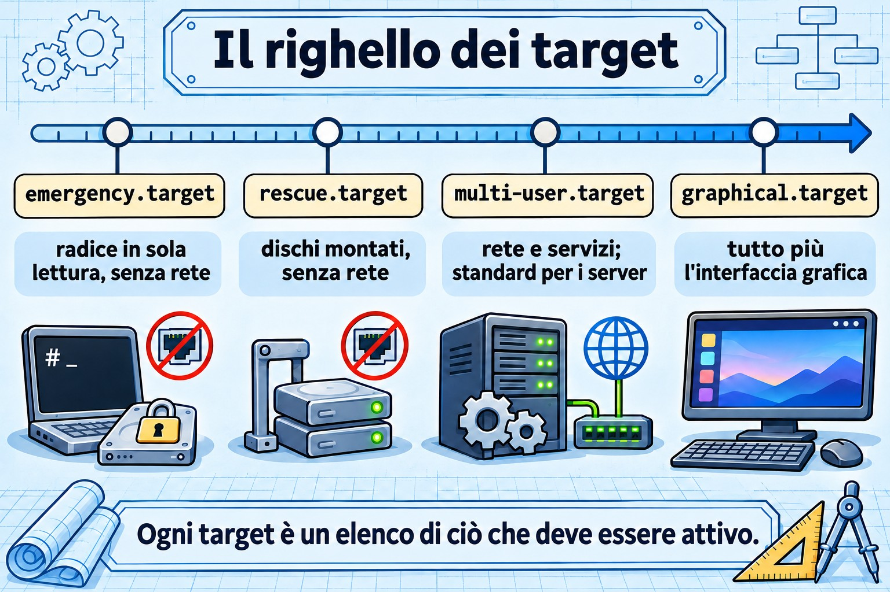
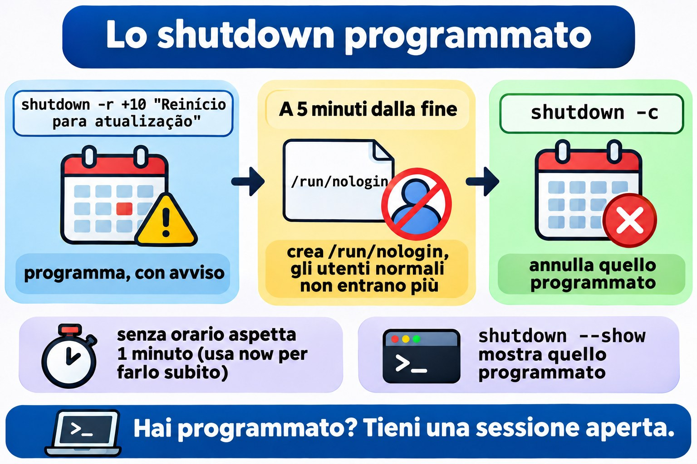
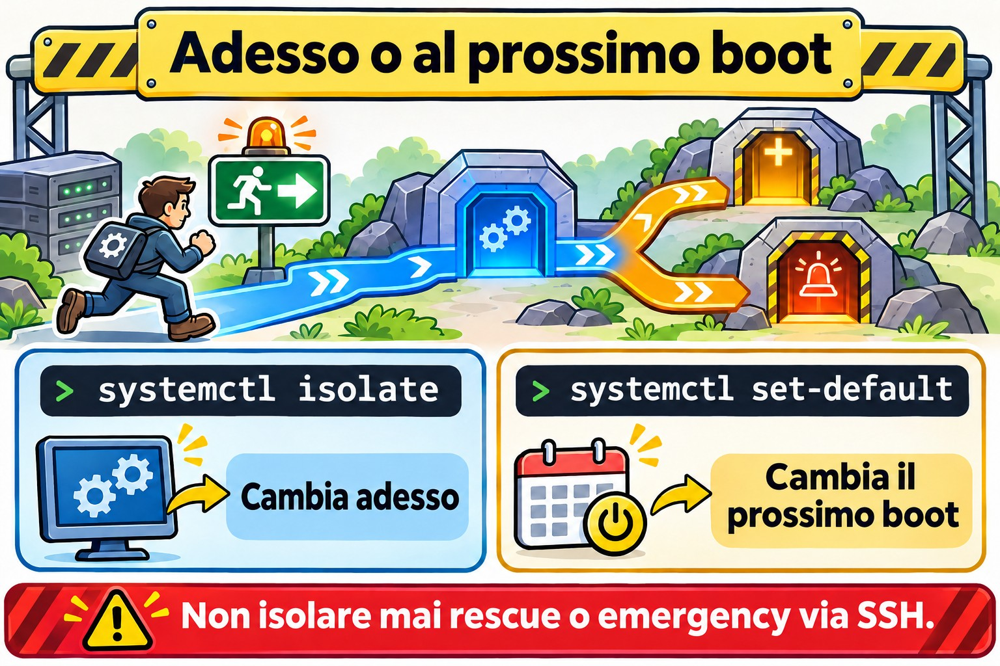

# Lezione 4.3 · Target, spegnimento e riavvio

Nella 4.2 hai avviato e fermato i servizi uno per uno. Oggi cambi modalità all'intera macchina: dalla modalità normale a quella di manutenzione, e ritorno. Impari anche a spegnere e riavviare un server senza prendere di sorpresa nessuno.

> **Il cuore di questa lezione:** un target è una modalità di funzionamento della macchina, un pacchetto di unit. `get-default` e `set-default` agiscono sulla modalità del prossimo boot; `isolate` cambia la modalità adesso. `rescue` e `emergency` sono le modalità di manutenzione, ed entrambe chiedono la password di root. Per spegnere o riavviare: `systemctl poweroff` e `systemctl reboot`, oppure `shutdown` quando vuoi un orario e un avviso.

| Scheda |  |
| --- | --- |
| Modulo | M4 · Boot e systemd, lezione 3 di 4 |
| Quando | Settimana 9 |
| Durata | circa 1h30 |
| Prerequisiti | Lezioni 4.1 e 4.2 |
| Lab | rocky-lab (201) e debian-lab (202), con la **console di Proxmox aperta** |
| Snapshot | `m4a3-inicio` e `m4a3-fim` |

## 1 Riscaldamento

Rispondi prima di leggere. Le risposte sono nelle Soluzioni, alla fine della lezione.

1. Esegui `sudo systemctl isolate rescue.target` in una sessione SSH. Cosa succede alla tua sessione?
2. Qual è la differenza tra `systemctl set-default` e `systemctl isolate`?
3. Cosa fa `shutdown -r +10`, e come lo annulli?

## 2 Perché conta

| Situazione reale | Cosa risolve |
| --- | --- |
| Hai toccato `/etc/fstab`, hai riavviato e il server non parte | Entrare in `emergency.target` dalla console |
| Una manutenzione che richiede la macchina senza servizi attivi e senza utenti | `rescue.target` |
| Riavviare il server di un cliente alle 23, avvisando chi è collegato | `shutdown -r 23:00 "mensagem"` |
| Qualcuno ha installato un'interfaccia grafica su un server e ora parte in modalità grafica | `systemctl set-default multi-user.target` |

## 3 Modello mentale

Un target è l'elenco di ciò che deve essere attivo perché la macchina si trovi in una certa modalità. Pensalo come un righello, da quella con meno cose attive a quella con più cose attive:

```
emergency   →   rescue    →   multi-user    →   graphical
raiz só        discos do     rede, sshd,       multi-user
leitura,       fstab,        todos os          + tela
shell root     shell root    serviços          gráfica
```

Il `multi-user.target` è il server normale: rete, `sshd` e i tuoi servizi, senza schermata grafica. È il predefinito di qualsiasi server. Il `graphical.target` è tutto questo più la schermata grafica. I due a sinistra sono modalità di manutenzione: non hanno né rete né `sshd`, solo una shell di root sulla console.

Hai due leve, uguali a quelle della 4.2:

| Leva | Cambia quando | Comando | Parente nella 4.2 |
| --- | --- | --- | --- |
| Modalità del prossimo boot | Al prossimo boot | `systemctl set-default` | `enable` |
| Modalità di adesso | Adesso, senza riavviare | `systemctl isolate` | `start` |

I vecchi runlevel (da 0 a 6) che hai visto nella tabella della 4.1 sono solo vecchi nomi per questi target. Il `runlevel 3` è il `multi-user.target`, e il `runlevel 1` è il `rescue.target`.



*Ogni target è l'elenco di ciò che deve essere in piedi.*

## 4 L'essenziale

### Vedere e cambiare il target predefinito

```bash
systemctl get-default
sudo systemctl set-default multi-user.target
ls -l /etc/systemd/system/default.target
```

`set-default` non fa magie: cambia soltanto un link simbolico, `default.target`, perché punti al target che hai scelto. Al boot, systemd cerca il `default.target` e segue il link.

### Vedere cosa richiama un target

```bash
systemctl list-units --type=target
systemctl list-dependencies multi-user.target | head -20
```

### Cambiare adesso: isolate

```bash
sudo systemctl isolate multi-user.target
```

`isolate` avvia ciò che il nuovo target richiede e **ferma tutto ciò che non ne fa parte**. Per questo accetta solo i target marcati con `AllowIsolate=yes`, come multi-user, graphical, rescue, emergency, reboot e poweroff. Con gli altri target rifiuta, con *Operation refused, unit may not be isolated*.

Scorciatoie che userai più di `isolate`:

| Scorciatoia | Equivale a |
| --- | --- |
| `systemctl rescue` | `isolate rescue.target` |
| `systemctl emergency` | `isolate emergency.target` |
| `systemctl default` | `isolate default.target` (torna alla modalità predefinita) |

### rescue × emergency

|  | rescue.target | emergency.target |
| --- | --- | --- |
| Root (`/`), con un boot diretto | montata in lettura e scrittura | montata **sola lettura** |
| Altri dischi di fstab | montati | non montati |
| Rete e `sshd` | no | no |
| Chiede la password di root | sì | sì |
| Quando usarlo | manutenzione con il sistema quasi in piedi | fstab rotto, o quando il rescue non parte |
| Vecchio nome | runlevel 1, `single` | nessun equivalente |

La riga della password è quella che frega anche i più esperti. Entrambe le modalità chiamano `sulogin`, che pretende la password di **root**: la tua password di sudo non basta. Se l'account root è bloccato, la modalità di manutenzione non si apre e compare *Cannot open access to console, the root account is locked*. Controlla prima di averne bisogno:

```bash
sudo passwd -S root
```

Se la seconda colonna è `L` o `LK`, l'account è bloccato (*locked*). `P` o `PS` significa che ha una password. Hai dimenticato la password di root? Questo è il tema della 4.4.

### Entrare in un target solo per questo boot

In GRUB aggiungi `systemd.unit=rescue.target` oppure `systemd.unit=emergency.target` alla riga del kernel. Vale solo per quel boot. Anche i vecchi nomi `1`, `s` e `single` portano al rescue. Lo farai in pratica nella 4.4; per ora, sappi che esiste.

### Spegnere e riavviare

```bash
sudo systemctl poweroff          # spegne
sudo systemctl reboot            # riavvia
sudo systemctl halt              # ferma la CPU, ma può non togliere l'alimentazione
sudo shutdown -h now             # spegne subito
sudo shutdown -r +10 "Reinício para atualização"   # tra 10 min, con avviso
sudo shutdown -r 23:00           # a un orario preciso
sudo shutdown -c                 # annulla quello programmato
wall "Servidor reinicia às 23h"  # messaggio a tutti i terminali
```

Tre dettagli di `shutdown`:

- Senza orario, aspetta **1 minuto**: cioè non è immediato. Per renderlo immediato, usa `now`.
- Quando mancano 5 minuti, crea il file `/run/nologin`, e da lì in poi gli utenti normali non riescono più a entrare.
- Per vedere cosa è programmato, usa `shutdown --show`. Se la tua versione di systemd non ha questa opzione, leggi `/run/systemd/shutdown/scheduled`.



*Hai programmato un riavvio? Tieni aperta una sessione: a 5 minuti dalla fine, nessuno entra più.*

I vecchi comandi funzionano ancora e si incontrano nella documentazione datata: `init 0` spegne, `init 6` riavvia, `telinit 1` va nel rescue, e `runlevel` mostra quello precedente e quello attuale (per esempio, `N 3`).

Per sapere quando la macchina si è riavviata: `who -b`, `last -x reboot shutdown | head` e `journalctl --list-boots`.

### Rocky × Debian

|  | Rocky 9 | Debian 12 |
| --- | --- | --- |
| Target predefinito di un server senza GUI | `multi-user.target` | `multi-user.target` |
| Account root dopo l'installazione | bloccato, se non hai dato la password di root nell'installer | bloccato, se hai lasciato vuota la password di root |
| Comandi di target e shutdown | uguali (systemd 252) | uguali (systemd 252) |

Le due usano la stessa versione di systemd, quindi i comandi sono gli stessi. In pratica la differenza sta nell'account root, ed è questo a decidere se riesci a entrare in modalità di manutenzione.

## 5 Lab guidato

### Passo 0 · Snapshot e console

Nella shell del nodo Proxmox:

```bash
qm snapshot 201 m4a3-inicio
qm snapshot 202 m4a3-inicio
```

Apri la **console** (noVNC) delle due VM nell'interfaccia di Proxmox e lasciala aperta. In questa lezione la rete cadrà di proposito, e la console è la tua unica via di ritorno. In ogni VM:

```bash
mkdir -p ~/lab43 && cd ~/lab43
```

### Passo 1 · Dov'è la macchina adesso

In entrambe le VM:

```bash
systemctl get-default
ls -l /etc/systemd/system/default.target
systemctl list-units --type=target --state=active
sudo runlevel
```

Annota le risposte in `~/lab43/notas.txt`. Il risultato atteso: `multi-user.target`, un link che punta a `/usr/lib/systemd/system/multi-user.target` e `N 3` nel `runlevel`.

### Passo 2 · Controllare l'account root

```bash
sudo passwd -S root
```

Se compare `L` o `LK`, imposta una password di root **solo nel lab**, digitandola tu stesso, e salvala nel tuo password manager:

```bash
sudo passwd root
```

Senza questo, i passi 3 e 6 si bloccano sul messaggio *the root account is locked*.

### Decidi 1

Sei sulla rocky-lab **via SSH**, non dalla console, e stai per eseguire `sudo systemctl isolate rescue.target`. Cosa succede?

- A) Non cambia nulla, e la sessione SSH continua normalmente.
- B) La sessione SSH cade o si blocca, e la console resta in attesa della password di root.
- C) La macchina si riavvia e torna su in modalità rescue.

Scegli un'opzione prima di continuare. Poi eseguilo e guarda cosa succede.

| Se hai scelto | Risultato | Perché |
| --- | --- | --- |
| A | Sbagliato | `isolate` ferma tutto ciò che non fa parte del rescue, e questo include `sshd` e la rete |
| B | Giusto | Senza `sshd` e senza rete, la tua sessione perde la strada. Il rescue apre una shell di root solo sulla console |
| C | Sbagliato | `isolate` non riavvia: cambia modalità con la macchina accesa |

**Da ricordare:** non isolare mai rescue o emergency via SSH su un server remoto, a meno che tu non abbia una console fuori banda (iLO, IPMI o la console di Proxmox). Nel lab ce l'hai, quindi puoi provare.

### Passo 3 · Dentro il rescue e l'emergency

Nella **console** della rocky-lab, digita la password di root e controlla:

```bash
systemctl is-system-running      # atteso: maintenance
systemctl list-units --type=service --state=running
ip -br addr
findmnt /
```

Nota quanto poco resta in esecuzione. Per uscire, torna alla modalità predefinita e rientra via SSH:

```bash
systemctl default
```

Ora la debian-lab. Direttamente nella **console**, entra con il tuo utente ed esegui:

```bash
sudo systemctl emergency
```

Digita la password di root e confronta con il rescue:

```bash
systemctl list-units --state=active | wc -l
findmnt /
```

Fai caso a una cosa: dato che sei entrato con la macchina già accesa, la root è rimasta com'era, montata in lettura e scrittura. La root in sola lettura compare quando avvii la macchina direttamente in emergency, da GRUB, e questo è per la 4.4. Esci con `systemctl default`.

### Decidi 2

Sulla debian-lab, via SSH, programma un riavvio e guarda la programmazione:

```bash
sudo shutdown -r +6 "Teste da aula 4.3"
sudo shutdown --show || cat /run/systemd/shutdown/scheduled
```

**Non chiudere questa sessione.** Aspetta circa 2 minuti, finché non mancano meno di 5, e apri una **seconda** sessione SSH con il tuo utente. Entra?

- A) Entra normalmente.
- B) Viene rifiutata, con un messaggio che dice che il sistema sta per spegnersi.
- C) Entra, ma cade subito.

| Se hai scelto | Risultato | Perché |
| --- | --- | --- |
| A | Sbagliato | Quando mancano 5 minuti, `shutdown` crea `/run/nologin` |
| B | Giusto | Con quel file presente, `pam_nologin` rifiuta il login di qualsiasi utente che non sia root |
| C | Sbagliato | Il rifiuto avviene prima che la sessione si apra |

Nella prima sessione, che è ancora aperta, annulla e controlla:

```bash
sudo shutdown -c
ls -l /run/nologin
```

Se il file non è sparito, eliminalo con `sudo rm /run/nologin`.

**Da ricordare:** è per questo che tieni una sessione aperta dopo aver programmato. Se devi annullare quando mancano meno di 5 minuti, non riesci più a entrare con il tuo utente. Programmare con avviso è `shutdown`; riavviare adesso è `systemctl reboot`.

### Passo 4 · Cambiare il target predefinito

Sulla rocky-lab, che non ha un'interfaccia grafica installata:

```bash
sudo systemctl set-default graphical.target
ls -l /etc/systemd/system/default.target
sudo systemctl reboot
```

Rientra via SSH e controlla:

```bash
systemctl get-default
systemctl is-system-running
```

La macchina parte normalmente. Il `graphical.target` richiede il multi-user e *vorrebbe* soltanto il display manager, e un `Wants=` che non esiste viene ignorato (è roba della 4.2). Funziona, ma confonde chi arriva dopo di te. Torna al predefinito da server:

```bash
sudo systemctl set-default multi-user.target
```

### Passo 5 · Chi ha riavviato e quando

In entrambe le VM:

```bash
who -b
last -x reboot shutdown | head -6
journalctl --list-boots | tail -5
```

Dovresti vedere i riavvii di questa lezione. Un `reboot` senza uno `shutdown` subito prima indica che la macchina è caduta, invece di essere spenta correttamente.

## 6 Rompi e ripara

Sulla rocky-lab, via SSH:


*isolate cambia adesso; set-default cambia il prossimo boot. Non isolare mai rescue o emergency via SSH su un server remoto.*


```bash
sudo systemctl set-default rescue.target
sudo systemctl reboot
```

L'SSH non torna. Indaga solo dalla **console**: cosa compare sullo schermo? Quale modalità è attiva? Perché la rete non è partita?

Dopo aver indagato, ripara e controlla con un altro riavvio:

```bash
systemctl get-default
systemctl set-default multi-user.target
systemctl default
```

La lezione: quando un server "non torna in rete" dopo una modifica, la prima domanda è *in che modalità è partito?* La console risponde in pochi secondi.

## 7 Trappole

- **`isolate rescue` via SSH su un server remoto.** Resti fuori, e rientri solo con una console fuori banda o con qualcuno davanti alla macchina.
- **Root bloccato.** Rescue ed emergency non si aprono. Controlla con `passwd -S root` prima del giorno in cui ti serve.
- **`halt` al posto di `poweroff`.** A seconda dell'hardware, la macchina si ferma ma resta alimentata.
- **`shutdown` senza orario.** Aspetta 1 minuto: non è immediato.
- **Programmato e dimenticato.** Il server si riavvia all'orario fissato, in pieno orario di lavoro. Controlla con `shutdown --show` e annulla con `shutdown -c`.
- **`isolate` su un target qualsiasi.** Senza `AllowIsolate=yes`, rifiuta.
- **`graphical.target` su un server.** Non rompe nulla, ma il predefinito di un server è il `multi-user.target`.

## 8 Quiz

1. Quale comando mostra il target predefinito?
2. Vuoi che, dal prossimo boot, la macchina parta in `multi-user.target`. Qual è il comando?
3. Con un boot diretto, qual è la differenza tra rescue ed emergency per quanto riguarda la root e i dischi di fstab?
4. Hai eseguito `shutdown -r 22:30 "Atualização"`. Cosa cambia per gli utenti alle 22:25?
5. Quali sono gli equivalenti in systemd di `init 6` e di `telinit 1`?
6. *You are logged in over SSH to a remote server with no out-of-band console. Why is `systemctl isolate emergency.target` a bad idea?*

## 9 Promemoria

### Da sapere a memoria

| Comando | Fa |
| --- | --- |
| `systemctl get-default` | Mostra la modalità del prossimo boot |
| `systemctl set-default multi-user.target` | Cambia la modalità del prossimo boot |
| `systemctl isolate X.target` | Cambia la modalità adesso |
| `systemctl rescue` / `emergency` / `default` | Scorciatoie di modalità |
| `systemctl poweroff` / `reboot` | Spegne o riavvia adesso |
| `shutdown -r +10 "msg"` / `shutdown -c` | Programma con avviso / annulla |
| `passwd -S root` | Mostra se l'account root è bloccato |

### Da consultare

`systemctl list-dependencies X.target`, `AllowIsolate=`, `/run/nologin`, `shutdown --show` oppure `/run/systemd/shutdown/scheduled`, `wall`, `runlevel`, `init`, `telinit`, `who -b`, `last -x`.

### Flashcard

| Domanda | Risposta |
| --- | --- |
| Qual è la modalità normale di un server? | `multi-user.target` |
| `set-default` sta a `isolate` come `enable` sta a...? | `start` |
| Cos'è il `default.target` dentro? | Un link simbolico |
| Quale password chiede il rescue? | Quella di root |
| Cosa succede quando mancano 5 minuti a uno `shutdown`? | Viene creato `/run/nologin`, e gli utenti normali non entrano più |

## 10 Checklist e chiusura

- [ ] So vedere e cambiare il target predefinito
- [ ] Sono entrato in rescue e in emergency dalla console e sono tornato con `systemctl default`
- [ ] So perché non si isola il rescue via SSH
- [ ] Ho programmato, controllato e annullato uno `shutdown`
- [ ] Ho riparato una macchina partita in rescue
- [ ] Le due VM hanno una password di root nota

**Ultimo esercizio, senza guardare la lezione:** sulla debian-lab, programma un riavvio tra 15 minuti con un messaggio, mostra la programmazione, annulla e verifica che `/run/nologin` non esista. Sulla rocky-lab, verifica che il predefinito sia `multi-user.target`.

**Riavvio e verifica:** riavvia le due VM e controlla:

```bash
systemctl get-default            # multi-user.target
systemctl is-system-running      # running
ls ~/lab43
```

**Snapshot di fine**, nel nodo Proxmox:

```bash
qm snapshot 201 m4a3-fim
qm snapshot 202 m4a3-fim
```

## 11 Nella vita reale

**Missione, sola lettura.** Su un server reale che amministri, esegui soltanto questi comandi, che non cambiano nulla:

```bash
systemctl get-default
who -b
last -x reboot shutdown | head -6
journalctl --list-boots | tail -5
sudo passwd -S root
```

Rispondi: quand'è stato l'ultimo riavvio? È stato uno spegnimento pulito o un crash? Se questo server domani non partisse, riusciresti a entrare in rescue? Ha una password di root? Ha una console fuori banda?

**Diario:** scrivi tre righe su ciò che hai imparato oggi e un dubbio che ti è rimasto.

**Domani, senza guardare:**

1. Di' a memoria i quattro target del righello, in ordine.
2. Scrivi il comando che programma un riavvio alle 23 con avviso.
3. Spiega in una frase perché il rescue potrebbe non aprirsi.

## 12 Approfondire quando vuoi

- `systemctl list-dependencies --reverse`: chi richiama un target.
- Creare un tuo target, per esempio un `manutencao.target` con `AllowIsolate=yes`.
- `systemd-inhibit`: programmi che trattengono lo spegnimento.
- Il pulsante di accensione: `HandlePowerKey=` in `/etc/systemd/logind.conf`.
- `systemctl soft-reboot`, che riavvia solo lo user space. È da systemd 254 in poi, quindi non esiste in Rocky 9 né in Debian 12.

In DeepTutor: `!explica isolate e set-default`, `!feynman rescue e emergency`, `!quiz targets e shutdown`.

## Soluzioni commentate

### Riscaldamento

1. La sessione cade o si blocca. Il rescue ferma `sshd` e la rete, e lascia solo una shell di root sulla console.
2. `set-default` cambia la modalità del prossimo boot, sostituendo il link `default.target`. `isolate` cambia la modalità adesso, senza riavviare.
3. Programma un riavvio tra 10 minuti e avvisa gli utenti collegati. Si annulla con `shutdown -c`.

### Quiz

1. `systemctl get-default`.
2. `sudo systemctl set-default multi-user.target`. Ricorda che questo non cambia nulla adesso: per cambiare subito, usa `isolate`.
3. Nel rescue, la root è montata in lettura e scrittura e i dischi di fstab sono montati. Nell'emergency, la root è in sola lettura e nulla di fstab viene montato. Per questo l'emergency è la via d'uscita quando fstab è rotto.
4. Mancano 5 minuti, quindi viene creato `/run/nologin`: gli utenti normali non riescono più a entrare. Chi è già collegato resta e riceve gli avvisi.
5. `init 6` è `systemctl reboot`. `telinit 1` è `systemctl isolate rescue.target`, oppure `systemctl rescue`.
6. *Emergency mode stops networking and sshd, so the SSH session dies and nothing is left to log back in through. Without a console, someone has to go to the machine physically.*

---

<!-- navegacao -->
[← Lezione 4.2 · systemd: servizi e unit](4.2-systemd-servicos-e-units.md) · [Indice delle lezioni](../01-aulas.md) · [Lezione 4.4 · GRUB e accesso di emergenza →](4.4-grub-e-acesso-de-emergencia.md)
