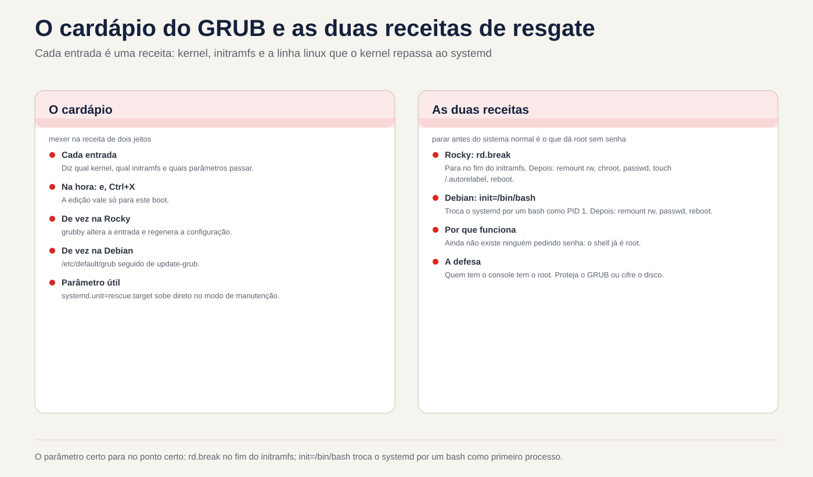
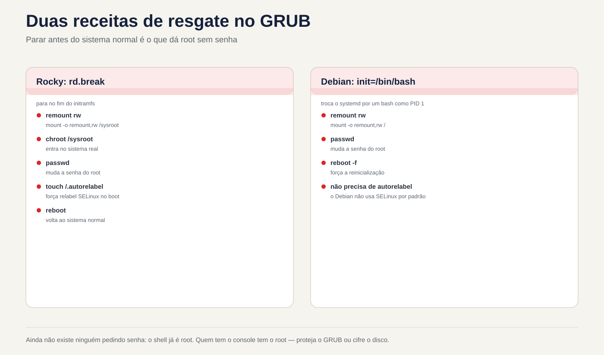

# Lezione 4.4 · GRUB e accesso di emergenza

Questa è l'ultima lezione del modulo 4. Sai già che GRUB è il secondo corridore nel relè (4.1) e che puoi avviare la macchina su un target diverso (4.3). Oggi si scherza davvero con GRUB: si cambiano i parametri del kernel solo per un avvio o per sempre, e si recupera la password di root di una macchina a cui nessuno può accedere.

> **Chiave di questa lezione:** nel menu di GRUB, `e` modifica la voce e `Ctrl+X` inizia con la modifica, che si applica solo a quell'avvio. Cambiare in meglio: in Rocky, `grubby`; in Debian, `/etc/default/grub` seguito da `update-grub`. Per recuperare la password di root: in Rocky, `rd.break`, poi rimontare, chroot, passwd e **`touch /.autorelabel`**; su Debian, `init=/bin/bash`, quindi rimontare e passarewd. E la lezione sulla sicurezza: chiunque abbia la console ha il root, a meno che tu non protegga GRUB o crittografi il disco.

| File |  |
| --- | --- |
| Modulo | M4 · Boot e systemd, lezione 4 di 4, che chiude il modulo |
| Quando | Settimana 9 |
| Tempo | circa 1h30, più la sfida del modulo |
| Prerequisito | lezioni da 4.1 a 4.3 |
| Prova | RHCSA (interruzione dell'avvio per riottenere l'accesso, modifica del bootloader) · LPIC-1 101.2 e 102.2 |
| Laboratorio | rock-lab (201) e debian-lab (202), con la **console Proxmox aperta** |
| Prima di iniziare | **backup su PBS** delle due VM, oltre allo snapshot |
| Istantanee | `m4a4-inicio` e `m4a4-fim` |

## 1 Riscaldamento

Rispondi dalla tua testa, senza consultare. Le risposte si trovano nella chiave di risposta, alla fine della lezione.

1. Quale programma carica il kernel e initramfs in memoria?
2. Un parametro immesso nella schermata GRUB è valido per quanti avviamenti?
3. Qualcuno con accesso alla console di un server Linux non protetto può diventare root senza conoscere la password?

## 2 Perché è importante

| Situazione attuale | Cosa risolve |
| --- | --- |
| Hai preso il controllo di un server e nessuno conosce la password di root | Recupero tramite GRUB |
| Un nuovo kernel non viene caricato dopo l'aggiornamento | Scegliere il kernel precedente dal menu, quindi impostarlo come predefinito |
| Il venditore chiede di disattivare un'opzione del kernel su tutti gli avviamenti | `grubby --args` o `/etc/default/grub` |
| L'audit chiede se qualcuno con accesso alla stanza diventa root | Password GRUB e disco crittografato |

## 3 Modello mentale

GRUB è un menu. Ogni voce di menu è una ricetta: quale kernel, quale initramfs e quali parametri passare al kernel (la riga che inizia con `linux`). Il kernel legge questi parametri e li passa a systemd. Ecco come funzionava `systemd.unit=rescue.target` di 4.3.

Puoi modificare la ricetta in due modi:

| Modo | Dove | Dura |
| --- | --- | --- |
| In orario | Nel menu premere il tasto `e`, poi `Ctrl+X` | Proprio questo avvio |
| Per sempre | File su disco, quindi rigenerare la configurazione | Tutti gli stivali |

E perché è possibile recuperare la password di root? Perché, se dici al kernel di fermarsi **prima** del normale avvio del sistema, nessuno ti chiederà comunque la password: ti ritroverai in una shell che è già root. In Rocky, `rd.break` si ferma alla fine dell'initramfs, prima di cedere il controllo al disco vero e proprio. In Debian, `init=/bin/bash` sostituisce systemd con bash come primo processo.



*Il parametro destro si ferma al punto giusto: rd.break alla fine di initramfs, init=/bin/bash al posto di systemd.*

## 4 Gli elementi essenziali

### GRUB menu

Subito dopo BIOS/UEFI, il menu viene visualizzato per alcuni secondi. Se non appare, premere `Esc` o tenere premuto `Shift` all'inizio dell'avvio. Nel menu:

| Chiave | Fare |
| --- | --- |
| Frecce | Scegliere l'input (un altro kernel, ad esempio) |
| `e` | Modifica la voce selezionata |
| `Ctrl+X` (o `F10`) | Si inizia con l'edizione |
| `Esc` | Annulla la modifica e torna al menu |
| `c` | Aprire la riga di comando di GRUB |

Durante la modifica, cerca la riga che inizia con `linux` e aggiungi il parametro **alla fine**. Di solito è lungo e si divide in più righe sullo schermo, ma è solo una riga. Usa `End` o `Ctrl+E` per andare alla fine.

**Tastiera:** GRUB e le shell di emergenza utilizzano spesso il layout americano. Se il carattere è sbagliato su una tastiera italiana, `=` si trova sul tasto `ì` (il secondo a destra di `0`), `-` sul tasto `'` e `/` sul tasto `-`. Per lo stesso motivo, usa una password temporanea composta solo da lettere e numeri e cambiala in seguito, con il sistema normale.

### Cambiandola una volta in Rocky: grubby

Rocky memorizza una voce per kernel in `/boot/loader/entries/` (il formato BLS) e `grubby` è lo strumento per cambiarle:

```bash
sudo grubby --default-kernel
sudo grubby --info=DEFAULT
sudo grubby --info=ALL | grep -E '^(kernel|args)'
sudo grubby --update-kernel=ALL --args="nome=valor"
sudo grubby --update-kernel=ALL --remove-args="rhgb quiet"
sudo grubby --set-default /boot/vmlinuz-VERSÃO
```

Puoi anche modificare `/etc/default/grub` ed eseguire `grub2-mkconfig -o /boot/grub2/grub.cfg`, ma nelle versioni attuali di Rocky 9 questo non aggiorna i parametri di kernel già installati (per questo esiste l'opzione `--update-bls-cmdline`). Pertanto, in Rocky, usa `grubby`.

### Cambia definitivamente in Debian: /etc/default/grub

```bash
sudo nano /etc/default/grub      # GRUB_TIMEOUT, GRUB_CMDLINE_LINUX_DEFAULT, GRUB_CMDLINE_LINUX
sudo update-grub                 # governa /boot/grub/grub.cfg
```

`update-grub` è solo una scorciatoia per `grub-mkconfig -o /boot/grub/grub.cfg`. **Non modificare mai `grub.cfg` a mano**: viene generato e il successivo aggiornamento del kernel sovrascrive la modifica. La differenza tra le due variabili: `GRUB_CMDLINE_LINUX` vale per tutti gli inserimenti, compreso quello di ripristino, mentre `GRUB_CMDLINE_LINUX_DEFAULT` vale solo per gli inserimenti normali.

### Recupera la password di root su Rocky

1. Nel menu premere `e` e aggiungere `rd.break` alla fine della riga `linux`. Poi `Ctrl+X`.
2. Cadi in un guscio `switch_root:/#`. Il disco reale è montato in `/sysroot`, **sola lettura**.
3. Esegui:

```bash
mount -o remount,rw /sysroot
chroot /sysroot
passwd root
touch /.autorelabel
exit
exit
```

Il primo `exit` esce dal chroot e il secondo continua l'avvio. Poiché il file `/.autorelabel` esiste, la macchina ricollega l'intero disco a SELinux (impiega alcuni minuti) e si riavvia una volta.

`touch /.autorelabel` esiste perché `passwd` riscrive `/etc/shadow`. Poiché veniva eseguito al di fuori del normale sistema, senza SELinux caricato, il nuovo file nasce senza la giusta etichetta. Con SELinux in modalità *enforcing*, nessun login con una password può leggere `shadow`: né quella di root né quella dell'utente. La rietichettatura risolve questo problema. SELinux ha il proprio modulo, più sotto; per ora, memorizza la riga.

### Recupera la password di root su Debian

1. Nel menu premere `e` e aggiungere `init=/bin/bash` alla fine della riga `linux`. Poi `Ctrl+X`.
2. Atterri in un `root@(none):/#`. La radice è montata **sola lettura**.
3. Esegui:

```bash
mount -o remount,rw /
passwd root
sync
mount -o remount,ro /
exec /sbin/init
```

O `exec /sbin/init` scambia bash con systemd e continua l'avvio normale. Qui `systemctl reboot` non funziona, perché systemd non è in esecuzione. Debian non usa SELinux per impostazione predefinita, quindi non ha bisogno di essere nuovamente codificato.

### Proteggiti da questo

Hai appena visto che la console dà root. Esistono tre difese:

- **Password GRUB:** `grub2-setpassword` su Rocky. In Debian, `grub-mkpasswd-pbkdf2` più una voce in `/etc/grub.d/40_custom`. Pertanto, modificando una voce viene avviata la richiesta di password.
- **Disco crittografato (LUKS):** senza passphrase, nessuno monta il disco, né tramite GRUB né rimuovendo il disco dalla macchina.
- **Proteggi la console:** password complessa in iLO/IPMI e Proxmox e la stanza è chiusa.

Nel laboratorio, non inserire una password in GRUB: ne avrai bisogno per aprirla sfida.

### Rocky × Debian

|  | Roccioso 9 | Debian 12 |
| --- | --- | --- |
| Configurazione modificata | `/etc/default/grub` e le voci in `/boot/loader/entries/` | `/etc/default/grub` |
| File generato | `/boot/grub2/grub.cfg` | `/boot/grub/grub.cfg` |
| Strumento quotidiano | `grubby` | `update-grub` |
| Recupera radice | `rd.break` + rimonta `/sysroot` + chroot + `passwd` + `touch /.autorelabel` | `init=/bin/bash` + rimontare `/` + `passwd` + `exec /sbin/init` |
| Password in GRUB | `grub2-setpassword` | `grub-mkpasswd-pbkdf2` + `40_custom` |

### Cosa contiene il test

In RHCSA, recuperare la password di root è solitamente la prima cosa da fare: in molte edizioni si riceve una macchina senza password. Dimenticare `touch /.autorelabel` vanifica l'intero test, perché in seguito non funziona più il login con password. Vengono eliminati anche `grubby`, i parametri del kernel e il kernel predefinito. In LPIC-1 101.2 e 102.2: i tasti menu, `/etc/default/grub`, `grub-mkconfig` e `update-grub`, i parametri del kernel all'avvio e, in teoria, `grub-install` (che installa GRUB su disco) e le differenze per GRUB Legacy (`menu.lst`).

## 5 Laboratorio guidato

### Passo 0 · Backup, snapshot e console

Oggi tu cambiare ciò che fa accendere la macchina. Pertanto, oltre allo snapshot, effettuare un backup su PBS. Nella shell del nodo Proxmox:

```bash
pvesm status                                         # trovare il nome dell'archivio PBS
vzdump 201 --storage NOME_DO_PBS --mode snapshot
vzdump 202 --storage NOME_DO_PBS --mode snapshot
qm snapshot 201 m4a4-inicio
qm snapshot 202 m4a4-inicio
```

Se preferisci, esegui il backup tramite l'interfaccia: VM, poi Backup, poi *Backup now*, scegliendo lo storage PBS. Quindi, apri la **console** (noVNC) di entrambe le VM e lasciala aperta. In ogni VM:

```bash
mkdir -p ~/lab44 && cd ~/lab44
```

### Passo 1 · Conoscere il GRUB di ognuno

In Rocky-Lab:

```bash
cat /proc/cmdline
sudo grubby --default-kernel
sudo grubby --info=DEFAULT
ls /boot/loader/entries/
grep -v '^#' /etc/default/grub
```

In Debian-Lab:

```bash
cat /proc/cmdline
grep -v '^#' /etc/default/grub | grep .
ls -l /boot/grub/grub.cfg
```

Nota in `~/lab44/notas.txt`: quanti kernel ha ciascuno, qual è l'impostazione predefinita e il timeout del menu.

### Passo 2 · Modificare solo per un avvio

Riavviare Rocky-Lab e guardare la console. Nel menu, premere `e`, andare alla fine della riga `linux`, aggiungere `systemd.unit=rescue.target` e premere `Ctrl+X`.

La macchina va in salvataggio, come in 4.3, ma questa volta senza che voi abbiate cambiato nulla sul disco. Immettere la password root e verificare:

```bash
cat /proc/cmdline
systemctl get-default
```

Il valore predefinito rimane `multi-user.target`: il parametro di avvio è scaduto. Riavviare con `systemctl reboot`, senza toccare nulla nel menu. La macchina ritorna alla normalità e `cat /proc/cmdline` non mostra più il parametro: la modifica valeva un singolo avvio.

### Passo 3 · Cambia definitivamente

**Rocky:** rimuovi `rhgb quiet` per vedere i messaggi di avvio. Questo è quello che vuoi su un server che non si avvia.

```bash
sudo grubby --update-kernel=ALL --remove-args="rhgb quiet"
sudo grubby --info=ALL | grep -E '^(kernel|args)'
sudo systemctl reboot
```

Nella console, ora vedi passare i messaggi del kernel e di systemd.

**Debian:** aumenta il tempo del menu. In `/etc/default/grub` modificare `GRUB_TIMEOUT=5` in `GRUB_TIMEOUT=10` e salvare. **Non eseguire ancora `update-grub`.**

### Decidi 1

Hai salvato `/etc/default/grub` con `GRUB_TIMEOUT=10` e riavvierai debian-lab senza eseguire `update-grub`. Quanto tempo attende il menu?

- A) 10 secondi, perché il file è stato salvato.
- B) 5 secondi, perché non è cambiato nulla in ciò che legge GRUB.
- C) Il menu non viene nemmeno visualizzato, perché la configurazione è diventata incoerente.

Controllare prima un'opzione. Quindi riavviare e impostare l'ora nella console.

| Se hai selezionato | Risultato | Perché |
| --- | --- | --- |
| A | Sbagliato | GRUB non legge `/etc/default/grub`. Si legge `/boot/grub/grub.cfg`, che è ancora il vecchio |
| B| Capito bene | `/etc/default/grub` è proprio la ricetta per generare `grub.cfg`, e chi la genera è `update-grub` |
| C| Sbagliato | Non c'è alcuna incoerenza: il vecchio `grub.cfg` rimane valido |

Ora applica e controlla:

```bash
sudo update-grub
grep -m1 'timeout=' /boot/grub/grub.cfg
sudo systemctl reboot
```

**Per correggere:** in Debian, modificato `/etc/default/grub`, esegui `update-grub`. Su Rocky, preferisci `grubby`, che scrive direttamente sugli input.

### Passo 4 · Recupera la password di root su Rocky

Fai finta che nessuno conosca la password di root di Rocky-lab. Dalla console, riavvia. Nel menu premere `e` e aggiungere `rd.break` alla fine della riga `linux`. Poi `Ctrl+X`. Arrivi su `switch_root:/#`.

### Decidi 2

Prima di ogni altra cosa, esegui `chroot /sysroot` e poi `passwd root`. Cosa succede?

- A) La password cambia normalmente.
- B) `passwd` fallisce con un errore come *Errore di manipolazione del token di autenticazione*.
- C) La macchina si blocca con un *kernel panico*.

Controllare prima un'opzione. Quindi eseguilo e guarda cosa succede.

| Se hai selezionato | Risultato | Perché |
| --- | --- | --- |
| A | Sbagliato | `/sysroot` è montato in sola lettura e `passwd` deve scrivere in `/etc/shadow` |
| B| Capito bene | Senza il rimontaggio per la lettura e la scrittura, la scrittura sul disco non funziona |
| C| Sbagliato | Un errore di registrazione è solo un errore: il kernel è ancora in piedi |

Esci dal chroot con `exit` ed esegui la sequenza corretta:

```bash
mount -o remount,rw /sysroot
chroot /sysroot
passwd root
touch /.autorelabel
exit
exit
```

Attendi la nuova codifica e il riavvio automatico. Successivamente, nella console, accedi come root con la nuova password e controlla:

```bash
getenforce                 # Applicazione
ls -Z /etc/shadow          # shadow_t dovrebbe apparire
```

Infine cambiare la password temporanea con `passwd root` in una permanente. Ora la tastiera è nel layout corretto.

**Da risolvere:** l'ordine è rimonta, chroot, passwd, autorelabel, exit ed exit. Se si salta il rimontaggio, `passwd` fallisce. Se si salta l'autorelabel, l'intero test va con sé.

## 6 Break and fix

In Rocky-Lab, da SSH:


*Non c'è ancora nessuno che chiede una password: la shell è già root. Chiunque abbia la console ha il root.*


```bash
sudo grubby --update-kernel=ALL --args="systemd.unit=emergency.target"
sudo systemctl reboot
```

La macchina va in emergenza ad ogni avvio. Investiga attraverso la **console**: `systemctl get-default` cosa mostra? Dov'è la causa? `/boot` è montato? Il root accetta la scrittura?

Sono disponibili due percorsi di riparazione. Scegline uno e poi prova l'altro:

- **Con GRUB:** nel menu, `e`, elimina `systemd.unit=emergency.target` dalle righe `linux` e `Ctrl+X`. La macchina si alza normalmente, solo questa volta. Quindi, tramite SSH, eseguire `sudo grubby --update-kernel=ALL --remove-args="systemd.unit=emergency.target"`.
- **Dall'emergenza:** il root è di sola lettura e `/boot` non è montato, quindi `grubby` non ha nessun posto dove scrivere. Esegui:

```bash
mount -o remount,rw /
mount /boot
grubby --update-kernel=ALL --remove-args="systemd.unit=emergency.target"
systemctl reboot
```

La lezione: quando `get-default` dice una cosa e la macchina ne fa un'altra, guarda `/proc/cmdline`. Un parametro di avvio sovrascrive la destinazione predefinita.

## 7 Insidie

- **Dimenticare `touch /.autorelabel` in Rocky.** Dopo il riavvio, non funziona l'accesso tramite password. Correzione: `rd.break` di nuovo, e questa volta con autorelabel.
- **Dimentica il rimontaggio.** Sia `/sysroot` su Rocky che `/` su Debian iniziano in sola lettura.
- **Modifica `grub.cfg` a mano.** Il successivo aggiornamento del kernel cancella la modifica.
- **Modifica `/etc/default/grub` e non eseguire `update-grub`.** Non cambia nulla.
- **In Rocky, modifica solo `/etc/default/grub`.** I kernel già installati non ricevono la modifica. Usa `grubby`.
- **Tastiera americana in GRUB e shell di emergenza.** La password che hai inserito potrebbe non essere quella che pensi. Utilizzare una semplice password temporanea e modificarla in seguito.
- **`systemctl reboot` in `init=/bin/bash`.** Non funziona perché systemd non è in esecuzione. Usa `exec /sbin/init`.
- **Invia SMS con GRUB e non riavviare per testare.** Prova mentre hai la console e il tempo, non il giorno dell'arresto anomalo.

## 8 Quiz

1. In Debian, dove si modifica l'ora del menu di GRUB e quale comando applica la modifica?
2. In Rocky, come si aggiunge un parametro del kernel a tutti i kernel installati?
3. Perché Rocky ha bisogno di `touch /.autorelabel` e Debian no?
4. Dopo `rd.break`, perché è necessario rimontare `/sysroot`?
5. Nel menu di GRUB, quale tasto modifica la voce e quale inizia con modifica?
6. *Nominare due misure che impediscono a qualcuno con accesso alla console di reimpostare la password di root tramite GRUB.*

## 9 Cola

### Da sapere a memoria

| Comando o tasto | Fare |
| --- | --- |
| `e` / `Ctrl+X` | Modifica la voce / inizia con la modifica |
| `cat /proc/cmdline` | Mostra con quali parametri è stato creato il kernel |
| `grubby --info=DEFAULT` | Mostra il kernel e i parametri predefiniti (Rocky) |
| `grubby --update-kernel=ALL --args=` / `--remove-args=` | Aggiungere o rimuovere parametri (Rocky) |
| `/etc/default/grub` + `update-grub` | Cambiarlo per sempre (Debian) |
| `rd.break` → rimonta `/sysroot` → chroot → passwd → `touch /.autorelabel` | Recupera root (Rocky) |
| `init=/bin/bash` → rimonta `/` → passwd → `exec /sbin/init` | Recupera root (Debian) |

### Consultare

`grubby --set-default`, `grub2-mkconfig -o /boot/grub2/grub.cfg`, `--update-bls-cmdline`, `GRUB_CMDLINE_LINUX` e `GRUB_CMDLINE_LINUX_DEFAULT`, `/boot/loader/entries/`, `grub2-setpassword`, `grub-mkpasswd-pbkdf2`, `/etc/grub.d/40_custom`, `grub-install`, `ls -Z`, `getenforce`.

### Flashcards

| Domanda | Rispondi |
| --- | --- |
| GRUB legge `/etc/default/grub`? | No: legge il `grub.cfg` generato da esso |
| Dov'è il vero record dopo `rd.break`? | In `/sysroot`, sola lettura |
| Cosa risolve il `.autorelabel`? | Il tag SELinux di `/etc/shadow` e il resto del disco |
| Chi vince: il bersaglio standard o lo stivale `systemd.unit=`? | Il parametro di avvio |
| Qual è la difesa contro la reimpostazione della password tramite la console? | Password in GRUB e disco crittografato |

## 10 Checklist e chiusura

- [ ] Ho modificato una voce nel menu solo per un boot
- [ ] Ho cambiato parametri una volta per tutte con `grubby` in Rocky
- [ ] Ho cambiato il timeout in Debian e ho capito perché `update-grub` è obbligatorio
- [ ] Ho recuperato la password dalla root di Rocky, e SELinux continua a *applicare*
- [ ] Ho riparato una macchina bloccata in emergenza in entrambi i sensi
- [ ] Conosco le tre difese contro la reimpostazione della password tramite la console

**Ultimo esercizio, senza guardare la lezione:** in debian-lab, ritorna `GRUB_TIMEOUT` a 5, applica e conferma in `grub.cfg`. Su Rocky-Lab, decidi se rivuoi indietro `rhgb quiet`. Molti amministratori preferiscono un server che ne sia sprovvisto. Se lo vuoi indietro, usa `grubby`.

**Riavvia e conferenza:** riavvia entrambe le VM e controlla:

```bash
cat /proc/cmdline
systemctl is-system-running      # corsa
ls ~/lab44
```

**Istantanea della fine**, sul nodo Proxmox:

```bash
qm snapshot 201 m4a4-fim
qm snapshot 202 m4a4-fim
```

## 11 Nella vita reale

**Missione, sola lettura.** Su un server reale che amministri, esegui semplicemente questi comandi, che non cambiano nulla.

In Rocky o su RHEL:

```bash
cat /proc/cmdline
sudo grubby --info=DEFAULT
sudo test -f /boot/grub2/user.cfg && echo "GRUB com senha" || echo "GRUB sem senha"
lsblk -f | grep -i crypto
```

Su Debian:

```bash
cat /proc/cmdline
grep -v '^#' /etc/default/grub | grep .
sudo grep -c password_pbkdf2 /boot/grub/grub.cfg
lsblk -f | grep -i crypto
```

Risposta: GRUB ha una password? Il disco è crittografato? Chi ha accesso alla console di questo server (iLO, Proxmox, la stanza)? Se la risposta è "chiunque abbia la password Proxmox diventa root qui", prendi nota di questo rischio e parla con la persona responsabile. Non cambiare nulla da solo.

**Diario:** scrivi tre righe su ciò che hai imparato oggi e una domanda che ti è rimasta.

**Domani, senza guardare:**

1. Scrivi la sequenza completa di recupero di Rocky root.
2. Indica quale file GRUB legge effettivamente, in Rocky e Debian.
3. Spiega in una frase perché `rd.break` fornisce una shell di root senza chiedere una password.

## 12 Scava più a fondo a tuo piacimento

- La riga di comando di GRUB (`c`): `ls`, `set root=`, `linux`, `initrd` e `boot`, per avviare manualmente una macchina con il menu interrotto.
- Reinstalla GRUB da un'ISO, con `grub-install` e `grub2-mkconfig` all'interno di un chroot.
- UEFI e Secure Boot: `shim`, `mokutil --sb-state` e `efibootmgr` dalla 4.1.
- Ritorno automatico al kernel precedente: `GRUB_DEFAULT=saved`, `grub2-set-default` e `grub2-editenv list`.
- Proteggi GRUB con una password in una VM di prova, per avere un'idea del menu.

In DeepTutor: `!explica rd.break e init=/bin/bash`, `!feynman por que o autorelabel existe`, `!quiz GRUB e recuperação de root`.

## La sfida del modulo 4

Il modulo 4 si chiude con l'attività che rientra maggiormente in RHCSA e che salva la maggior parte dei server nella vita reale: **recuperare la password root delle due VM, senza guardare la lezione.**

**Prima di:** sul nodo Proxmox, eseguire `qm snapshot 201 m4-desafio` e `qm snapshot 202 m4-desafio`.

**Regole:**

- Utilizzare solo la console Proxmox, no SSH.
- Non consultare la lezione, Cola o DeepTutor. Se si blocca, sono disponibili suggerimenti nella chiave di risposta.
- Tempo previsto: 15 minuti per VM, senza contare la rietichettatura.

**È pronto quando:**

| V.M. | Criterio |
| --- | --- |
| laboratorio-roccioso | Root accede alla console con la nuova password |
| laboratorio-roccioso | `getenforce` mostra `Enforcing` e `ls -Z /etc/shadow` mostra `shadow_t` |
| laboratorio-roccioso | L'utente abituale inserisce anche la password |
| debian-lab | Root accede alla console con la nuova password |
| debian-lab | `systemctl is-system-running` mostra `running` |

**Bonus:** scrivi in ​​cinque righe, nel tuo diario, perché funziona e come impedire a un estraneo di fare lo stesso.

**Se va storto:** `qm rollback 201 m4-desafio` (o 202) riporta la VM allo stato in cui era prima e riprovi. Commettere errori qui è economico: commettere errori nel test, o sul server di un cliente, non lo è.

Con questo, **il modulo 4 è completato**: sai come Linux si accende, invia servizi, cambia modalità ed entra in una macchina bloccata.

## Risposta commentata

### Riscaldamento

1. GRUB, il secondo corridore della staffetta 4.1.
2. Solo uno stivale. Al successivo avvio, ciò che è presente sul disco sarà nuovamente valido.
3. SÌ. Tramite GRUB, con `rd.break` o `init=/bin/bash`. Non puoi farlo se GRUB ha una password o il disco è crittografato.

### Quiz

1. Nella variabile `GRUB_TIMEOUT` di `/etc/default/grub` e si applica con `sudo update-grub`.
2. `sudo grubby --update-kernel=ALL --args="nome=valor"`.
3. Rocky usa SELinux in modalità *enforcing*. `passwd` è stato eseguito senza la policy caricata, quindi il nuovo `/etc/shadow` è stato lasciato senza l'etichetta corretta e SELinux ne blocca la lettura al momento del login. Debian non utilizza SELinux per impostazione predefinita e il suo AppArmor non si basa sui tag dei file.
4. Perché initramfs monta effettivamente il disco in `/sysroot` di sola lettura e `passwd` deve scrivere su `/etc/shadow`.
5. `e` modifica e `Ctrl+X` (o `F10`) inizia con la modifica.
6. *Una password GRUB, quindi le voci di avvio non possono essere modificate e crittografia dell'intero disco con LUKS, quindi il disco non può essere letto senza la passphrase. La protezione fisica della console (iLO/IPMI, accesso all'hypervisor, sala server) è il terzo livello.*

### Suggerimenti per la sfida

Leggi solo se rimane bloccato.

- **Il `passwd` non è riuscito:** hai dimenticato il rimontaggio per la lettura e la scrittura.
- **In Rocky, nessuno entra dopo il riavvio:** `touch /.autorelabel` mancava. Ripetere l'intero processo.
- **Su Debian, `systemctl reboot` non funziona:** systemd non è in esecuzione. Usa `exec /sbin/init`.
- **La nuova password dopo non funziona:** era la tastiera americana. Ripetere con una password composta da lettere e numeri.

---

<!-- navegacao -->
[← lezione 4.3 · Destinazioni, spegnimento e riavvio](4.3-targets-desligar-e-reiniciar.md) · [Indice lezione](../01-aulas.md) · [lezione 5.1 · Hardware per kernel →](5.1-hardware-pelo-kernel.md)
