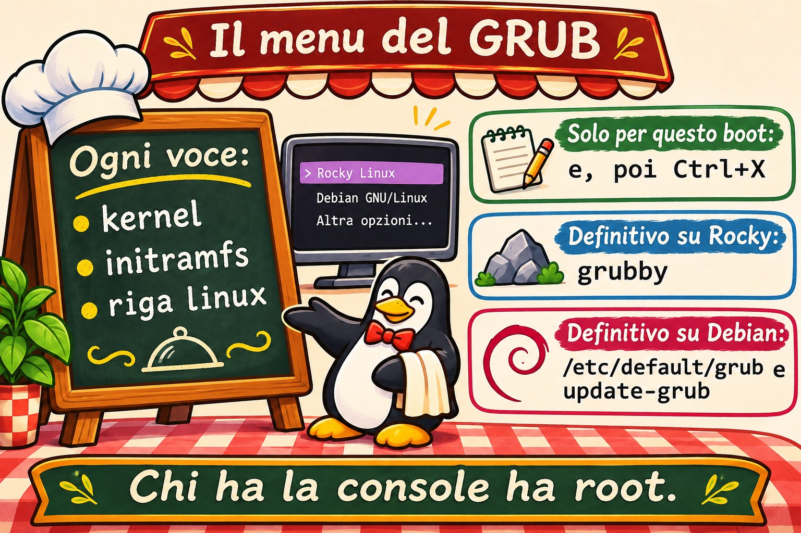
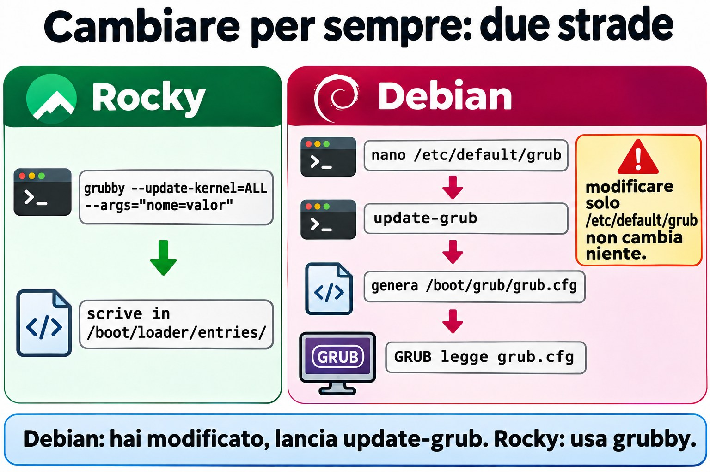
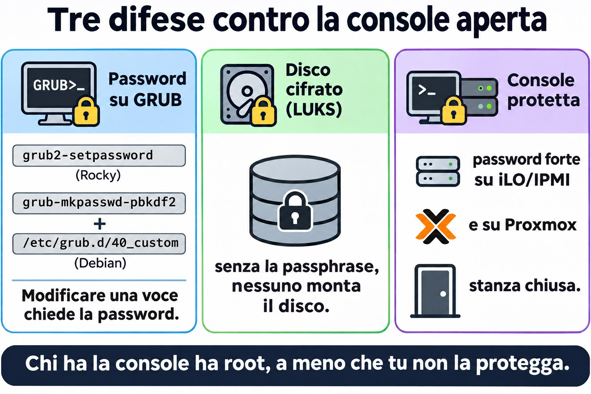
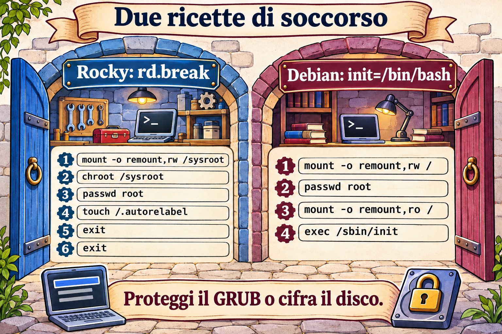

# Lezione 4.4 · GRUB e accesso di emergenza

È l'ultima lezione del modulo 4. Sai già che GRUB è il secondo frazionista della staffetta (4.1) e che si può avviare la macchina in un target diverso (4.3). Oggi metti mano a GRUB sul serio: cambi i parametri del kernel solo per un boot o per sempre, e recuperi la password di root di una macchina in cui nessuno riesce a entrare.

> **Il cuore di questa lezione:** nel menu di GRUB, `e` modifica la voce e `Ctrl+X` avvia con la modifica, che vale solo per quel boot. Per cambiare in modo permanente: su Rocky, `grubby`; su Debian, `/etc/default/grub` seguito da `update-grub`. Per recuperare la password di root: su Rocky, `rd.break`, poi remount, chroot, passwd e **`touch /.autorelabel`**; su Debian, `init=/bin/bash`, poi remount e passwd. E la lezione di sicurezza: chi ha la console ha root, a meno che tu non protegga GRUB o cifri il disco.

| Scheda |  |
| --- | --- |
| Modulo | M4 · Boot e systemd, lezione 4 di 4, che chiude il modulo |
| Quando | Settimana 9 |
| Durata | circa 1h30, più la sfida del modulo |
| Prerequisiti | Lezioni da 4.1 a 4.3 |
| Lab | rocky-lab (201) e debian-lab (202), con la **console di Proxmox aperta** |
| Prima di iniziare | **backup su PBS** delle due VM, oltre allo snapshot |
| Snapshot | `m4a4-inicio` e `m4a4-fim` |

## 1 Riscaldamento

Rispondi prima di leggere. Le risposte sono nelle Soluzioni, alla fine della lezione.

1. Quale programma carica in memoria il kernel e l'initramfs?
2. Un parametro che digiti nella schermata di GRUB vale per quanti boot?
3. Chi ha accesso alla console di un server Linux senza alcuna protezione riesce a diventare root senza conoscere la password?

## 2 Perché conta

| Situazione reale | Cosa risolve |
| --- | --- |
| Hai preso in carico un server e nessuno conosce la password di root | Recupero da GRUB |
| Un kernel nuovo non parte dopo l'aggiornamento | Scegliere il kernel precedente nel menu, e poi renderlo quello predefinito |
| Il fornitore chiede di disattivare un'opzione del kernel a ogni boot | `grubby --args` oppure `/etc/default/grub` |
| L'audit chiede se chiunque abbia accesso alla sala diventa root | Password su GRUB e disco cifrato |

## 3 Modello mentale

GRUB è un menu del ristorante. Ogni voce del menu è una ricetta: quale kernel, quale initramfs e quali parametri passare al kernel (la riga che inizia con `linux`). Il kernel legge quei parametri e li passa a systemd. È così che ha funzionato il `systemd.unit=rescue.target` della 4.3.

Puoi modificare la ricetta in due modi:

| Modo | Dove | Dura |
| --- | --- | --- |
| Al volo | Tasto `e` nel menu, poi `Ctrl+X` | Solo questo boot |
| Per sempre | File sul disco, e poi rigenerare la configurazione | Tutti i boot |

E perché si può recuperare la password di root? Perché, se dici al kernel di fermarsi **prima** che il sistema normale si avvii, non c'è ancora nessuno che chieda una password: finisci in una shell che è già root. Su Rocky, `rd.break` si ferma alla fine dell'initramfs, prima di passare il controllo al disco vero. Su Debian, `init=/bin/bash` sostituisce systemd con un bash come primo processo.



*Modificare nel menu vale solo per questo boot; grubby e update-grub cambiano per sempre.*

## 4 L'essenziale

### Il menu di GRUB

Subito dopo il BIOS/UEFI, il menu compare per qualche secondo. Se non compare, premi `Esc` o tieni premuto `Shift` appena inizia il boot. Nel menu:

| Tasto | Fa |
| --- | --- |
| Frecce | Scelgono la voce (un altro kernel, per esempio) |
| `e` | Modifica la voce selezionata |
| `Ctrl+X` (o `F10`) | Avvia con la modifica |
| `Esc` | Scarta la modifica e torna al menu |
| `c` | Apre la riga di comando di GRUB |

Nella modifica, cerca la riga che inizia con `linux` e aggiungi il parametro **in fondo**. Di solito è lunga e va a capo su più righe sullo schermo, ma è una riga sola. Usa `End` o `Ctrl+E` per andare in fondo.

**Tastiera:** GRUB e le shell di emergenza di solito usano il layout americano. Se il carattere esce sbagliato su una tastiera italiana, il `=` sta sul tasto `ì` (il secondo a destra dello `0`), il `-` sul tasto `'`, e la `/` sul tasto `-`. Per lo stesso motivo, usa una password temporanea fatta solo di lettere e numeri, e cambiala dopo, a sistema normale.

### Cambiare per sempre su Rocky: grubby

Rocky tiene una voce per ogni kernel in `/boot/loader/entries/` (il formato BLS), e `grubby` è lo strumento per metterci mano:

```bash
sudo grubby --default-kernel
sudo grubby --info=DEFAULT
sudo grubby --info=ALL | grep -E '^(kernel|args)'
sudo grubby --update-kernel=ALL --args="nome=valor"
sudo grubby --update-kernel=ALL --remove-args="rhgb quiet"
sudo grubby --set-default /boot/vmlinuz-VERSÃO
```

Potresti anche modificare `/etc/default/grub` ed eseguire `grub2-mkconfig -o /boot/grub2/grub.cfg`, ma nelle versioni attuali di Rocky 9 questo non aggiorna i parametri dei kernel già installati (per questo esiste l'opzione `--update-bls-cmdline`). Per questo, su Rocky, usa `grubby`.

### Cambiare per sempre su Debian: /etc/default/grub

```bash
sudo nano /etc/default/grub      # GRUB_TIMEOUT, GRUB_CMDLINE_LINUX_DEFAULT, GRUB_CMDLINE_LINUX
sudo update-grub                 # rigenera /boot/grub/grub.cfg
```

`update-grub` è solo una scorciatoia per `grub-mkconfig -o /boot/grub/grub.cfg`. **Non modificare mai `grub.cfg` a mano**: è generato, e il prossimo aggiornamento del kernel sovrascrive la tua modifica. La differenza tra le due variabili: `GRUB_CMDLINE_LINUX` vale per tutte le voci, compresa quella di recupero, e `GRUB_CMDLINE_LINUX_DEFAULT` vale solo per le voci normali.



*Su Debian GRUB legge il grub.cfg generato, non /etc/default/grub; su Rocky grubby scrive direttamente nelle voci.*

### Recuperare la password di root su Rocky

1. Nel menu, premi `e` e aggiungi `rd.break` in fondo alla riga `linux`. Poi `Ctrl+X`.
2. Finisci in una shell `switch_root:/#`. Il disco vero è montato in `/sysroot`, **in sola lettura**.
3. Esegui:

```bash
mount -o remount,rw /sysroot
chroot /sysroot
passwd root
touch /.autorelabel
exit
exit
```

Il primo `exit` esce dal chroot e il secondo continua il boot. Dato che il file `/.autorelabel` esiste, la macchina rietichetta tutto il disco per SELinux (ci vogliono alcuni minuti) e si riavvia da sola una volta.

`touch /.autorelabel` serve perché `passwd` riscrive `/etc/shadow`. Dato che è stato eseguito fuori dal sistema normale, senza SELinux caricato, il file nuovo nasce senza l'etichetta giusta. Con SELinux in modalità *enforcing*, nessun login con password riesce a leggere lo `shadow`: né quello di root, né quello del tuo utente. La rietichettatura risolve il problema. SELinux ha un modulo tutto suo, più avanti; per ora, memorizza la riga.

### Recuperare la password di root su Debian

1. Nel menu, premi `e` e aggiungi `init=/bin/bash` in fondo alla riga `linux`. Poi `Ctrl+X`.
2. Finisci in un `root@(none):/#`. La root è montata **in sola lettura**.
3. Esegui:

```bash
mount -o remount,rw /
passwd root
sync
mount -o remount,ro /
exec /sbin/init
```

`exec /sbin/init` sostituisce bash con systemd e continua il boot normale. Qui `systemctl reboot` non funziona, perché systemd non è in esecuzione. Debian non usa SELinux di default, quindi non serve la rietichettatura.

### Proteggersi da tutto questo

Hai appena visto che la console ti dà root. Le difese sono tre:

- **Password su GRUB:** `grub2-setpassword` su Rocky. Su Debian, `grub-mkpasswd-pbkdf2` più una voce in `/etc/grub.d/40_custom`. Così, modificare una voce richiede la password.
- **Disco cifrato (LUKS):** senza la passphrase, nessuno monta il disco, né da GRUB né togliendo il disco dalla macchina.
- **Proteggere la console:** password robusta su iLO/IPMI e su Proxmox, e la sala chiusa a chiave.

Nel lab, non mettere la password su GRUB: ti servirà aperto nella sfida.



*Chi ha la console ha root; tre difese chiudono questa porta.*

### Rocky × Debian

|  | Rocky 9 | Debian 12 |
| --- | --- | --- |
| Configurazione che modifichi | `/etc/default/grub` e le voci in `/boot/loader/entries/` | `/etc/default/grub` |
| File generato | `/boot/grub2/grub.cfg` | `/boot/grub/grub.cfg` |
| Strumento di tutti i giorni | `grubby` | `update-grub` |
| Recuperare root | `rd.break` + remount `/sysroot` + chroot + `passwd` + `touch /.autorelabel` | `init=/bin/bash` + remount `/` + `passwd` + `exec /sbin/init` |
| Password su GRUB | `grub2-setpassword` | `grub-mkpasswd-pbkdf2` + `40_custom` |

## 5 Lab guidato

### Passo 0 · Backup, snapshot e console

Oggi metti mano a ciò che fa accendere la macchina. Per questo, oltre allo snapshot, fai un backup su PBS. Nella shell del nodo Proxmox:

```bash
pvesm status                                         # ache o nome do storage do PBS
vzdump 201 --storage NOME_DO_PBS --mode snapshot
vzdump 202 --storage NOME_DO_PBS --mode snapshot
qm snapshot 201 m4a4-inicio
qm snapshot 202 m4a4-inicio
```

Se preferisci, fai il backup dall'interfaccia: VM, poi Backup, poi *Backup now*, scegliendo lo storage PBS. Poi apri la **console** (noVNC) delle due VM e lasciala aperta. In ogni VM:

```bash
mkdir -p ~/lab44 && cd ~/lab44
```

### Passo 1 · Conoscere il GRUB di ciascuna

Sulla rocky-lab:

```bash
cat /proc/cmdline
sudo grubby --default-kernel
sudo grubby --info=DEFAULT
ls /boot/loader/entries/
grep -v '^#' /etc/default/grub
```

Sulla debian-lab:

```bash
cat /proc/cmdline
grep -v '^#' /etc/default/grub | grep .
ls -l /boot/grub/grub.cfg
```

Annota in `~/lab44/notas.txt`: quanti kernel ha ciascuna, qual è quello predefinito, e il timeout del menu.

### Passo 2 · Modificare solo per un boot

Riavvia la rocky-lab e guarda la console. Nel menu, premi `e`, vai in fondo alla riga `linux`, aggiungi `systemd.unit=rescue.target` e premi `Ctrl+X`.

La macchina parte in rescue, come nella 4.3, ma questa volta senza che tu abbia cambiato nulla sul disco. Entra con la password di root e controlla:

```bash
cat /proc/cmdline
systemctl get-default
```

Il predefinito resta `multi-user.target`: il parametro del boot ha vinto. Riavvia con `systemctl reboot`, senza toccare nulla nel menu. La macchina torna normale, e `cat /proc/cmdline` non mostra più il parametro: la modifica è valsa per un solo boot.

### Passo 3 · Cambiare per sempre

**Rocky:** togli `rhgb quiet` per vedere i messaggi del boot. È quello che vorrai su un server che non parte.

```bash
sudo grubby --update-kernel=ALL --remove-args="rhgb quiet"
sudo grubby --info=ALL | grep -E '^(kernel|args)'
sudo systemctl reboot
```

Nella console, ora vedi scorrere i messaggi del kernel e di systemd.

**Debian:** aumenta il tempo del menu. In `/etc/default/grub`, cambia `GRUB_TIMEOUT=5` in `GRUB_TIMEOUT=10` e salva. **Non eseguire ancora `update-grub`.**

### Decidi 1

Hai salvato `/etc/default/grub` con `GRUB_TIMEOUT=10` e stai per riavviare la debian-lab senza eseguire `update-grub`. Quanto aspetta il menu?

- A) 10 secondi, perché il file è stato salvato.
- B) 5 secondi, perché nulla è cambiato in ciò che GRUB legge.
- C) Il menu non compare nemmeno, perché la configurazione è diventata incoerente.

Scegli un'opzione prima di continuare. Poi riavvia e cronometra nella console.

| Se hai scelto | Risultato | Perché |
| --- | --- | --- |
| A | Sbagliato | GRUB non legge `/etc/default/grub`. Legge `/boot/grub/grub.cfg`, che è ancora quello vecchio |
| B | Giusto | `/etc/default/grub` è solo la ricetta per generare `grub.cfg`, e a generarlo è `update-grub` |
| C | Sbagliato | Non c'è nessuna incoerenza: il vecchio `grub.cfg` resta valido |

Ora applica e controlla:

```bash
sudo update-grub
grep -m1 'timeout=' /boot/grub/grub.cfg
sudo systemctl reboot
```

**Da ricordare:** su Debian, se hai modificato `/etc/default/grub`, esegui `update-grub`. Su Rocky, preferisci `grubby`, che scrive direttamente nelle voci.

### Passo 4 · Recuperare la password di root su Rocky

Fingi che nessuno conosca la password di root della rocky-lab. Dalla console, riavvia. Nel menu, premi `e` e aggiungi `rd.break` in fondo alla riga `linux`. Poi `Ctrl+X`. Finisci nel `switch_root:/#`.

### Decidi 2

Prima di qualsiasi altra cosa, esegui `chroot /sysroot` e subito dopo `passwd root`. Cosa succede?

- A) La password cambia normalmente.
- B) `passwd` fallisce con un errore del tipo *Authentication token manipulation error*.
- C) La macchina si blocca con un *kernel panic*.

Scegli un'opzione prima di continuare. Poi eseguilo e guarda cosa succede.

| Se hai scelto | Risultato | Perché |
| --- | --- | --- |
| A | Sbagliato | `/sysroot` è montato in sola lettura, e `passwd` deve scrivere `/etc/shadow` |
| B | Giusto | Senza il remount in lettura e scrittura, nessuna scrittura su disco funziona |
| C | Sbagliato | Un errore di scrittura è solo un errore: il kernel resta in piedi |

Esci dal chroot con `exit` e fai la sequenza giusta:

```bash
mount -o remount,rw /sysroot
chroot /sysroot
passwd root
touch /.autorelabel
exit
exit
```

Aspetta la rietichettatura e il riavvio automatico. Poi, nella console, entra come root con la nuova password e controlla:

```bash
getenforce                 # Enforcing
ls -Z /etc/shadow          # deve aparecer shadow_t
```

Infine, sostituisci la password temporanea con una definitiva usando `passwd root`. Ora la tastiera è già nel layout giusto.

**Da ricordare:** l'ordine è remount, chroot, passwd, autorelabel, exit ed exit. Se salti il remount, `passwd` fallisce. Se salti l'autorelabel, dopo il boot il login non funziona.

## 6 Rompi e ripara

Sulla rocky-lab, via SSH:


*Non c'è ancora nessuno che chieda una password: la shell è già root. Chi ha la console ha root.*


```bash
sudo grubby --update-kernel=ALL --args="systemd.unit=emergency.target"
sudo systemctl reboot
```

La macchina parte in emergency a ogni boot. Indaga dalla **console**: cosa mostra `systemctl get-default`? Dov'è la causa? `/boot` è montato? La root accetta scritture?

Hai due strade per riparare. Sceglierne una e poi prova l'altra:

- **Da GRUB:** nel menu, `e`, cancella `systemd.unit=emergency.target` dalla riga `linux` e `Ctrl+X`. La macchina parte normale, solo questa volta. Poi, via SSH, esegui `sudo grubby --update-kernel=ALL --remove-args="systemd.unit=emergency.target"`.
- **Da dentro l'emergency:** la root è in sola lettura e `/boot` non è montato, quindi `grubby` non ha dove scrivere. Esegui:

```bash
mount -o remount,rw /
mount /boot
grubby --update-kernel=ALL --remove-args="systemd.unit=emergency.target"
systemctl reboot
```

La lezione: quando `get-default` dice una cosa e la macchina ne fa un'altra, guarda `/proc/cmdline`. Un parametro di boot vince sul target predefinito.

## 7 Trappole

- **Dimenticare `touch /.autorelabel` su Rocky.** Dopo il riavvio, nessun login con password funziona. Riparazione: `rd.break` di nuovo, e questa volta con l'autorelabel.
- **Dimenticare il remount.** Sia `/sysroot` su Rocky sia `/` su Debian partono in sola lettura.
- **Modificare `grub.cfg` a mano.** Il prossimo aggiornamento del kernel cancella la tua modifica.
- **Modificare `/etc/default/grub` e non eseguire `update-grub`.** Non cambia nulla.
- **Su Rocky, cambiare solo `/etc/default/grub`.** I kernel già installati non ricevono la modifica. Usa `grubby`.
- **Tastiera americana in GRUB e nelle shell di emergenza.** La password che hai digitato lì potrebbe non essere quella che pensi. Usa una password temporanea semplice e cambiala dopo.
- **`systemctl reboot` con `init=/bin/bash`.** Non funziona, perché systemd non è in esecuzione. Usa `exec /sbin/init`.
- **Toccare GRUB e non riavviare per provare.** Prova finché hai la console e il tempo, non il giorno del guasto.

## 8 Quiz

1. Su Debian, dove si cambia il tempo del menu di GRUB, e quale comando applica la modifica?
2. Su Rocky, come si aggiunge un parametro del kernel a tutti i kernel installati?
3. Perché Rocky ha bisogno di `touch /.autorelabel` e Debian no?
4. Dopo `rd.break`, perché bisogna rimontare `/sysroot`?
5. Nel menu di GRUB, quale tasto modifica la voce, e quale avvia con la modifica?
6. *Name two measures that stop someone with console access from resetting the root password through GRUB.*

## 9 Promemoria

### Da sapere a memoria

| Comando o tasto | Fa |
| --- | --- |
| `e` / `Ctrl+X` | Modifica la voce / avvia con la modifica |
| `cat /proc/cmdline` | Mostra con quali parametri è partito il kernel |
| `grubby --info=DEFAULT` | Mostra il kernel predefinito e i parametri (Rocky) |
| `grubby --update-kernel=ALL --args=` / `--remove-args=` | Aggiunge o toglie parametri (Rocky) |
| `/etc/default/grub` + `update-grub` | Cambia per sempre (Debian) |
| `rd.break` → remount `/sysroot` → chroot → passwd → `touch /.autorelabel` | Recupera root (Rocky) |
| `init=/bin/bash` → remount `/` → passwd → `exec /sbin/init` | Recupera root (Debian) |

### Da consultare

`grubby --set-default`, `grub2-mkconfig -o /boot/grub2/grub.cfg`, `--update-bls-cmdline`, `GRUB_CMDLINE_LINUX` e `GRUB_CMDLINE_LINUX_DEFAULT`, `/boot/loader/entries/`, `grub2-setpassword`, `grub-mkpasswd-pbkdf2`, `/etc/grub.d/40_custom`, `grub-install`, `ls -Z`, `getenforce`.

### Flashcard

| Domanda | Risposta |
| --- | --- |
| GRUB legge `/etc/default/grub`? | No: legge il `grub.cfg` generato a partire da quel file |
| Dov'è il disco vero dopo `rd.break`? | In `/sysroot`, in sola lettura |
| Cosa ripara `.autorelabel`? | L'etichetta SELinux di `/etc/shadow` e del resto del disco |
| Chi vince: il target predefinito o il `systemd.unit=` del boot? | Il parametro del boot |
| Qual è la difesa contro il reset della password dalla console? | Password su GRUB e disco cifrato |

## 10 Checklist e chiusura

- [ ] Ho modificato una voce nel menu solo per un boot
- [ ] Ho cambiato i parametri in modo permanente con `grubby` su Rocky
- [ ] Ho cambiato il timeout su Debian e ho capito perché `update-grub` è obbligatorio
- [ ] Ho recuperato la password di root di Rocky, e SELinux è ancora *Enforcing*
- [ ] Ho riparato una macchina bloccata in emergency in entrambi i modi
- [ ] So le tre difese contro il reset della password dalla console

**Ultimo esercizio, senza guardare la lezione:** sulla debian-lab, riporta `GRUB_TIMEOUT` a 5, applica e verifica nel `grub.cfg`. Sulla rocky-lab, decidi se rivuoi `rhgb quiet`. Molti amministratori preferiscono il server senza. Se lo rivuoi, usa `grubby`.

**Riavvio e verifica:** riavvia le due VM e controlla:

```bash
cat /proc/cmdline
systemctl is-system-running      # running
ls ~/lab44
```

**Snapshot di fine**, nel nodo Proxmox:

```bash
qm snapshot 201 m4a4-fim
qm snapshot 202 m4a4-fim
```

## 11 Nella vita reale

**Missione, sola lettura.** Su un server reale che amministri, esegui soltanto questi comandi, che non cambiano nulla.

Su Rocky o RHEL:

```bash
cat /proc/cmdline
sudo grubby --info=DEFAULT
sudo test -f /boot/grub2/user.cfg && echo "GRUB com senha" || echo "GRUB sem senha"
lsblk -f | grep -i crypto
```

Su Debian:

```bash
cat /proc/cmdline
grep -v '^#' /etc/default/grub | grep .
sudo grep -c password_pbkdf2 /boot/grub/grub.cfg
lsblk -f | grep -i crypto
```

Rispondi: GRUB ha una password? Il disco è cifrato? Chi ha accesso alla console di questo server (iLO, Proxmox, la sala)? Se la risposta è "chiunque abbia la password di Proxmox diventa root qui", annotalo come rischio da discutere con il responsabile. Non cambiare nulla da solo.

**Diario:** scrivi tre righe su ciò che hai imparato oggi e un dubbio che ti è rimasto.

**Domani, senza guardare:**

1. Scrivi la sequenza completa di recupero di root su Rocky.
2. Di' quale file GRUB legge davvero, su Rocky e su Debian.
3. Spiega in una frase perché `rd.break` dà una shell di root senza chiedere la password.

## 12 Approfondire quando vuoi

- La riga di comando di GRUB (`c`): `ls`, `set root=`, `linux`, `initrd` e `boot`, per avviare a mano una macchina con il menu rotto.
- Reinstallare GRUB da una ISO, con `grub-install` e `grub2-mkconfig` dentro un chroot.
- UEFI e Secure Boot: lo `shim`, `mokutil --sb-state` e l'`efibootmgr` della 4.1.
- Tornare automaticamente al kernel precedente: `GRUB_DEFAULT=saved`, `grub2-set-default` e `grub2-editenv list`.
- Proteggere GRUB con una password su una VM di test, per vedere come diventa il menu.

In DeepTutor: `!explica rd.break e init=/bin/bash`, `!feynman por que o autorelabel existe`, `!quiz GRUB e recuperação de root`.

## Sfida dell'M4

Il modulo 4 si chiude con il compito che salva più server nella vita reale: **recuperare la password di root delle due VM, senza guardare la lezione.**

**Prima:** sul nodo Proxmox, esegui `qm snapshot 201 m4-desafio` e `qm snapshot 202 m4-desafio`.

**Regole:**

- Usa solo la console di Proxmox, niente SSH.
- Non consultare la lezione, il Promemoria né DeepTutor. Se ti blocchi, ci sono dei suggerimenti nelle Soluzioni.
- Tempo obiettivo: 15 minuti per VM, senza contare la rietichettatura.

**Hai finito quando:**

| VM | Criterio |
| --- | --- |
| rocky-lab | Root entra nella console con la nuova password |
| rocky-lab | `getenforce` mostra `Enforcing`, e `ls -Z /etc/shadow` mostra `shadow_t` |
| rocky-lab | Anche il tuo utente normale entra con la password |
| debian-lab | Root entra nella console con la nuova password |
| debian-lab | `systemctl is-system-running` mostra `running` |

**Bonus:** scrivi in cinque righe, nel tuo Diario, perché funziona e come impedire che un estraneo faccia lo stesso.

**Se va male:** `qm rollback 201 m4-desafio` (o 202) riporta la VM allo stato di prima, e riprovi. Sbagliare qui costa poco: sbagliare sul server di un cliente, no.

Con questo, il **Modulo 4 è concluso**: sai come Linux si avvia, comanda i servizi, cambia modalità ed entra in una macchina chiusa a chiave.

## Soluzioni commentate

### Riscaldamento

1. GRUB, il secondo frazionista della staffetta della 4.1.
2. Un solo boot. Al boot successivo vale di nuovo ciò che c'è sul disco.
3. Sì. Da GRUB, con `rd.break` o `init=/bin/bash`. Non ci riesce solo se GRUB ha una password o il disco è cifrato.

### Quiz

1. Nella variabile `GRUB_TIMEOUT` di `/etc/default/grub`, e si applica con `sudo update-grub`.
2. `sudo grubby --update-kernel=ALL --args="nome=valor"`.
3. Rocky usa SELinux in modalità *enforcing*. `passwd` è stato eseguito senza la policy caricata, quindi il nuovo `/etc/shadow` è rimasto senza l'etichetta giusta, e SELinux ne blocca la lettura al login. Debian non usa SELinux di default, e il suo AppArmor non dipende dalle etichette sui file.
4. Perché l'initramfs monta il disco vero in `/sysroot` in sola lettura, e `passwd` deve scrivere `/etc/shadow`.
5. `e` modifica, e `Ctrl+X` (o `F10`) avvia con la modifica.
6. *A GRUB password, so boot entries cannot be edited, and full-disk encryption with LUKS, so the disk cannot be read without the passphrase. Physically securing the console (iLO/IPMI, hypervisor access, the server room) is the third layer.*

### Suggerimenti per la Sfida

Leggine una alla volta.

- **`passwd` è fallito:** hai dimenticato il remount in lettura e scrittura.
- **Su Rocky, dopo il riavvio non entra nessuno:** mancava `touch /.autorelabel`. Ripeti tutto il procedimento.
- **Su Debian, `systemctl reboot` non funziona:** systemd non è in esecuzione. Usa `exec /sbin/init`.
- **La nuova password dopo non funziona:** è stata la tastiera americana. Ripeti con una password fatta solo di lettere e numeri.

---

<!-- navegacao -->
[← Lezione 4.3 · Target, spegnimento e riavvio](4.3-targets-desligar-e-reiniciar.md) · [Indice delle lezioni](../01-aulas.md) · [Lezione 5.1 · L'hardware visto dal kernel →](5.1-hardware-pelo-kernel.md)
