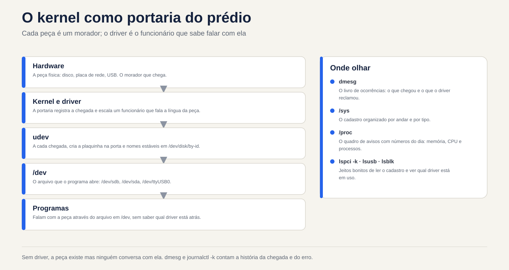
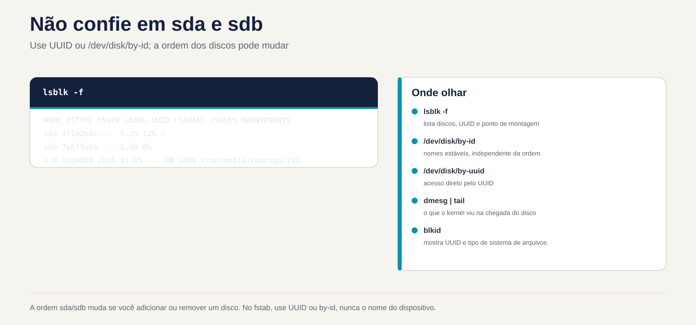

# Lezione 5.1 · Hardware attraverso il kernel

Il kernel è ciò che comunica con l'hardware. Tutto ciò che vede, lo mostra in due luoghi: `/proc` e `/sys`. In questo corso imparerai come chiedere al kernel quale hardware è presente, quale driver si prende cura di ogni pezzo e cosa è successo quando qualcosa è stato collegato. In una VM, vedrai anche che l'"hardware" è quello che Proxmox ha inventato per questo.

> **Chiave di questa lezione:** `lspci -k`, `lsblk`, `lsusb`, `dmesg` (o `journalctl -k`), `/proc/cpuinfo` e `/proc/meminfo`, l'idea di un driver e udev che crea i file in `/dev`. Il resto è approfondito.

| File |  |
| --- | --- |
| Modulo | M5 · Hardware, kernel e virtualizzazione, lezione 1 di 3 |
| Quando | Settimana 9 |
| Settimana | 9 |
| Tempo | dalle 2h alle 2h30 |
| VM | rocky-lab (201) e debian-lab (202) |
| Prima | Istantanea `m5a1-inicio` in entrambi |
| Prova | LPIC 101.1 |

## 1 Riscaldamento

Rispondi senza cercare. Le risposte sono nella chiave di risposta.

1. Se si collega un nuovo disco a un server connesso, è necessario riavviare affinché Linux possa vedere?
2. Che cos'è un conducente, in una frase?
3. Dove annota il kernel ciò che è accaduto dall'avvio: in un file di registro comune o altrove?

## 2 Perché è importante

| Situazione attuale | Cosa fai con questa lezione |
| --- | --- |
| Il cliente dice che "la scheda di rete è scomparsa" dopo un aggiornamento | `lspci -k` indica se la carta esiste e se un conducente l'ha presa in consegna |
| Hai aggiunto un disco a Proxmox e vuoi conoscerne il nome | `lsblk` e `dmesg` mostrano il nuovo disco, senza riavviare |
| Un server fisico è lento e sospetti che il disco | `dmesg` mostra errori I/O, reset del controller e settori danneggiati |
| È necessario inventariare memoria e CPU per 20 macchine | `/proc/meminfo`, `/proc/cpuinfo` e `lscpu` danno la risposta tramite script |

## 3 Modello mentale

Pensa al kernel come alla **porta d'ingresso di un edificio**:

- Ogni componente hardware è un **residente**. Quando arriva, il concierge registra il suo arrivo nel **libro degli eventi**, che è `dmesg`.
- Per ogni residente, la portineria assegna un **dipendente** che sa come parlare con lui: l'**autista**. Senza dipendente, l'ospite esiste, ma nessuno gli parla.
- `/sys` è l'**anagrafe organizzata** di tutti gli abitanti, per piano e tipologia. `/proc` è la **bacheca** con i numeri del giorno: memoria, CPU e processi.
- **udev** è l'impiegato che, ad ogni arrivo, mette un **cartello sulla porta**, cioè crea il file in `/dev`, come `/dev/sdb`, e gli dà nomi stabili in `/dev/disk/by-id`.

I comandi `lspci`, `lsusb` e `lsblk` sono proprio dei simpatici modi per leggerlo record.



*Senza driver, la parte esiste ma nessuno parla con essa.*

## 4 Elementi essenziali

### /proc e /sys

Entrambi sono file system **virtuali**: non occupano disco e il kernel genera il contenuto quando lo leggi.

| Percorso | Mostra |
| --- | --- |
| `/proc/cpuinfo` | Ogni CPU, il modello e i flag, come `vmx` o `svm` per la virtualizzazione |
| `/proc/meminfo` | Memoria totale, libera e disponibile, cache e scambio |
| `/proc/cmdline` | I parametri con cui è nato il kernel (4.4) |
| `/proc/partitions` | I dischi e le partizioni conosciuti dal kernel |
| `/proc/interrupts` e `/proc/ioports` | Interrupt e porte I/O che rientrano nel test |
| `/sys/class/net/` | Una cartella per scheda di rete |
| `/sys/block/` | Una cartella per disco |
| `/sys/bus/pci/devices/` | Un elemento per dispositivo PCI |

Scorciatoie che leggono questi file per te: `lscpu`, `free -h` e `lsmem`.

### Ls\*

| Comando | Elenco | La migliore opzione |
| --- | --- | --- |
| `lspci` | Dispositivi PCI: rete, disco, video | `-k` mostra il driver in uso; `-nn` mostra gli ID del produttore e del modello |
| `lsusb` | Dispositivi USB | `-t` viene visualizzato nell'albero |
| `lsblk` | Dischi e partizioni | `-f` mostra il file system e l'UUID |
| `lscpu` | CPU | nessuna opzione |
| `lshw` | Tutti | `-short` ne fornisce una sintesi; necessita di root e talvolta di installazione |

Se `lspci` o `lsusb` non esistono, installare i pacchetti `pciutils` e `usbutils`.

### Cos'è un driver

Un driver è un codice del kernel che sa come comunicare con un tipo di hardware. Può essere **integrato** nel kernel o essere un **modulo** caricato quando appare l'hardware. 5.2 tratta dei moduli. In `lspci -k` la riga *Kernel driver in use* indica chi ha preso in consegna l'apparecchio. Se non appare, nessun driver ha preso il controllo e il dispositivo non funziona.

### dmesg e journalctl -k

Il kernel memorizza i messaggi in un **ring buffer*. Quando l'anello si riempie, quelli più vecchi scompaiono.

```bash
sudo dmesg -T | less          # -T: tempo leggibile
sudo dmesg -w                 # segui in diretta
sudo dmesg -l err,warn        # solo errori e avvertimenti
journalctl -k -b              # messaggi del kernel da questo avvio, tramite journal
journalctl -k -b -1           # dall'avvio precedente, se il journal è persistente
```

`journalctl -k` ha un vantaggio: memorizza i messaggi di avvio precedenti, cosa che `dmesg` non fa.

### udev e /dev

Quando il kernel rileva un dispositivo, avvisa **systemd-udevd**. udev crea il file in `/dev`, modifica i permessi e crea i collegamenti stabili:

```bash
ls -l /dev/disk/by-id/ /dev/disk/by-uuid/ /dev/disk/by-path/
udevadm info /dev/sda          # tutto ciò che udev sa sul disco
sudo udevadm monitor           # mostra eventi dal vivo
```

**Regola pratica:** nomi come `sda` e `sdb` dipendono dall'ordine in cui appaiono i dischi e potrebbero cambiare all'avvio successivo. In `/etc/fstab` e negli script, utilizzare l'UUID o `by-id`.

### Rocky × Debian

| Articolo | Roccioso | Debian |
| --- | --- | --- |
| `dmesg` senza sudo | Di solito funziona | Rifiutato: `kernel.dmesg_restrict = 1` |
| `lspci` con installazione minima | Può mancare: `dnf install pciutils` | Può mancare: `apt install pciutils` |
| regole udev | `/usr/lib/udev/rules.d/` (sistema) e `/etc/udev/rules.d/` (tuo) | Uguale |

### Ciò che è compreso nel test

LPIC 101.1 addebita la differenza tra `/proc`, `/sys` e `/dev`; a cosa servono udev e `udevadm`; i comandi `lspci`, `lsusb`, `lsblk` e `dmesg`; e il concetto di *hotplug* (il dispositivo entra con la macchina accesa) rispetto a *coldplug* (il dispositivo era già presente all'avvio). Amano chiedere dove si trovano le informazioni sull'interruzione: sono in `/proc/interrupts`.

## 5 Laboratorio guidato

### Passaggio 0 · Istantanea e cartella

Sul nodo Proxmox:

```bash
qm snapshot 201 m5a1-inicio
qm snapshot 202 m5a1-inicio
```

Su ciascuna VM:

```bash
mkdir -p ~/lab51 && cd ~/lab51
```

### Passaggio 1 · Inventario tramite /proc

Su entrambe le VM:

```bash
lscpu | head -20
grep -c ^processor /proc/cpuinfo
grep -m1 'model name' /proc/cpuinfo
free -h
grep -E 'MemTotal|MemAvailable|SwapTotal' /proc/meminfo
cat /proc/partitions
lsblk -f
```

Confronta il modello di CPU dei due con quello del nodo Proxmox. Con il tipo di CPU `host` la VM vede lo stesso modello del processore fisico. Nota in `~/lab51/inventario.txt`: CPU, memoria totale, dischi e partizioni.

### Passo 2 · Who's who su PCI e USB

```bash
lspci
lspci -k | grep -A3 -iE 'ethernet|scsi|sata|virtio'
lsusb
lsusb -t
```

Vedrai i dispositivi con il nome *Red Hat, Inc. Virtio*: queste sono le parti virtuali offerte da Proxmox (QEMU), con driver *virtio* sul lato Linux. In `lsusb`, appare un *QEMU USB Tablet*: è il mouse della console noVNC.

Nota: quale driver si prende cura della scheda di rete e quale si prende cura del controller del disco?

### Decidi 1

Nel passo successivo aggiungerai un disco da 1 GB a Debian-Lab, con esso acceso. Innanzitutto rispondi: cosa mostra `lsblk` subito dopo?

- A) Niente di nuovo: il disco appare solo dopo il riavvio.
- B) Un nuovo disco, `sdb` ad esempio, senza partizioni.
- C) Un nuovo disco, già con una partizione formattata.

Selezionare un'opzione prima di procedere.

### Passo 3 · Hotplug live

In debian-lab, aprire **due sessioni SSH**. Nella prima:

```bash
sudo udevadm monitor --udev --subsystem-match=block
```

Nella seconda:

```bash
sudo dmesg -wT
```

Ora aggiungi il disco. Attraverso l'interfaccia Proxmox: VM 202, quindi *Hardware*, *Add* e *Hard Disk*, con bus **SCSI**, memoria `vm-hdd` e dimensione 1 GB. Oppure, nella shell del nodo:

```bash
qm set 202 --scsi1 vm-hdd:1
```

Guarda le due sessioni: `dmesg` mostra il kernel che trova il disco, e `udevadm monitor` mostra l'evento `add` per udev. Fermarli entrambi con `Ctrl+C` e spuntare:

| Se hai selezionato | Risultato | Perché |
| --- | --- | --- |
| A | Sbagliato | Il bus SCSI virtuale avvisa immediatamente il kernel: questo è hotplug |
| B| Capito bene | Il kernel vede il disco e udev crea `/dev/sdb`. Il nuovo disco arriva vuoto |
| C| Sbagliato | Nessuno partiziona o formatta da solo. Dipende da te, sull'M9 |

```bash
lsblk
ls -l /dev/disk/by-id/ | grep -v part
udevadm info /dev/sdb | head -30
```

**Conferma in base alla dimensione** che il disco da 1 GB sia effettivamente `sdb`. Se è un altro nome, utilizzalo nel resto della lezione.

**Per risolvere:** il nuovo disco viene visualizzato senza riavviarsi e il nome `sdX` è solo l'ordine di arrivo. Il nome della stalla è in `/dev/disk/by-id`.

### Decidi 2

Su entrambe le VM, come **utente normale e senza sudo**, eseguirai `dmesg | tail -3`. Cosa succede?

- A) Entrambi mostrano i messaggi.
- B) Entrambi rifiutano.
- C) Uno mostra e l'altro rifiuta.

Controlla prima un'opzione. Quindi eseguirli entrambi e anche `sysctl kernel.dmesg_restrict`.

| Se hai selezionato | Risultato | Perché |
| --- | --- | --- |
| A | Sbagliato | Debian protegge l'anello del kernel dagli utenti ordinari |
| B| Sbagliato, nella maggior parte delle installazioni | Rocky di solito viene fornito con `dmesg_restrict = 0` |
| C| Capito bene | Debian viene fornito con `kernel.dmesg_restrict = 1` e Rocky solitamente con 0. Controlla il valore reale sulle tue VM |

**Per risolvere:** `dmesg` può rivelare indirizzi e dettagli utili a un utente malintenzionato. Ecco perché Debian lo limita. In uno script di monitoraggio, esegui con sudo o usa `journalctl -k` in un gruppo con accesso al journal.

### Passo 4 · Passa attraverso /sys

```bash
ls /sys/class/net/
cat /sys/class/net/*/address
cat /sys/class/net/*/operstate
cat /sys/block/sdb/size              # in settori da 512 byte
echo $(( $(cat /sys/block/sdb/size) * 512 / 1024 / 1024 )) MiB
cat /sys/block/sdb/queue/rotational  # 1 = disco rotante, 0 = SSD o virtuale senza dirlo
readlink -f /sys/class/net/*/device/driver
```

Nota: i `lsblk` e `ip link` che già usi leggono esattamente questi file.

## 6 Interrompi e ripara

Farai in modo che il kernel "dimentichi" il disco di test e poi lo farai cercare di nuovo, senza riavviare. Questo è ciò che fai su un server fisico quando un nuovo disco non viene visualizzato.


*L'ordine sda/sdb cambia se aggiungi o rimuovi un disco. In fstab, usa UUID o by-id.*


**Per prima cosa, controlla di nuovo** con `lsblk` che `sdb` sia il disco da 1 GB e che non abbia nulla montato. Non eseguire mai questa operazione sul disco di sistema.

```bash
lsblk /dev/sdb
echo 1 | sudo tee /sys/block/sdb/device/delete
lsblk
sudo dmesg | tail -5
```

Il disco non è più disponibile per Linux, sebbene sia ancora connesso alla VM. Ora, senza guardare la risposta qui sotto, prova a capire come mandarlo a cercare di nuovo. Suggerimento: il percorso è in `/sys/class/scsi_host/`.

La correzione:

```bash
for h in /sys/class/scsi_host/host*/scan; do echo "- - -" | sudo tee "$h" >/dev/null; done
lsblk
```

I tre trattini significano "qualsiasi canale, qualsiasi destinazione, qualsiasi LUN". Il disco ritorna, a volte con un nome diverso. Pertanto, ancora una volta, gli script e fstab utilizzano l'UUID o `by-id`.

## 7 trappole

- **Affidati a `sda` e `sdb`.** L'ordine può cambiare quando si avvia con un disco in più o in meno. Utilizzare l'UUID o `by-id`.
- **Penso che `dmesg` contenga tutto.** L'anello ha una dimensione fissa e si spegne all'avvio. Per la cronologia, utilizzare `journalctl -k`, con il journal persistente 3.x.
- **Dimentica `-k` in `lspci`.** Senza di esso, vedi l'hardware ma non il driver, che è proprio ciò che conta in un "la scheda è sparita".
- **Esegui `device/delete` sul disco sbagliato.** Il sistema perde il disco con tutto ciò che è montato su di esso. Confermare per dimensione e `lsblk` prima.
- **Modifica file in `/usr/lib/udev/rules.d/`.** Il prossimo aggiornamento sovrascrive. Le sue regole vanno in `/etc/udev/rules.d/`.
- **Aspettatevi di vedere l'hardware fisico in una VM.** All'interno della VM, vedi l'hardware virtuale offerto da Proxmox. Lo stato dei dischi fisici viene controllato nel nodo, non nella VM.

## 8 Quiz

1. Qual è la differenza tra `/proc` e `/sys`, in una frase ciascuno?
2. Quale comando mostra quale driver ha preso il controllo della scheda di rete?
3. Perché non usi `/dev/sdb` in `/etc/fstab`?
4. In quale file sono in uso gli interrupt?
5. Come visualizzare i messaggi del kernel dall'avvio precedente?
6. *Cosa fa udev quando il kernel rileva un nuovo dispositivo?*

## 9 Cola

### Conoscerlo a memoria

| Comando | Fare |
| --- | --- |
| `lspci -k` | dispositivi PCI e il driver per ciascun |
| `lsusb` / `lsusb -t` | Dispositivi USB, in elenco o albero |
| `lsblk -f` | Dischi, partizioni, file system e UUID |
| `lscpu` / `free -h` | CPU e memoria |
| `sudo dmesg -T` / `-w` | Messaggi del kernel, con ora o in tempo reale |
| `journalctl -k -b` / `-b -1` | Messaggi del kernel dall'avvio corrente o precedente |
| `udevadm info /dev/X` / `udevadm monitor` | Cosa sa udev da un dispositivo/eventi live |
| `/dev/disk/by-id`, `by-uuid` | Nomi dischi stabili |

### Da consultare

`lspci -nn`, `lspci -v`, `lshw -short`, `lsmem`, `/proc/interrupts`, `/proc/ioports`, `/proc/dma`, `/sys/class/`, `/sys/bus/pci/devices/`, `/sys/block/*/queue/rotational`, `/sys/class/scsi_host/host*/scan`, `/sys/block/*/device/delete`, `/etc/udev/rules.d/`, `udevadm trigger`, `kernel.dmesg_restrict`.

### Flashcard

| Domanda | Rispondi |
| --- | --- |
| `/proc` e `/sys` occupano il disco? | No: il kernel genera il contenuto al volo |
| Chi crea i file in `/dev`? | udev (`systemd-udevd`) |
| Un nuovo disco in una VM connessa richiede un riavvio? | No: è hotplug |
| Dove sono le regole di amministrazione di udev? | `/etc/udev/rules.d/` |
| Perché `dmesg` fallisce senza sudo su Debian? | `kernel.dmesg_restrict = 1` |

## 10 Lista di controllo e chiusura

- [ ] Ho eseguito l'inventario della CPU, della memoria e del disco utilizzando `/proc` e i comandi `ls*`
- [ ] Ho trovato la scheda di rete e il driver del controller del disco
- [ ] Ho visto un disco attivarsi in `dmesg` e in `udevadm monitor`
- [ ] Capisco perché `dmesg` si comporta diversamente in entrambi distribuzioni
- [ ] Ho fatto in modo che il kernel dimenticasse un disco e lo cercasse di nuovo
- [ ] So perché i nomi `sdX` non sono utili per fstab

**Ultimo esercizio, senza guardare la lezione:** rimuovi il disco di test in modo pulito. Per prima cosa, all'interno di Debian-lab, fai in modo che il kernel lo rilasci:

```bash
echo 1 | sudo tee /sys/block/sdb/device/delete
```

Quindi, nell'interfaccia Proxmox, vai su VM 202, quindi *Hardware*, seleziona il disco `scsi1`, fai clic su *Detach* e poi su *Remove* su *Unused Disk*. Questo cancella il disco di test da 1 GB, che non ha nulla.

**Riavvia e conferenza:** riavvia entrambe le VM e controlla:

```bash
lsblk                            # solo i dischi originali
systemctl is-system-running      # corsa
ls ~/lab51
```

**Termina snapshot**, sul nodo Proxmox:

```bash
qm snapshot 201 m5a1-fim
qm snapshot 202 m5a1-fim
```

## 11 Nella vita reale

**Missione, sola lettura.** Su un server reale che amministri, preferibilmente fisico, esegui semplicemente questi comandi, che non cambiano nada:

```bash
lscpu | grep -E 'Model name|^CPU\(s\)'
free -h
lsblk -o NAME,SIZE,TYPE,MODEL,ROTA,MOUNTPOINTS
lspci -k | grep -A3 -iE 'ethernet|raid|sas|nvme'
sudo dmesg -T -l err,warn | tail -20
journalctl -k -p warning -b --no-pager | tail -20
```

Risposta: i dischi girano o gli SSD? La scheda di rete ha un driver in uso? Ci sono errori e avvisi del kernel relativi al disco, alla memoria o alla rete? Su un server fisico i messaggi con `I/O error`, `reset` o `Machine Check` meritano una conversazione con la persona responsabile. Non cambiare nulla da solo.

**Diario:** scrivi tre righe su ciò che hai imparato oggi e una domanda che ti è rimasta.

**Domani, senza guardare:**

1. Nomina tre file da `/proc` e cosa mostra ciascuno.
2. Scrivere il comando che mostra il driver per ciascun dispositivo PCI.
3. Spiega, in una frase, cosa fa udev quando arriva un disco.

## 12 Approfondisci quando vuoi

- Scrivi una regola udev in `/etc/udev/rules.d/` che dia un nome fisso ad un disco o ad una scheda di rete.
- `udevadm test` e `udevadm trigger` per testare le regole senza collegare nulla.
- Stato fisico dell'hardware: `smartctl` (pacchetto `smartmontools`), `rasdaemon` e messaggi EDAC di memoria.
- `lshw -html` per un inventario a pagina intera.
- *Coldplug*: come udev rielabora i dispositivi che erano già presenti all'avvio.

In DeepTutor: `!explica /proc, /sys e /dev`, `!feynman o que o udev faz`, `!quiz hardware pelo kernel`.

## Risposta commentata

### Riscaldamento

1. In generale, no. SAS, SATA hotplug, NVMe supportato e dischi virtuali vengono visualizzati all'accensione della macchina. Se non compaiono, è possibile richiedere una nuova scansione tramite `/sys`.
2. Un driver è il codice del kernel che sa come comunicare con un tipo di hardware.
3. In un anello di memoria del kernel, letto da `dmesg`. La rivista ne conserva anche una copia, che in `journalctl -k` si legge.

### Quiz

1. `/proc` mostra i processi e i numeri del kernel, come memoria e CPU. `/sys` presenta dispositivi e autisti in modo organizzato, per autobus e per lezione.
2. `lspci -k`, in linea *Driver del kernel in uso*.
3. Perché il nome `sdX` dipende dall'ordine in cui appaiono i dischi e può cambiare. L'UUID e il `by-id` non cambiano.
4. Nel `/proc/interrupts`.
5. `journalctl -k -b -1`, purché il giornale sia persistente.
6. *udev riceve l'evento del kernel, crea il file del dispositivo in /dev con i permessi corretti, aggiunge collegamenti simbolici stabili come /dev/disk/by-id ed esegue eventuali regole di corrispondenza.*

---

<!-- navegacao -->
[← lezione 4.4 · GRUB e accesso di emergenza](4.4-grub-e-acesso-de-emergencia.md) · [Indice lezione](../01-aulas.md) · [lezione 5.2 · Moduli e parametri →](5.2-modulos-e-parametros.md)
