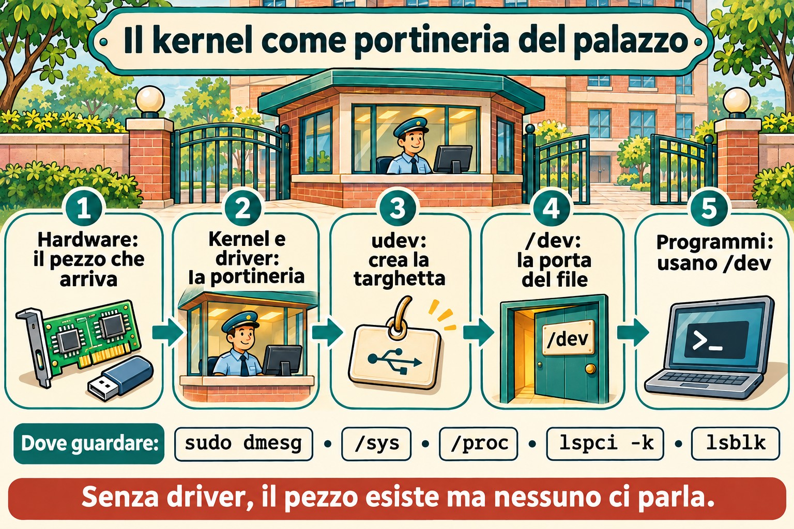
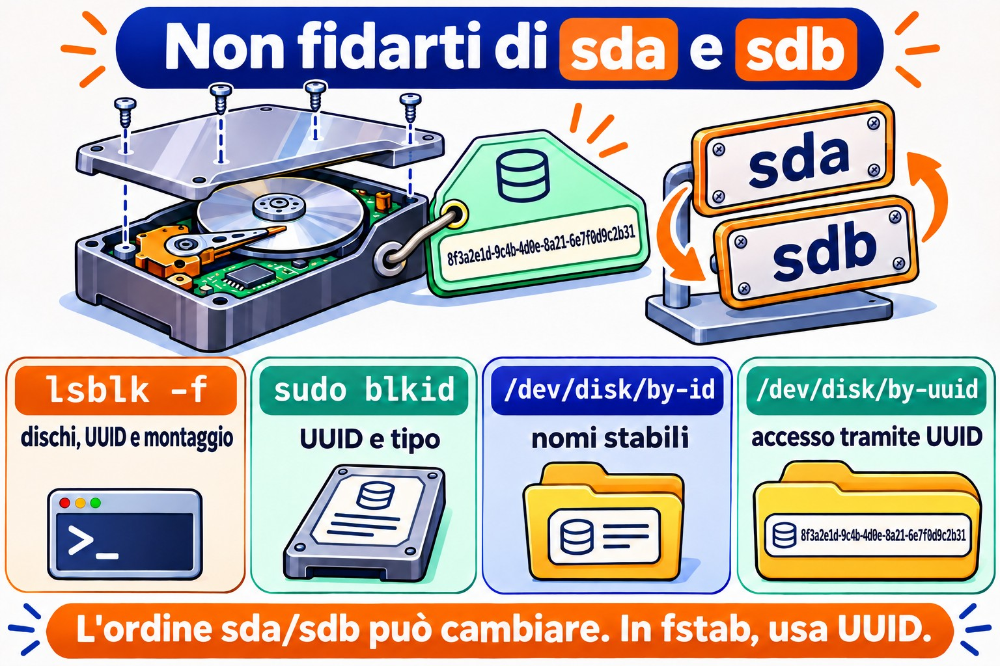

# Lezione 5.1 · L'hardware visto dal kernel

Il kernel è quello che parla con l'hardware. Tutto ciò che vede, lo mostra in due posti: `/proc` e `/sys`. In questa lezione impari a chiedere al kernel quale hardware esiste, quale driver si occupa di ogni componente e cosa è successo quando qualcosa è stato collegato. In una VM vedrai anche che l'"hardware" è quello che Proxmox ha inventato per lei.

> **Il cuore di questa lezione:** `lspci -k`, `lsblk`, `lsusb`, `dmesg` (o `journalctl -k`), `/proc/cpuinfo` e `/proc/meminfo`, l'idea di driver, e udev che crea i file in `/dev`. Il resto è approfondimento.

| Scheda |  |
| --- | --- |
| Modulo | M5 · Hardware, kernel e virtualizzazione, lezione 1 di 3 |
| Quando | Settimana 9 |
| Settimana | 9 |
| Durata | 2 h – 2 h 30 |
| VM | rocky-lab (201) e debian-lab (202) |
| Prima | Snapshot `m5a1-inicio` su entrambe |

## 1 Riscaldamento

Rispondi senza cercare. Le risposte sono nelle Soluzioni.

1. Se colleghi un disco nuovo a un server acceso, devi riavviare perché Linux lo veda?
2. Cos'è un driver, in una frase?
3. Dove annota il kernel ciò che è successo dal boot: in un normale file di log o altrove?

## 2 Perché conta

| Situazione reale | Cosa fai con questa lezione |
| --- | --- |
| Il cliente dice che "la scheda di rete è sparita" dopo un aggiornamento | `lspci -k` mostra se la scheda esiste e se un driver l'ha presa in carico |
| Hai aggiunto un disco su Proxmox e vuoi sapere come si chiama | `lsblk` e `dmesg` mostrano il disco nuovo, senza riavviare |
| Un server fisico è lento e sospetti del disco | `dmesg` mostra errori di I/O, reset del controller e settori danneggiati |
| Devi fare l'inventario di memoria e CPU di 20 macchine | `/proc/meminfo`, `/proc/cpuinfo` e `lscpu` danno la risposta via script |

## 3 Modello mentale

Pensa al kernel come alla **portineria di un palazzo**:

- Ogni componente hardware è un **inquilino**. Quando arriva, la portineria registra l'arrivo nel **registro degli eventi**, che è `dmesg`.
- Per ogni inquilino, la portineria assegna un **addetto** che sa parlargli: il **driver**. Senza addetto, l'inquilino esiste, ma nessuno gli parla.
- `/sys` è l'**anagrafica ordinata** di tutti gli inquilini, per piano e per tipo. `/proc` è la **bacheca** con i numeri del giorno: memoria, CPU e processi.
- **udev** è l'addetto che, a ogni arrivo, mette una **targhetta sulla porta**, cioè crea il file in `/dev`, come `/dev/sdb`, e gli dà nomi stabili in `/dev/disk/by-id`.

I comandi `lspci`, `lsusb` e `lsblk` sono solo modi comodi per leggere quell'anagrafica.



*Senza driver, il componente esiste ma nessuno gli parla.*

## 4 L'essenziale

### /proc e /sys

Sono entrambi file system **virtuali**: non occupano disco, e il kernel genera il contenuto nel momento in cui leggi.

| Percorso | Mostra |
| --- | --- |
| `/proc/cpuinfo` | Ogni CPU, il modello e i flag, come `vmx` o `svm` per la virtualizzazione |
| `/proc/meminfo` | Memoria totale, libera, disponibile, cache e swap |
| `/proc/cmdline` | I parametri con cui è partito il kernel (4.4) |
| `/proc/partitions` | I dischi e le partizioni che il kernel conosce |
| `/proc/interrupts` e `/proc/ioports` | Interrupt e porte di I/O |
| `/sys/class/net/` | Una cartella per ogni scheda di rete |
| `/sys/block/` | Una cartella per ogni disco |
| `/sys/bus/pci/devices/` | Una voce per ogni dispositivo PCI |

Scorciatoie che leggono questi file al posto tuo: `lscpu`, `free -h` e `lsmem`.

### I comandi ls\*

| Comando | Elenca | Opzione più utile |
| --- | --- | --- |
| `lspci` | Dispositivi PCI: rete, disco, video | `-k` mostra il driver in uso; `-nn` mostra gli ID di produttore e modello |
| `lsusb` | Dispositivi USB | `-t` li mostra ad albero |
| `lsblk` | Dischi e partizioni | `-f` mostra il file system e l'UUID |
| `lscpu` | CPU | nessuna opzione |
| `lshw` | Tutto | `-short` dà un riepilogo; richiede root e, a volte, l'installazione |

Se `lspci` o `lsusb` non esistono, installa i pacchetti `pciutils` e `usbutils`.

### Cos'è un driver

Un driver è il codice del kernel che sa parlare con un tipo di hardware. Può essere **integrato** nel kernel oppure essere un **modulo** caricato quando l'hardware compare. I moduli sono nella 5.2. In `lspci -k`, la riga *Kernel driver in use* dice chi ha preso in carico il dispositivo. Se non compare, nessun driver l'ha preso in carico, e il dispositivo non funziona.

### dmesg e journalctl -k

Il kernel conserva i messaggi in un **anello di memoria** (*ring buffer*). Quando l'anello si riempie, i più vecchi spariscono.

```bash
sudo dmesg -T | less          # -T: orario leggibile
sudo dmesg -w                 # segue in tempo reale
sudo dmesg -l err,warn        # solo errori e avvisi
journalctl -k -b              # messaggi del kernel di questo boot, via journal
journalctl -k -b -1           # del boot precedente, se il journal è persistente
```

`journalctl -k` ha un vantaggio: conserva i messaggi dei boot precedenti, cosa che `dmesg` non fa.

### udev e /dev

Quando il kernel rileva un dispositivo, avvisa **systemd-udevd**. udev crea il file in `/dev`, imposta i permessi e crea i link stabili:

```bash
ls -l /dev/disk/by-id/ /dev/disk/by-uuid/ /dev/disk/by-path/
udevadm info /dev/sda          # tutto quello che udev sa sul disco
sudo udevadm monitor           # mostra gli eventi in tempo reale
```

**Regola d'oro:** nomi come `sda` e `sdb` dipendono dall'ordine in cui compaiono i dischi e possono cambiare al prossimo boot. In `/etc/fstab` e negli script, usa l'UUID o il `by-id`.

### Rocky × Debian

| Voce | Rocky | Debian |
| --- | --- | --- |
| `dmesg` senza sudo | Di solito funziona | Rifiutato: `kernel.dmesg_restrict = 1` |
| `lspci` nell'installazione minimale | Può mancare: `dnf install pciutils` | Può mancare: `apt install pciutils` |
| Regole di udev | `/usr/lib/udev/rules.d/` (di sistema) e `/etc/udev/rules.d/` (tue) | Uguali |

## 5 Lab guidato

### Passo 0 · Snapshot e cartella

Sul nodo Proxmox:

```bash
qm snapshot 201 m5a1-inicio
qm snapshot 202 m5a1-inicio
```

In ogni VM:

```bash
mkdir -p ~/lab51 && cd ~/lab51
```

### Passo 1 · Inventario da /proc

In entrambe le VM:

```bash
lscpu | head -20
grep -c ^processor /proc/cpuinfo
grep -m1 'model name' /proc/cpuinfo
free -h
grep -E 'MemTotal|MemAvailable|SwapTotal' /proc/meminfo
cat /proc/partitions
lsblk -f
```

Confronta il modello di CPU delle due VM con quello del nodo Proxmox. Con il tipo di CPU `host`, la VM vede lo stesso modello del processore fisico. Annota in `~/lab51/inventario.txt`: CPU, memoria totale, dischi e partizioni.

### Passo 2 · Chi è chi su PCI e USB

```bash
lspci
lspci -k | grep -A3 -iE 'ethernet|scsi|sata|virtio'
lsusb
lsusb -t
```

Vedrai dispositivi con il nome *Red Hat, Inc. Virtio*: sono i componenti virtuali che Proxmox (QEMU) offre, con driver *virtio* lato Linux. In `lsusb` compare un *QEMU USB Tablet*: è il mouse della console noVNC.

Annota: quale driver gestisce la scheda di rete, e quale gestisce il controller del disco?

### Decidi 1

Nel prossimo passo aggiungerai un disco da 1 GB alla debian-lab, con la macchina accesa. Prima, rispondi: cosa mostra `lsblk` subito dopo?

- A) Niente di nuovo: il disco compare solo dopo il riavvio.
- B) Un disco nuovo, `sdb` per esempio, senza partizioni.
- C) Un disco nuovo, già con una partizione formattata.

Scegli un'opzione prima di continuare.

### Passo 3 · Hotplug in tempo reale

Sulla debian-lab, apri **due sessioni SSH**. Nella prima:

```bash
sudo udevadm monitor --udev --subsystem-match=block
```

Nella seconda:

```bash
sudo dmesg -wT
```

Ora aggiungi il disco. Dall'interfaccia di Proxmox: VM 202, poi *Hardware*, *Add* e *Hard Disk*, con bus **SCSI**, storage `vm-hdd` e dimensione 1 GB. Oppure, nella shell del nodo:

```bash
qm set 202 --scsi2 vm-hdd:1
```

Guarda le due sessioni: `dmesg` mostra il kernel che trova il disco, e `udevadm monitor` mostra l'evento `add` per udev. Ferma entrambi con `Ctrl+C` e controlla:

| Se hai scelto | Risultato | Perché |
| --- | --- | --- |
| A | Sbagliato | Il bus SCSI virtuale avvisa subito il kernel: questo è hotplug |
| B | Giusto | Il kernel vede il disco, e udev crea `/dev/sdb`. Un disco nuovo arriva vuoto |
| C | Sbagliato | Nessuno partiziona né formatta da solo. Tocca a te, nell'M9 |

```bash
lsblk
ls -l /dev/disk/by-id/ | grep -v part
udevadm info /dev/sdb | head -30
```

**Verifica dalla dimensione** quale nome ha preso il disco da 1 GB. Il disco da 2 GB della Lezione 2.2 è già su `scsi1` e di solito è `sdb`; allora quello nuovo diventa `sdc`. Usa il nome che hai visto nel resto della lezione al posto di `sdb`, e non toccare il disco da 2 GB: è dell'M9.

**Da ricordare:** un disco nuovo compare senza riavviare, e il nome `sdX` è solo l'ordine di arrivo. Il nome stabile è in `/dev/disk/by-id`.

### Decidi 2

In entrambe le VM, come **utente normale e senza sudo**, esegui `dmesg | tail -3`. Cosa succede?

- A) Entrambe mostrano i messaggi.
- B) Entrambe rifiutano.
- C) Una mostra, e l'altra rifiuta.

Scegli un'opzione prima di continuare. Poi eseguilo su entrambe, e anche `sysctl kernel.dmesg_restrict`.

| Se hai scelto | Risultato | Perché |
| --- | --- | --- |
| A | Sbagliato | Debian protegge l'anello del kernel dagli utenti normali |
| B | Sbagliato, nella maggior parte delle installazioni | Rocky di solito ha `dmesg_restrict = 0` |
| C | Giusto | Debian ha `kernel.dmesg_restrict = 1`, e Rocky normalmente 0. Controlla il valore reale nelle tue VM |

**Da ricordare:** `dmesg` può rivelare indirizzi e dettagli utili a un attaccante. Per questo Debian lo limita. In uno script di monitoraggio, eseguilo con sudo o usa `journalctl -k` in un gruppo con accesso al journal.

### Passo 4 · Un giro in /sys

```bash
ls /sys/class/net/
cat /sys/class/net/*/address
cat /sys/class/net/*/operstate
cat /sys/block/sdb/size              # in settori da 512 byte
echo $(( $(cat /sys/block/sdb/size) * 512 / 1024 / 1024 )) MiB
cat /sys/block/sdb/queue/rotational  # 1 = disco rotante, 0 = SSD o virtuale che non lo dice
readlink -f /sys/class/net/*/device/driver
```

Nota: `lsblk` e `ip link`, che già usi, leggono esattamente questi file.

## 6 Rompi e ripara

Farai "dimenticare" al kernel il disco di test e poi gli farai cercarlo di nuovo, senza riavviare. È quello che si fa su un server fisico quando un disco nuovo non compare.


*L'ordine sda/sdb cambia se aggiungi o rimuovi un disco. In fstab, usa UUID o by-id.*


**Prima, ricontrolla** con `lsblk` che `sdb` sia il disco da 1 GB e che non abbia nulla montato. Non farlo mai sul disco di sistema.

```bash
lsblk /dev/sdb
echo 1 | sudo tee /sys/block/sdb/device/delete
lsblk
sudo dmesg | tail -5
```

Il disco è sparito per Linux, anche se resta collegato alla VM. Ora, senza guardare la risposta qui sotto, prova a scoprire come dirgli di cercarlo di nuovo. Suggerimento: il percorso è in `/sys/class/scsi_host/`.

La riparazione:

```bash
for h in /sys/class/scsi_host/host*/scan; do echo "- - -" | sudo tee "$h" >/dev/null; done
lsblk
```

I tre trattini significano "qualsiasi canale, qualsiasi target, qualsiasi LUN". Il disco ritorna, a volte con un altro nome. Per questo, ancora una volta, script e fstab usano UUID o `by-id`.

## 7 Trappole

- **Fidarsi di `sda` e `sdb`.** L'ordine può cambiare in un boot con un disco in più o in meno. Usa UUID o `by-id`.
- **Pensare che `dmesg` conservi tutto.** L'anello ha una dimensione fissa e si azzera al boot. Per lo storico, usa `journalctl -k`, con il journal persistente della 3.x.
- **Dimenticare `-k` in `lspci`.** Senza, vedi l'hardware ma non il driver, che è proprio ciò che conta in un "la scheda è sparita".
- **Eseguire `device/delete` sul disco sbagliato.** Il sistema perde il disco con tutto ciò che c'è montato sopra. Verifica dalla dimensione e da `lsblk` prima.
- **Modificare i file in `/usr/lib/udev/rules.d/`.** Il prossimo aggiornamento li sovrascrive. Le tue regole vanno in `/etc/udev/rules.d/`.
- **Aspettarsi di vedere l'hardware fisico in una VM.** Dentro la VM vedi l'hardware virtuale che Proxmox offre. La salute dei dischi fisici si controlla sul nodo, non nella VM.

## 8 Quiz

1. Qual è la differenza tra `/proc` e `/sys`, in una frase ciascuno?
2. Quale comando mostra quale driver ha preso in carico la scheda di rete?
3. Perché non si usa `/dev/sdb` in `/etc/fstab`?
4. In quale file ci sono gli interrupt in uso?
5. Come vedere i messaggi del kernel del boot precedente?
6. *What does udev do when the kernel detects a new device?*

## 9 Promemoria

### Da sapere a memoria

| Comando | Fa |
| --- | --- |
| `lspci -k` | Dispositivi PCI e il driver di ciascuno |
| `lsusb` / `lsusb -t` | Dispositivi USB, in elenco o ad albero |
| `lsblk -f` | Dischi, partizioni, file system e UUID |
| `lscpu` / `free -h` | CPU e memoria |
| `sudo dmesg -T` / `-w` | Messaggi del kernel, con orario, o in tempo reale |
| `journalctl -k -b` / `-b -1` | Messaggi del kernel di questo boot o del precedente |
| `udevadm info /dev/X` / `udevadm monitor` | Cosa sa udev di un dispositivo / eventi in tempo reale |
| `/dev/disk/by-id`, `by-uuid` | Nomi stabili dei dischi |

### Da consultare

`lspci -nn`, `lspci -v`, `lshw -short`, `lsmem`, `/proc/interrupts`, `/proc/ioports`, `/proc/dma`, `/sys/class/`, `/sys/bus/pci/devices/`, `/sys/block/*/queue/rotational`, `/sys/class/scsi_host/host*/scan`, `/sys/block/*/device/delete`, `/etc/udev/rules.d/`, `udevadm trigger`, `kernel.dmesg_restrict`.

### Flashcard

| Domanda | Risposta |
| --- | --- |
| `/proc` e `/sys` occupano disco? | No: il kernel genera il contenuto al momento |
| Chi crea i file in `/dev`? | udev (`systemd-udevd`) |
| Un disco nuovo in una VM accesa richiede il reboot? | No: è hotplug |
| Dove stanno le regole udev dell'amministratore? | `/etc/udev/rules.d/` |
| Perché `dmesg` fallisce senza sudo su Debian? | `kernel.dmesg_restrict = 1` |

## 10 Checklist e chiusura

- [ ] Ho fatto l'inventario di CPU, memoria e dischi da `/proc` e con i comandi `ls*`
- [ ] Ho trovato il driver della scheda di rete e del controller del disco
- [ ] Ho visto un disco entrare in tempo reale in `dmesg` e in `udevadm monitor`
- [ ] Ho capito perché `dmesg` si comporta in modo diverso nelle due distro
- [ ] Ho fatto dimenticare un disco al kernel e gliel'ho fatto cercare di nuovo
- [ ] So perché i nomi `sdX` non vanno bene per fstab

**Ultimo esercizio, senza guardare la lezione:** rimuovi il disco di test nel modo pulito. Prima, dentro la debian-lab, fai in modo che il kernel lo rilasci:

```bash
echo 1 | sudo tee /sys/block/sdb/device/delete
```

Poi, nell'interfaccia di Proxmox, vai su VM 202, poi *Hardware*, seleziona il disco `scsi2`, clicca *Detach* e poi *Remove* sul *Unused Disk*. Questo cancella il disco di test da 1 GB, che è vuoto.

**Riavvio e verifica:** riavvia le due VM e controlla:

```bash
lsblk                            # só os discos originais
systemctl is-system-running      # running
ls ~/lab51
```

**Snapshot di fine**, nel nodo Proxmox:

```bash
qm snapshot 201 m5a1-fim
qm snapshot 202 m5a1-fim
```

## 11 Nella vita reale

**Missione, sola lettura.** Su un server reale che amministri, meglio se fisico, esegui soltanto questi comandi, che non cambiano nulla:

```bash
lscpu | grep -E 'Model name|^CPU\(s\)'
free -h
lsblk -o NAME,SIZE,TYPE,MODEL,ROTA,MOUNTPOINTS
lspci -k | grep -A3 -iE 'ethernet|raid|sas|nvme'
sudo dmesg -T -l err,warn | tail -20
journalctl -k -p warning -b --no-pager | tail -20
```

Rispondi: i dischi sono rotanti o SSD? La scheda di rete ha un driver in uso? Gli errori e gli avvisi del kernel parlano di disco, memoria o rete? Su un server fisico, messaggi con `I/O error`, `reset` o `Machine Check` meritano una chiacchierata con il responsabile. Non cambiare nulla da solo.

**Diario:** scrivi tre righe su ciò che hai imparato oggi e un dubbio che ti è rimasto.

**Domani, senza guardare:**

1. Di' tre file di `/proc` e cosa mostra ciascuno.
2. Scrivi il comando che mostra il driver di ogni dispositivo PCI.
3. Spiega, in una frase, cosa fa udev quando arriva un disco.

## 12 Approfondire quando vuoi

- Scrivere una regola udev in `/etc/udev/rules.d/` che dia un nome fisso a un disco o a una scheda di rete.
- `udevadm test` e `udevadm trigger` per provare le regole senza collegare nulla.
- Salute dell'hardware fisico: `smartctl` (pacchetto `smartmontools`), `rasdaemon` e i messaggi EDAC della memoria.
- `lshw -html` per un inventario completo in forma di pagina.
- *Coldplug*: come udev rielabora, al boot, i dispositivi che c'erano già.

In DeepTutor: `!explica /proc, /sys e /dev`, `!feynman o que o udev faz`, `!quiz hardware pelo kernel`.

## Soluzioni commentate

### Riscaldamento

1. In genere no. Dischi SAS, SATA con hotplug, NVMe con supporto e dischi virtuali compaiono a macchina accesa. Se non compaiono, si può chiedere una nuova scansione tramite `/sys`.
2. Un driver è il codice del kernel che sa parlare con un tipo di hardware.
3. In un anello di memoria del kernel, letto da `dmesg`. Anche il journal ne conserva una copia, che `journalctl -k` legge.

### Quiz

1. `/proc` mostra processi e numeri del kernel, come memoria e CPU. `/sys` mostra i dispositivi e i driver in modo ordinato, per bus e per tipo.
2. `lspci -k`, nella riga *Kernel driver in use*.
3. Perché il nome `sdX` dipende dall'ordine in cui compaiono i dischi e può cambiare. L'UUID e il `by-id` non cambiano.
4. In `/proc/interrupts`.
5. `journalctl -k -b -1`, purché il journal sia persistente.
6. *udev receives the kernel event, creates the device file in /dev with the right permissions, adds stable symlinks such as /dev/disk/by-id, and runs any matching rules.*

---

<!-- navegacao -->
[← Lezione 4.4 · GRUB e accesso di emergenza](4.4-grub-e-acesso-de-emergencia.md) · [Indice delle lezioni](../01-aulas.md) · [Lezione 5.2 · Moduli e parametri →](5.2-modulos-e-parametros.md)
