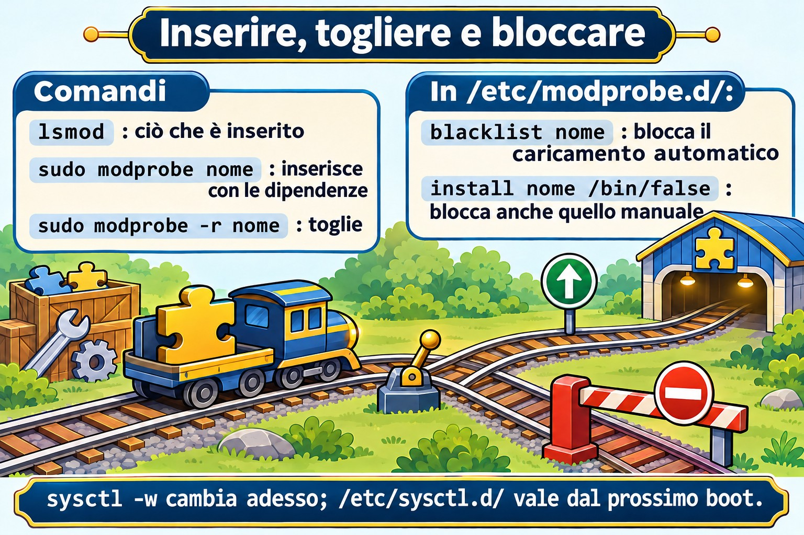

# Lezione 5.2 · Moduli e parametri

Nella 5.1 hai visto che ogni componente hardware ha bisogno di un driver, e che molti driver sono **moduli**: pezzi di kernel caricati quando servono. In questa lezione impari a elencare, caricare, scaricare, configurare e bloccare i moduli. Impari anche a cambiare il comportamento del kernel in funzione con `sysctl`, e a far sopravvivere la modifica al reboot.

> **Il cuore di questa lezione:** `lsmod`, `modinfo`, `modprobe` e `modprobe -r`; i file in `/etc/modprobe.d/` (opzioni e blacklist) e in `/etc/modules-load.d/` (caricare al boot); `sysctl` e `sysctl -w`; e i file in `/etc/sysctl.d/` applicati con `sysctl --system`. Il resto è approfondimento.

| Scheda |  |
| --- | --- |
| Modulo | M5 · Hardware, kernel e virtualizzazione, lezione 2 di 3 |
| Quando | Settimana 9 |
| Settimana | 9 |
| Durata | 2 h – 2 h 30 |
| VM | rocky-lab (201) e debian-lab (202) |
| Prima | Snapshot `m5a2-inicio` su entrambe |

## 1 Riscaldamento

Rispondi senza cercare. Le risposte sono nelle Soluzioni.

1. Per cambiare il driver di una scheda di rete, bisogna ricompilare il kernel?
2. Un valore cambiato con `sysctl -w` sopravvive al reboot?
3. Se metti un modulo nella *blacklist*, è ancora possibile caricarlo a mano?

## 2 Perché conta

| Situazione reale | Cosa fai con questa lezione |
| --- | --- |
| Il driver di una scheda blocca il server dopo un aggiornamento | Blocchi il modulo e ne usi un altro, senza ricompilare nulla |
| Il firewall deve instradare pacchetti tra due reti | Attivi `net.ipv4.ip_forward` in modo permanente |
| Il database chiede un `vm.swappiness` basso e più file aperti | Regoli i parametri in un file in `/etc/sysctl.d/` |
| Un audit chiede che `usb-storage` resti disattivato | Blocchi il modulo davvero, e non solo con la blacklist |

## 3 Modello mentale

Pensa al kernel come a un **coltellino svizzero con lame a incastro**:

- Il **manico** è il kernel di base, che parte al boot.
- Ogni **lama** è un modulo, un file `.ko` in `/lib/modules/$(uname -r)/`. La incastri (`modprobe`) e la tiri via (`modprobe -r`) a coltellino aperto.
- Alcune lame hanno bisogno di altre per funzionare: sono le **dipendenze**. `modprobe` incastra entrambe, `insmod` no.
- Ogni lama ha le sue **regolazioni**, cioè i parametri del modulo. Le scegli quando la incastri oppure le lasci annotate in `/etc/modprobe.d/`.
- `sysctl` è il **pannello di regolazione del manico**: il comportamento generale del kernel, come rete, memoria e sicurezza. Compare come file in `/proc/sys/`.


*Il manico parte al boot; ogni lama è un modulo che incastri e tiri via.*

## 4 L'essenziale

### Vedere i moduli

```bash
uname -r                       # versão do kernel em uso
lsmod                          # módulos carregados, tamanho e quem os usa
lsmod | grep virtio
sudo modinfo virtio_net             # arquivo, descrição, licença, dependências, parâmetros
sudo modinfo -p e1000               # só os parâmetros
ls /sys/module/virtio_net/parameters/   # valores em uso agora
```

In `lsmod`, la colonna *Used by* dice quanti utilizzatori e quali moduli dipendono da quello. Un modulo in uso non può essere scaricato.

### Caricare e scaricare

| Comando | Fa | Nota |
| --- | --- | --- |
| `modprobe nome` | Carica il modulo e le dipendenze | Il modo giusto |
| `modprobe nome opcao=valor` | Carica con un parametro | Vale fino allo scaricamento |
| `modprobe -r nome` | Scarica il modulo e le dipendenze che restano inutilizzate | Fallisce se è in uso |
| `insmod /caminho/arquivo.ko` | Carica un file, senza risolvere le dipendenze | Basta saperlo riconoscere; quasi mai si usa |
| `rmmod nome` | Scarica un solo modulo | Basta saperlo riconoscere |
| `depmod -a` | Ricalcola le dipendenze in `modules.dep` | I pacchetti del kernel lo eseguono già |

### Configurare in modo permanente

| File | A cosa serve | Esempio di riga |
| --- | --- | --- |
| `/etc/modprobe.d/*.conf` | Opzioni predefinite di un modulo | `options dummy numdummies=2` |
| `/etc/modprobe.d/*.conf` | Impedire il caricamento **automatico** | `blacklist dummy` |
| `/etc/modprobe.d/*.conf` | Impedire **qualsiasi** caricamento | `install dummy /bin/false` |
| `/etc/modules-load.d/*.conf` | Caricare al boot | una sola riga con `dummy` |

La differenza tra `blacklist` e `install ... /bin/false` è la trappola più comune. La `blacklist` impedisce solo che il modulo venga caricato **da solo**, quando l'hardware compare. Un `modprobe` a mano, o un altro modulo che ne dipenda, lo carica comunque. Per bloccarlo davvero, usa entrambe le righe.

Se il modulo entra nell'initramfs, la modifica vale al prossimo boot solo dopo aver rigenerato l'initramfs: `dracut -f` su Rocky e `update-initramfs -u` su Debian. Li hai visti entrambi nella 4.1.

### sysctl: le regolazioni del kernel

```bash
sudo sysctl -a | wc -l                          # centenas de regulagens
sudo sysctl net.ipv4.ip_forward                 # ler uma
cat /proc/sys/net/ipv4/ip_forward          # o mesmo valor, como arquivo
sudo sysctl -w vm.swappiness=10            # mudar agora, até o reboot
```

Il nome con i punti corrisponde al percorso in `/proc/sys/`, con le barre: `net.ipv4.ip_forward` è il file `/proc/sys/net/ipv4/ip_forward`.

Perché la modifica resti, crea un file in `/etc/sysctl.d/`, che finisca in `.conf`:

```bash
echo 'vm.swappiness = 10' | sudo tee /etc/sysctl.d/90-lab.conf
sudo sysctl --system          # aplica todos os arquivos, na ordem, e mostra cada um
```

I file vengono letti in ordine alfabetico, e l'ultimo valore vince. Per questo i nomi iniziano con un numero. Al boot, ad applicarli è `systemd-sysctl.service`.

### Rocky × Debian

| Voce | Rocky | Debian |
| --- | --- | --- |
| Moduli | `/lib/modules/$(uname -r)/`, file `.ko.xz` | `/lib/modules/$(uname -r)/`, `.ko` o compressi, a seconda della versione |
| Rigenerare l'initramfs | `sudo dracut -f` | `sudo update-initramfs -u` |
| `/etc/sysctl.conf` | Esiste, ma si raccomanda `/etc/sysctl.d/` | Nelle versioni nuove può anche non esistere. Usa `/etc/sysctl.d/` |
| Valori predefiniti del sistema | `/usr/lib/sysctl.d/` | `/usr/lib/sysctl.d/` |

## 5 Lab guidato

Il modulo di allenamento è `dummy`. Crea schede di rete finte, non dipende dall'hardware e non disturba nulla se qualcosa va storto.

### Passo 0 · Snapshot e cartella

Sul nodo Proxmox:

```bash
qm snapshot 201 m5a2-inicio
qm snapshot 202 m5a2-inicio
```

In ogni VM:

```bash
mkdir -p ~/lab52 && cd ~/lab52
```

### Passo 1 · Conoscere ciò che è caricato

In entrambe le VM:

```bash
uname -r
lsmod | wc -l
lsmod | head -15
lsmod | grep -E 'virtio|scsi'
sudo modinfo virtio_net | grep -E '^(filename|description|depends|parm)'
sudo modinfo dummy | grep -E '^(filename|description|parm)'
```

Annota in `~/lab52/notas.txt`: quanti moduli ha caricati ogni VM, in quale file sta `dummy`, e quale parametro accetta.

### Passo 2 · Caricare, usare e scaricare

```bash
lsmod | grep dummy                 # nada
sudo modprobe dummy
lsmod | grep dummy
ip -br link show type dummy        # apareceu dummy0
sudo modprobe -r dummy
ip -br link show type dummy        # sumiu
```

Ora, con un parametro:

```bash
sudo modprobe dummy numdummies=3
ip -br link show type dummy        # dummy0, dummy1 e dummy2
cat /sys/module/dummy/parameters/numdummies
sudo modprobe -r dummy
```

### Passo 3 · Rendere permanente

```bash
echo 'options dummy numdummies=2' | sudo tee /etc/modprobe.d/lab-dummy.conf
echo 'dummy' | sudo tee /etc/modules-load.d/lab-dummy.conf
sudo systemctl reboot
```

Dopo il reboot:

```bash
ip -br link show type dummy        # dummy0 e dummy1, sem você fazer nada
systemctl status systemd-modules-load --no-pager
```

A caricarlo è stato `systemd-modules-load.service`, che legge `/etc/modules-load.d/`. Le opzioni sono arrivate da `/etc/modprobe.d/`.

### Decidi 1

Aggiungi una blacklist e prova a caricare a mano:

```bash
echo 'blacklist dummy' | sudo tee /etc/modprobe.d/lab-bloqueio.conf
sudo modprobe -r dummy
```

Prima di eseguire `sudo modprobe dummy`, rispondi: cosa succede?

- A) Il modulo si carica normalmente.
- B) `modprobe` rifiuta, perché il modulo è nella blacklist.
- C) Il modulo si carica, ma senza le opzioni di `lab-dummy.conf`.

Scegli un'opzione prima di continuare. Poi esegui `sudo modprobe dummy` e `ip -br link show type dummy`.

| Se hai scelto | Risultato | Perché |
| --- | --- | --- |
| A | Giusto | La blacklist impedisce solo il caricamento automatico tramite l'alias dell'hardware. Una richiesta esplicita passa |
| B | Sbagliato | È quello che quasi tutti si aspettano, ed è per questo che frega la gente in un audit |
| C | Sbagliato | Le opzioni continuano a valere: compaiono `dummy0` e `dummy1` |

Ora blocca davvero:

```bash
echo 'install dummy /bin/false' | sudo tee -a /etc/modprobe.d/lab-bloqueio.conf
sudo modprobe -r dummy
sudo modprobe dummy                # agora falha
echo $?
```

**Da ricordare:** per disattivare un modulo in un audit, usa `blacklist` **e** `install nome /bin/false`. Se è nell'initramfs, rigenera l'initramfs.

### Passo 4 · sysctl

```bash
sudo sysctl vm.swappiness net.ipv4.ip_forward
cat /proc/sys/vm/swappiness
sudo sysctl -w vm.swappiness=10
cat /proc/sys/vm/swappiness
```

### Decidi 2

Hai cambiato `vm.swappiness` con `sysctl -w` e non hai creato nessun file. Dopo il reboot, qual è il valore?

- A) Resta 10.
- B) Torna al predefinito della distro.
- C) Diventa 0, perché il valore è andato perso.

Scegli un'opzione prima di continuare. Poi riavvia e controlla con `sysctl vm.swappiness`.

| Se hai scelto | Risultato | Perché |
| --- | --- | --- |
| A | Sbagliato | `sysctl -w` cambia solo la memoria del kernel in funzione |
| B | Giusto | Al boot valgono i predefiniti del kernel e i file in `sysctl.d`. Su Rocky, `tuned` può avere un suo predefinito, come 30 nel profilo per VM |
| C | Sbagliato | Non si perde nulla: il kernel riparte di nuovo dal predefinito |

Ora rendilo permanente:

```bash
echo 'vm.swappiness = 10' | sudo tee /etc/sysctl.d/90-lab.conf
sudo sysctl --system | tail -5
sudo systemctl reboot
```

Dopo il reboot, `sysctl vm.swappiness` mostra 10.

**Da ricordare:** `sysctl -w` serve per provare. Per renderlo permanente, usa un file in `/etc/sysctl.d/` e `sysctl --system`.

## 6 Rompi e ripara

In questo guasto ci sono due problemi insieme. Sulla rocky-lab, `lab-bloqueio.conf` impedisce già `dummy`, ma `modules-load.d` chiede ancora di caricarlo al boot. Aggiungi anche un errore di battitura in sysctl:


*modprobe rispetta le dipendenze; insmod no. blacklist impedisce solo il caricamento automatico.*


```bash
echo 'vm.swapiness = 20' | sudo tee /etc/sysctl.d/91-lab-erro.conf
sudo systemctl reboot
```

Dopo il reboot, indaga senza guardare la riparazione:

```bash
systemctl --failed
journalctl -b -u systemd-modules-load --no-pager
sudo sysctl --system 2>&1 | grep -i -E 'error|cannot|invalid'
```

`systemd-modules-load` dovrebbe lamentarsi di non essere riuscito a inserire `dummy`, e `sysctl --system` dovrebbe dire che `/proc/sys/vm/swapiness` non esiste. Sono due casi comuni: qualcuno blocca un modulo e dimentica chi lo richiedeva, oppure scrive un parametro sbagliato e non controlla mai.

La riparazione:

```bash
sudo rm /etc/modules-load.d/lab-dummy.conf
sudo rm /etc/sysctl.d/91-lab-erro.conf
sudo systemctl reset-failed
sudo systemctl restart systemd-modules-load
sudo sysctl --system | grep -i swap
systemctl --failed
```

La lezione: dopo aver toccato `modprobe.d`, `modules-load.d` o `sysctl.d`, esegui `sysctl --system` e guarda `systemctl --failed` prima di andartene.

## 7 Trappole

- **Credere che la blacklist blocchi.** Impedisce solo il caricamento automatico. Per bloccare, usa anche `install nome /bin/false`.
- **Dimenticare l'initramfs.** Un modulo di disco o di rete caricato nell'initramfs ignora la modifica finché non esegui `dracut -f` o `update-initramfs -u`.
- **Usare `sysctl -w` e dimenticare il file.** Funziona oggi e sparisce al prossimo reboot, proprio quando nessuno se lo ricorda più.
- **Modificare `/usr/lib/sysctl.d/`.** È del pacchetto, e l'aggiornamento lo sovrascrive. Il tuo posto è `/etc/sysctl.d/`.
- **File senza `.conf` in fondo.** `sysctl.d`, `modprobe.d` e `modules-load.d` ignorano i file con un'altra estensione.
- **Su Rocky, dimenticare `tuned`.** Tocca anche i parametri del kernel. Di default, riapplica dopo i tuoi file di `sysctl.d`, ma controlla con `tuned-adm active` quando un valore non torna.
- **Scaricare il modulo della scheda di rete via SSH.** La sessione cade insieme. Fallo dalla console.

## 8 Quiz

1. Qual è la differenza tra `modprobe` e `insmod`?
2. Qual è la differenza tra `blacklist dummy` e `install dummy /bin/false`?
3. Dove si mette un modulo perché venga caricato al boot?
4. Come rendere permanente `vm.swappiness = 10` e applicarlo senza riavviare?
5. Quale file in `/proc/sys/` corrisponde a `net.ipv4.ip_forward`?
6. *Why can `modprobe -r` fail on a loaded module?*

## 9 Promemoria

### Da sapere a memoria

| Comando o file | Fa |
| --- | --- |
| `lsmod` / `modinfo nome` | Elenca i moduli caricati / mostra i dettagli di uno |
| `modprobe nome op=valor` / `modprobe -r nome` | Carica con le dipendenze / scarica |
| `/etc/modprobe.d/*.conf` | `options`, `blacklist` e `install nome /bin/false` |
| `/etc/modules-load.d/*.conf` | Moduli caricati al boot |
| `sysctl chave` / `sysctl -w chave=valor` | Legge / cambia fino al reboot |
| `/etc/sysctl.d/*.conf` + `sysctl --system` | Cambia in modo permanente e applica adesso |

### Da consultare

`insmod`, `rmmod`, `depmod -a`, `/lib/modules/$(uname -r)/`, `modules.dep`, `/sys/module/*/parameters/`, `modprobe -c`, `modprobe --show-depends`, `dracut -f`, `update-initramfs -u`, `/usr/lib/sysctl.d/`, `sysctl -p arquivo`, `systemd-sysctl.service`, `systemd-modules-load.service`, `tuned-adm active`, `/proc/sys/kernel/tainted`.

### Flashcard

| Domanda | Risposta |
| --- | --- |
| `modprobe` risolve le dipendenze? | Sì; `insmod` no |
| La blacklist impedisce un `modprobe` a mano? | No |
| Chi carica `modules-load.d` al boot? | `systemd-modules-load.service` |
| Chi applica `sysctl.d` al boot? | `systemd-sysctl.service` |
| `net.ipv4.ip_forward` come file è... | `/proc/sys/net/ipv4/ip_forward` |

## 10 Checklist e chiusura

- [ ] Ho elencato i moduli e letto i dettagli di uno con `modinfo`
- [ ] Ho caricato e scaricato `dummy`, con e senza parametro
- [ ] Ho fatto caricare un modulo al boot con le opzioni
- [ ] Ho visto la blacklist lasciar passare un `modprobe` a mano e ho bloccato davvero
- [ ] Ho cambiato un parametro del kernel per un boot e in modo permanente
- [ ] Ho trovato e riparato un modulo bloccato e un parametro scritto male

**Ultimo esercizio, senza guardare la lezione:** pulisci le due VM. Elimina i file `lab-*` che hai creato in `/etc/modprobe.d/`, `/etc/modules-load.d/` e `/etc/sysctl.d/`, uno per uno e per nome. Poi applica di nuovo sysctl e scarica `dummy`. Sulla debian-lab non c'è stato il guasto, ma i file dei Passi 3 e 4 ci sono comunque.

**Riavvio e verifica:** riavvia le due VM e controlla:

```bash
ls /etc/modprobe.d/ /etc/modules-load.d/ /etc/sysctl.d/   # nenhum lab-* nem 90-lab
lsmod | grep dummy                                         # nada
systemctl --failed                                         # vazio
ls ~/lab52
```

**Snapshot di fine**, nel nodo Proxmox:

```bash
qm snapshot 201 m5a2-fim
qm snapshot 202 m5a2-fim
```

## 11 Nella vita reale

**Missione, sola lettura.** Su un server reale che amministri, esegui soltanto questi comandi, che non cambiano nulla:

```bash
lsmod | wc -l
grep -rv '^#' /etc/modprobe.d/ /etc/modules-load.d/ 2>/dev/null | grep -v ':$'
grep -rv '^#' /etc/sysctl.d/ /etc/sysctl.conf 2>/dev/null | grep -v ':$'
/usr/sbin/sysctl net.ipv4.ip_forward vm.swappiness fs.file-max
cat /proc/sys/kernel/tainted
systemctl --failed
```

Rispondi: ci sono moduli bloccati o caricati a forza? Qualcuno ha documentato perché? `ip_forward` è attivo, e la macchina dovrebbe fare routing? `tainted` dà 0? Se non dà 0, è stato caricato qualche modulo esterno al kernel ufficiale, come un driver del produttore. Non è un errore, ma vale la pena annotarlo. Non cambiare nulla da solo.

**Diario:** scrivi tre righe su ciò che hai imparato oggi e un dubbio che ti è rimasto.

**Domani, senza guardare:**

1. Scrivi le due righe che bloccano davvero `usb-storage`, e in quale file stanno.
2. Di' quale servizio applica `sysctl.d` al boot e quale carica `modules-load.d`.
3. Spiega perché `sysctl -w` non basta su un server.

## 12 Approfondire quando vuoi

- Il valore di `/proc/sys/kernel/tainted` scomposto bit per bit, e cosa significa ogni lettera.
- DKMS: moduli del produttore ricompilati da soli a ogni kernel nuovo.
- Moduli firmati e Secure Boot: perché un driver esterno può essere rifiutato, e `mokutil`.
- Profili di `tuned` su Rocky: `tuned-adm list`, `tuned-adm profile` e cosa cambia ogni profilo.
- `kernel.modules_disabled = 1`: impedire qualsiasi caricamento di moduli dopo il boot, su server molto blindati.

In DeepTutor: `!explica blacklist e install /bin/false`, `!feynman o que é um módulo do kernel`, `!quiz módulos e sysctl`.

## Soluzioni commentate

### Riscaldamento

1. No. Nella maggior parte dei casi il driver è un modulo: ne scarichi uno, ne carichi un altro e, se serve, blocchi quello vecchio.
2. No. Per restare, serve un file in `/etc/sysctl.d/`.
3. Sì. La blacklist impedisce solo il caricamento automatico. Un `modprobe` a mano passa.

### Quiz

1. `modprobe` trova il modulo per nome e carica prima le dipendenze. `insmod` carica solo il file che hai indicato e fallisce se manca qualche dipendenza.
2. `blacklist` impedisce solo il caricamento automatico, tramite l'alias dell'hardware. `install dummy /bin/false` sostituisce il caricamento con un comando che fallisce sempre, quindi nessun `modprobe` riesce a caricarlo.
3. In un file `.conf` in `/etc/modules-load.d/`, con il nome del modulo su una riga.
4. Crea `/etc/sysctl.d/90-algo.conf` con `vm.swappiness = 10` ed esegui `sudo sysctl --system`.
5. `/proc/sys/net/ipv4/ip_forward`.
6. *Because the module is in use: a device, an interface or another module depends on it, so the Used by count in lsmod is not zero.*

---

<!-- navegacao -->
[← Lezione 5.1 · L'hardware visto dal kernel](5.1-hardware-pelo-kernel.md) · [Indice delle lezioni](../01-aulas.md) · [Lezione 5.3 · Linux come guest →](5.3-linux-como-convidado.md)
