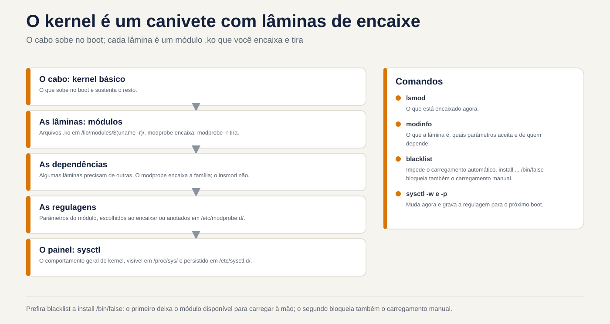
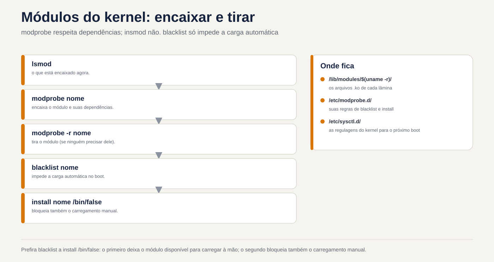

# Lezione 5.2 · Moduli e parametri

Nella 5.1 hai visto che ogni pezzo di hardware ha bisogno di un driver e che molti driver sono **moduli**: pezzi del kernel caricati quando sono necessari. In questo corso imparerai come elencare, caricare, scaricare, configurare e bloccare i moduli. Imparerai anche come modificare il comportamento del kernel durante l'esecuzione con `sysctl` e come far sì che la modifica sopravviva al riavvio.

> **Chiave di questa lezione:** `lsmod`, `modinfo`, `modprobe` e `modprobe -r`; i file in `/etc/modprobe.d/` (opzioni e blacklist) e in `/etc/modules-load.d/` (caricamento all'avvio); `sysctl` e `sysctl -w`; e i file del `/etc/sysctl.d/` applicati con il `sysctl --system`. Il resto è approfondito.

| File |  |
| --- | --- |
| Modulo | M5 · Hardware, kernel e virtualizzazione, lezione 2 di 3 |
| Quando | Settimana 9 |
| Settimana | 9 |
| Meteo | dalle 2h alle 2h30 |
| VM | rocky-lab (201) e debian-lab (202) |
| Prima | Istantanea `m5a2-inicio` in entrambi |
| Prova | LPIC 101.1 · EX342 kernel |

## 1 Riscaldamento

Rispondi senza cercare. Le risposte sono nella chiave di risposta.

1. Per modificare il driver di una scheda di rete, è necessario ricompilare il kernel?
2. Un valore modificato con `sysctl -w` sopravvive al riavvio?
3. Se inserisci un modulo nella *lista nera*, puoi comunque caricarlo manualmente?

## 2 Perché è importante

| Situazione attuale | Cosa fai con questa lezione |
| --- | --- |
| Un driver della scheda blocca il server dopo un aggiornamento | Bloccare il modulo e utilizzarne un altro, senza ricompilare nulla |
| Il firewall deve instradare i pacchetti tra due reti | Attiva `net.ipv4.ip_forward` permanentemente |
| Il database richiede un basso `vm.swappiness` e più file aperti | Regola i parametri in un file in `/etc/sysctl.d/` |
| Un audit richiede la disattivazione del `usb-storage` | Blocca il modulo davvero, e non solo con una lista nera |

## 3 Modello mentale

Pensa al kernel come a un **coltellino svizzero con lame scanalate**:

- Il **cavo** è il kernel di base, che si avvia all'avvio.
- Ogni **blade** è un modulo, un file `.ko` in `/lib/modules/$(uname -r)/`. Si monta (`modprobe`) e si toglie (`modprobe -r`) con il coltello aperto.
- Alcune lame hanno bisogno di altre per funzionare: queste sono le **dipendenze**. Il `modprobe` si adatta a entrambi, il `insmod` no.
- Ogni lama ha **regolazioni**, che sono i parametri del modulo. Li scegli quando li colleghi o li lasci annotati in `/etc/modprobe.d/`.
- `sysctl` è il **pannello di regolazione dei cavi**: il comportamento generale del kernel, come rete, memoria e sicurezza. Appare come file in `/proc/sys/`.



*Il cavo si solleva all'avvio; ogni blade è un modulo che si collega e si estrae.*

## 4 Elementi essenziali

### Vedere i moduli

```bash
uname -r                       # versione del kernel in uso
lsmod                          # moduli caricati, dimensioni e chi li utilizza
lsmod | grep virtio
modinfo virtio_net             # file, descrizione, licenza, dipendenze, parametri
modinfo -p e1000               # solo i parametri
ls /sys/module/virtio_net/parameters/   # valori in uso adesso
```

In `lsmod`, la colonna *Utilizzato da* indica quanti utenti e quali moduli dipendono da quello. Non è possibile scaricare un modulo in uso.

### Carica e scarica

| Comando | Fare | Nota |
| --- | --- | --- |
| `modprobe nome` | Carica il modulo e le dipendenze | Nel modo giusto |
| `modprobe nome opcao=valor` | Si carica con un parametro | Vale anche la pena di scaricarlo |
| `modprobe -r nome` | Scarica il modulo e le dipendenze che rimangono inutilizzate | Fallisce se in uso |
| `insmod /caminho/arquivo.ko` | Carica un file, senza risolvere le dipendenze | Fai il test; |
| non viene quasi mai usato `rmmod nome` | Scarica un modulo singolo | Fai il test |
| `depmod -a` | Ricalcolare le dipendenze in `modules.dep` | I pacchetti del kernel eseguono già |

### Configura per sempre

| Archivio | Per cosa | Riga di esempio |
| --- | --- | --- |
| `/etc/modprobe.d/*.conf` | Opzioni predefinite per un modulo | `options dummy numdummies=2` |
| `/etc/modprobe.d/*.conf` | Prevenire la ricarica **automatica** | `blacklist dummy` |
| `/etc/modprobe.d/*.conf` | Previeni **qualsiasi** caricamento | `install dummy /bin/false` |
| `/etc/modules-load.d/*.conf` | Carica all'avvio | una riga con solo `dummy` |

La differenza tra `blacklist` e `install ... /bin/false` è la trappola più comune. `blacklist` impedisce solo il caricamento del modulo **da solo**, quando viene visualizzato l'hardware. Un comodo `modprobe`, o un altro modulo che dipende da esso, lo porta ancora. Per bloccarlo una volta per tutte, utilizza entrambe le linee.

Se il modulo è incluso nell'initramfs, la modifica è valida solo al successivo avvio dopo aver rigenerato l'initramfs: `dracut -f` su Rocky e `update-initramfs -u` su Debian. Li avete visti entrambi in 4.1.

### sysctl: le impostazioni del kernel

```bash
sysctl -a | wc -l                          # centinaia di impostazioni
sysctl net.ipv4.ip_forward                 # leggine uno
cat /proc/sys/net/ipv4/ip_forward          # lo stesso valore di file
sudo sysctl -w vm.swappiness=10            # cambia ora, fino al riavvio
```

Il nome con punti corrisponde al percorso in `/proc/sys/`, con barre: `net.ipv4.ip_forward` è il file `/proc/sys/net/ipv4/ip_forward`.

Per mantenere la modifica, creare un file in `/etc/sysctl.d/`, che termina in `.conf`:

```bash
echo 'vm.swappiness = 10' | sudo tee /etc/sysctl.d/90-lab.conf
sudo sysctl --system          # applica tutti i file, in ordine, e li mostra ciascuno
```

I file vengono letti in ordine alfabetico e prevale l'ultimo valore. Ecco perché i nomi iniziano con un numero. All'avvio si applica `systemd-sysctl.service`.

### Rocky × Debian

| Articolo | Roccioso | Debian |
| --- | --- | --- |
| Moduli | File `/lib/modules/$(uname -r)/`, `.ko.xz` | `/lib/modules/$(uname -r)/`, `.ko` o tablet, a seconda della versione |
| Rigenera initramfs | `sudo dracut -f` | `sudo update-initramfs -u` |
| `/etc/sysctl.conf` | Esiste, ma l'opzione consigliata è `/etc/sysctl.d/` | Nelle nuove versioni potrebbe anche non esistere. Utilizzare `/etc/sysctl.d/` |
| Impostazioni predefinite del sistema | `/usr/lib/sysctl.d/` | `/usr/lib/sysctl.d/` |

### Ciò che rientra nel test

LPIC 101.1 copre `lsmod`, `modinfo`, `modprobe`, `insmod` e `rmmod` e la differenza tra `modprobe` e `insmod`: dipendenze. L'EX342 è in grado di diagnosticare problemi al kernel e ai moduli, bloccare un modulo, regolare costantemente i parametri e sapere dove viene letto tutto all'avvio.

## 5 Guided Lab

Il modulo di formazione è `dummy`. Crea schede di rete false, non dipende dall'hardware e non rovina nulla se va storto.

### Passo 0 · Istantanea e cartella

Nel nodo Proxmox:

```bash
qm snapshot 201 m5a2-inicio
qm snapshot 202 m5a2-inicio
```

In ogni VM:

```bash
mkdir -p ~/lab52 && cd ~/lab52
```

### Passo 1 · Sapere cosa è caricato

In entrambe le VM:

```bash
uname -r
lsmod | wc -l
lsmod | head -15
lsmod | grep -E 'virtio|scsi'
modinfo virtio_net | grep -E '^(filename|description|depends|parm)'
modinfo dummy | grep -E '^(filename|description|parm)'
```

Nota in `~/lab52/notas.txt`: quanti moduli ha ciascuna VM caricato, in quale file `dummy` si trova e quale parametro accetta.

### Passo 2 · Carica, usa e scarica

```bash
lsmod | grep dummy                 # Niente
sudo modprobe dummy
lsmod | grep dummy
ip -br link show type dummy        # è apparso dummy0
sudo modprobe -r dummy
ip -br link show type dummy        # è scomparso
```

Ora, con un parametro:

```bash
sudo modprobe dummy numdummies=3
ip -br link show type dummy        # manichino0, manichino1 e manichino2
cat /sys/module/dummy/parameters/numdummies
sudo modprobe -r dummy
```

### Passo 3 · Lascia per sempre

```bash
echo 'options dummy numdummies=2' | sudo tee /etc/modprobe.d/lab-dummy.conf
echo 'dummy' | sudo tee /etc/modules-load.d/lab-dummy.conf
sudo systemctl reboot
```

Dopo il riavvio:

```bash
ip -br link show type dummy        # dummy0 e dummy1, senza che tu faccia nulla
systemctl status systemd-modules-load --no-pager
```

Quello che ha caricato è stato `systemd-modules-load.service`, che legge `/etc/modules-load.d/`. Le opzioni provengono da `/etc/modprobe.d/`.

### Decidi 1

Aggiungi una lista nera e prova a caricare manualmente:

```bash
echo 'blacklist dummy' | sudo tee /etc/modprobe.d/lab-bloqueio.conf
sudo modprobe -r dummy
```

Prima di eseguire `sudo modprobe dummy`, rispondi: cosa succede?

- A) Il modulo si carica normalmente.
- B) `modprobe` rifiuta, perché il modulo è nella lista nera.
- C) Il modulo si carica, ma senza le opzioni `lab-dummy.conf`.

Verificare prima un'opzione. Poi girare `sudo modprobe dummy` e `ip -br link show type dummy`.

| Se hai selezionato | Risultato | Perché |
| --- | --- | --- |
| A | Capito bene | La lista nera impedisce solo il caricamento automatico tramite nickname hardware. Una richiesta esplicita passa |
| B | Sbagliato | Questo è ciò che quasi tutti si aspettano, ed è per questo che è testato e controllato |
| C| Sbagliato | Le opzioni sono ancora valide: compaiono `dummy0` e `dummy1` |

Ora bloccalo davvero:

```bash
echo 'install dummy /bin/false' | sudo tee -a /etc/modprobe.d/lab-bloqueio.conf
sudo modprobe -r dummy
sudo modprobe dummy                # ora fallisce
echo $?
```

**Per risolvere:** per disattivare un modulo in un audit, utilizzare `blacklist` **e** `install nome /bin/false`. Se è nell'initramfs, rigenerare l'initramfs.

### Passo 4 · sysctl

```bash
sysctl vm.swappiness net.ipv4.ip_forward
cat /proc/sys/vm/swappiness
sudo sysctl -w vm.swappiness=10
cat /proc/sys/vm/swappiness
```

### Decidi 2

Hai cambiato `vm.swappiness` con `sysctl -w` e non hai creato alcun file. Dopo il riavvio, qual è il valore?

- A) Continua 10.
- B) Ritorna alle impostazioni predefinite della distribuzione.
- C) Rimane 0, perché il valore è stato perso.

Controllare prima un'opzione. Quindi riavviare e verificare con `sysctl vm.swappiness`.

| Se hai selezionato | Risultato | Perché |
| --- | --- | --- |
| A | Sbagliato | `sysctl -w` modifica solo la memoria del kernel funzionante |
| B | Capito bene | All'avvio si applicano le impostazioni predefinite del kernel e i file in `sysctl.d`. In Rocky, `tuned` può avere un proprio valore predefinito, ad esempio 30 nel profilo VM |
| C| Sbagliato | Niente è perduto: il kernel si riavvia dalle impostazioni predefinite |

Ora lascialo per sempre:

```bash
echo 'vm.swappiness = 10' | sudo tee /etc/sysctl.d/90-lab.conf
sudo sysctl --system | tail -5
sudo systemctl reboot
```

Dopo il riavvio, `sysctl vm.swappiness` mostra 10.

**Da correggere:** `sysctl -w` è per il test. Per davvero, usate un file in `/etc/sysctl.d/` e `sysctl --system`.

## 6 Interrompi e correggi

In questa interruzione ci sono due problemi contemporaneamente. In Rocky-Lab, `lab-bloqueio.conf` impedisce già `dummy`, ma `modules-load.d` chiede comunque di caricarlo all'avvio. Aggiungi anche un errore di battitura in sysctl:


*modprobe rispetta le dipendenze; insmod n. la blacklist impedisce solo il caricamento automatico.*


```bash
echo 'vm.swapiness = 20' | sudo tee /etc/sysctl.d/91-lab-erro.conf
sudo systemctl reboot
```

Dopo il riavvio, indagare senza cercare la correzione:

```bash
systemctl --failed
journalctl -b -u systemd-modules-load --no-pager
sudo sysctl --system 2>&1 | grep -i -E 'error|cannot|invalid'
```

`systemd-modules-load` dovrebbe lamentarsi di non aver potuto inserire `dummy`, e `sysctl --system` dovrebbe dire che `/proc/sys/vm/swapiness` non esiste. Entrambi sono comuni: qualcuno blocca un modulo e dimentica chi lo ha richiesto, oppure inserisce un parametro sbagliato e non lo controlla mai.

La soluzione:

```bash
sudo rm /etc/modules-load.d/lab-dummy.conf
sudo rm /etc/sysctl.d/91-lab-erro.conf
sudo systemctl reset-failed
sudo systemctl restart systemd-modules-load
sudo sysctl --system | grep -i swap
systemctl --failed
```

La lezione: dopo aver armeggiato con `modprobe.d`, `modules-load.d` o `sysctl.d`, esegui `sysctl --system` e guarda `systemctl --failed` prima di uscire.

## 7 Trappole

- **Pensi che la lista nera lo blocchi.** Impedisce solo il caricamento automatico. Per bloccare, usare anche `install nome /bin/false`.
- **Dimentica initramfs.** Un disco o un modulo di rete caricato in initramfs ignora la modifica finché non si esegue `dracut -f` o `update-initramfs -u`.
- **Utilizza `sysctl -w` e dimentica il file.** Funziona oggi e scompare al prossimo riavvio, proprio quando nessuno se ne ricorda.
- **Modifica `/usr/lib/sysctl.d/`.** È dal pacchetto e l'aggiornamento lo sovrascrive. Il suo posto è `/etc/sysctl.d/`.
- **File senza `.conf` alla fine.** `sysctl.d`, `modprobe.d` e `modules-load.d` ignorano i file con un'altra estensione.
- **In Rocky, dimentica `tuned`.** Cambia anche i parametri del kernel. Per impostazione predefinita, riapplica i file da `sysctl.d` in un secondo momento, ma controlla con `tuned-adm active` quando un valore non corrisponde.
- **Scarica il modulo della scheda di rete tramite SSH.** La sessione si interrompe contemporaneamente. Fallo tramite la console.

## 8 Quiz

1. Qual è la differenza tra `modprobe` e `insmod`?
2. Qual è la differenza tra `blacklist dummy` e `install dummy /bin/false`?
3. Dove viene posizionato un modulo da caricare all'avvio?
4. Come rendere `vm.swappiness = 10` permanente e applicarlo senza riavviare?
5. Quale file in `/proc/sys/` corrisponde a `net.ipv4.ip_forward`?
6. *Perché `modprobe -r` può fallire su un modulo caricato?*

## 9 Cola

### Da sapere a memoria

| Comando o file | Fare |
| --- | --- |
| `lsmod` / `modinfo nome` | Elenca i moduli caricati/mostra i dettagli di un |
| `modprobe nome op=valor` / `modprobe -r nome` | Carica con dipendenze/scarica |
| `/etc/modprobe.d/*.conf` | `options`, `blacklist` e `install nome /bin/false` |
| `/etc/modules-load.d/*.conf` | Moduli caricati all'avvio |
| `sysctl chave` / `sysctl -w chave=valor` | Legge/modifica fino al riavvio |
| `/etc/sysctl.d/*.conf` + `sysctl --system` | Modificalo e candidati ora |

### Da consultare

`insmod`, `rmmod`, `depmod -a`, `/lib/modules/$(uname -r)/`, `modules.dep`, `/sys/module/*/parameters/`, `modprobe -c`, `modprobe --show-depends`, `dracut -f`, `update-initramfs -u`, `/usr/lib/sysctl.d/`, `sysctl -p arquivo`, `systemd-sysctl.service`, `systemd-modules-load.service`, `tuned-adm active`, `/proc/sys/kernel/tainted`.

### Flashcard

| Domanda | Rispondi |
| --- | --- |
| `modprobe` risolve le dipendenze? | SÌ; `insmod` non |
| La lista nera impedisce un `modprobe` manualmente? | No |
| Chi carica `modules-load.d` all'avvio? | `systemd-modules-load.service` |
| Chi applica il `sysctl.d` al boot? | `systemd-sysctl.service` |
| `net.ipv4.ip_forward` in archivio è... | `/proc/sys/net/ipv4/ip_forward` |

## 10 Checklist e chiusura

- [ ] Ho elencato i moduli e letto i dettagli di uno con `modinfo`
- [ ] Ho caricato e scaricato `dummy`, con e senza parametri
- [ ] Ho caricato un modulo all'avvio con le opzioni
- [ ] Ho visto la blacklist lasciarsi passare `modprobe` manualmente e l'ho effettivamente bloccato it
- [ ] Ho cambiato un parametro del kernel per un avvio e per sempre
- [ ] Ho trovato e corretto un modulo bloccato e un parametro digitato in modo errato

**Ultimo esercizio, senza guardare la lezione:** pulisci entrambe le VM. Cancella uno per uno i file `lab-*` che hai creato in `/etc/modprobe.d/`, `/etc/modules-load.d/` e `/etc/sysctl.d/` e per nome. Quindi applica nuovamente sysctl e scarica `dummy`. In Debian-lab non c'era alcuna interruzione, ma ci sono anche i file dei passaggi 3 e 4.

**Riavvia e conferenza:** riavvia entrambe le VM e controlla:

```bash
ls /etc/modprobe.d/ /etc/modules-load.d/ /etc/sysctl.d/   # né lab-* né 90-lab
lsmod | grep dummy                                         # Niente
systemctl --failed                                         # vuoto
ls ~/lab52
```

**Fine snapshot**, sul nodo Proxmox:

```bash
qm snapshot 201 m5a2-fim
qm snapshot 202 m5a2-fim
```

## 11 Nella vita reale

**Missione, sola lettura.** Su un server reale che amministri, esegui solo questi comandi, che non cambiano niente:

```bash
lsmod | wc -l
grep -rv '^#' /etc/modprobe.d/ /etc/modules-load.d/ 2>/dev/null | grep -v ':$'
grep -rv '^#' /etc/sysctl.d/ /etc/sysctl.conf 2>/dev/null | grep -v ':$'
sysctl net.ipv4.ip_forward vm.swappiness fs.file-max
cat /proc/sys/kernel/tainted
systemctl --failed
```

Risposta: Ci sono moduli bloccati o caricati forzatamente? Qualcuno ha documentato il motivo? `ip_forward` è acceso e la macchina deve spostarsi? `tainted` dà 0? Se non funziona, è stato caricato qualche modulo esterno al kernel ufficiale, come un driver del produttore. Questo non è un errore, ma vale la pena notarlo. Non cambiare nulla da solo.

**Diario:** scrivi tre righe su ciò che hai imparato oggi e una domanda che ti è rimasta.

**Domani, senza guardare:**

1. Scrivere le due righe che effettivamente bloccano `usb-storage` e in quale file si trovano.
2. Indica quale servizio applica `sysctl.d` all'avvio e quale carica `modules-load.d`.
3. Spiega perché `sysctl -w` non è sufficiente su un server.

## 12 Approfondisci quando vuoi

- Il valore di `/proc/sys/kernel/tainted` suddiviso bit per bit e cosa significa ciascuna lettera.
- DKMS: moduli del produttore ricompilati da soli con ogni nuovo kernel.
- Moduli firmati e Secure Boot: perché un driver esterno può essere rifiutato e `mokutil`.
- Profili `tuned` su Rocky: `tuned-adm list`, `tuned-adm profile` e cosa cambia ogni profilo.
- `kernel.modules_disabled = 1`: impedisce il caricamento di qualsiasi modulo dopo l'avvio, su server fortemente bloccati.

Su DeepTutor: `!explica blacklist e install /bin/false`, `!feynman o que é um módulo do kernel`, `!quiz módulos e sysctl`.

## Foglio di risposta commentato

### Riscaldamento

1. No. Nella maggior parte dei casi il driver è un modulo: ne scarichi uno, ne carichi un altro e, se necessario, blocchi quello vecchio.
2. No. Per restare è necessaria una pratica in `/etc/sysctl.d/`.
3. SÌ. La lista nera impedisce solo il caricamento automatico. Un pratico `modprobe` è superato.

### Quiz

1. `modprobe` trova il modulo per nome e carica prima le dipendenze. `insmod` carica solo il file indicato e fallisce se manca una dipendenza.
2. `blacklist` impedisce solo il caricamento automatico, a causa del soprannome dell'hardware. `install dummy /bin/false` scambia il caricamento con un comando che fallisce sempre, quindi nessun `modprobe` può caricare.
3. In un file `.conf` in `/etc/modules-load.d/`, con il nome del modulo su una riga.
4. Creare `/etc/sysctl.d/90-algo.conf` con `vm.swappiness = 10` ed eseguire `sudo sysctl --system`.
5. `/proc/sys/net/ipv4/ip_forward`.
6. *Perché il modulo è in uso: un dispositivo, un'interfaccia o un altro modulo dipende da esso, quindi il conteggio Usato da in lsmod non è zero.*

---

<!-- navegacao -->
[← lezione 5.1 · Hardware per kernel](5.1-hardware-pelo-kernel.md) · [Indice lezione](../01-aulas.md) · [lezione 5.3 · Linux come ospite →](5.3-linux-como-convidado.md)
