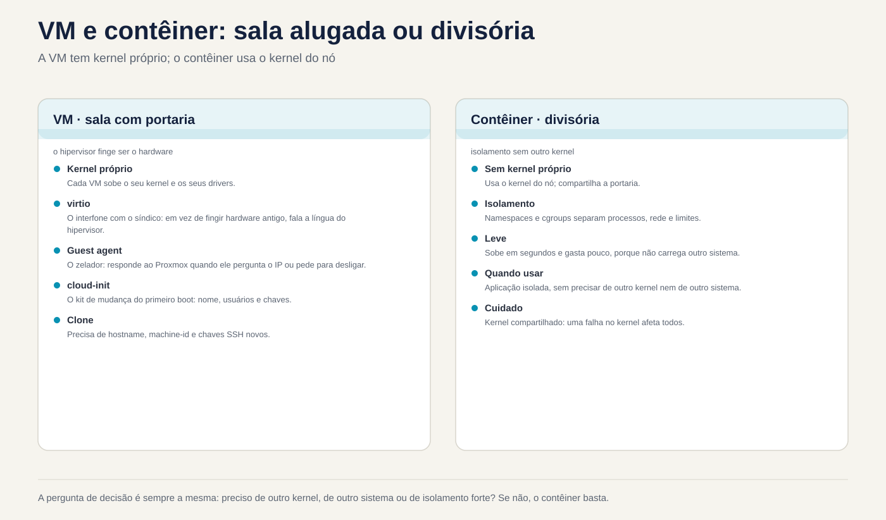
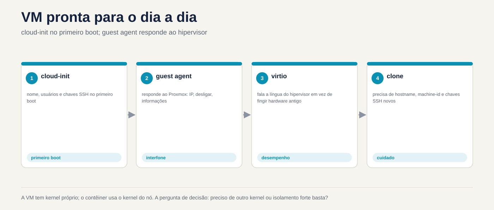

# Lezione 5.3 · Linux come ospite

Nelle lezioni 5.1 e 5.2 hai visto il kernel comunicare con l'hardware. Tuttavia, nelle tue due VM, questo hardware non esiste: quello che risponde è QEMU, in esecuzione sul nodo Proxmox. Oggi vedi Linux all'interno della VM. Come sa di essere un ospite, quali driver utilizza per renderlo più veloce, come parla con l'hypervisor tramite l'agente guest e come si configura da solo al primo avvio tramite cloud-init. Vedrai anche cosa succede quando qualcuno clona una VM e dimentica che alcune cose devono essere uniche. Alla fine, confronti una VM con un contenitore, che assomiglia a una macchina ma utilizza il kernel di un'altra.

> **Chiave di questa lezione:** `systemd-detect-virt` e `hostnamectl` per sapere dove ti trovi; i dispositivi `virtio`; `qemu-guest-agent`, su entrambi i lati (pacchetto in VM, opzione in Proxmox); cosa fa cloud-init al primo avvio; cosa deve essere univoco in un clone: ​​nome host, `/etc/machine-id` e chiavi SSH dell'host; e la differenza tra VM e contenitore: il kernel. Il resto è approfondito.

| File | lezione 5.3 |
| --- | --- |
| Modulo | M5 · Hardware, kernel e virtualizzazione, lezione 3 di 3 |
| Quando | Settimana 9 |
| Alla fine puoi | Dire se Linux viene eseguito in una macchina virtuale, in un contenitore o su una macchina fisica e con quale hypervisor; riconoscere i dispositivi `virtio` e i loro moduli; installare e connettere l'agente guest sulla VM e Proxmox e utilizzarlo con `qm agent` e `qm guest cmd`; spiegare cosa fa cloud-init e quando viene eseguito; elencare ciò che deve essere univoco in un clone e scambiare il nome host, `machine-id` e le chiavi SSH dell'host; vedi in pratica che un contenitore utilizza il kernel dell'host |
| Articoli di prova | LPIC-1 102.6 (Linux come ospite di virtualizzazione) · RHCSA (il test viene eseguito su una VM; l'agente ospite e `hostnamectl` compaiono nella vita di tutti i giorni) |
| Prerequisiti | lezione 5.1 (`lspci -k`, `/sys`, `dmesg`); lezione 5.2 (`lsmod`, `modinfo`); lezione 4.2 (systemd e unità); SSH tra il tuo computer e le VM |
| Meteo | Intorno alle 2h30, più il Modulo Challenge |
| Istantanee | m5a3-start e m5a3-end su entrambe le VM; m5-challenge prima della sfida |

## 1 · Riscaldamento

Tre domande, a colpo d'occhio. Scrivi le risposte; la chiave di risposta viene visualizzata alla fine.

1. Accedi tramite SSH a una macchina sconosciuta. Indovina: con un solo comando puoi sapere se è una VM?
2. Clona una VM Linux in Proxmox e connetti i due. Indovina: avranno lo stesso `/etc/machine-id`? E ha importanza?
3. Un contenitore Debian viene eseguito all'interno del tuo laboratorio roccioso. Indovina: cosa mostra `uname -r` al suo interno, il kernel Debian o quello di Rocky?

## 2 · Perché è importante

| Il cosiddetto | La risposta sbagliata | Cosa provoca |
| --- | --- | --- |
| "Proxmox non mostra l'IP della VM e lo spegnimento tramite la GUI non funziona" | Spegnimento con il pulsante Stop | Fermarsi è staccare la spina. Ciò che mancava era l'agente guest: con esso Proxmox vede l'IP, richiede uno spegnimento pulito e congela il file system durante il backup |
| "Ho clonato la VM e ora combattono entrambe per lo stesso IP DHCP e il monitoraggio ne vede solo uno" | Cambiare il nome host e pensare che sia finita | Le chiavi `machine-id` e SSH rimangono le stesse. A seconda della rete, DHCP identifica i due come la stessa macchina; anche il giornale, il monitoraggio e molti agenti utilizzano `machine-id` |
| "SSH dice che l'ID del server è cambiato: `REMOTE HOST IDENTIFICATION HAS CHANGED`" | Cancellare l'intero `known_hosts` o ignorare l'avviso | A volte è solo un clone con nuove chiavi. A volte è un attacco. Chissà quando sono cambiate le chiavi e perché, decide con calma e toglie solo la riga giusta |
| "Lo eseguiremo in un contenitore, che è più leggero" | Tratta il contenitore come una VM più piccola | Il contenitore utilizza il kernel dell'host. Non carica il proprio modulo, non sceglie la versione del kernel e, se il kernel host va giù, va giù con lui |

## 3 · Modello mentale

> Pensa a un **edificio commerciale**, come nella lezione 5.1. Una **VM** è una stanza in affitto con il proprio concierge: il suo kernel è tuo, con i tuoi driver, e l'hypervisor finge di essere l'hardware. I driver `virtio` sono il citofono diretto con il gestore: invece di fingere di utilizzare hardware vecchio, l'ospite sa di trovarsi in una VM e parla la lingua dell'hypervisor, che è più veloce. Il **guest agent** è il custode della stanza, che assiste il gestore (Proxmox) quando chiede l'IP o chiede di chiudere tutto. **cloud-init** è il kit di cambio: il primo giorno configura la stanza con il nome, gli utenti e le chiavi presenti nella confezione. Un **contenitore** non è una stanza con un cancello: è una partizione all'interno di un'altra stanza, che utilizza lo stesso cancello (lo stesso kernel).

```text
  MÁQUINA FÍSICA (nó Proxmox)
  ┌───────────────────────────────────────────────────────────────┐
  │ kernel do nó (KVM)                                            │
  │  ┌────────────── QEMU ─────────────┐   ┌──── LXC ───────────┐ │
  │  │ VM rocky-lab                    │   │ contêiner           │ │
  │  │  kernel PRÓPRIO                 │   │  processos isolados │ │
  │  │  virtio_net, virtio_scsi        │   │  SEM kernel próprio │ │
  │  │  qemu-guest-agent ◄── canal ────┼─► │  usa o kernel do nó │ │
  │  │  cloud-init (1º boot)  virtio-serial │                     │ │
  │  └─────────────────────────────────┘   └─────────────────────┘ │
  └───────────────────────────────────────────────────────────────┘
```



*La VM ha il proprio kernel; il contenitore utilizza il kernel del nodo.*

## 4 · Gli elementi essenziali

### Dove mi trovo?

| Comando | Che mostra |
| --- | --- |
| `systemd-detect-virt` | `kvm`, `qemu`, `vmware`, `microsoft`, `oracle`... in una VM; `lxc`, `podman`, `docker`... in un contenitore; `none` sulla macchina fisica |
| `systemd-detect-virt -c` / `-v` | Solo contenitore/Solo VM |
| `hostnamectl` | Riga `Virtualization:` e `Chassis: vm`, oltre al nome host e al kernel |
| `lscpu \| grep -i hypervisor` | `Hypervisor vendor: KVM` |
| `sudo dmidecode -s system-product-name` | Il "modello" inventato dall'hypervisor, come `Standard PC (Q35 + ICH9, 2009)` |

### I driver virtio

L'hypervisor può imitare hardware vecchio e reale, come la scheda di rete e1000 o un disco IDE. Funziona su qualsiasi sistema, ma è lento, perché ogni accesso è tradotto. **virtio** è un hardware che esiste solo nelle VM: il guest lo sa e parla direttamente con l'hypervisor. Su Linux, i driver virtio sono già inclusi nel kernel.

| Dispositivo su Proxmox | Autista in ospite | Come appare |
| --- | --- | --- |
| VirtIO SCSI (controller) | `virtio_scsi` | Dischi `sda`, `sdb`... |
| Blocco VirtIO | `virtio_blk` | Dischi `vda`, `vdb`... |
| Scheda VirtIO | `virtio_net` | `ens18` o `eth0` |
| Palloncino | `virtio_balloon` | L'hypervisor può riprendere la RAM |
| RNG VirtIO | `virtio_rng` | Fonte di casualità |
| Seriale VirtIO | `virtio_console` | Il canale dell'agente guest |

### Il canale dell'agente guest

`qemu-guest-agent` è un servizio che viene eseguito **all'interno** della VM e risponde a Proxmox su un canale seriale virtuale. Ha bisogno di due metà e dimenticarne una è il classico errore:

1. **In Proxmox:** opzione `QEMU Guest Agent` attiva (`qm set ID --agent enabled=1`). Crea il dispositivo seriale, ed è valido solo dopo aver spento e riacceso la VM tramite Proxmox.
2. **Nella VM:** il pacchetto `qemu-guest-agent` installato e il servizio in esecuzione.

Con entrambe le metà, Proxmox mostra gli IP nella GUI, esegue un arresto pulito, blocca il file system (`fsfreeze`) durante il backup in modo che la copia risulti coerente e consente di porre domande con `qm agent` e `qm guest cmd`.

### cloud-init

O cloud-init viene eseguito al **primo avvio** di un'immagine cloud e configura la macchina con i dati che provengono dall'esterno: nome host, utenti, chiavi SSH autorizzate, rete e pacchetti. Questi dati provengono da una **origine dati**: un servizio di metadati in AWS o OpenStack o un CD virtuale in Proxmox (la scheda Cloud-Init). Cloud-init memorizza un `instance-id`: finché non cambia, la macchina non è considerata nuova e non rifa la prima configurazione di avvio.

| Comando o file | E per |
| --- | --- |
| `cloud-init status --long` | Ha funzionato? E' finita? Ha fatto un errore? |
| `/var/log/cloud-init.log` e `cloud-init-output.log` | Quello che ha fatto, passo dopo passo |
| `/etc/cloud/cloud.cfg` e `/etc/cloud/cloud.cfg.d/` | Che cosa è autorizzato a modificare |
| `sudo cloud-init clean --logs` | Cancella lo stato. Al successivo avvio si comporta come se fosse la prima volta. Questo è ciò che fai prima di trasformare la VM in un modello |

### Cloni e cosa deve essere univoco

Un **clone completo** copia l'intero disco. Un **clone collegato** (clone collegato) utilizza il disco modello come base e registra solo le differenze. In entrambi i casi, il disco clone inizia come l'originale, con tutto al suo interno:

| Identificatore | Dov'è | Chi cambia |
| --- | --- | --- |
| Indirizzo MAC | Configurazione della macchina virtuale | Proxmox ne genera uno nuovo nel clone |
| Nome host | `/etc/hostname` e `/etc/hosts` | Tu, con `hostnamectl set-hostname`, o cloud-init |
| `machine-id` | `/etc/machine-id` (in Debian anche `/var/lib/dbus/machine-id`) | Tu, con `systemd-machine-id-setup`, oppure l'immagine arriva già con un file vuoto |
| Chiavi SSH host | `/etc/ssh/ssh_host_*` | Tu, con `ssh-keygen -A`, o cloud-init |
| IP fisso | Configurazione di rete | Tu, o cloud-init |

`machine-id` è il "CPF" dell'installazione: 32 caratteri esadecimali creati al momento dell'installazione. Il journal memorizza i registri in una cartella con quel nome, `systemd-networkd` utilizza questo ID per identificarsi in DHCP e anche molti agenti di monitoraggio o backup fanno altrettanto. Due cloni con lo stesso `machine-id` sono, per questi strumenti, la stessa macchina.

Le **chiavi SSH host** dimostrano al client che il server è lo stesso dell'ultima volta. Due cloni con le stesse chiavi sono indistinguibili per SSH: se uno di essi viene compromesso, la sua chiave privata viene utilizzata per impersonare l'altro.

### VM e contenitore affiancati

|  | VM (QEMU/KVM, `qm`) | Contenitore (LXC con `pct`, Podman, Docker) |
| --- | --- | --- |
| Nocciolo | Proprio | |
| dell'ospite Avvio | GRUB, initramfs, systemd | Inizia proprio nel processo principale, a volte un systemd |
| Moduli e `sysctl` | Carica e modifica il tuo | Non carica il modulo; molti `sysctl` sono di sola lettura o di solo host |
| Altro sistema operativo | Chiunque, anche Windows | Solo Linux, con il kernel dell'host |
| Isolamento | Forte: l'hypervisor separa | Più debole: tutto dipende dal kernel condiviso |
| Costo | Più RAM e più disco | Leggero: si apre in pochi secondi |

### Rocky × Debian

| Tema | Roccioso | Debian |
| --- | --- | --- |
| Agente ospite | `dnf install qemu-guest-agent` | `apt install qemu-guest-agent` |
| Connetti il ​​servizio | Il pacchetto non si accende da solo in tutte le versioni: verificare con `systemctl status` e connettersi con `systemctl enable --now` | Il servizio si attiva quando appare il dispositivo seriale; senza l'opzione attivata in Proxmox, rimane bloccato in attesa |
| Chiave SSH host mancante | `sshd-keygen@.service` genera quelli mancanti quando `sshd` sale | `ssh` non sale. È necessario eseguire `ssh-keygen -A` o `dpkg-reconfigure openssh-server` |
| `/var/lib/dbus/machine-id` | Di solito non esiste; il D-Bus legge `/etc/machine-id` | Di solito si tratta di un collegamento a `/etc/machine-id`; verificare con `ls -l` |
| Immagini nuvola | Vieni con cloud-init | Vengono forniti con cloud-init |

**Cosa è incluso nel test.** In LPIC-1 102.6, il test richiede concetti: la differenza tra VM e contenitore; cos'è un hypervisor; cos'è IaaS; quali driver e strumenti guest esistono (come l'agente guest); cosa fa cloud-init; e, più spesso, **ciò che deve essere unico in un clone**: il `machine-id` di D-Bus e systemd, le chiavi SSH dell'host e il nome host. Presso RHCSA, il test viene eseguito su una VM ed è obbligatorio sapere come modificare il nome host con `hostnamectl`.

## 5 · Laboratorio guidato

### Passaggio 0 · Istantanea e cartella

Nel nodo Proxmox:

```bash
qm snapshot 201 m5a3-inicio
qm snapshot 202 m5a3-inicio
```

In ciascuna VM:

```bash
mkdir -p ~/lab53 && cd ~/lab53
```

### Passaggio 1 · Dove mi trovo?

In entrambi VM:

```bash
systemd-detect-virt
hostnamectl
lscpu | grep -i hypervisor
sudo dmidecode -s system-product-name
lspci | grep -i virtio
lsmod | grep virtio
```

Sul nodo Proxmox, eseguire anche `systemd-detect-virt`. Dovrebbe rispondere `none`: il nodo è la macchina fisica.

Nota in `~/lab53/notas.txt` cosa `systemd-detect-virt` ha risposto in ogni luogo e quali moduli `virtio` trasporta ciascuna VM. Confronta con ciò che mostra la scheda Hardware della VM in Proxmox: il controller del disco e il modello della scheda di rete.

### Passo 2 · L'agente guest, le due metà

Prima di tutto, la metà della VM. In rocky-lab:

```bash
sudo dnf -y install qemu-guest-agent
sudo systemctl enable --now qemu-guest-agent
systemctl status qemu-guest-agent --no-pager
```

In debian-lab:

```bash
sudo apt -y install qemu-guest-agent
systemctl status qemu-guest-agent --no-pager
```

In Debian, il servizio potrebbe apparire interrotto, in attesa del dispositivo `virtio-ports/org.qemu.guest_agent.0`. Ciò è normale finché l'altra metà non è collegata.

Ora, la metà Proxmox. Nel nodo:

```bash
qm config 201 | grep agent
qm set 201 --agent enabled=1
qm set 202 --agent enabled=1
```

### Decidi 1

Hai attivato l'opzione agente. Su debian-lab, esegui `sudo systemctl reboot`. Dopo che ritorna, esegui `qm agent 202 ping` sul nodo. Cosa succede?

- A) Risponde senza errori, perché la VM è stata riavviata.
- B) Dà un errore, perché il riavvio dall'interno della VM non applica la modifica hardware.
- C) Dà un errore, perché il servizio Debian necessita del manuale `enable`.

Controllare prima un'opzione. Allora fai il test.

| Se hai selezionato | Risultato | Perché |
| --- | --- | --- |
| A | Sbagliato | Il riavvio dall'interno riavvia il sistema, ma il processo QEMU rimane lo stesso, con il vecchio hardware. La GUI mostra l'opzione come modifica in sospeso |
| B | Capito bene | La modifica hardware è valida solo quando Proxmox spegne e riaccende la VM: `qm shutdown` e `qm start`, oppure `qm reboot`, oppure Riavvio GUI |
| C| Sbagliato | In Debian, il servizio si avvia da solo quando appare il dispositivo. Il problema è che il dispositivo non esiste ancora |

Ora applicalo sul serio e parla con l'agente:

```bash
qm reboot 201
qm reboot 202
# espere as VMs voltarem
qm agent 201 ping && echo ok
qm agent 202 ping && echo ok
qm guest cmd 202 get-osinfo
qm guest cmd 202 network-get-interfaces | grep -E '"name"|ip-address"'
qm guest cmd 201 get-fsinfo | grep -E 'mountpoint|type'
```

Nella GUI, la pagina Riepilogo delle due VM ora mostra gli IP.

**Per risolvere:** l'agente guest funziona solo con le due metà: il pacchetto all'interno della VM e l'opzione in Proxmox, applicata con uno spegnimento e riaccensione effettuato da Proxmox.

### Passaggio 3 · cloud-init, solo cercando

Le tue VM sono state installate da ISO, quindi probabilmente cloud-init non è presente. Dai un'occhiata:

```bash
command -v cloud-init || echo "cloud-init não instalado"
```

Se è installato, guarda senza modificare nulla:

```bash
cloud-init status --long
sudo tail -20 /var/log/cloud-init.log
ls /etc/cloud/cloud.cfg.d/
```

Sul nodo, guarda come Proxmox fornisce i dati a cloud-init da una VM che utilizza un'immagine cloud:

```bash
man qm | grep -A2 -E '^ +--(ciuser|sshkeys|ipconfig0)'
```

Opzioni `--ciuser`, `--sshkeys` e `--ipconfig0` vanno su un CD virtuale che cloud-init legge all'avvio. Non creerai un modello adesso. Appare di nuovo nel modulo di automazione.

### Passo 4 · L'identità della VM

In Debian-lab:

```bash
hostnamectl hostname
cat /etc/machine-id
ls -l /var/lib/dbus/machine-id
ls /var/log/journal/
ls -l /etc/ssh/ssh_host_*
for k in /etc/ssh/ssh_host_*_key.pub; do ssh-keygen -lf "$k"; done
```

Sul computer, confrontare l'impronta digitale con quella salvata dal client SSH:

```bash
ssh-keygen -F IP_DA_DEBIAN -l
```

Il nome della cartella in `/var/log/journal/` è `machine-id`. Memorizza le tre cose in `~/lab53/identidade.txt`: nome host, `machine-id` e la stampa della chiave `ed25519`. Ne avrai bisogno nella sfida.

### Decidi 2

Clone debian-lab senza toccare nulla e accendi il clone. Quali di queste cose il clone ha **uguale** all'originale?

- A) Solo il nome host.
- B) Nome host, `machine-id` e chiavi SSH dell'host. Il MAC è nuovo.
- C) Tutto, compreso il MAC.

Verificare prima un'opzione. Dai un'occhiata al modulo Challenge.

| Se hai selezionato | Risultato | Perché |
| --- | --- | --- |
| A | Sbagliato | Viene copiato l'intero disco e con esso i file `/etc/machine-id` e `/etc/ssh/ssh_host_*` |
| B | Capito bene | Il MAC è nella configurazione della VM e Proxmox ne genera un altro nel clone. Tutto nell'album è lo stesso |
| C| Sbagliato | Proxmox modifica il MAC esattamente in modo che entrambi possano trovarsi sulla stessa rete |

**Per risolvere:** clone copia il disco. Tutto ciò che identifica la macchina e risiede sul disco deve essere modificato manualmente, con uno strumento come `virt-sysprep` o con cloud-init.

### Passo 5 · Un contenitore accanto a

In rocky-lab, con internet:

```bash
sudo dnf -y install podman
uname -r
podman run --rm docker.io/library/debian:12 cat /etc/os-release
podman run --rm docker.io/library/debian:12 uname -r
podman run --rm docker.io/library/debian:12 ls /boot /lib/modules
```

Il contenitore dice che è Debian 12, ma `uname -r` mostra il kernel Rocky, con `el9` nel nome. E non c'è `/boot` né moduli: non c'è nessun kernel da caricare. Questa è la risposta alla domanda 3 del Warm-Up, in diretta.

Per finire, prova a modificare un parametro del kernel dall'interno del contenitore:

```bash
podman run --rm docker.io/library/debian:12 sh -c 'echo 10 > /proc/sys/vm/swappiness'
```

Il kernel rifiuta, perché `/proc/sys` appare di sola lettura nel contenitore: il kernel appartiene all'host e l'host ne è responsabile.

## 6 · Interrompi e correggi

In questa interruzione elimini le chiavi SSH dell'host su entrambe le VM e vedi che ciascuna la distribuzione reagisce diversamente. **Fallo tramite la console Proxmox**, non tramite SSH. Una sessione SSH aperta non si arresta in modo anomalo al riavvio del servizio, ma non è possibile aprirne un'altra.


*La VM ha il proprio kernel; il contenitore utilizza il kernel del nodo. Hai bisogno di un altro kernel o è sufficiente un isolamento forte?*


Su entrambe le VM:

```bash
sudo cp -a /etc/ssh ~/lab53/ssh-antes
sudo rm /etc/ssh/ssh_host_*
```

Su rocky-lab, `sudo systemctl restart sshd`. In Debian-Lab, `sudo systemctl restart ssh`. Quindi, indaga senza guardare la riparazione:

```bash
systemctl status sshd --no-pager      # Roccioso
systemctl status ssh --no-pager       # Debian
journalctl -b -u ssh --no-pager | tail -5
ls /etc/ssh/ssh_host_*
```

In Rocky, `sshd` appare: `sshd-keygen@` ha generato prima nuove chiavi. Su Debian, `ssh` fallisce, con qualcosa come `no hostkeys available`. Dal tuo computer, prova ad inserirli entrambi. Rocky risponde con l'avvertimento `REMOTE HOST IDENTIFICATION HAS CHANGED`, perché le chiavi sono cambiate. Debian rifiuta la connessione.

La correzione in Debian:

```bash
sudo ssh-keygen -A
sudo systemctl restart ssh
systemctl status ssh --no-pager
```

Sul tuo computer, rimuovi semplicemente la vecchia riga da ciascuna VM ed effettua nuovamente l'accesso, controllando la nuova impronta digitale con ciò che mostra la console:

```bash
ssh-keygen -R IP_DA_ROCKY
ssh-keygen -R IP_DA_DEBIAN
```

La lezione: l'avviso di cambio di chiave non può essere ignorato e non può essere risolto cancellando l'intero `known_hosts`. Scopri **perché** la chiave è cambiata, controlla la nuova stampa in un altro modo (qui, la console) e solo dopo rimuovi la vecchia riga.

## 7 · Insidie

- **Accedere l'agente solo su un lato.** Il pacchetto senza l'opzione in Proxmox, o l'opzione senza pacchetto, danno lo stesso risultato: niente.
- **Riavvia dall'interno e attendi che l'hardware cambi.** Basta spegnerlo e riaccenderlo. di nuovo. di Proxmox.
- **Elimina `/etc/machine-id`.** Il modo giusto è svuotare o rimuovere e ricreare con `systemd-machine-id-setup` e controllare `/var/lib/dbus/machine-id` in Debian. Un sistema senza il file potrebbe non caricarsi correttamente.
- **Crea modello senza pulizia.** Se trasformi una VM in un modello senza pulire `machine-id`, chiavi SSH e stato cloud-init, tutti i cloni nascono gemelli.
- **Dimentica `/etc/hosts`.** `hostnamectl set-hostname` cambia `/etc/hostname`, ma il vecchio nome rimane in `/etc/hosts` e `sudo` potrebbe essere lento o lamentarsi.
- **Tratta il contenitore come una VM.** Non ha un proprio kernel: i moduli, molti `sysctl` e la versione del kernel provengono dall'host.
- **Clona con IP fisso connesso alla rete.** Due IP identici sulla stessa rete bloccano lentamente entrambe le macchine. Accendere il clone con la scheda scollegata fino a cambiare l'IP.

## 8 · Quiz

1. Quale comando ti dice se ti trovi in ​​una macchina virtuale, in un contenitore o in una macchina fisica?
2. Quali sono le due metà dell'agente ospite e come si applica la metà Proxmox?
3. Cosa fa cloud-init e quando?
4. Nomina tre cose che devono essere univoche in un clone e indica dove si trova ciascuna.
5. Perché un contenitore Debian all'interno di Rocky mostra il kernel di Rocky?
6. *Quale file contiene l'ID macchina systemd e quale comando ne crea uno nuovo?*

## 9 · Cola

### Da conoscere a memoria

| Comando o file | Fare |
| --- | --- |
| `systemd-detect-virt` / `hostnamectl` | Dove mi trovo / nome host, chassis e virtualizzazione |
| `qm set ID --agent enabled=1` + `qm reboot ID` | Connetti l'agente a Proxmox e applica |
| `qm agent ID ping` / `qm guest cmd ID network-get-interfaces` | Testare l'agente/richiedere gli IP |
| `hostnamectl set-hostname nome` | Modificare il nome host (e poi `/etc/hosts`) |
| `/etc/machine-id` + `systemd-machine-id-setup` | L'ID di installazione e chi la ricrea |
| `/etc/ssh/ssh_host_*` + `ssh-keygen -A` | Le chiavi dell'host e chi genera quelle mancanti |
| `ssh-keygen -R host` | Rimuovere solo quell'host da `known_hosts` |

### Per consultare

`systemd-detect-virt -c` e `-v`, `lscpu`, `dmidecode`, `virtio_scsi`, `virtio_blk`, `virtio_net`, `virtio_balloon`, `qm guest cmd ID get-osinfo`, `get-fsinfo`, `fsfreeze-status`, `cloud-init status --long`, `cloud-init clean --logs`, `/var/log/cloud-init.log`, `/etc/cloud/cloud.cfg.d/`, `qm set --ciuser --sshkeys --ipconfig0`, `qm clone --full`, `qm template`, `virt-sysprep`, `sshd-keygen@.service`, `dpkg-reconfigure openssh-server`, `ssh-keygen -lf`, `ssh-keygen -F`, `podman run --rm`, `pct list`.

### Flashcard

| Domanda | Rispondi |
| --- | --- |
| `systemd-detect-virt` sulla macchina fisica risponde... | `none` |
| Il riavvio dall'interno della VM applica modifiche hardware? | NO; basta spegnere e accendere Proxmox |
| Il clone di Proxmox cambia il MAC? | SÌ; cosa c'è sul disco, non |
| Debian senza chiave SSH host... | `ssh` non sale; Rocky genera da solo le nuove chiavi |
| Un contenitore ha il proprio kernel? | NO; utilizza |

## 10 · Checklist e chiusura

- [ ] Ho scoperto dove viene eseguita ciascuna macchina con `systemd-detect-virt` e `hostnamectl`
- [ ] Ho riconosciuto i dispositivi e i moduli `virtio` delle due VM
- [ ] Ho attivato l'agente guest su entrambi i lati e ho visto gli IP con `qm guest cmd`
- [ ] Ho spiegato cos'è cloud-init funziona, anche senza che sia installato
- [ ] Ho annotato il nome host, `machine-id` e la chiave SSH da debian-lab
- [ ] Ho visto un container Debian in esecuzione sul kernel Rocky
- [ ] Ho cancellato le chiavi SSH dell'host, ho visto la differenza tra le distribuzioni e l'ho corretta

**Ultimo esercizio, senza guardare la lezione:** dall'interno di ogni VM, senza usare la GUI, dico così IP e confermare tramite il nodo con `qm guest cmd`. Quindi, in Rocky-Lab, elimina l'immagine scaricata da Podman (`podman images`, poi `podman rmi` con il nome che appare).

**Riavvia e conferenza:** riavvia le due VM tramite Proxmox (`qm reboot`) e controlla:

```bash
systemctl status qemu-guest-agent --no-pager   # attivo (in esecuzione)
systemctl --failed                              # vuoto
ls ~/lab53
```

Nel nodo, `qm agent 201 ping` e `qm agent 202 ping` senza errori.

**Termina snapshot**, sul nodo Proxmox:

```bash
qm snapshot 201 m5a3-fim
qm snapshot 202 m5a3-fim
```

L'agente guest è attivo da ora in poi. Aiuterà con i backup e i moduli successivi.

## 11 · Nella vita reale

**Mission, sola lettura.** Su un real server che gestisci, basta eseguire questi comandi, che non cambiano nulla:

```bash
systemd-detect-virt
hostnamectl
systemctl is-active qemu-guest-agent 2>/dev/null || echo "sem guest agent"
cat /etc/machine-id
command -v cloud-init && cloud-init status
```

Se è una VM Proxmox, guarda anche, nel nodo, basta leggere: `qm config ID | grep agent`.

Risposta: le VM che gestisci hanno l'agente guest su entrambi i lati? In caso contrario, il backup verrà eseguito senza bloccare il file system. Due delle vostre macchine hanno lo stesso `machine-id`? Questo tradisce un clone di scarsa qualità. Scrivi quello che pensi. Non cambiare nulla da solo.

**Diario:** scrivi tre righe su ciò che hai imparato oggi e una domanda che ti è rimasta.

**Domani, senza guardare:**

1. Elenca, in ordine, cosa faresti a un clone appena creato prima di collegarlo alla rete.
2. Spiegare perché il riavvio dall'interno della VM non attiva l'agente guest.
3. Fornisci un vantaggio e uno svantaggio del contenitore rispetto alla VM.

## 12 · Scava più a fondo quando vuoi

- `virt-sysprep` (pacchetto `guestfs-tools` o `libguestfs-tools`): pulisce `machine-id`, chiavi SSH, log e cronologia da un disco VM spento.
- Modelli in Proxmox con immagini cloud di Rocky e Debian: `qm importdisk`, la scheda Cloud-Init e `qm template`.
- I file cloud-init `user-data`, `meta-data` e `network-config` e l'origine dati NoCloud.
- Clone collegato e clone completo: spazio, prestazioni e perché il modello di un clone collegato non può essere eliminato.
- `systemd-firstboot` e `ConditionFirstBoot=`: come systemd sa che è il primo avvio.
- Contenitori LXC in Proxmox (`pct`), privilegiati e non privilegiati.
- Spazi dei nomi e cgroup: le parti del kernel che compongono un contenitore.

In DeepTutor: `!explica guest agent do QEMU`, `!feynman diferença entre VM e contêiner`, `!quiz Linux como convidado`.

## Sfida del modulo 5

**Missione:** clonare debian-lab e dare al clone la propria identità: nome host, `machine-id` e host SSH chiavi. Alla fine le due VM sono connesse contemporaneamente, sulla stessa rete, senza conflitti. Senza guardare la lezione; il Modello contiene suggerimenti, se rimani bloccato.

**Prima di iniziare**, nel nodo Proxmox:

```bash
qm snapshot 202 m5-desafio
qm list          # scegli un VMID libero, ad esempio 902
```

**Regole:**

- Clone completo, in archivio `vm-hdd`, con il nome `debian-clone`.
- Accendere il clone con la scheda di rete **sconnessa** e fare tutto tramite console, fino al cambio identità. Se debian-lab utilizza un IP fisso, cambiare anche l'IP.
- Il debian-lab originale non cambia affatto.
- Tempo previsto: 30 minuti.

**Criteri di successo:**

| Controlla | Come | Previsto |
| --- | --- | --- |
| Nome host | `hostnamectl hostname` nel clone | `debian-clone` e `/etc/hosts` senza il vecchio nome |
| `machine-id` | `cat /etc/machine-id` in entrambi | Diverso; quello del clone con 32 caratteri esadecimali |
| D-Bus | `ls -l /var/lib/dbus/machine-id` nel clone | Collegamento a `/etc/machine-id` o allo stesso contenuto |
| Chiavi SSH | `ssh-keygen -lf /etc/ssh/ssh_host_ed25519_key.pub` in entrambi | Impressioni diverse; confrontare con `identidade.txt` |
| Rete | `ip -br a` in entrambi, con il clone già connesso | IP diversi ed entrambi rispondono a `ping` |
| SSH | Dal tuo computer, `ssh` ad entrambi | I due entrano; il clone appare come nuovo host in `known_hosts` |
| Agente | `qm agent 902 ping` nel nodo | Nessun errore |

**Rollback**, se qualcosa va storto nell'originale: `qm rollback 202 m5-desafio`.

**Cleanup**, quando hai finito e controlli tutto: nel nodo, `qm stop 902` e poi `qm destroy 902 --purge`. Controllare il numero due volte prima di premere Invio. Sul tuo computer, clona `known_hosts` con `ssh-keygen -R IP_DO_CLONE`.

## Foglio risposte commentate

### Riscaldamento

1. SÌ. `systemd-detect-virt` risponde a `kvm`, `vmware`, `lxc`... o `none`. `hostnamectl` riporta inoltre, in linea `Virtualization`.
2. Sì, avranno lo stesso, perché il file è sul disco e il disco è stato copiato. E questo è importante: il giornale, il DHCP di `systemd-networkd` e diversi agenti utilizzano `machine-id` per sapere chi è chi.
3. Quello di Rocky. Il contenitore porta file Debian, ma viene eseguito sul kernel dell'host.

### Quiz

1. `systemd-detect-virt`. Funziona anche `hostnamectl`.
2. Il pacchetto `qemu-guest-agent` in esecuzione all'interno della VM e l'opzione `--agent enabled=1` in Proxmox. L'opzione crea un dispositivo seriale ed è valida solo dopo che Proxmox spegne e accende la VM, ad esempio con `qm reboot`.
3. Configura la macchina al primo avvio con i dati da un'origine dati: nome host, utenti, chiavi SSH, rete, pacchetti. Lo ripete solo se cambia `instance-id` o se qualcuno esegue `cloud-init clean`.
4. Nome host, in `/etc/hostname` e `/etc/hosts`; `machine-id`, in `/etc/machine-id` (e `/var/lib/dbus/machine-id`); chiavi SSH host, in `/etc/ssh/ssh_host_*`. L'IP fisso vale anche nella configurazione di rete. Il MAC e Proxmox stanno già cambiando.
5. Perché il contenitore non ha un proprio kernel. Si tratta di un gruppo di processi isolati eseguiti nel kernel host.
6. *`/etc/machine-id`. Svuotatelo o rimuovetelo, quindi eseguite `systemd-machine-id-setup`; su Debian, controlla che `/var/lib/dbus/machine-id` corrisponda o sia collegato ad esso.*

### Suggerimenti per la sfida

Provalo tu stesso prima. Se rimani bloccato, leggi un suggerimento alla volta.

1. **Scheda clonata e disconnessa:** `qm clone 202 902 --name debian-clone --full --storage vm-hdd`. Poi, `qm config 902 | grep net0`, e ripetere la riga con `,link_down=1` alla fine: `qm set 902 --net0 virtio=MAC_DO_CLONE,bridge=vmbr0,link_down=1`. Utilizza il MAC acquisito dal clone per evitare di generarne un altro. Solo allora `qm start 902` e aprire la console.
2. **Nome host:** `sudo hostnamectl set-hostname debian-clone` e sostituire il vecchio nome in `/etc/hosts` con `sudoedit /etc/hosts` o con `sed -i` della lezione 3.4.
3. **id-macchina:** `sudo rm /etc/machine-id`, quindi `sudo systemd-machine-id-setup`. Controlla `/var/lib/dbus/machine-id`: se è un link è già corretto; se si tratta di un file comune, `sudo rm /var/lib/dbus/machine-id` e `sudo ln -s /etc/machine-id /var/lib/dbus/machine-id`.
4. **Chiavi SSH:** `sudo rm /etc/ssh/ssh_host_*`, poi `sudo ssh-keygen -A` e `sudo systemctl restart ssh`. Se dimentichi `ssh-keygen -A`, sai già cosa succede: l'interruzione di questa lezione.
5. **Riavvia e collega in rete:** riavvia il clone in modo che tutto inizi utilizzando il nuovo `machine-id`. La nuova cartella appare in `/var/log/journal/` e quella vecchia può essere cancellata. Cambiare l'IP se è fisso e solo dopo riconnettersi: `qm set 902 --net0 virtio=MAC_DO_CLONE,bridge=vmbr0` (senza `link_down`).
6. **Controlla:** esegui la tabella dei criteri. Se il `machine-id` del clone è sempre lo stesso dell'originale, controlla di non aver modificato la VM sbagliata. Il prompt mostra il nome host, ecco perché viene prima.

---

<!-- navegacao -->
[← lezione 5.2 · Moduli e parametri](5.2-modulos-e-parametros.md) · [Indice lezioni](../01-aulas.md) · [lezione 6.1 · Pacchetti in Debian →](6.1-pacotes-no-debian.md)
